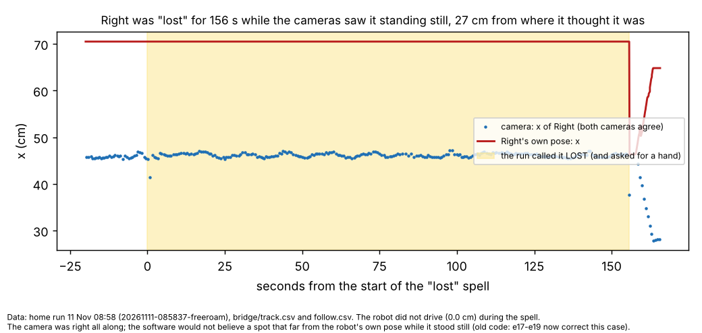
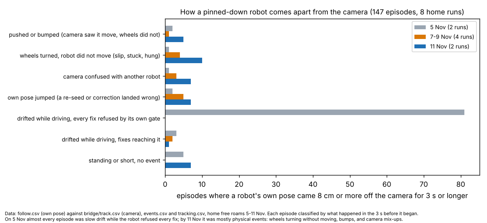
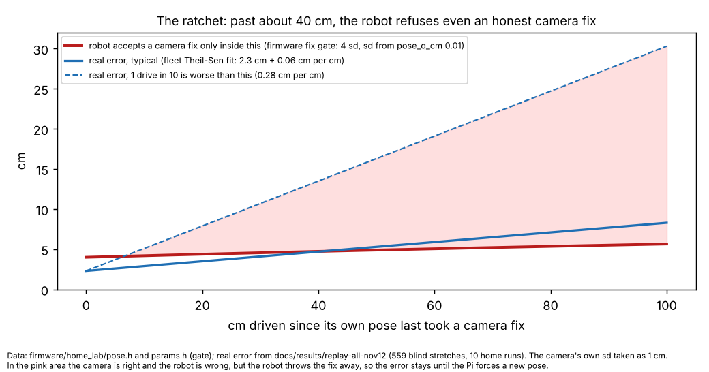

# Error and loss audit (12 Nov, logs and code only)

## Premise

Nick asked two things (12 Nov, 17:24):

1. **How do we treat error and loss today?** His model:
   - the robot keeps running while its error radius grows;
   - as the radius nears the edge, it veers away and keeps running as best it can;
   - once it is found, the radius shrinks and the run goes on;
   - if the radius grows so far that any move would push it over the edge, the robot pauses and a concerted search begins.

   Is that what the code does? He asked for an audit of everything related to error and loss.
2. **Why do we lose robots we already had pinned down?** He asked for the root cause of the cause.

What was read and run:
- The code on main at fe1459b (e19), all of it: `safety_rules.py`, `freeroam_core.py`, `run_plan.py` (missions), `odo_trust.py`, `observe.py`, the firmware's `pose.h` and `params.h`, and the simulator's robot (`freeroam_fastsim.py`, `fastsim_realism.py`).
- The logs of 8 real home free roams, 5-11 Nov.
- New scripts, in `docs/audits/2026-11-12-loss/`: `onset.py` (finds every episode where a robot's own pose came apart from the camera) and `charts.py`.

Nothing touched a robot or a Pi.

Labels used below:
- **Measured:** read from the logs or the code.
- **Claude's reading:** an interpretation.

**One caveat runs through the whole report.** The newest real run is 11 Nov, on e13b-e16 code. e17, e18 and e19 changed a lot in this area, but they have only run in the simulator and in replays. Section C6 says which findings they already address.

## Short answers

1. **Partly.**
   - The first and third stages match your model.
   - The second (veer away) happens only by accident: moves that would reach the edge are refused. Nothing steers on purpose, and missions do not veer at all.
   - The pause tests the error circle **where the robot stands**, not **every move it could make**.
   - The concerted search is a 20° wiggle, a request for a person, and a slow creep that ignores the edge rule.
   - The biggest gap is that there is **no single error radius**. Seven parts of the code each keep their own, and they disagree (section B).
2. **The camera rarely loses a robot. The software stops believing it.**
   - On both 11 Nov runs, the camera saw the "lost" robot in **98-100 % of the lost seconds**.
   - "Lost" in the code means "no camera fix accepted", not "not seen".
   - The cause chain has three links:
     1. a physical surprise moves the robot away from its own pose: a bump, wheels turning without moving, a camera mix-up between two robots, or a wrong heading;
     2. **the robot's own filter is about 6× too sure of itself, so once it is more than about 6 cm off, it throws away every honest camera fix** (the ratchet);
     3. the Pi's rules for overriding it refuse big jumps unless the robot can prove them by moving, and a standing robot can't.

   **Claude's reading, the root cause of the cause:** no part of the system holds an honest, shared measure of how wrong a robot's pose might be. The pieces that decide whether to believe the camera are the most over-confident.

## A. Today's handling against your model (measured, code at fe1459b)

| Your stage | Free roam (home, `freeroam_core`) | Missions (`run_plan`) |
|---|---|---|
| 1. Keep running while the radius grows | **Yes.** A lost robot drives on its wheels and gyro (`MIRLT_BLIND_RULE=edge`). Its bubble grows by its own record: 2.0 cm + 0.07 cm per cm, plus turns (`odo_trust`). Every plan carries the bubble along its whole path. | **Yes.** It drives its lane on its own wheels and gyro. |
| 2. Veer away as it nears the edge | **Only by elimination.** A move whose swept path would bring the circle within the clearance is refused, so the moves left tend inward. Nothing scores "away from the edge" or "toward ground the camera reads well" until the hard limit. e18's lost priority only applies outside the readable area. | **No.** The lane does not change. At the limit it drives straight back to where it was last read, else it is halted and held. |
| 3. Found: the radius shrinks | **Yes, with refusals.** A fix within 12 cm is taken. Beyond 12 cm it needs 3 fixes that move as its wheels moved, or 2 s standing with nobody else there. e19 adds an out-and-back proof drive. | **Yes.** Within 2.5-12 cm the pose is reset from the camera. Beyond that, the camera guard decides. |
| 4. Pause when any move would cross the edge | **Different test.** It pauses when bubble + half body + stop reaches the edge **at its current spot** (`blind_stop`). Then it asks a person to click it, wiggles ±20°, and (never-still) creeps toward the middle with **no edge rule** ("a fall is allowed while experimenting"). | Halt and hold that robot, others carry on, or stop everyone. |

Separate from the radius, three more holds happen:
- **"Unsure near an edge"** (`edge_judgement`): inside the clearance, and its own pose and the camera are more than 3 cm apart (chosen), or the camera is not fresh. Then a person is asked, or it takes one 6 cm step that is inward "by both the camera and its own pose", or it holds.
- **No-pictures limit:** slowed at half its limit (chosen), held at the limit.
- **ID pause:** an unnamed robot pauses while it is identified.

**Claude's reading.** Stage 4's "any move" matters more than it looks:
- A straight move toward the middle **gains** room whenever its heading doubt is under about 85°. Per cm it gains cos(doubt) minus the 0.07 cm the bubble grows.
- A turn on the spot doesn't move the circle at all.
- So under your rule, a robot only truly has to pause when its **heading** is unknown, or other robots box it in.

That is the case to design the search for, and it removes the "how slow should the creep be" question (e19 Q2) without a chosen number.

## B. Seven error radii, not one (measured)

| # | Name, where | What it adds up | Used for | Problem |
|---|---|---|---|---|
| 1 | The robot's own variance (`pose.h`, `pose_q_cm` 0.01 cm² per cm) | Grows about 0.1 × √cm: **1 cm sd after 100 cm**. Shrinks with every accepted fix. | Its **fix gate**: 4 sd, never under 3 cm | **About 6× too sure.** The real error after 100 cm is about 8 cm typical and 30 cm for 1 drive in 10. Never fitted to data. |
| 2 | `unc()` on the Pi (free roam) | 1 cm + bubble + **fix age × 10 cm/s** + own-vs-camera gap | Every edge clearance in plans | The 10 cm/s is fixed, not the robot's speed. |
| 3 | The lost bubble (`odo_trust`) | Starts at **2.0 cm** + 0.07 per cm (calibration straight drives), widened by its own checks | Blind driving, blind stop | Starts at 2 cm even when the pose was already wrong before the loss. On 08:58, **33 of 56** "seen again" errors were outside it. **11 had driven under 1 cm** but were 7-32 cm off. |
| 4 | `stated_doubt` (e19) | The larger of #2 or #3 and the record's prediction since its last agreement | How far a correction may move it without proof | Inherits #3's start. |
| 5 | The pose-fuse gap (`PoseFuse`) | Own-vs-camera distance, added at once | #2. Re-seed after 5 cm for 2 s (chosen). | Trusts whichever robot the camera labelled. |
| 6 | Plans made ahead (`TRACK_P95_CM` 1.7) | Measured cross-track error at a drive's end | Mission lanes, refusal thresholds | Fine as a plan number. |
| 7 | Missions' blind error | 2.0 + 0.07 per cm, or the record | Missions' blind stop | Same start problem as #3. |

The filter in `fused_pose.py` would be an eighth, but it is off by default.

Thresholds in this area that are still **chosen** (each could be derived as shown):

| Number | Value | Could come from |
|---|---|---|
| `fix_gate`, `pose_q_cm` (firmware) | 4 sd, 0.01 | the fleet drift record (#3's data) |
| `fix_max_age_ms` (firmware) | 1000 ms | the measured fix delay. On 08:58 the 90th percentile is 1.14 s and the 95th 1.39 s, so **about 17 % of fixes are thrown away as old**. |
| Pose history (firmware) | 1.28 s | the same delays |
| `SURE_TOL_CM` (unsure) | 3 cm | the camera's noise and #1 |
| `POSE_AGREE` (re-seed) | 5 cm for 2 s | the same |
| `REACQUIRE_MAX_CM` | 12 cm | the radius itself |
| Age term in `unc()` | 10 cm/s | the robot's own speed |
| No-pictures heading doubt / slow share | 3°, 0.5 | the gyro record / risk |
| Creep step, cautious share | 8 / 2 cm, 0.5 | dropped by A's reading |
| Off plan | 4 cm for 0.3 s | the radius |

## C. Why a pinned-down robot gets lost (measured)

### C1. The camera usually still sees it

| Home run | "Lost" spells | Lost seconds | Camera saw it in | Error found beyond the bubble | Hardly drove but more than 5 cm off |
|---|---|---|---|---|---|
| 11 Nov 08:58 (4 h) | 56 | 529 | **98 %** | 33 | 11 |
| 11 Nov 08:26 | 25 | 158 | **100 %** | 15 | 9 |
| 5 Nov 15:50 (4 h) | 211 | 283 | 61 % | 56 | 14 |
| 7 Nov 14:44 | 11,190 | 2,625 | 28 % | 642 | 29 |

"Camera saw it" = the bridge reported a sighting of that robot within each second of the spell.

Right on 11 Nov 08:58:
- It was "lost" and asking for a hand for 156 s.
- Both cameras saw it standing still at x 46. Its own pose said x 71.
- It never drove.
- The software would not accept a spot 27 cm from its own pose while it stood still, because a standing robot cannot show the camera's spot moving with its wheels.

Then the second half of the problem showed:
- Once corrected, it kept its old heading, 14°.
- It made three "inward" 6 cm steps. Its own pose went right 18 cm; the camera saw it go **left** 17 cm. **Its heading was about 180° off.** The home outline tracking cannot tell front from back.
- The camera's spot "did not move as its wheels did", so the camera was not believed again, and it went back to asking for a hand.
- The "inward by both" check uses **one** heading (its own) for both positions, so it cannot catch a wrong heading.

### C2. How the own pose first comes apart

`onset.py` finds every episode where a robot's own pose was 8 cm or more from the camera for at least 3 s. That gave 147 episodes in 8 runs. For each, it looked at the 3 s before the gap started.

| How it began | 5 Nov | 7-9 Nov | 11 Nov |
|---|---|---|---|
| Wheels turned, robot did not move (slip, stuck, hung; "did not move" or "hazard" events) | 1 | 4 | **10** |
| Camera confused with another robot (another robot within 20 cm, a close pass, a merged outline) | 1 | 3 | **7** |
| Own pose jumped (a re-seed or correction landed wrong) | 2 | 5 | **7** |
| Pushed or bumped (camera saw it move, wheels didn't; front stop or "felt a robot") | 2 | 1 | **5** |
| Drifted while driving, **every fix refused by its own gate** | **81** | 0 | 0 |
| Drifted while driving, fixes reaching it | 3 | 2 | 1 |
| Standing or short, no event found | 5 | 0 | 7 |

- On 5 Nov the robots drifted 5-8 % short of the camera's distance while their gates refused every fix (one: 434 refused, 0 used, in 72 s).
- By 11 Nov, after the Pi's forced re-seeds (e08), slow drift no longer builds up. Every episode starts with a **physical or identity event**.
- In 32 of the 37 episodes on 11 Nov, the robot refused at least one fix.

### C3. Why a small error becomes a long loss: the ratchet

- The firmware takes a camera fix only within 4 of its own standard deviations (and at least 3 cm).
- Its own standard deviation grows far slower than the real error, so the gate stays near 4-6 cm.
- Any surprise bigger than that (a bump, a slip, a mix-up, a heading 180° off) gets the camera refused **for good**. The robot never re-checks whether the camera kept saying the same thing.
- The Pi must then force a pose (`fpose`), and its own rules hold that back:
  - beyond 12 cm it needs motion proof;
  - a standing robot cannot give it;
  - a close pass blocks it;
  - "did not move as its wheels did" fires exactly when the heading is wrong.
- Separately, about 17 % of fixes arrive older than the firmware's 1 s limit and are dropped as "old". On 08:58, 14-24 % of the fixes sent to each robot were refused.
- **Claude's reading:** most of those were refused for age. The firmware does not log the reason.

### C4. The simulator cannot show the ratchet

The simulated robot (`freeroam_fastsim.fuse`) has no distance gate. It takes every fix under 1 s old at a fixed 35 % weight. So the simulator never reproduces the mechanism that turns a 6 cm surprise into a 2-minute loss.

**Claude's reading:** this may be part of why the simulator's lost spells don't match the real runs (an open item from e19).

### C5. Bumps and slips are not fed into the radius

- A front stop, a "felt a robot", a "did not move" verdict, and a hazard all are logged.
- None of them widens the error radius.
- None of them corrects the own pose from the camera or accelerometer that just showed it wrong.

### C6. What e17-e19 already change (in code, not yet on a real robot)

- **A robot named all along but beyond its gate gets corrected** (e18b `FAR_NAMED_CORRECT`, e19 motion proof). That covers the Right 156 s case's position.
- **Re-seeds never land mid-turn** (e17).
- **A standing re-seed keeps its own heading unless the camera's is better** (e18b).
  - **Claude's reading:** in the Right case that would keep the wrong 14°. Worth checking.
- **After a restart, the pose is re-sent and a heading check asked** (e19).
- **Hung robots are recovered** (e19).

Not addressed anywhere yet:
- the firmware ratchet;
- the 2 cm start of the bubble;
- the age limit;
- bumps and slips feeding the radius;
- a heading check after **every** correction;
- the simulator's missing gate.

## Conclusion

1. The code follows your stages 1 and 3. It does stage 2 only by refusing edge-ward moves, and stage 4 with a different test. Missions skip stage 2. (Measured.)
2. There are seven error radii. The one that decides whether to believe the camera, the robot's own, is about 6× too confident. (Measured.)
3. Robots are rarely unseen. They are lost because a bump, slip, mix-up or wrong heading puts their own pose over about 6 cm off, and then the robot refuses the camera. (Measured on 147 episodes.)
4. **Root cause (Claude's reading):** no single, honest, shared error radius. Fix that, and stage 2 and stage 4 can be built exactly as you described.

## What's next (proposal, needs Nick's go-ahead)

**e21, one error radius and Nick's four stages**, after e20. Estimate 4-5 h, simulator and logs only.

1. **One radius per robot**, owned by one module. Every user (plans, edge rule, pause, corrections, Mission Control) reads it.
   - It is made of: the camera's noise, plus the fleet record's growth per cm and per degree, plus measured jumps for events (bump, slip, re-seed, merge, restart), plus the live own-vs-camera gap.
   - It starts from what was already seen, not 2 cm. It shrinks only with accepted fixes.
2. **Break the ratchet on the Pi first.** When the camera's spots agree with each other, and not with the own pose, for long enough that chance can't explain it (from the camera's measured noise), the own pose is wrong: send it the camera's pose.
   - The heading comes from the robot's next short move, as seen by the camera. That catches 180° flips.
3. **Your stages, explicitly:**
   - **Run:** normal while radius + body + stop fit along the whole path.
   - **Veer:** when the radius would reach the edge within the next moves, moves are scored by room gained and by how well the cameras read the ground ahead (e20's trust map). The run goes on.
   - **Found:** the radius shrinks.
   - **Pause and search:** only when no move gains room (in practice: heading unknown, or boxed in). Then:
     - it turns on the spot (the circle doesn't grow);
     - nearby robots hold still for a few seconds, so it is the only thing moving;
     - both cameras and the detector look at that area;
     - then a person is asked.
   - No creep without the edge rule.
4. **Bumps and slips feed the radius,** and a slip seen by the camera corrects the own pose at once.
5. **Simulator:** the simulated robot gets the firmware's gate, age limit and history, plus bumps. Then the ratchet shows up in tests.
6. **Firmware, later, needs a reflash:**
   - its variance from the measured record;
   - its age limit from the measured delay;
   - a longer history;
   - the reason for each refusal logged.

   One robot at home first.

## Questions for Nick

1. Go ahead with e21 as above, after e20?
2. While one robot is being searched for, may the robots near it hold still for a few seconds?
3. The firmware part needs a reflash. Test it on one home robot when you're ready?

## Sweeps

**New tests that may be needed:**
- the simulated robot's gate and age limit;
- a 180° heading after a correction;
- a robot bumped while standing;
- wheels slipping at a hazard;
- a robot standing far off its own pose while the camera sees it.

**Possible inaccuracies:**
- `onset.py` classifies by the events in a 3 s window. One episode can have several causes, and the first matching rule wins.
- "Camera saw it" uses the bridge's own labels, which can be wrong in merged outlines.
- The ratchet chart takes the camera's sd as 1 cm.
- The 17 % older than 1 s comes from one run's percentiles.
- The real runs predate e17-e19.
