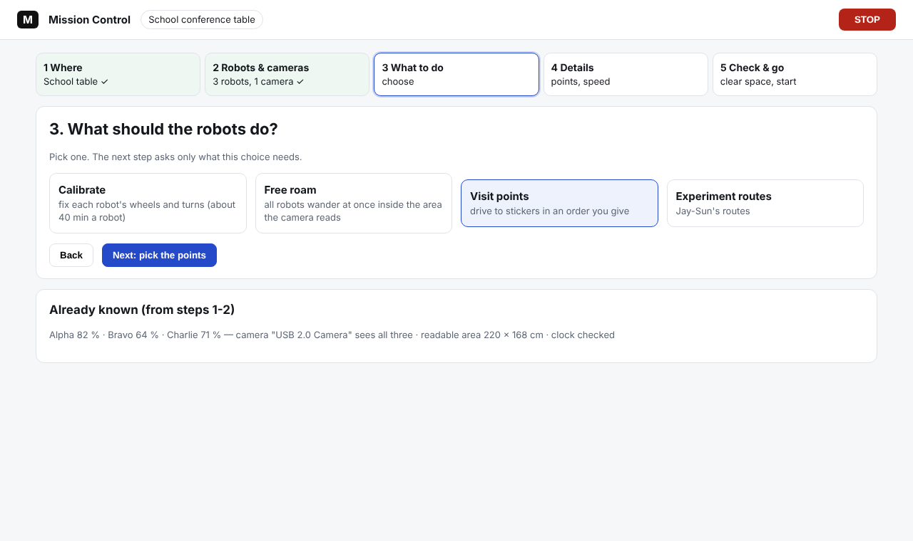
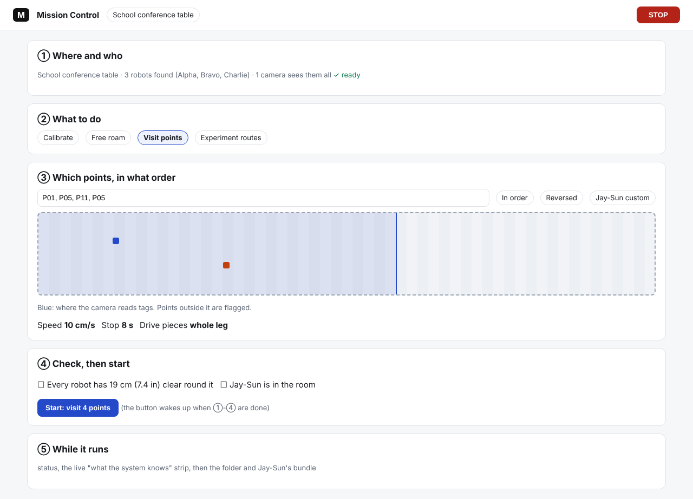
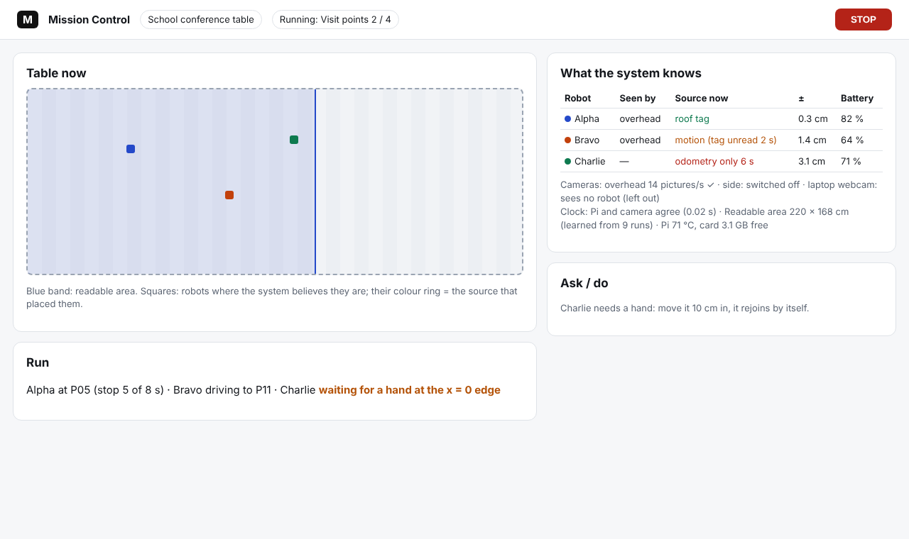

# Mission Control: audit and three redesign directions (IDEAS ONLY, build e13, 10 Nov 2026)

Nick (10 Nov): the page is "a bit backwards" (the button to start a run comes before the option to pick your points);
everything should come in a natural order, Mission Control should be "warmed up" so it feels intuitive, and it should
show live what data is available and being used. **Nothing is rebuilt until Nick chooses a direction.**

Premise: the page was walked in practice mode (school site, simulator) with Playwright; every screen is in
`docs/screenshots/2026-11-10/audit-*.png`. Data: those screens and the page's code (`mission_control.html`,
`start_job.py`). Conclusion and the choice for Nick at the end.

## 1. Problems found

| # | Problem | Where (picture) |
|---|---|---|
| P1 | The four run buttons (Calibrate, Free roam, **Visit points**, Experiment routes) come **before** "Visit points in your order", so the natural first click starts the shared-out tour before the person has picked points | `audit-01-start-screen.png` |
| P2 | The five-question quiz sits above the run buttons on a first visit: the most important controls are a long scroll down | `audit-01-start-screen.png` |
| P3 | Nothing on the Start screen says what the system can see right now: which cameras, which robots, tags or not, the readable area, clock, batteries (only words "Practice: 2 simulated robots") | `audit-01-start-screen.png` |
| P4 | The overhead picture beside the points map is a broken image until a model exists ("no camera model for overhead yet"), with no button that fixes it from there | `audit-01-start-screen.png` |
| P5 | Two parallel worlds: the Start screen, and Details' tabs (1 Connect, 2 Cameras & table, 3 Production, 4 Run, 5 Review) that do the same things another way; a person cannot tell which one a run uses | `audit-04-details-on.png`, `audit-20...25` |
| P6 | Cameras & table: "Recording in step" and "export and compare" (a post-run task) sit on the setup screen; Measure is in the side column, away from the pictures it needs | `audit-22-details-2-cameras---table.png` |
| P7 | The Run tab shows engineering fields (`sim_true_objects`, `improve_budget_s`, `sim_washout`...) at the same level as the run's real choices | `audit-24-details-4-run.png` |
| P8 | Phone width: the run buttons and the points map need long scrolling; STOP stays visible (good) | `audit-03-start-screen-phone.png` |
| P9 | What happens after a run (the folder, Jay-Sun's bundle, the robots asleep in 10 min) is only words in the status box | (status box, not running in the audit) |

## 2. Three directions

### A. Guided steps ("wizard")

Five steps across the top: Where, Robots and cameras, What to do, Details (only what that run needs: points for Visit,
minutes for Free roam), Check and go (the clear-space confirm, attended, start). Each step says what it found and can
be revisited.

- **Fixes** P1, P2 (the quiz becomes step 1's defaults), P5 (one path), P9 (a sixth "After" step).
- **Costs** about 1.5-2 days: a new page shell, the four run kinds re-plumbed into steps, Details kept behind a
  switch (keep features). Slower for an expert who knows what they want (mitigated by "Run again as last time").

### B. One page, top to bottom

The same Start screen, re-ordered into numbered sections that read in the order you do them: ① where and who
(found), ② what to do, ③ its details (the points map and order for Visit), ④ check and start (the start button last,
asleep until ①-③ are done), ⑤ while it runs and after.

- **Fixes** P1, P2, P8 (sections collapse on a phone), P4 (the picture placeholder offers "Measure now").
- **Costs** about 0.5-1 day: mostly moving existing blocks; Details stays as it is (P5 remains).

### C. Cockpit with a live data panel

Left: the table now (readable area shaded, robots where the system believes they are, each ringed by the source
that placed it) and the run. Right: the live **"What the system knows"** panel (below), and an Ask/do box (questions,
"needs a hand").

- **Fixes** P3 and P9 fully; with B's order for the setup it fixes P1 and P2 too.
- **Costs** about 2-3 days: the panel needs a small status feed from the runs (most of it is already in files:
  `sources.csv`, `state.json`, `frames.json`, `coverage.json`, the readability map, battery rows).

## 3. The live "What the system knows" panel (for B or C)

One row per robot, one strip per camera, then the run-wide facts; refreshed every second from files the runs already
write (new in e13 where marked). Colour words, never colour alone.

| Part | Shows | From |
|---|---|---|
| Robot row | name (and WiFi name), seen by which cameras, **source now** (roof tag / lock-on / motion / detector / odometry only, and for how long), position +- (95 %), battery % and its trend, state (moving, stopped at P05 3 of 8 s, waiting for a hand, held: no pictures) | `sources.csv` (e13), the run's `state.json` / `motion.csv`, `battery.csv`, `edge_parked.json` (e13 needs-a-hand) |
| Camera strip | each camera found: new pictures a second, last picture age, its role (found vs typed), robots it sees, light level; "sending no pictures" in red with the recorder hint | `bridge/frames.json` (e13), `coverage.json` (e13 discovery) |
| Readable area | the shaded area on the map, cm2, and how it was learned (seed, runs) | `readmap_start.json`, the site's `readmap.json` |
| Clock | Pi vs camera clock difference, internet time set or not | `clock.csv`, the sync card's status |
| Tags | roof tags read per robot this minute; reference tags read (camera not bumped) | `tag_poses.csv`, `ref_watch.csv` |
| Detector | off / on with the model's date, detections a second | `sources.csv` ml column (e13) |
| Pi | temperature, card and stick space, the sleep timer after the run (e13: "robots asleep at 14:32 if no new run") | heat tracker rows, diskguard, `run_activity.json` (e13) |

## 3b. Asking a person for a hand: the click card (built in e13, to fold into whichever direction)

When a robot holds because its error sum could reach an edge, a red card goes to the top of every screen: the robot's
name, why it holds, each camera's live picture with its last known spot ringed; one click on the robot places it; after
its safe straight drive the card shows each camera's picture at the first click beside the live one for the second
click (its heading), and offers the motion detector's spot to confirm; "put it on a sticker" picks a point when no
camera shows it. Picture: `../screenshots/2026-11-10/e13-feature-click-heading-second-click-card.png`. In direction C
it belongs in the "Ask / do" box; in A and B as a banner above the steps. Open design points: the card on a phone (two
pictures per camera are small: one camera at a time with a switch), and a sound when it appears.

## 4. Recommendation (Claude's reading) and the choice for Nick

Claude's reading: **B now, then C's panel added to B** (about 1 day + 2 days). B fixes the "backwards" order with the
least change to a page Nick and Jay-Sun already use; the panel is the part Nick asked for that no ordering fixes. A
is cleanest but rebuilds the most and hides the expert path.

Options for Nick: **A**, **B**, **C**, or **B then C's panel**.

## Sweeps

New tests that may be needed: a Playwright walk of the chosen design in practice and with a real Pi (Jay-Sun at the
table); the panel's refresh under a 10-minute run (CPU on the Pi).

Possible inaccuracies: the audit was in practice mode with the school site only (home's Start screen differs a
little); the running-status screen was not captured (no run was started during the audit); the cost estimates are
Claude's guesses (this repo's time tracker shows estimates running 3-8x long).
