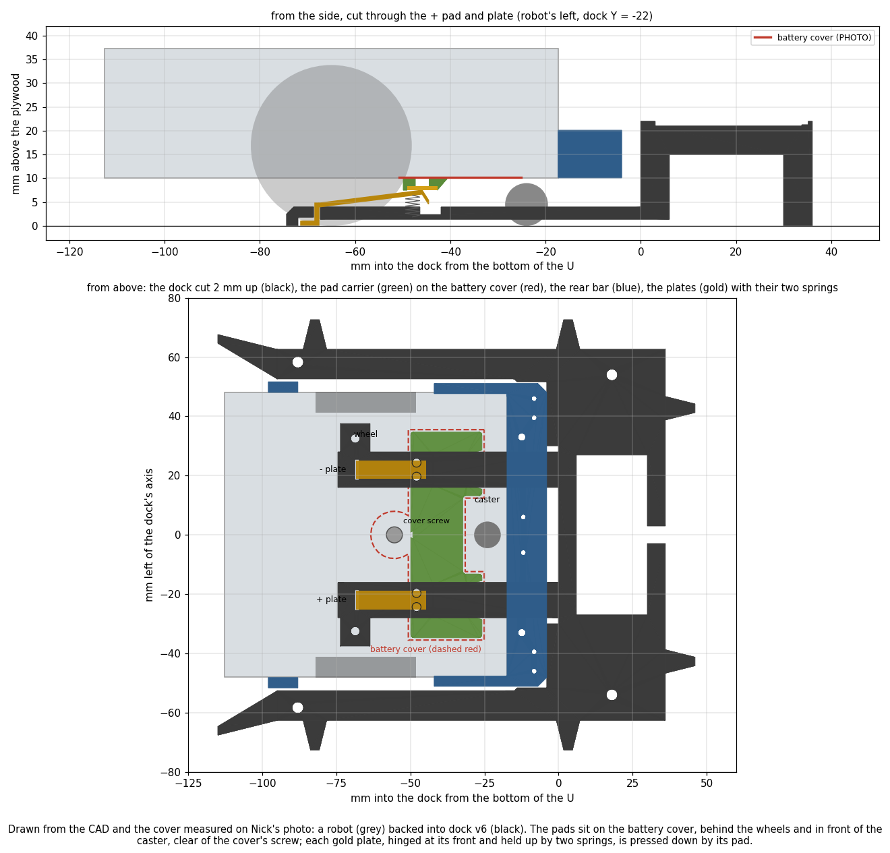
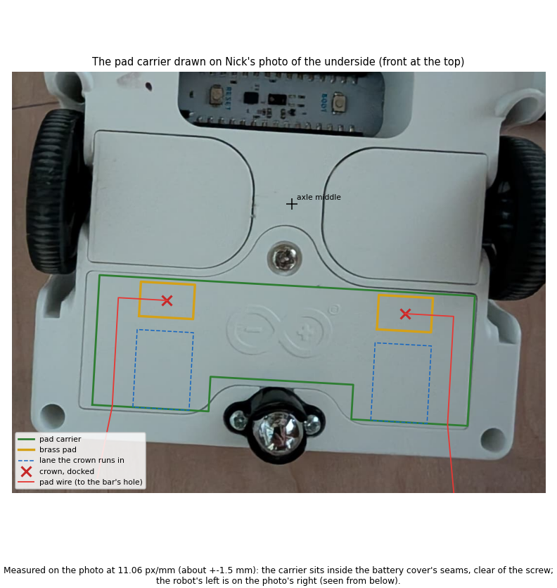
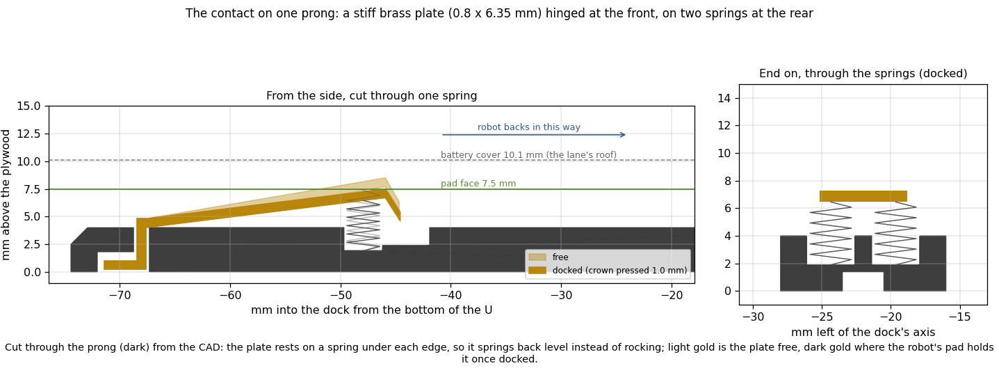
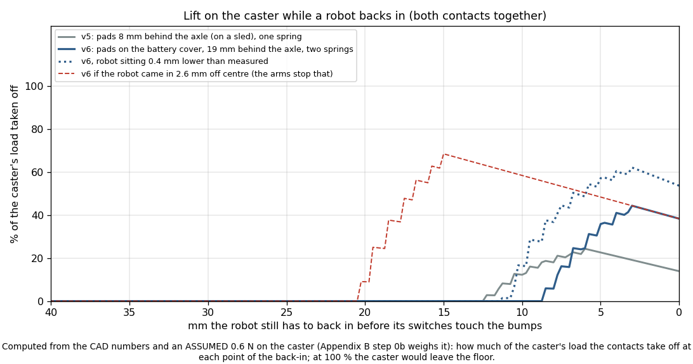

# Self-charging dock: dock v6 (pads on the battery cover, two springs per plate), charge levels that adapt

Written 2026-10-25 (v6: after Nick's decisions at 13:03). Nothing here is built or bought yet.
CAD: `hardware/dock/build_dock_v6.py` (v5 and earlier kept). Battery: `tools/dock/battery_rates.py`. Levels:
`tools/dock/charge_levels.py`. Runner hookup: `tools/experiment/e02.py` (`charge_levels_tick`), live view
`tools/experiment/e02_view.py`. Tests: `tools/dock/tests/` (23), `tools/experiment/tests/test_e02_charge_levels.py` (4).
v5 (pads on a sled 8 mm behind the axle, one spring per plate) is in Appendix D.

## Premise

Standing decisions: one dock for now; robots charge on their own, aiming at 24/7; a cut-down USB-C plug in the Nano's
port wired to two pads under the robot; one attachment at the BACK; robots back into a U; the contacts are stiff
brass plates hinged at the front and sprung at the rear (a ramp); the dock carries the system's known length.

Nick's decisions, 13:03:
1. **The pads go on the battery cover** (behind the wheels, in front of the caster), so they come off with it. The
   cover's centre screw stays clear. No drilling the cover unless unavoidable.
2. **Two stiffer springs per plate,** one each side, so the plate doesn't wobble.
3. **The U may widen slightly at the mouth** if it helps the first approach.
4. **Find the cause of the misleading battery fit** (driving drain below standing drain), fix it, say which to trust.
5. **Charge levels adapt automatically** as battery data comes in. No switching robots off by hand, ever. Hook the
   learner and levels into the runner, simulator first.
6. Parts: 1/32 × 1/4 in brass strip, a small spring assortment; no calipers (steel rule, pennies, paper).

## Data

**The battery cover**, measured on Nick's underside photo (`docs/hardware/photos/alvik-underside-2026-10-25.png`) at
11.06 px/mm (the wheel centres 89.2 mm apart). Check: the caster lands within 1.2 mm of Arduino's CAD. About ±1.5 mm.

| | Behind the axle (mm) | Across |
|---|---|---|
| Front seam (beside the screw's tab) | 14.3 | |
| Screw (in a tab of the front edge, seam about 8 mm round it) | 9.6 | centre line |
| Caster notch in the back edge | from 33.5 back | ±12.4 |
| Back seam | 39.9 | |
| Width | | 71 (±35.5) |

**Battery readings:** 6 sessions (2026-10-23/24), 3 robots, about 100 one-minute readings each, 3.5 h standing and
0.8-1.0 h driving per robot. Fitted all together, three ways:

| Robot | Old fit: one rate, sessions joined | One rate, sessions not joined | **Fixed: a base per session + shared driving extra** |
|---|---|---|---|
| Center | still 16.1, moving **11.4** | 15.5, 13.2 | still **14.8 ± 0.7**, moving **18.4 ± 1.9** (extra 3.6 ± 1.8) |
| Left | 17.5, **10.3** | 16.6, 13.6 | **15.8 ± 0.4**, **19.5 ± 2.2** (extra 3.7 ± 2.2) |
| Right | 14.0, **13.4** | 13.9, 13.6 | **13.1 ± 0.3**, **18.7 ± 2.3** (extra 5.6 ± 2.2) |

<sub>%/h ± one standard error, inflated for the readings' correlation in time. `python tools/dock/battery_rates.py
--diagnose`.</sub>

- **Each session's standing drain differs:** Center 13.5-15.4, Left 15.0-16.4, Right 12.2-13.5 %/h over its 4
  sessions.
- **Every session drives about the same share of the time:** 16-27 %.
- **The fixed fit fits to the gauge's own resolution:** residual 0.27-0.29 % (rounding to whole % alone gives 0.29),
  no correlation left between neighbouring minutes (the old fit: 0.10-0.34, a sign it was missing something).
- **No long lag in the reading:** shifting the driving times 1 min later fits as well, 5-10 min later fits worse and
  drives the extra towards 0.

**Approach accuracy (for the mouth):** at the end of a route, calibrated robots were 1.37 cm off on average (n = 8),
calibrated with camera fixes 2.65 cm (n = 7; E02 session 1). The camera itself sees about 3.1 px/cm, and the learned
uncertainty after a fix starts at 0.5 cm + 1 % of the distance driven.

## Conclusion: the design (v6)


*A robot (grey) backed into dock v6 (black): the pad carrier (green) sits on the battery cover (dashed red), clear of
its screw, and each gold plate on two springs is pressed down by a pad.*


*The pad carrier, pads, crown lanes and pad wires drawn over Nick's photo of the underside at its measured scale: the
carrier sits inside the battery cover's seams.*

**Pad carrier v6** (`stl/pad_carrier_v6.stl`, 24 × 69 × 2.4 mm), replaces the v5 sled:
- **Sits on the battery cover** with thin double-sided tape, 0.8 mm inside its seams, notched round the caster. The
  screw's head stays 2.8 mm in front of it. A notch on the carrier's front edge lines up with the screw.
- **Pads from the same brass strip:** a 10 mm piece of 1/4 in strip laid across the robot (6.35 mm along it), 0.8 mm
  thick, glued into a recess. Its middle is **19.1 mm behind the axle**. The crown lands there when docked, so the
  real seam may sit 2.2 mm off the photo's either way before the crown leaves the pad.
- **Lanes** as v5 (the crowns pass under the robot touching nothing until the last 8.5 mm).
- **Wires:** 30 AWG soldered to each pad's back before gluing; the joint sits in a 3 mm hole. A channel on the
  carrier's top runs to its back edge at ±31 mm. Then 14 mm taped along the robot's underside, and up through
  attachment v5's holes at ±33 mm (6 mm outboard of any crown). **A 2-pin plug above the bar** (two Dupont jumper
  ends) lets the cover come off with its pads. From there, as before, to the cut USB-C plug at the Nano's front left.

| How to fix the pads to the cover | Verdict |
|---|---|
| **Printed carrier on thin double-sided tape** | **Chosen:** no drilling, the cover stays removable, the carrier sets the pads' height and lanes |
| Carrier clipped round the cover's edges | The cover sits flush in the body with a hairline seam: a clip there stops it seating |
| Under the cover's screw (longer screw) | Covers the screw (Nick: keep it clear), needs a non-stock screw |
| Glue / epoxy | Works, but the carrier can never move if a pad needs shifting |
| Adhesive copper or brass tape straight on the cover | Pads at the underside's height: the crowns would rub the cover all the way in. The tape's edge peels under a sliding crown |

**The contact:** as v5 (stiff 1/32 × 1/4 in plate, hinged at the front, lip at the rear), now on **two springs side
by side under the plate's edges** (2.35 mm either side of its middle, a 1.2 mm printed wall between their pockets).


*One prong cut lengthwise through a spring, and end on through both springs: the plate rests on a spring under each
edge, so it springs back level instead of rocking.*

| Springs | Verdict |
|---|---|
| **Two side by side under the plate's edges** | **Chosen:** one plate, no soldering, 12 mm prongs as v5 |
| Two outboard, under a cross-piece soldered across the plate's rear (a T) | About 6.5 times stiffer against rocking, but needs soldering brass to brass and 16 mm prongs. The upgrade if the plates still rock |
| Preloaded springs held down by a hooked lip | Near-constant force whatever the height, but needs an undercut and fiddly fitting |
| One stiffer spring | Doesn't stop the rocking |

**Force budget** (pads now 19 mm behind the axle, against v5's 8):

| | v5 | **v6** |
|---|---|---|
| Springs | one, 0.20 N/mm | **two, 0.15 N/mm each** (0.30 together) |
| Stiffness at the crown; press docked | 0.165 N/mm; 1.3 mm | **0.247 N/mm; 1.0 mm** |
| Force per plate, docked | 0.21 N | **0.25 N (25 g)** |
| Lift on the caster, docked | 14 % | **38 %** |
| Most lift while backing in | 24 % | **44 %** (crown meets the pad's back edge, 22 mm behind the axle) |
| Robot 0.4 mm lower than measured | | 54 % docked, 62 % at most |
| Robot 1.0 mm lower | 25 %, 43 % | 77 %, 90 % (the paper-stack check exists to catch this) |
| Robot 0.6 mm higher | | still pressed 0.4 mm (0.10 N) |
| Resistance to rocking | none (one spring) | 0.03 N mm per degree: a 5 g push on one edge tilts the free plate about 5° (with the T below: under 1°); docked, the pad holds it flat |


*The share of the caster's load the two contacts take off at each point of the back-in, from the CAD numbers and the
ASSUMED 0.6 N on the caster; at 100 % the caster would leave the floor.*

<sub>Lift = force × distance behind the axle ÷ 41 mm ÷ 0.6 N. The pads moved 11 mm further back, so the same force
lifts 2.4 times as much. 1 mm of press with the stiffer springs keeps the force near v5's and the change smaller when
the robot sits a little off its measured height.</sub>

- **The cost of the cover:** about 3 times v5's lift, still under v3's 59 %. It rests on the ASSUMED 0.6 N on the
  caster: weighing it (Appendix B, step 0b) turns every percentage into a measured one.
- Free crowns pass 1.6 mm under the cover and the bar. Springs 5.5 mm free, 2.6 mm at the stop (solid about 2).

**Mouth: widened to a 20 mm chamfer opening 12 mm each side** (catches 13.5 mm off centre; v5: 8.5).

| Option | Catches | Verdict |
|---|---|---|
| v5's 10 mm chamfer, 7 mm each side | 8.5 mm | Below a robot's typical 1.4-2.7 cm end-of-route error: unless it takes a fresh camera fix at the staging point, a first approach often meets an arm's end |
| **20 mm chamfer, 12 mm each side** | **13.5 mm** | **Chosen:** catches a robot staged with a fresh camera fix (about 0.5 cm + 1 % of the 20-30 cm back-in) with room to spare, and a fair share of the unfixed ones; the arms stay straight (±1.5 mm) for 27 mm before a crown reaches the carrier; 10 mm longer, the arms' ends flare 5 mm out |
| The whole arm tapering to the mouth | 15+ mm | The robot would still be up to ±2 mm off when the crowns enter their lanes (2.0 mm margin): too tight |
| v4's 50 mm funnel | 32 mm | Nick chose short (10:39); a long funnel erases the approach error the gyro wants to log |

**Dock v6** (`stl/dock_v6.stl`, 161 × 145 × 22 mm, one print, bottom down, brim on): v5 with the crowns at dock
X −45.9 (under the cover's pads), two spring pockets per prong, the wire groove under the prong's middle, the wider
mouth. Bumps, post stations, marker strip, pocket and firmware numbers: as v5. All post-station checks pass. Attachment
and marker strip: v5's files, unchanged.

## Conclusion: battery fit and charge levels

**Why driving looked cheaper than standing:** the old fit used **one standing rate for every session**, but each
session's standing drain differs by 1-3 %/h. Robots drive 16-27 % of the time, at much the same share every session,
so the fit could trade the two rates against each other. It pushed the sessions' differences into the driving rate,
magnified about 4-5 times (one over the driving share). Joining the 24th's stages into one stretch, with the gaps
counted as standing, added the rest.

Ruled out with data: the reading's lag (no lag beyond 1 min), the whole-% rounding (the fixed fit's residual is the
rounding itself) and robot-to-robot battery differences (each robot is fitted on its own). The moving/still labels
come from the wheel speeds in the robot logs, not from `battery.csv`. Not separable with these logs: why a session's
standing drain differs (battery level, temperature, what the firmware streamed all change together).

**Fixed** (`battery_rates.py`): each session starts its own stretch; each session gets its own standing drain (its
"base"), and driving's extra cost is shared. **Trust the fixed numbers:** driving costs 3.6-5.6 %/h on top of
standing, so moving is 18.4-19.5 %/h and standing 13.1-15.8. They agree with the session-by-session fits pooled
(17.8-19.3 moving).

**The levels now adapt on their own** (`charge_levels.py`, `battery_rates.BatteryModel`):
- **Drains:** this session's own standing rate after 0.75 h of data; until then the robot's earlier sessions; until
  then the fleet default. **Moving = the standing rate in use + driving's extra,** pooled over all sessions so far, so
  moving follows today's standing drain from the first hour. Asleep: learned from robots sent to sleep.
- **Charge curve:** learned from the robots' charging (rate below the knee, and the knee where the rate drops below
  70 %) once there is 0.25 h of it. The leave level is the learned knee. Until then: the PLACEHOLDER 40 %/h to 80 %.
- **Margins shrink with data:** each drain is used at its rate + 2 standard errors, and the errors fall as hours add up.
- **Resting means asleep** (the firmware's `sleep`). Robots are never switched off by hand.

**Levels on the logs now** (all six sessions as history, nobody at the dock, PLACEHOLDER charge curve):

| Robot | Go | Leave | Before the fix | Capacity check |
|---|---|---|---|---|
| Center | **48 %** | 80 % | 52 % | 3.1 robots: ok |
| Left | **51 %** | 80 % | 54 % | 2.9 robots: rest one |
| Right | **49 %** | 80 % | 49 % | 3.2 robots: ok |

**Runner hookup** (simulator first; `e02.py`):
- The battery watch (every `--battery-watch-s`, at most every 5 min) calls `charge_levels_tick`.
- It refits from `battery.csv` and the log (cheap: no robot logs), saves the history (`logs/battery_learned.json`;
  dry runs `battery_learned-dryrun.json`), and puts each robot's go, leave, drains and their sources into
  `e02_state.json` `charge_levels`.
- It logs a line when a robot's go level moves a point, and prints "drains faster / slower than before".
- `battery.csv` now says `asleep` for robots sent to sleep, and a new last column `moved_s` gives the seconds each
  robot drove since its previous row. **Why:** replaying a finished dry run showed that `battery.csv` alone (what
  the runner has live) caught only 7 % driving against the true 22 %. That read the simulator's standing drain as
  6.9 %/h against its true 3. With `moved_s` rebuilt for that run, the live fit gives 1.0-2.8 standing and
  22-26 driving, as the robot logs do (the simulator: 3 and 20).
- **Live view:** each robot card shows "dock: go at N %, leave at M %" with the drain, and both levels as dashed
  lines on the battery line.
- The runner does not yet send robots to the dock: no dock is built.

## What's next

1. **Nick, before printing:** measure the battery cover and weigh the caster (Appendix B, step 0); tell Claude if a
   number is off by more than 1 mm (the carrier and crowns move with it).
2. **Order and print** (Appendix F): dock v6, pad carrier v6, attachment v5, marker strip v5. Pick the springs (penny
   test), fit the carrier and contacts, paper-stack check.
3. **Bench test 1 (charge curve) and the sleep-drain test.** The levels pick both up by themselves. Then
   `python tools/dock/charge_policy_sim.py --compare --learned` decides plain, top-up or rest.
4. **A real session** with `--battery-watch-s 300 --sleep-idle 10`: check the levels on the robot cards and that the
   asleep robot's drain is learned.
5. Bench tests 4-8, then the firmware (back-in `charge` run, docked guard, sense pin) and the runner sending robots to
   the dock at their go level, with a fresh camera fix at the staging point before each back-in (the mouth catches
   13.5 mm).

---

## New tests that may now be needed
1. **Cover measurement and caster weight** (step 0): the pads' position and every lift figure rest on them.
2. **Tape holds:** the carrier on the cover after 50 back-ins and one cover removal; pads still flush.
3. **Back-in with the cover pads, 20 times** (bench test 6): caster lifting near the 44 % peak, a crown catching the
   ramp, the carrier's lane edges.
4. **Plate rocking:** press one edge of a free plate with a fingernail; it should spring back level. If it stays
   tilted, the T cross-piece.
5. **Contact resistance at 0.25 N** (meter on pad and plate, docked, unpowered; then the plug's voltage at full
   charge current).
6. **Mouth catch:** back-ins from 0 / 7 / 13 mm off centre and 0 / 5° (bench test 6's DOE).
7. **Battery learner on a long session:** a 2-hour session; the driving extra's error should fall below 2 %/h, and
   the runner's levels should match `python tools/dock/battery_rates.py --levels` on the same folder.
8. **Charge-curve learner on real charging** (bench test 1's log through `learn_charge`): rate and knee against the
   USB meter.
9. **Dry run with the hookup** (`--battery-watch-s 20`, a 1-hour run so the session's own rates take over):
   `charge_levels` in `e02_state.json`, the levels on the cards, the learned drains near the simulator's 3 and 20 %/h.
   Not run yet: another agent's dry-run grid held the simulator's ports.
10. Carried over: marker bump check with the strip, the dock as the scale, back-in docking in the simulator.

## Possible inaccuracies
- **Battery cover position and size: PHOTO** (±1.5 mm, one photo with a little perspective). The pad has 2.2 mm of
  margin.
- **Caster load 0.6 N: ASSUMED.** Every lift % scales with it.
- **Underside 10.1 mm: Arduino's CAD.** ASSUMED: the cover is flush with it. Tape thickness 0.2 mm: ASSUMED. The
  paper-stack check measures the real pad height.
- **Springs 0.15 N/mm, 3 mm across, solid at 2 mm: ASSUMED** until picked.
- **The lift model:** rigid plate turning about its hinge, rigid robot; friction, the plate rocking and the carrier
  flexing are left out.
- **Battery:** standing and driving fitted from about 1 h of driving per robot. The driving extra is assumed the same
  every session (its pooled error is wide, ±6 %/h, because each session's own is noisy). The robots' "still" may
  include motors held by the controller.
- **`moved_s` counts the runner's legs and runs,** every 2 s. Firmware moves the runner does not know about would be
  missed; the robot logs' wheel speeds replace it after the session. Older `battery.csv` files (no `moved_s`) fall
  back to the half-the-interval guess.
- **Charge curve and sleep drain: PLACEHOLDERS** until the robots charge or sleep. The learner's knee rule (70 %,
  5 % bands) is untested on real charging.
- **Approach error 1.4-2.7 cm:** end-of-route errors, 7-8 runs each from one session; the back-in into the dock
  is not measured yet.
- **Chosen numbers**, each with whether a DOE should set it (rows in `docs/doe-backlog.md`):
  - Press 1 mm, spring 0.15 N/mm each, pad 19 mm behind the axle: **yes**, as v5's DOE (2 spring rates × 2 crown
    heights × 20 back-ins), now with the caster weighed.
  - Springs' spacing (1.2 mm wall): no (the smallest printable wall).
  - Carrier inset 0.8 mm, pad 10 mm across: no (seam clearance; covers the arms' play).
  - Mouth 20 mm × 12 mm: **yes**, bench test 6 from 0 / 7 / 13 mm off.
  - Driving extra default 4 %/h: measured, not chosen.
  - Charge-curve learner (70 % knee rule, 5 % bands, 0.25 h before use): **yes, logs-only** on bench test 1's charge
    log against the USB meter.
  - Levels refit every 5 min at most: no (display freshness).

---

## Appendix A: geometry report (`python hardware/dock/build_dock_v6.py`: 0 FAIL, 1 WARN)
- WARN (for comparison only): a robot 2.6 mm off centre would drag a crown under the carrier's plastic: up to 68 %
  lift (the arms hold it to 1.5).
- Carrier 24.0 × 69.4 mm, 0.8 mm inside the seams; lanes 15.2-28.8 mm out with 2.0 mm to the caster notch and 1.2 to
  the wire channel.
- Spring pockets 3.5 mm across, 1.2 mm wall between, 1.9 mm to the prong's sides; wire groove 0.5 mm under them.
- When the caster reaches the prongs' tips, the bar is 21 mm into the U: the ball misses them by 10 mm or more.
- Arms' ends flare 5 mm out from X −95; a robot on a side station (its bar to X −91) never reaches them.
- Print: dock bottom down, brim on (2191 mm² faces down: cavity roof and grooves, short bridges); carrier top face
  down, no supports.
- Crowns at dock X −45.9, Y ±22; prong tips X −74.4; mouth X −115. Firmware and map numbers as v5 (bumper face
  6.10 cm behind the axle, switches ±4.27 cm; docked, the axle 6.5 cm from the bottom of the U).
- Previews: `preview/dock_v6.png`, `docked_v6.png`, `contact_v6.png`, `lift_v6.png`, `carrier_v6.png`,
  `carrier_on_photo_v6.png`.

## Appendix B: build steps

**Step 0: measure before printing** (robot switched off, upside down on a towel; steel rule).
0a. **The battery cover.** Lay the steel rule along the robot, across the middle of one wheel's hub. Read the distance
   from the hub's centre back to the cover's front seam, beside the screw's tab (expect 14.3 mm, about 9/16 in). Then to
   the cover's back seam (expect 39.9 mm, about 1 9/16 in). Then across the cover from side seam to side seam (expect 71
   mm, about 2 13/16 in). Write the three numbers down. If one differs by more than 1 mm, send them to Claude.
0b. **The caster's load.** Robot right way up, attachment on. Put the kitchen scale under the caster and a stack of
   books or cards under the wheels so the robot sits level. Zero the scale first with nothing on it. Read the grams.
   Expect about 61 g (0.6 N). Send the number.
0c. **How the cover comes off:** take out the screw and lift the cover. Note whether its back edge hooks under the
   body. Put it back.

**Make the files** (only if a number changed). Open a **Terminal window on the laptop** in the project folder, type
this and press Enter:

```
python hardware/dock/build_dock_v6.py
```

You should see lines starting `ok`, one starting `WARN`, and none starting `FAIL`.

**Print** (PLA, 0.2 mm layers, 4 walls, 20 % infill; do not rotate the parts in the slicer):
1. `dock_v6.stl`: bottom down, brim on, black.
2. `pad_carrier_v6.stl`: as exported, no support.
3. `attachment_v5.stl`: upside down as exported, supports on.
4. `marker_strip_v5.stl`: white; filament change (M600) at 1.2 mm.

**Picking the springs** (four alike, two per plate; kitchen scale, zeroed; a flat stick). Choose from the assortment
springs about 3 mm across (2.5-3.0) and 5-7 mm long; the box's chart lists both. Stand one spring upright on the
scale. Press it down with the stick until it is as tall as a stack of **3 pennies** and read the grams. Press further,
to **2 pennies**, and read again. **The second reading minus the first should be 17-30 g** (that is 0.11-0.19 N/mm).
Pick four whose differences are within 3 g of each other.

**Paper-stack check** (as v5; a US penny is 1.52 mm, printer paper about 0.1 mm a sheet):
1. **Clearance:** 6 pennies under the cover beside a pad's place, add sheets until the robot just lifts. Expect 10.1
   mm (6 pennies + 10 sheets).
2. Fit the carrier (Robot side, below), then the **pad height:** 4 pennies + sheets under one pad. Expect 7.5 mm (4
   pennies + 14 sheets).
3. **Crown height = pad height + 1.0 mm,** and at least 0.8 mm under the clearance.
4. **Set each crown** with two equal stacks and a ruler across, as v5. Crown too low: a paper disk under **both**
   springs. Too high: snip a quarter turn off **both**.
5. **Docked check** (power off): back the robot in by hand until both switches click. A sheet of paper under the
   caster must be pinched.

**Robot side** (each robot):
1. Cut two 10 mm pieces of the 1/4 in brass strip (the pads). File the edges smooth.
2. Solder 15 cm of 30 AWG silicone wire to the middle of each pad's back: red for the pad on the robot's left (the
   side the USB plug is on), black for the other.
3. Glue each pad into its recess on the carrier's underside (superglue, thin film), wire up through the hole. Run a
   fingernail across: it must not stick out. Press the wires into the channels on the carrier's top.
4. Cover off (step 0c). Clean its outside with a little rubbing alcohol. Stick thin double-sided tape on the
   carrier's top, around the channels. Line the carrier's front notch up with the screw hole, its edges parallel to
   the cover's, and press it on for 30 s.
5. Put the cover back. Tape the two wires flat along the underside to the bar's holes at ±33 mm (electrical tape).
   Thread them up through attachment v5's holes.
6. Above the bar: a 2-pin plug (two Dupont jumper ends) in each wire, then the SS34 diode in the red wire (striped
   end towards the plug), the sense resistors and the cut USB-C plug, as before (Appendix C). Route to the Nano's
   USB-C port at the front left along the cable clips.

**Dock side** (each contact):
1. Cut 31.5 mm of the brass strip. Bend 7 mm at one end down 90° (4 mm through the prong + 3 mm foot). Bend the last
   2.5 mm at the other end down about 60° (the lip). Round the lip's outside with a fine file.
2. Solder 10 cm of 30 AWG silicone wire to the foot.
3. Drop a spring into each of the two pockets (a dot of superglue on each bottom end).
4. Push the tab and wire down through the slot. Turn the dock over, bend the foot flat towards the mouth into its
   recess, and lay the wire in the groove under the prong's middle.
5. Turn the dock back: the plate's rear rests on both springs. Press one edge, then the other: it should spring back
   level both times.
6. Wire the charger (PTC fuse in red, red to the + plate under the dimple). **Polarity check:** charger plugged in,
   meter on DC volts, red probe on the + plate, black on the −: about +5.0 V.
7. Screw the dock down (four holes and the two prong tabs). Leave 25 cm clear in front of the mouth.

**Bench tests** (unchanged): 1 charge curve; 2 robot's 5 V on battery; 3 cut plug through the meter; 4 dock short
test; 5 force and caster pinch; 6 20 back-ins; 7 one supervised full charge; 8 runner trial.

## Appendix C: how the Alvik charges, and electrics (research 2026-10-24/25)

| Question | Answer | Source |
|---|---|---|
| Battery | One 18650 Li-ion cell, 2500 mAh, 3.0-4.2 V | [DS] §2.3; tech-specs.yml |
| Charge port | The Nano ESP32's USB-C (front left, Nick's photo); charging comes in on VBUS | [Hackster](https://www.hackster.io/glowascii/first-steps-with-the-arduino-alvik-robot-kit-f229bb); [CNX](https://www.cnx-software.com/2024/05/14/arduino-alvik-is-a-3-wheel-robot-designed-for-steam-education/) |
| Charger chip | MAX17332 (charger, fuel gauge, protector) plus LTC4360 protection | [DS] §2.3.1; [Analog Devices](https://www.analog.com/en/products/MAX17332.html) |
| Charge current | Not published | bench test 1 |
| Switched off / on | Charges either way | [docs commit](https://github.com/arduino/docs-content/commit/5442398e6b4358783dfb01e38d9ecb4c320ed9c5); [Bandini](https://www.hackster.io/roni-bandini/building-a-self-charging-alvik-6daed7) |
| Which USB-C lines | Only VBUS and GND; a USB-A charger with a cut USB-A cable always gives 5 V | [Hackaday](https://hackaday.com/tag/vconn/); [DigiKey forum](https://forum.digikey.com/t/simple-way-to-use-usb-type-c-to-get-5v-at-up-to-3a-15w/7016/11) |

<sub>[DS] = the [AKX00066 datasheet](https://docs.arduino.cc/resources/datasheets/AKX00066-datasheet.pdf).</sub>

Electrics: USB-C plug → SS34 Schottky diode (striped end towards the plug) in the + wire → 2-pin plug → the + pad
(robot's left). Contact sense: 100 kΩ from the + pad to a free Nano analog pin, 150 kΩ from that pin to GND. Dock:
USB-A wall charger (5 V, 2 A+) → cut USB-A cable → resettable fuse (PTC, 1.1 A hold) in the red wire → + plate.

## Appendix D: superseded designs (files kept)
- **v5** (`build_dock_v5.py`, same day 11:05): pads on a sled screwed to the bar, 8 mm behind the axle (14 % lift
  docked, 24 % peak), one 0.2 N/mm spring per plate, a 10 mm mouth chamfer. Replaced by Nick's 13:03 decisions (the
  cover; two springs; a wider mouth).
- **v3 / dock v4** (`build_attachment_v3.py`): upright spring pins in a fork, pads 24 mm behind the axle (59 %, 71 %
  peak), a 50 mm funnel.
- **v2 / dock v3:** pads in the front bar, pins in the back wall. **Thresholds 40 % / 90 %:** replaced by the method
  above.

## Appendix E: the policy comparison on the logs' drain rates
`python tools/dock/charge_policy_sim.py --compare --learned` (3 robots, one dock, 7 days; uptime typical (worst case)):

| Charge rate | Plain | Early top-up | Rest 1 (1 works) | Rest 2 (2 work) | Rest 1 + top-up | Rest 2 + top-up |
|---|---|---|---|---|---|---|
| 20 %/h (0.5 A) | none safe | none | none | none | none | none |
| 25 %/h | none | none | 33 % (34) = 1.0 robot, lowest 9 % | none | 33 % (34) = 1.0, lowest 15 % | none |
| 30 %/h | none | none | 33 % (34) = 1.0, lowest 14 % | none | 33 % (34) = 1.0, lowest 35 % | none |
| 40 %/h (1.0 A) | 63 % (62) = 1.9, lowest 10 % | **66 % (64) = 2.0, lowest 21 %** | 33 % = 1.0 | 63 % (63) = 1.9, lowest 6 % | 33 % = 1.0, lowest 39 % | 59 % (57) = 1.8, lowest 35 % |

<sub>Drain from the logs after the item-4 fix: working 14.3-16.8, driving 20.0, waiting 15.9 %/h (the robots' own
rates); asleep 3.0 (PLACEHOLDER). Same verdict as before the fix: early top-up is best at 40 %/h; below 25 %/h nothing
keeps 3 robots safe on one dock; resting needs the sleep drain measured.</sub>

## Appendix F: parts (rough prices, estimated, not checked against a store)

| Part | Per | Rough price |
|---|---|---|
| Brass strip 1/32 × 1/4 in (0.8 × 6.35 mm), 12 in: plates and pads | dock + robots | $3-5 (Nick has it) |
| Micro compression spring assortment (2.5-3 mm across, 5-7 mm long, wire 0.2-0.3 mm) | dock (4) | $6-10 (Nick has it) |
| Thin double-sided tape (mounting film or carpet tape, not thick foam) | once | $3-6 |
| 30 AWG silicone stranded wire | once | $5-8 |
| Dupont jumper ends (2-pin plug in the pad wires) | robot | on hand |
| #4 × 1/2 in wood screws (prong tabs) | dock (2) | on hand? |
| USB-C plug (short cable to cut), SS34 diode, 100 kΩ and 150 kΩ | robot | $2-4 |
| USB-A charger 5 V 2 A+, USB-A cable to cut, PTC fuse 1.1 A hold | dock | $12-18 |
| Inline USB power meter (bench tests) | once | $10-15 |
