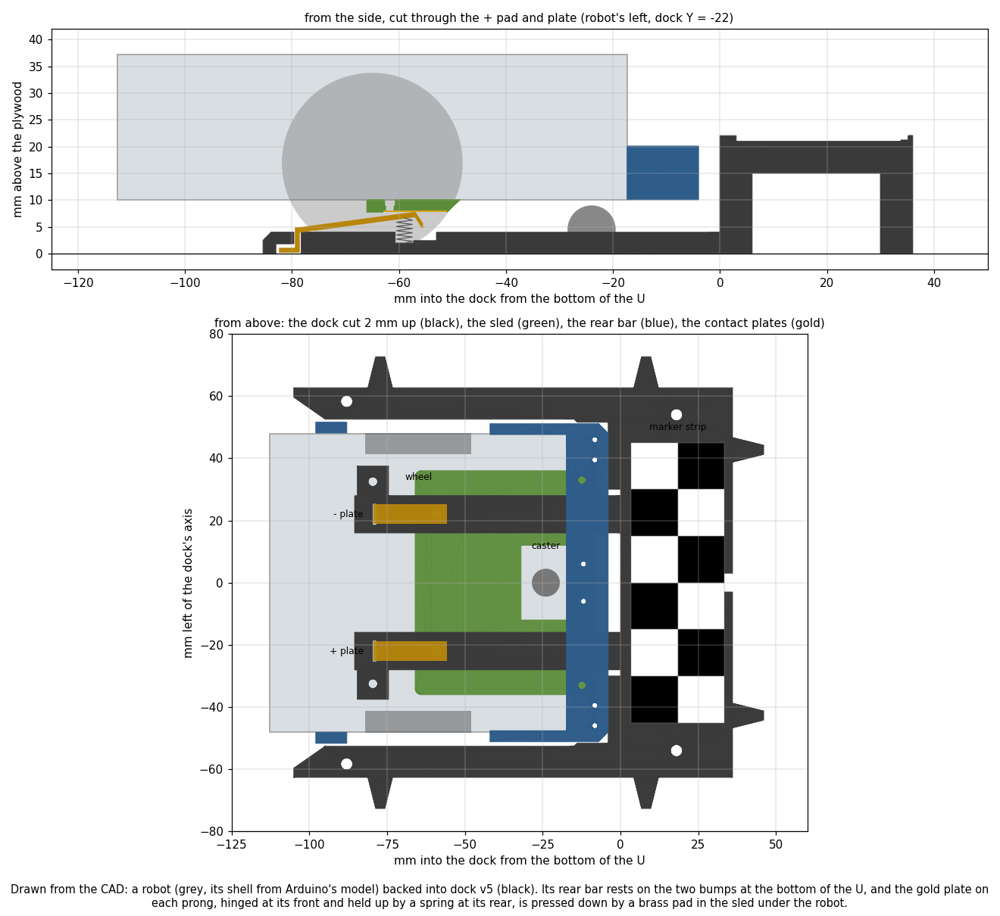
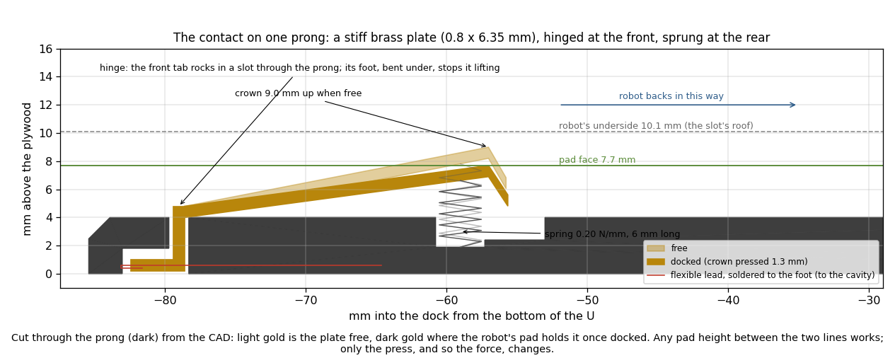
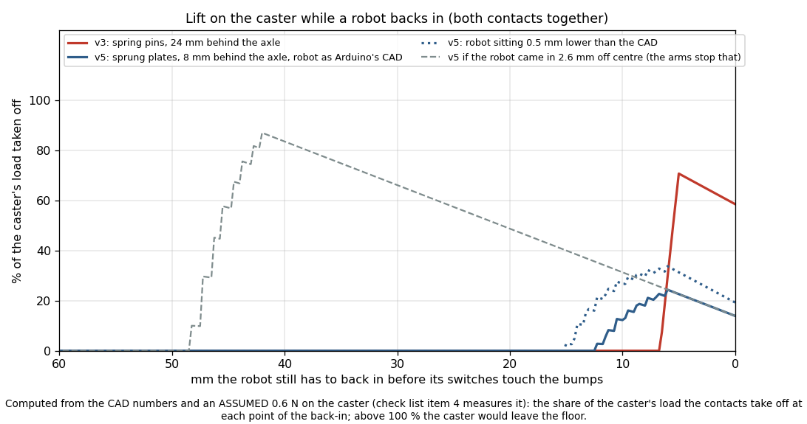

# Self-charging dock: dock v5 (a U with sprung ramp contacts), pad sled v5, battery-driven charge levels

Written 2026-10-25 (v5: same day, after Nick's decisions at 10:39 and 11:05). Nothing here is built or bought yet.
CAD: `hardware/dock/build_dock_v5.py`. Battery rates: `tools/dock/battery_rates.py`. Charge levels:
`tools/dock/charge_levels.py`. Policy simulator: `tools/dock/charge_policy_sim.py`. Tests: `tools/dock/tests/` (12).
The v3/v4 design (pins in a fork, funnel dock) is in Appendix D; its files are kept.

## Premise

Standing decisions (2026-10-25, earlier): one dock for now (two later); robots charge on their own, aiming at 24/7;
a cut-down USB-C plug in the Nano's port wired to two flush pads under the robot; one attachment at the BACK (bumper
switches, lights, cable route); robots back into the dock and into the boards.

Nick's decisions, 10:39 and 11:05:
1. **Contacts are a ramp.** The dock's contact on each fork prong is a **stiff strip with springs under its rear, no
   bending** (11:05): raised at the rear, sloping down to the front. The robot's pad rides onto it and pushes the rear
   down. The springs are weak, so they are pushed down instead of lifting the robot. The clearance then need not be
   precise: Nick checks it with stacked paper or pennies instead of printing a gauge.
2. **Shorter funnel:** the robots approach accurately and cautiously.
3. **A U** the robot backs into. Bumps on its 3 outer edges (touch calibration from outside, as now) and on the inner
   edge at the bottom of the U (the back switches when docked).
4. **The marker** could be a skinny rectangle along the bottom of the U.
5. One dock now. Robots sleep while docked. If charging is slow, robots take turns resting asleep off the dock
   (not a second dock yet).
6. The battery log feeds the charge levels: learn each robot's drain while moving, still and asleep, with
   uncertainty; flag a robot whose drain changes; give the runner its go and leave levels.
7. (11:05) **The dock is the one known length** in the system: it must carry a clearly measurable feature, with its
   exact printed size written down for the software.

## Data

**The robot's underside** (Arduino's CAD model, measured 2026-10-25; Appendix A of v3, unchanged): flat at
**10.1 mm** above the floor between the wheels from the back edge to the front sensor board; caster (9 mm ball) on the
centre line 41 mm behind the axle, its holder 7.1 mm up across ±9.5 mm; tyres' inner faces ±41.2 mm; robot 192 g.
**Weight on the caster: ASSUMED 0.6 N** (not measured; check item 4).

**Camera:** 262 cm above the floor, 640 × 480, about **3.1 px/cm** (`floor_calibration.json` of the 2026-10-22 to 24
sessions).

**What the marker is used for** (grep of `tools/` and `docs/` for checker, chessboard, findChessboard, dock tile):
only `session_checks.PatternWatch` / `dock_tile_checks` (check A15, E00e Part C). It tracks a patch of the picture
around the marker by ECC alignment, **translation only**, to catch a bumped camera (alarm at 0.5 px). Nothing calls
OpenCV's chessboard finder and nothing takes a pose from the marker.

**Battery readings on disk:** 6 sessions (2026-10-23 morning and evening, 2026-10-24 stages 1-3, the 24th's night
session); 3 robots; about 100 one-minute readings per robot; 4 h awake still, 0.8-1.0 h moving per robot; nothing
asleep. Only the night session has a `battery.csv`, and it holds 8 rows (15 s), so the rest come from the robot logs
(runinfo, runend, find, e02, gyro, the RAW rows), with driving from the RAW rows' wheel speeds and `leg.csv`.

**Drain per robot** (`python tools/dock/battery_rates.py`), %/h ± one standard error. Each session was fitted on its
own and then pooled with the spread between sessions (what the runner would use):

| Robot | Still, awake | Moving | Asleep | Sessions | Moving share |
|---|---|---|---|---|---|
| Center | 14.8 ± 2.4 | 17.8 ± 5.7 | none yet (default 3 ± 3) | 4 (still), 3 (moving) | 0.20 |
| Left | 17.0 ± 2.6 | 19.3 ± 5.1 | none yet | 4, 3 | 0.20 |
| Right | 13.0 ± 1.7 | 18.5 ± 6.6 | none yet | 4, 4 | 0.21 |

<sub>Session by session the still rate moves 9.6-19.3 %/h, and the moving rate 15-34 %/h with ±4-12 standard
errors: robots moved only 0.1-0.5 h in a session. No session's rate differed from the earlier ones by more than
3 standard errors, so no change was flagged. The standard errors are inflated for the readings' correlation in time
(lag-1 autocorrelation of the residuals, 0.1-0.34).</sub>

## Conclusion: the design


*A robot (grey) backed into dock v5 (black), drawn from the CAD: its rear bar (blue) on the two bumps at the bottom of
the U, and a gold contact plate on each prong pressed down by a pad in the sled (green).*

**Dock v5** (`stl/dock_v5.stl`, **151 × 145 × 22 mm**, 73 % of v4's footprint, one print, bottom down, brim on):
- **The U.** A base (the bottom of the U, 36 mm deep) and two arms 10 mm thick. The last 14 mm before the bottom is
  the old pocket: the bar seats to ±0.5 mm. Along the arms the bar has ±1.5 mm. A groove along the arms' inner faces
  (10.5-19 mm up) lets the M3 screw heads of the attachment and the light plate's legs slide through. The funnel is
  now **a 10 mm chamfer at the mouth**, opening 7 mm each side: it catches a robot up to 8.5 mm off centre (v4's
  funnel was 50 mm long). Checked in the CAD: the attachment slides in from 100 mm out to docked, centred and 1.4 mm
  off, without touching the U.
- **Bumps:** two on the base's inner face for the back switches (as v4: 4 mm out, they press each lever 1.5 mm and
  stop the bar's face). **Post stations** on the back face and on both arms' outer faces (dock v2's posts, 22 mm
  tall, tips 85.45 mm apart; all of dock v2's station checks pass).
- **Marker strip** in a recess on top of the base (below). Wiring cavity under it, cable channel out of the back,
  4 countersunk holes for #6 × 1 1/4 in wood screws, + mark on top above the + contact.
- **Two prongs** on the floor, 12 × 4 mm, at ±22 mm, either side of the caster (it misses them by 3 mm or more for
  any robot the mouth can catch), each pinned at its far end by a #4 × 1/2 in wood screw through a tab.

**The contact on each prong** (Nick's "stiff strip with springs under the rear"):


*One prong cut lengthwise (dark), with the plate free (light gold) and docked (dark gold), from the script's numbers.*

- **A stiff brass plate,** 1/32 in (0.8 mm) × 1/4 in (6.35 mm) brass strip, about 31.5 mm of strip. 22 mm from hinge
  to crown, rising 4.2 mm (11°). It bends 0.000 mm under the largest force: it is stiff; only the spring moves.
- **Hinge at the front** (towards the mouth): the strip's front end goes down through a slot across the prong and is
  bent flat under it (a 3 mm foot in a recess). The tab rocks in the slot; the foot stops it lifting out. Nothing
  stands above the plate, so the robot's sled only ever meets the plate.
- **Spring under the rear:** one small compression spring in a pocket, 2 mm in front of the crown. Target **0.2 N/mm
  (20 g per mm)**, 3 mm across, about 6 mm long (a 0.2 mm wire micro spring; buy an assortment and pick one with the
  penny test in Appendix B). The plate simply rests on it: the crown's free height is set by the spring's length.
- **The rear end is bent down in a short lip,** so the robot's pad meets a rounded edge. The lip's pocket floor is the
  stop: the crown can go down 3.6 mm at most, with the spring then 2.6 mm long (solid at about 2.0).
- **Flexible lead:** 30 AWG silicone-insulated stranded wire soldered to the foot (it barely moves when the plate
  rocks), along a groove under the prong to the cavity. The current never goes through the spring or the hinge.

**Robot side**
- **Pad sled v5** (`stl/pad_sled_v5.stl`, 59 × 72 × 2.4 mm): the pads move forward to **8 mm behind the axle** (v3:
  24) and are 12 × 10 mm. The slots the crowns travel in are 10.4 mm wide (the plate's 6.35 plus the arms' ±1.5 and
  0.5 to spare), so the crown passes under the robot touching nothing until the last 12 mm. Pad position chosen for
  the force budget (below).
- **Attachment v5** (`stl/attachment_v5.stl`) = attachment v3 with the two pad-wire holes moved out to ±33 mm, clear
  of the wider slots. Print it instead of v3.
- Electrics, polarity (robot's left pad = +), diode, sense resistors and the dock's charger and fuse: as before
  (Appendix C).

### Force budget: the contacts against the caster's load


*The share of the caster's load the two contacts take off at each point of the back-in, computed from the CAD numbers
and the assumed 0.6 N on the caster; at 100 % the caster would leave the floor.*

| | v3 spring pins | **v5 sprung plates** |
|---|---|---|
| Where it pushes up | 24 mm behind the axle | **8 mm behind the axle** |
| Force per contact, docked | 0.3 N (30 g, ASSUMED pin) | **0.21 N (22 g)**: 0.165 N/mm at the crown × 1.3 mm press |
| Lift on the caster, docked | 59 % | **14 %** |
| Most lift while backing in | 71 % (as the pin crosses the pad's edge) | **24 %** (the crown meets the pad's back edge, 14 mm behind the axle) |
| Robot 0.5 mm lower than the CAD | not in the design's range | 19 % docked, 34 % at most |
| Robot 1.0 mm lower | the pin would rub the robot | 25 % docked, 43 % at most; crown still 0.1 mm clear of the slot roof |
| Robot 0.9 mm higher | no contact | still pressed 0.4 mm (0.07 N: weak but touching) |

<sub>Lift = force × distance behind the axle ÷ 41 mm (the caster's distance) ÷ 0.6 N. The plate turns about its hinge;
the force at the crown is the spring rate × (spring's distance ÷ crown's distance from the hinge)².</sub>

The robot sitting lower than the CAD is the one direction that raises the force, so the paper-stack check
(Appendix B) is set up to catch it. One condition carries the design: the robot must stay within the arms' ±1.5 mm
while the crowns travel in their slots. A robot 2.6 mm off centre would drag a crown under the sled's plastic, up to
87 % lift (dashed line). The arms hold it.

### Marker: a rectangle works

The marker is only used to see whether the camera moved (ECC translation of a patch around it). For that, a
rectangle works as well as a square: it needs edges in both directions, which two rows of squares give.

**Recommended: 2 × 6 squares of 15 mm, 90 × 30 mm** (`stl/marker_strip_v5.stl`, white with black raised squares,
filament change at 1.2 mm), across the top of the base, its long side along the bottom of the U.
- **15 mm squares** are 4.6 px each at the camera's 3.1 px/cm. The old tile's 10 mm squares are 3.1 px, close to
  blurring into grey.
- **Two rows** give edges both ways. One row on the black dock would also work, but more slowly (fewer edges across).
- **90 mm long** is the dock's longest camera-visible known length (below), and it fits the 36 mm base.
- **3 mm behind the U's inner face:** the docked robot's light plate (59-63 mm up) ends 17 mm short of it. Seen from
  the camera up to 90 cm away it appears 15 mm closer, so the strip stays visible (3 mm to spare).
- **Code updated** (`tools/session_checks.py`): the patch around the marker is now a rectangle fitted to the strip
  (a square patch would take in the docked robot); the marker's place is 2.24 cm behind the bump faces, against the
  dock's heading (the v4/v5 map pose faces out of the dock). The session-check tests pass (28).
- If a **pose** from the marker were ever wanted, OpenCV's chessboard finder needs more than 2 inner corners each way
  (4 × 4 squares at least). That is not a skinny strip; ArUco tags would be the better choice then.

### The known lengths (Nick, 11:05)

Printed sizes the software can take as the system's absolute scale (`python hardware/dock/build_dock_v5.py` prints
them). A print can come out 0.1-0.3 % off (PLA shrinkage, the printer's steps: 0.1-0.3 mm over 90 mm). So measure the
printed part once with calipers or a steel rule, and the software uses the measured value.

| Length | Printed (mm) | Who sees it |
|---|---|---|
| **Marker strip, long side** (6 squares) | **90.00** | camera: the strip's two ends and its 7 square edges along it |
| Marker strip, short side; square pitch | 30.00; 15.00 | camera |
| U's inner width at the bottom (the pocket) | 103.25 | the robot: the bar seats to ±0.5 |
| Post tips of each station, centre to centre | 85.45 | the robot's two back switches |
| Back station's tip line to the bumps' faces | 50.00 | the robot: docked, then a back-touch on the back posts |
| Side stations, tip line to tip line across the dock | 145.25 | the robot: a touch on each side station |
| Outer width of the U | 125.25 | tape, camera |

## Conclusion: charge levels from the battery log

**The software** (tests: `tools/dock/tests/test_battery_rates.py`):
- `battery_rates.load_session(folder)` reads `battery.csv` and the robot logs, and marks a robot asleep from the
  log's "sent to sleep" line. `BatteryModel` fits, per robot, battery = segment start − still rate × hours still −
  moving rate × hours moving − asleep rate × hours asleep. A new segment starts at each charge or session.
- It is the front sensor's method (`e02_front.py`): this session's own rate once it has enough hours (0.75 h still,
  0.25 h moving, 0.75 h asleep); before that, the robot's earlier sessions (`logs/battery_learned.json`); before that,
  the fleet default. A rate that differs from the earlier one by more than 3 %/h and 3 standard errors is reported
  once: "Left drains faster while still than before: ...".
- `charge_levels.levels(robot, model, fleet)` returns the **go level, the leave level, the early top-up level, the
  parts and the reasons**. It uses each drain at its **upper bound (rate + 2 standard errors)**, the dock queue (the
  robot on the dock and how far it has to go, the queued ones, the working ones that could arrive first) and the
  reading error. `should_go()` adds the early top-up rule. `rest_advice` says when one dock can't keep everyone
  working.

**The levels on the real data** (all six sessions as history, 3 robots, nobody at the dock, charge curve still the
PLACEHOLDER 40 %/h to a knee at 80 %):

| Robot | Go | Leave | Early top-up below | Go's parts (%) | Capacity check |
|---|---|---|---|---|---|
| Center | **52 %** | 80 % | 60 % | error 3 + job 1.6 + drive 1.7 + queue 40.5 + floor 5 | 3.0 robots: ok |
| Left | **54 %** | 80 % | 60 % | 3 + 1.6 + 1.7 + 42.5 + 5 | 2.8 robots: **rest one** |
| Right | **49 %** | 80 % | 60 % | 3 + 1.7 + 1.8 + 37.2 + 5 | 3.2 robots: ok |

<sub>Queue = the worst case: both other robots reach their go level at the same moment as this one, each needing about
1 h on the dock. The drains go in at their upper bounds (Left: still 22.2, moving 29.6, docked 9.0 %/h). That is why
the go levels sit above the simulator's 40-50 %.</sub>

- **The queue is still almost all of the go level** (75-80 %). A robot that is nearly done on the dock lowers the
  others' go level at once (tested).
- **The uncertainty costs about 10 points of go level:** at the plain rates instead of rate + 2 standard errors,
  the go levels would be 41-46 % (Right 40.7, Center 42.9, Left 45.6). More hours of logs narrow it. The moving rate is the loosest (±5-7 %/h),
  because robots drove only 0.1-0.5 h a session.
- **Left alone fails the capacity check** at the placeholder charge rate: it drains fastest (17.0 still).

**Resting robots instead of a second dock** (`python tools/dock/charge_policy_sim.py --compare`; 3 robots, one dock,
7 days, the plan's drain range; best safe go/leave on a small grid; uptime typical (worst case)):

| Charge rate | Plain | Early top-up | Rest: 1 works, 2 sleep | Rest: 2 work, 1 sleeps |
|---|---|---|---|---|
| 20 %/h (0.5 A) | none safe | none safe | none safe | none safe |
| 25 %/h (0.62 A) | none safe | none safe | none safe | none safe |
| 30 %/h (0.75 A) | none safe | none safe | **33 % (34) = 1.0 robot working**, lowest 13 % | none safe |
| 40 %/h (1.0 A) | 61 % (44) = 1.8 robots | **66 % (45) = 2.0 robots**, lowest 20 % | 33 % = 1.0 | 61 % (50) = 1.8, lowest 6 % |

- **Resting works only in a band of charge rates.** A robot asleep off the dock still drains (PLACEHOLDER 3 %/h). So
  one dock keeps K robots working only if K × working drain + the others' sleep drain < charge rate − sleep drain.
  At 30 %/h, resting two robots is the only safe policy (one robot always working). Below about 25 %/h not even that
  holds: the sleepers' own drain outruns the dock.
- **At 40 %/h resting costs uptime.** Early top-up stays best (2.0 robots working on average against 1.8).
- **So the sleep drain decides it as much as the charge current does.** If the firmware's `sleep` draws well under
  3 %/h, resting reaches lower charge rates. If it can't, the alternative is switching resting robots off (the
  Alvik's switch is manual) or a second dock.
- The same comparison on the logs' drain rates: Appendix E.

## What's next

1. **Nick:** order the parts (Appendix F), print the dock, sled, attachment v5 and marker strip, do the paper-stack
   check (Appendix B), and fit the contacts.
2. **Bench test 1 (charge curve) and the sleep-drain test.** Then rerun
   `python tools/dock/charge_policy_sim.py --compare --cc-rate R --knee K --sleep-drain S`. That decides between
   plain, top-up and rest, and whether one dock can run 3 robots nonstop.
3. **Runner wiring (simulator first):** call `BatteryModel.update(load_session(session dir))` every battery tick,
   print its change messages, call `charge_levels.should_go()` with the dock queue, and save the model at the end.
   Also log `state=asleep` in `battery.csv` for robots sent to sleep (the learner already reads it).
4. **Software scale:** measure the printed marker strip and enter it as the dock's known length.
5. Bench tests 4-8 (Appendix B), then the firmware (back-in `charge` run, docked guard, sense pin).

---

## New tests that may now be needed
1. **Paper-stack check and spring pick** (Appendix B): the real clearance, pad height and spring rate. The force
   budget rests on them and on the caster load (check item 4).
2. **Back-in with the plates, 20 times** (bench test 6): watch for the caster lifting while the crown crosses the
   pad's back edge (the 24 % peak), and for the plate catching the sled's slot end.
3. **Contact resistance at 0.2 N:** meter on pad and plate, docked, unpowered; then voltage at the plug while charging
   at full current. Low force on brass may not be enough. If it isn't: a stiffer spring (the budget allows about
   0.35 N per plate below 25 %), or tin both faces.
4. **Plate wear and hinge:** 100 back-ins, then the contact resistance again, and check the tab hasn't worn its slot
   (a worn slot lets the plate shift sideways).
5. **Sleep drain** (one robot asleep 1 h): it now decides whether resting robots helps at all.
6. **Battery learner on a long session:** a 2-hour session with `--battery-watch-s 300`; check the moving rate's
   standard error falls below 3 %/h, and that `battery.csv`'s state rule (without RAW rows) agrees with the RAW
   rows' driving time.
7. **Runner integration** in the simulator: levels recomputed as robots queue; a resting robot reaching its go level
   waits asleep until the dock is free; two robots wanting the dock at once.
8. **Dock-marker bump check on a real recording** with the strip (E00e Part C): it must catch a 0.5 px bump with the
   rectangular patch, and pass with a robot docked beside it.
9. **The dock as the scale:** the measured strip length against the camera's px/cm. If they disagree by more than
   0.3 %, the floor calibration or the print is off.
10. Carried over: back-in docking in the simulator (prongs and plates as obstacles), back-finds without a line sensor
    behind, the post stations with the rear bar.

## Possible inaccuracies
- **Caster load 0.6 N: ASSUMED.** Every lift percentage scales with it (check item 4).
- **Underside 10.1 mm and pad height 7.7 mm:** Arduino's simplified CAD (no battery cover, screws or tyre squash).
  The sled now reaches 8 mm further forward (to just past the axle). The battery cover's position is unknown: it may
  sit under the sled (check item 2).
- **Spring rate 0.2 N/mm, 6 mm long, solid at 2 mm: ASSUMED** until bought. The free crown height follows the
  spring's length (Appendix B sets it).
- **The lift curve's model:** the plate as a rigid line turning about its hinge, the robot as rigid, contact where
  the robot must push the plate down furthest. Friction, plate rocking in its slot and the sled flexing are left out.
- **The rest policy's sleep drain (3 %/h) is a PLACEHOLDER;** the comparison's verdict turns on it.
- **Charge curve:** still the PLACEHOLDER 40 %/h to a knee at 80 %, so the leave level (80 %) is a placeholder too.
- **Drain:** only about 1 h of moving per robot over all sessions. Fitting all sessions jointly (instead of session
  by session) gives moving rates *below* still (10-13 against 14-17 %/h). That is not physical: the joint fit's
  assumption that robots stood switched on between the 24th's stages is probably wrong, or the gauge's smoothing
  confounds it. The table uses the session-by-session fits.
- **`battery.csv` alone** does not say how long a robot moved between rows. Without RAW rows the learner ASSUMES half
  the time it was not known to be still. RAW rows, when present, override it.
- **The battery % is a smoothed whole number** whose meaning is unchecked (night analyses). The AR(1) inflation may
  not fully cover its correlation.
- **Marker visibility margin (3 mm)** assumes the camera up to 90 cm from the dock at 262 cm height. A lower camera
  or a dock further out shrinks it.
- **Known lengths** are the printed sizes. A print's real size can differ by 0.1-0.3 % until measured.
- **Chosen numbers**, each with whether a DOE should set it (rows in `docs/doe-backlog.md`):
  - Pad 8 mm behind the axle, spring 0.2 N/mm, crown 9.0 mm free: **yes, a small DOE:** 2 spring rates × 2 crown
    heights (one paper sheet of shims) × 20 back-ins, scored on contact resistance, contact rate and caster pinch.
  - Plate 22 mm hinge to crown, 0.8 mm brass: no (geometry; any stiff strip).
  - Arms' play ±1.5 mm, mouth chamfer 10 mm × 7 mm, arm length to 105 mm: **yes:** bench test 6's back-ins from
    staging offsets of 0 / 5 / 10 mm, then a narrower or wider chamfer if any miss.
  - Slot width 10.4 mm: no (follows from the arms' play).
  - Marker squares 15 mm, 2 × 6: **yes, cheap:** E00e Part C with the 15 mm strip against the old 10 mm tile, a known
    bump of 1 px, 10 times each.
  - Base 36 mm deep: no (fits the strip).
  - Drain at rate + 2 standard errors: **yes, in the simulator:** each robot's rate drawn from its uncertainty,
    k = 1 / 2 / 3, scored on flat batteries against uptime.
  - Learner thresholds (0.75 / 0.25 h before a session's own rate; 3 %/h and 3 standard errors to flag; 3 % rise =
    a charge; 45 min to join sessions): **yes, logs-only:** replay sessions with a drain change injected; how soon
    it is caught against false flags.
  - Rest K (how many robots work): set by the simulator after bench test 1 and the sleep test.

---

## Appendix A: geometry report (`python hardware/dock/build_dock_v5.py`: 0 FAIL, 1 WARN)
- WARN (for comparison only): a robot 2.6 mm off centre would drag a crown under the sled: up to 87 % lift.
- Spring 5.9 mm long free (pocket floor 1.9 mm up); the lip's pocket stops the crown after 3.6 mm (spring 2.6 mm,
  solid about 2.0). The foot swings up 0.5 mm at the stop in a 1.8 mm recess.
- Prongs 16-28 mm out: clear of the caster's holder by 6.5 mm and 13.2 inside the wheels; screw tabs to 38 mm.
- When the caster reaches the prong tips, the bar is at the mouth: a robot the chamfer can catch (8.5 mm) misses the
  tips by 3.0 mm or more.
- The sled's front end never meets the plate above 7.2 mm (the sled face is 7.7).
- Light plate legs clear the arms by 0.97 mm; M3 heads (to 53.75) run in the 55 mm groove.
- Print: dock bottom down, brim on (2258 mm² faces down, about 2171 of it bridges: the cavity roof, wire grooves,
  screw-head groove roofs). Sled top face down, no supports. Attachment v5 as v3 (upside down, supports).
- Firmware and map numbers (as v3/v4): bumper face 6.10 cm behind the axle, switches ±4.27 cm, `sw_gap_cm` 0.020,
  `bumper_cm` 1.34; docked, the axle is 6.5 cm from the bottom of the U; the map's dock pose is the middle of the
  bumps' faces, heading out of the dock. Crowns at dock X −57.0, Y ±22; marker centre 18.4 mm behind the U's inner
  face.
- Previews: `preview/dock_v5.png`, `docked_v5.png`, `contact_v5.png`, `lift_v5.png`, `sled_v5.png`.

## Appendix B: build steps and the paper-stack check

**Make the files** (only if a number changed). Open a **Terminal window on the laptop** in the project folder, type
this and press Enter:

```
python hardware/dock/build_dock_v5.py
```

You should see lines starting `ok`, one starting `WARN`, and none starting `FAIL`.

**Print** (PLA, 0.2 mm layers, 4 walls, 20 % infill; do not rotate the parts in the slicer):
1. `dock_v5.stl`: bottom down, brim on, black.
2. `pad_sled_v5.stl`: as exported, no support.
3. `attachment_v5.stl`: upside down as exported, supports on (tree if offered). (Not v3: v5 has the wire holes moved.)
4. `marker_strip_v5.stl`: white; add a filament change (pause, M600) at 1.2 mm so the raised squares print black.

**Paper-stack check** (robot switched off, on a flat table). Sizes: a US penny is 1.52 mm thick. Printer paper is
about 0.1 mm a sheet. To check yours: a 500-sheet ream's thickness in mm ÷ 500.
1. **Clearance under the robot.** Make a stack of 6 pennies (9.1 mm). Slide it under the robot's flat underside from
   behind, between the caster and a wheel. If it slides in without lifting the robot, add one sheet of paper at a
   time on top until the robot just starts to lift. Write down the last stack that slid in: pennies × 1.52 + sheets
   × 0.1 = **clearance**. Expect about 10.1 (6 pennies + 10 sheets).
2. **Fit the sled** (Robot side, below). Then the **pad height**: the same with 5 pennies (7.6 mm) under one brass
   pad. Expect about 7.7 (5 pennies + 1 sheet). Write it down: **pad height**.
3. **Your crown height** = pad height + 1.3 mm, but **at least 0.8 mm under the clearance**. If those two clash (pad
   height + 1.3 is more than clearance − 0.8), stop and tell Claude: the sled's thickness changes.
4. **Set each crown.** Make two equal stacks of pennies and paper at your crown height. Stand them on the plywood,
   one each side of a plate's crown, and lay a ruler across them over the crown. A strip of paper slid between the
   crown and the ruler should be lightly pinched. Crown too low (the paper is loose): put a paper disk under the
   spring. Crown too high (the ruler rocks): snip a quarter turn off the spring's bottom with side cutters.
5. **Docked check** (power off): back the robot in by hand until both switches click. Slide a sheet of paper under
   the caster: it must be pinched (the caster still carries weight).

**Picking the spring** (penny test; the spring stands upright on a kitchen scale; zero the scale first): press it
down with a flat stick until it is as tall as a stack of 3 pennies (4.6 mm). The scale should read **20-45 g**. Under
20 g the contact is weak; over 45 g it lifts more of the caster.

**Robot side** (each robot):
1. Cut two brass-shim pads, 12 × 10 mm (12 along the robot), each with a 3 mm tab on one short end. Bend the tab up
   90°.
2. Push each pad into its recess on the sled's underside, tab up through its slot, with a thin film of superglue. Run
   a fingernail across: it must not stick out.
3. Solder red to the pad on the robot's left and black to the other (sled channels facing up, screw holes towards
   you: left is on your left). Press each wire into the channel on the sled's top, out to the back.
4. Fit attachment v5 with eight M3 × 8 screws. Thread the two wires up through the bar's holes. Screw the sled to the
   bar's underside with two M2 × 6 screws. A strip of thin double-sided tape near the sled's front end holds it flat.
5. Above the bar: SS34 diode in the red wire (striped end towards the plug), sense resistors, the cut USB-C plug, as
   before (Appendix C).

**Dock side** (each contact):
1. Cut 31.5 mm of 1/32 × 1/4 in brass strip. Bend 7 mm at one end down 90° (the tab: 4 mm through the prong plus the
   3 mm foot). Bend the last 2.5 mm at the other end down about 60° (the lip). Round the lip's outside with a fine
   file.
2. Solder 10 cm of 30 AWG silicone wire to the tab's last 3 mm (the foot).
3. Drop the spring into its pocket (a dot of superglue on its bottom end).
4. Push the tab and wire down through the slot from above. Turn the dock over and bend the foot flat towards the mouth
   into its recess. Lay the wire in the groove to the cavity.
5. Turn the dock back over: the plate's rear should rest on the spring, its lip over the lip's pocket. Press the rear
   down with a finger: it should spring back up and not rub the pocket's sides.
6. Wire the charger as before (PTC fuse in red, red to the + plate under the dimple, black to the −). **Polarity check
   before any robot docks:** charger plugged in, meter on DC volts, red probe on the + plate, black on the −: about
   +5.0 V.
7. Screw the dock down through the four holes and the two prong tabs. Leave 25 cm clear in front of the mouth.

**Bench tests** (unchanged from the first plan): 1 charge curve; 2 robot's 5 V on battery (diode needed?); 3 cut plug
through the meter; 4 dock short test (fuse); 5 force and caster pinch (now the penny test and step 5 above); 6 20
back-ins (contact within 10 s; watch the caster at the pad's edge); 7 one supervised full charge; 8 runner trial.

## Appendix C: how the Alvik charges, and electrics (research 2026-10-24/25)

| Question | Answer | Source |
|---|---|---|
| Battery | One 18650 Li-ion cell, 2500 mAh, 3.0-4.2 V | [DS] §2.3; tech-specs.yml |
| Charge port | The Nano ESP32's USB-C; charging comes in on VBUS | [Hackster](https://www.hackster.io/glowascii/first-steps-with-the-arduino-alvik-robot-kit-f229bb); [CNX](https://www.cnx-software.com/2024/05/14/arduino-alvik-is-a-3-wheel-robot-designed-for-steam-education/) |
| Charger chip | MAX17332 (charger, fuel gauge, protector) plus LTC4360 protection | [DS] §2.3.1; [Analog Devices](https://www.analog.com/en/products/MAX17332.html) |
| Charge current | Not published | bench test 1 |
| Switched off / on | Charges either way | [docs commit](https://github.com/arduino/docs-content/commit/5442398e6b4358783dfb01e38d9ecb4c320ed9c5); [Bandini](https://www.hackster.io/roni-bandini/building-a-self-charging-alvik-6daed7) |
| Which USB-C lines | Only VBUS and GND; a USB-A charger with a cut USB-A cable always gives 5 V | [Hackaday](https://hackaday.com/tag/vconn/); [DigiKey forum](https://forum.digikey.com/t/simple-way-to-use-usb-type-c-to-get-5v-at-up-to-3a-15w/7016/11) |

<sub>[DS] = the [AKX00066 datasheet](https://docs.arduino.cc/resources/datasheets/AKX00066-datasheet.pdf).</sub>

Electrics: USB-C plug → SS34 Schottky diode (striped end towards the plug) in the + wire → the + pad (robot's left).
Contact sense: 100 kΩ from the + pad to a free Nano analog pin, 150 kΩ from that pin to GND. Dock: USB-A wall charger
(5 V, 2 A+) → cut USB-A cable → resettable fuse (PTC, 1.1 A hold) in the red wire → + plate; black → − plate.

## Appendix D: superseded designs (files kept)
- **v3 / dock v4** (`build_attachment_v3.py`): upright spring pins in a two-pronged tongue, pads 24 mm behind the
  axle (59 % caster lift docked, 71 % while crossing the pad's edge), a funnel dock with a 50 mm funnel and a solid
  100 mm head. Replaced by Nick's 10:39 decisions.
- **A leaf spring** (a bent phosphor-bronze strip) was drafted for v5 first, then replaced by Nick's 11:05
  clarification (a stiff strip on springs, no bending).
- **v2 / dock v3:** pads in the front bar, pins in the back wall. **Thresholds 40 % / 90 %:** replaced by the method
  above.

## Appendix E: the policy comparison on the logs' drain rates
`python tools/dock/charge_policy_sim.py --compare --learned` (drain from `battery_rates.py`):

| Charge rate | Plain | Early top-up | Rest 1 (1 works) | Rest 2 (2 work) | Rest 1 + top-up | Rest 2 + top-up |
|---|---|---|---|---|---|---|
| 20 %/h | none safe | none | none | none | none | none |
| 25 %/h | none | none | none | none | 33 % (34) = 1.0 robot, lowest 15 % | none |
| 30 %/h | none | none | 33 % (34) = 1.0, lowest 14 % | none | 33 % (34) = 1.0, lowest 34 % | none |
| 40 %/h | 62 % (51) = 1.9, lowest 7 % | **65 % (55) = 2.0, lowest 19 %** | 33 % = 1.0 | 62 % (64) = 1.9, lowest 15 % | 33 % = 1.0, lowest 39 % | 59 % (40) = 1.8, lowest 32 % |

<sub>Drain from the logs: working 14.2-17.5, driving 19.3, waiting 17.0 %/h (the robots' own rates, not their upper
bounds); asleep 3.0 (PLACEHOLDER). Same verdict as the plan's drain range, a little more forgiving: with early
top-up added, resting two robots is also safe at 25 %/h.</sub>

## Appendix F: parts (rough prices, estimated, not checked against a store)

| Part | Per | Rough price |
|---|---|---|
| Brass strip 1/32 × 1/4 in (0.8 × 6.35 mm), 12 in | dock (2 plates) | $3-5 |
| Micro compression spring assortment (wire 0.2-0.3 mm, 3 mm across, 5-8 mm long) | dock (2) | $6-10 |
| 30 AWG silicone stranded wire | once | $5-8 |
| #4 × 1/2 in wood screws (prong tabs) | dock (2) | on hand? |
| Brass shim 0.3-0.5 mm (pads) | small sheet | $5-8 |
| M2 × 6 pan-head screws | robot (2) | $4 a pack |
| USB-C plug (short cable to cut), SS34 diode, 100 kΩ and 150 kΩ | robot | $2-4 |
| USB-A charger 5 V 2 A+, USB-A cable to cut, PTC fuse 1.1 A hold | dock | $12-18 |
| Inline USB power meter (bench tests) | once | $10-15 |
