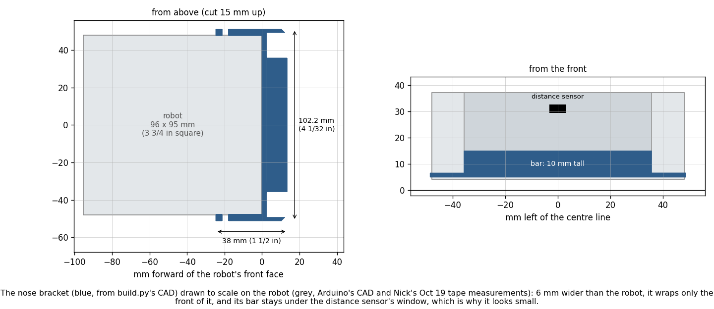
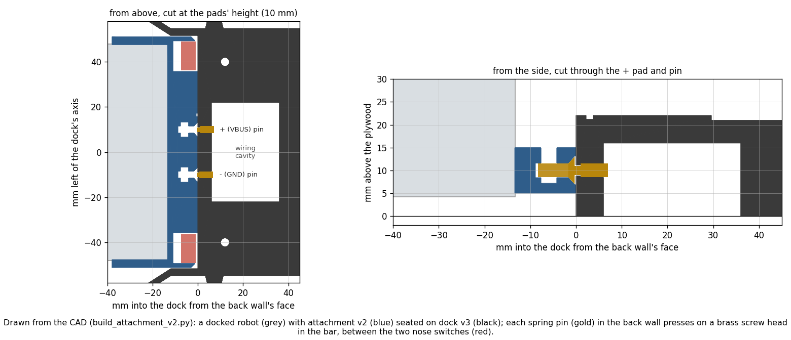

# Self-charging dock: plan, and attachment v2 / dock v3

Written 2026-10-25. Nothing here is built or bought yet. The CAD is `hardware/dock/build_attachment_v2.py`.
Firmware and runner changes are described but not written.

## Premise

Nick, 2026-10-24: the Alvik charges through a standard USB-C port. "I think we would plug in some sort of extension
and design our own point of contact". It should be "integrated into our design for a single attachment that accounts
for switches, lights, and now charging port". The robot already creeps into a printed dock until both nose switches
click (0.5 mm, 0.3 deg fix, `dock.h`). If that same docking also makes the charging contact, the robot can top
itself up without Nick, and every charge also gives it an exact position fix. That fits the autonomy and
self-calibration story.

Tools available: a 3D printer and a soldering iron.

## Data and findings

**How the Alvik charges**

| Question | Answer | Source |
|---|---|---|
| Battery | One 18650 Li-ion cell, under a screwed cover on the bottom. Range 3.0-4.2 V | [AKX00066 datasheet](https://docs.arduino.cc/resources/datasheets/AKX00066-datasheet.pdf) §2.3; [Arduino docs commit](https://github.com/arduino/docs-content/commit/21a309aff3865d451f933eac4422b38a7945f7be) |
| Charge port | The Nano ESP32's USB-C port. Charging comes in on its 5 V line (VBUS) | [First steps with the Alvik (Hackster)](https://www.hackster.io/glowascii/first-steps-with-the-arduino-alvik-robot-kit-f229bb); [CNX Software](https://www.cnx-software.com/2024/05/14/arduino-alvik-is-a-3-wheel-robot-designed-for-steam-education/) |
| Charger chip | MAX17332: charger, fuel gauge and protector in one. It handles the charge voltage, temperature limits (JEITA) and over-current itself. An LTC4360 adds over-voltage and reverse-voltage protection | datasheet §2.3.1; [MAX17332 (Analog Devices)](https://www.analog.com/en/products/MAX17332.html); [DroneBot Workshop](https://dronebotworkshop.com/alvik/) |
| Charge current and voltage | **Not published.** We feed a plain 5 V, as a USB port does. The chip sets the current | none found: bench test 1 measures it |
| Switched off | Charges. The Nano's LED blinks red, then goes solid green when full | [Arduino docs commit](https://github.com/arduino/docs-content/commit/5442398e6b4358783dfb01e38d9ecb4c320ed9c5) |
| Switched on | Charges "safely … anyway", but no LED shows it (one hobby source) | [Bandini, Hackster](https://www.hackster.io/roni-bandini/building-a-self-charging-alvik-6daed7) |
| Can the robot tell? | Yes. `alvik.is_battery_charging()` is in the library, and our firmware already logs it (`charging` in raw.csv / runinfo.csv). It has not yet been seen at 1 on a real robot | `firmware/home_lab/rawlog.h`, `home_lab.ino` |
| Drain while switched on | **11-16 % per hour** standing still. Driving adds too little to measure | `docs/build-reports/e02-oct24-night-analyses.md` (measured) |

**Prior work.** [Roni Bandini's "Building a self-charging Alvik"](https://www.hackster.io/roni-bandini/building-a-self-charging-alvik-6daed7)
is the only Alvik self-charger found. He decided against plugging into the USB-C port because it "needed precision and
pressure". Instead he used a 5 V / 1 A wireless charger: the coil in a printed base, the receiver soldered to the
Nano ESP32's **VBUS and GND pins**, a gap of 6 mm in practice. The robot follows a black line to the base when the
battery drops below 20 %. It charges up to a limit, then leaves. This confirms that 5 V into the Nano's VBUS charges
the Alvik, through the same wire our extension uses.

**Contact options**, judged on whether they still connect after a slightly-off docking. The funnel centres the robot
to about ±0.5 mm and 1 deg.

| Option | Tolerance to an off docking | Verdict |
|---|---|---|
| **Spring pins in the dock + flat brass pads on the robot** | ±2.5 mm (pad radius); the springs keep pressing after the wheels stop | **Chosen.** Cheap. The robot carries nothing fragile. Pins are rated for tens of thousands of cycles ([Promax](https://promaxpogopin.com/spring-loaded-pin/robot-pogo-pins/)) |
| Spring pins on the robot, pads in the dock | Same | No. The nose is also the touch probe: it bumps boards, and the pins would bend |
| Magnetic spring connector (2-pin) | About ±1 mm; the magnets pull it in | Plan B. Its 2.54 mm pitch leaves the pins close together, the magnet would tug the robot off the position the switches give, and stroke is 1.1 mm ([Electrokit](https://www.electrokit.com/en/2-pin-male-magnetic-pogo-pin-connector-spring-loaded)) |
| Bent brass-shim leaf springs | Large | Plan C. Cheapest, but the spring force fades as the shim fatigues and the plastic creeps |
| A USB-C plug the dock pushes in | Needs a fraction of a millimetre and a firm push. The port is on top of the robot, not the nose | No. Bandini rejected it for this reason |
| Wireless (Bandini) | Large (6 mm gap) | No for now. The coil does not fit in a 10 mm bar under the distance sensor. Also 1 A at most, and it runs warm |

**Which USB-C lines matter.** Only VBUS (+5 V) and GND. Our extension does not need CC resistors: the Nano is the
device being charged, and a plain 5 V on VBUS charges it, as Bandini's wiring shows. CC resistors matter at the
**dock's own power input**, and only when the source is a USB-C charger. Such a charger gives 0 V until it sees
5.1 kΩ on each CC pin
([Hackaday, "All About USB-C: Resistors And Emarkers"](https://hackaday.com/tag/vconn/);
[DigiKey forum](https://forum.digikey.com/t/simple-way-to-use-usb-type-c-to-get-5v-at-up-to-3a-15w/7016/11)).
A USB-A charger with a cut USB-A cable always gives 5 V, so we use that.

**Is the printed nose bracket too small? No. It only looks small.** It is 102.2 mm wide (4 1/32 in): the robot (96)
plus a 3 mm arm and a 0.15 mm gap on each side. It is 38 mm front to back. Its bar is 10 mm tall and stays under the
distance sensor's window. It wraps only the front 25 mm of the robot's sides, which is all a bumper needs. Between the
arms it measures 95.1 mm at the bottom and 96.2 at the top, against Nick's measured 95.25. That is a snug fit, and a
tight one, if anything. Attachment v2 carries the light plate too (112 x 103 x 58 mm), so it covers the whole robot.
Check list item 2 below confirms the print came out at that size.


*The printed bracket (blue) drawn to scale on the robot (grey) from the CAD and the Oct 19 tape measurements: it only
wraps the robot's front, so it looks smaller than the robot it fits.*

## The design

**Robot side: attachment v2** (`stl/attachment_v2.stl`). This is version 1's one-piece attachment (switches and light
plate) with two charging pads added in the bar, between the switches. Each pad is the head of a **brass M3 x 8
countersunk screw**, 10 mm either side of the centre and 10 mm above the floor. The heads sit 0.3 mm behind the bar's
face, so the face is still the hard stop and the touch probe. Behind each screw, a nut slot that is open on top holds
an M3 nut and the wire's ring terminal. A groove along the bar's top takes both wires to the switch pockets. From
there they run up the robot's front corner with the switch wires, never across the dark recess.

- **Left pad = + (VBUS), right pad = − (GND)**, as the robot sees it. A dimple beside the + pad marks it. Polarity is
  fixed by the dock's shape: a robot can only dock nose-first and upright.
- **The outside is exactly version 1's**, so docks already printed still fit and the firmware's `bump_*` and
  `bumper_cm` numbers stay as they are.
- **The extension**: a short USB-C **male plug with two wires** (a "USB-C plug breakout" or a cut USB-C cable), plugged
  into the Nano's port. Between it and the + pad goes a Schottky diode (SS34): it blocks a reversed wire, and it keeps
  the pads dead if the robot's own 5 V would otherwise reach them. The plug blocks the USB port, so firmware goes on by
  WiFi (already in use), or you unplug it. The fallback is Bandini's way: solder to the Nano's VBUS and GND holes.
- **Contact sense**: two resistors (100 kΩ over 150 kΩ to GND) from the + pad to a free Nano analog pin. It reads
  about 3 V when the pads touch the live pins. It works even when the battery is full and not charging.

**Dock side: dock v3** (`stl/dock_v3.stl`). This is dock v2 unchanged (funnel, three post stations, check tile, screw
holes), with two spring pins in the back wall at the pads' spacing and height. The pins are pressed in from behind
until they stop on a printed step. The GND pin stands 1.3 mm out and the + pin 1.0 mm, so ground touches first and
lets go last. When the face is flush, the pins are pressed 0.7-1.0 mm of a 1.5 mm stroke. They are already touching
when the switches click, so "both switches clicked" also means "contact made". A wiring cavity behind the wall is open
underneath and has a solid roof under the check tile. The cable leaves through a channel under the head to the back
face (for a dock at the board's edge), or straight down through a 3/4 in hole drilled in the plywood.


*Sections through the CAD of a docked robot: the dock's spring pins (gold) press on the two screw-head pads in the
bar, between the nose switches (red).*

**Power at the dock**: USB-A wall charger (5 V, 2 A or more) → cut USB-A cable (red +, black −) → resettable fuse
(PTC, 1.1 A hold) in the red wire → + pin; black → − pin. 5 V cannot shock anyone. A short across the pins (a dropped
screw) trips the fuse, which resets once the short is cleared.

**How the robot and the runner know it is charging** (in order of trust):
1. The contact-sense pin goes high within a second of seating: contact is made.
2. `is_battery_charging()` reads 1: the charger chip accepted the power. If contact is made but this reads 0, the
   battery is full or the supply is off.
3. Battery % rises. This is slow and comes in 1 % steps (the library smooths it). Use it only as a check over
   30 minutes.

**How the runner sends a low robot to charge and back** (runner and firmware work, later):
1. At the end of a run, a robot at or below **40 %** (the runner's existing warning level) is sent home. It drives to
   a point 25 cm in front of its own dock (the dock's pose is in the map), then `run dock`.
2. After seating it waits up to 10 s for contact sense and charging. If either is missing, it backs out 3 cm and
   docks again. After the second failure the runner holds for Nick on the live page (as it does for the border).
3. While docked, the robot **sleeps with check-ins** (`sleep N`, firmware 2026-10-25a) and reports battery %, contact
   and charging at each check-in. Sleeping matters: awake it drains 11-16 %/h, and that is taken off whatever the
   charger gives. Firmware refuses forward moves while contact sense is high; backing out is the only move allowed.
4. It leaves at **90 %**, or at 60 % or more if the session needs it. It backs straight out 12 cm, clear of the
   funnel, then rejoins. The docking also gave a 0.5 mm position fix and a gyro-drift reading, which go into
   self-calibration.
5. The runner stops and alerts Nick if a docked robot's battery falls, or does not rise in 30 minutes.

**Failure modes and safety**

| What | Guard |
|---|---|
| Docked but no contact (dust, pin stuck) | contact sense + charging flag → re-dock once → hold for Nick |
| Short across the dock pins | PTC fuse at the dock; the charger's own limit |
| Pads live on the robot | Schottky on the robot; bench test 2 measures whether the robot's VBUS is live when it runs |
| Wired backwards when built | the Schottky blocks it; a polarity check with the multimeter before the first docking |
| Robot drives off while charging | harmless electrically (the contact just opens); firmware allows only backing out while docked |
| The springs push the robot off the wall | about 1.2 N (ASSUMED); bench test 5 checks the braked wheels hold it |
| Pins disturb the 0.5 mm position fix | the pins are symmetric about the centre; bench test 6 repeats E00e with the pins in |
| Li-ion | the Alvik's own chip controls the charge. We only ever give it 5 V on VBUS and never wire to the battery. First charges are supervised, with temperatures checked by hand; no unattended overnight charging until test 7 passes |

**Parts** (rough prices, estimated, not checked against a store)

| Part | Per | Rough price |
|---|---|---|
| Spring pins, through-hole with solder tail, about 3 mm barrel, about 1.5 mm stroke | dock (2) | $5-10 for a pack of 10-20 |
| Brass M3 x 8 countersunk screws + M3 nuts | robot (2 each) | $5-8 a pack |
| M3 ring terminals, 22-26 AWG | robot (2) | $5 a pack |
| USB-C male plug breakout (2-wire) or a short USB-C cable to cut | robot | $1-3 each |
| SS34 Schottky diode | robot | under $0.50 |
| 100 kΩ and 150 kΩ resistors | robot | pennies |
| USB-A wall charger, 5 V 2 A+ | dock | $8-12 |
| USB-A cable to cut (long enough to reach the outlet) | dock | $3-5 |
| PTC resettable fuse, 1.1 A hold | dock | under $0.50 |
| Inline USB power meter (for the bench tests) | once | $10-15 |
| Hook-up wire 24-26 AWG, heat-shrink | once | on hand? |

**First bench tests, in order** (the first three need no printing):
1. **What the robot draws.** Plug the robot into a wall charger through the USB power meter and stock cable. Robot
   OFF for 30 min, then ON for 30 min. Write down the amps and volts every 10 min, and the battery % (console). While
   ON, check the logged `charging` column reads 1. This gives the charge current, whether it charges while on, and the
   net rate awake.
2. **Is the robot's 5 V live when it runs on battery?** Robot ON, nothing plugged in. Plug in the USB-C pigtail and
   measure between its red and black wires with the multimeter (keep the two bare ends apart: if the line is live,
   touching them together is a short). Above 0.5 V means the pads would be live: the Schottky is then required, not
   just recommended.
3. **The extension alone.** Pigtail in the Nano, fed from the dock's charger through the PTC and the Schottky with
   clip leads, through the USB meter. Expect the same reading as test 1, minus a little for the diode.
4. **Print** the fit test and the pin gauge (below). Then the dock short test: dock v3 wired, no robot. Touch a wire
   across the two pins for 5 s. The fuse warms and the current drops; once the short is removed, 5 V returns.
5. **Spring force and hold.** Push one pin 1 mm into a kitchen scale (expect under 100 g). Then dock a robot with no
   power on the pins: it must stay seated, both switches pressed, for 60 s.
6. **Contact repeatability.** 20 dockings from varied starts (as E00e), power on. Count dockings with contact sense
   and charging within 10 s (goal: 20/20). Compare the seat repeatability with E00e's figures without pins.
7. **One supervised full charge**, docked, robot asleep, 20 % → 100 %. Every 30 min feel the battery cover, the pins
   and the fuse (warm is fine, hot is not) and note the %.
8. **Runner trial** in the simulator, then one real low-battery send-home.

## What's next

1. Nick answers the questions below and does the tape checks.
2. Bench tests 1-3 (no printing, about 1.5 h including the 1 h log).
3. Order the parts (Professor Sodhi orders project parts).
4. Print the fit test, then attachment v2 and dock v3. Build following Appendix B.
5. Bench tests 4-7, then the firmware (`charge` run, docked guard, sense pin) and runner work (send home, sleep, leave,
   alerts), with simulator tests.

### Before printing: tape-measure check list

| # | Check | Expect / why |
|---|---|---|
| 1 | Where the Nano's USB-C port is on the robot, and which way it points (front, back or side). Is there 7/8 in (22 mm) of room above it, under where the light plate will be? | Decides a straight or right-angle plug. ASSUMED: on top, pointing back |
| 2 | The printed nose bracket: outside width, arm to arm | 4 1/32 in (102.2 mm). Off by more than 1/32 in means the slicer scaled it: check its scale is 100 % |
| 3 | The printed nose bracket: front face to the arms' back end | 1 1/2 in (38 mm) |
| 4 | Slide the printed bracket onto the nose: does it go on without spreading the arms? | It should be snug. If the arms must be forced apart, tell me: the gap (`ARM_CLEAR_MM`) gets wider for v2 |
| 5 | On the robot with the bracket on: the bar's middle above the table | 25/64 in, just under 3/8 (10 mm). The dock's pins are at this height |
| 6 | Where the dock will sit: at the board's edge, or away from it? Distance to the nearest outlet | Picks the cable route (back channel or a hole through the plywood) and the cable length |
| 7 | When the spring pins arrive: which of the gauge's five holes holds a pin snugly, and how far the tip stands out of the barrel | Sets `POGO_BARREL_DIA_MM` and `POGO_FREE_MM` (ASSUMED 3.0 and 2.0) |

---

## New tests that may now be needed
1. Charge current and net rate, switched on and off (bench test 1). This decides the thresholds and whether sleeping
   while docked is required.
2. Whether the robot's VBUS is live when switched on (bench test 2).
3. E00e repeat with the pins in: does the spring push change the 0.5 mm / 0.3 deg fix (bench test 6)?
4. Contact reliability over many dockings: 100 dockings, contact resistance measured before and after (pin and pad
   wear, brass tarnish).
5. Contact-sense calibration: ADC reading with the pads open, on the live pins, and with the dock unpowered.
6. Firmware guard test in the simulator: a docked robot refuses forward moves, and backing out clears the guard.
7. Runner send-home logic in the simulator: thresholds, retry then hold, leaving, two robots wanting docks at once.
8. Heat during a full charge with the robot awake against asleep (bench test 7, twice).
9. `is_battery_charging()` against the USB meter: does the flag drop when the current stops (full battery)?

## Possible inaccuracies
- **USB-C port position on the robot: ASSUMED** (on the Nano on top, pointing back). Check 1 confirms it.
- **Charge current: unknown.** The MAX17332's current setting on the Alvik is not published. The 1.1 A fuse and the
  thresholds wait for test 1.
- **Charging while switched on** rests on one hobby source (Bandini) and the library flag. Our logs so far are dry
  runs, so the flag has never been seen at 1.
- **The MAX17332 charging on its own, with no host**, is inferred from Analog's page ("stand-alone charger"), not
  stated for the Alvik.
- **Battery %** is a smoothed integer from `get_battery_charge()`. What it measures is not checked (night analyses).
- **Spring-pin size, free length, stroke and force: ASSUMED** from typical listings, none bought. The gauge and test 5
  replace them.
- **Height tolerance 0.5 mm: ASSUMED** (plywood flatness, tyre squash). The pad's ±2.5 mm leaves 2.5x margin over
  pocket play + height.
- **Ring terminal thickness 0.8 mm: ASSUMED.**
- **Bracket fit**: the gap between the arms (95.1 mm at the bottom) is computed from Arduino's CAD. The tape's 95.25
  is good only to ±0.8 mm (1/32 in), so the true fit is unknown until check 4.
- **Prices** are estimates, not looked up.
- **The Schottky's voltage drop** (about 0.3-0.4 V at these currents) may cut the charge current. Test 3 compares with
  and without it. If it matters, use an "ideal diode" module instead.
- **Chosen numbers** (CHOSEN in the script). For each: should a design of experiment set it?
  - Pin protrusion (+ 1.0 mm, GND 1.3 mm) and pad recess (0.3 mm): **yes, a small DOE** if test 6 shows misses or a
    shifted fix. Two step heights × 20 dockings each, scored on contact rate and seat repeatability.
  - Charge thresholds (go at 40 %, leave at 90 % / 60 %): **yes, but in the simulator**. Sweep them using the measured
    charge and drain rates. A physical DOE would take days of charging.
  - Pad spacing 20 mm and pad height 10 mm: no (geometry: kept clear of the switches and inside the bar).
  - PTC 1.1 A hold: no. Set it from test 1's measured peak (about 1.5x).
  - Sense divider 100k/150k: no (keeps the pin under 3.3 V up to 5.5 V in).
  - Sense wait 10 s, one retry, back-out 3 cm, leave by backing 12 cm: no. Set from test 6's timings; 12 cm clears the
    62 mm funnel with margin.
  - Cavity and channel sizes: no.

---

## Appendix A: geometry and report (from `python hardware/dock/build_attachment_v2.py`)
- Attachment v2: 112 x 103 x 58 mm. One solid, same outside as version 1. Print upside down (the plate's top face on
  the bed) with supports, about 1466 mm² (version 1: 1450).
- Pads: M3 x 8 countersunk, head Ø6.0 in a Ø6.3 x 0.3 mm recess. The screw ends 5.1 mm in front of the robot's face.
  There is 2.5 mm of bar between the countersink and the nut slot, and the nut slots reach 13.5 mm from the centre
  (the switch pockets start at 35.7).
- Dock v3: 172 x 174 x 22 mm. All of dock v2's checks pass (post spacing 85.45 mm, stations clear). Pins are held over
  5.0 / 5.3 mm of wall. The cavity (30 x 44 x 16 mm) has a 5 mm roof under the tile. The cable channel is 6 x 5 mm.
  It prints bottom down. The cavity roof is a 30 mm bridge (support "touching build plate" only, if your printer
  sags).
- Pin on pad: the pin lands on the pad up to 2.5 mm off-centre. Docked, the robot is within 0.5 mm sideways (pocket
  play) and about 0.5 mm in height. A crooked seat within the pocket's play (0.56 deg) moves a pad only 0.10 mm along
  the pin.
- Firmware numbers unchanged: `set bump_ahead_cm 6.10`, `set bump_half_cm 4.27`, `set sw_gap_cm 0.020`,
  `set bumper_cm 1.34`.
- Files: `stl/attachment_v2.stl`, `stl/dock_v3.stl`, `stl/attachment_v2_fit_test.stl` (38 x 102 x 13 mm slice: the bar
  with its switch pockets and pads, the arms up to the low screw holes), `stl/pogo_gauge.stl` (holes 2.8-3.2 mm, the
  smallest at the notched end). Previews: `preview/attachment_v2.png`, `dock_v3.png`, `charging_contact.png`,
  `nose_bracket_size.png`.

## Appendix B: build steps

**Make the files** (only if a number changed). In a **Terminal window on the laptop**, in the project folder, type
this and press Enter:

```
python hardware/dock/build_attachment_v2.py
```

You should see lines starting `ok`, and none starting `FAIL`. The new STL files are in `hardware/dock/stl/`.

**Print** (PLA, 0.2 mm layers, 4 walls, 20 % infill; do not rotate the parts in the slicer):
1. `attachment_v2_fit_test.stl`: bottom down, no support, about 20 min. Slide it onto the robot's nose. Put one M3 x 8
   screw through each low arm hole into the brass insert behind it: the hole should line up without forcing.
2. `pogo_gauge.stl`: bottom down, no support. Push a spring pin into each hole from the back. Note the smallest hole
   that takes it with a firm push.
3. `attachment_v2.stl`: upside down as exported, **supports on** (tree supports if offered). Printed this way the two
   nut slots and the wire groove open downwards, so the slicer may fill them with support. Pick it out with a small
   screwdriver, or block support there in the slicer: the slots' floors bridge only 3.6 mm.
4. `dock_v3.stl`: bottom down, brim on, black.

**Robot side** (each robot):
1. Push a brass M3 x 8 countersunk screw into each pad hole from the front. From above, drop an M3 nut into the slot
   behind it with a ring terminal between the nut and the slot's front wall. Tighten with a screwdriver from the front
   until the head sits just below the face. Run a fingernail across: the head must not stick out.
2. Solder a red wire to the LEFT pad's terminal and a black wire to the RIGHT pad's terminal (left and right as the
   robot sees them). Lay both in the groove on top of the bar, out through a switch pocket, up the white corner strip
   with the switch wires.
3. Solder the SS34 diode in the red wire: its **striped end towards the robot's plug**. Join red to the pigtail's
   + (red) wire and black to its − (black) wire. Cover each joint with heat-shrink.
4. Sense wires: a 100 kΩ resistor from the red wire (pad side of the diode) to the chosen Nano analog pin, and a
   150 kΩ from that pin to GND.
5. Plug the pigtail into the Nano's USB-C port. Fit the attachment as version 1 (eight M3 x 8 screws).

**Dock side:**
1. Press each spring pin into its hole from the cavity side until it stops (a drop of superglue on the barrel if it is
   loose). The pin under the dimple on top is **+**.
2. Cut the USB-A cable, leaving the USB-A plug end. Strip the outer jacket; use red (+) and black (−) and tape off the
   others. Solder the PTC fuse in the red wire, then red to the + pin's tail and black to the − pin's tail. Heat-shrink
   everything.
3. Lay the cable in the channel to the back, or through a 3/4 in hole drilled in the plywood under the cavity.
4. **Polarity check before any robot docks:** charger plugged in, multimeter on DC volts, red probe on the + pin and
   black probe on the − pin. You should see about +5.0 V. A minus sign means the wires are swapped: stop and swap them.
5. Screw the dock down as dock v2 (four #6 x 1 1/4 in wood screws through the head, two in the funnel tabs).

## Appendix C: research notes
- Bandini's base, code and parameters: `autocharge20.py`, `batteryLimit=20`, line following with `kp=50`, a second
  tape colour marking the path's end, receiver hot-glued (he suggests a bracket on the M3 inserts). Code: his GitHub
  `Alvik` repository, autocharge folder (MIT).
- Arduino's own charging advice is to charge with the robot OFF so the LEDs show the state: red blinking while
  charging, solid green when full, no light possibly meaning a faulty battery
  ([docs commit](https://github.com/arduino/docs-content/commit/5442398e6b4358783dfb01e38d9ecb4c320ed9c5)).
- The datasheet lists the power rails: 3.7 V (battery), 5 V (boost), 3.3 V (step-down). It gives no charging current,
  and the servo connector's 5 V pin is shown only in a picture.
- Not reachable this session (permission prompt timed out): Arduino's `tech-specs.yml` on GitHub. The datasheet
  fetched on the second try.
