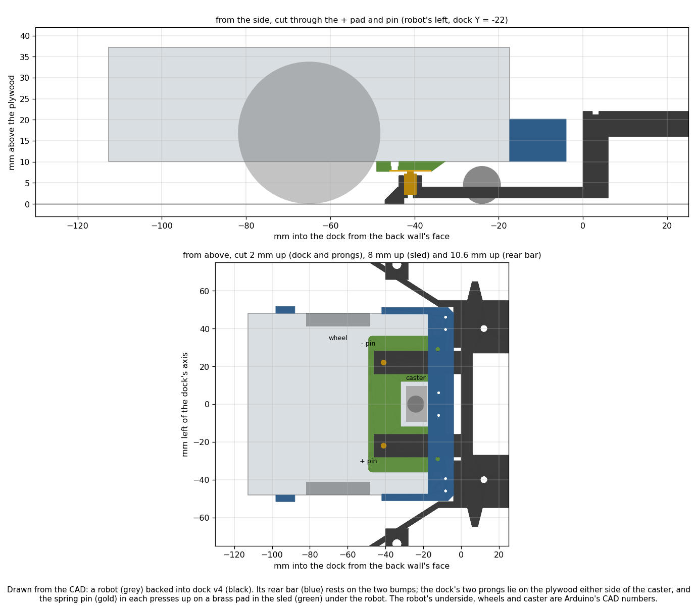
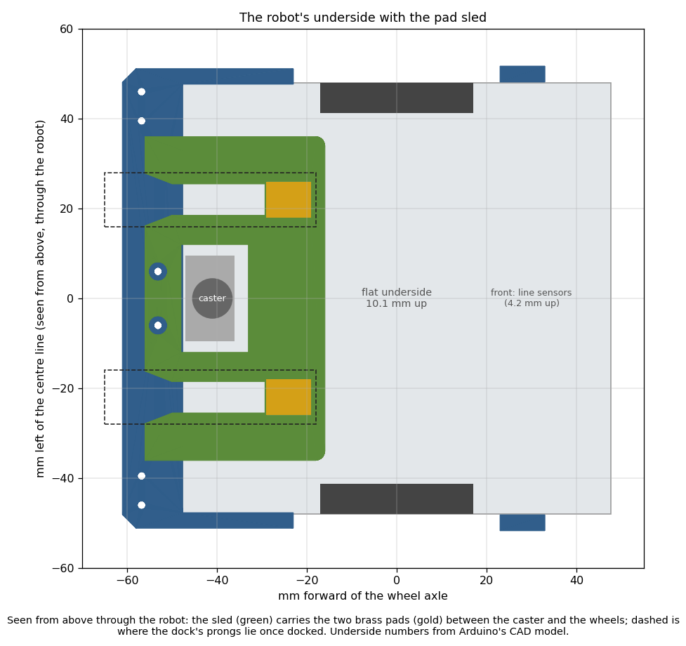

# Self-charging dock: back-mounted attachment v3, pad sled, dock v4

Written 2026-10-25. Redesigned the same day after Nick's decisions below. Nothing here is built or bought yet.
CAD: `hardware/dock/build_attachment_v3.py`. Charge policy: `tools/dock/charge_policy_sim.py`. Firmware and runner
changes are described here but not written. The earlier front-pad design (attachment v2, dock v3) is in Appendix D.

## Premise

Nick's decisions, 2026-10-25:
- **One dock for now** (small workspace). Robots charge on their own; **the long-term goal is 24/7 running**.
- **Charging:** a standard USB-C plug in the Nano ESP32's port, cut down to its 5 V and ground wires, wired to our
  own contacts. The port is on top at the robot's front and faces one side. Which side is not known yet, so the
  cable route works either way.
- **Contacts:** two flat pads, flush on the robot's underside, so nothing hangs down to rub the plywood. The dock has
  a thin tongue on its floor that slides under the robot and carries the spring contacts, pressing up onto the pads.
  **The robot backs in.**
- **Two bumps on the dock's back wall** for the bumper switches, so the parking spot has switch bumps on all four
  sides.
- **One attachment, mounted at the BACK:** the two bumper switches, the ID lights, the pads and the cable route.
  Robots calibrate by backing into the boards (Nick is changing the firmware and runner for that). The front stays
  clear for the distance sensor and the line sensors.

## Data

**The robot's underside.** Measured from Arduino's CAD model of the Alvik by casting vertical rays through it,
4 mm apart and finer near the wheels and the caster.

| What | Number | Source |
|---|---|---|
| Flat underside between the wheels, from the back edge to the front sensor board | **10.1 mm** above the floor | [STEP] |
| Back face's bottom edge | 10.1-10.4 mm up (the front's is 4.2: the line sensor board) | [STEP] |
| Caster | a 9 mm steel ball, **on the centre line, 6.6 mm in front of the back edge** (41 mm behind the axle). Its holder hangs to 7.1 mm up, ±9.5 mm wide | [STEP]; ball size [DS] §2.1; "a ball castor at the robot's rear" ([DroneBot](https://dronebotworkshop.com/alvik/)) |
| Wheels | 34 mm; inner faces 41.2 mm either side of the centre (82.4 apart) | [STEP]; [DS] §2.1 |
| Battery cover | "at the bottom", opened with a Phillips screwdriver. Its position and screws are not in the CAD | [DS] §2.3.1 |
| Weight | 192 g | [tech-specs.yml](https://github.com/arduino/docs-content/blob/main/content/hardware/edu/solution-and-kits/alvik/tech-specs.yml) |
| Back connectors | Qwiic ×2, Grove ×2, servo ×2, "at the back of the robot". Arduino's picture shows them along the top's back edge | [DS] §2.4.1, [picture](https://github.com/arduino/docs-content/blob/main/content/hardware/edu/solution-and-kits/alvik/datasheet/assets/perspective_front.png) |
| Nano ESP32 | lies across the front of the top. Its USB-C is at one end and faces a side | Arduino's picture (same link) |

<sub>[STEP] = Arduino's `alvik_reference_design.step`; [DS] = the
[AKX00066 datasheet](https://docs.arduino.cc/resources/datasheets/AKX00066-datasheet.pdf). Links and the model's
frame are in `hardware/dock/dock_params.py`. The model is a simplified shell: no battery cover, no screws, no tyre
squash. Fit test 1 measures the real clearance.</sub>

**Feasibility: the tongue fits, with two changes.** Nick's idea works in the 10.1 mm under the robot, but a
straight centred tongue would not. Two problems showed up:

1. **The caster sits exactly where a centred tongue would go** (back centre, touching the floor). So the tongue is a
   **fork**: two prongs, one each side of the caster, each carrying one spring pin (+ on one, − on the other). The
   caster rolls down the open middle.
2. **The springs push the robot's rear up.** The robot is light (192 g), and only part of that weight is on the
   caster. A pin under the back edge acts on a longer lever than the caster's own load, so it would lift the caster.
   So the pads sit as far forward as the funnel allows: **24 mm behind the axle**. The pins should also be low-force
   (about 30 g each). Two such pins take an estimated 59 % of the caster's load off it (it stays down). That rests on
   an assumed caster load: check item 4 measures it.

A third point follows from "flush". A spring pin has to be free while it passes under the robot and pressed once it
reaches the pad, so the pad has to be the lowest point on its path. The pads are therefore flush in a thin
(2.4 mm) **pad sled** under the robot's rear. The sled has a slot for each pin to travel in, with a ramp at its end
down onto the pad. The lowest thing the robot carries is then 7.7 mm off the plywood (the caster's holder is 7.1).

Height stack, mm above the plywood (checks all pass; `build_attachment_v3.py`):

| Prong top | Pin boss top | Barrel top | Pad face (pin pressed 1.0 of 1.5 mm) | Free pin tip | Robot underside and bar bottom |
|---|---|---|---|---|---|
| 4.0 | 6.7 | 7.2 | **7.7** | 8.7 | **10.1** |

<sub>A free pin tip travels 1.4 mm below the robot. If the real clearance is under about 9.6 mm, a free tip would
rub. Fit test 1 decides: the fix is a thinner sled and a lower pin seat, both single numbers in the script.</sub>

**How the Alvik charges** (unchanged from the first plan; details in Appendix C). It charges from 5 V on the Nano's
USB-C VBUS line. The MAX17332 chip on the robot controls the charge. The charge current is **not published**. Bench
test 1 measures it, and the charge thresholds depend on it. Our firmware already logs `is_battery_charging()`.
[Bandini's self-charging Alvik](https://www.hackster.io/roni-bandini/building-a-self-charging-alvik-6daed7) confirms
that 5 V on VBUS charges the robot while it is switched on.

**Drain** (measured, `docs/build-reports/e02-oct24-night-analyses.md` §C): **11-16 %/h** standing still and
switched on; 13-24 %/h over day fits that include driving (robots drove about a quarter of the time). **Job length**
(measured, 741 runs in `logs/*/robot-logs-*/runend.csv`): median 28 s, 95 % 52 s, longest 191 s.

## Conclusion: the design


*A robot (grey) backed into dock v4 (black), drawn from the CAD. The spring pin (gold) in each of the dock's two
prongs presses up on a brass pad in the sled (green) under the robot, and the caster rolls between the prongs.*


*The robot from below (drawn as if seen through it). The sled carries the two pads between the caster and the wheels,
and the dashed boxes are where the prongs lie once it is docked.*

**Robot side**
- **Attachment v3** (`stl/attachment_v3.stl`, 116 × 103 × 53 mm, one print). Version 1's bracket is moved to the
  back, the same width (102.2 mm) with the same switches, and screwed to the back insert pair. Its bar is raised to
  10.1-20.1 mm so its bottom is level with the robot's underside. The light plate keeps its layout (bright bar at
  the front) and stands on the front insert pair. **Cable clips** under the plate run across the front over the
  Nano, so the plug works from either end, then down the middle to the back. They keep the cable off the robot's
  touch buttons. The bar has two wire holes for the pad wires and two pilot holes for the sled's screws.
- **Pad sled** (`stl/pad_sled.stl`, 72 × 42 × 2.4 mm). It sits against the robot's flat underside and is screwed to
  the bar's underside with two M2 screws. The pins push it up against the robot, so it needs no glue. It has two
  **brass-shim pads** (8 × 10 mm, 0.4 mm, flush in recesses), a slot and ramp for each pin, and wire channels on its
  top back to the bar. It is notched around the caster.
- **Polarity:** the robot's **left pad = + (VBUS)**, right = − (GND). The dock's + pin is marked with a dimple on
  top.
- **Electrics (as before):** USB-C plug → a Schottky diode (SS34, striped end towards the plug) in the + wire → the
  + pad. The − wire goes to the − pad. Contact sense: 100 kΩ from the + pad to a free Nano analog pin, and 150 kΩ from
  that pin to GND (about 3 V when docked on live pins). The plug blocks the USB port, so firmware goes on by WiFi.

**Dock side: dock v4** (`stl/dock_v4.stl`, 172 × 174 × 22 mm)
- This is dock v2's funnel and check tile, with **two bumps** (4 mm out) on the back wall. Each bump presses its
  switch's lever 1.5 mm and stops the bar's face. The three outside **post stations** stay, with their posts raised
  from 15 to 22 mm to reach the higher rear bar.
- **The tongue:** two prongs, 12 × 4 mm, from the back wall 47 mm into the dock, at ±22 mm. Each prong holds one
  upright spring pin, seated on a printed step, with its solder tail in a wire groove underneath (open to the
  plywood) that leads to the cavity behind the wall. The prong tips have chamfered noses.
- **Power:** USB-A wall charger (5 V, 2 A+) → cut USB-A cable → resettable fuse (PTC, 1.1 A hold) in the red wire →
  + pin. Black → − pin. The cable leaves through the channel under the head, or a hole drilled in the plywood.

**How a docking goes:** the runner drives the robot to the staging point 20 cm in front of the dock (`PARK_STAGE_CM`,
as for a park spot), turns it, and backs it in.
1. The funnel centres the rear bar.
2. The caster rolls between the prongs. Checked: by the time the caster reaches the prong tips, the funnel holds
   the bar within 10.1 mm of centre, so the ball misses them.
3. Each pin travels in its sled slot, climbs the ramp, and is pressed 1.0 mm onto its pad.
4. Both switches click on the bumps.

The wheels never reach the prongs: docked, the tyres touch the plywood 12 mm short of the tips.

**Firmware and map numbers** (printed by the script): the bumper face is **6.10 cm behind the axle**, switches
±4.27 cm, `sw_gap_cm` 0.020, `bumper_cm` 1.34 (now at the back). Docked, the axle is 6.5 cm from the back wall,
because the bumps add 0.4 cm. The map's dock pose is the middle of the two bumps' faces, heading out of the dock.
While docked, the firmware should refuse **backward** moves; leaving means driving forward, which is the reverse of
the first plan.

**Risk: backing has no line sensor behind.** The line sensors (the edge guard) are at the front. A robot that backs
towards a board that isn't there, or towards the board's edge, is stopped only by the camera's border and the
robot's own position border (`FW_BORDER_CM`, `HOME_FW_BORDER_CM`). A board-push find that misses its board, or a
pose error larger than the border, sends the robot off the edge backwards. Before relying on back-finds, run the
simulator's back-find with camera noise and a missing board (new test 9 below).

## Conclusion: charge thresholds (go and leave levels)

**Method.** No more round numbers (40 % / 90 %). Each level comes from what it has to cover:
- **Go level** = reading error + finishing the current job + driving to the dock + **the worst wait for the one
  dock** + a floor above empty. Each part is a drain rate × a time. The worst wait is every other robot charging
  ahead of this one. Because that wait depends on the go level itself, the script solves for it.
- **Leave level** = the **knee** of the charge curve: the point where constant current turns to constant voltage and
  the %/min drops. Charging past the knee buys little charge for a long time on the only dock, while the others
  wait.
- **Check:** a queue simulation (`tools/dock/charge_policy_sim.py`). N robots, one dock, 7 days, the measured drain,
  the charge curve as parameters. It reports uptime (share of robot-time spent working) and the lowest true battery
  for a grid of go / leave levels. Each cell takes the worse of two cases: a worst case (top drain, all start full at
  the same moment, every reading 3 % high) and a typical case (5 random runs).

**Result, with PLACEHOLDER charge numbers** (40 %/h, i.e. 1.0 A, to a knee at 80 %; asleep while docked). The
placeholders are marked in the script and replaced after bench test 1. The drain and job numbers are measured.

| Policy (3 robots, 1 dock) | Go | Leave | Uptime, typical (worst case) | Lowest battery |
|---|---|---|---|---|
| Plain: go at G, leave at L | 50 % | 80 % | 61 % (44 %) | 9 % |
| **Plus early top-up**: also go whenever the dock is free, nobody is waiting, and the reading is below L − 20 | **40 %** | **70 %** | **66 % (45 %)** | **20 %** |
| Upper limit (no queue at all) | | | 71 % | |

- **The knee rule holds:** with the plain policy, uptime rises with the leave level up to the knee and falls after
  it: 56, 59, 61, 61.3, 61.2, 59 % at 65-90 %, then 35 % at 95 %.
- **The go level from its parts** (plain, worst case, leave 80): 3.0 error + 1.0 job + 1.4 drive + 34.1 queue
  (2.1 h) + 5.0 floor = **44.5 %**. The simulation's lowest safe level is 50 %; the gap is the gauge's whole-%
  rounding. **The queue is almost all of it.**
- **The early top-up is better** (+5 points of uptime, lowest 20 % instead of 9 %). It spreads the robots out, so
  they rarely need the dock at the same time. Recommended, pending the real curve.
- **Capacity: the real charge current decides whether 24/7 is possible.** One dock keeps at most 1 + charge rate ÷
  drain rate robots running. At the placeholder that is 3.5, and 3 robots keep the dock busy 86 % of the time. At
  **0.5 A** (20 %/h) it is 2.2, and **no thresholds keep 3 robots running without one going flat**. The same happens
  if robots stay **awake** while docked (2.6). So 3 robots on one dock need a net charge of about **33 %/h (0.8 A,
  asleep)**, or about 39 %/h (1.0 A) at the top of the drain range. Below that, the runner has to rest one robot at a
  time (2 working, 1 asleep), or a second dock is needed.

**What bench test 1 must measure** (then rerun
`python tools/dock/charge_policy_sim.py --cc-rate R --knee K --sleep-drain S`):
1. **The charge curve:** the current (A) and battery % every 5 minutes from about 20 % to full, robot asleep. This
   gives the rate before the knee (R, in %/h), the knee (K), and where the charger stops.
2. The same for 30 minutes **awake**. The difference is the awake penalty.
3. **Sleep drain** (S): one robot asleep for 1 h, not charging.
4. **Reading error:** the meter's mAh against the change in battery % over the full charge.

## What's next

1. Nick does the check list below and prints fit test 1 (clearance gauge). Its result may move one number.
2. Bench tests 1-3 (no printing). Then rerun the simulator with test 1's numbers. **That decides whether one dock
   can run 3 robots nonstop.**
3. Order the parts (Professor Sodhi orders project parts).
4. Print fit tests 2 and 3, then attachment v3, the sled and dock v4 (Appendix B).
5. Bench tests 4-8, then the firmware (back-in `charge` run, docked guard, sense pin) and the runner (send home,
   early top-up, sleep while docked, leave, alerts), with simulator tests.

### Check list: measure with a ruler (or the printed gauge)

Robot switched off, on a flat table.

| # | What to measure, and where | Expect | Sets |
|---|---|---|---|
| 1 | **Clearance under the back.** Print `clearance_gauge.stl` (six fingers, 8.0-10.5 mm tall; the notches count them, one notch = 8.0). Slide each finger in from behind the robot, between the caster and a wheel, under the flat part. Write down the tallest one that slides in without lifting the robot | the 10.0 slides in, the 10.5 doesn't | `Z_UNDER_MM` |
| 2 | **Battery cover.** Turn the robot over and take a photo. Is anything (cover edge, screw heads, labels) raised above the flat bottom in the area from the back edge to 1 1/2 in (38 mm) forward, between the wheels? | flat | the sled's outline |
| 3 | **Caster.** From the robot's back edge to the centre of the steel ball; and the width of the plastic holder around the ball | 1/4 in (6.6 mm); 3/4 in (19 mm) | `CASTER_X_MM`, holder width |
| 4 | **Weight on the caster.** Kitchen scale. Stand the robot with only its caster on the scale and its wheels on a book stack of the same height as the scale's top. Then weigh the whole robot | about 60 g; 192 g | `CASTER_LOAD_N` (the pins must take less than half of it off) |
| 5 | **Nano's USB-C port.** Which side it faces (robot's left or right, standing behind the robot looking where it looks); from the robot's front edge to the port's centre; how far the port's end is from that side's edge of the shell | ASSUMED 1 3/16-1 5/16 in (30-33 mm) back | `NANO_X_MM`, plug choice |
| 6 | **Back face.** The height above the table of the lowest connector (Grove, Qwiic or servo) on the back | above 13/16 in (20 mm), where the rear bar ends | the bar's height |
| 7 | **Tyres.** Inside face to inside face, across | 3 1/4 in (82.4 mm) | `WHEEL_INNER_Y_MM` |
| 8 | **When the spring pins arrive:** which hole of `pogo_gauge_v.stl` holds one snugly (smallest at the notched end), and how high the pin's tip then stands above the table | tip 11/32 in (8.7 mm) | `POGO_V_BARREL_DIA_MM`, `POGO_V_LEN_MM` |

### Bench tests, in order

1. **Charge curve** (above). The robot on the stock cable through the USB power meter.
2. **Is the robot's 5 V live when it runs on battery?** Robot ON. Measure between the cut plug's red and black wires
   (keep the bare ends apart). Above 0.5 V means the SS34 diode is required.
3. **The cut plug alone,** fed from the dock's charger through the PTC fuse and the diode with clip leads, through
   the meter. It should read the same as test 1, a little lower for the diode.
4. **Dock short test:** dock v4 wired, no robot. A wire across the two pins for 5 s: the fuse warms and the current
   drops; 5 V returns once the wire is removed.
5. **Spring force and caster:** one pin pressed 1 mm into a kitchen scale (want 30 g or less). Then a robot docked
   on unpowered pins: slide a sheet of paper under the caster. It must be pinched (the caster still carries weight),
   and the robot must stay seated, both switches pressed, for 60 s.
6. **Back-in repeatability:** 20 back-ins from varied starts at the staging point, up to 2 cm off to the side,
   power on. Count contact sense plus charging within 10 s (goal 20/20). Watch for the caster touching a prong, and
   for a pin catching the sled.
7. **One supervised full charge,** docked, robot asleep, 20 → 100 %. Every 30 min, feel the battery cover, pins and
   fuse.
8. **Runner trial** in the simulator, then one real low-battery send-home.

---

## New tests that may now be needed
1. **Real clearance and caster load** (check items 1 and 4): the whole stack and the caster-lift margin rest on them.
2. **Caster lift during the approach.** When the robot is still off-centre as the pins reach the sled's back end
   (the funnel then allows up to 17 mm; the slots' flared mouths take 6), a pin rides under the sled's plastic for a
   few mm, briefly pressed far behind the axle. Bench test 6 watches for it. If the caster lifts, flare the slots
   wider or send the robot to the staging point more precisely.
3. **Back-in docking in the simulator:** `tools/sim/fw_dock.py` models nose-first docking with the old pocket. It
   needs the back bumper, the bumps and the fork (prongs as obstacles for the caster).
4. **Charge curve, awake penalty, sleep drain, reading error** (bench test 1). Then rerun the policy simulator; it is
   the 24/7 go / no-go.
5. **Early top-up in the runner,** simulator first: two robots wanting the dock at once, a robot topping up when
   another drops to the go level (does the runner pull the top-up robot out?), and resting one robot when the
   capacity check fails.
6. **Contact wear:** 100 back-ins, then the contact resistance (meter on the pad and pin) before and after. The pins
   slide 4 mm over the ramp and pad on every docking.
7. **Contact-sense calibration:** ADC reading with the pads open, on live pins, and with the dock unpowered.
8. **Firmware guard:** a docked robot refuses backward moves, and driving forward clears the guard.
9. **Back-finds without a line sensor behind:** a back-find towards a missing board, and towards the board's edge,
   with camera noise in the simulator. The position borders must stop it before the edge.
10. **Post stations with the raised posts:** repeat the `run posts` check, since the levers now meet the posts
    14.6 mm up instead of about 9.

## Possible inaccuracies
- **The underside numbers come from Arduino's simplified CAD**, which has no battery cover, screws or tyre squash.
  The 10.1 mm clearance carries the whole stack (check items 1-2).
- **Caster load 0.6 N: ASSUMED** (about 30 % of 192 g plus the attachment). The 59 % lift figure scales with it
  (check item 4).
- **Spring pins: every number ASSUMED** (3.0 mm barrel, 6.5 mm long, 1.5 mm stroke, 0.3 N). None bought. Low-force
  pins of this exact length may not exist off the shelf. The pin seat height is the one number to change for
  another length.
- **The back face is assumed to mirror the front** (47.6 mm behind the axle), from the CAD's 47.4-48.0.
- **Nano port position** is read off Arduino's picture, not measured (check item 5).
- **Back connectors** assumed above the rear bar (check item 6).
- **The robot's lateral offset at the sled** (17 mm) comes from the funnel's shape alone. The real offset depends on
  how precisely the runner reaches the staging point.
- **Charge-policy placeholders:** charge rate 40 %/h, knee 80 %, the CV taper's shape, cut-off at C/10, sleep drain
  3 %/h, reading error ±3 %. The answer moves with all of them; only the method is final.
- **Drain rates** are per-day fits with driving about a quarter of the time. A 24/7 duty with more driving would
  drain faster. The battery % is a smoothed integer whose meaning is not checked (night analyses).
- **The simulation queues first come, first served,** with no robot ever rested and a fixed 2 min drive and 1.5 min
  swap (both estimates).
- **Prices** are estimates, not looked up.
- **Chosen numbers** (CHOSEN in the scripts), each with whether a design of experiment should set it:
  - Pad position 24 mm behind the axle, prong width 12, pin compression 1.0 mm: **yes, a small DOE** if bench test 6
    shows misses or caster lift. Two compressions × two pad positions × 20 back-ins, scored on contact rate and
    caster pinch.
  - Bump height out of the wall 4 mm, rear bar height 10.1-20.1: no (geometry: lever travel, pin clearance).
  - Sled thickness 2.4, slot width 7, flare 14, ramp 4 mm: no, unless test 6 shows catching; then a DOE on the
    flare.
  - Go / leave / top-up levels: **set by the simulator** (a simulated DOE over the grid), not physically.
  - Floor 5 %: **yes, a one-robot test:** run it down and note the % where the motors weaken or it browns out.
  - Drive 2 min and swap 1.5 min: no; timed in bench test 8.
  - PTC 1.1 A hold: no; 1.5 × test 1's peak.

---

## Appendix A: geometry report (`python hardware/dock/build_attachment_v3.py`, 33 ok, 2 WARN, 0 FAIL)
- WARN, approach: when the pins reach the sled's back end, the funnel holds the robot within 17.1 mm; the flared
  mouths take 6.2 (new test 2).
- WARN, lift: two 0.3 N pins at 24 mm take 0.35 N off the caster, 59 % of the assumed 0.6 N (check item 4, test 5).
- Prongs 16-28 mm out from the centre: they miss the ball (out to 4.5) and pass under its holder (7.1 mm up), and
  are 13.2 mm inside the wheels. The ball clears the prong tips by 1.4 mm at the funnel's worst.
- On the pad, the pin has 3.2 mm to spare sideways (docked play 0.5) and 4.2 mm along it.
- Dock v2's checks on dock v4 pass (post spacing 85.45 mm, stations clear, posts 22 mm).
- Print: attachment v3 upside down with supports (about 1570 mm², version 1 1450). Sled top face down, no
  supports (its only down-facing faces are 2 mm wire-channel roofs). Dock v4 bottom down (the cavity roof, cable
  channel and wire grooves are bridges).
- Files: `stl/attachment_v3.stl`, `pad_sled.stl`, `dock_v4.stl`, `clearance_gauge.stl`,
  `attachment_v3_fit_test.stl` (the rear bar and lower arms, 38 × 102 × 8 mm), `pogo_gauge_v.stl`. Previews:
  `preview/attachment_v3.png`, `pad_sled.png`, `dock_v4.png`, `docked_v4.png`, `underside_v4.png`.

## Appendix B: build steps

**Make the files** (only if a number changed). Open a **Terminal window on the laptop** in the project folder,
type this and press Enter:

```
python hardware/dock/build_attachment_v3.py
```

You should see lines starting `ok`, two starting `WARN` (above), and none starting `FAIL`.

**Print** (PLA, 0.2 mm layers, 4 walls, 20 % infill; do not rotate the parts in the slicer):
1. `clearance_gauge.stl`: bottom down, no support (check item 1).
2. `attachment_v3_fit_test.stl`: bottom down, no support. Hold it against the robot's back. The bar's bottom
   should be level with the robot's underside, and the low arm holes should line up with the back pair of brass
   inserts.
3. `pogo_gauge_v.stl` once the pins arrive (check item 8).
4. `attachment_v3.stl`: upside down as exported, **supports on** (tree if offered).
5. `pad_sled.stl`: as exported (top face down), no support.
6. `dock_v4.stl`: bottom down, brim on, black.

**Robot side** (each robot):
1. Cut two brass-shim pads, 8 × 10 mm, each with a 3 mm tab on one short end. Bend the tab up 90°.
2. Push each pad into its recess on the sled's underside (the recesses are at the end away from the two screw
   holes), with the tab up through the slot. Glue it with a thin film of superglue. Run a fingernail across: it
   must not stick out.
3. Solder a red wire to the tab of the pad that will be on the **robot's left**. Hold the sled with its wire
   channels facing up and the two screw holes towards you: that is the pad on your **left**. Solder a black wire to
   the other. Press each wire
   into the channel on the sled's top, out to the back.
4. Fit attachment v3 to the robot with eight M3 × 8 screws: the bar's arms on the back inserts, the plate's legs on
   the front inserts.
5. Thread the two wires up through the bar's wire holes. Hold the sled flat under the robot's back and screw it to
   the bar with two M2 × 6 pan-head screws.
6. Above the bar: SS34 diode in the red wire, **striped end towards the plug**. Join red to the cut plug's red and
   black to its black, and heat-shrink each joint. Add the sense resistors as before (100 kΩ from red, on the pad
   side of the diode, to the analog pin; 150 kΩ from that pin to GND).
7. Lay the cable in the clips under the plate, from the back to the front, and plug it into the Nano.

**Dock side:**
1. Solder a short wire to each spring pin's tail first, then press the pin into its prong from above until it stops
   on its seat (a drop of superglue on the barrel if loose). Lay the wire in the groove under the prong, to the
   cavity. The pin under the dimple on top is **+**.
2. Wire the cut USB-A cable: PTC fuse in red, then red to the + pin's wire and black to the −. Heat-shrink
   everything.
3. **Polarity check before any robot docks:** charger plugged in, multimeter on DC volts, red probe on the + pin,
   black on the −. You should see about +5.0 V. A minus sign means swap them.
4. Screw the dock down as dock v2 (four #6 × 1 1/4 in wood screws through the head, two in the funnel tabs). Leave
   25 cm clear in front of the mouth for the staging point.

## Appendix C: how the Alvik charges (research, 2026-10-24/25)

| Question | Answer | Source |
|---|---|---|
| Battery | One 18650 Li-ion cell, 2500 mAh, 3.0-4.2 V | [DS] §2.3; tech-specs.yml |
| Charge port | The Nano ESP32's USB-C; charging comes in on VBUS | [Hackster](https://www.hackster.io/glowascii/first-steps-with-the-arduino-alvik-robot-kit-f229bb); [CNX](https://www.cnx-software.com/2024/05/14/arduino-alvik-is-a-3-wheel-robot-designed-for-steam-education/) |
| Charger chip | MAX17332 (charger, fuel gauge, protector) plus LTC4360 over/reverse-voltage protection | [DS] §2.3.1; [Analog Devices](https://www.analog.com/en/products/MAX17332.html) |
| Charge current | Not published | bench test 1 |
| Switched off / on | Charges either way. When off, the Nano's LED blinks red, then goes solid green when full | [docs commit](https://github.com/arduino/docs-content/commit/5442398e6b4358783dfb01e38d9ecb4c320ed9c5); [Bandini](https://www.hackster.io/roni-bandini/building-a-self-charging-alvik-6daed7) |
| Which USB-C lines | Only VBUS and GND. No CC resistors on the robot side. A USB-A charger with a cut USB-A cable always gives 5 V | [Hackaday](https://hackaday.com/tag/vconn/); [DigiKey forum](https://forum.digikey.com/t/simple-way-to-use-usb-type-c-to-get-5v-at-up-to-3a-15w/7016/11) |

Bandini (the only Alvik self-charger found) rejected plugging into the USB-C port ("needed precision and pressure")
and used a 5 V / 1 A wireless coil soldered to the Nano's VBUS and GND, with the robot going home below 20 %.

## Appendix D: superseded designs
- **Attachment v2 / dock v3** (`build_attachment_v2.py`, files kept): brass screw-head pads in the FRONT bar, and
  spring pins in the dock's back wall. Replaced by Nick's decisions above: back-mounted attachment, contacts
  underneath, tongue.
- **Thresholds 40 % / 90 %:** replaced by the method above.

## Parts (rough prices, estimated, not checked against a store)

| Part | Per | Rough price |
|---|---|---|
| Spring pins, through-hole with solder tail, **low force (about 30 g)**, about 3 mm barrel, about 6.5 mm long, 1.5 mm stroke | dock (2) | $5-10 for 10-20 |
| Brass shim, 0.3-0.5 mm (or a scrap of copper-clad board) | a small sheet | $5-8 |
| M2 × 6 pan-head screws | robot (2) | $4 a pack |
| M3 × 8 screws (as version 1) | robot (8) | on hand |
| USB-C plug: a short USB-C cable to cut, or a 2-wire plug breakout. Ideally right-angle (check item 5) | robot | $1-3 |
| SS34 Schottky diode; 100 kΩ and 150 kΩ resistors | robot | under $1 |
| USB-A wall charger 5 V 2 A+, USB-A cable to cut, PTC fuse 1.1 A hold | dock | $12-18 |
| Inline USB power meter (bench tests) | once | $10-15 |
| Hook-up wire 26-28 AWG, heat-shrink | once | on hand? |
