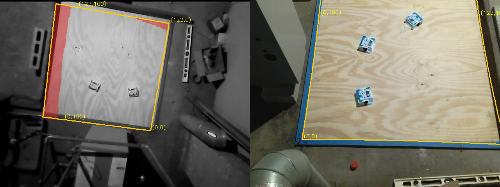
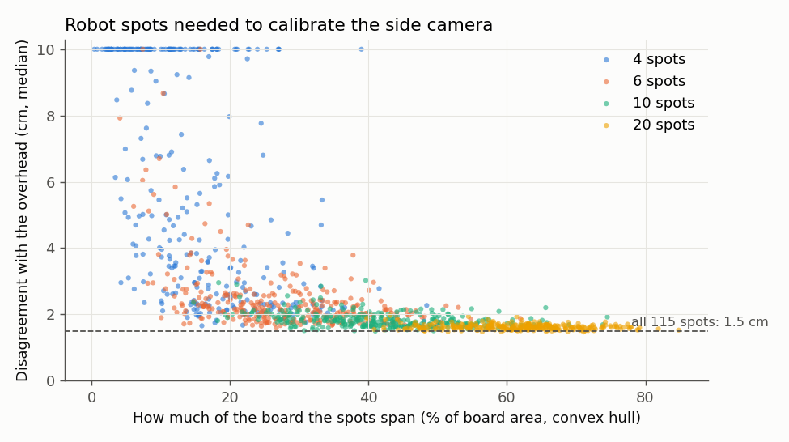
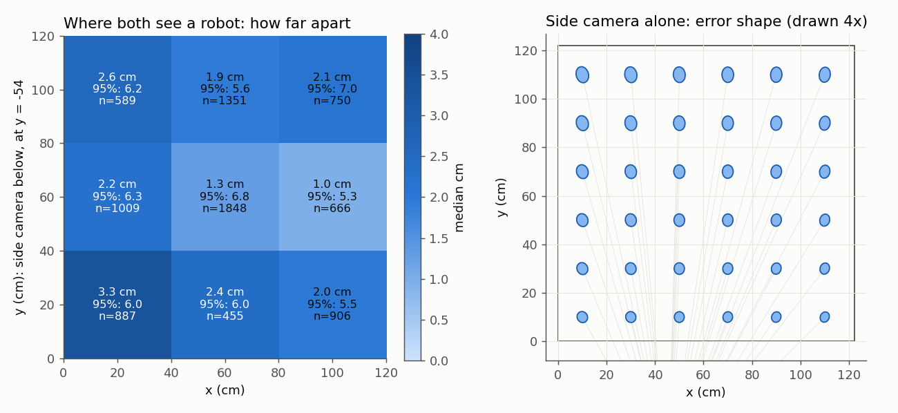
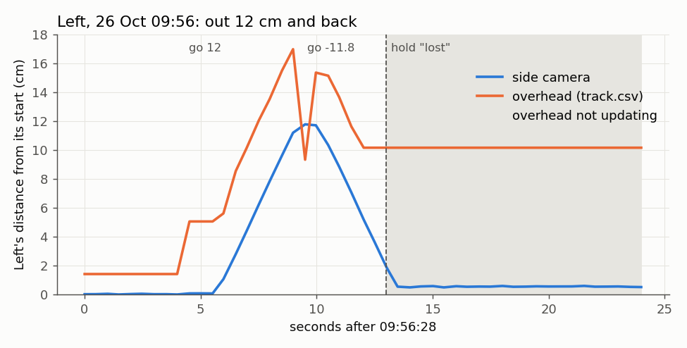
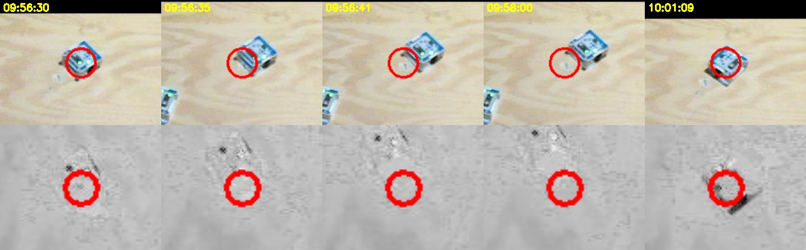
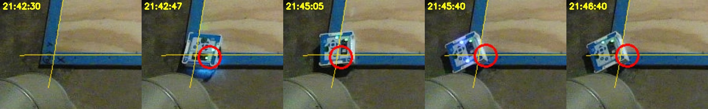
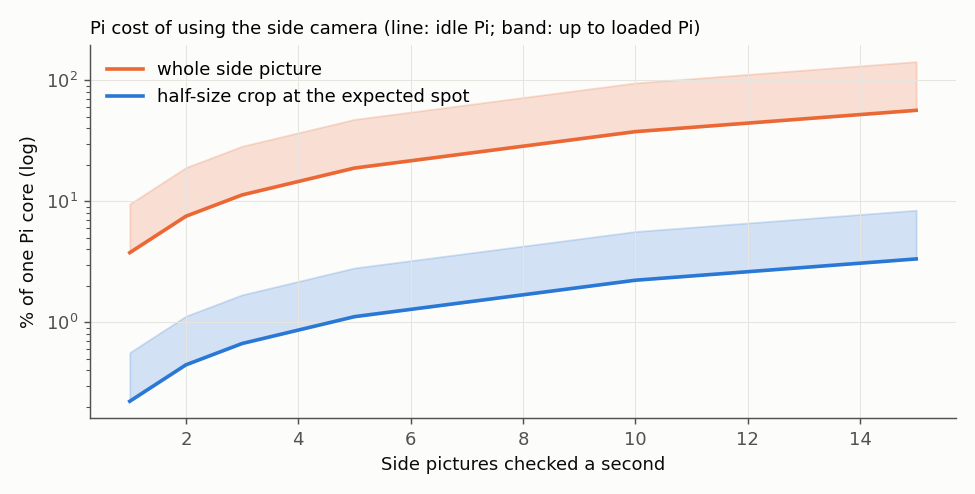
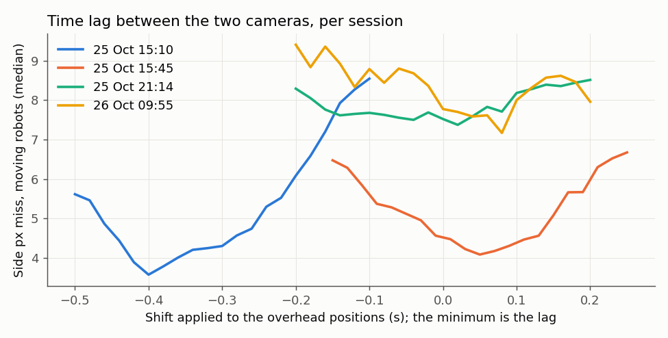

# Two camera angles: can the side view confirm or correct the overhead? (MIRLT, 2026-10-26)

Logs-only feasibility study, from Nick's 12:40 question: "start thinking about using the geometry of 2 different
camera angles to confirm Alvik position". Nothing on the Pi or in the runner was touched. Scripts:
`tools/experiment/analyses_oct26/twocam/`. The robot-made side model: `tools/experiment/data/side_floorcal_robots_20261026.json`.

## Premise

The overhead camera loses or misplaces robots at the edges and when a robot's white top washes out against the
plywood. The side camera (EMEET C950, on the Pi as cam1) has been recorded every session but never used live.
Because the robots drive on one flat board, any point the overhead reports can be paired with where the robot
appears in the side picture. Those pairs fit the side camera to the floor with no tape measure: **the robots
calibrate the second camera from the first.** The same steps work for any further camera that shares the floor with
the first.

Data: sessions 2026-10-25 15:10, 15:45, 21:14 and 2026-10-26 09:55. Both videos were read by byte range from the
GitHub releases, with every robot-tracked minute sampled at 2.5 side pictures a second (about 15,700 side pictures),
plus track.csv, frames.csv and the logs. Track positions from explore's stand-in camera (15:10 all session, 21:14
until 22:02, 09:55 until 10:22) were taken back to pixels and onto the roam1 floor frame.

## Data

### 1. The side camera's view

Left: the overhead picture with the board outline (yellow) and, shaded red, the floor the side camera cannot see.
Right: the side picture with the same outline. Data: median of 15 pictures from the start of 09:55; roam1
calibrations.

| | Side camera |
|---|---|
| Where | at the (0, 0) end of the board, about 1.7 m up, 54 cm back from the y = 0 edge |
| Board seen (a whole robot in the picture) | **87 %**: everything up to y ≈ 107 cm. Not seen: the far 15 cm strip along the x-board (y = 107-122), and the near-right corner (x > 115, y < 30) |
| How oblique | 19° from straight down at the near edge, 35° in the middle, 47-49° at the far edge |
| Picture scale | 0.25 cm a pixel near, 0.42 cm far |
| Moved between sessions? | **No.** Feature shift against 09:55: 0.3-0.4 px median, 1.3 px worst, for all three 25 Oct sessions. The 25 Oct plywood-grain calibration (`side_floorcal_roam1.json`) still sits on the blue tape |

Side finding: the overhead's picture was 1.7-2.2 px off between the 25 Oct sessions and 26 Oct (about 0.5 cm on the floor).

### 2. Calibration from the robots alone

Each side picture's moving outlines (difference from that minute's median picture) were paired with the overhead's
track.csv position at the same moment. A random-sample fit (RANSAC) picked out the true pairs from the false ones
(other robots, shadows). It then refitted with a shrinking gate: homography plus one lens-bend term.

| | 15:10 | 15:45 | 21:14 | 09:55 | **All four, one model** |
|---|---|---|---|---|---|
| Pairs used | 1,296 | 1,170 | 2,927 | 1,417 | **6,650** |
| Miss in side pixels (median) | 5.6 | 3.2 | 4.9 | 4.6 | **4.9** (rms 6.1), about 1.5 cm |

**How many robot spots it needs:**

Each dot is one random set of N still-robot spots, fitted alone. Across: how much of the board the spots span. Up:
how far the fit then disagrees with the overhead over the whole board (capped at 10 cm). Data: 115 spots (10 cm
cells with 3 or more still pairs) from the four sessions.

- 4 spots: unreliable. When bunched (under 25 % of the board), 1 draw in 10 was over 40 cm off.
- **8 spots spanning a quarter of the board or more: 1.85 cm**, against 1.5 cm with all 115.
- 10 spots spanning half the board: 1.73 cm (90 % of draws under 1.95 cm). Explore's first minutes already give that.

### 3. Cross-check: where both cameras see a robot

Fit on even minutes, test on odd minutes, and the reverse (8,461 test moments).

Left: median distance between the two cameras' positions in each third of the board, with the 95th percentile.
Right: the side camera's own error shape at each spot, for a 2-pixel error in finding the outline's centre, drawn 4
times larger. Data: the pooled model, held-out minutes of all four sessions.

- **98.2 % of moments agree within 10 cm; among those, median 1.9 cm, 95 % 6.0 cm.**
- Best in the middle (1.0-1.3 cm). Worst at the near-left (3.3 cm) and far-left (2.6 cm). Within 12 cm of an edge
  2.6 cm; inside 1.8 cm.
- **Uncertainty shape:** the side camera is mildly oblique here. Its error stretches along its line of sight by 1.08×
  at the near edge and about 1.4× at the far edge (0.27 × 0.25 cm a pixel near; 0.42 × 0.31 far). The measured
  differences are about round (along sight 1.5 cm, across 1.7 cm; spread measured as interquartile range / 1.35). So
  the overhead's own scatter, not the side's geometry, sets today's agreement.
- How often the side found an outline within 10 cm of a moving tracked robot: 15:45 99 %, 09:55 86 %, 15:10 83 %,
  21:14 56 %. The misses are this offline detector's: a robot that stands still for most of a minute melts into that
  minute's median picture. They are not the camera's.

**The catch: a camera calibrated from another inherits its constant errors.** The robot-made model and the
independent grain calibration disagree by **4.7 cm**, in nearly the same direction everywhere (x −4.2, y +1.9 cm;
0.8 cm scatter around that). So the overhead's positions sit about 5 cm from where the grain-calibrated side camera
puts the robot's middle. The 21:14 report saw the same thing by eye at the corner ("tracker 5 cm further out"). Zoomed
pictures show each camera sometimes off the body's centre, so which one carries the offset is not settled
(test T1). Calibrated from the robots, the side camera catches jumps, losses and stuck robots. It cannot catch an
offset the overhead always has. Calibrated independently, it can.

### 4. The moments the overhead went wrong

**09:55 session, Left washed out (09:56-10:02).**

Left's distance from its starting spot over its 12 cm probe and the 11.8 cm return, by the side camera (blue) and
the overhead (orange); grey = the overhead not updating. Data: side video every 0.5 s with the pooled model;
track.csv.

Side crops (top) and overhead crops (bottom) around the overhead's position (red circle), 09:56:30-10:01:09. Data: both videos.

- The side camera saw Left at every picture (740 of 753): out 11.7 cm, then back to 0.5 cm of its start by 09:56:41.
- The overhead jumped 5 cm before Left moved, then stopped updating at 09:56:40, 10.2 cm out, on empty plywood.
- **The side view would have answered the 09:56:41 hold at once:** the wheels were right, and Left was home, 9.6 cm
  from the overhead's spot. The real hold waited 4 min 19 s for Nick.
- At 10:01:06 the overhead's "40 px jump" put Left 0.5-1 cm from where the side camera saw it. **The side view
  confirms the jump was the correct re-find.** That hold (1 min 56 s) was not needed.

**21:14 session, the two false "lost" holds.** Center from 21:17:20 and Right from 21:30:14 stood still in the side
view. The side positions were 0.9-1.2 cm and 2.7-3.6 cm from the overhead's. Both cameras said 0 cm against the
wheels' 10 cm. **Two cameras agreeing on "did not move" points to a lost command, not a lost camera.** It took the
21:14 report a log dig to find that.

**21:14 session, Left at the corner (21:42-21:47).**

The board's (0, 0) corner in the side view, with the x = 0 and y = 0 lines (yellow), and the overhead's latest
position (red circle). Data: side video; pooled model; grain calibration for the lines.

- The corner is close to the side camera (0.29 cm a pixel), and it saw Left in all 660 pictures. The pictures show
  the body over the tape, nose past the plywood from 21:42:47, and tilted at the corner from 21:45:40.
- The overhead stopped updating at 21:45:37. Its last spot was 6.8 cm from where the side saw the body.
- At 21:42:47 the overhead put Left at y = −6.1. The grain-calibrated side view gives y = −1.3, close to the
  report's −0.5 by eye. The robot-made model gives −6.1 again: it inherits the offset (section 3).

### 5. Costs

| | This machine | Pi (×1.9 idle to ×4.8 loaded) |
|---|---|---|
| Runner tracker, idle (the scale) | 14.4 ms | 26-29 ms measured (09:55 report) |
| Side: decode the whole picture + find outlines | 19.8 ms | 38-95 ms |
| Side: half-size grey decode, crop around the expected spot, compare with a reference | **1.2 ms** | **2.2-5.6 ms** |

The Pi scale is this machine's idle tracker against the Pi's: ×1.9. The ×4.8 upper end is the Pi following a robot
(73 ms).

The share of one Pi core the side check would take at each rate. Line: idle Pi; band: up to a loaded Pi. Data: the
timings above.

- **Rate:** robots move at a median 3-5 cm/s and 12-26 cm/s at the 90th percentile. Each side check is paired with
  the overhead by time, so the rate only sets how soon a problem is seen. **2 a second, and 5 a second when the
  overhead goes stale or a hold is about to be raised,** costs about 1 % of a core with the crop method (whole
  pictures: 7-19 % at 2 a second). The runner's camera thread is already CPU-bound (0.86-0.97 s a second at
  21:14), so only the crop method fits. A DOE should set the rate (backlog).
- **Clock sync:** both cameras' frames.csv share one Pi clock (`t_mono`). From the camera's own timestamp to the Pi
  receiving the picture: side 34-36 ms median, overhead 45-51 ms (up to 180 ms at the 99th percentile when the Pi is
  busy). Lining up moving robots in the pictures themselves gives the side pictures' lag behind the overhead:

How far side outlines miss the overhead's positions on moving robots when the overhead is shifted in time; each
curve's lowest point is that session's lag. Data: the four sessions' pairs.

  15:45 +0.05 s, 09:55 +0.08 s, 21:14 about 0 (a flat curve), but **15:10 −0.40 s**. The overhead tracker against its
  own pictures at 15:10 was within ±0.05 s, so the 0.4 s is between the cameras' pictures. The cause is unknown.
  Live use has to measure the lag itself from moving robots, not trust the timestamps.

## Conclusion

1. **Yes, the side view can confirm the overhead, and it would have settled 3 of the 4 holds studied at once.** The
   two cameras agree within 10 cm 98 % of the time (median 1.9 cm), over 87 % of the board. The far strip along
   the x-board is not seen.
2. **The robots can calibrate it with no measuring:** about 8-10 still spots spanning a quarter to half of the board.
3. **That calibration copies the overhead's constant offset (about 5 cm).** To correct positions, not just confirm
   them, the side camera needs an independent reference. The plywood-grain calibration already exists and still fits.
4. Cheap: a crop check at 2-5 a second costs about 1 % of a Pi core. The time lag must be measured live.

**Recommendation (Claude's):** the plan is in steps.

- **Phase 1: the side camera confirms; it does not fuse.** Every lost, jump and border hold first asks the side view.
  - **The side view overrules the overhead when:**
    - the overhead is stale (no update for 0.5 s) or its lock is low,
    - the side sees an outline within 15 cm of the expected path,
    - and the side agrees with the wheels within 4 cm (2 of 3).
  - It never overrules in the hidden strip (y > 105, x > 115 with y < 30), or when another robot's known position
    lies between the side camera and the target.
  - If both cameras agree the robot did not move, the hold says "command lost", not "camera lost".
- **Phase 2: fused, weighted by each camera's uncertainty.**
  - Side: about (2 px)² × the floor-per-pixel shape above, so 0.5-0.8 cm, stretched along its line of sight.
  - Overhead: 1.5 cm, more within 12 cm of an edge.
  - This waits on test T1 (which camera carries the 5 cm), so that fusing does not average two biases.

**Build steps** (rough hours, before the time tracker's usual ⅓ correction):

| Step | Hours |
|---|---|
| Side stream in the runner on demand (port 8001, newest picture only); `--with-side` already starts it | 1 |
| Load `side_floorcal_robots_20261026.json`. Each session's first minutes refit it from the robots, with a "camera moved" alarm above 1.5 cm | 1.5 |
| Live lag estimate from moving robots; alarm above 0.15 s | 1 |
| `confirm(robot, t)`: crop at the expected spot against the empty-board reference, outline centre to floor, distance | 1.5 |
| Wire into lost, jump and border holds and the help-call text ("the side camera sees it at ...") | 2 |
| Simulator: a second camera and occlusion (exists in `second-camera-plan.md` as step 8) | 4 |
| Tests (below), dry runs, screenshots | 2 |

**Board test** (about 30 min of Nick's time, robots only):

- T1: each robot parked on 5 taped marks: the corner, the middle of each open edge and the board's middle.
- T2: out-and-back legs near each open edge.
- T3: one robot with its top washed out (the 09:55 lamp).
- T4: two robots lined up from the side camera (occlusion).
- T5: all robots blinking their lights 5 times (both cameras see the blink). This measures the time lag directly.

**Equipment that would help:**

- **A third camera** at the far (x-board) side, looking back. It sees the 15 cm strip and the blocked corner the
  side cannot, and a robot hidden from one camera.
- **A rigid clamp** for the side camera. It has not moved, but a bump would quietly void its calibration (the
  refit alarm would catch it).
- **Diffuse light** over the board. Shadows are the likely source of the constant 5 cm offset.
- **Matte dark top marks** (from the 09:55 report). They help both cameras find the robot's middle.

## What's next

- Nick's call on phase 1 (confirmation only) and on the board test above.
- The 15:45 side video is only uploaded up to 16:09 (part-aa only), and 21:14's side video lacks parts ak-am. If
  they are still on the Pi, uploading them gives more pairs, mostly at the far side.
- Run the DOE rows added to `docs/doe-backlog.md` (logs ones can run without the board).

### New tests that may now be necessary
- Taped-mark check (T1): which camera carries the 5 cm offset; pass if the corrected camera is within 1.5 cm of the marks.
- Lag from the robots' lights (T5) against the moving-robot estimate; alarm if they differ by more than 0.1 s.
- "Camera moved" alarm: shift the stored side model 2 cm in a replay; the refit must flag it within one session's first minutes.
- Replay of the 09:56 and 10:01 holds with `confirm()`: the first resolved as "robot home", the second as "jump correct", with no question to Nick.
- Replay of the 21:14 lost holds: "command lost" wording when both cameras say 0 cm.
- Occlusion: two robots in line from the side camera; the side check must decline, not report the front robot.
- Hidden strip: a robot at y > 107 must give "not visible", never a wrong position.
- Pi load: the crop check at 2 and 5 a second during a followed robot; the tracker's picture rate must not drop more than 1 a second.

### Possible inaccuracies in what this relied on
- **The overhead was the reference.** "Agreement" measures the two cameras against each other, not against the true
  position. The 5 cm constant offset is not attributed to either camera.
- **Explore's stand-in positions** (15:10, part of 21:14 and 09:55) were converted to the roam1 frame through
  pixels. A tracker correction applied in the stand-in frame would carry over slightly differently.
- **The outline detector** is an offline one: each minute's median picture as background, threshold 28 grey levels
  and 120 px minimum area (both chosen). Ghosts and merged shadows remain. Robot outline centres sit part-way up
  the body, and the model absorbs that only on average.
- **The lens-bend term was weakly fitted** (κ ≈ 0 pooled, against the grain fit's k1 = 0.28): robots do not reach
  the picture's corners. Edge accuracy may be worse than the held-out numbers suggest.
- **Lags per session** came from minimising misses on moving robots. 21:14's curve is flat, and 15:10's 0.4 s is
  unexplained.
- **Pi scale factors** (×1.9, ×4.8) come from one idle comparison and one loaded figure from another report, not
  from running the side check on the Pi.
- **The spots test** scored on pairs that include the spots' own cells, which slightly flatters small N. The 10 cm
  cell and 3-pair minimum are chosen.
- **Visibility percentages** (56-99 %) mix the detector's misses with real ones. The 87 % board coverage is
  geometry (the grain calibration) and assumes the whole robot must be in the picture with a 20 px margin.
- **Overrule rules** (0.5 s stale, 15 cm, 4 cm, 2 a second, 5 a second burst) are chosen, not derived. Their DOE
  rows are in the backlog.

## Appendix: method notes
- Pairing: a side picture at Pi time t is paired with the overhead's track position at t + lag (interpolated
  between rows less than 0.25 s apart). The model: pixel = C + (q − C)(1 + κ|q − C|²), q = H·(x, y, 1), with C the
  picture centre. Robust least squares (soft L1, 3 px), gates 40 → 12 px.
- Cross-check folds: minutes alternate between fit and test. The test takes each robot's nearest side outline with
  no gate, and reports the share within 10 cm separately.
- Error shape: the floor-per-pixel matrix (JᵀJ)⁻¹ of the model's derivative J at each spot. "Along sight" is the
  direction from the side camera's floor spot (45, −54) cm, taken from the grain calibration.
