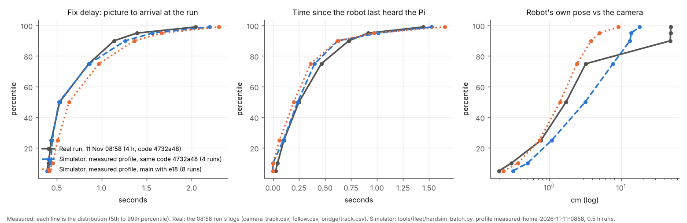
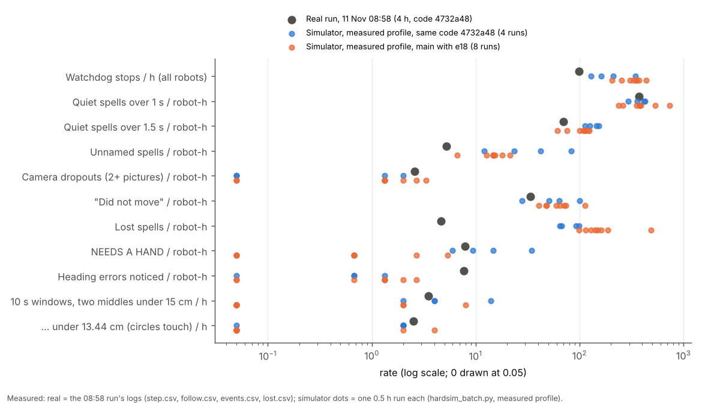
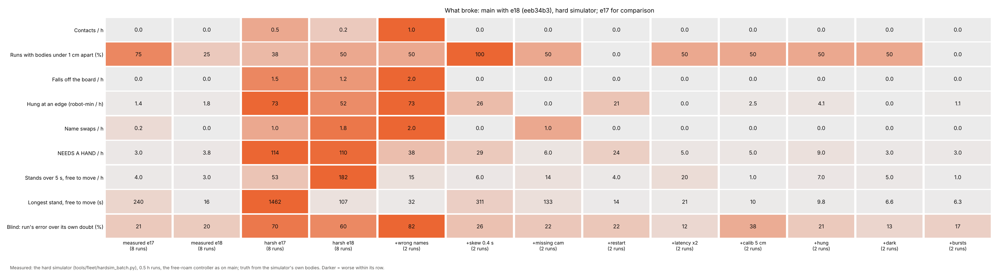
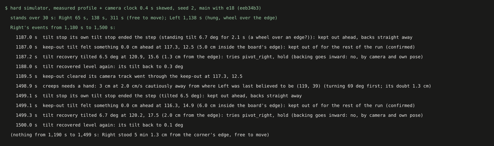

# The hard simulator: measured realism from the 11 Nov home runs, and what breaks (12 Nov, simulator and logs only)

## Premise

- The fast simulator was too easy. It ran 12 pictures a second with fixes 0.12-0.2 s late and one Pi freeze a run.
- The 11 Nov home runs showed far worse:
  - pictures at 1.6 a second for most of the 4-hour run;
  - fixes 0.4-2 s late;
  - about 400 watchdog stops;
  - "did not move" moves;
  - robots held for minutes.
- Goal: measure each of these from the real logs as a distribution, make the simulator reproduce them (a **measured**
  profile), add a **harsh** profile that goes further, then run the fleet code on both and report what breaks.
- CLAUDE.md "Observe, then trust", point 5: the simulator deliberately breaks the guesses.
- Nothing here touched a robot or a Pi.
  - **Measured** = read from the real logs or the simulator.
  - **Claude's reading** = an interpretation, marked as such.

## Data

### 1. What the real runs show (measured)

Source: `tools/analysis/realism_measure.py` (new) on the uploaded run folders. The numbers are in
`docs/results/hardsim-nov12/real_measures.json`.

| Measure | 11 Nov 08:58 (4 h) | 11 Nov 08:26 (18 min) | 5-9 Nov runs (5 runs, 0.2-4 h) |
|---|---|---|---|
| Pictures the bridge handled a second, median (10th pct) | **1.6** (1.4) | 4.7 (4.1) | 1.5-7.9 |
| Fix delay, picture to arrival: median / 90th / 99th pct (s) | 0.53 / **1.14** / 2.04 | 0.53 / 1.04 / 1.60 | 0.42-0.45 / 0.49-0.56 / 0.79-0.98 |
| Time since the robot last heard the Pi: median / 99th pct (s) | 0.25 / 1.44 | 0.18 / 1.00 | 0.09-0.26 / 0.53-0.71 |
| Quiet spells over 1 s, per robot-hour (share on 2+ robots at once) | **371** (82 %) | 105 (66 %) | 3-20 |
| Watchdog stops per hour (all robots) | **99** | 39 | 0 |
| Unnamed spells (bridge saw it, the run named nothing), per robot-hour; longest | 5.2; 191 s | 19.5; 83 s | 0-2.3; 2-78 s |
| Camera dropouts (2+ pictures missed), per robot-hour | 2.6 | 5.4 | 0-3.3 |
| Seen in pictures | 99.6-99.9 % | 99.6-99.9 % | 99.5-100 % |
| Own pose vs camera: median / 90th pct (cm) | 1.7 / 48 (the 84-min hold) | 1.7 / 6.3 | 0.9-1.5 / 1.7-22 |
| Standing scatter of the bridge's spot: both cameras / side only (cm) | 0.12 / 0.26 | 0.22 / 0.05 | 0.06-0.17 / 0.10-0.53 |
| Curve ratio (camera turn / asked) Left / Center / Right | **1.065** / 0.982 / 0.997 | 1.100 / 1.045 / 1.098 | 0.92-1.03 |
| Slips (wheels 2+ cm in a second, camera under 30 % of it), per robot-hour; length | 22.6; 1-2 s | 6.5; 1 s | 3.3-6.7; 1-7 s |
| Tilt spells over 3 deg, per robot-hour; median peak | 3.4; 3.1 deg | 5.4; 4.0 deg | 0.7-28; 3.1-3.8 deg |
| Camera's edge line against the line sensors' edge (cm, median; n) | -0.6 (6) | - | +2.1 (10) |
| "Did not move", per robot-hour | **33.6** (events.csv keeps 400) | 6.5 | 0-3.3 |
| NEEDS A HAND / REJOINED, per robot-hour | 7.9 / 0.8 | 9.7 / 3.2 | 0 / 0 |
| Lost spells, per robot-hour (median length) | 4.7 (2.9 s) | 27 (1.8 s) | 3-1,160 (0.1-5.9 s) |
| Heading errors the run noticed, per robot-hour (median size) | 7.7 (20 deg) | 55 (23 deg) | 0-0.2 |
| Cores 2-3 busy, median | 99 % | 99 % | 93-97 % |

A percentile (pct): the 90th percentile is the value 90 of 100 readings are under. A "quiet spell" starts when
the robot's own count of time since the last packet from the Pi (follow.csv quiet_ms) passes 1 s.

- The 4-hour run spent most of its time at **2 pictures a second** (bridge.txt: 3,948 of 6,312 status lines), not
  the 4-5 the 08:26 run had.
- The robots went quiet together: 82 % of quiet spells overlapped another robot's. **Claude's reading:** this is the
  Pi's controller not sending (cores 2-3 at 99 %), not WiFi.
- Half of the real quiet spells over 1.5 s began while the robot stood idle with nothing queued: 409 of 839, with no
  watchdog stop. The other half stopped a step.
- The camera almost never missed a robot (99.6 % of pictures). The dropouts that matter were the run's own: a fix
  arriving late, or not being named.

### 2. The hard simulator (what it does)

`tools/fleet/fastsim_realism.py` (new). It subclasses the fast simulator; `freeroam_fastsim.py` and
`fastsim_sources.py` are unchanged. Profiles:

| Profile | What it is | Switch |
|---|---|---|
| **easy** | The fast simulator exactly as before: still the default of `freeroam_fastsim.Sim`. | `profile="easy"` / `--profile easy` |
| **measured** | The 08:58 run's own timing, **replayed**: every named picture's time and delay, every Pi-wide silence, each robot's own silences. It starts at a random point of the run and wraps round. Fixes and robot messages wait in the queue during a silence, then arrive together, late, as on the Pi. Plus measured distributions for the rest: one bridge sighting a robot a picture (no names), seen 99.6-99.9 %, both cameras 88 % / side 11 %, each with its standing scatter; dropouts at 2.6 per robot-hour; curve ratios by robot (Left 1.065); slips 22.6 per robot-hour; the edge line 0.6 cm off; edge physics on. | `profile="measured"` (default of the new tools); `timing="draw"`: independent draws instead of the replay |
| **harsh** | Measured, then all of: latency ×2, dropout bursts (×3 rate, ×3 length, clustered), one robot **hung** 60-180 s mid-board (wheels spin, body still), calibration **5 cm** off, a 30 cm **dark patch** (sightings 30 %), camera clock **0.4 s** skewed, one robot **restarting** (silent 8-15 s, queue lost, own heading from a fresh gyro: anywhere), **wrong camera names** for up to 10 min (sightings mirrored), the overhead camera **missing** for up to 10 min (side only, the far quarter unseen). | `profile="harsh"`; one fault on its own: `faults={"hung": True}` / `--faults hung` |

- Batches: `python3 tools/fleet/hardsim_batch.py --profile measured --seeds 1-8 --hours 0.5 --out ...`. `--code DIR`
  tests another version of the code, such as the 11 Nov one.
- The simulator's measures use the same definitions as the real ones (`picture_spells`, `quiet_spells`), so the
  two sides compare like with like.
- Profiles: `tools/fleet/sim_profiles/measured-home-2026-11-11-0858.json` (default) and `-0826.json`. Each holds the
  timing derived from its run, not the raw logs.

### 3. Validation: the simulator against the real run (the acceptance test)

The simulator runs the **same code that made the real run** (4732a48, `--code`), on the measured profile: 4 runs of
0.5 h. The real run's 30-minute stretches vary too: fix delay median 0.46-0.86 s, Pi-wide silences 228-782 an hour.
Main with e18 is shown beside it (8 runs).

| Measure | Real 08:58 | Simulator, code 4732a48: range (median) | Simulator, main with e18 | Matches? |
|---|---|---|---|---|
| Pictures a second, median | 1.6 | 1.3-1.5 (1.4) | 1.3-2.8 (1.5) | yes (replayed) |
| Fix delay median / 90th / 99th pct (s) | 0.53 / 1.14 / 2.04 | 0.55 / 1.30 / 2.30 | 0.60 / 1.35 / 2.40 | yes, the tail 0.15-0.3 s long |
| Time since the Pi was heard, median / 99th pct (s) | 0.25 / 1.44 | 0.25 / 1.55 | 0.20 / 1.50 | yes |
| Quiet spells over 1 s, per robot-hour (shared %) | 371 (82 %) | 294-426 (79 %) | 237-737 (85 %) | yes |
| Quiet spells over 1.5 s, per robot-hour | 70 | 113-153 (145) | 61-124 (113) | 1.6-2× high |
| **Watchdog stops per hour** | 99 | 128-342 (210) | 204-436 (348) | **2× high** |
| Unnamed spells, per robot-hour (over 5 s) | 5.2 (2.5) | 12-83 (11.3) | 6.7-21 (5.3) | 2-8× high on its code |
| Camera dropouts, per robot-hour | 2.6 | 0-2 (1.3) | 0-3.3 (1.3) | close (rare events) |
| Own pose vs camera, median / 75th pct (cm) | 1.7 / 3.2 | 3.6 / 11.0 | 1.5 / 2.5 | old code 2-3× high; e18 matches |
| "Did not move", per robot-hour | 34 | 28-100 (63) | 41-112 (65) | ~2× high |
| NEEDS A HAND, per robot-hour | 7.9 | 6-35 (14.7) | 0-5.3 (0.7) | yes on its code |
| **Lost spells, per robot-hour (median length)** | 4.7 (2.9 s) | 65-99 (0.45 s) | 99-486 (0.25 s) | **15-20× high, short** |
| Heading errors noticed, per robot-hour | 7.7 | 0-1.3 | 0-2.7 | **5× low** |
| 10 s windows with two middles under 15 cm / under 13.44 cm (circles touch), per hour | 3.5 / 2.5 | 2-14 (4) / 0-2 (2) | 0-8 (0) / 0-4 (0) | yes on its code |

Each line is a distribution from the 5th to the 99th percentile. The simulator's fix delays and the robots' "time since
the Pi was heard" lie on the real run's lines.

Each dot is one run's rate, on a log scale. The simulator matches the real run on silences, NEEDS A HAND and close
passes. It is too high on watchdog stops and lost spells, and too low on heading errors.

- **Acceptance (measured):** the timing the code cannot change matches: pictures, fix delays, silences and
  their share. On its own code, the run's behaviour also matches on NEEDS A HAND, close passes and camera dropouts.
- **Where it does not match (measured):**
  - Watchdog stops: 2× high.
  - Lost spells: 15-20× more often, and short (0.3 s against 2.9 s).
  - Unnamed spells and "did not move": about 2× high.
  - Heading errors noticed: 5× low.
  - So the simulator is harsher than the real run on tracking and watchdog, and milder on headings.
- **Claude's reading of the watchdog gap:** half the real long silences began with the robot idle and nothing
  queued (409 of 839), so no step was stopped. The real silences come when the controller is busy planning, often
  while robots wait for a move. The replay puts them at random against the simulated robots' state.
- **Claude's reading of the lost gap:** with easy timing the simulator has 3 lost spells per robot-hour. With
  fixes 1 s late (the old profile) it has 43. Something in how the simulated layer and robots handle late fixes trips
  "lost" for a picture or two, where the real Pi did not: for example, the real bridge's own tracker and its
  0.3 % of lock / lights fixes, or the firmware's fix gate. Not found yet.
- What this means for section 4: lost-spell, watchdog and unnamed effects are over-stated, and heading effects
  under-stated.

### 4. What breaks: the fleet code on the measured and harsh profiles

8 runs × 0.5 h per profile, 2 × 0.5 h per single fault, all on the measured profile. Main with e18 = eeb34b3, the
exact landed code. e17 is the same batch on main before e18 (3f37317 + others' commits). Data:
`docs/results/hardsim-nov12/e18/` and `e17/`, one JSON per run.

Each cell is one kind of break for one group of runs; darker is worse within its row. Measured runs break little.
Mirrored sightings, a skewed camera clock and the harsh profile break the most.

The e17 columns' stand rows count hung robots in the first 6 of their 16 runs: those runs were recorded before
the simulator marked hung robots. Read e18 for stands.

**What broke on main with e18, ranked (measured unless said):**

| # | Break | Measured profile (8 runs) | Harsh / single faults | Where it shows |
|---|---|---|---|---|
| 1 | **A robot hung with a wheel over the edge stays hung for minutes** (never freed). Under "never give up" this is the worst. | Hung 24, 152 and 267 s in 3 runs | Harsh: 52 robot-min / h. Restart seed 1: 21 min. Skew seed 2: Left hung 19 min. Wrong names: 18-55 min | `hung_s`, stands with hung = true |
| 2 | **Falls off the board** | 0 | Harsh: 5 of 8 runs. Wrong names: 2 in one run. No single other fault on its own | `falls` |
| 3 | **A robot free to move stands for minutes** (never still) | Longest 16.5 s. 12 stands over 5 s in 4 h | Skew seed 2: Right stood **311 s** by a corner after a tilt recovery (picture below). Missing camera: 133 s. Harsh: up to 107 s, 182 stands over 5 s an hour | `stands_free`, `longest_free_stand_s` |
| 4 | **A wrong camera name mid-run is never concluded.** Each robot says "camera disagrees ... not believed" and drives on dead reckoning. | - | The run's position is outside its own stated doubt 82 % of blind seconds. 2 swaps, 1 contact, 2 falls in 1 h | events, `blind_breaches` |
| 5 | **The run is more sure of a blind robot than it should be.** Its position is further from the truth than its own stated doubt (`ctrl.unc`). | 20 % of blind seconds; 95th pct error 11.7 cm | Calibration 5 cm off: 38 %. Harsh: 60 % | `blind_breaches` / `blind_samples` |
| 6 | **Bodies within 1 cm** (no contact) | 2 of 8 runs (e17: 6 of 8) | Skew: 2 of 2. Harsh: 4 of 8, 1 contact | `min_gap_cm`, `contacts` |
| 7 | **Name swaps** | 0 (e17: 1) | Harsh: 1.8 / h. Wrong names: 2 / h. Missing camera: 1 / h | `swaps` |
| 8 | **A restarted robot drives on with its heading 40-70 deg off** for up to a minute, its own pose up to 55 cm off. Nothing asks for a heading check after a restart (restart model: Claude's) | - | Restart: 24 NEEDS A HAND / h | test below |

The run's own event lines for Right with the camera's clock 0.4 s skewed. After a tilt recovery 1.3 cm from the corner,
Right stood 5 minutes with nothing said, then crept "cautiously away from where Left was last believed to be". Left was
hung at an edge 25 cm away.

- **e18 against e17 (measured):**
  - Bodies under 1 cm: 6 of 8 runs → 2 of 8.
  - Swaps: 1 → 0.
  - Latency ×2: 6 contacts → 0.
  - Wrong names: 21 contacts / h → 1.
  - The own pose stays closer to the camera (median 1.5 cm).
  - NEEDS A HAND is about the same (15 against 12 in 4 h).
  - Falls under harsh: 6 → 5, in 5 of 8 runs both times.
- **Claude's reading of #3 (skew):** this is e18's "heading in doubt beside a neighbour the camera does not have:
  creep cautiously away" waiting on Left. Left was hung, and the camera kept seeing it, but its own pose was in doubt.
  It is only a reading: the controller logged nothing for those 5 minutes, and that silence is itself a gap.

### 5. Tests

- `tools/fleet/tests/test_hard_simulator.py`: 11 tests, about 30 s, in the suite.
  - The measures: picture spells, quiet spells, quantile draws.
  - Easy = the old simulator, run for run.
  - The measured profile reproduces delay, pictures and silences.
  - A silence holds fixes and robot messages, then delivers them late.
  - Hung, restart and harsh faults on.
  - Two **xfail** regressions, open on main with e18:
    - `test_restart_heading_is_checked_before_it_wanders` (#8);
    - `test_wrong_camera_name_mid_run_no_contact` (#4).
    - Each passes once fixed.
- **Long checks** (a separate command, about 20-40 min on 2 cores):
  `python3 tools/fleet/tests/long_hardsim.py` (or `--check-only --out DIR` on existing batches).
  - Realism checks (delay, silences, pictures).
  - Measured: no contact, no body under 1 cm, no fall, no swap, never still (60 s), no edge hang over 120 s.
  - Harsh: contact in at most a quarter of runs, never still (120 s).
  - Four single-fault cases (#1, #2, #3).
  - On e18 batches: **6 of 15 checks fail**:
    - bodies under 1 cm;
    - edge hang 267 s;
    - skew stand 311 s;
    - missing-camera stand 133 s;
    - wrong-names falls;
    - restart hang 21 min.
- Full fleet suite on main with e18 + this build: **991 passed, 11 skipped**, 1 xfailed, 1 xpassed in 23.5 min. The xpass was the first version of the wrong-camera test, written before e18 landed; on e18 its seed no longer fell, so it was moved to a case that still breaks (seed 8, 3 contacts). The test file alone then gives 9 passed, 2 xfailed.
- `tools/pi/tests` + `tools/analysis/tests`: 149 passed; the same 4 `test_launcher.py` failures as before (not touched).

## Conclusion

1. **The measured profile reproduces the real run's timing** (pictures, fix delays, Pi silences). On the code that ran
   that day, it also reproduces NEEDS A HAND, close passes and camera dropouts.
2. **It is harsher than reality in three places:** watchdog stops 2×, lost spells 15-20×, unnamed spells about 2×. It is
   milder on heading errors, 5×. Its break counts are an upper bound for tracking and a lower bound for headings.
3. **On realistic conditions, main with e18 breaks little:**
   - no contact, fall or swap in 4 simulated hours;
   - stands under 17 s;
   - two passes within 1 cm;
   - a few edge hangs that last minutes.
4. **What breaks it, ranked:**
   1. robots hung at an edge, never freed;
   2. falls;
   3. a robot free to move standing for minutes (skew, missing camera);
   4. a wrong camera never concluded;
   5. over-confidence while blind;
   6. close passes;
   7. swaps;
   8. a restart's heading.
5. **Claude's reading:** items 1 and 3 break Nick's "never give up" and "never still" rules, and need a fix more than
   the rest. Both come out of edges and doubt about a neighbour, not out of the timing.

## What's next

- **Fixes, each to be a build with its own regression test already written** (the xfails and the long checks):
  - an edge hang that frees itself or keeps trying, never stays (#1);
  - the doubtful-neighbour wait bounded by never-still (#3);
  - a camera-wide "my sightings are mirrored / shifted" check that keeps running after the start (#4);
  - a heading check after a restart (#8; the runner's on_boot).
- **Close the validation gaps:** find why the simulator calls lost so often (replay the real run's own poses into the
  simulated layer), and tie silences to the controller's planning.
- **Every new real run:**
  1. `python3 tools/analysis/realism_measure.py RUN --out m.json`;
  2. `python3 tools/fleet/fastsim_realism.py build m.json RUN tools/fleet/sim_profiles/measured-<run>.json`;
  3. check the new profile against its run.
- Nothing for Nick to do at the board for this build.

## Sweep 1: new tests that may now be needed

- **A real restart mid-run.** Power-cycle one robot during a free roam (it is safe to do by hand). This checks
  the simulator's restart model: what does its own heading do after the boot, and does the run notice?
- **A wrong camera name mid-run on the real Pi.** Swap the two cameras' names in a short dry run. The fast simulator
  mirrors every sighting; the real failure may be milder (the side camera's calibration on the overhead picture).
- **The silence-to-idle link.** On the real 4-hour run, half the long silences began with the robot idle and nothing
  queued. The simulator places silences at random. A replay that ties each silence to the controller's planning
  (when a robot asks for a move) would test whether the watchdog gap closes.
- **Hard-simulator profile from the next real run.** Run `realism_measure.py` on it and build a new profile
  (`fastsim_realism.py build`). Validate the new code's run against it, the same way.
- **Close passes on the real board, by body.** The camera only gives middles (closest 10.2 cm in 4 h). A side-camera
  check of the real body gap at the closest passes would show whether the simulator's sub-1 cm passes are real.
- **The long checks on every build** that touches free roam: `python3 tools/fleet/tests/long_hardsim.py`.

## Sweep 2: possible inaccuracies

- **Chosen numbers.** For each: whether a DOE should set it.
  - QUIET_BASE_S 0.2 s (draw mode only): no; the replay is the default.
  - NEVER_STILL_S 5 s (the bar for counting a stand): no; it is a reporting bar.
  - The side camera's leftover offset, 1 cm: yes, from a calibration run with both cameras on the tape grid.
  - Merged outline under 3 cm (fastsim_sources): yes, from real close passes.
  - Slip strength (body moves 0-30 % of the wheels): yes, from raw.csv windows with the camera at 4+ pictures a second.
  - Harsh sizes: latency ×2, bursts ×3, hung 60-180 s, 5 cm, 0.4 s, 30 % in the dark patch, restart 8-15 s, wrong names
    and missing camera up to 10 min. No: these are chosen stresses, not estimates.
  - The long checks' limits (1 cm, 60 s, 120 s, a quarter of runs): DOE no. They are Claude's reading of Nick's rules.
- **The replay is one run.** It is the 4-hour 08:58 run on the 11 Nov Pi load (cores 2-3 at 99 %). Another day's load
  is another profile. 08:26 (4-5 pictures a second) is in `sim_profiles/` too.
- **Silences** are the robots' own quiet_ms. A silence is called Pi-wide when 2+ robots' spells overlap. Its length is
  the overlap, from FOLLOW records at 10 a second (±0.1 s).
- **The sighting model** is one unnamed bridge sighting a robot a picture. The real bridge also sends its own lock and
  lights fixes (0.3 % of rows) and keeps its own tracker, which the simulator does not have.
- **The restart model** (own heading anywhere after the boot) is Claude's model, not measured. The fast simulator
  has no runner `on_boot` (safety re-set, compass check, follow again).
- **The wrong-names model** mirrors every sighting left to right (the e10 model). A real swap may be milder.
- **The breach measure** compares the run's position with the truth while no named fix has come for 1 s. It uses
  `ctrl.unc()` as "its own doubt", not e18's per-robot blind allowance R.
- **Edge offset** comes from 6 edge marks in the 08:58 run, a median of 0.6 cm. The 7 Nov run had +2.1 cm (10 marks).
- **Slips** are 1 s windows at 1.6 pictures a second, so a sub-second slip is not seen. The 22.6 per robot-hour
  includes camera lag at the ends of drives.
- **Stress batches** are 8 runs × 0.5 h per profile and 2 × 0.5 h per single fault. The single-fault rates are
  indications, not estimates.

## Questions for Nick

**Substantive**

1. A robot hung with a wheel over the edge: "falls allowed" (12 Nov) and "never give up" pull opposite ways. Should a
   hung robot keep trying to free itself until it falls (never still), or try a few derived moves and then wait for a
   hand? Today it waits, often for the rest of the run.
2. When most sightings disagree with every robot's own pose at once (a wrong camera name, a bumped camera), should the
   run stop trusting that camera as a whole and say so? Or keep judging robot by robot, as now?
3. The simulator's profile is the 11 Nov Pi load (2 pictures a second, 99 % cores). Once the Pi bench picks a core
   layout, should the default profile become that day's run, with 11 Nov kept as "slow Pi"?
4. Restart model: after a real restart, does the robot's own heading start from its boot direction? (Claude's model:
   it does, so it can be anything.) A power-cycle of one robot in a short run would settle it.

**Other**

5. Body gaps under 1 cm counted as a failure in the long checks (CHOSEN, Claude's): keep it, or use 0 (contact only)?
6. The validation used 4 simulated runs of the old code (2 h) against the 4 h real run. Run 8 more for the report
   to the professor?

## Appendix A: how each measure is defined

The docstring of `tools/analysis/realism_measure.py` holds every definition. The simulator uses the same functions.
Ones that needed a decision:

- **Unnamed spell.** Two named fixes further apart than max(1 s, 2.5 × the picture interval there), with the bridge
  seeing the robot at least twice between them. It is matched by time, not by picture: the bridge's picture stamps and
  the named fixes' stamps differ by tens of ms in the logs.
- **Camera dropout.** The robot is missing from 2 or more pictures in a row. At 1.6 pictures a second, a gap-in-seconds
  rule flagged nearly every picture interval.
- **Quiet spell.** quiet_ms passes 1 s. A climb after a drop is a new spell. Spells of 2 or more robots that overlap
  are one Pi-wide silence (their common part); the rest are that robot's own.
- **Slip.** Wheel travel from wl_rpm / wr_rpm × 1.7 cm radius. raw.csv's v_cms is in mm/s: the first pass read it
  as cm/s and found 100 slips per robot-hour.
- **Picture rate.** Distinct picture times in bridge/track.csv per 10 s. perf.csv's fps_handled is the recorder's
  rate (25 a second), not the bridge's.

## Appendix B: files

- `tools/analysis/realism_measure.py`: the measures (real logs).
- `tools/fleet/fastsim_realism.py`: the profiles, the hard simulator, `measure_sim()`, `breakage()`, the profile
  builder.
- `tools/fleet/hardsim_batch.py`: batches, `--code`, `summarize`.
- `tools/fleet/sim_profiles/`: the two 11 Nov profiles (derived timing, about 0.5 MB and 0.1 MB).
- `tools/fleet/tests/test_hard_simulator.py`, `tools/fleet/tests/long_hardsim.py`.
- `docs/results/hardsim-nov12/`:
  - `real_measures.json` (7 real runs);
  - `e18/`, `e17/`, `validation_4732a48/` (one JSON per simulated run);
  - the chart and batch scripts.
- No raw run data is committed. The run folders stay in the releases.
