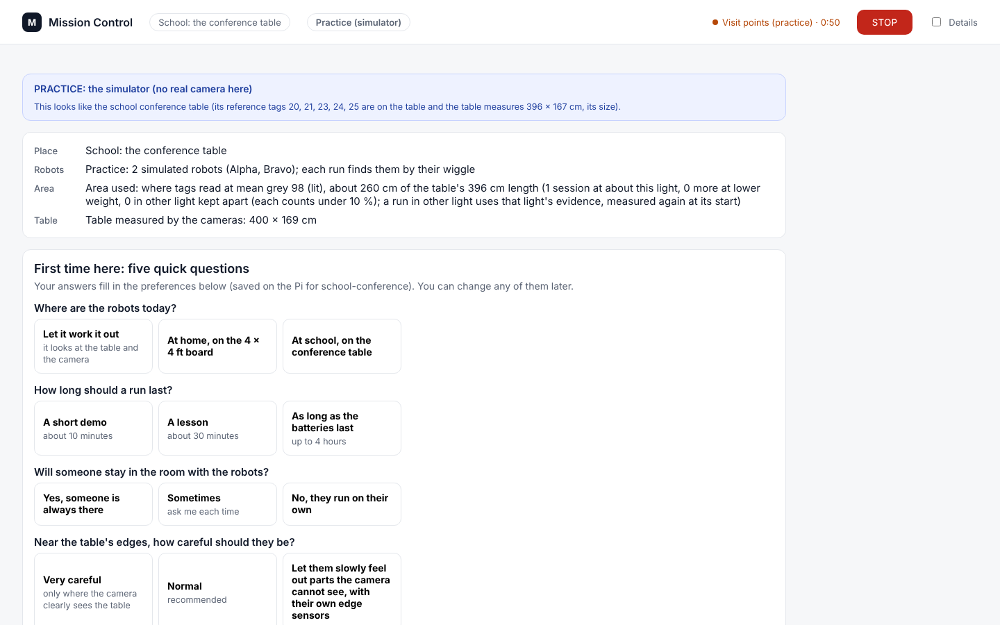
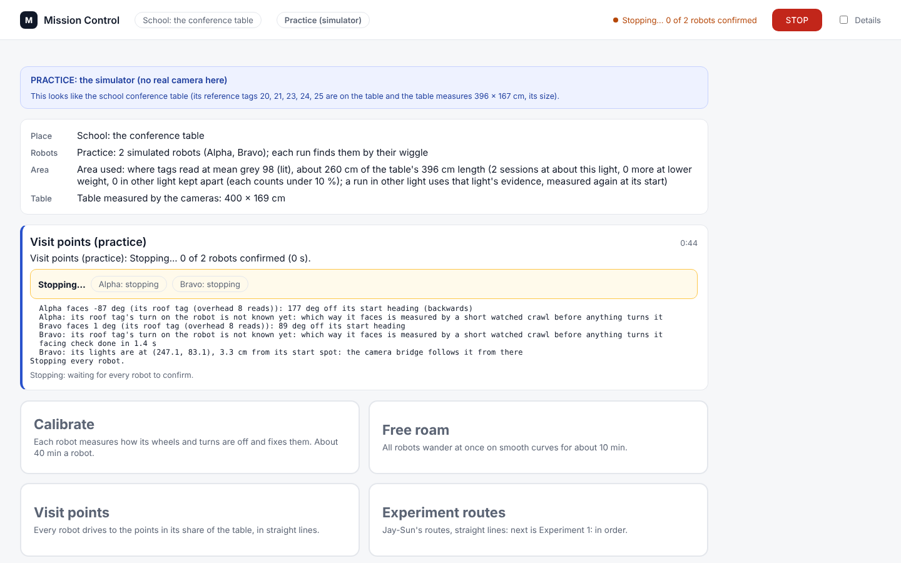
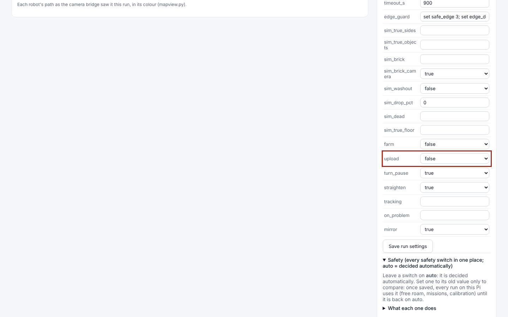
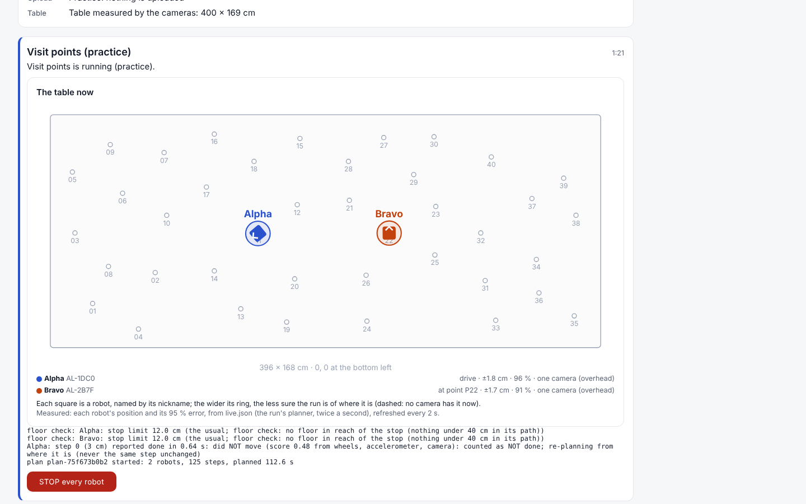
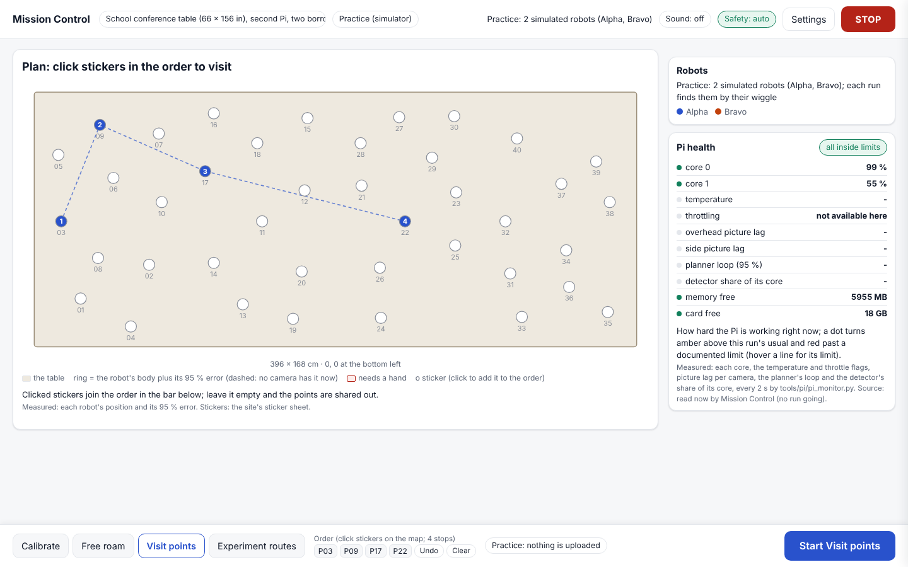
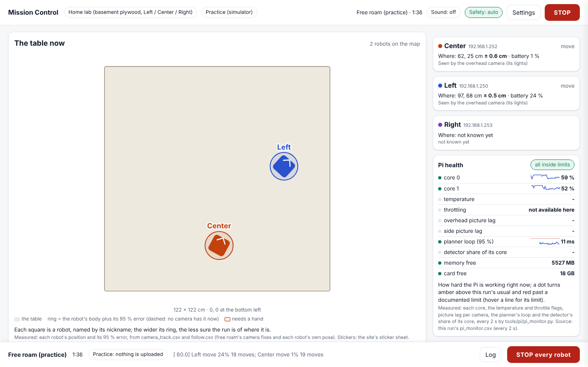
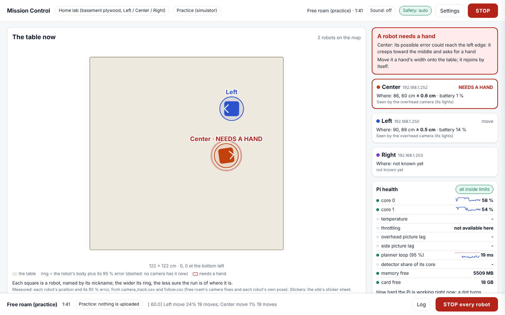
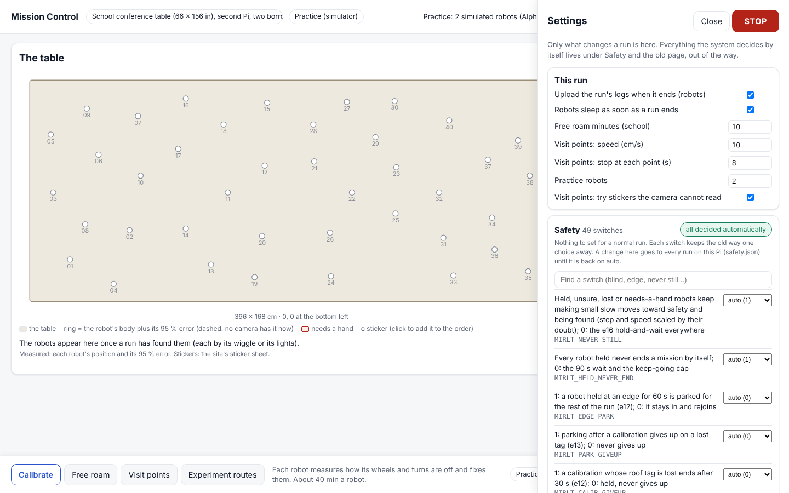
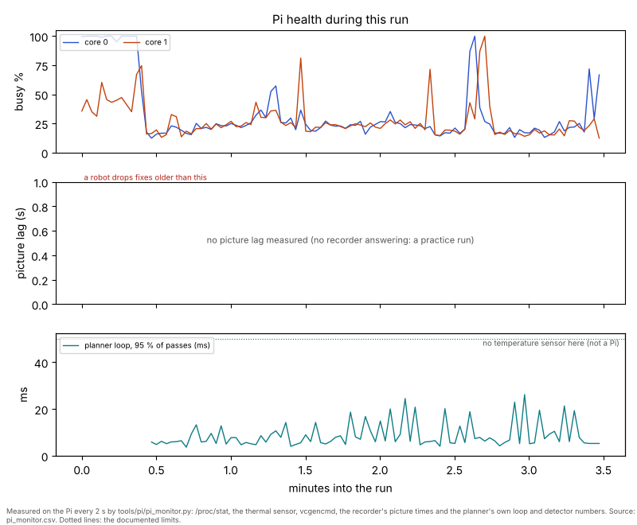

# Mission Control: STOP, uploads, the live table, the map-first page and the Pi efficiency monitor (12 Nov)

## Premise

Nick's decisions of 12 Nov on the design proposal (`docs/design/mission-control/proposal.md`):

1. Three quick fixes, each its own commit with tests: **(a)** STOP really stops the practice run and shows "stopping..."
   until every robot has confirmed; **(b)** uploads on by default; **(c)** the Start screen shows a live map.
2. The redesign: **Option 1, "the table"** (map-first), laptop first; Mission Control replaces starting home runs over
   SSH (SSH kept as the fallback); robots shown by **nickname** with the real name beside it; a **sound** when a robot
   needs a hand, with a mute; the **old page kept** behind a setting, off; rarely used settings moved out of the way,
   Safety still reachable.
3. A **Pi efficiency monitor** on every run, a Pi health panel, a run-report section with a chart, and a data-based
   way to set the detector's core share (`docs/how-to/pi-bench-core-share.md`).

Nothing here touched a robot, a Pi or a camera. **Measured** = practice runs on this build computer (2 cores, no
recorder, no Pi sensors), Playwright on the live page, and the tests. **Claude's own** marks my conclusions, not the
team's.

## Data

### Commits (on main)

| Commit | What |
|---|---|
| 1a | STOP: Ctrl+C to the run's whole process group; `stop_confirm.py` StopWatch ("stopping..." until every robot confirmed); `stop.json` in the run folder |
| 1b | Uploads on by default; an old unchosen `false` follows it; home free roam uploads when it ends (`freeroam-upload`); the page shows will upload / uploading / uploaded / failed |
| 1c | `/api/live` (`live_view.py`) and the live table on the Start screen |
| Part 3 | `tools/pi/pi_monitor.py` (pi_monitor.csv), `monitor_feed.py`, tagfree read-only `share_now`, `/api/pi_health`, the free-roam report section |
| Part 2 | `mission_control_table.html` at `/`, old page at `/classic`; `tools/pi/detector_share_bench.py` |
| docs | this report, two how-tos, screenshots |

### 1a. STOP (measured)

| | Before (audit, F1) | After |
|---|---|---|
| What gets the Ctrl+C | mission_run only; the driver only if mission_run passes it on | the whole process group at once (as a terminal's Ctrl+C) |
| What the page says after STOP | "running" (once for about 4 min, and the tour finished) | "Stopping... 0 of 2 robots confirmed", then "Stopped: every robot confirmed 1 s after STOP" |
| The run's own record | no stop | `stop.json` in the run folder |

- Two practice Visit points runs at school, STOP pressed 40-80 s in: both confirmed **1 s** after STOP, nothing forced.
  A practice home free roam: **4 s**.
- The test `test_stop_reaches_the_driver_even_when_the_leader_does_not_pass_it_on` **fails on the old `Run.stop`**
  (checked against main's `mission_control.py`) and passes now. Its fake leader blocks Ctrl+C the way a busy or slow
  mission_run would; I could not reproduce the audit's 4-minute run on a quiet machine (STOP worked in 5-10 s there
  with the old code too), so the test models the cause rather than replaying it.
- Real robots: once the drivers are gone, each robot must **answer** a `stop` on the log port (the firmware says
  "nothing running" or "run ...: stopped"). A silent robot is asked again every 3 s and named on the page, never given
  up. This path is tested with stubs only.
- A robot that never answers (switched off, asleep, out of the WiFi) keeps the page on "Stopping..." and is asked
  again; once every driving process has ended, the bar offers **Carry on without them** (a person's decision, asked
  with a confirm, recorded in `stop.json`). The robots' sleep at the end of a run now waits until the stop is
  confirmed, so it cannot silence a robot before it answers.
- If a driver is still alive 25 s after STOP (mission_run's own stop path: 15 s for its child + 10 s for the bridge):
  Ctrl+C again, then SIGTERM, then SIGKILL, drivers only; uploads and refits are left to finish.
- The old way is kept: `MIRLT_STOP_GROUP=0`.


STOP pressed on the old code: the header still shows the run going and nothing says "stopping".


Half a second after STOP: each robot is listed until it has confirmed.

### 1b. Uploads on by default

- `RUN_DEFAULTS["upload"] = True`. `settings.json` is saved whole, so a file saved before this build holds
  `upload: false` whether or not anyone chose it. It now follows the new default unless the page recorded it as set by
  hand (`settings.by_hand`).
- Home free roam started from Mission Control on the robots never uploaded either (the SSH way's `freeroam-finish` did
  the upload). It now runs `run-fleet-pi.sh freeroam-upload` after the run: the same upload, but the recorder is left
  running for Mission Control's camera.
- The Start screen and the new page say "Upload when it ends: on", "Uploading...", "Uploaded" (with the release link),
  "Upload failed" or "Practice: nothing is uploaded".


Before: `upload` false, the 19th row of Details > Run > More.

### 1c. The live table on the Start screen

`/api/live` reads only what runs already write: `live.json` at a roof-tag site; `camera_track.csv`, `follow.csv`,
`battery.csv`, `state.json` and `edge_parked.json` for home free roam. Each robot: nickname, WiFi name, position,
heading, 95 % error (home: 2.45 x the filter's `pos_sd_cm`), whether a camera has it now, battery, needs a hand.


The old Start screen during a practice tour, now with the live table.

### 2. The new page: "the table" (Option 1)


Before a run at school: Visit points chosen; four stickers clicked on the map make the order in the bottom bar.


A practice home free roam: robots by nickname with their addresses beside them, the Pi health panel on the right.


NEEDS A HAND: pulsing red ring on the map, red card, the alert at the top of the rail, three beeps when Sound is on.
(The needs-a-hand line was written into the practice run's file by hand for this picture.)


Settings: "This run" (6 lines) and the Safety group as one line, "all switches (49 when the picture was taken), all decided automatically", opening
into every switch with auto / old way and a search.

| Nick's decision | What was built |
|---|---|
| Laptop first, must not break narrow | Two columns from 980 px; one column under it; checked at 1440 x 900 and 600 px (no sideways scroll) |
| Replace SSH for home runs | Free roam, Calibrate, STOP and the upload run from the page; `docs/how-to/mission-control-new-page.md` keeps the SSH commands as the fallback |
| Nicknames | Left / Center / Right (home) or Alpha / Bravo (school, from the wiggle) as the label; the WiFi name (`AL-2B7F`) or address small beside it and on hover |
| Sound | "Sound: off" button in the top bar; a click enables audio (browsers need one); three beeps, again every 20 s while a robot needs a hand; the choice remembered per browser |
| Old page kept | `/classic` always; `/` serves it again with Settings > "Open the old page by default" or `MIRLT_MC_PAGE=classic` (off by default) |
| (Claude's own additions) | Where each robot drove: faint lines for the last minute during a run, the whole run after it; the run's questions (an attended run holding a robot until answered), "a robot was left at the edge" and "click the corners first" in the rail; a Log panel |
| Fewer settings | The new page shows 6 run settings and the Safety line; setup, Measure, preferences and every typed value stay on the old page (one link) |

### 3. The Pi efficiency monitor

- `tools/pi/pi_monitor.py` writes `pi_monitor.csv` (29 columns, every 2 s) into the run folder: each core, load,
  temperature, throttle flags (`vcgencmd` or sysfs; blank where absent), memory, card free, picture lag per camera
  (the recorder's capture time, `X-Time`), the planner's loop (work a pass, period), the detector (calls, ms a call,
  share of its core, its cap, refused).
- Started beside every Mission Control run and by `run-fleet-pi.sh freeroam-run` (the SSH way too). Low priority, its
  own process, ends with the run. `MIRLT_PI_MONITOR=0` switches it off.
- Free roam's `report.md` gains a **Pi health** section with the chart; every run folder gets `pi_monitor.md/.png`.
- Practice home free roam on this computer (105 rows): core 0 median 63 %, core 1 56 %, the planner's loop 12 ms median
  (95 % of passes) against its 50 ms period; no picture lag, temperature or detector numbers (no recorder, sensor or
  model here).


The run-report chart from that practice run; on the Pi the empty middle panel fills with each camera's picture lag.

**Warning levels** (where each comes from):

| Measure | Red | Amber |
|---|---|---|
| temperature | 80 C, the Pi's documented throttle point | - |
| throttling | any firmware flag set now | ("since boot" shown as a note) |
| picture lag | over 1 s: the robots drop older fixes (firmware `fix_max_age_ms`) | over this run's own 95th percentile |
| planner loop | over its 50 ms period target (`freeroam.TICK_S`) | over this run's own 95th percentile |
| a core | full two readings running [chosen: 99.5 %] | over this run's own 95th percentile |
| card | under diskguard's card floor (runs stop there) | under twice it [chosen] |
| memory | under 5 % available [chosen] | - |
| detector | - | its share over its own cap |

The run's own percentiles start after one minute of rows [chosen].

**The core-share bench** (`tools/pi/detector_share_bench.py`, how-to `docs/how-to/pi-bench-core-share.md`): robots
parked, the real recorder, a practice free roam pinned to core 1 as the load; 5 min each at 0 % (baseline), 10, 25 and
50 %. It measures picture lag, loop time, core 1, temperature, throttling and the time to find a parked robot asked for
as lost. The largest share whose median lag and loop stay inside the baseline's 95th percentiles is chosen; `apply`
saves it (`~/.config/mirlt/detector/share.json`, read by `tagfree.Budget`; `MIRLT_DETECTOR_DUTY` overrides). Tested
with fakes only.

### Tests

- `tools/fleet/tests/test_mc_build_nov12.py`: 21 tests (STOP x 6, uploads x 3, live table x 3, monitor x 7, page x 2,
  bench x 1). Counts for the full suites: Appendix A.

## Conclusion

1. **STOP now reaches what drives the robots directly, and the page says "stopping..." until each robot has
   confirmed** (measured in practice: 1 s; the real-robot answers are tested with stubs only).
2. **Runs on the robots upload by default, home free roam included, and the page says so.**
3. **The live table is on the Start screen and is the whole of the new page.** Robots by nickname, their doubt as a
   ring, needs-a-hand on the map with a sound.
4. **Every run now records the Pi's efficiency** in a CSV, shows it live, and reports it with a chart. The numbers that
   matter on the Pi (picture lag, temperature, the detector's share) could not be measured here.
5. **Claude's own:** the new page covers starting, watching and stopping runs. Setup (corners, Measure), preferences
   and the school's production / experiment screens still live on the old page; I would keep `/classic` until those
   move.

## What's next

1. Nick: update the home Pi and open the page (Appendix B), then one real free roam from the page. Look at: the robots
   on the map by nickname, STOP's "Stopping..." then "Stopped", "Uploaded" with its link, `pi_monitor.csv` and the
   Pi health section in the run's `report.md`.
2. Nick: the core-share bench (about 25 min, robots parked), then `apply` the chosen share.
3. Before the next school day: one practice Visit points run from the new page at school, and a real STOP with the
   robots on the table (Sweep 1).

## Sweep 1: new tests that may now be needed

- Real-robot STOP: every robot answers the `stop` on the log port after the drivers end; a switched-off robot is named
  and retried. With Nick, robots on the board.
- STOP on a loaded Pi (the audit's case): practice run under `stress` or during the bench; confirm in under 25 s with
  nothing forced.
- A real home free roam started from the page uploads through `freeroam-upload` while the recorder keeps running (the
  frames folder is complete; the release has the logs).
- `pi_monitor` on the Pi: `vcgencmd` columns filled; the `/live?q=30` picture lag read costs under 1 % of core 0; the
  monitor's own CPU.
- The page's polling cost on the Pi over a 30-minute run (four requests every 1.5-4 s; e16 measured Mission Control at
  1-3 % CPU before).
- Needs a hand from a real run: the alert, map ring, click card and sound together (the picture here used a hand-written
  file).
- The new page at school: production / experiment runs from the bar, the order picker with the camera picture.
- The bench end to end on the Pi with the real model.

## Sweep 2: possible inaccuracies in what this relied on

- **STOP's 25 s escalation** is derived from mission_run's own waits (15 + 10 s); calibration and the ladder may have
  longer stop paths (a calibration's report). DOE: no; check against those programs' code.
- **Robot "answers" as confirmation** assume the firmware's reply to `stop` reaches the Pi; a robot that stopped but
  whose answer is lost stays "no answer" (safe side, never "confirmed" wrongly). The 3 s retry is [chosen]; DOE: no.
- **Old settings migration**: an upload set to `false` by hand *before* this build is turned on (there was no record of
  "by hand" then). Nick should check Settings > This run once.
- **Home ± ring** = 2.45 x the filter's `pos_sd_cm` from `follow.csv` (a 2-D normal's 95 %); the school ring is
  run_plan's own `plus_minus_cm`. Proxies, not checked against the camera.
- **Picture lag** is the recorder's capture-to-serve time on a low-quality extra picture; the planner's own lag is in
  `held_*_s` only when free roam has frames. The two are not the same thing.
- **Monitor thresholds** marked [chosen] (core full 99.5 %, card amber 2 x, memory 5 %, one-minute warm-up): DOE no;
  they are display rules. The 80 C and 1 s limits are documented ones.
- **Detector share stats** were tested with a fake source; no real detector ran here.
- **Bench**: the practice free roam's simulator adds load a real run does not have (fair against its own baseline, not
  absolute); "found" within 5 cm, an ask every 2 s, 20 s give-up and 5 min a share are [chosen], DOE no (the shares
  are the experiment).
- **Sound** timing (three beeps, every 20 s) is [chosen]; DOE no.
- **Screenshots** come from practice on a 2-core build computer; positions, batteries and timings are the simulator's.

## Appendix A: test runs

| Suite | e18 baseline (given) | This build, before the rebase | After rebasing onto e19 1-2 (59ab9b8) |
|---|---|---|---|
| `tools/fleet/tests` | 991 passed, 11 skipped | 1012 passed, 10 skipped, 2 xfailed, 1 failed (`test_school_engine::test_mission_control_api` read the old page at `/`: fixed to read `/classic`) | **1021 passed, 10 skipped, 2 xfailed, 1 failed** |
| `tools/pi/tests` | 4 known `test_launcher.py` failures | 132 passed, 5 failed (the 4 known + `test_camrec_no_stall` free-roam parts, a timing test that passes alone and on main: load) | **133 passed, 4 failed (the 4 known)** |

- The one fleet failure after the rebase, `test_risk_fixes.py::test_stopall_reaches_robots_heard_on_the_wifi`, fails
  the same way on origin/main 59ab9b8 without this build (e19 2/14 stopped remembering loopback addresses, which that
  test uses). Not touched here; for the e19 build.
- The 2 xfailed are the hard simulator's known regressions. The skip count fell by one because a test that skips
  without a model now runs (unchanged here).
- New tests: `tools/fleet/tests/test_mc_build_nov12.py`, 23.
- e19 landed three more commits (6f040cd, 6c5b5a0, 374cbc3) while the suites ran; rebased again cleanly onto 374cbc3
  and re-ran this build's tests with the e19, tag-free, school-engine, Start-screen and Mission Control suites:
  124 passed, 1 skipped. The full suites were not run a third time.

## Appendix B: update the home Pi and open the new page

The full steps are in `docs/how-to/mission-control-new-page.md`. In short (laptop terminal, one box at a time):

```
ssh st1maxfini@100.122.222.75
```

```
cd ~/alvik-fleet-capstone
```

```
git pull
```

```
./run-fleet-pi.sh mc-stop
```

```
./run-fleet-pi.sh mc
```

Then in the browser: `http://100.122.222.75:8095`. You should see the board in the middle, Pi health on the right and
the run bar at the bottom.
