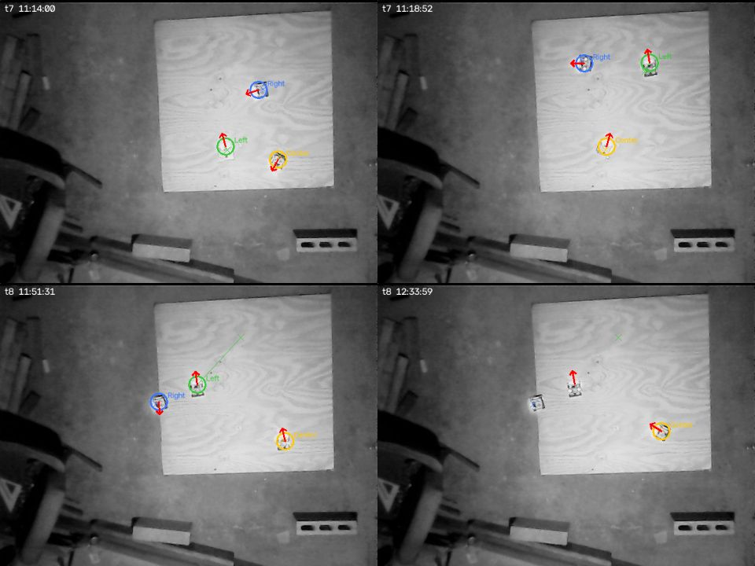
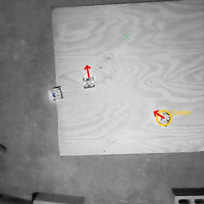
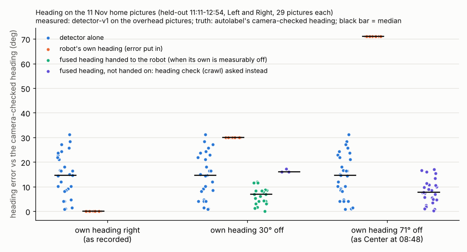
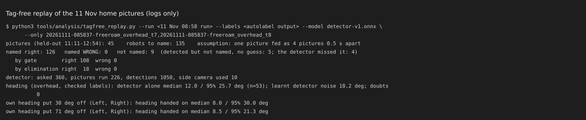
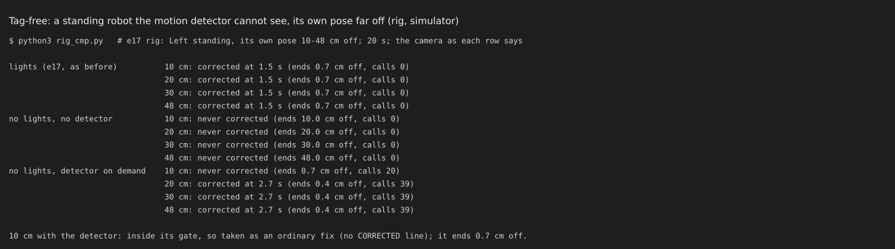
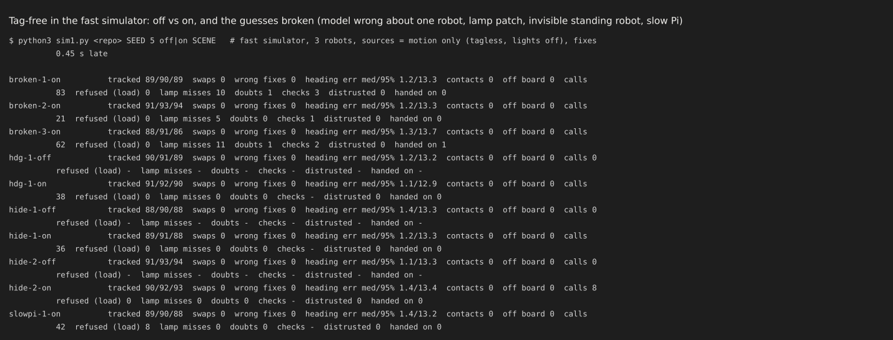

# Tag-free mode: robots with no roof tag found, named and given a heading (12 Nov, simulator, tests and logs only)

## Premise

- The home robots carry no roof tags. Until now, a robot standing still with its own pose far off could only be found by the lights spot, and the motion detector cannot see a standing robot at all.
- detector-v1 now exists (`docs/results/detector-v1/report.md`). On the held-out home pictures it found 98 % of robots (96 % of the standing ones) with no false detections. Its overhead heading was 12 deg median (never flipped). Its side-camera heading is not learned.
- The goal: use what exists to find, name and give a heading to tagless robots, without overloading the Pi. That means the detector on demand, motion in the picture, each robot's own odometry and gyro, and the tracking layer's elimination and identity moves (e17, and e18's out-and-back once it lands).
- Nothing here touched a robot, a Pi or a camera. **Measured** means the 11 Nov home pictures, the simulator or the tests. Conclusions marked **Claude's own** are Claude's, not the team's.

## Data

### 1. What was built (each behind a switch)

| Piece | What it does | Switch |
|---|---|---|
| Detector as a tracking-layer source (`tools/fleet/tagfree.py`, `DetectorSource`) | The layer calls it only for a robot that is unaccounted, unsure, or whose heading is in doubt. It is capped at 2 calls a second per robot and 4 a second in all (e17's caps). It also has its own load limit: at most 25 % of one core, judged by its measured time per call. A call over 80 ms backs it off. Three slow calls in a row drop the side camera. One picture's result serves every robot that asks. It never names a robot. | `MIRLT_TAGFREE=auto` (default): on when the model file is there, and used for a robot only while no roof tag has named it in the last 3 s. `=1` always. `=0` off. |
| Cameras | Overhead first, for position and heading. The side camera is used only where the overhead found nothing near the robot, and for position only. | - |
| Where it runs (Layout B) | In a worker thread of the planner (free roam), so on the **planner's core 1**. The planner never waits for it. The bridge's cores 2-3 are never used. | `MIRLT_DETECTOR_CORE=recorder` moves the worker to core 0 |
| Model file | Not in git. It is looked for at `MIRLT_DETECTOR_MODEL`, then `MIRLT_ML_MODEL`, then `~/.config/mirlt/detector/detector-v1.onnx`. If it is missing, the run says so once and runs exactly as before. | - |
| Naming | By the layer's own rules, unchanged: the gate round each robot's own pose, then elimination (one robot unaccounted, one steady unclaimed sighting), then the wiggle. The detector's overhead heading makes a turning robot visible in a wiggle. | the e17 switches |
| Heading (`HeadingFuser`) | Each robot's heading is its own gyro heading minus an offset that the overhead detector measures (a small filter on the offset). The detector's noise is learnt from its own residuals. Headings are compared only while the robot turns under 8 deg/s. | - |
| What happens to the heading | **Agrees within its noise:** nothing; the gyro is kept. **Off by a plausible drift** (over 2 sigma, at most 45 deg, two pictures): the fused heading goes to the robot with its sigma. **Off by more than 45 deg, or two outliers in a row:** the e17 heading check (the camera-measured crawl) is asked, and nothing is handed on. **If the check settles it and the detector still disagrees:** the detector's heading for that robot is distrusted for the rest of the run. | - |
| Simulator (`SimDetector`) | detector-v1's measured recall and errors. It breaks the guesses: the model missing, a wrong detector heading for one robot, robots half over an edge (recall 0.5), washed-out lamp patches (0.8), a slow Pi (`ml_ms`), side-camera-only areas. | scene keys |
| Replay (`tools/analysis/tagfree_replay.py`) | Runs a run's labelled pictures through tag-free mode. | - |

Hooks: `freeroam.py` gained one attach block, the heading's sigma passed on, and the summary in run.json. `tracking_layer.py`, `fastsim_sources.py` and `freeroam_core.py` are unchanged (Claude's choice, so it merges cleanly with e18).

### 2. Replay: the 11 Nov home pictures (measured)

- Data: 45 held-out overhead pictures (11:11-12:54, never trained on), each with its side picture, and each robot's own pose from `follow.csv`.
- Setup: a fresh tracking layer with all 3 robots unaccounted, the detector run on demand.
- Scoring: each robot is checked against the camera track's label.

| 135 robots to name | named right | named wrong | not named |
|---|---|---|---|
| by the gate round its own pose | 108 | 0 | - |
| by elimination | 18 | 0 | - |
| total | **126 (93 %)** | **0** | 9: 5 detected but not named (no guess made), 4 not detected |


Four held-out home pictures. Each name is where tag-free mode put that robot: the circle is the fix, the cross is the robot's own pose, and a line joins them when they are far apart. Red arrows are the detector's headings.


The miss that matters. Right is parked half over the left edge, and the detector misses it there (the same robot as the report's 5 misses). Left's own pose is about 30 cm away from where Left is. With two robots unaccounted and one sighting, nothing is guessed, so neither is named.

**Heading.** The robots' own headings were put off on purpose (Left and Right, 29 pictures each), and the result was compared with the camera-checked heading:

| own heading put off by | heading handed on | heading check asked | heading the robot ends with: median / 95 % |
|---|---|---|---|
| 0 deg (as recorded) | 0 of 29 | 0 | 0 / 0 deg (kept) |
| 30 deg | 22 of 29 (from the 2nd picture) | 3 | **8 / 30 deg** |
| 71 deg (as Center at 08:48) | 0 | 26 of 29 | 71 deg until the crawl measures it (the crawl is not in a replay) |

The detector alone: 12 deg median, 26 deg at 95 % (the report's numbers). Its noise learnt from residuals is 18 deg. No false doubts in 53 pictures.


Each dot is one picture of Left or Right. When the robot's own heading is right it is kept. When it is 30 deg off, the fused heading brings it to about 8 deg. When it is 71 deg off, tag-free mode asks the camera-measured crawl instead of trusting the detector.



### 3. Rig: a standing robot the motion detector cannot see (measured, e17 rig)

Left stands with its own pose 10-48 cm off, for 20 s.

| camera | 10 cm | 20 / 30 / 48 cm |
|---|---|---|
| lights spot (e17, as before) | corrected 1.5 s | corrected 1.5 s |
| no lights, no detector (tagless and standing) | 10 cm off at the end | **never** (20 / 30 / 48 cm off at the end) |
| no lights, detector on demand | in its gate: 0.7 cm off | **corrected 2.7 s**, 0.4 cm off |



### 4. Simulator: free roam, 3 robots, 5 min a run, fixes 0.45 s late (measured)

| runs | names tracked (% of pictures) | swaps / wrong fixes | heading error median / 95 % | detector at work |
|---|---|---|---|---|
| heading fault, off / on (seed 1) | 89-91 / 90-92 | 0 / 0 | 1.2 / 13.2 against 1.1 / 12.9 | 38 calls, nothing handed on |
| Right invisible standing, off / on (seeds 1, 2) | 88-94 / 88-93 | 0 / 0 | 1.1-1.4 / 13.3-13.4 both | 8-36 calls |
| broken guesses: Left's detector heading 90 deg wrong, a lamp patch over a quarter of the board, Right invisible standing (seeds 1-3) | 86-94 | 0 / 0 | 1.2-1.3 / 13.3-13.7 (unchanged) | 21-83 calls, 5-11 lamp misses; the wrong heading asked the heading check 1-3 times a run, which kept the robot's own heading; 0-1 headings handed on |
| model missing | identical to "off" (attach returns nothing; test `test_the_switch_is_auto...`) | | | |
| slow Pi (150 ms a call) | 88-90 | 0 / 0 | 1.4 / 13.2 | all 34 calls over budget, 8 refused for load, about 1 call every 1.5 s left |

- In free roam the robots move about 70 % of the time (never still), so the motion detector sees them. The detector changes nothing that matters there, which is what it should do.
- Its value is the standing robot with a far-off own pose (sections 2-3).



### Tests

- `tools/fleet/tests/test_tagfree.py`, 17 tests:
  - the switch and the missing model;
  - the Runner hook;
  - floor positions and headings through a camera model;
  - the side camera (position only, only when needed);
  - the load limit, and a slow call dropping the side camera;
  - the worker thread (never waits; each result handed in once);
  - fusion (agreeing headings kept; 30 and 71 deg own errors caught within 2-3 pictures);
  - doubt, then distrust; no comparison while turning;
  - a far-off heading goes to the heading check;
  - elimination naming a standing robot that motion can't see, and not without the detector;
  - auto mode leaving tagged robots to their tag;
  - the e17 rig correction;
  - the simulator's edge, lamp and wrong-heading breaks;
  - the slow Pi.
- One test needs the real model (`MIRLT_DETECTOR_MODEL`). It passes here and is skipped where the model isn't present.
- Full suites: see the end of Appendix A.

## Conclusion

1. **Tagless robots can now be found and named from the detector (measured).**
   - On the held-out home pictures: 126 of 135 named right, none wrong. The rest were left unnamed, never guessed.
   - A standing robot 20-48 cm from its own pose is corrected in 2.7 s, where it was never corrected without the detector.
2. **Heading (measured on the replay, simulator for the doubt path).**
   - The overhead detector corrects a plausibly drifted own heading: 30 deg off becomes 8 deg (median).
   - It never overrides a good gyro heading: 0 hand-ons in 29 pictures, no false doubts.
   - **Claude's own design choice:** a far-off disagreement goes to the camera-measured crawl rather than being trusted. From headings alone, a robot that is 71 deg off and a detector that is wrong about that robot look the same.
3. **Load (simulator; not measured on a Pi).** The detector stays within its share even at 150 ms a call.
4. **The weak spot (measured): robots half over an edge.** The detector misses them, so a second unaccounted robot can't then be named by elimination. The wiggle, or e18's out-and-back, has to do it.

## What's next

1. **Put the model on the home Pi** (steps below), then run one free roam. Look for:
   - the "Tag-free mode ON" line at the start;
   - "CORRECTED" lines for held or lost robots;
   - "heading in doubt (tag-free)" lines;
   - the `tagfree` block in `state.json` (calls, ms per call, refused for load). That block is the first real Pi timing.
2. Nick: decide where the model lives for good: the GitHub release `detector-v1`, as the report proposes.
3. The Pi bench with tag-free on (`MIRLT_TAGFREE=1`), comparing the worker on core 1 against core 0.

### Putting the model on the home Pi

On the laptop, open **PowerShell** (Windows) or **Terminal** (Mac). Type each box, press Enter, and wait for the `$`.

```
ssh st1maxfini@100.122.222.75
```

Type the Pi's password if it asks. You should see a line ending in `$`.

```
mkdir -p ~/.config/mirlt/detector
```

Nothing is printed. Next, copy the model from the laptop (until the release exists, the file is `detector-v1.onnx` from the build). Open a **second** PowerShell / Terminal window on the laptop, in the folder that holds `detector-v1.onnx`:

```
scp detector-v1.onnx st1maxfini@100.122.222.75:~/.config/mirlt/detector/detector-v1.onnx
```

You should see `detector-v1.onnx 100%`. Back in the first window (the Pi):

```
ls -l ~/.config/mirlt/detector/
```

You should see `detector-v1.onnx`, about 300 KB. Nothing else is needed: the next free roam finds it by itself. To switch it off: `export MIRLT_TAGFREE=0` before starting the run.

## Sweep 1: new tests that may now be needed

- A real free roam with tag-free on: time per call on the Pi, and fixes late and watchdog stops against e17's numbers.
- A real held robot whose own pose has been sent 30 cm off (fpose) with the lights off: the detector should correct it, as the rig does.
- A detector heading check against the crawl on the real board. Is the 45 deg hand-on limit right?
- Two robots unaccounted with one half over an edge (the replay's miss) with e18's out-and-back: is it resolved?
- Tag-free mode at school: tagged robots under auto mode, so the detector should run only for robots the tags haven't named.
- Picture age: the recorder's newest picture against the bridge's picture time, for moving robots.
- A pixel-level simulator path: robots drawn without tags through the real model. Not built here (only the statistical model).

## Sweep 2: possible inaccuracies

- **The replay's truth is the camera track mapped through a camera model fitted to it** (the detector report's caveat). The heading truth is the robot's own heading where the camera confirmed it, so "own heading as recorded = 0 deg error" is true by construction. Only the injected-error rows test the fusion.
- **Replay assumption:** one saved picture is fed as 4 pictures 0.5 s apart, so the steady-sighting rule can act. The robots were mostly standing ("unsure near an edge"), but a robot that moved within those 2 s would be scored too kindly.
- **The simulator's detector is a statistical model of the report's numbers**, not pictures. The edge recall (0.5) and lamp recall (0.8) are chosen.
- **The Pi load is not measured.** 25 ms a call in the simulator is the report's Pi 4 estimate.
- **Picture timing:** a detection carries the recorder's picture time, but the layer takes it at its own feed time, up to about 1 s later (`MAX_AGE_S`). Fine for standing robots; a moving robot's fix may lag.
- **The side camera's floor height** (2 cm, half the body) is chosen; the overhead's 3.7 cm is the roof.
- **Chosen numbers**, each with whether a designed experiment (DOE) should set it:
  - DUTY 0.25, CALL_BUDGET_MS 80, OVER_N 3, COOLDOWN_K 4: DOE yes, on the Pi bench (fixes late and watchdog stops against time to name);
  - TAG_FRESH_S 3: DOE no (a floor; school runs will show);
  - MAX_AGE_S 1: DOE no;
  - Z_SIDE_CM 2: DOE no, measure it (side-camera fixes against overhead fixes);
  - SIGMA_DET0 15 deg (starting guess only; it is learnt), P0 20 deg, Q 0.5 deg/s, Q_TURN 0.07: DOE yes, on long home runs with the camera;
  - DOUBT_K 3, DOUBT_N 2, HAND_MAX_DEG 45, HAND_MIN_N 2, SIGNIF_K 2: DOE yes, scored on headings handed on wrongly against crawls asked per hour;
  - TURN_MAX_DPS 8: no (e17's derived re-seed rule);
  - the replay's RIGHT_CM 6: no, a definition;
  - the simulator's edge recall 0.5 and lamp recall 0.8: DOE no; measure them on pictures (the edge test in the detector report's sweep 1).

## Appendix A: simulator runs and suites

Script: `tfwork/sim1.py` (scratch). `freeroam_fastsim.Sim(seed, 5 min, camera="detections", sources=("motion",), edge_physics, cam_delay 0.45)`, with `tagfree.SimDetector` attached from outside.

```
broken-1-on          tracked 89/90/89  swaps 0  wrong fixes 0  heading err med/95% 1.2/13.3  contacts 0  off board 0  calls 83  refused (load) 0  lamp misses 10  doubts 1  checks 3  distrusted 0  handed on 0
broken-2-on          tracked 91/93/94  swaps 0  wrong fixes 0  heading err med/95% 1.2/13.3  contacts 0  off board 0  calls 21  refused (load) 0  lamp misses 5  doubts 0  checks 1  distrusted 0  handed on 0
broken-3-on          tracked 88/91/86  swaps 0  wrong fixes 0  heading err med/95% 1.3/13.7  contacts 0  off board 0  calls 62  refused (load) 0  lamp misses 11  doubts 1  checks 2  distrusted 0  handed on 1
hdg-1-off            tracked 90/91/89  swaps 0  wrong fixes 0  heading err med/95% 1.2/13.2  contacts 0  off board 0  calls 0  refused (load) -  lamp misses -  doubts -  checks -  distrusted -  handed on -
hdg-1-on             tracked 91/92/90  swaps 0  wrong fixes 0  heading err med/95% 1.1/12.9  contacts 0  off board 0  calls 38  refused (load) 0  lamp misses 0  doubts 0  checks -  distrusted 0  handed on 0
hide-1-off           tracked 88/90/88  swaps 0  wrong fixes 0  heading err med/95% 1.4/13.3  contacts 0  off board 0  calls 0  refused (load) -  lamp misses -  doubts -  checks -  distrusted -  handed on -
hide-1-on            tracked 89/91/88  swaps 0  wrong fixes 0  heading err med/95% 1.2/13.3  contacts 0  off board 0  calls 36  refused (load) 0  lamp misses 0  doubts 0  checks -  distrusted 0  handed on 0
hide-2-off           tracked 91/93/94  swaps 0  wrong fixes 0  heading err med/95% 1.1/13.3  contacts 0  off board 0  calls 0  refused (load) -  lamp misses -  doubts -  checks -  distrusted -  handed on -
hide-2-on            tracked 90/92/93  swaps 0  wrong fixes 0  heading err med/95% 1.4/13.4  contacts 0  off board 0  calls 8  refused (load) 0  lamp misses 0  doubts 0  checks -  distrusted 0  handed on 0
slowpi-1-on          tracked 89/90/88  swaps 0  wrong fixes 0  heading err med/95% 1.4/13.2  contacts 0  off board 0  calls 42  refused (load) 8  lamp misses 0  doubts 0  checks -  distrusted 0  handed on 0
```

Suites on the code of commit "tag-free a" plus the 17 tag-free tests rerun on the final code (shared machine, load 4-10 on 2 cores):

- `tools/fleet/tests`: **948 passed, 10 skipped, 1 failed** in 25.8 min (e17's 934 / 9 + this build's tests). The failure, `test_e14.py::test_sigterm_during_detection_leaves_through_the_orderly_path` (tag_bridge, not touched here), passes when run alone (22 s): a timing test on a loaded machine.
- `tools/fleet/tests/test_tagfree.py` on the final code: 16 passed, 1 skipped (the real-model test; it passes with `MIRLT_DETECTOR_MODEL` set).
- `tools/pi/tests`, `tools/analysis/tests`, `tools/detector/tests`: 184 passed, 1 skipped, 5 failed. The failures are the same 4 `test_launcher.py` failures as before e17, and `test_geometry::test_augmented_picture_and_heading_agree`, which needs PyTorch (the detector report's note). Three detector test files can't be collected without PyTorch.

## Appendix B: files

- `tools/fleet/tagfree.py` (new): source, fuser, simulator detector, attach, Runner helper.
- `tools/fleet/freeroam.py`: the attach block, `sigma_th` passed on, `tagfree` in state.json, `VERSION_TAGFREE`.
- `tools/analysis/tagfree_replay.py` (new): the replay.
- `tools/fleet/tests/test_tagfree.py` (new): 17 tests.
