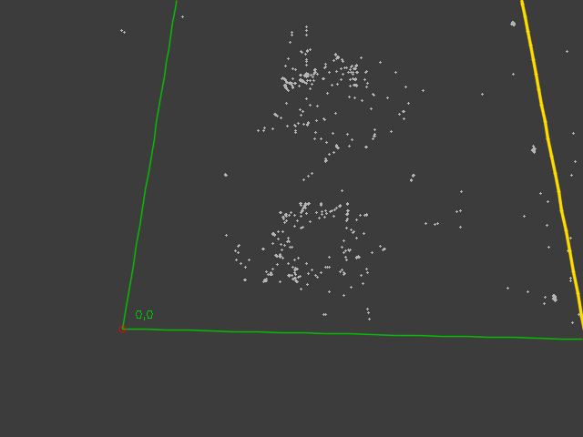

# Side camera on roam1: calibration, cross-check, coverage (2026-10-24)

## Premise
Steps 2 and 3 of `docs/build-plans/second-camera-plan.md`, offline on roam1 (2026-10-20): calibrate the side camera
to the floor, check it against the overhead where a robot stands still, and see how often it sees a robot the overhead
misses.

**What roam1 holds for the side camera.** The release `roam1-data` has the overhead only: `video.avi` is one
640x480 stream of 23,995 frames, and `frames.csv` and `meta.json` are camera 0's. The side camera's video (27,928
frames, 730 MB) and its `frames.csv` were not uploaded. The project file points to
`C:\Users\nfmax\recordings\20261020-065947_roam1\cam1` on Nick's laptop. What the release does have is the studio's
motion detections for the side camera (`recognition-project.zip`, `labels/..._roam1_side/cache/motion_detections.csv`):
21,640 sightings in side pixels, 19,806 of them robot-sized. All the work below uses those detections and the
overhead's own detections. No side picture was available, so:
- the side camera's corners could not be found in a picture. It was calibrated from **robots seen by both cameras**
  instead (overhead floor position at the same moment as a side pixel);
- the side clock had to be **fitted**, since its `frames.csv` is missing (method below);
- the side MotionTracker could not be replayed. The per-spot robot size it needs was built and tested on a drawn
  steep view.

## Data

**Clock.** The side frame time is `t = offset + frame × 0.034375 s`, using the cache's own 960.02 s / 27,928 frames
(29.1 fps). The offset that lines up the most robot pairs is **0.58 s**. The overhead's first frame is at 0.55 s, so
the two cameras started together. Fitted per 2-minute block, the best offset ranged 0.41-0.65 s, so there is no
drift beyond about ±0.15 s.

**Calibration** (`tools/experiment/data/side_floorcal_roam1.json`):

| | |
|---|---|
| Pairs used (overhead robot moving under 1.5 cm in ±0.2 s) | 12,099, of which 2,924 are the same robot (RANSAC) |
| Floor cells (10 cm) the pairs cover | 30 of 144: x 20-110 cm, y 0-100 cm |
| Fit error | 2.0 px; leave-one-cell-out 0.70 cm (worst 1.37 cm) |
| Camera (fitted) | (54.6, −31.4) cm, 143 cm up, 24.5° from straight down, looking at (45, 33) |
| Board in the picture | 97%: missing the far strip (y above 117.5-120 cm) and the corner at (122, 0) |

The green outline is the board as the side calibration puts it in the side camera's picture; the grey dots are where the
side camera saw robots (every 25th frame); there is no photo behind them, because the side video is missing.

**Cross-check at still moments.** Two folds by alternating minutes: each fold's calibration was checked only on still
moments from the other fold's minutes. A still moment is the overhead seeing a robot move under 1 cm over 0.4 s
(`still_position`'s rule). There were 361 of them in 12 places.

| x cm | y cm | region | moments | median diff cm | worst cm | lean toward side camera, cm |
|---|---|---|---|---|---|---|
| 0-30 | 0-30 | middle | 2 | 4.4 | 4.7 | 3.0 |
| 0-30 | 30-60 | middle | 11 | 0.9 | 1.3 | −0.9 |
| 30-60 | 0-30 | middle | 53 | 1.3 | 7.0 | −0.9 |
| 30-60 | 30-60 | middle | 47 | 0.7 | 4.5 | 0.2 |
| 30-60 | 60-90 | middle | 52 | 1.1 | 6.3 | 0.6 |
| 30-60 | 90-120 | middle | 7 | 0.9 | 1.4 | −0.1 |
| 60-90 | 0-30 | middle | 13 | 1.2 | 3.9 | −0.8 |
| 60-90 | 30-60 | middle | 36 | 1.4 | 4.3 | −0.6 |
| 60-90 | 60-90 | middle | 24 | 2.1 | 2.7 | −0.7 |
| 90-120 | 0-30 | along the x=122 board | 35 | 2.5 | 11.8 | 0.7 |
| 90-120 | 30-60 | along the x=122 board | 48 | 1.1 | 8.7 | 1.1 |
| 90-120 | 90-120 | blocked corner | 33 | 0.8 | 2.1 | −0.6 |
| **all** | | | **361** | **1.15** (90%: 3.4) | **11.8** | **0.0** |

The worst differences are explained moments, not a pattern. The 11.8 cm one is at 123 s, in the side camera's first
seconds of sightings. The 8.6-8.7 cm run is one spot, (93, 35), at 831-836 s, during the objects phase (objects and
hands on the board).

**Lean.** The side camera sees the robot's near face, so its outline centre should lean toward the camera. Measured,
the lean is 0.0 cm (median) and does not grow with distance from the camera: slope 0.0006 cm per cm, correlation 0.01.
By distance band: −0.2 cm (under 60 cm), +0.2, +0.5, −0.3 cm (over 120 cm). The calibration is fitted to the
overhead's positions, so any constant lean is absorbed into it. At roam1's mount (24.5° from straight down) nothing is
left over. The plan's steeper mount (45-55° from straight down) may leave a lean.

**Where each camera sees** (half-second bins; a camera "sees" a robot with at least 2 sightings within 10 cm in the bin;
calibration and roaming phases, 170-730 s):

| region | robot-bins | both | overhead only | **side only** (side sees, overhead misses) |
|---|---|---|---|---|
| blocked corner (x, y > 97 cm) | 104 | 89 | 0 | **15 (14%)** |
| along the x=122 board | 236 | 190 | 21 (9%) | **25 (11%)** |
| along the y=122 board | 2 | 0 | 2 | 0 |
| open edge y=0 | 37 | 33 | 3 (8%) | 1 (3%) |
| middle | 994 | 873 | 2 | **119 (12%)** |

The objects phase (730-940 s) is left out. There the overhead alone has 46-80% of bins, because objects and hands
confuse the two detectors differently (appendix A3). Robots in roam1 hardly went near the y=122 board or into the
Oct 24 glare cells (x 60-100, y 100-120), so roam1 cannot say anything about those.

**Tracker size per spot** (`MotionTracker(..., size_per_spot=True)`, off by default). The robot size in pixels is now
taken at each outline's own spot for the shape check, the cover disks and the lock-on's starting look. The pre-filter
uses the smallest robot on the board. On a drawn camera like the plan's mount (42° from straight down, 2.3 times larger
near than far), a robot at the near edge was refused as too big with the middle's size (outline 1,711-1,924 px against
506 px) and kept with its own size. Robots at all 7 test spots across the board pass. Roam1's real side mount changes
scale only 1.65 times (2.7-4.4 px/cm), which the old check already allows.

## Conclusion
- **The side camera can be calibrated from robots alone.** Against the overhead it agrees to 1.15 cm median (90% within
  3.4 cm) at 361 held-out still moments in 12 places, including the blocked corner (0.8 cm) and along the x=122 board
  (1.1-2.5 cm). It is not an independent check of the overhead, because the fit uses the overhead's positions. A
  corner calibration from a side picture is still needed for that.
- **At roam1's mount the side camera adds robots everywhere, not mainly at the overhead's weak places.** It sees robots
  the overhead misses in 11-14% of robot-time, and about equally in the blocked corner, along the x=122 board and in
  the middle. The overhead almost never sees what the side misses (0-9%).
- **No measurable lean** at a 24.5° view once fitted. The plan's step-4 correction may be unnecessary at a mount like
  roam1's.
- **The fit depends on the guessed side clock.** An offset of 0.68 s instead of 0.58 s broke one fold (worst 473 cm),
  and 0.78 s did not fit at all. The side `frames.csv` would remove this guess.

## What's next
1. **Nick uploads roam1's side camera folder.** The files are `video.avi`, `frames.csv` and `meta.json` from
   `C:\Users\nfmax\recordings\20261020-065947_roam1\cam1`, to the `roam1-data` release as `side-video.avi`,
   `side-frames.csv` and `side-meta.json`. Then: real clock, corners from the picture (`find_board_corners` →
   `order_corners_like` against this file's `board_corners_px` → `make_calibration(..., name="side")`), a real
   `draw_check`, and the side MotionTracker replay with `size_per_spot=True`.
2. Compare the corner calibration with this robot calibration. That comparison is the independent cross-check.
3. Plan step 1 (mount) changes the view. Recalibrate there, check the lean again at the steeper angle, and re-run the
   coverage table with blocked boards standing.
4. Coverage with the real tracker: replay the overhead MotionTracker as well, instead of the studio's motion detector.

## New tests that may now be needed
- Corner calibration vs robot calibration on roam1's side picture: positions agree within a set limit across the board.
- Side MotionTracker replay on roam1 (size per spot): share of frames a robot is held, by region, against the overhead.
- Lock-on tracker on a steep view: a robot driving from far to near (2-3 times the size) stays locked. The look is
  taken once at the start size.
- `find_offset` on real footage with a known clock (a session with both `frames.csv`): the fitted offset within 0.05 s.
- A guard that refuses a robot calibration whose two folds disagree by more than a few cm, as the 0.68 s offset showed.

## Possible inaccuracies
- **Side clock**: a constant offset (0.58 s) at a constant 29.1 fps, not measured. Dropped side frames would shift
  later times. Block-by-block offsets ranged 0.41-0.65 s, about 1.5-3 cm for a moving robot.
- **Calibration rests on the overhead**: it inherits the overhead's errors (its leave-one-out 1.1 cm, 2.1 cm worst)
  and cannot show them. The cross-check measures agreement, not truth.
- **Coverage of the fit**: pairs cover x 20-110, y 0-100 cm. The strip y > 100 cm, x < 20 cm and the corner at (122, 0)
  are extrapolated.
- **Side detections are unchecked**: "side only" sightings could include shadows or reflections the side detector
  calls robots. With no side video they could not be looked at.
- **The overhead proxy is the studio's motion detector**, not e02's MotionTracker. The e02 tracker's own losses (30%
  seen against a board, Oct 22) may differ.
- **Board layout**: the blocked boards at x = 122 and y = 122 come from the default `Board` layout. Whether boards stood
  in roam1 is not recorded here.
- **Chosen numbers** (whether a designed experiment should set each):
  - side plane height 1.85 cm (half the robot): made no difference (0, 1.85 and 3.7 cm gave identical results); no DOE.
  - RANSAC limit 4 px: 3 px failed (too few cells); 6 px gave 1.16 cm median, 3.0 cm at 90%; a sweep is enough, no DOE.
  - slow-robot limit 1.5 cm: 0.8 cm gave 1.53 cm median, 3.0 cm gave 1.29 cm; a sweep is enough.
  - cell size 10 cm, pair window 0.02 s, still-moment rule (0.4 s, under 1 cm) from `still_position`: not swept.
  - "same robot" radius 10 cm, bin 0.5 s, at least 2 sightings, edge band 12 cm, corner 25 cm: these set the coverage
    table's split and could move its percentages by a few points. A small DOE (radius × sightings) on the side video
    would be worth it once tracker data exists.
  - the tracker's per-spot size uses 9.5 cm × px/cm at the spot (`px_per_cm` averages x and y), and the pre-filter
    uses the smallest of 9 board spots. These are geometry, not tuning; no DOE.

## Appendix
**A1. How the calibration was made** (`tools/experiment/e02_sidecam.py`). Overhead detections go to the floor at
3.7 cm with `overhead_floorcal_roam1.json`. Every side sighting is paired with every overhead sighting within 0.02 s,
keeping only overhead robots that moved under 1.5 cm in ±0.2 s. A RANSAC plane homography (4 px) keeps the pairs that
are the same robot. These are reduced to one median per 10 cm floor cell (at least 3 pairs) and fitted with
`CameraModel.from_points` (no lens term, mirror found automatically). The pairs are then re-picked by that camera
(within 4 px) and it is fitted again. The offset scan used inlier count: coarse 0.25 s steps over ±3 s, then 0.02 s
steps. The peak was 6,349 at 0.58 s, against 6,107 at 0.62 s and about 4,500 at 0.9 s.

**A2. Sensitivity of the cross-check to the clock offset** (held-out still moments: n, median, 90%, worst cm):
0.38 s: 364, 1.27, 3.93, 9.0 · 0.48 s: 364, 1.42, 5.14, 13.8 · **0.58 s: 361, 1.15, 3.36, 11.8** · 0.68 s: 268, 1.15,
4.5, 473 (one fold broke) · 0.78 s: no fit.

**A3. Objects phase (730-940 s), robot-bins: both / overhead only / side only.** Middle 50 / 102 / 68. x=122 board
3 / 67 / 14. Elsewhere under 10 bins each. The two detectors disagree here too much to say which camera is right
without pictures.

**A4. Side detections over time** (sightings per minute). 0-120 s: none. 120-240 s: 300 and 3,477. 240-420 s: under 60.
420-720 s: 541 then about 3,490 a minute. 720-960 s: 344-431. The overhead was also nearly empty at 0-120 s and
240-420 s (robots standing), so the side camera's silence there is not by itself a sign it went dark.

**A5. Code.** `e02_camera.make_calibration(..., name="overhead")` takes a camera name (default unchanged).
`e02_camera.order_corners_like(found, predicted)` tries the 8 ways round the outline and keeps the one nearest the
predicted corners. `MotionTracker(size_per_spot=False)` adds `_rpx_at(x, y)`, `area_min` and `_shape_ok(..., rpx=None)`;
with the default False every path is the old one. Tests: `tools/experiment/tests/test_e02_sidecam.py` (17). Existing
camera tests run (camerr, explore, fixbuild, multitrack, oct22, realclips, one runner test): 59 passed, 12 skipped (no
clips).
