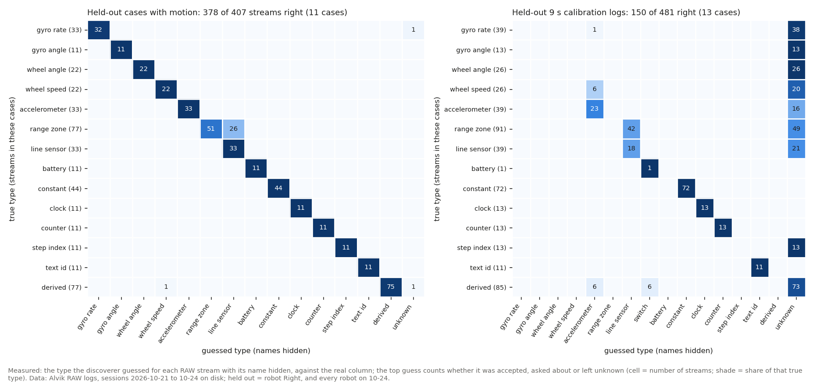

# Blind sensor discovery on the Alvik logs (2026-10-25)

Logs only, no board time. First piece of **New system from scratch** (design: [sensor-array-self-calibration.md](../build-plans/sensor-array-self-calibration.md) §7, the discovery half of rank 2 in §11; the doc's test 1 and part of tests 2 and 3). Code: `tools/discovery/` (load, features, relations, classify, calibrate, score, replay, chart; tests in `tools/discovery/tests/`, 34 pass). Results: `tools/discovery/results/replay_streams.csv` (one row per stream per case, with evidence) and `replay_summary.json`. Rerun: `python3 tools/discovery/replay.py` (about 4 min for every session on disk).

## Premise

Can the system work out what each sensor stream is when its name is hidden? Each RAW column becomes `stream_01..37` in a shuffled order, and the name key is kept apart for scoring only (a test checks that the discoverer's modules never import it). The discoverer may use only:

- the streams' values and arrival times;
- the commanded legs (`leg.csv`), which a real discovery run would know because it sends them;
- the camera track (`track.csv`) and the board lines.

Computed streams (pose, drive speed, tilt) must come out as **derived**, not as separate sensors.

**How it was kept honest.**

- **Development set:** Left and Center on 2026-10-21 to 10-23, plus a synthetic robot with known sensors (`tests/synth.py`). These were the only cases looked at while writing the rules. Nothing was fitted: the rules are hand-written with chosen numbers.
- **Freeze, then test:** the rules were frozen before running the held-out cases: robot Right (never looked at), and all three robots on 10-24 (recorded later).
- **One change after the test:** after the held-out disguise test, two fixes were made, the number parser and asking about IMU axes (Appendix B). Both runs are reported. Accuracy on the plain held-out cases did not change.

## Data

52 cases (one robot in one session), 37 streams each:

- **20 rich cases:** 5,000 to 75,000 rows of finds, routes and calibrations. 9 are development, 11 held out.
- **32 short cases:** the 9 s calibration logs, about 450 rows, mostly the robot standing still. 19 are development, 13 held out.

Commanded legs fall inside RAW logging in only 9 of the 20 rich cases. Most legs were idle moves between runs, when RAW is off. The camera therefore carried most of the turn evidence: the heading change between two drive stretches it sees.

| | Streams right | Accepted (≥ 0.90) | Wrong among accepted | Asked (0.60-0.90) | Left unknown |
|---|---|---|---|---|---|
| **Held-out, with motion (11 cases)** | **378 / 407 (93%)** | 234 | **0** | 138 (the truth was among the 3 offered in all 138) | 35 |
| … robot Right, 10-21 to 10-23 (5) | 168 / 185 (91%) | 111 | 0 | 59 | 15 |
| … Left and Center, 10-24 (4) | 145 / 148 (98%) | 81 | 0 | 58 | 9 |
| … Right, 10-24 (2) | 65 / 74 (88%) | 42 | 0 | 21 | 11 |
| Development, with motion (9) | 327 / 333 (98%) | 184 | 1 | 129 | 20 |
| **Held-out 9 s logs (13)** | 150 / 481 (31%) | 109 | 0 | 25 | 347 |
| Held-out with motion, units disguised | 308 / 407 (76%) | 209 | 13 (6%) | 140 | 58 |
| … disguised and delayed 100 ms | 277 / 407 (68%) | 174 | 10 (6%) | 130 | 103 |

"Right" counts the top guess even when it was only asked about or left unknown. Units disguised: every stream multiplied by one of 0.1, 10, 57.3, 1/57.3, 2.54, 1000, half of them sign-flipped (design doc test 2). Offsets were not disguised, because gravity's steady level is part of how an accelerometer is found.

Each cell counts streams of one true type (row) given one guessed type (column), for the held-out cases with motion (left) and the held-out 9 s logs (right).

**What was identified, in the held-out cases with motion** (11 cases each unless stated):

- **Right in every held-out case:**
  - all wheel angles and wheel speeds (each pair found as angle = integral of speed, r ≥ 0.98);
  - the yaw gyro;
  - all 3 accelerometer axes;
  - the fused yaw (found as an integral of the gyro);
  - the clock, the row counter, the step index, the run id, the battery, the constants;
  - all 3 line sensors.
- **Pose:** x, y and heading were found every time as a position pair driven along a heading (circular agreement 0.90-1.00 on held-out windows).
- **Derived streams:** 87 of the 88 computed streams were tagged derived (pose, drive speed, turn rate, roll, pitch, yaw). The miss is one roll.
- **Finding (Claude):** `dC_cm` is exactly the mean of `dCL_cm` and `dCR_cm` (R² 1.000 on held-out windows) in all 11 held-out and all 9 development cases. The Alvik's centre zone is computed, not measured, so it is not separate evidence.
- **The failures:**
  - 26 range zones were guessed "line sensor". 23 of them are on robot Right, and none was accepted.
  - The rest: 1 roll, 1 gyro axis and 1 drive speed, all left unknown or asked about.
- **Why Right's zones fail:** during motion they change only 3-7 times their rest noise. On Left and Center that figure is 12-29 times, with the same rest noise (about 1 cm). The board reference that could separate the two types (≥ 12 drive ends facing a board) was not available in these cases.

**Calibration against references** (rich cases, correctly typed streams):

| Stream | Measured | Reference | Note |
|---|---|---|---|
| Yaw gyro | 0.97-1.02 camera degrees per gyro unit (median 0.99, 12 cases) | Camera heading change between drive stretches | Units snapped to deg/s. In 2 of 12 the sign came out negative (not explained yet) |
| Gravity axis | 1.019 g per unit (0.99-1.03) | Gravity at rest | Confirms data-formats' "az about 1 at rest" (it reads 0.98) |
| Wheel angle | 0.0303 cm per degree (0.028-0.039, 15 cases) | Camera distance over drive stretches | A wheel radius of 1.73 cm (data-formats: "about 1.7 cm, to be measured") |
| Wheel speed | 0.148 cm/s per unit (0.12-0.16) | Camera distance over the integral of the speed | **19% below** the 0.182 the wheel radius implies for rpm |
| Range zones | Scale 0.6-2.5 | Camera distance to the boards ahead | **Not usable:** few drive ends face a board, and a zone's own direction is ignored |

**Cut-offs (the chosen 0.90 / 0.60), replayed at other values**, on the 11 held-out cases with motion, ask bar 0.60:

| Accept at | Accepted | Wrong | Questions | Questions per robot | Same cut-off on the 9 s logs: wrong |
|---|---|---|---|---|---|
| 0.70 | 355 | 3 (0.8%) | 17 | 1.5 | 7 |
| 0.80 | 281 | 0 | 91 | 8.3 | 7 |
| **0.90 (now)** | 234 | 0 | 138 | 12.5 | **0** |
| 0.95 | 172 | 0 | 200 | 18 | 0 |

The 7 wrong at 0.70-0.85 on the 9 s logs are two-valued streams (a pose coordinate or the battery that flickered between two values) taken for a switch.

**Is confidence honest?** (held-out, with motion)

| Confidence band | 0.5-0.6 | 0.6-0.7 | 0.7-0.8 | 0.8-0.9 | 0.9-1.0 |
|---|---|---|---|---|---|
| Guesses right | 13 / 23 (57%) | 8 / 17 (47%) | 71 / 74 (96%) | 47 / 47 | 234 / 234 |

Above 0.70 the guesses are right more often than they claim, so the confidence is too modest there. Below 0.70 it is roughly right or slightly high.

## Conclusion

1. **Yes, for sensors the motion and the camera exercise.** With a few minutes of driving and turning under the camera, the system names 93% of held-out streams with names hidden. It accepted 234 labels without a single wrong one, and every question it would ask offers the right answer among its three choices. Wheels, gyro, accelerometer gravity, line sensors, clocks and constants were identified on the robot it never saw.
2. **Derived streams are caught by relations, not by names.** The tests are: angle = integral of a rate, exact copies, exact combinations of two streams, and a position pair whose direction of travel follows a heading. 87 of 88 computed streams were tagged derived. The same tests found that the centre range zone is a computed mean **[Claude: so the fusion should not count it as a sixth independent zone]**.
3. **A log where the robot does not move cannot identify motion sensors**, and the discoverer says so instead of guessing. On the 9 s logs it identifies only the passive types (clock, counter, id, constants), and never wrongly at 0.90. This supports the design's test-motion battery (§7). The current 9 s calibration log is not enough for New system from scratch.
4. **Three weak spots, measured:**
   - range zones that barely move look like reflectance sensors (Right);
   - telling the IMU's accelerometer axes from its gyro axes rests on the axes sharing units, so the non-gravity axes are now asked about (about 4 questions per robot);
   - hidden units (rescaled streams) still produce 6% wrong accepted labels, mostly planar-pose and wheel-versus-pose mix-ups.
5. **The 0.90 bar is right while short logs exist [Claude].** At 0.80 there were no wrong labels on the held-out logs with motion, and it cuts questions per robot from 12.5 to 8.3, but it lets 7 wrong ones through on the 9 s logs. The bar could depend on how much motion the log holds; that is a DOE row, not a decision made here.
6. **For New system from scratch [Claude].** Discovery works on what moves the robot and what gravity pulls, provided the session commands and logs its own test motions under the camera. These logs had commands for only 9 of 20 rich cases, and a real discovery run would have them throughout, so this replay is the harder case. The open parts are a second robot or simulator with a truly different sensor set (the risk "it learns the Alvik, not sensors") and zones with little motion.

## What's next

1. **Check Right's front sensor:** its zones move 3-7x their noise against 12-29x on the others (new test 1). This is logs only and can run now.
2. **Wheel speed against wheel angle:** find where the 19% comes from (new test 2). Logs only.
3. **The rest of design rank 2: the heading logs as an error-check test set** (not done here), then **rank 3, the general stream model**. It takes this discoverer's types and its calibrations (gyro, gravity, wheel) as starting values, tagged with the provenance the doc asks for (*measured* or *derived*; here only the derived tag exists).
4. **The test-motion battery as a runner stage** (design rank 8), so a real discovery log has every motion commanded and logged. Then replay this discoverer on it.
5. **The DOE rows** added to the backlog: the cut-offs by amount of motion, the exact-relation bars, the windows and the grouping. All of them are logs-only replays.
6. **A different robot:** a ROS 2 simulator robot (design §11 risks) with renamed, rescaled and remounted sensors.

---

## New tests that may now be needed

1. **Right's front sensor:** zone change in motion against the camera's distance to the boards, Right against Left and Center, from the logs already on disk. Is it blocked, aimed low, or just facing near boards?
2. **Wheel speed scale:** compare `wl_rpm` with the change of `wl_deg` per second, robot by robot. Is it wheel rpm, motor rpm, or rpm on another time base?
3. **Gyro sign against the camera:** 2 of 12 cases gave a negative camera-per-gyro factor. Check whether those sessions had the board side flipped (`xboard_side`) or the scan locked on a mirror.
4. **Camera angle scan against integral scan:** the fused yaw came out at 1.06 camera degrees per unit and the pose heading at 0.95, though both are integrals of the same gyro. The angle scan may be biased.
5. **Disguise with axis swaps and offsets**, which this replay did not do (design test 2).
6. **The discoverer on a real test-motion battery log**, once design rank 8 exists.
7. **A non-Alvik robot**, in simulator or from a public dataset, with a different sensor set.
8. **Repeatability:** run discovery on the first and second half of one long session. Do the labels agree?

## Possible inaccuracies

- **Rules were written while looking at the development cases and a synthetic robot I designed.** Held-out scores test generalisation across one robot and one day, not across sensor kinds. All three robots are Alviks with the same firmware.
- **The chosen numbers are not derived.** They include the exact-relation bars (0.98 integral, 0.97 copy, 0.80 planar with 0.30 excess), the grouping affinity 0.45, 1 s and 2 s windows, the 10 Hz grid, the 2.5 cm/s camera drive threshold, the 0.05 unknown floor, the short-case ramp (30-120 s), the gravity level-to-noise of 300, the IMU-axis cap and the range/line score weights. All are in the DOE backlog.
- **Some evidence depends on the Alvik's printing format.** Whole-number line readings (raw counts) are a cue that a rescaled stream loses. The parser takes text to be "not a printf number", and leading zeros mark a run id.
- **Truth labels are partly a choice.** yaw_deg is scored as gyro angle (and tagged derived). dC_cm is scored as range although it is computed. A stream constant in a case is scored "constant". charging, lifted and the switches never changed in any session, so switches were never really tested.
- **Pass 2 was changed after seeing held-out disguise results** (parser and IMU-axis asking). Plain held-out accuracy is the same in both passes, but pass 2's disguise numbers are no longer fully blind.
- **The confusion chart and the "streams right" figure count top guesses** that would only have been asked about or left unknown.
- **The camera heading reference folds to ±90°**, because it does not know forward from backward. A turn near 90° between two stretches is ambiguous.
- **"Questions per robot" assumes the person answers correctly.** The wheel radius of 1.73 cm rests on camera distances over drive stretches that include their stops and starts.

## Appendix A. How the discoverer works

1. **Passive pass:** text (anything that is not a printf number), constant, counter (never falls, equal steps), clock (never falls, in proportion to time, changes every row). The clock found here becomes the time base, which removes WiFi arrival jitter. Also slow streams (battery: trend over the session; step index) and two-valued streams.
2. **Groups:** streams that flicker together while the robot stands still, judged on rows where every flat-at-rest stream (encoders, pose) is flat. These come out as the range zones, the line sensors, the accelerometer and the fused orientation.
3. **Relations:** on 1 s and 2 s windows, each checked on two interleaved halves of the data. These are integral pairs, copies, exact combinations of two streams, and planar pose (a position pair's travel direction follows a heading, beating both streams' own concentration).
4. **Derived:**
   - the planar pose and its heading;
   - the turn rate the pose heading integrates;
   - a processed copy (less noise at rest);
   - the odd one out of an exact trio: two look-alike channels, or, for three look-alike zones, the one that is a positive-weight mean;
   - outputs on the tick of a computed angle;
   - a tilt that follows an accelerometer axis but updates more slowly.
5. **Types:**
   - a pair with a look-alike pair is wheels, and a pair whose rate sits in the IMU set is gyro;
   - the IMU set is the flickering, continuous streams around the rate whose integral follows the camera's heading change (or the pose heading), split by noise floor into accelerometer (with the gravity axis) and gyro;
   - a multi-channel group splits into range or line by response to motion and agreement with the camera's board distance.
6. **Confidence:** each type gets a score in [0, 1], with "unknown" starting at 0.05 (raised in short logs). Confidence is the best score's share of the total.

## Appendix B. Pass 1 and pass 2

| | Pass 1 (frozen) | Pass 2 |
|---|---|---|
| Held-out with motion: right | 378 / 407 | 378 / 407 |
| Accepted / wrong | 276 / 0 | 234 / 0 |
| Disguised: right; accepted wrong | 294; 44 of 245 | 308; 13 of 209 |
| Disguised and delayed: right; accepted wrong | 272; 41 of 219 | 277; 10 of 174 |

Changes:

1. **The parser accepts scientific notation**, so the disguise's "1e+03" values were no longer read as text. Leading zeros still mark an id.
2. **IMU axes other than the gravity axis and the turn-following rate are asked about**, not accepted.

Earlier fixes, made during development, all came from the development cases or the synthetic robot:

- a monotone step taken for a clock;
- the gyro bias left in the turn integral;
- speed calibration taken from stretch edges;
- the lockstep rule over-firing on large groups;
- a scale-dependent look-alike test.
