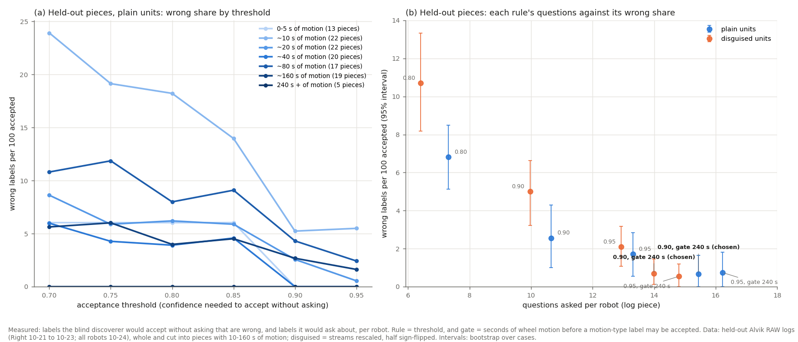

# Discovery: when to accept a label, and which calibration moves to add (2026-10-25)

Logs and simulation only, no board time. Follows the [blind discovery replay](e02-oct25-discovery-replay.md) and
[Right's front sensor and rpm](e02-oct25-right-front-and-rpm.md). Code: `tools/discovery/` (fixes in `features.py`,
`relations.py`, `classify.py`; new `threshold_doe.py`, `battery.py`, `battery_doe.py`, `threshold_chart.py`; tests in
`tests/test_battery_and_threshold.py`, 42 discovery tests pass). Results: `tools/discovery/results/` (`replay_*`,
`threshold_*`, `battery_doe.json`).

## Premise

1. **Two flaws in the replay** (found by the follow-up report):
   - its motion response counted every 1 s window, standing still included;
   - its wheel-speed calibration included 1 s either side of each drive.
2. **Accept labels?** Nick: "design an experiment and make a recommendation." When should the system label a
   stream without asking? This depends on the confidence threshold, on how much motion the log holds, and on whether
   the units are known.
3. **Calibration test moves.** The 9 s calibration log identifies almost nothing that moves, and the IMU's
   non-gravity axes were always asked about. Which short test moves should a calibration run hold?

## Design

**Fixes.** Two changes:

- The motion response now uses only the 1 s windows where the robot moves (blind: some stream that sits exactly
  flat at rest, such as an encoder or the pose, is changing).
- The wheel-speed calibration now sums over the drive stretch only.

Then the full replay was rerun.

**Threshold experiment** (`threshold_doe.py`). Three factors:

| Factor | Levels |
|---|---|
| Acceptance threshold | 0.70, 0.75, 0.80, 0.85, 0.90, 0.95 |
| Motion in the log | 9 s calibration logs (0-5 s of motion as they are). Rich logs cut into contiguous pieces holding 10, 20, 40, 80 or 160 s of wheel motion (2 pieces per case and level, random starts), plus each whole log |
| Units | plain; disguised (each stream rescaled by 0.1-1000, half sign-flipped) |

- **Responses per robot** (one log piece): wrong accepted labels, questions (confidence 0.60 to threshold) and unknowns.
- **Size:** 206 log pieces from 52 cases, 15,244 stream labels.
- **Held-out discipline:** the rule is chosen on development cases (Left and Center, 10-21 to 10-23) only, and
  checked on held-out cases (Right; every robot on 10-24). The criterion was fixed in the code before any results
  were seen: wrong share at most 1%, and its 95% upper bound at most 3%, in plain and disguised units alike. Among
  passing rules, the one with the fewest questions wins.
- **Disclosure:** the gate idea (below) came after seeing that thresholds alone fail. My first table of gated rules
  printed held-out numbers next to dev numbers. The choice itself uses dev numbers only.

**Calibration moves** (`battery.py`, `battery_doe.py`). The simulator (`tools/sim`) has no tilt physics: its gx and
gy are bias plus noise. So I built a synthetic robot with the same 37 RAW columns:

- a tilt turns gravity between accelerometer axes and turns the x/y gyro;
- a lift adds vertical acceleration, lifts the line sensors and sets the lifted flag;
- a drive over tape raises the line sensors;
- rest noise is copied from the real logs; speeds are in robot units (`tools/raw_units.py`).

Plans tested: today's 9 s log, the full battery, the full battery minus each move, a stand plus each move alone, and
two compact batteries. Each ran on 3 robots (seeds), in plain and disguised units.

**Tilt test** (new, `classify.py tilt_pairs`). A tilt by hand gives direct evidence for the IMU's other axes. The
x/y gyro's integral is the tilt angle, and gravity moves onto an accelerometer axis by sin(angle), so that axis's
change follows the same integral. Without a test that uses this, a tilt move adds nothing. The test fires on no
real log on disk (checked on the full replay and on 24 log pieces).

## Data

### 1. The two fixes

| Held-out logs with motion (11 cases, 407 streams) | Before | After |
|---|---|---|
| Streams right | 378 (93%) | **401 (98.5%)** |
| Accepted / wrong among them | 234 / 0 | 237 / 0 |
| Right's range zones right | 26 of 49 | **46 of 49** |
| Disguised: right; wrong among accepted | 308; 13 of 209 | 326; 10 of 209 |
| Development logs with motion (9 cases): right | 327 of 333 | 303 of 333 |
| Wheel speed, cm/s per logged unit (15 cases) | 0.148 (19% below the wheel angle) | **0.164 (10% below)** |

- **Right's zones are now recognised.** Development zones dropped by the same count: 24 zones on 4 small dev
  logs (8,000 rows, slow driving) now come out "line sensor". None of them is accepted.
- **Why the zones moved.** With moving windows only, every robot's zones read 1.6-13.6x their rest noise and line
  sensors 0.9-1.7x. The two overlap on logs with little motion.
- **The ramp was re-anchored.** The classifier's motion-response ramp from "weak" to "strong" was set for the old
  all-window figure (2 to 6). I moved it to 1.5 to 3.0 from the development groups (line maximum 1.7, zone median
  3.3). The held-out values were on screen when I chose it.
- **Totals on all rich logs:** 705 of 740 right before, 704 after. The errors moved from Right to Left/Center's
  slow logs.
- **Wheel speed.** It now reads 10% below the wheel angle. 8 points of that are the motor board's real 1.08. About
  2.6% is still the method: the camera's drive stretch starts and ends inside the speed ramps.

### 2. Acceptance threshold against motion



Left: how many of every 100 accepted labels are wrong at each threshold, for log pieces with different amounts of
motion. Right: each rule's questions per robot against its wrong share, where lower-left is better.

**At the current 0.90, wrong share by motion** (held-out, plain):

| Motion in the piece | 0-5 s | ~10 s | ~20 s | ~40 s | ~80 s | ~160 s | whole log (240 s +) |
|---|---|---|---|---|---|---|---|
| Wrong / accepted | 0 / 109 | 10 / 191 | 5 / 195 | 0 / 241 | 15 / 348 | 11 / 411 | 0 / 106 |
| Questions per robot | 0.5 | 8.1 | 9.5 | 13.4 | 14.6 | 14.2 | 15.0 |
| Unknown per robot | 28.1 | 20.2 | 18.6 | 11.5 | 1.9 | 1.2 | 0.8 |

**Threshold alone does not work.** The wrong share does not fall steadily with motion, and pieces with 10-160 s of
motion keep 1-5% wrong labels even at 0.95. 61 wrong labels across all plain pieces have confidence 0.90 or more,
and 31 of those sit at the top value of 0.95. They come from rules that score full marks whatever the amount of
evidence:

- roll/pitch taken for accelerometer axes: 22;
- accelerometer axes taken for range zones: 11;
- a wheel angle that turned one way through a whole piece taken for a clock: 7.

**Rules compared** (gate = seconds of wheel motion before a motion-type label may be accepted; passive labels such
as clock, id, constant and battery are accepted at the threshold regardless):

| Rule | Dev plain: wrong (95% interval¹) | Dev disguised | **Held-out plain** | **Held-out disguised** | Questions per robot (held-out plain / disguised) |
|---|---|---|---|---|---|
| 0.80 | 5.8% (3.9-7.9) | 10.5% | 6.8% | 10.7% | 7.3 / 6.4 |
| 0.90 (now) | 1.9% (0.8-2.9) | 5.5% | 2.6% (1.0-4.3) | 5.0% (3.2-6.6) | 10.7 / 10.0 |
| 0.95 | 1.1% (0.3-1.8) | 2.4% | 1.7% | 2.1% | 13.3 / 12.9 |
| 0.90, gate 120 s | 1.1% | 2.5% | 1.4% | 2.3% | 13.4 / 12.3 |
| **0.90, gate 240 s (chosen on dev)** | **0.4% (0-0.8)** | **0.9% (0.2-1.6)** | **0.7% (0-1.6)** | **0.7% (0.1-1.4)** | **15.4 / 14.0** |
| 0.95, gate 240 s | 0.4% | 0.6% | 0.7% | 0.5% | 16.2 / 14.8 |

<sub>¹ 95% bootstrap interval: the cases (one robot in one session) are drawn again at random with replacement
2,000 times and the figure recomputed each time. The middle 95% of those values is the interval. Cases rather than
streams are resampled because streams of one robot rise and fall together. When no wrong label was seen, the upper
end is 3 / (labels accepted), the usual 95% bound for zero events.</sub>

The chosen rule meets the criterion on dev, and it meets it again on held-out cases it never saw. 7 wrong labels
remain on held-out pieces in each units variant:

- **Plain:** all 7 are passive guesses: a wheel angle, pose x or pose y taken for a clock.
- **Disguised:** 5 clocks of the same kind, plus 2 mix-ups on whole logs (a wheel angle and the fused yaw tagged
  derived).

### 3. Calibration test moves (synthetic robot, 37 streams, mean of 3 robots, accept 0.90)

| Plan | Length | Right (plain / disguised) | Accepted | Wrong accepted | Questions |
|---|---|---|---|---|---|
| Today's 9 s calibration log | 12 s | 18 / 17 | 11 | 0 | 1 |
| **Full battery** | 141 s | **36.7 / 34.3** | 26.7 | 0.3 | 10 |
| Full minus square drive | 83 s | 35.3 / 29.3 | 9 | 0 | 27.7 |
| Full minus tilt | 123 s | 33 / 30.7 | 19 | 2.7 | 15.3 |
| Full minus lift | 133 s | 35.3 / 31 | 27.3 | 1.7 | 8 |
| Full minus line crossing | 127 s | 35 / 33.7 | 26 | 2.0 | 9 |
| Full minus spins | 129 s | 37 / 32 | 27 | 0 | 9.3 |
| Full minus straight drive | 127 s | 36.7 / 33 | 26.3 | 0 | 10.3 |
| Stand + tilt only | 34 s | 19.3 / 18.7 | 18 | 0 | 12 |
| Compact (no square, no line) | 69 s | 34.3 / 30 | 9 | 0 | 25 |

What each move does here:

- **Square drive** (12 legs of 15 cm with 90° turns). It gives the camera 12+ heading changes between drive
  stretches (the gyro's scale and sign) and the range zones their drive ends against boards. It also takes the log
  past the 120 s duration ramp, below which confidence is capped. Without it, almost nothing is accepted.
- **Tilt.** IMU non-gravity axes go from asked about (12 questions) to all 12 accepted. Without it, roll and pitch
  were taken for range zones in 1 of 3 robots.
- **Lift.** It makes the lifted flag change, so the flag is found as a switch rather than a constant. Without the
  lift, the bottom zone (which in this model looks further ahead when the nose tilts up) was taken for an angle in
  every robot.
- **Spins and the straight drive** add little once the square is there.

The compact batteries get 34 of 37 right but accept 9, because the duration ramp caps them. With the ramp switched
off they accept 26-27, but 1-2 per robot are wrong.

**A finding, not caused by any move:** in 3 of the 7 full-battery variants, the fused yaw and the pose heading were
swapped (each taken for the other) and accepted at 0.95. This weakness predates this work.

## Conclusion

1. **Accept labels, with a motion gate.** Accept a label without asking when its confidence is 0.90 or more. For
   anything that needs motion to identify (wheels, IMU, range, line, derived streams), do this only once the log
   holds 240 s of wheel motion. Before that, ask. Passive labels (clock, counter, id, constant, battery, step index)
   are accepted at 0.90 from the start. Evidence, held-out: 0.7% wrong among accepted labels in plain and disguised
   units, against 2.6% and 5.0% for 0.90 alone, at 14-15 questions per robot instead of 10-11.
2. **The risk each option carries:**

   | Option | Wrong labels it lets through (held-out) | Questions per robot |
   |---|---|---|
   | 0.80 | about 1 in 15 (1 in 9 with unknown units) | 6-7 |
   | 0.90 alone | 1 in 40 (1 in 20 with unknown units), mostly at the top confidence 0.95 | 10-11 |
   | 0.95 alone | about 1 in 50 | 13 |
   | **0.90 + 240 s gate** | **1 in 140** | **14-15** |

   The gate's remaining risk is mostly passive labels: a wheel or pose coordinate taken for a clock.
3. **The fixes work as predicted for Right.** Its zones are now recognised (46 of 49). On slow logs, though, zones
   and line sensors overlap under any motion-response cut-off. A board approach in the calibration moves is the
   better remedy.
4. **Calibration moves to add** (synthetic evidence, synthetic times):

   | Move | Time | Who does it | Why |
   |---|---|---|---|
   | Stand still, at start and end | 10 s + 5 s | robot | rest noise and groups that flicker together at rest |
   | Square drive: 12 × (15 cm, then turn 90°) | about 58 s | robot (commanded) | gyro against the camera, wheels, zones against boards; the main source of accepted labels |
   | Tilt: nose up and back, each side and back, twice | about 18 s | Nick's hands | the IMU's x/y gyro and non-gravity accelerometer axes; roll/pitch found as computed |
   | Lift: straight up about 5 cm, hold, down, twice | about 8 s | Nick's hands | lifted flag; keeps the bottom zone from passing as an angle |
   | Line crossing: over a tape strip and back, twice | about 14 s | robot (tape laid once) | line sensors' response |
   | Spins both ways, 4 × 90° | about 12 s | robot | optional: gyro sign without the camera |
   | Straight drive at a board and back, twice | about 14 s | robot | optional in simulation; on the real board it gives the zones their board distances |

   Total about 2.5 minutes, about 95 s of it wheel motion. **Gap:** that is under the chosen 240 s gate, so with the
   rule as it stands, a battery-only discovery would ask about every motion label. Either the battery gets longer (a
   second square, about 5 min) or the classifier's full-marks rules are fixed and the gate re-decided (what's next 1).

## What's next

1. **Fix the rules that score full marks whatever the evidence:**
   - accept "clock" only for the time base;
   - stop roll/pitch passing as accelerometer axes;
   - stop the yaw/pose heading swap;
   - scale confidence by evidence counts (turn pairs, drive ends) instead of log duration.

   Then rerun the threshold experiment (about 26 min) and re-decide the gate. Logs only; runs without asking.
2. **Put the chosen rule in the code** once Nick accepts it (`classify.decide` with the motion seconds; today the
   code still decides at 0.90 alone).
3. **A real calibration battery** as a runner stage (design rank 8), one log per robot. Then rerun the discoverer
   and both experiments on it.
4. **Shortest battery:** synthetic sweep of square legs (6 / 12 / 18) and tilt repeats (1 / 2 / 3).

---

## New tests that may now be needed

1. **Real tilt log:** hand-tilt one robot with RAW on (2 × nose up, 2 × each side). Does the tilt test fire, and only
   on gx, gy, ax, ay?
2. **Bottom zone and tilt:** does the real bottom zone follow pitch the way the synthetic one does? It decides
   whether the lift move is needed.
3. **Board approach on the real board:** do zones on a slow log separate from line sensors once the robot drives at
   a board?
4. **Pieces between 160 and 240 s of motion,** to find where the gate really sits.
5. **Yaw/pose heading swap:** a test that builds both and checks the planar test picks the pose's own heading.
6. **Wheel-speed method:** the remaining 2.6%. Compare the speed integral with the wheel-angle change over the same
   rows instead of the camera's stretch.
7. **Combined pytest run across tools/** in CI, since the module-name clash (`score.py`) showed tests can pick the
   wrong module.

## Possible inaccuracies

- **The synthetic robot is my model.** IMU physics, the bottom zone's response to pitch, line-sensor lift, tape
  reading 600, move speeds (10 cm/s, 60°/s) and the times in the move table are chosen, not measured. The move
  rankings show what each move makes possible for this discoverer, not what a real robot will give.
- **Motion seconds come from the true wheel angles** (the experimenter reads the key). A real battery knows what it
  commanded. A log the system did not command would need the discoverer's own estimate. That estimate tracks the
  truth (r 0.95 on a log scale) but reads a median 1.6× high, because it counts encoder jitter as motion.
- **Pieces are cut from sessions of finds and routes,** not from batteries, so what they lack is ordinary motion.
  The 240 s gate fits that kind of log. On a designed battery it may be too strict (synthetic full battery: 0.3
  wrong per robot at 0.90 without a gate).
- **Few dev cases at high motion:** 4 cases at ~40, ~80 and ~160 s, and 4 whole logs over 240 s. The dev intervals
  there are wide.
- **The gate levels were a small set** (0, 5, 60, 120, 160, 240 s). Pieces at 120 and 160 s gave the same result,
  and none fell between 160 and 240 s.
- **Chosen numbers in the new code:**
  - the criterion (1% / 3%);
  - AOR_RAMP 1.5-3.0, re-anchored with held-out values in view;
  - MOVE_MIN_WINDOWS 5;
  - TILT_R 0.90, the noise-floor factor e and the group size 4;
  - the battery's move sizes;
  - the piece levels and 2 pieces per level.

  All are in the DOE backlog.
- **The tilt test was changed twice after testing.** First a guard against zones (synthetic); then a noise-floor
  guard, after it fired on one real 20 s piece (the pose heading was asked about as an accelerometer axis). The
  threshold experiment ran on the first version. On a re-check of 24 pieces, 4 of 1,776 labels differed, all in that
  one piece and none accepted.
- **"Questions" assume the person answers correctly,** and the share where the truth is not among the 3 offered
  grows on pieces (up to 51 of 179 questions at ~10 s).

## Appendix A. Changes to the discoverer

| File | Change |
|---|---|
| `features.py` | `moving_response()`: motion response over moving 1 s windows (5 needed); the all-window figure is kept as `active_over_rest_all`. Wheel-speed integral over the drive stretch only |
| `relations.py` | Works out the moving rows from the streams that sit flat at rest, and sets each stream's motion response |
| `classify.py` | `AOR_RAMP` 1.5-3.0 (was 2-6); `SHORT_RAMP` named (unchanged 30-120 s); tilt test (`tilt_pairs`, `TILT_R`) checked before the integral-pair rule |
| `disc_score.py` | Renamed from `score.py` (it clashed with `tools/site/score.py` in a combined pytest run) |
| `tests/synth.py`, `battery.py` | Speeds in robot units via `tools/raw_units.py` (rpm, v_cms, w_dps 1.08 high; v_cms in mm/s), with a `sim_info.json` marker |

## Appendix B. Reruns

```
python3 tools/discovery/replay.py                  # about 5 min on 2 busy cores
nice -n 10 python3 tools/discovery/threshold_doe.py   # about 26 min; --analyse for the tables only
nice -n 10 python3 tools/discovery/battery_doe.py     # about 2-7 min
python3 tools/discovery/threshold_chart.py
```
