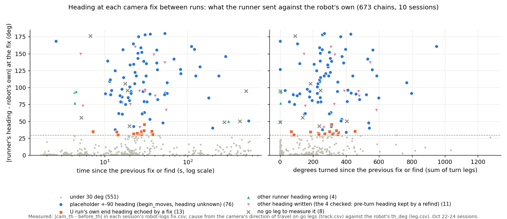

# E02: where the 30°+ heading errors between camera fixes come from (2026-10-25)

Logs only. No runner or firmware code changed. Script: `tools/experiment/analyses_oct25/heading_diag.py`. Outputs are in
`tools/experiment/analyses_oct25/out/` (`heading_diag.txt`, `heading_big.csv`, `heading_chains.csv`, `heading_resets.csv`,
`heading_legs.csv`, `heading_diag.png`).

## Premise
The logs DOE ([e02-oct25-logs-doe.md](e02-oct25-logs-doe.md) §1) found that 112 of 663 stretches between camera fixes
(17 %) ended with a heading disagreement of 30° or more at the next fix. Those stretches needed a position correction
of 22 cm (median), and the uncertainty model has no term for that. That number was `cam_th − before_th` from `fix.csv`.

**`cam_th` is not a camera measurement.** It is the heading the *runner* sent with the fix (`e02.py fix_now`: its
own `heads[robot]`, built from the camera's direction on go legs plus the turns it *commanded*). So the 17 % is the
runner's heading against the robot's own, and either one can be the wrong one. This report measures both against the
camera.

**Method.** The true heading is the direction the camera saw the robot move on a go leg of 8 cm or more (reversed
for a backward leg). The firmware holds its own heading while driving a go leg. The robot's heading error at a leg is
therefore its `th_deg` at the leg's start minus that direction. 803 legs measured, across the same 10 sessions and
673 chains as §1. Between two resets (a fix or a find) the robot's heading is gyro only, so:
- the error at the first measured leg after a reset is the error that reset **wrote in**;
- the change from the first to the last measured leg is what the **gyro and turns** added;
- the runner's error at a fix = disagreement + the robot's error at the last leg.

Check: the runner's error worked out before a fix and the robot's error measured after it (the fix wrote the
runner's heading in) agree to 1.7° median (90 %: 5.3°, n 145). The method holds.

## Data

**Hypotheses 1 to 5, against the data**

| # | Hypothesis | Result |
|---|---|---|
| 1 | Measurement artefact (quarter turn) | **Partly.** The 30°+ disagreements cluster near 90° (24 within 7° of 90, against 10.5 for an even spread); 17 of those 24 come from the placeholder heading below (±90°). Nothing clusters at 180° (5 against 5.2). No camera outline heading is involved: the runner sends bearings of go legs. The artefact is in the *metric*: in 19 of the 112 the robot was measured right and the runner's heading was the wrong one |
| 2 | A fix writes a wrong heading | **Yes: the main cause.** 100 of the 112 trace to a fix that wrote a heading the runner had not measured (three ways, table below) |
| 3 | Gyro scale / drift / wrap | **No.** Inside a chain the robot's own error grows a median 1.4° (under 90° turned), 2.1° (90-270°), 3.6° (270-720°); one chain reached 30°. No wrap bug: the firmware's `yawTrack`, `imuTurnTo`, the idle `turn` leg (`e02.h` `turnToFloor(wrap180(th + arg))`) and `fixCommand` all wrap; the runner's heading arithmetic all goes through `wrap180` |
| 4 | Wheel slip on turns | **Not a heading cause.** The robot's heading is the gyro's, so slip moves it without turning its heading. Wheels / gyro on 576 turns on the spot inside runs: 0.95-0.97 per robot (10-90 %: 0.92-0.99), no slip outliers |
| 5 | Robot / phase | Right 21 %, Left 17 %, Center 12 %. 100 of 112 are in the parking phase (where the idle moves and their fixes happen). The 2026-10-22 sessions are worst (21-100 %); stage 1-2 (2026-10-24, current runner) still 10-16 %. Power-on and compass check: not separable in these logs |

**What started each 30°+ chain** *(classification: Claude)*

| Origin | n | Share | Position correction, median (90 %) |
|---|---|---|---|
| A. Placeholder heading ±90° written by `begin_moves` (runner's heading unknown, after an identify) | 76 | 68 % | 24 cm (97) |
| B. A U run's own end heading echoed back by the next fix | 13 | 12 % | 37 cm (40) |
| C. Another runner heading written (9; the 4 checked in the log: the heading from before a turn cut short by a refind), or unresolved (2: neither measured heading 20°+ off) | 11 | 10 % | 43 cm (84) |
| D. Runner's heading wrong, robot right, not one of the above | 4 | 4 % | 0.7 cm (1.3) |
| No go leg of 8 cm on either side to measure it | 8 | 7 % | 3.5 cm (14) |

**Every reset, by what it wrote in** (the robot's error at the first measured leg after it)

| Reset | n | Measured | Wrote in 20°+ | Robot was right before it, wrong after |
|---|---|---|---|---|
| Placeholder fix (±90°, `begin_moves`) | 90 | 39 | **33 (85 %)** | 2 of 2 |
| Fix with any other heading | 833 | 330 | 29 (9 %) | 1 of 140 |
| Fix, position only (`-`) | 121 | 1 | 1 | - |
| Find | 112 | 0 | - | - |

Of the 29 "other heading" fixes that wrote 20°+, 23 sent the robot's own heading back unchanged (disagreement under
0.5°), 20 of them within 60 s of a U run's end. Echo fixes after C and KC runs wrote 20°+ in 0 of 51 cases.



Each dot is one stretch between camera fixes. The colored ones (30°+ apart) sit at every time and every amount of
turning, so they did not build up on the way: they were there from the start of the stretch.

**Three examples** (full list: Appendix A)
- **A** (stage 1, Left, 15:48:57-15:49:37). The camera lost Left after a U run; `identify` found it by a turn on
  its spot. The runner's heading was unknown, so `begin_moves` sent `fix 90.47 93.53 90.0`, writing 90° in. Its
  heading drive then found "Left faces 5 deg", but nothing told the robot. The confidence-pause fix 29 s later found
  its own heading 87-95° wrong and its position 14.6 cm off.
- **B** (stage 1, Right, 15:51). After an uncalibrated U run (gyro scale 1 against a real ~1.075, ~400° of route
  turning), the runner took the robot's own end heading as its own (`heads = [end_th, False]`) and its next fix sent
  it back (−135.9°). That was 30° wrong, now labelled as a fix. 75 cm later the correction was 37.8 cm (§1's example).
- **C** (oct23-morning, Center, 10:28:50-10:29:10). In a K run the runner sent `turn -167.7`. The front-sensor check
  then fired and the runner stopped the robot and refound it. `refind` kept the heading from before the turn, and the
  next fix wrote it in (`fix 64.73 65.28 -101.6`). The robot's own error after that: −93°.

## Conclusion *(Claude)*
1. **The 30°+ "heading errors" are not gyro errors, slip, or a wrap bug.** They are headings the runner writes into
   the robot with a camera fix *without having measured them*. Every fix sends `heads[robot][0]` whatever its
   "measured" flag says, and the firmware replaces its own gyro heading with it. Three paths do this: the ±90°
   placeholder (68 %), a U run's own end heading sent back (12 %), and a stale heading kept across a refind (10 %).
   Left alone, the robot's gyro heading stays within a few degrees (hypothesis 3). Of 140 ordinary fixes that found
   it right, 1 made it wrong.
2. **§1's 17 % mixes two different things.** In 68 chains the robot carried a wrong heading written at the
   *previous* fix (A 46, B 13, C 9). In 30 the fix at the end *was* the placeholder: the runner's ±90° against a
   robot that, wherever it could be measured (14 of 14), was right. The other 14: D 4, unmeasured 8, unresolved 2.
3. **The uncertainty model's turning term survives.** Refitted without the chains a wrongly written heading started
   (476 left), the turning term is 0.0126 per degree (§1: 0.0136), and the sd after 50 cm and 180° is 3.2 cm (§1:
   3.4-3.7). Only 10 of those 476 chains (2 %) needed more than 10 cm.
4. **What it affects.** The robot's own pose feeds `detect_after_move` (it looks within 6 cm of where the robot's
   own pose says), `find_heading_ok`, the front check when pictures are late, and the firmware's backing and edge
   limits. The measured routes start from a find (the boards set the pose), so U/C/K/KC end errors are not directly
   affected. A K run is affected when a refind happens mid-route (3 chains in the route phase).

## Recommended fixes (not applied: runner code is out of this task's scope)
Line numbers are those of the committed `tools/experiment/e02.py` (9aba737, unchanged at bdeae8a). Another lane has uncommitted edits
in `fix_now` (the uncertainty learner); the function names hold.

1. **`fix_now` (line 1019): send the runner's heading only when it was measured.**
   ```python
   if position_only:
       h = None
   elif heading is not None:
       h = heading
   else:
       h0, measured = self.heads.get(robot, [None, False])
       h = h0 if measured else None            # unmeasured: "-", the robot keeps its own gyro heading
   ```
   This stops A's and C's wrong headings (C's stale heading never reaches the robot, whose gyro saw the real,
   partial turn). It also stops B's echo being labelled as a camera heading.
2. **`begin_moves` (lines 1035-1036): use the placeholder only when the robot has no pose at all** (the firmware
   refuses a first fix without a heading: `e02.h fixCommand`, "the first fix needs a heading").
   ```python
   h, measured = self.heads.get(robot, [None, False])
   if measured:
       self.fix_now(robot, h)
   elif self.own_pose(robot) is not None:
       self.fix_now(robot, position_only=True)
   else:
       self.fix_now(robot, h if h is not None else self.board.face_xboard)
   ```
3. **Push a measured heading as soon as there is one.** After a go leg that measures the heading (`acquire_heading`'s
   heading drive, line ~3839; `drive_to` after `steer.after`, line 1773, when `steer.measured` turns True on a go leg),
   send `fix_now(robot, heading)` if the robot's own heading (the leg's `th_deg`) differs by more than 8°. This
   corrects A (no placeholder is needed after the first leg), B (a U run's wrong end heading is caught on the first
   leg after the run) and anything else. The 8° is chosen: about the noise of a 10 cm leg's direction. A logs DOE
   can set it from `heading_legs.csv` (backlog row added).
4. **Callers that pass an unmeasured heading explicitly** keep doing so after fix 1: the bricks crossing (line ~4367,
   `fix_now(robot, h)` with `measured` unchecked) and the mapping ray (~3914, after a commanded turn). Pass the heading
   only when measured there too.
5. **Analyses:** `unc_fit.py`'s `dth` is the runner against the robot, not a heading error. Use the camera's
   direction (`heading_legs.csv`) for any heading error. The online uncertainty learner that another lane is wiring
   into `fix_now` (`unc_learn`) will learn from these 20-100 cm corrections until fixes 1-3 land. It should skip
   chains that start from a fix with an unmeasured heading, or wait for fixes 1-3.

## What's next
1. Nick decides whether fixes 1-3 go in (a runner change, simulator tests first; no firmware change).
2. Simulator: check that the simulator reproduces A (identify, then the placeholder fix) and that fixes 1-3 remove it.
   Then rerun `heading_diag.py` on a simulator session.
3. After the next board session with the fixes: rerun `heading_diag.py`. Expected *(Claude)*: 30°+ disagreements drop
   from 17 % to about 2 % (the D and unmeasured groups), and the uncertainty refit's outliers drop with them.
4. Then the confidence-pause simulator grid with the refit turning term (§1's next step, unchanged).

**If the logs aren't enough (a board check for Nick, about 10 minutes):** with fixes 1-3 in, put each robot down by
hand at a random heading 5 times, away from its spot, and let the runner find and park it. Watch the live view as it
drives: the robot's own arrow should point the way it actually drives from the first heading drive on. Afterwards,
`heading_diag.py` on that session should show no reset that wrote in 20°+.

## New tests that may now be needed
1. Unit test: `fix_now` with `heads = [h, False]` sends `-`; with `[h, True]` sends `h`; `begin_moves` sends the
   placeholder only when `own_pose` is None.
2. Unit test: after `acquire_heading`'s heading drive, a fix with the measured heading goes to the robot.
3. Unit test: `drive_to`'s front-sensor refind after a turn does not write the pre-turn heading.
4. Simulator: identify → park with fixes 1-3; the robot's own heading error at the first measured leg under 8°.
5. Logs DOE: the heading-push threshold (fix 3), from `heading_legs.csv` (the noise of a 10-15 cm leg's direction).
6. Rerun `unc_fit.py` and `heading_diag.py` after the first session with the fixes.
7. Finds: the robot's own heading just before `run find` could be measured only once here (n 1). Log the runner's
   and the robot's heading at each find start (`find_heading_checks` exists) and check them against the camera.

## Possible inaccuracies
- **Truth is the camera's direction of travel.** It assumes the robot drives straight along its heading on a go leg
  (the firmware steers to hold it) and the camera's positions are right. With 0.8 cm per axis of camera noise, an
  8 cm leg's direction has about ±8° sd. The 20° "wrong" threshold (chosen) sits well above that, but errors of
  20-30° are less certain than the 90° ones.
- **Gyro across turns.** The errors at the first and last measured legs are taken as the error at the reset and at
  the fix. Turns in between add the gyro's error (here 1-4° median), which is ignored.
- **The origin labels are inferred from signatures**, not a logged call site: A = a fix of exactly ±90.0 followed
  by `acquire_heading`'s `turn 2` / 10-15 cm drive; B = a fix whose heading equals the robot's own, within 60 s after a
  U run. C was checked in the log for 4 of its 11 chains only. The rest of C are "another unmeasured heading", cause
  not traced.
- **8 of the 112 had no 8 cm go leg on either side** and are left unexplained. 22 of the 112 had no measured leg
  before the fix.
- **Wheel-vs-gyro (hypothesis 4)** uses the nominal wheel geometry (radius 1.7 cm, half track 4.5 cm: `motion.h`).
  The 0.95-0.97 ratio may be that geometry, not slip. Turns inside idle legs (most of the chains) are not in RAW.
- **Power-on / compass check** (hypothesis 5) was not tested separately: the calibration log rows were not joined.
- **The 2026-10-22 sessions ran older firmware and runner**; the stage 1-2 sessions alone show the same causes.
- **Numbers chosen, not derived:** `MIN_MOVE_CM` 8 cm, `BIG` 20°, the 60 s "after a U run" window, the 90° turn
  limit for using a leg next to a reset. Each could be set by a sensitivity run of the script (logs only). A design
  of experiment is not needed for an analysis threshold.

## Appendix A: every 30°+ chain
Codes: A placeholder ±90 written · B U run's end heading echoed · C other heading written or unresolved · D runner wrong,
robot right · U unmeasured. "Robot first → last" = the robot's own heading error (own − camera, °) at the first and
last measured go leg of the chain. "Runner" = the error of the heading the runner sent at the end fix. "Legs" = the
idle legs since the previous reset (g go cm, t turn °, ! not done), cut at 60 characters.

| Session | Robot | Time | Phase | Corr. (cm) | Driven (cm) | Turned (°) | Since prev. (s) | Runner − robot (°) | Robot first → last (°) | Runner (°) | Origin | Legs |
|---|---|---|---|---|---|---|---|---|---|---|---|---|
| oct22-0816 | Left | 08:19 | parking | 14.0 | 10 | 92 | 7 | -175.9 | - → - | - | U | `g-6 t+92 g+4` |
| oct22-0816 | Left | 08:23 | parking | 68.2 | 3 | 441 | 236 | 117.4 | - → - | - | A | `g-3 t-116 t-78 t+168 t+40 t-40` |
| oct22-0816 | Left | 08:23 | parking | 39.0 | 60 | 310 | 22 | -42.6 | 45.0 → 44.2 | 1.6 | A | `g+10 t+80 g+10 t-3 g+37 t-180 g+2 t+47` |
| oct22-0816 | Right | 08:24 | parking | 31.7 | 24 | 193 | 20 | -81.0 | 76.8 → 76.8 | -4.1 | A | `g+10 t+60 g+10 t+40 t-40 g+4 t-53` |
| oct22-0816 | Left | 08:31 | parking | 99.2 | 75 | 366 | 26 | -175.3 | 175.5 → 174.9 | -0.4 | A | `g+10 t-163 t-1 g+10 t-2 g+52 t-161 g+3 t+40` |
| oct22-0816 | Left | 08:32 | parking | 12.0 | 18 | 185 | 18 | -105.9 | - → - | - | U | `t+105 g+10 t+40 t-40 g+4 g+4` |
| oct22-0951 | Left | 09:58 | parking | 62.1 | 55 | 228 | 23 | 105.9 | 103.0 → 105.6 | -148.6 | A | `g+10 t+148 g+10 t+40 t-40 g+4 g+31` |
| oct22-0951 | Left | 09:58 | parking | 10.4 | 2 | 145 | 5 | 149.1 | - → - | - | C | `g-2 t-145` |
| oct22-0951 | Right | 10:02 | parking | 56.5 | 55 | 598 | 179 | -85.0 | 80.8 → 84.8 | -0.1 | A | `g+10 t+89 t-3 g+10 t+40 t-40 t+40 t-40 g+10 t+90 g+10 t+40 t` |
| oct22-0951 | Left | 10:10 | parking | 83.0 | 55 | 239 | 27 | -159.0 | -127.9 → -126.3 | 74.8 | A | `g+10 t-116 g+10 t+40 t-40 g+4 t+8 g+31 t+36` |
| oct22-0951 | Left | 10:10 | parking | 9.4 | 4 | 153 | 5 | -72.9 | - → - | - | C | `g-4 t-153` |
| oct22-0951 | Center | 10:16 | parking | 7.3 | 11 | 248 | 32 | 79.1 | -2.4 → -2.4 | 76.7 | A | `g-9 t-88 g+2 t+40 t-40 t+40 t-40` |
| oct22-0951 | Right | 10:27 | parking | 8.0 | 57 | 948 | 111 | 160.8 | 0.1 → 7.2 | 168.1 | A | `t-17 t+6 g+9 t+40 t-40 g+4 t+176 t-3 g+15 t-157 t+40 t-40 g+` |
| oct22-0951 | Right | 10:27 | parking | 23.1 | 10 | 0 | 3 | -168.4 | 169.6 → 169.6 | 1.3 | A | `g+10` |
| oct22-0951 | Right | 10:27 | parking | 2.7 | 7 | 236 | 20 | 42.9 | - → - | - | U | `g-3 t+96 t-140 g+4` |
| oct22-0951 | Right | 10:39 | parking | 3.9 | 19 | 258 | 13 | 38.0 | -30.8 → -37.5 | 0.5 | A | `g+10 t+175 t-5 g+9 t+77` |
| oct22-0951 | Left | 10:39 | parking | 16.3 | 10 | 257 | 31 | 177.9 | - → - | - | A | `g+10 t-177 t+40 t-40` |
| oct22-0951 | Left | 19:16 | finding | 17.4 | 41 | 536 | 50 | 47.7 | -49.7 → -49.7 | -2.0 | A | `g+10 t-110 t+40 t-40 g+4 t+9 t+40 t-40 g+4 g+12 t+40 t-40 g+` |
| oct22-0951 | Center | 19:17 | parking | 49.1 | 108 | 401 | 36 | 34.0 | -30.1 → -33.3 | 0.7 | A | `g+10 t-149 g+10 g+60 t-17 t+3 g+13 t-51 t+4 g+15 t-176` |
| oct22-0951 | Left | 19:17 | finding | 2.1 | 1 | 0 | 81 | -126.9 | - → - | - | A | `g-1` |
| oct22-0951 | Left | 19:18 | parking | 18.1 | 10 | 372 | 35 | 53.2 | - → - | - | A | `g+10 t+40 t-40 t-40 t+40 t-52 t+40 t-40 t-40 t+40` |
| oct22-1929 | Left | 19:30 | parking | 10.5 | 10 | 303 | 25 | -142.9 | - → - | - | A | `g+10 t+40 t-40 t+143 t+40 t-40` |
| oct22-1929 | Left | 19:31 | parking | 18.3 | 30 | 430 | 53 | 91.8 | - → - | - | A | `g+10 t+40 t-40 t+90 g+10 t+90 g+10 t+90 t+40 t-40` |
| oct22-1929 | Left | 19:31 | parking | 15.7 | 10 | 349 | 29 | -108.3 | - → - | - | A | `g+10 t+40 t-40 t-40 t+40 t+109 t+40 t-40` |
| oct22-1929 | Left | 19:36 | parking | 16.0 | 10 | 376 | 285 | -146.1 | - → - | - | A | `g+10 t+40 t-40 t-147 t-70 t+40 t-40` |
| oct22-1929 | Left | 19:38 | parking | 1.2 | 10 | 397 | 121 | -156.5 | - → - | - | A | `g+10 t+40 t-40 t+157 t+40 t-40 t-40 t+40` |
| oct22-1929 | Left | 19:42 | parking | 40.5 | 30 | 541 | 200 | 40.1 | - → - | - | A | `g+10 t+90 g+10 t+40 t-40 t-128 t-3 g+10 t+40 t-40 t-40 t+40 ` |
| oct22-1929 | Left | 19:44 | parking | 15.0 | 10 | 291 | 140 | 130.7 | - → - | - | A | `g+10 t+40 t-40 t-131 t+40 t-40` |
| oct22-1929 | Left | 19:53 | parking | 28.8 | 20 | 370 | 542 | 50.9 | - → - | - | A | `g+10 t+40 t-40 t-50 g+4 g+1 t+40 t-40 g+4 t+40 t-40 t+40 t-4` |
| oct22-1954 | Left | 19:55 | parking | 24.3 | 29 | 254 | 17 | -156.1 | 153.4 → 155.1 | -1.0 | A | `t+2 g+10 t+153 g+10 t-3 g+9 t-97` |
| oct22-1954 | Center | 19:56 | parking | 27.7 | 39 | 242 | 19 | 85.1 | -84.6 → -85.1 | -0.0 | A | `t+2 g+10 t-157 t-2 g+10 t+2 g+19 t+80` |
| oct22-1954 | Right | 19:56 | parking | 68.4 | 81 | 406 | 30 | -79.3 | 74.5 → 78.3 | -1.0 | A | `t+2 g+10 t+162 g+10 t-3 g+56 t+140 t-18 g+5 t+82` |
| oct22-2005 | Center | 20:09 | parking | 8.3 | 10 | 146 | 16 | 60.9 | - → - | - | A | `t+2 g+10 t-64 t+40 t-40` |
| oct22-2005 | Center | 20:10 | parking | 4.2 | 9 | 153 | 15 | 61.7 | - → - | - | A | `g-9 t-73 t+40 t-40` |
| oct22-2005 | Right | 20:17 | parking | 35.8 | 23 | 87 | 18 | -75.4 | 82.9 → 82.9 | 7.6 | A | `t+2 g+10 t+5 g+9 t+40 t-40 g+4` |
| oct22-2005 | Right | 20:19 | parking | 1.4 | 0 | 220 | 13 | -125.1 | - → - | - | A | `t+140 t+40 t-40` |
| oct22-2005 | Right | 20:21 | parking | 115.4 | 58 | 531 | 68 | 142.3 | -134.6 → -140.5 | 1.8 | A | `t+2 g+10 t+40 t-40 t-40 t+40 t+40 t-40 t-16 t+5 g+10 t-1 g+1` |
| oct22-2005 | Right | 20:26 | parking | 4.8 | 0 | 240 | 11 | -109.4 | - → - | - | A | `t-160 t+40 t-40` |
| oct23-evening | Left | 19:14 | parking | 18.3 | 30 | 164 | 16 | -97.5 | 97.5 → 103.9 | 6.4 | A | `t+2 g+15 t+128 t-5 g+10 t+29 g+5` |
| oct23-evening | Center | 19:15 | parking | 70.4 | 86 | 297 | 28 | -61.5 | 61.5 → 62.8 | 1.2 | A | `t+2 t+90 t+2 g+15 t-120 g+10 t+5 g+61 t+78` |
| oct23-evening | Right | 19:16 | parking | 31.9 | 28 | 177 | 16 | -86.4 | 78.0 → 87.4 | 1.1 | A | `t+2 g+10 t+82 g+10 t+10 g+8 t-83` |
| oct23-evening | Right | 19:26 | parking | 40.0 | 79 | 311 | 30 | -45.8 | 30.8 → 32.8 | -12.9 | B | `t-52 t-1 t+3 g+10 t+35 t-4 g+10 g+56 t+153 g+4 t+62` |
| oct23-evening | Left | 19:29 | find | 1.5 | 8 | 0 | 310 | -50.6 | 2.3 → 2.3 | -48.3 | D | `g-8` |
| oct23-evening | Left | 19:31 | parking | 41.8 | 83 | 300 | 28 | -35.0 | 28.2 → 32.6 | -2.4 | B | `t-68 t-2 g+10 t+33 g+10 g+59 t+123 g+4 t+75` |
| oct23-evening | Center | 19:35 | parking | 21.5 | 37 | 84 | 14 | -30.3 | 29.8 → 30.4 | 0.1 | B | `t+39 g+10 t+40 t+5 g+10 g+17` |
| oct23-evening | Right | 19:39 | parking | 3.7 | 14 | 266 | 31 | -117.3 | - → - | - | A | `t+26 g+10 t+40 t-40 g+4 t+40 t-40 t+40 t-40` |
| oct23-evening | Right | 19:39 | parking | 58.8 | 35 | 289 | 20 | 133.7 | -133.0 → -131.9 | 1.8 | A | `t+2 g+15 t-66 t-10 g+10 t+39 g+10 t-172` |
| oct23-evening | Left | 19:39 | find | 2.2 | 7 | 0 | 507 | -94.8 | - → - | - | U | `g-7` |
| oct23-evening | Right | 19:45 | parking | 28.1 | 65 | 264 | 26 | -41.2 | 29.5 → 28.2 | -13.0 | C | `t+29 g+10 t+35 g+10 t-5 g+41 t+144 g+3 t+51` |
| oct23-evening | Left | 19:46 | find | 1.8 | 7 | 0 | 275 | -49.0 | - → - | - | U | `g-7` |
| oct23-evening | Left | 19:48 | parking | 40.5 | 84 | 342 | 30 | -36.6 | 27.4 → 32.8 | -3.8 | B | `t-67 t-2 g+10 t+32 g+10 g+59 t+144 t-21 g+5 t+76` |
| oct23-evening | Left | 19:51 | parking | 117.3 | 69 | 386 | 42 | 136.2 | -142.3 → -136.5 | -0.3 | A | `t+2 g+15 t+40 t-40 t-53 t-5 g+10 t-22 t-2 g+10 t+5 t+10 t-10` |
| oct23-evening | Right | 19:56 | find | 2.4 | 15 | 405 | 425 | -50.2 | - → - | - | U | `g-3 t-67 g+4 g+4 t+167 g+4 t-171` |
| oct23-morning | Center | 08:52 | parking | 21.6 | 34 | 229 | 16 | 78.5 | -74.7 → -79.2 | -0.7 | A | `t+2 g+10 t-150 g+10 g+14 t+78` |
| oct23-morning | Right | 08:52 | parking | 19.4 | 10 | 242 | 11 | -139.4 | 139.8 → 139.8 | 0.4 | A | `t+2 g+10 t+151 t-89` |
| oct23-morning | Left | 08:53 | parking | 89.3 | 76 | 558 | 43 | 126.2 | -123.4 → -131.4 | -5.2 | A | `t+2 t+90 t+2 t+90 t+2 g+10 t+130 t-1 g+10 t+4 t+4 t+3 g+51 t` |
| oct23-morning | Left | 08:58 | find | 6.4 | 0 | 80 | 12 | 90.9 | - → - | - | A | `t+40 t-40` |
| oct23-morning | Left | 08:59 | parking | 21.1 | 10 | 562 | 42 | -155.6 | - → - | - | A | `t+2 t+90 t+2 t+90 t+2 t+90 t+2 g+10 t+40 t-40 t-124 t+40 t-4` |
| oct23-morning | Left | 09:00 | parking | 13.6 | 10 | 246 | 19 | 95.8 | - → - | - | U | `t+2 t+90 t+2 g+10 t+40 t-40 t+72` |
| oct23-morning | Center | 09:01 | find | 6.0 | 0 | 80 | 12 | 89.9 | - → - | - | A | `t+40 t-40` |
| oct23-morning | Center | 09:02 | parking | 98.7 | 67 | 461 | 35 | -90.5 | 97.4 → 91.8 | 1.4 | A | `t+2 t+90 t+2 t+90 t+2 t+90 t+2 g+10 t-12 t+1 g+53 t-68 g+3 t` |
| oct23-morning | Right | 09:03 | find | 6.6 | 0 | 80 | 12 | 89.4 | - → - | - | A | `t+40 t-40` |
| oct23-morning | Right | 09:04 | parking | 108.1 | 82 | 798 | 56 | -91.5 | 94.7 → 92.0 | 0.5 | A | `t+2 t+90 t+2 t+90 t+2 t+90 t+2 g+10 t-88 g+10 t+40 t-40 g+4 ` |
| oct23-morning | Right | 09:08 | parking | 173.4 | 87 | 428 | 35 | -178.9 | -179.9 → -178.8 | 2.4 | A | `t+2 t+90 t+2 t+90 t+2 g+10 t+53 g+10 g+60 t+25 t-7 t+3 g+7 t` |
| oct23-morning | Center | 09:14 | parking | 15.4 | 32 | 271 | 22 | -31.6 | 27.2 → 30.5 | -1.1 | B | `t+41 t+1 g+10 t+36 t-2 g+10 t+11 t-2 g+12 t-177` |
| oct23-morning | Right | 09:18 | parking | 34.2 | 73 | 319 | 26 | -31.3 | 30.0 → 31.9 | 0.6 | B | `t-51 t+1 g+10 t+36 g+10 t+1 g+53 t-80 t+149` |
| oct23-morning | Center | 09:20 | parking | 34.4 | 69 | 349 | 28 | 30.8 | -28.7 → -31.1 | -0.3 | B | `t+113 t-2 g+10 t-34 g+10 t+6 g+45 t-81 g+4 t-113` |
| oct23-morning | Left | 09:22 | parking | 6.1 | 17 | 68 | 7 | -34.9 | 25.8 → 33.1 | -1.8 | B | `g-8 t-68 g+8` |
| oct23-morning | Left | 09:38 | route | 23.5 | 44 | 584 | 55 | 66.5 | -57.4 → -66.9 | -0.4 | C | `g+4 g+4 t+40 t-40 g+4 g+4 t-108 t-12 g+10 t-40 g+4 g+4 t+40 ` |
| oct23-morning | Left | 09:38 | parking | 0.4 | 4 | 3 | 4 | -77.1 | - → - | - | D | `g-4 t-3` |
| oct23-morning | Left | 09:39 | parking | 72.1 | 64 | 479 | 40 | 87.7 | -94.6 → -86.5 | 1.1 | C | `t+70 g+10 t-108 t+4 g+10 t+15 g+10 t-15 g+10 t-26 t+7 g+10 t` |
| oct23-morning | Left | 09:52 | parking | 38.2 | 42 | 411 | 31 | -96.3 | 94.1 → 95.2 | -1.1 | A | `t+2 g+10 t-21 g+15 t+40 t-40 g+4 g+4 t+162 t-5 g+10 t-141` |
| oct23-morning | Right | 09:55 | parking | 41.5 | 76 | 323 | 25 | -32.8 | 34.1 → 33.2 | 0.5 | A | `t+2 t+90 t+2 g+10 t+54 g+10 t-3 g+56 t+172` |
| oct23-morning | Right | 09:57 | parking | 13.5 | 70 | 276 | 82 | -120.4 | 12.2 → 10.7 | -109.7 | A | `t-11 g+10 t+13 g+60 t-6 t+3 t-3 t+4 t-4 t+5 t-5 t+5 t-5 t+4 ` |
| oct23-morning | Right | 09:58 | parking | 10.2 | 68 | 768 | 57 | 107.2 | -109.4 → -106.0 | 1.2 | A | `t+2 g+10 t-172 t+5 g+6 t+40 t-40 g+4 g+4 t+40 t-40 g+4 g+4 t` |
| oct23-morning | Center | 10:30 | route | 43.1 | 50 | 547 | 53 | -137.1 | 140.2 → 137.3 | 0.2 | C | `g+4 g+4 t-42 t+40 t-40 g+4 t+3 t+40 t-40 g+4 g+4 t+40 t-40 g` |
| oct23-morning | Center | 10:30 | parking | 0.9 | 3 | 5 | 4 | -92.9 | - → - | - | D | `g-3 t+5` |
| oct23-morning | Center | 10:31 | parking | 77.9 | 65 | 476 | 31 | 94.3 | -92.7 → -93.3 | 0.9 | C | `t-168 t-3 g+10 t-101 t+1 g+10 t-6 t+1 g+41 t+70 g+4 t+126` |
| oct23-morning | Right | 10:35 | parking | 3.9 | 0 | 239 | 12 | -111.3 | - → - | - | A | `t-159 t+40 t-40` |
| oct23-morning | Right | 10:35 | parking | 142.5 | 80 | 522 | 52 | 89.5 | - → - | - | A | `t+2 g+10 t+90 t+2 t+90 t+2 t+90 t+2 g+10 t+40 t-40 t+4 g+60 ` |
| oct23-morning | Right | 10:36 | parking | 41.4 | 45 | 307 | 30 | 63.3 | -64.9 → -62.8 | 0.6 | A | `t+2 t+90 t+2 g+10 t+90 t+2 g+10 t-114 t+4 g+10 t+3 g+15` |
| oct23-morning | Center | 10:39 | parking | 36.6 | 70 | 353 | 28 | 33.7 | -29.8 → -33.4 | 0.4 | B | `t+113 t-2 g+10 t-35 g+10 t+7 g+46 t-90 g+4 t-106` |
| oct23-morning | Center | 10:49 | parking | 114.3 | 76 | 309 | 23 | 159.7 | -154.0 → -159.6 | 0.1 | C | `t-143 t-2 g+10 t-156 g+10 t-7 g+56` |
| oct23-morning | Right | 10:52 | route | 72.1 | 51 | 332 | 39 | -148.2 | 157.0 → 150.2 | 2.0 | C | `g+4 t-30 t+2 g+10 t-16 g+9 g+4 t-63 t-4 g+10 t-21 t+4 g+10 t` |
| oct23-morning | Right | 10:52 | parking | 0.5 | 4 | 7 | 4 | -94.5 | - → - | - | D | `g-4 t+7` |
| oct23-morning | Right | 10:53 | parking | 83.5 | 70 | 390 | 26 | 95.0 | -95.9 → -94.2 | 0.8 | C | `t+105 t-1 g+10 t-111 t+3 g+10 t+3 g+50 t-167` |
| oct23-morning | Right | 10:57 | parking | 39.8 | 80 | 454 | 37 | -35.4 | 29.3 → 31.5 | -3.9 | B | `t-50 t+1 g+10 t+36 g+10 g+54 t-42 t+40 t-40 g+4 t+162 g+2 t+` |
| oct23-morning | Center | 10:59 | parking | 4.2 | 4 | 137 | 5 | -55.6 | - → - | - | U | `g-4 t+137` |
| oct23-morning | Center | 10:59 | parking | 8.9 | 23 | 328 | 20 | 75.3 | -68.8 → -68.8 | 6.5 | C | `g-8 t+103 g+10 t-70 t+22 t-4 g+6 t-130` |
| stage1 | Left | 15:37 | parking | 76.5 | 52 | 205 | 22 | -134.6 | 124.5 → 129.5 | -5.1 | A | `t+2 t+90 t+2 g+10 t+102 g+10 t+3 t+6 g+29 g+4` |
| stage1 | Right | 15:38 | parking | 46.0 | 46 | 226 | 20 | -100.9 | 97.9 → 101.4 | 0.5 | A | `t+2 g+15 t+117 t+1 g+10 t+6 g+21 t-100` |
| stage1 | Left | 15:49 | parking | 14.6 | 35 | 347 | 29 | 94.2 | -87.3 → -95.1 | -0.9 | A | `t+2 t+90 t+2 g+15 t+90 t+2 g+10 t+152 g+10 t-9` |
| stage1 | Right | 15:51 | parking | 37.8 | 75 | 231 | 25 | -32.9 | 29.9 → 33.0 | 0.1 | B | `t-53 t-1 g+10 t+34 g+10 t-1 g+55 t+140 t-2` |
| stage1 | Center | 15:54 | parking | 19.1 | 20 | 304 | 23 | 122.8 | -121.0 → -125.0 | -2.2 | A | `t+2 t+90 t+2 t+90 t+2 g+10 t-113 g+10 t-4 t-1` |
| stage1 | Center | 15:56 | parking | 150.6 | 79 | 105 | 22 | 164.7 | -162.1 → -164.7 | 0.0 | A | `t+2 g+15 t+46 t+3 g+10 t+4 g+54 t+50` |
| stage1 | Center | 15:56 | parking | 3.6 | 23 | 183 | 14 | -34.8 | 31.4 → 31.1 | -3.7 | B | `g-9 t-76 t+5 g+10 t+102 g+4` |
| stage1 | Right | 16:00 | parking | 30.2 | 35 | 293 | 24 | 117.2 | -109.9 → -118.9 | -1.7 | A | `t+2 g+15 t+135 t-2 t+1 g+10 t-141 g+10 t-10 t-2` |
| stage1 | Right | 16:06 | parking | 29.3 | 45 | 481 | 44 | 82.4 | -88.4 → -82.7 | -0.3 | A | `t+2 t+90 t+2 g+15 t+90 t+2 g+10 t+40 t-40 t-121 t+2 g+10 t-7` |
| stage1 | Left | 16:15 | parking | 16.1 | 25 | 245 | 17 | 114.7 | -117.1 → -115.1 | -0.4 | A | `t+2 t+90 t+2 g+15 t-143 t-3 g+10 t+4` |
| stage2 | Left | 16:17 | parking | 35.1 | 24 | 180 | 21 | -94.2 | 93.5 → 107.4 | 13.2 | A | `t+2 g+10 t-29 t-3 g+10 t+40 t-40 g+4 t-66` |
| stage2 | Right | 16:17 | parking | 32.6 | 21 | 30 | 12 | -95.7 | 83.9 → 83.9 | -11.7 | A | `t+2 g+10 t-5 g+8 g+3 t+23` |
| stage2 | Right | 16:21 | parking | 4.5 | 70 | 298 | 28 | -152.2 | -3.8 → -3.8 | -156.0 | A | `t-163 g+10 t-5 t+51 t+40 t-40` |
| stage2 | Right | 16:22 | parking | 16.4 | 44 | 242 | 25 | 150.8 | -149.6 → -149.6 | 1.2 | A | `g+15 t+90 t+2 g+15 t+150` |
| stage2 | Right | 16:33 | parking | 4.7 | 0 | 585 | 125 | -117.5 | - → - | - | A | `t+25 t+40 t-40 t-40 t+40 t+40 t-40 t-40 t+40 t+40 t-40 t-40 ` |
| stage2 | Right | 16:34 | parking | 95.8 | 52 | 269 | 53 | 179.8 | -135.8 → -138.0 | 41.8 | A | `t+2 g+15 t+40 t-40 t-48 t-7 t+1 g+10 t+24 g+10 t-24 g+13 t+4` |
| stage2 | Left | 16:38 | parking | 0.9 | 10 | 103 | 15 | -88.1 | 3.8 → 3.8 | -84.3 | A | `t-13 g+10 t+5 t+5 t+40 t-40` |
| stage2 | Left | 16:38 | parking | 47.3 | 34 | 55 | 15 | 79.2 | -91.1 → -80.5 | -1.2 | A | `t+2 g+15 t-17 g+10 t+34 t-3 g+9` |
| stage2 | Right | 16:46 | parking | 39.0 | 75 | 235 | 38 | -30.7 | 29.6 → 31.8 | 1.1 | B | `t-53 g+10 t+34 g+55 t+147` |
| stage2 | Right | 16:52 | parking | 66.5 | 40 | 119 | 32 | 135.4 | -135.4 → -134.2 | 1.2 | A | `t+2 g+15 t-72 t-8 g+10 t-5 g+15` |
| stage2 | Right | 17:16 | parking | 2.5 | 0 | 118 | 10 | -90.8 | - → - | - | A | `t-38 t+40 t-40` |
| stage2 | Right | 17:16 | parking | 63.7 | 48 | 226 | 21 | 91.6 | -97.5 → -91.4 | 0.1 | A | `t+2 g+15 t-14 t-2 g+30 t+148 g+4 t+60` |
| stage2 | Left | 17:30 | parking | 6.7 | 30 | 313 | 30 | 138.8 | -130.9 → -137.2 | 1.6 | A | `t+2 t+90 t+2 g+10 t+90 t+2 g+10 t+116 t+2 g+10 t-9` |
