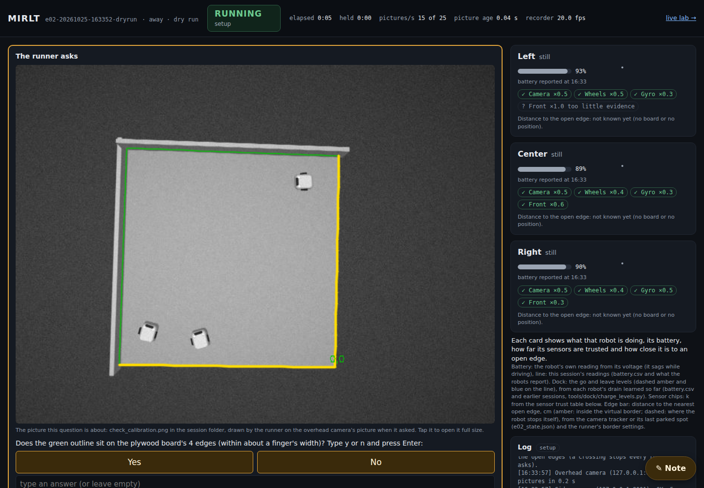
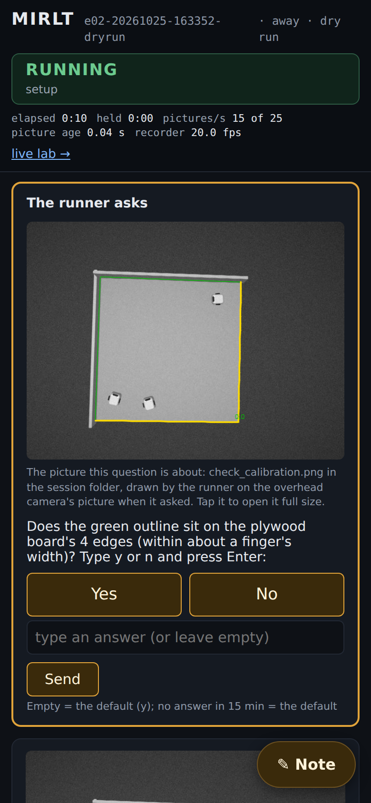
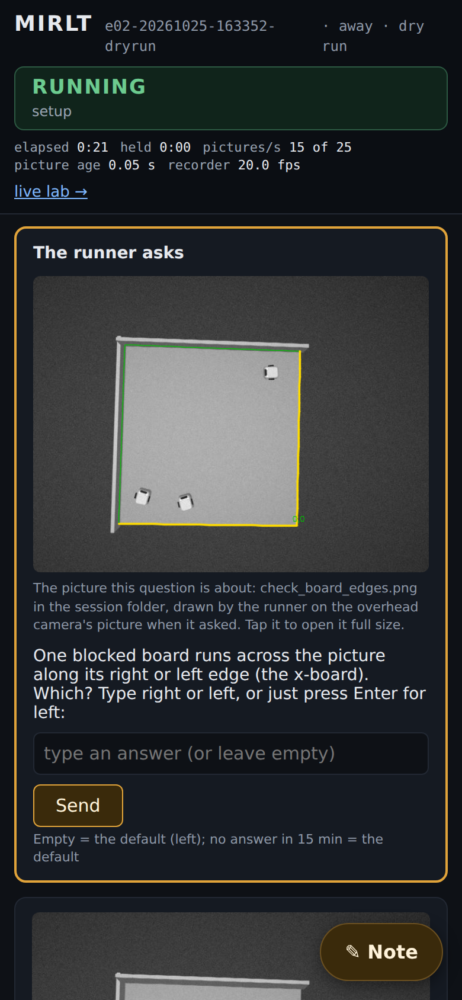
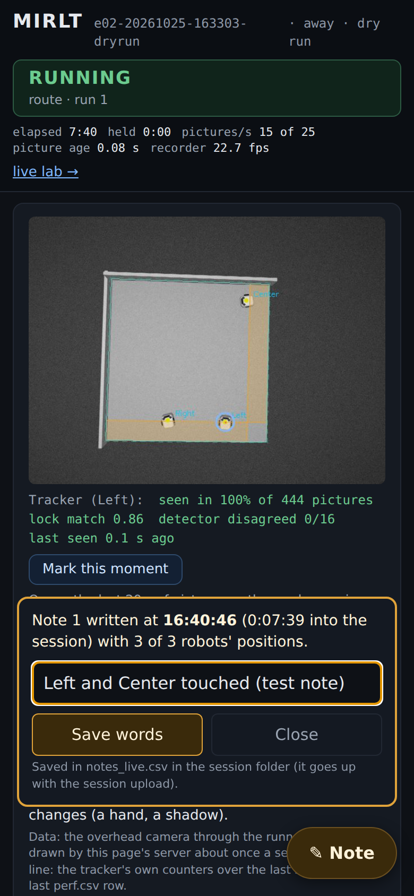
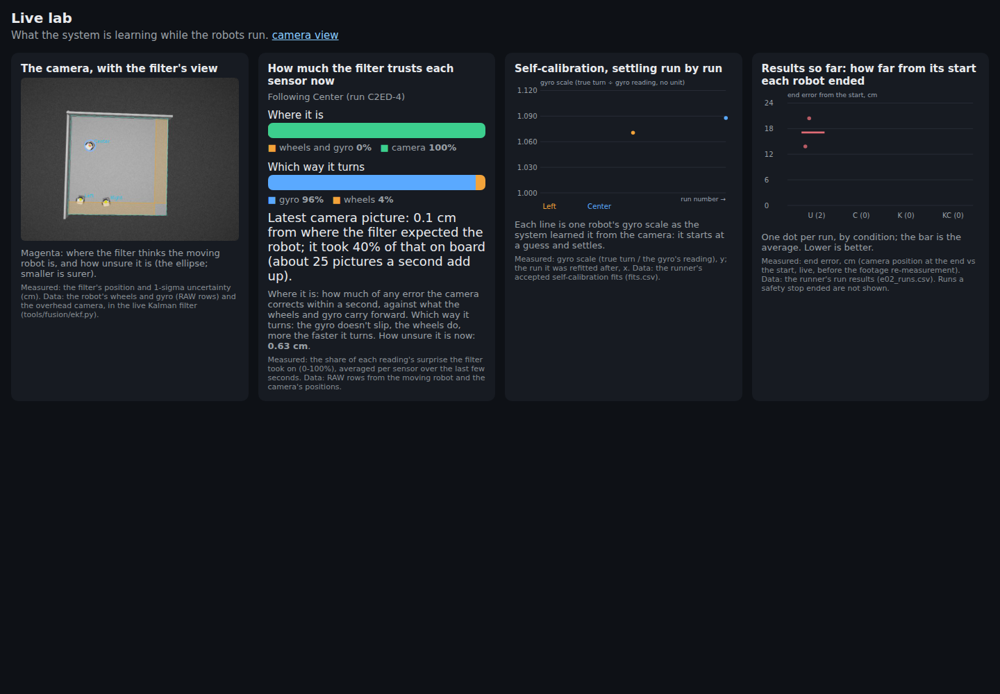

# Live page fixes after the 15:10 session (MIRLT, 2026-10-25)

**Premise.** At 15:26 Nick answered `n` to "does the green outline sit on the board's 4 edges?" without seeing the
picture: the live page showed only the question text. The `n` then sent the Pi run into the studio steps ("4. Come
back here and press Enter"), which assume a laptop and loop, and he stopped there
([session report](e02-oct25-session-1510.md), item 8). Approved 16:15: (1) show a question's picture inside the
question; (2) `n` to the outline continues with the stored calibration; (3) a Note button that works from a phone;
(4) the Live lab's start rule and threshold as the [restart DOE](e02-oct25-real-fusion.md) recommended (R4,
display only).

## Data

**Tests.** 16 new tests (`tools/experiment/tests/test_e02_live_page.py`), all passing, plus the full suite (see
the commit). Three dry runs against the simulator with questions on the live page (`--dry-run --classic-setup
--web-ask`), each in its own network namespace because another agent's simulator held the fixed ports.
Screenshots: Playwright, desktop 1440 x 1000, phone 390 x 844 at 2x.

| Check | Result | Source |
|---|---|---|
| Outline question shows `check_calibration.png` | Yes, full width on desktop, first on the phone, Yes/No buttons | dry run 3, screenshots below |
| Board-sides questions show `check_board_edges.png` | Yes, both questions; no Yes/No (not a y/n question) | dry run 3 |
| `n` to the outline | Stored calibration used, 3-line message, no studio steps | dry run 1 log 16:30:44 |
| Note from a phone | Row written at the tap: time, 0:07:39 into the session, recorder frame 6896, 3 of 3 robots | dry run 2, `notes_live.csv` |
| Live lab, stage 2 replay | Restarts 301 → 11 (492 → 18 an hour); 95th pct 3.93 → 2.91 cm; time diverged 7.8 → 4.4 % | old rule vs new `LiveLab`, same replay as the DOE |

The new `LiveLab` gives exactly the DOE's numbers for its chosen rule (camera start, threshold 120): 11 restarts,
2.91 cm, 4.4 %. 95th pct: the 95th percentile of the filter's prediction error against the next camera position.

The question panel on a computer during a simulated session: the runner's check picture fills the wide column, with
the question and Yes/No under it (data: dry run `e02-20261025-163352-dryrun`, simulator camera).

The same question on a phone: it comes first on the page, above the live picture (same dry run).

The board-sides question with `check_board_edges.png`: typed answer, no Yes/No buttons (same dry run).

After a tap on Note (bottom right): the moment is already saved; the words are optional (data: dry run
`e02-20261025-163303-dryrun`, run 1, Left driving).

The Live lab during that dry run, following Center: the filter now starts from the camera's position of each robot
(data: the same dry run). The restart count line was added after this screenshot.

## Conclusion

1. **Pictures in questions.** `ask()` and `ask_timeout()` take `image=`. The three setup questions that save a check
   picture pass it: the outline check (`confirm_calibration`), the outline of a calibration made here, and both
   board-sides questions (`find_boards`). The page fetches the picture by question id only, so it can never serve
   another file. Y/n questions also get Yes/No buttons.
2. **`n` to the outline** (`outline_doubted`, `e02.py`). It continues with the stored calibration
   (`overhead_floorcal_roam1.json` on the Pi) and says so. Every run's line adds "Nick said its outline is off", and
   so does the session report's notes (`e02_analysis.py`). The studio steps now run only when no calibration is
   stored at all.
3. **Note.** A floating button on every screen size. The tap writes the row at once; words can follow.
   File: `<session>/notes_live.csv`, one row per note. Each row holds the clock, the time into the session, the
   recorder frame, phase, run and followed robot. For each robot: x, y, heading, where the position comes from
   (camera now / camera's last fix or parked spot / session state) and what it is doing. The session upload already
   zips the whole folder. A resumed session keeps numbering. The replay viewer refuses notes. The existing "Mark
   this moment" (opens the mark page) is unchanged.
4. **Live lab.** One filter per robot, started at the camera's latest position (seen within 1 s), heading unknown
   until the camera sees a straight 5 cm drive; threshold 60 → 120. The old rule stays in `e02_live.py` as
   `LiveLabBefore`, so the DOE script still reproduces its "today" rows. The lab page now shows the restart count.

## What's next

1. On the next Pi session, confirm the picture loads on Nick's phone over the Pi's WiFi (the check PNGs are about
   0.5 MB in the simulator; the real camera picture may be larger).
2. Read the lab's restart count after that session: about 14 an hour is what the DOE expects.
3. Item 8's second half is not built: on the Pi, a "click the 4 corners on the live page" path to remake the
   calibration in place of the studio. Today the fix is the corner clicks on the laptop before a session.

## Sweep 1: new tests that may now be needed

- A browser test that answers through the Yes/No buttons and the Note sheet (today: screenshots and HTTP tests, no
  clicks checked by assertion).
- A dry run that answers `n` to the outline during explore's fallback (today's 15:26 path), not only in the classic
  setup.
- Two viewers tapping Note at the same moment (the file write is locked; not exercised).
- The lab rule on the other 14 real sessions as a regression (only stage 2 is in the suite: 33 s).

## Sweep 2: possible inaccuracies in what this relied on

- **A note's position for a robot that is not followed** is the camera's last fix or its parked spot, not where it
  is now. If two robots were both moving, only the followed one is current.
- **Headings in a note** come from the runner's last measured heading (`heads`) or the stored position. While a
  robot turns they can be stale by the whole turn.
- **"Time into the session"** counts from the runner's launch, not from the first run.
- **The lab's 1 s camera freshness, 5 cm straight drive and 8 deg/s "straight"** are the DOE's chosen values, not
  derived. The threshold barely mattered between 60 and never, so a further DOE is not worth it. The other three
  could be tuned by replay if the lab's heading looks slow to settle.
- **Screenshots come from the simulator.** The real overhead picture and the Pi's WiFi were not tested.
