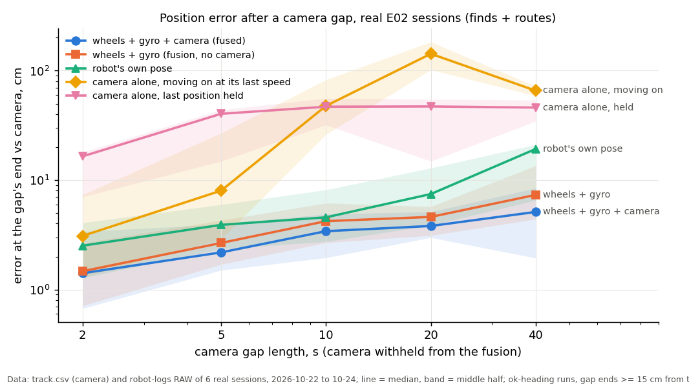
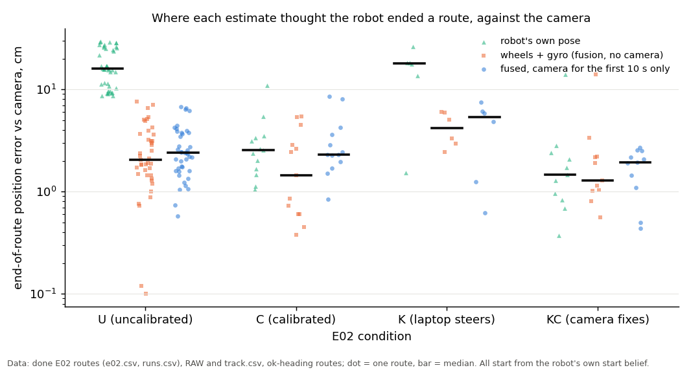
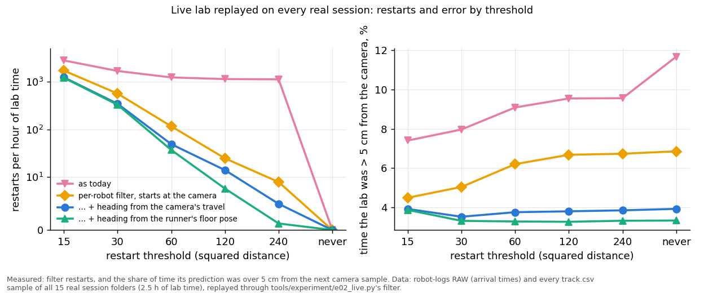

# First fusion on real sessions, and the Live lab's restart threshold (2026-10-25)

Logs only, no board time (Nick's standing rule: logs-only experiments run without asking). No runner or firmware code
changed. Follows [the RAW units fix](e02-oct25-units-fix.md), which made the offline fusion read the robots' speeds
right. Scripts: `tools/experiment/analyses_oct25/real_fusion.py` (part 1), `live_restart_doe.py` (part 2),
`real_fusion_report.py` (tables, charts). Outputs: `analyses_oct25/out/real_fusion_*.csv|txt`,
`out/live_restart_doe_*.csv|txt`.

## Premise

Every fusion number so far came from the simulator. Two questions on real data:
1. Does merging wheels + gyro + camera beat each source alone, and by how much? How fast does each robot drift
   without the camera, and how does that compare with the robot's own pose and with the runner's results?
2. The Live lab (the live view's filter, display only) still restarted 300-525 times per real session. Is the
   restart threshold (60, chosen) the cause, and what value or rule should replace it?

**Method, part 1.** Every find and every finished E02 route on disk (203 runs, 7 sessions with driving:
2026-10-22 08:16, 09:51 and 20:05, 10-23 morning and evening, 10-24 stages 1-2; the other 8 folders hold only
standing calibration runs) goes through `tools/fusion/engine.py` as it is, three ways:
- **wheels + gyro** (no camera), from the robot's own start belief;
- **wheels + gyro + camera** with the camera withheld for gaps of 2, 5, 10, 20, 40 s (15 s of camera between gaps);
- **wheels + gyro + camera** with the camera on all the time, and with the camera only for the first 10 s.

The reference is the camera itself (track.csv, "held" rows left out), scored leave-out: at the end of each gap the
fused estimate is compared with what the camera saw there. In the same gaps, each source alone is anchored at the
camera's last position before the gap: the camera held there, the camera moved on at its last speed, wheels + gyro's
displacement over the gap, and the robot's own pose's displacement (routes: the firmware's pose recomputed from RAW,
`oct25_common.reintegrate`, which matches the logged end pose). The camera's clock was lined up with the wheels by
speed correlation (shift +0.04 to +0.14 s per session).

**Heading check** (the runner's heading problem, [e02-oct25-heading.md](e02-oct25-heading.md)): each run's start
heading was compared with the camera's direction of travel on its first straight stretch (8 cm or more, one way,
wheels within 15 % of each other). 195 runs measured: **none started 20° or more wrong**. 8 runs could not be measured
(the camera had no rows during the run, or, in one 2026-10-22 session, saw the robot about 96 cm from where it
was) and are excluded. The placeholder headings sit in the idle moves between runs, which RAW does not cover, so they
never reached these stretches.

**Board-side camera.** Within about 15 cm of a blocked board the camera's position jumps 5-8 cm (the outline merges
with the board) and can stay off. At find ends, against the find's own pose from touching both boards, the camera is
5.1 cm off (median, 71 finds), the fused estimate with the camera on 3.6 cm. So the headline gap numbers use gap
ends 15 cm or more from both boards; the near-board ones are in Appendix A.

## Data

The fused estimate (blue) ends closest to where the camera saw the robot (tied at 2 s); wheels + gyro
alone is close behind, and the camera alone is lost after 2 s.

**Error at the end of a camera gap** (cm, median (90th percentile); 7 sessions, checked start heading, gap ends 15 cm or
more from the boards)

| Gap | Gaps | Fused | Wheels + gyro | Robot's own pose | Camera, moving on | Camera, held | Fused beat the best single source |
|---|---|---|---|---|---|---|---|
| 2 s | 273 | **1.4** (5.2) | 1.5 (3.9) | 2.5 (4.8) | 3.1 (12.1) | 16.5 (18.8) | 39 % |
| 5 s | 250 | **2.2** (5.7) | 2.7 (6.4) | 3.9 (7.7) | 8.0 (36.5) | 40.4 (45.0) | 50 % |
| 10 s | 126 | **3.4** (6.5) | 4.2 (7.6) | 4.6 (11.0) | 47.7 (96.4) | 46.9 (66.5) | 58 % |
| 20 s | 100 | **3.8** (6.6) | 4.6 (7.4) | 7.5 (16.4) | 142.7 (238) | 47.1 (60.9) | 46 % |
| 40 s | 7 | **5.1** (14.7) | 7.3 (19.6) | 19.2 (24.2) | 65.6 (132) | 46.0 (63.0) | 57 % |

Robot's own pose: routes only. 40 s: only 7 gaps (few runs last 50 s).

**Routes driven blind after their first 10 s** (57 routes; error at the end, each source anchored at the camera's
position at 10 s): fused 2.3 cm (90 %: 4.6), wheels + gyro 3.0 (7.3), robot's own pose 8.6 (17.5), camera held
36.8 (81.2).

On uncalibrated (U) and laptop-steered (K) routes the robot's own pose ends about 16-18 cm from where the camera saw
it; the fusion's wheels + gyro, from the same start, ends about 2-4 cm away.

**End of route, against the camera** (cm, median; checked start heading)

| Condition | Routes | Robot's own pose | Wheels + gyro (fusion, no camera) | Fused, camera first 10 s | Runner: ended from start (`end_err_cm`) | Runner: robot thought (`robot_thought_end_cm`) |
|---|---|---|---|---|---|---|
| U | 46 | 15.9 | **2.0** | 2.4 | 16.8 | 0.9 |
| C | 13 | 2.5 | **1.4** | 2.3 | 1.5 | 0.9 |
| K | 9 | 18.0 | **4.2** | 5.3 | 1.4 | 11.1 |
| KC | 12 | 1.5 | **1.3** | 1.9 | 2.6 | 1.1 |

The runner's two columns measure something else: how far from its start the robot really ended (camera) and
how far it believed it ended (its own pose). Their difference is close to the "robot's own pose" column on U.

**Drift without the camera** (wheels + gyro, start position aligned; per robot in Appendix B): routes 1.5-2.9 cm over
a 36 s, 4.5 m route (0.3-0.7 cm per metre driven; Left drifts about twice as much as Center and Right); finds 6-8.5 cm
(2.1-2.3 cm per metre), where the robot pushes against the boards and the wheels turn without moving it. The robot's
own pose drifts 3.1-4.4 cm per metre on U routes and 0.1-0.4 on C routes.

**With the camera on all the time** the fused estimate stays within 0.7 cm of the camera (median of runs), 4.8 cm at
the 95th percentile (the board-side jumps it refuses).

## Part 2: the Live lab restart threshold

**Method.** Every real session folder (15; 2.5 h of lab time) replayed through the Live lab as the replay viewer
feeds it (RAW rows at their arrival time, every track.csv sample). Two factors, full factorial (24 settings):
- **threshold** (squared distance that triggers a restart): 15, 30, 60 (today), 120, 240, never;
- **start rule**, added after the first replay showed where the restarts came from: *today* (below); *position*
  (one filter per robot, started at the camera's latest position of that robot); *camera* (as position, heading
  marked unknown and taken from the camera's direction of travel on the first straight 5 cm); *floor* (as position,
  heading from the runner's own floor pose at the run's start; a reference for what the runner could hand the lab).

Responses: restarts per hour of lab time; how far the filter's prediction was from each camera sample (95th
percentile); share of time that was over 5 cm ("diverged"); and, at threshold 60, the error after the camera was
withheld for 2 s every 20 s.

**What causes today's restarts.** The threshold is not the cause. The lab starts a new filter whenever a RAW row comes
from a different robot or run than the last one, at that row's `x_cm`, `y_cm`, `th_deg`: the Alvik library's own
odometry, in its own frame, often 100 cm or more and any angle from the floor position. During the naming check and
whenever several robots log at once, rows alternate robot by robot, so the replay started **94,583 filters in 2.5 h**;
each new one is about 100 cm off and is restarted at the next camera sample (on stage 2: 74 % of restarts within 3 s
of a filter start, median jump 99 cm). Raising the threshold cannot fix that.

With today's start rule (pink) restarts stay above 1,000 an hour at any threshold; once each robot keeps its own
filter and starts at the camera (other lines) they fall steeply with the threshold while the time spent off the
camera barely changes.

| Start rule | Threshold | Restarts per hour | Prediction vs camera, 95th pct | Time diverged (> 5 cm) | After a 2 s camera gap, median / 90th pct |
|---|---|---|---|---|---|
| today | 60 | 1,233 | 7.7 cm | 9.1 % | 3.5 / 29.1 cm |
| today | never | 0 | 8.6 cm | 11.7 % | - |
| position | 60 | 116 | 3.7 cm | 6.2 % | 3.3 / 18.4 cm |
| camera | 30 | 345 | 2.6 cm | 3.5 % | - |
| camera | 60 | 49 | 2.7 cm | 3.8 % | 2.9 / 15.5 cm |
| **camera** | **120** | **14** | **2.7 cm** | **3.8 %** | - |
| camera | never | 0 | 2.7 cm | 3.9 % | - |
| floor | 60 | 37 | 2.5 cm | 3.3 % | 2.7 / 12.7 cm |
| floor | 120 | 8 | 2.5 cm | 3.3 % | - |

All 15 folders pooled; the four sessions with E02 runs alone: today 60 = 638 an hour, camera 120 = 12 an hour.
Full table: `out/real_fusion_report.txt`, per session: `out/live_restart_doe_a.csv`, `_b.csv`.

## Conclusion *(Claude)*

1. **Yes, merging wheels + gyro + camera beats each source alone on real data, but only modestly over wheels + gyro
   anchored at the camera.** After a camera gap the fused estimate is 15-30 % closer than wheels + gyro (2.2 against
   2.7 cm after 5 s, 3.8 against 4.6 after 20 s, 5.1 against 7.3 after 40 s), about half the robot's own pose's
   error (3.8 against 7.5 cm after 20 s), and 10-40 times better than the camera alone. Gap by gap it beats the best
   single source only about half the time. Most of the gain is on finds (3.0 against 4.6 cm after 10 s), where the
   robot pushes against the boards and the camera tells the filter the wheels slipped. On routes the two are level up
   to 10 s, and at 2 s the fused one is slightly worse (2.4 against 1.7 cm), likely the tracker's frame-to-frame
   jitter pulling its speed and heading (Appendix A).
2. **The biggest gain on real data is not the camera: it is how the fusion uses the gyro.** From the same start,
   the fusion's wheels + gyro ends an uncalibrated route 2.0 cm from the camera; the robot's own pose ends 15.9 cm
   off. The firmware turns by the IMU's yaw, which reads about 7 % short until a gyro scale is learned (C routes:
   2.5 cm). The fusion integrates the raw gyro rate, whose scale is close to right (its 410-420° per square route is
   mostly a 0.6 °/s bias), and learns the bias whenever the wheels stand still. With no calibration at all it
   matches the calibrated C condition.
3. **The camera is not a perfect reference near the boards.** It jumps 5-8 cm there; the fusion's gate refuses
   those jumps, which is why, at find ends, the fused estimate is closer to the board-touch pose (3.6 cm) than the
   camera is (5.1 cm).
4. **The runner's heading problem did not touch these stretches** (0 of 195 runs started wrong). But one weakness
   showed: when the fusion starts far from the camera (one 2026-10-22 run, about 96 cm), it never recovers, because
   its gate refuses every camera fix and it has no restart rule.
5. **Live lab: the restarts come from how its filter starts, not from the threshold.** Fixing the start (one filter
   per robot, started at the camera's position, heading from the camera's direction of travel) cuts restarts from
   about 1,200 to 49 an hour at the same threshold, the prediction error's 95th percentile from 7.7 to 2.7 cm and the
   time off the camera from 9 % to under 4 %. With that start rule the threshold barely changes the error between 60
   and never (2.66-2.69 cm, 3.8-3.9 %), so **the recommendation is 120** with the camera start rule: about 14 restarts
   an hour, few enough for each "the wheels and the camera parted ways" message to be looked at (what they are is
   not yet checked: new test 7). No learned rule is needed: the response is flat from 60 up. The runner's floor heading (when it has one) does slightly better
   (8 an hour, 2.5 cm), so pass it to the lab when the runner knows it, and fall back to the camera's direction.

## What's next

1. **Nick decides** on the recommended changes below (none is applied; the firmware one needs the simulator first).
2. Rerun `real_fusion.py` after the next board session, especially with longer gaps (only 7 gaps of 40 s exist).
3. Fit the fusion's noise settings on real data (DOE backlog row "Fusion settings, older lane"): the 2 s result says
   the camera noise or its timing is not yet modelled right.

**Recommended changes (not applied: out of this task's scope)**

| # | Where | Change | Why |
|---|---|---|---|
| R1 | firmware `pose.h` heading (simulator first) | Heading from the gyro rate (`gz`), with its bias taken whenever the encoders say the robot stands still, instead of the IMU's yaw times a learned scale | U and K routes: own pose 16-18 cm off at the end, the same data integrated this way 2-4 cm. Removes the dependence on the gyro-scale fit |
| R2 | `tools/fusion/engine.py` | A restart rule: when the camera keeps landing outside a robot's possible area for N frames in a row while nothing else claims it, reset the position to the camera (as the Live lab does), heading unknown | One run never recovered from a 96 cm start |
| R3 | `tools/fusion/engine.py` / runner `camerr` | Widen the camera noise within 15 cm of a blocked board (or use the runner's camera-error map there) | The camera's board-side jumps of 5-8 cm |
| R4 | `tools/experiment/e02_live.py` (`LiveLab.on_raw`, `on_camera`) | One filter per robot (another robot's RAW rows must not restart it); start a run's filter at the camera's latest position of that robot, not the library's `x_cm`/`y_cm`; heading from the runner's floor pose when it has one, else unknown until the camera sees a straight 5 cm; restart threshold 120. The rule is in `live_restart_doe.py` `Lab` (start "camera" / "floor") | 94,583 filter starts and 1,233 restarts an hour today; 14 an hour and 2.7 cm with the fix |

---

## New tests that may now be necessary

1. Unit test for R4: two robots' RAW rows interleaved do not restart each other's filter; a new run starts at the
   camera's position; replaying stage 2 gives the DOE's numbers (camera / 120: 11 restarts).
2. Simulator: heading from `gz` with standstill bias (R1) against today's yaw x scale, on U routes; then one board
   check of 4 U routes per robot.
3. Unit test for R2: a fusion run started 100 cm from the camera recovers within 1 s of driving.
4. The camera near the boards: score the tracker against marked footage within 15 cm of the boards (mark page), to
   size R3's widening.
5. A gyro-scale check on real data: integrated `gz` (minus the standstill bias) against the camera's turn on long
   spins, per robot, to confirm the "close to right" claim in conclusion 2.
6. Rerun `real_fusion.py` with the fusion's noise settings fitted on half the runs and scored on the other half.
7. Classify the Live lab's remaining restarts at 120 (camera start rule) against board distance, wheel speed and
   turning: real slips or camera jumps.

## Possible inaccuracies

- **The reference is the camera**, whose own error (0.6 cm per axis while driving, 0.1-0.5 cm standing; 5-8 cm
  jumps at the boards; the floor calibration) is inside every number. Away from the boards that error is the same for
  every source, so the comparison holds better than the absolute values.
- **Single-source baselines are anchored at the camera's last raw sample** before the gap, which carries its
  frame-to-frame noise; the fused estimate starts from its own smoothed state. This favours the fused one slightly at
  short gaps.
- **Identity was given** (each robot's filter saw only its own track.csv rows); live, the fusion would have to assign
  sightings itself.
- **The engine's noise settings are the simulator's guesses** (ekf.Noise); nothing was tuned on these data.
- **The camera clock shift** is a speed-correlation estimate (+0.04 to +0.14 s; flat curve: correlation 0.53-0.71).
- **The gap layout is chosen** (first gap at 5 s, 15 s of camera between gaps; doubling lengths). A DOE is not needed
  for an analysis layout; a sensitivity rerun with 10 s between gaps would show whether re-convergence time matters.
- **The 15 cm "near a board" cut and the 20° heading cut are chosen** (analysis thresholds, no DOE needed).
- **Robot's own pose** for routes is the firmware's pose recomputed from RAW with the route's corrections; for KC
  that leaves out the camera fixes the robot received (the KC column then shows the robot's dead reckoning only).
  Finds have no own-pose trail here (the board resets mid-find are not modelled).
- **The board-touch pose at find ends** comes from board lines the camera measured, so it is not fully independent of
  the camera.
- **"Gyro scale close to right"** rests on the fusion's route results and one session's yaw/gz comparison, not on a
  direct measurement (new test 5).
- **The Live lab replay feeds RAW at arrival time** (WiFi delay included, p95 0.3 s late) and every track.csv sample,
  as the replay viewer does; live, the camera feed may differ slightly.
- **"Diverged" uses 5 cm (chosen)** and the 2 s / 20 s gap pass ran at threshold 60 only (time: each pass took up to
  50 min on the longest session).
- **The remaining restarts at 120 were not classified** (real slips, board-side camera jumps, or turns). A logs pass
  that tags each against the board distance and the wheels would tell (new test 7).
- **Chosen numbers in the new start rule:** the straight 5 cm of camera travel for a heading (about 10° of camera
  noise), the 1 s for "the camera saw it recently", and the 90° "unknown" heading sd. A replay DOE over 3-8 cm would set
  the first; the other two are bounds, not tuning knobs.
- **The "floor" level's offsets** assume the library and firmware headings turn together within a run.

## Appendix A: gaps by kind and near the boards

#### Gaps, routes only
| gap s | gaps | wheels + gyro + camera (fused) | wheels + gyro (fusion, no camera) | robot's own pose | camera alone, moving on at its last speed | camera alone, last position held | fused beat the best single source |
|---|---|---|---|---|---|---|---|
| 2 | 158 | 2.4 (6.0) | 1.7 (4.1) | 2.5 (4.8) | 4.1 (12.7) | 14.8 (19.5) | 35% |
| 5 | 147 | 3.2 (7.3) | 3.0 (6.7) | 3.9 (7.7) | 19.5 (43.2) | 19.5 (45.2) | 40% |
| 10 | 93 | 3.7 (6.6) | 3.7 (7.7) | 4.6 (11.0) | 53.7 (109.0) | 40.4 (66.4) | 53% |
| 20 | 75 | 4.1 (6.6) | 4.6 (7.6) | 7.5 (16.4) | 165.3 (269.8) | 28.1 (55.2) | 33% |
| 40 | 7 | 5.1 (14.7) | 7.3 (19.6) | 19.2 (24.2) | 65.6 (131.5) | 46.0 (63.0) | 57% |
Each cell: median (90th percentile) error at the gap's end against the camera, cm.

#### Gaps, finds only
| gap s | gaps | wheels + gyro + camera (fused) | wheels + gyro (fusion, no camera) | robot's own pose | camera alone, moving on at its last speed | camera alone, last position held | fused beat the best single source |
|---|---|---|---|---|---|---|---|
| 2 | 115 | 0.9 (3.3) | 1.1 (3.7) | - | 1.8 (11.0) | 17.4 (18.7) | 44% |
| 5 | 103 | 1.8 (4.2) | 2.3 (5.8) | - | 2.9 (12.8) | 43.6 (45.0) | 63% |
| 10 | 33 | 3.0 (5.6) | 4.6 (7.3) | - | 34.1 (52.4) | 51.6 (68.2) | 73% |
| 20 | 25 | 2.7 (4.5) | 4.9 (6.5) | - | 115.6 (142.5) | 56.9 (69.2) | 84% |
Each cell: median (90th percentile) error at the gap's end against the camera, cm.

#### Gaps ending NEAR a board (< 15 cm)
| gap s | gaps | wheels + gyro + camera (fused) | wheels + gyro (fusion, no camera) | robot's own pose | camera alone, moving on at its last speed | camera alone, last position held | fused beat the best single source |
|---|---|---|---|---|---|---|---|
| 2 | 75 | 2.4 (6.9) | 1.6 (5.3) | 1.7 (2.1) | 6.7 (19.8) | 11.1 (18.2) | 28% |
| 5 | 85 | 1.1 (5.0) | 1.4 (4.2) | 9.1 (12.0) | 21.3 (41.0) | 11.5 (36.8) | 46% |
| 10 | 55 | 4.0 (10.6) | 2.9 (8.8) | - | 21.7 (46.7) | 68.1 (72.2) | 33% |
| 20 | 77 | 2.5 (8.1) | 3.9 (7.7) | - | 121.3 (136.8) | 62.7 (70.5) | 58% |
| 40 | 1 | 40.7 (40.7) | 39.0 (39.0) | - | 277.9 (277.9) | 73.0 (73.0) | 0% |
Each cell: median (90th percentile) error at the gap's end against the camera, cm.

#### Gaps in runs whose start heading was wrong or unmeasured
| gap s | gaps | wheels + gyro + camera (fused) | wheels + gyro (fusion, no camera) | robot's own pose | camera alone, moving on at its last speed | camera alone, last position held | fused beat the best single source |
|---|---|---|---|---|---|---|---|
| 2 | 3 | 50.8 (92.6) | 18.3 (18.3) | 18.2 (18.4) | 0.7 (0.9) | 0.2 (0.3) | 0% |
| 5 | 3 | 76.7 (100.7) | 39.2 (44.0) | 41.9 (44.3) | 0.8 (1.2) | 0.1 (0.2) | 0% |
| 10 | 1 | 96.6 (96.6) | 66.0 (66.0) | 65.5 (65.5) | 2.7 (2.7) | 0.2 (0.2) | 0% |
| 20 | 1 | 42.3 (42.3) | 18.4 (18.4) | 2.8 (2.8) | 5.1 (5.1) | 0.2 (0.2) | 0% |
Each cell: median (90th percentile) error at the gap's end against the camera, cm.

#### Left
| gap s | gaps | wheels + gyro + camera (fused) | wheels + gyro (fusion, no camera) | robot's own pose | camera alone, moving on at its last speed | camera alone, last position held | fused beat the best single source |
|---|---|---|---|---|---|---|---|
| 5 | 87 | 2.1 (8.1) | 3.3 (6.0) | 3.7 (7.5) | 5.8 (33.9) | 41.3 (45.0) | 52% |
| 10 | 48 | 3.0 (6.9) | 4.2 (9.8) | 6.1 (11.3) | 43.5 (88.1) | 47.7 (64.3) | 69% |
| 20 | 40 | 3.5 (6.8) | 4.7 (8.7) | 10.8 (16.2) | 132.9 (209.0) | 50.9 (56.9) | 45% |
Each cell: median (90th percentile) error at the gap's end against the camera, cm.

#### Center
| gap s | gaps | wheels + gyro + camera (fused) | wheels + gyro (fusion, no camera) | robot's own pose | camera alone, moving on at its last speed | camera alone, last position held | fused beat the best single source |
|---|---|---|---|---|---|---|---|
| 5 | 81 | 2.4 (5.7) | 2.4 (6.6) | 4.2 (7.5) | 8.9 (44.8) | 27.1 (44.6) | 52% |
| 10 | 34 | 3.4 (5.4) | 4.1 (7.2) | 4.8 (10.8) | 59.5 (116.6) | 32.8 (66.6) | 56% |
| 20 | 31 | 3.8 (5.9) | 4.8 (7.7) | 7.1 (16.9) | 153.3 (270.1) | 28.1 (59.5) | 58% |
Each cell: median (90th percentile) error at the gap's end against the camera, cm.

#### Right
| gap s | gaps | wheels + gyro + camera (fused) | wheels + gyro (fusion, no camera) | robot's own pose | camera alone, moving on at its last speed | camera alone, last position held | fused beat the best single source |
|---|---|---|---|---|---|---|---|
| 5 | 82 | 2.1 (5.2) | 2.5 (6.0) | 3.9 (7.9) | 11.5 (38.3) | 40.5 (45.2) | 45% |
| 10 | 44 | 3.9 (6.4) | 4.3 (6.4) | 4.0 (11.5) | 44.1 (96.4) | 48.4 (69.0) | 48% |
| 20 | 29 | 4.0 (6.0) | 4.0 (5.6) | 6.1 (13.7) | 140.1 (248.1) | 46.6 (69.0) | 34% |
Each cell: median (90th percentile) error at the gap's end against the camera, cm.

The unmeasured-heading rows are 3 gaps from one 2026-10-22 run whose camera track sat about 96 cm from the robot (the fusion refused it throughout; see R2).

Find ends against the find's own board-touch pose (71 finds, checked heading):

| estimate | finds | median cm | 90th pct cm |
|---|---|---|---|
| camera | 71 | 5.09 | 9.70 |
| fused, camera on | 71 | 3.63 | 5.30 |
| fused, camera for the first 10 s only | 71 | 3.99 | 5.73 |
| wheels + gyro only | 71 | 5.18 | 10.14 |

## Appendix B: drift per robot

#### Drift of wheels + gyro alone (start aligned), per robot
| robot | kind | runs | end error median cm | per minute median | per metre driven median |
|---|---|---|---|---|---|
| Left | route | 22 | 2.9 | 4.7 | 0.7 |
| Left | find | 31 | 8.5 | 15.1 | 2.1 |
| Center | route | 24 | 1.6 | 2.4 | 0.3 |
| Center | find | 21 | 6.4 | 13.0 | 2.2 |
| Right | route | 20 | 1.5 | 2.6 | 0.3 |
| Right | find | 23 | 8.2 | 15.7 | 2.3 |

#### Drift of the robot's own pose (start aligned), routes
| robot | cond | routes | end error median cm | per metre driven median |
|---|---|---|---|---|
| Left | U | 12 | 17.9 | 4.4 |
| Left | C | 5 | 1.4 | 0.4 |
| Left | K | 2 | 20.0 | 3.5 |
| Center | U | 13 | 16.0 | 3.5 |
| Center | C | 4 | 0.7 | 0.1 |
| Center | K | 3 | 12.4 | 1.3 |
| Right | U | 11 | 15.7 | 3.1 |
| Right | C | 4 | 1.9 | 0.3 |
| Right | K | 1 | 18.1 | 1.7 |
