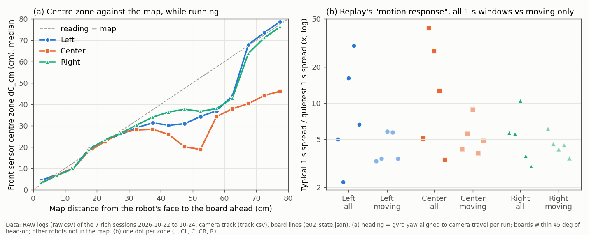

# Right's front sensor, and what wl_rpm really is (2026-10-25)

Logs only, no board time. These are new tests 1 and 2 from the [blind discovery replay](e02-oct25-discovery-replay.md). Scripts: `tools/experiment/analyses_oct25/right_front_rpm/` (run order in its README). No runner or firmware code was changed.

## Premise

1. **Right's front zones.** In the replay, Right's front range zones scored 3-7x their rest noise, against 12-29x on Left and Center, so 23 of them were taken for line sensors. Is Right's front sensor faulty or mounted differently, or is the measure misleading?
2. **Wheel speed.** The replay found `wl_rpm` / `wr_rpm` 19% off the scale that the wheel angles (`wl_deg`, `wr_deg`) and the wheel radius imply. Is this a units issue or a real disagreement, and does anything that steers the robots depend on it?

## Data

The 7 rich sessions (2026-10-22 to 10-24): 127,000 RAW rows with a camera position and a board within 45° of head-on, plus 374 runner front checks (`front_checks.csv`, boards within 50 cm). For each RAW row, the "map distance" is the distance from the robot's face to the board ahead. It comes from the camera position (`track.csv`), the board lines (`e02_state.json`), and the gyro heading, lined up per run with the camera's direction of forward travel. The source code of the Alvik libraries came from the Arduino_AlvikCarrier 1.1.1 (motor board) and Arduino_Alvik 1.1.1 (ESP32) libraries.

### 1. Right's front sensor against the map

| | Left | Center | Right |
|---|---|---|---|
| Runner front checks: reading − map, median (cm) | −2.1 | −2.1 | −2.8 |
| … spread¹ (cm) | 7.7 | 8.2 | **6.8** |
| … within 6 cm of the map | 59% | 53% | 57% |
| While running: correlation of each zone with the map (L, CL, C, CR, R) | 0.61-0.91 | 0.64-0.81 | **0.79-0.91** |
| All 5 zones at the front checks: spread¹ (cm) | 5.5-11.5 | 7.9-10.3 | **3.8-7.2** |
| Time between new zone values (ms) | 53 | 54 | 54 |
| Longest unchanged run while driving (s) | 0.57 | 0.50 | 0.49 |
| Bottom zone at rest (`dbot_cm`, reads the floor) | 7.0 | 8.1 | 7.3 |
| Front-sensor holds in the runner logs | 4 | 7 | 4 |

¹ Spread = median absolute deviation × 1.48, which reads like a standard deviation but is not thrown off by a few wild readings.

(a) The median of each robot's centre-zone reading at each map distance: Right follows the map as closely as Left does, and better than Center beyond 35 cm. (b) The replay's "motion response" figure for each zone: robots differ a lot when every 1 s window counts, and hardly at all when only the windows where the wheels turn count.

- **No fault signs on Right.** Its range limits, update rate, delay against the camera (it is 0.1 s ahead of the camera, where the others are 0.2 s ahead) and floor reading all match the other two. No stuck values. The bottom zone reads the floor at 7-8 cm on all three robots. That is the sensor's bottom row by design (its 4×4 grid), not a blocked window. Right's reading is 0.3 cm further than Left's, so its sensor is not mounted lower.
- **Why the replay's figure was low on Right.** The replay's "motion response" is a typical 1 s spread divided by the quietest 1 s spread, taken over all windows, still ones included. Most of the typical spread on Left and Center comes from **standing still**. When they stand still, zones that look out past the boards flicker by 17-56 cm (no target in range). Right's zones look at steadier things where it stands. With the windows where the wheels turn only, the figure is 3.3-5.8 on Left, 3.8-8.8 on Center and 3.5-6.1 on Right, which is the same.
- **A shared weakness, not Right's:** beyond about 30 cm all three read short of the map (at 45 cm: Left 30, Center 24, Right 37 cm). This analysis leaves other robots out of the map, so part of that is a robot in between (Center, in the middle of the board, is worst). The runner's own front checks do include robots, and they still show readings 10-15 cm short of a board at 35-45 cm, on every robot.

### 2. Wheel speed

| | Left | Center | Right |
|---|---|---|---|
| `w*_rpm` ÷ wheel-angle rate in rpm (212 runs, both wheels) | 1.080 | 1.085 | 1.081 |
| Delay of `w*_rpm` behind the angle rate | 50 ms | 50 ms | 50 ms |
| `v_cms` ÷ mean wheel rpm | 1.78 | 1.78 | 1.78 |

- **What `wl_rpm` is:** wheel rpm (output shaft, gear ratio already applied), reading **8% high**, the same on every robot and session (spread across runs 0.004). The motor board works out rpm as encoder counts per update ÷ an assumed 20 ms update (`conversion_factor = 60/(MOTOR_RATIO × 0.02)`). Its loop runs `if (millis()-tmotor>=20){ tmotor=millis(); ...}`, so every delay in the loop adds to the period. The ratio implies an average of about 21.6 ms. The wheel angle adds up the same counts with no time in it, so it is right. The 50 ms delay is the board's 5-update moving average.
- **The replay's 19% = 8% real + about 11% from its own method.** Its speed calibration adds up |speed| from 1 s before to 1 s after each camera drive stretch, and the wheels also turn in those margins (speeding up, slowing down, the turn before). Over the same 6 cases, rpm summed over the stretch alone gives 1.09 × the angle, and with the margins 1.31 ×.
- **The PID holds the *reported* rpm on the command.** A calibration spin commanded at 15 rpm reports 15.2-16.3 rpm, so the wheels really turn at about 14.3 rpm. Every speed set through `set_wheels_speed` (`setDrive`, creep, push, dock) is about 7.5% slower than the firmware thinks. Distances are not affected, because the firmware's own pose counts wheel angles.
- **Bump stall detection:** the threshold means the same thing. It compares measured rpm with commanded rpm (`meas < bump_stall_frac × cmdRpm`), both in the board's inflated units, and in steady creep they are equal. So "below 40% of the creep speed" stays true. What changes: the creep is really 4.6 cm/s, not 5. And because of the 50 ms average, a stall is seen about 50 ms after the wheels slow, which puts the stall-based contact point about 0.2 cm late. The edge guard (`edge_min_rpm` 2) and the "wheels turning" test (> 4 rpm) are too coarse for 8% to matter.
- **Found on the way: `v_cms` is in mm/s, not cm/s** (`v_cms` ÷ rpm = 1.78 = 10 × the cm/s factor for a 1.7 cm wheel, in every session). The cause is an Arduino_Alvik library bug: `get_drive_speed` passes `'MM_S'` (a character constant, quotes included) as the source unit, so no conversion is done. The runner (`e02.py`) and the firmware's control do not use `v_cms`, `wl_rpm` or `wr_rpm`. These readers do use `v_cms` as cm/s:
  - the offline fusion's wheel speed (`tools/fusion/engine.py` line 1056 → `ekf.wheel_v`, noise 0.3 cm/s + 3%);
  - the live lab's wheel trust (`e02_live.py` line 76);
  - the stillness and drive tests in `tools/session_checks.py` and `tools/site/observe.py`.

## Conclusion

1. **Right's front sensor is not faulty and not mounted differently, as far as the logs can show.** On every check against the camera and map, it agrees with the map at least as well as Left and Center. The replay's low figure for Right reflects what each robot faces while it stands still, not how its sensor responds to motion.
2. **Past results stand.** Right's front checks, front-sensor holds (4, the same as Left) and trust numbers show nothing to correct. The replay's statement "during motion they change only 3-7 times" is wrong in its wording and its cause. The replay's numbers themselves are unchanged.
3. **`wl_rpm` is real wheel rpm read 8% high, because the motor board's update runs about 1.6 ms later than the 20 ms its arithmetic assumes.** That is a timing issue in the library, not a units issue. The remaining 11% of the replay's 19% came from its calibration window. Bump stall detection keeps its meaning. The robot creeps and drives about 7.5% slower than commanded.
4. **`v_cms` is mm/s.** Wherever it is read as cm/s, the speed is 10.8× too large. The offline fusion and the live lab's wheel trust are the readers that matter **[Claude: their past wheel-speed results should be rechecked; nothing that steers the robots is affected]**.

## What's next

1. **What Nick should look at on Right:** nothing is needed for a fault. Optional, 5 minutes, all three robots: stand each one square to a board at 20, 40 and 60 cm and log RAW for 5 s at each distance. This tells whether the shared short readings beyond 30 cm come from the sensor or the setup. Also wipe each front window.
2. **Recommended fixes (not made):**
   - **Fusion and live lab:** read `v_cms` as mm/s (÷ 10), or better, take the speed from the wheel-angle rate. Note it in `docs/data-formats.md`. Leave the firmware column as it is, so old logs keep their meaning.
   - **Anywhere `w*_rpm` is used as a physical speed:** divide by 1.08, or use the angle rate (no 50 ms delay). Fusion's `vl` / `vr` (engine.py line 1061) read 8% high; its wheel-scale prior is ±3%.
   - **Discovery replay:** compute the "motion response" on windows where the camera or a command says the robot moves (`features.py` line 215). Sum speed over the stretch only (`features.py` line 528).
   - **Firmware (optional):** if true commanded speeds matter (creep 5 cm/s, dock 1.1 cm/s), scale `setDrive` by the measured 1.08. A fixed factor breaks if the motor board's loop timing changes, so a calibration step that measures rpm against the angle rate per robot is the sturdier fix. The 1.08 is measured, not chosen: no DOE is needed for it.
   - **Front check range:** `FRONT_CHECK_RANGE_CM` (50, chosen) admits the distances where every robot reads short. Choosing it, e.g. 30 against 50, is a sensible DOE row (logs-only replay of holds and trust).
3. **Tell the replay report's readers:** its "Why Right's zones fail" line and new tests 1-2 are answered here.

---

## New tests that may now be needed

1. **Fusion replay with `v_cms` ÷ 10** (or speed from the wheel angles) against the current runs: how much do past fusion position errors change?
2. **Front sensor at fixed distances** (20 / 40 / 60 cm, square to a board, each robot): cause of the shared short readings beyond 30 cm.
3. **Motor-board period per robot and firmware version:** repeat the rpm ÷ angle-rate ratio in every new session (`session_checks`). A change means the board's loop timing changed.
4. **Front checks with robots in the map** (the runner's `ahead_cm` does this; this analysis did not), split by whether another robot is within 50 cm ahead.
5. **Discovery replay rerun** after the moving-only fix: do Right's 23 zones now come out as range?

## Possible inaccuracies

- **Map distance uses the camera position plus the gyro heading, lined up per run.** The median heading error is 2-8° per run, and other robots are not in the map. Beyond 30 cm both bias readings "short".
- **The 21.6 ms period is inferred** from the rpm ratio, not timed. Counting angle updates in RAW gives 24.4 ms, but RAW sees updates in bursts, so that count is an upper bound.
- **The library source read is version 1.1.1** (motor board and ESP32), checked out on this machine. The robots' exact motor-board version was not read from them.
- **The flicker explanation rests on "still" = wheel angles changing < 1° in 1 s**, and on the replay's quiet level taken as the 10th percentile of window spreads. The replay's own value (`REST_Q`) may differ slightly.
- **"Within 6 cm" and the 30 / 50 cm cut-offs are chosen numbers**, not derived.
- **The 15 rpm spin check** compares reported rpm with the commanded value from `params.h`. The command itself is not logged.
