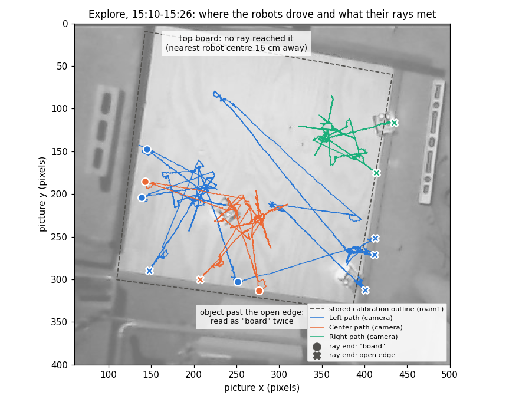
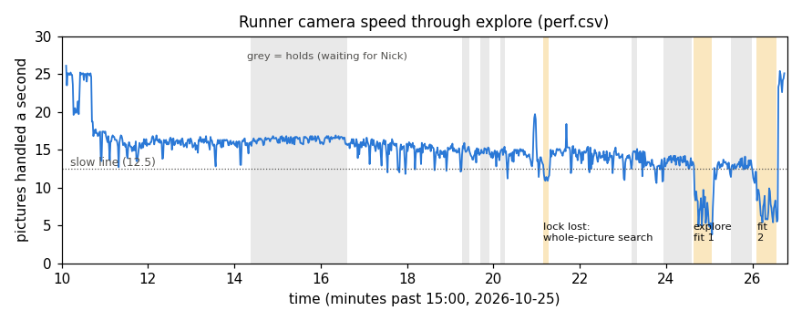

# Real session 2026-10-25 15:10 (MIRLT): why explore held, collided, missed the top board and fell back

**Premise.** Session `e02-20261025-151004` (15:10-15:32 EDT), the Pi, `--home`, `--with-side` (the recorder took
the side camera; the runner used the overhead only, as designed), robots on firmware 2026-10-22b, from scratch.
Explore ran for 16 minutes, held the session 7 times, two robots touched, and the fit was rejected; the runner fell
back to the stored calibration (`overhead_floorcal_roam1.json`), Nick answered `n` to an outline he could not see,
and stopped at the studio-calibration step. Nick's seven questions are answered below. Logs only; no runner code
changed.

**Sources.** The session's `e02_log.txt`, `e02_state.json` (holds, explore stops and contacts, slow spells),
`track.csv`, `perf.csv`, `border_shadow.csv`, `robot-logs-1/leg.csv` (each leg's end: how far, why it stopped),
snapshots, the recorder's `frames.csv`, and single frames from the overhead video. Explore's fit was re-run
offline from the logged stops and reproduced the Pi's numbers exactly (6.76 px, f 234, the same 12 contacts and the
same side failure). Scripts: `tools/experiment/analyses_oct25/session_1510/`.

## Data

### Every hold and question

| Time | Robot | Kind | Why (runner's words) | What was really happening | Answer | Wait | Real danger? | Fix (rank below) |
|---|---|---|---|---|---|---|---|---|
| 15:14:22 | Right | border | centre 3 cm from an open edge, moving towards it | Backing **away** 9.5 cm after its ray met the right edge (leg 554391). Its centre was 4.1 cm past the stored edge line, so moving back in made the distance to the line shrink | o (leave out) | 134 s | **False alarm** | 1 |
| 15:19:16 | Left | lost | not seen for 1.6 s while it drives | Turning 175° on its spot at the bottom edge, beside a light object past the edge; the camera lost it for 3.0 s. The hold stopped the turn at 72°, and nothing finished it afterwards | c | 10 s | False alarm (turning on the spot); **but it set up a real wrong-way drive (below)** | 5, 3 |
| 15:19:41 | Left | border | 5 cm, moving towards it | Backing away after a ray met the right edge (centre 5.5 cm past the line) | c | 12 s | False alarm | 1 |
| 15:20:09 | Left | border | 4 cm, moving towards it | Same, next ray (centre 4.4 cm past the line) | c | 6 s | False alarm | 1 |
| 15:23:12 | Center | lost | not seen for 1.5 s | Turning on its spot right beside Left (the two touching after the collision); camera gap 1.8 s; turn stopped 2° short | c | 8 s | False alarm | 5, 4 |
| 15:23:56 | Center | lost | not seen for 1.5 s | Same place, gap 1.8 s; turn stopped **13° short** and not finished | c | 39 s | False alarm | 5, 3 |
| 15:25:30 | Left | border | 3 cm, moving towards it | Backing away after its gap ray met the right edge near the bottom corner (centre 3.8 cm past the line) | c | 29 s | False alarm | 1 |
| 15:26:35 | - | question | does the green outline sit on the board's 4 edges? | The picture (`check_calibration.png`) is not on the live page, so Nick could not see the outline | n | 150 s | - | 8 |
| 15:29:05 | - | question | make a new floor calibration in the studio, then Enter | The steps assume a laptop with the studio; the run was on the Pi | stop | 201 s | - | 8, 10 |

Seven holds, **none a real danger**; Nick waited 238 s on holds and 351 s on the two questions. The two real
approaches to an open edge this session (below, Q6) were both forward drives, and home's camera border stopped them
without a hold.

The robots' camera-tracked paths during explore drawn on the overhead picture, with each ray's end (circle: front
sensor said "board", cross: open edge) and the stored calibration's board outline (data: `track.csv`, `e02_state.json`).

How many pictures a second the runner handled through explore, with explore's two fits and the one tracker
search shaded orange and the holds grey (data: `perf.csv`, `e02_state.json`).

## Conclusions

**Q1. Right's hold at 15:14 was not Right driving towards the edge.** The command was `go -9.50` (lid 554391), the
blind back-off after ray 2 met the right edge. Right moved 1.7 cm back by its wheels before the hold stopped it,
and the camera saw it come 2.5 cm *inwards*. The camera position was right (the tracker's cross sits on the robot in
the video frame). The cause is in `border_check` (`e02.py` 5973-5982): it measures "towards" as the drop in
`abs(position - edge line)`. Right's centre was **4.1 cm past** the stored edge line, so moving back onto the board
shrank that absolute distance and read as approaching. This is not a one-off: at all 5 line-sensor edge stops this
session the robot's centre ended 3.8-5.5 cm past the stored right-edge line (the stored line sits about 1 cm inside
the bright plywood; the robots stop with their centre over the dark strip along the edge). So every back-off from
that edge trips the border. `ST.hazard` (`e02_steer.py` 238-245) already uses a signed inward distance and does not
have this fault. Nick answered `o` after 134 s. Leaving Right out then cost the most (Q3).

**Q2. Left and Center collided at 15:21:31 because nothing in explore keeps a driving robot off a parked one,
except the ray check.** Left's "back near where it started" leg (`go 75.36`, lid 554297) was a straight line on its
own wheels and gyro that passed 6 cm from Center's spot. The video shows Left pushing Center from 15:21:31 to about
15:21:38. Left's wheels turned 33 cm more while the camera spot stood still, and the leg ended 4.3 cm sideways and
7.8° turned. Three gaps let it happen:
1. The camera watchdog's parked-robot clearance is skipped for all of explore. `watchdog_loop` returns at
   `if self.board is None: continue` (`e02.py` 6077) before `ST.hazard`, and the board stays `None` until explore
   succeeds.
2. `explore_ray_blocked` (25 cm clearance) is checked only for rays. The home leg (`explore_home`, 3545-3555) and the
   "back the way it came" leg (`explore_one_ray`, 3609-3613) are not checked.
3. Left's front sensor did not stop it: they met corner to corner, and it read 66.7 cm at the leg's end.

The leg started from the wrong place because ray 8's return drifted about 11° (175° turns and gyro scales of
1.08-1.09 that explore does not correct while driving) and was stopped at the right edge.

**Q3. Explore never met the top board. The top-left was the worst-covered quarter: 42% of it within 10 cm of a
robot's path, against 72-90% for the others. The sides check failed for that reason.** The camera fit itself
passed: 6.8 px rms over 151 stops, every robot used, and wheel and gyro scales inside their limits. Re-run
offline, its floor matches the stored calibration within 2.7 cm (median; 90% within 6.4) and its scale within
2.5%. The rays gave 12 contacts: the left board 3 times, the right open edge 5, the bottom open edge 2, the top
board **0**. The bottom open edge also gave 2 "board" readings (Left ray 4, Center ray 3, both at the same spot).
In the video, a light object stands just past the bottom edge there, and the front sensor read it as a board. With
one side empty and one mixed, `rectangle_from_rays` forced four sides out of three. It produced a 42 cm wide
"board" and `rect_check` rejected it: "side x0 is board in only 2 of 4 rays; side x1 met by 1 ray". The top was
never reached because of a chain:
1. Right went first ("most room") and sat nearest the top. The false hold (Q1) and `o` ended it after 2 rays.
   Rays 3-8 were then "driven" by a robot that was held out. Nothing was sent, but each was logged as **"nothing
   met"**.
2. Left's ray 8 aimed at the top-left and stopped at the 105 cm cap. Its front sensor read **27.9 cm** to the top
   board at that moment.
3. After the collision Left stood touching Center, so 5 of Center's 8 rays were skipped ("it would pass Left").
4. The gap-ray step found 3 unmet sectors. It gave the two top sectors to **Right**, the nearest robot, which was
   held out, so neither ray moved. They still counted as done. Because they counted, the "more rays from every
   robot" fallback was skipped too (`explore_gap_rays` 3656-3696; the `n_gap` check at 3365).

Only Left's ray at the bottom-right corner ran, and it caused the last border hold. A smaller finding: the fitted
camera is about 99 cm high with f 234 px, where the real one is about 262 cm with f 606. All the stops lie in one
plane, so height and focal length trade off against each other. That does not matter on the floor, but it makes the
"outlines 71% too long" size check meaningless as a scale check.

**Q4. Left's end spot is real, not a tracker error.** In the video Left sits at the right edge near the bottom-right
corner, with its body over the dark strip. The live view's "1 cm" is measured from the stored right-edge line,
which runs about 1 cm inside the bright plywood. Left got there by its gap ray (stopped by its line sensors), then
two cuts. The false hold cut its back-off after about 2 cm. Then the same sign fault cut its return leg after 3.6 cm:
at 15:26:05 home's border stopped it "1 cm from the edge, moving towards it" while it was driving **inwards** from
2.8 cm past the line. Then explore finished and the robots were not moved again.

**Q5. The slow spells were the runner's own work, not outside load.**
- **Spells 2 and 3** (15:24:44, 31 s, worst 3.8 a second; 15:26:04, 36 s, worst 5.4 a second, age 0.26 s) are
  exactly explore's two fits (15:24:38-15:25:03 and 15:26:06-15:26:34). The fit runs in the runner's own Python
  process and takes the time the camera thread needs. Milliseconds per picture doubled (63 → 115-260 ms), and
  speed was back to 23-25 a second the second the second fit ended. Offline the fit takes 11 s on this machine;
  the Pi took 25-28 s.
- **Spell 1** (15:21:14, 8 s, worst 10.9) is the tracker losing its lock on Left during the 10 cm/s ray-8 return.
  It fell back to searching the whole picture (85 ms a picture against 63).

Nothing moved during the fits, so they put nobody at risk, but they are counted as unexplained slow spells.

**Q6. The away border's 9 shadow trips: 6 false (all the sign fault), 3 real approaches, none dangerous.**

| Time | Robot | Away border at | Home tripped | Robot's command | Real motion | Class |
|---|---|---|---|---|---|---|
| 15:12:37 | Right | 14.1 cm | no | `go -11.83`, backing to its put-down spot after a room-check probe | 5 cm towards the right edge at 2-4 cm/s, ending 14 cm from it | Real approach, harmless (back to where Nick put it) |
| 15:14:21 | Right | 3.0 | yes, hold | back-off `go -9.5` | 2.5 cm inwards | False (sign fault) |
| 15:19:32 | Left | 14.6 | no (forward stop at 7 cm, 15:19:33) | `go 62.12`, the return after the turn the lost hold cut at 72° | Driving **at** the right edge, the wrong way (103° off) | **Real approach**: home's forward stop caught it |
| 15:19:41 | Left | 4.7 | yes, hold | back-off | 1.4 cm inwards | False |
| 15:19:59 | Left | 0.8 | yes, forward stop | return `go 7.89` | inwards (tracker jumped 9.7 cm) | False; cut the return to 3.4 cm |
| 15:20:08 | Left | 3.8 | yes, hold | back-off | 0.9 cm inwards | False |
| 15:21:13 | Left | 14.4 | no (forward stop at 8 cm, 15:21:14) | ray-8 return `go 104.83` at 10 cm/s | towards the right edge (about 11° drift) | **Real approach**: home's forward stop caught it |
| 15:25:29 | Left | 2.7 | yes, hold | back-off | 0.9 cm inwards | False |
| 15:26:04 | Left | 1.3 | yes, forward stop | return `go 58.69` | 3.0 cm inwards | False; stranded Left at the edge (Q4) |

The away border's 15 cm would have caught the two real approaches 6-7 cm earlier than home's 8 cm did. Both were
forward drives, with the firmware's edge guard on behind it.

**Q7. `n` was the right answer, but it was given blind.** I drew the stored outline on a clean frame (15:10:20)
and measured the plywood's bright edge across each side at three places:

| Side | Stored line against the plywood's bright edge |
|---|---|
| Right (open) | line about 1 cm inside |
| Bottom (open) | line 4-5 cm outside |
| Left (board) | line 3-4 cm outside |
| Top (board) | line about 3 cm inside |

> **Correction (2026-10-25, 15:45 fixes):** the dark strip along the bottom edge is painter's tape on the plywood
> (Nick). It is surface, not a drop. The bottom row above measured the bright plywood's edge, which is the tape's
> inner edge: the real drop is within about 1-2 cm of the stored bottom line ([15:45 analysis](e02-oct25-session-1545.md)).
> The bottom line is not 4-5 cm outside the drop.

The outline is shifted about 3-4 cm towards the bottom-left of the picture. Three sides miss by more than a
finger's width (about 2 cm). The live page shows only the live picture and the question text, so Nick could not
have seen it. He took 150 s to answer.

## Recommended fixes, ranked by how much they would help the next session

1. **Signed distance in the camera border** (`e02.py` `border_check`, 5973-5982). Measure "inward" as `ST.hazard`
   does (`e02_steer.py` 238-245): positive on the board, negative past the line. "Towards" means that signed
   distance dropping. A robot already past the line and coming back in is allowed. *Would have removed 4 of 7 holds
   and both false forward stops; Right would not have been left out, and Left would not have ended at the edge.*
   Add a simulator test with a robot whose line-sensor stop leaves its centre past the line.
2. **A held-out robot drops out of explore** (`explore`, 3335-3352; `explore_one_ray`, 3567;
   `explore_gap_rays` candidate loop, 3658-3683). Skip its remaining rays and its home leg. Never give it a gap
   ray. Do not log or count a ray that was not sent. *Would have sent the two top gap rays to Left and Center:
   probably the missing top side.*
3. **Finish a leg that a hold cut short** (`explore_leg`, 3270-3290). If the leg ends "stop command" while a hold
   happened during it, send the rest after "carry on" (`leg_final` gives how far it got). *Would have prevented
   the 56 cm wrong-way drive at the right edge (15:19:26) and Center's 13° shortfall.*
4. **Keep moving robots off parked ones during explore.**
   - Run the parked-robot half of `ST.hazard` while `self.board is None` (`watchdog_loop`, 6077). Positions and
     parked spots share the provisional frame; pass `edge_cm=-1e9`.
   - Check the home leg and the return leg with `MAP.ray_blocked` (`explore_home`, 3545-3555; `explore_one_ray`,
     3609-3613). Aim the home leg at a free spot near its start, not through another robot.

   *Would have prevented the collision. Center's 5 skipped rays followed from it.*
5. **Don't call a robot lost while it turns on its spot** (`watchdog_loop` lost check, 6029-6051). For turn legs,
   wait at least `RECHECK_S` (3.5 s) and look again before holding. A turning robot goes nowhere. *3 holds, 56 s of
   Nick's time, and the two cut turns behind fix 3.*
6. **Longer rays when nothing is met** (`EXPLORE_RAY_CM` 105, 3171; `explore_one_ray`). If a ray reaches the cap
   with the front sensor reading something under 60 cm ahead, drive one more leg the same way. *Left's ray 8 was
   27.9 cm from the top board.*
7. **Setup: nothing standing within about 30 cm past the open edges.** The light object past the bottom edge read as
   a board twice. A code guard is possible: drop a "board" contact that lies on a side whose other contacts are
   edges, as `rect_check` already does for stops well inside the board. Nick's setup check is cheaper.
8. **Show the check picture on the live page.** `confirm_calibration` (`e02.py` 3002-3021) and `e02_view.py`
   (`do_GET` 501-519 and the ask panel) need an image route, with the question showing `check_calibration.png`.
   The studio steps after `n` assume a laptop. On the Pi, offer "click the 4 corners on the live page" instead.
9. **Explore's fit out of the camera's way** (`explore_finish`, 3713-3734). Run `EX.fit` in a separate process, and
   count fits as planned load in the slow-spell report. *Removes 67 of the 76 s of slow spells. Low safety value:
   nothing moves during a fit.*
10. **Remake the stored floor calibration** (Nick, about 5 min of corner clicks). It is 3-4 cm off, and explore's
    border and every fallback use it.

## What's next

1. Build fixes 1-5 (runner only), with simulator tests that reproduce each case:
   - a centre past the line at an edge stop;
   - a hold during a turn;
   - an `o` during explore;
   - a home leg through a parked robot;
   - a 2-3 s camera gap during a turn.
2. Before the next board session, Nick:
   - clears the bottom edge's surroundings;
   - remakes the floor calibration;
   - flashes firmware 2026-10-25b. The robots ran 2026-10-22b, which has no border of the robots' own, so there
     was no robot-side backstop this session.
3. The next home session's `border_shadow.csv` is the first that will count real approaches without the sign fault.

**Questions for Nick**

*Substantive*
1. What is the dark strip, about 4 cm wide, along the open edges in the picture: tape on the plywood, or something
   past it? The robots' centres stop over it at every line-sensor stop. If it is past the plywood, the robots are
   stopping later than we think.
2. What is the light object just past the bottom edge (bottom-middle of the picture)? Can it move away, or should
   the code learn to ignore it?
3. Fix 4 aims the home leg at a free spot near its start. Is it fine if explore's robots end up to about 15 cm from
   where you put them?

*Other*

4. Shall I start the fixes 1-5 build now? Estimate about 1.5 h with simulator tests.

## Sweep 1: new tests that may now be needed

- Border, signed: a robot whose centre is past the line, backing in or driving in, gets no hold. The same robot
  driving further out does get one.
- Explore with an `o` at the first robot's ray 2: its remaining rays are not logged as "nothing met", and gap rays
  go to the others.
- A hold during a turn leg, then `c`: the robot ends at the commanded heading.
- A home leg whose straight line passes a parked robot: the leg is re-aimed or stopped short.
- The watchdog's parked-robot stop while exploring (board `None`).
- Explore with a side reachable only beyond 105 cm.
- A "board" contact on an open side (an object past the edge): the side still comes out "edge".
- The live page shows the calibration-check picture with the question.
- The slow-spell judge does not count explore's fit as unexplained.

## Sweep 2: possible inaccuracies in what this relied on

- **Edge distances use the stored calibration (roam1), which is 1-5 cm off by side.** The "past the line" figures
  (3.8-5.5 cm) are against a line about 1 cm inside the plywood's bright edge. Whether the dark strip is board is
  question 1.
- **Plywood edges were found as the strongest dark-to-bright step, 3 places a side, in one frame (15:10:20).** Glare
  or the strip could shift that by about 1 cm.
- **"Real motion" in the Q6 table comes from `track.csv`.** That is what the tracker wrote, not necessarily the
  exact samples `border_check` saw. The first row's 14.1 cm trip shows +0.1 cm (still) in `track.csv` over the same
  window.
- **"Collision" rests on the video and Left's leg record.** Center's own wheels never moved, and its push is seen
  only in the pictures.
- **The ray-8 return's 11° drift is estimated from the camera path, not measured.**
- **The coverage shares use tracked robot centres within 10 / 20 cm.** These are chosen radii and a proxy for
  "explored", not a definition explore uses.
- **Log times and recorder times were matched by wall clock.** A mark checked against them (`e02 slow`, frame 16918)
  agreed within 0.1 s.
- **Fix 6's "under 60 cm" and fix 7's "30 cm"** are chosen numbers. A DOE would suit fix 6 (backlog row added); fix 7
  is a setup rule, so no DOE.
