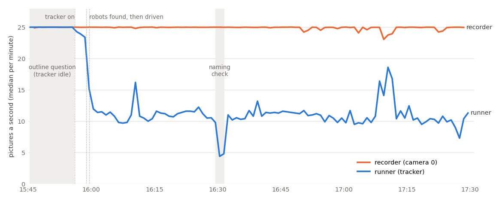

# Real session 2026-10-25 15:45 (MIRLT): why Right and Left went past the home border, the slow camera, Center's wheel flag

**Premise.** Session `e02-20261025-154522` (15:45-17:29 EDT, the Pi):
- The command was `./run-e02-pi.sh --with-side --home --classic-setup --hours 1.5`.
- Robot firmware was 2026-10-22b, which has no robot-side border. The runner's setup line still announced "the robots' own 6 cm".
- The runner was repo commit **b6de33c**. That is before the runner fixes (752fe6f, 2ebda06) and before the three sensor-trust commits.
- It used the stored floor calibration (roam1). Nick answered `y` to the outline question. The home border is 8 cm.

Nick saw a lost-robot hold on Right (16:10), Right stopping inside the bottom edge's border band (16:13), and Left at
the bottom edge (about 16:57). Left and Right ended "not available", and Center ran 14 route runs. Logs and video
only; the Pi was not touched, and no runner code was changed.

**Sources.**
- The session's logs zip: `e02_log.txt`, `e02_state.json`, `track.csv`, `perf.csv`, `runs.csv`, and from `robot-logs-1` the files `leg.csv` (each leg's start and end pose, result), `edge.csv`, `fix.csv`, `raw.csv` and `param.csv`.
- The recorder's small zip (`frames.csv`, `session.json`).
- The overhead video: frames were read by exact byte position from the file's own OpenDML index, because the uploaded parts end before the file does (Q5). The index reaches 16:53:31.
- The 15:10 session's logs, for comparison.

Robot and board distances are in the stored calibration's cm (x = 0 is the bottom open edge of the picture, y = 0 the
right one). Scripts: `tools/experiment/analyses_oct25/session_1545/` (Appendix C).

## Data

### First: where the bottom edge really drops

Every distance below depends on this, and it corrects the 15:10 report.

- The bright plywood ends at x = 4.2-5.0 cm, measured at 12 places along the bottom edge. A darker strip about 4.5 cm wide runs from there out to about the stored line (x ≈ 0).
- **Right sat with its body over that strip, out to x ≈ 0-1, for 15 s without falling** (16:12:53-16:13:10). Its edge sensors never fired.
- Left's bottom-facing sensor looks 9 cm ahead of the axle. At its first edge stop (16:40:30.2, centre x ≈ 7.3, heading 153°) it found the drop at **x ≈ -0.7**.

So the strip is solid surface (probably tape), and the drop is within about 1-2 cm of the stored bottom line. The 15:10
report's "outline 4-5 cm outside the plywood at the bottom" measured the strip's inner edge, not the drop. The 8 cm home
border is therefore about 8 cm from the drop. A robot's centre on that line has its front 3.25 cm from the drop.

### Right: 15:58-16:26

**Right's turning was broken for the whole session.** This is the fault behind everything Right did.

| | 15:10 session | This session |
|---|---|---|
| Turns that timed out (5.4 s) | 0 of 14 | **121 of 131** |
| Turns of 20° or more whose own heading moved the opposite way | 0 of 13 | **46 of 46** |
| Heading change during a straight 10 cm drive (median) | 0.1° | **42.9°** |
| Runner's "its own heading was N° off the measured one" | - | 18 times, 11-177° |

At the compass check (15:58:37-46) Right's wheels, gyro and heading still agreed, as on Left and Center. Its first turn
(15:58:58.8, commanded +40°) ran to the timeout with its own heading at -129°. The video shows the body turn about
80-100° in the first 2 s and then stand still while that heading reading kept moving. Same power-up (boot id F292 in
both sessions), same settings. The physical cause is not in the logs (question 1).

Key seconds at the edge. The full second-by-second table is in Appendix A1.
- **Video** = the body read by eye against lines drawn on the frame.
- **Border** = the camera border check as the Pi ran it: holds the session if the centre is within 8 cm of the line *and* moving towards it at over 2 cm/s, while a leg is live.
- **Watchdog** = the camera watchdog's stop rule: 9 cm, and it needs 6 pictures within 0.5 s.

| Time | Command | What the runner believed | Video | Pictures/s, age | Why nothing stopped it |
|---|---|---|---|---|---|
| 16:10:06 | `turn 2.0` (front check after Right was found by its lights) | a 2° nudge | spun; camera lost it | 16 / 0.13 s | Lost hold after 1.5 s. Nick: `a` (carry on, don't ask) after 65 s |
| 16:12:45-50 | `turn -106.3` towards the staging point (36.5, 78.2) | facing 40° afterwards | ended facing about 127°, towards the bottom edge | 10 / 0.17 s | Turns are exempt from the border; firmware guard does not check turns |
| 16:12:51.6-53.6 | `go 10` | inward | centre 15 → about 7, body over the strip to x ≈ 2.5 | 10 / 0.16-0.18 s | Tracker's lock stuck at 8.6 (about 2 cm behind) while the leg was live, so the border never saw it under 8. The watchdog could not judge: 5 pictures in its 0.5 s window |
| 16:12:54-59 | `turn -108.8` | facing 18° afterwards | spun 5.4 s, centre about 5.5-7, body to x ≈ 1 | 9-12 | Turn exempt; no "no turns within 9 cm of an open edge" rule in `drive_to` |
| 16:13:00.6-02.3 | `go 10` | facing 18° | drove along the edge (about 99°), centre 7 → 5.5, body to x ≈ 0 | 9-11 | Border ignores motion along an edge; watchdog stopped it at 16:13:02.9 ("7 cm from the open edge") |
| 16:13:03-08 | `turn -100.0` | facing -1° | spun 5.4 s, centre about 5-5.5 | 9-11 | Turn exempt |
| 16:13:10-12 | `go 10` | facing -1° | about 55°: inward, by chance | 9-11 | - |

Why Right ended "not available":
1. With turns that don't work it never reached its spot in 40 legs, three times over (16:04, 16:09, 16:14).
2. Two lost stops then called Nick at 16:15:35. Nobody answered in 10 minutes.
3. Its drive-out at 16:26 failed on a turn timeout, so it was left at (35, 86), **inside the square route's path** (see Q4).

### Left: 16:39:56-16:51

The full table is in Appendix A2.

| Time | Command | What the runner believed | Video / robot | Pictures/s, age | What happened |
|---|---|---|---|---|---|
| 16:39:58-16:40:00 | `go 8.3` (parking) | tracker "held" at (24.5, 112.1) | Left drove on to (16.9, 98.7) | 9-12 / 0.15-0.19 s | The lock stayed on the spot Left had left |
| 16:40:00.8 | camera fix sent to Left | (24.5, 112.1), heading -125° | 15 cm wrong | | A held position sent as a fix |
| 16:40:01-06 | `go 4.6`, then find again | | camera 19 cm, wheels 5 cm | | Silent find-again (`a`); found at (14.9, 95.7), correct |
| 16:40:14 | `go 4.0` (drive to measure its heading) | | towards -126° | | centre 15 → 11 |
| 16:40:15.9-17.0 | `turn 154.2` | facing 28° after it | turned 118°, then stopped | camera lost it 1.5 s | **Lost stop during a turn** (silent, `a`) |
| 16:40:18.7-21.7 | `turn 154.5` **re-sent in full** | facing 28° | **faced 152°: straight at the bottom edge, 124° off** | 9 / 0.18 s | `drive_to` does not count the part of a cut turn already done |
| 16:40:22 | find again (front 62 cm, map 34 cm) | heading unknown | centre about 11 | | Two ±40° turns on the spot |
| 16:40:29.1-30.2 | `go 4.0` to measure its heading: forward, which was at the edge | heading unknown | centre 11 → 7.3; **nose at the drop**; bottom sensor 6.4 → 11.2 cm | 15 / 0.14 s | Firmware bottom-zone guard stopped it. The border saw the centre under 8 only after the leg had ended |
| 16:40:30.9-35.1 | `turn -111.3`, `go 10`, `turn -3.1`, `go 10` | after the turn, facing 41° (inward) | all four **refused** by the guard (0.4 cm moved); camera centre 7.3 → 4.5, body about 2 cm further out | 8-11 | Refused legs counted as done. Three edge touches logged with the wrong heading (felt 4.9 / 13.7 / 11.4) moved the bottom line **8 cm in** (the cap) |
| 16:40:36.6 | `go -9.5`, backing out (the right move: it faced out) | | stopped after 0.17 s | 10 / 0.17 s | Watchdog: "4 cm past the open edge and still going", judged against the moved line and set off by a 0.6 cm tracker jitter |
| 16:40:37-16:50:37 | help call | | | | No answer in 10 min; put aside |
| 16:50:37-44 | identify turns ±40° | | 3 refused; the 4th turned 40° with the nose over the drop | | The guard only checks forward driving (`edge.h`: `if (!forward) return false`) |
| 16:51:13 | drive-out | | | | "no clear way round the other robots / the way out runs near an open edge": not parked, so not available |

At 16:57 the live page's "1 cm from the nearest open edge" measured from the moved line (x = 8). Left's centre was
then about 4.5-6.6 cm from the drop, with its nose at or over it.

### The camera

Pictures a second, median per minute: the runner's tracker (blue, `perf.csv`) against the recorder's own camera 0
(orange, `frames.csv`); grey bands are the outline question and the naming check.

| When | Runner pictures/s | Tracker ms a picture | What was running |
|---|---|---|---|
| 15:45-15:56 | 25 | 0 | Outline question; tracker idle |
| 15:56:05 | 24 | 38 | Tracker started (floor model; nobody followed) |
| 15:58:46-15:59:28 | 15 | 61 | Robots found by turns and lights (detector on) |
| 15:59:34 → 17:29 | **10-12** | **78-97** | A robot followed at all times: parking, finds, routes, 26 min of Right in parking |
| 16:29:31-16:31:37 | 4.4-4.8 | 109-119 | Naming check (blink tracker on every picture; planned) |
| 17:08-17:11 | 14-18 | 47-64 | Center being found again: nobody followed |

- **Steps, not a build-up.** From 16:00 to 17:29 each tracker mode's cost changed by under 2 ms per 10 minutes: "both" +1.9, detector -0.8, lock +1.6, and nobody followed -0.1. The first half of the session against the second: 86/88, 88/82, 85/94 and 64/63 ms. Heat, memory growth or a growing data structure would show a drift; there is none.
- **The recorder** (a separate process on the same Pi) held 24.5-25.0 pictures a second in every 10-minute block. The logs show 25 a second, its set rate, not 28.6.
- **Brief Pi-wide stalls.** Both recorder cameras dipped at the same moments (16:50:47, 16:54:09, 17:03:54, 17:05:27, 17:23:50). Four of these are the runner's worst picture ages (1.2-2.4 s at 16:54:08, 17:03:56, 17:05:25, 17:23:49). The recording drive also has three damaged stretches (Q5), so storage stalls are a candidate, not proven.
- **No temperature, throttling, CPU load or memory is logged** anywhere (`perf.csv`, the state, the robot logs, the recorder).

### Every hold, help call and question

| Time | Robot | Kind | Runner's words | Answer, wait | Real danger? |
|---|---|---|---|---|---|
| 15:45:23 | - | question | does the green outline sit on the 4 edges? | `y`, 637 s | - (the bottom line is near the drop: `y` was fair) |
| 15:56:00 / 15:58:24 | - | questions | x-board / y-board sides | defaults, 144 s / 2 s | - |
| 16:10:08 | Right | **hold**, lost | not seen for 1.5 s while it drives | `a`, 65 s | As "lost": false (it was in view, spinning). But the robot really was faulty, and `a` let it be driven on for 4 min to the edge |
| 16:15:35 | Right | help | watchdog stopped it twice (lost) | none (10 min) → put aside | Yes: a robot that cannot turn |
| 16:40:37 | Left | help | at or over an open edge, which way it faces unknown | none (10 min) → put aside | **Yes**: nose at the drop |

After `a`, 28 lost or disagreement events were handled without asking (Center 19, Left 6, Right 3). There were also 12 watchdog stops:
- 3 at an open edge: Right at 16:13:02 and 16:13:15; Left's back-out at 16:40:37.
- 9 near a parked robot: Center 7 times near put-aside Right, Right once near Left, Left once near Right.

The away border's shadow fired 3 times (Right twice near 14 cm, Center once at 11.5 cm); home's border never fired.

### Center's "wheels look bad" (17:02:44, k 2.3; the live page's ×2.2)

This is the self-calibration's camera-against-wheels error per stretch (`fit_data`), against what the trust check
expects (0.87 cm).

| Center's 31 stretches | rms (cm) |
|---|---|
| All | 1.76 |
| Camera at 11 a second or more / under 11 | 2.26 / 1.41 |
| Stretches under 20 cm / 20 cm or more | 1.75 / 1.78 |
| Tracker on "both" / on one source | 1.79 / 1.74 |

Left's 15 stretches gave 2.01 cm, and its wheels were flagged too (16:37:33). Center's wheel scale over 6 fits:
0.963-0.981.

### Center's runs (Q4)

17 runs scored (Center 14, Left 3); Right ran none.

| Condition | Clean runs: far point / back at start (cm) |
|---|---|
| U, L route | 6.6 / 5.0, 4.5 / 6.6 (Left), 4.6 / 8.5 |
| U, straight | 8.1 / 28.3 (Left), 5.9 / 27.9, 4.4 / 30.3 |
| C | L 2.0 / 0.7 |
| K | straight 2.3 / 1.7 |
| KC | L 1.6 / 3.6 |

## Conclusions

**Right: the real cause** was its broken turning plus a runner that never treats that as a fault. From 15:58:58 every
turn ran to the 5.4 s timeout and ended at an arbitrary heading. The runner kept steering Right with 10 cm legs whose
direction neither it nor the robot controlled, for 15 minutes, towards a park spot 17 cm from the bottom edge. Nothing
counts repeated turn timeouts or repeated 45°+ heading corrections, and the sensor trust never judged Right's gyro
("too little evidence").

Contributing, in order:
1. Turns are exempt from the camera border and unchecked by the firmware guard, and `drive_to` turns on the spot inside 9 cm of an open edge. Two 5.4 s spins happened with the body over the strip.
2. The watchdog's edge rule needs 6 pictures in 0.5 s. At this session's 10 a second it could judge on only 23-37 % of its checks.
3. The tracker's lock lagged about 2 cm in the one forward drive into the band.
4. The border ignores motion along an edge.
5. Nick's `a` removed the human check at the first symptom. Unfair to call it a cause: the hold said "lost", not "can't turn".

Not causes: the calibration (the bottom line is near the drop), wheel slip, the picture rate by itself.

**Left: the real cause** was a blind forward drive at the edge from about 11 cm (centre). With its heading unknown, the
runner measures it by driving forward 4 cm, whatever is ahead. Left faced the edge because a turn that a silent "lost"
stop had cut at 118° was re-sent in full (124° too far). The firmware guard stopped it with its nose at the drop.

Then the runner stranded it:
1. It treated four refused legs as done, so it believed Left faced inward.
2. It logged three edge touches with that wrong heading, and they moved the bottom line 8 cm in.
3. Its watchdog then stopped the one correct move, the back-out, as "4 cm past the edge and still going", on a 0.6 cm tracker jitter.

The chain started with a stale "held" tracker position sent to Left as a fix (15 cm wrong). Contributing:
- the lost check counting a turn as lost after 1.5 s at 10 pictures a second;
- the border only acting while a leg is live (with pictures 0.15-0.2 s old, a 1 s, 4 cm drive is over before the border sees it);
- the guard not checking turns (the 16:50:42 turn put Left further over).

**Against the runner fixes (752fe6f, 2ebda06):**

| Fix | Right | Left |
|---|---|---|
| 1. Signed border | no effect | no effect (the back-out was stopped by the watchdog's `hazard`, which was already signed) |
| 2. Left-out robot out of explore; 3. finish a cut leg; creep | explore only: no effect | explore only: `drive_to` still re-sends a cut turn in full |
| 4. Watchdog at a slow camera (1.2 s, 4 pictures) | would have judged on most checks; it might have stopped the 16:12:51 drive at 9 cm, never the spins | no effect on the cause |
| 5. Lost check waits 3.5 s in a turn | the 16:10 hold would probably have come later or not at all; no effect on the fault | **probably prevents this crossing**: the camera had Left again 2.5 s into the cut turn, so the turn would have finished facing inward |
| Speed guard | its margin here: about 0.5-0.7 cm (lag 0.25 s against 0.2); no effect | no effect |

So the fixes would probably have avoided Left's crossing this time, through fix 5, but not its general path: a blind
heading drive near an edge, refused legs counted as done, and wrong edge touches moving the line. They would not have
avoided Right's at all.

**Camera.** The slowdown came in steps tied to what the runner was doing, then stayed flat. The camera thread was
saturated: 83 ms a picture × 11 pictures a second is about 0.91 s of every second inside the tracker alone, and about
14 of the 25 pictures a second were dropped. Meanwhile the recorder, a separate process, kept 25 a second, so the Pi had
spare capacity. The runner was limited by one thread.

The same tracker work cost about twice what it did at 15:10:

| Tracker mode | 15:10 (ms a picture) | This session (ms a picture) |
|---|---|---|
| Lock-on | 39 | 85 |
| Both (lock + detector) | 60 | 84-96 |
| Nobody followed | 38 (start of this session) | 63 (once robots were being driven) |

No heat drift appears, and the cost per picture rose when the runner's other threads got busy. That fits time inside
the tracker being stretched by other Python threads of the same process (the GIL). It is likely, not proven: nothing
logs per-thread CPU. A tracker in its own process would remove that contention, roughly the 25-45 ms above the 38 ms
base: about 15-25 pictures a second. It would not remove the detector and lock-on cost itself.

**Center's flag is camera error charged to its wheels, not a wheel fault, and not mainly the slow camera:**
- the error is the same for short and long stretches (a wheel fault grows with distance);
- it is no larger when the camera was slow (1.41 cm below 11 a second, 2.26 cm above);
- the wheel scale held 0.963-0.981 over 6 fits;
- Left was flagged the same session.

About 1.2 cm per stretch end matches a camera whose error varies across the board. The stored calibration's error map
is learned only at the finds' corner. The sensor-trust commits after b6de33c change how finds count for the camera, not
the wheels' stretch check, so they would probably still raise this flag (not replayed).

**Center's runs.** The accuracy is what earlier sessions showed: uncalibrated U straight runs end 28-30 cm off, while
C, K and KC end 0.7-3.6 cm off. There are too few clean runs per condition for statistics. New:
1. All 5 square runs were spoiled: 4 cut by watchdog stops 14-17 cm from put-aside Right, sitting in the square's path, and the 5th (KC) mis-scored (point 2).
2. Two scores are camera artefacts, not robot errors.
   - Run 12 (C straight): "far point 100.1 cm off" is the start position.
   - Run 35 (KC square): far point and end are both (31, 98.5) while the robot ended at its start.
3. Run 28 (K L) started 18 cm from the start spot.

**Q5, the side camera** was recorded (93,492 frames, 15 a second) but never uploaded. The upload sends cam0 first: the
whole cam0 file is about 4.82 GB (the file's index), which needs three 1.9 GB parts. Only `-aa` and `-ab` arrived; the
last finished at 17:45:53, and nothing more had arrived by 18:33. So the upload stopped during cam0's third part,
before cam1.

The recording drive has damage on the same files:
- 11 MB of unreadable data in cam0's video at 16:02:00-14;
- about 4.4 MB of zeros near 17:03;
- 2 KB of zero bytes in `frames.csv` at 17:22:40.

A read error on that drive, a closed window, or the Pi losing power or network would each stop the upload. Which one
can only be seen on the Pi.

## What's next

Fixes not already built, ranked by how much they would have helped this session:
1. **A robot that cannot turn is stopped and named.**
   - The rule: 2 turn timeouts in a row, or 2 heading corrections over 45° within 5 legs.
   - What happens: stop it, hold with plain words ("Right's turns are not working"), drive it no more. Feed it to the sensor trust as gyro/turn evidence.
   - *This would have stopped Right at 15:59, before any of this.* Bench test of Right's turning first (question 1).
2. **No blind forward drive near an open edge.**
   - With the heading unknown and the centre within 15 cm of an open edge, the heading drive becomes a 3 cm crawl.
   - A guard stop on that crawl means "facing the edge": back straight out 6 cm (the way it came is known to be clear).
   - Better still: take the heading mod 180 from the body's outline after the identify turn and drive only the inward one of the two.
3. **A refused or cut leg never updates the belief.**
   - `drive_to` and `leg`: use the robot's own reported turn (`leg_final`) and send only the rest of a cut turn (the runner fixes' fix 3, extended from explore to `drive_to`/`park`).
   - Treat "failed (plywood edge)" on a turn as not turned.
4. **Edge touches only with a measured heading; back-outs always allowed after a guard stop.**
   - `edge_touch_log` skips touches whose heading was not measured since the last turn.
   - The watchdog lets a robot back straight out after its own guard stop.
   - "Still going" needs over 1 cm of outward motion, not tracker jitter.
5. **No turns on the spot within 9 cm (`EDGE_TURN_CM`) of an open edge, in `drive_to` too**: move straight in first, as parking does at its start. In firmware, a guard check during turns.
6. **No camera fix from a "held" position right after a drive.**
7. **Put-aside robots and help calls.**
   - Routes check against put-aside robots and are re-planned or skipped (5 square runs lost).
   - At home, a help call sounds on the live page instead of waiting 10 silent minutes.
8. **Camera:**
   - Log `vcgencmd measure_temp`, `vcgencmd get_throttled`, per-core CPU and the runner's memory once a second in `perf.csv`.
   - Run one session with the stall watch (`threads.csv`, in HEAD) to split the tracker's time from the GIL wait.
   - Then decide on a tracker process.
   - The slow-spell judge's baseline should come from a followed robot, not an idle tracker: it reported one "slow spell" of 5579 s.
9. **Sensor trust:** a rise shared by every robot's wheel stretches is charged to the camera, not to each robot. Trust learns the camera's error across the board, not only at the finds.

Before the next board session:
- Nick restarts the upload on the Pi (it skips parts already up). It has to send cam0 `-ac` and the side camera.
- He checks the recording drive.
- He bench-tests Right's turns.

**Questions for Nick**

*Substantive*
1. Did anything happen to Right between 15:58:37 and 15:59 (picked up, bumped, a wheel or the top touched)? Its turns worked at the compass check and failed from its next move on, without a restart. Can you bench-test `turn 90` with Right on the table before the next session?
2. What is the dark strip, about 4.5 cm wide, along the bottom open edge: tape on the plywood? This session says it is solid surface and the drop is near the stored line. The 15:10 report assumed the opposite; your answer settles it.
3. Fix 2 changes how a lost robot finds which way it faces near an edge. Do you prefer the 3 cm crawl (simple, the guard does the work) or the camera reading the body's outline (no movement, more code)?
4. For a robot that can't turn (fix 1): stop the session and ask, or leave that robot out and carry on with the others?

*Other*
5. Shall I start a build of fixes 1-6 (runner only, with simulator tests that re-create both crossings)? About 2.5-3 h.
6. Could the upload window have been closed, or the Pi switched off or moved, around 17:46? The video upload stopped there.

## Sweep 1: new tests that may now be needed

- A simulator robot whose turns run the wrong way until timeout: the runner stops it within 2 legs (fix 1).
- A heading drive with the robot facing an open edge 10 cm away: guard stop, then a back-out, no refused-leg loop (fix 2).
- A turn cut by a lost stop in `drive_to`: only the rest is sent (fix 3).
- A refused turn: the belief and the edge touches stay unchanged; the open edge does not move (fix 4).
- The watchdog lets a back-out run after a guard stop with 1 cm of tracker jitter (fix 4).
- A put-aside robot on a route's path: the route is skipped or re-planned.
- A replay of this session's trust items under HEAD's `e02_trust`: is Center's wheel flag still raised?
- A tracker in its own process on the Pi: pictures a second with a robot followed (target 15-25).
- A border-check replay where picture age is set to 0.2 s and legs of 1 s: how often is a move into the band seen while the leg is live?
- On the board: the bottom zone's real reach ahead (the 9 cm `BOTTOM_AHEAD_CM`), at the bottom and right edges.

## Sweep 2: possible inaccuracies in what this relied on

- **Where the drop is (x ≈ -0.7 to 1) rests on `BOTTOM_AHEAD_CM` = 9 cm**, a nominal "square on" value, and on Right not falling. If the zone sees 6 cm ahead, the drop is at about 1.9 cm.
- **"Video" positions near the edge were read by eye** from 640 × 480 frames against drawn lines: ±1-2 cm. The automatic blob measure was biased inward over the dark strip and was used only away from the edge (Appendix B).
- **Runner beliefs about heading** come from the turn it sent and the camera's measured heading (`heading_pushes`). The runner's internal `Steer` state is not logged.
- **The border and watchdog columns in Appendix A are re-computed** from `track.csv` in 1 s windows, not what the live checks saw every 0.1 s. One "HOLD" row (Left, 16:40:32) did not happen live, for the reason given there.
- **Right's physical turning** (80-100° then still) is from body-outline moments, which cannot tell +80° from -100°.
- **The GIL explanation is an inference** from ms a picture under different loads. There is no per-thread CPU data.
- **Storage stalls as the cause of the Pi-wide stalls**: timing near the file damage, not matched exactly.
- **Frame times**: the video index has exact positions to 16:53:31. Damaged stretches (16:02:00-14) were not used.
- **Chosen numbers in the fixes** (DOE rows added): 2 timeouts / 2 corrections over 45° in 5 legs; 15 cm and 3 cm for the crawl; 6 cm back-out; 1 cm "still going". `EDGE_TURN_CM` 9 cm already exists.
- **Accuracy figures per condition** are 1-3 runs each, against a camera whose own error here is about 1.2 cm per point.

## Appendix A1. Right, second by second (16:12:40-16:13:20)

Columns are re-computed from `track.csv`:
- **d** is the centre's distance from the stored bottom line (≈ the drop).
- **Border** shows towards/speed in cm/s, with the reason it would not act.
- **Watchdog** shows the distance now and in 0.3 s, and ignores the live rule's 6-pictures-in-0.5 s condition (so its "STOP" rows mostly did not happen live).
- **Robot own pose** is the leg record at the start or end of the leg.

| Time | Command [robot result] | Robot own x, y, heading | Tracker x, y (source) | Pictures/s, age | Border 8 cm: d, towards/speed cm/s | Watchdog 9 cm: d now -> in 0.3 s |
|---|---|---|---|---|---|---|
| 16:12:40 | turn -126.0 | 23.5, 50.9, -170 | 24.0, 53.2 (both) | 10, 0.16 s | 23.7 +2.5/3.1 (turn exempt) | - |
| 16:12:41 | turn -126.0 | 23.5, 50.9, -170 | 23.7, 53.2 (both) | 10, 0.17 s | - | - |
| 16:12:42 | turn -126.0 [turn timed out]; go 10.0 | 23.3, 50.8, -123 | 23.9, 53.0 (both) | 10, 0.17 s | 24.2 -0.1/0.7 - | 24.1->24.0 |
| 16:12:43 | go 10.0 | 23.3, 50.8, -123 | 22.7, 54.2 (both) | 12, 0.15 s | 19.5 +6.9/9.2 - | 20.0->18.1 |
| 16:12:44 | go 10.0 [front=16.0] | 14.9, 44.5, -169 | 15.2, 59.1 (lock) | 9, 0.19 s | 14.5 +2.0/2.1 - | 14.5->13.9 |
| 16:12:45 | turn -106.3 | 14.5, 59.5, 146 | 14.5, 59.5 (lock) | 10, 0.17 s | 14.5 +0.0/0.0 (turn exempt) | 14.5->14.5 |
| 16:12:46 | turn -106.3 | 14.5, 59.5, 146 | 14.2, 59.5 (both) | 11, 0.16 s | 13.8 +0.0/0.3 (turn exempt) | 14.6->15.5 |
| 16:12:47 | turn -106.3 | 14.5, 59.5, 146 | 14.1, 59.6 (lock) | 10, 0.17 s | 15.3 +1.2/1.2 (turn exempt) | 15.3->15.8 |
| 16:12:48 | turn -106.3 | 14.5, 59.5, 146 | 15.4, 60.0 (both) | 11, 0.17 s | 15.4 -1.2/1.3 (turn exempt) | 15.4->15.0 |
| 16:12:49 | turn -106.3 | 14.5, 59.5, 146 | 15.4, 60.1 (both) | 10, 0.17 s | 15.3 +1.6/1.6 (turn exempt) | 15.3->15.1 |
| 16:12:50 | turn -106.3 [turn timed out] | 14.3, 59.5, -144 | 15.3, 60.2 (lock) | 11, 0.16 s | 15.4 -0.2/0.2 (turn exempt) | 15.4->15.5 |
| 16:12:51 | go 10.0 | 14.3, 59.5, -150 | 15.3, 60.2 (both) | 10, 0.16 s | 15.2 +0.3/0.5 - | 15.1->15.0 |
| 16:12:52 | go 10.0 | 14.3, 59.5, -150 | 13.9, 62.4 (both) | 10, 0.18 s | 10.8 +7.6/10.8 - | 11.5->8.6 STOP |
| 16:12:53 | go 10.0 [front=67.2] | 4.0, 57.5, 163 | 9.4, 68.4 (lock) | 10, 0.16 s | 8.6 +2.2/2.8 - | 8.6->8.6 |
| 16:12:54 | turn -108.8 | 8.6, 69.0, 127 | 8.6, 69.0 (lock) | 9, 0.17 s | 8.6 +0.0/0.0 (turn exempt) | 8.6->8.6 |
| 16:12:55 | turn -108.8 | 8.6, 69.0, 127 | 7.1, 68.8 (lock) | 12, 0.16 s | 6.4 +2.0/2.1 (turn exempt) | 6.4->5.9 STOP |
| 16:12:56 | turn -108.8 | 8.6, 69.0, 127 | 6.7, 68.8 (lock) | 10, 0.18 s | 6.9 -0.9/1.1 (turn exempt) | 6.9->7.1 |
| 16:12:57 | turn -108.8 | 8.6, 69.0, 127 | 6.5, 68.8 (lock) | 12, 0.15 s | 6.9 -0.9/1.1 (turn exempt) | 6.9->7.4 |
| 16:12:58 | turn -108.8 | 8.6, 69.0, 127 | 6.4, 69.1 (lock) | 10, 0.16 s | 6.9 -0.9/1.1 (turn exempt) | 6.9->7.3 |
| 16:12:59 | turn -108.8 [turn timed out] | 8.5, 69.1, -153 | 6.5, 68.8 (lock) | 10, 0.18 s | 9.1 -4.6/4.8 (turn exempt) | 7.8->8.9 |
| 16:13:00 | go 10.0 | 8.5, 69.1, -160 | 7.2, 68.8 (lock) | 10, 0.18 s | 7.2 +0.0/0.0 along/slow | 7.2->7.2 |
| 16:13:01 | go 10.0 | 8.5, 69.1, -160 | 7.2, 70.6 (lock) | 11, 0.16 s | 7.8 -0.8/9.9 along/slow | 7.6->7.8 |
| 16:13:02 | go 10.0 [stop command] | -0.4, 67.8, 170 | 5.9, 78.4 (detector) | - | 5.7 -0.3/0.4 (turn exempt) | 5.8->5.9 |
| 16:13:03 | turn -100.0 | 5.6, 78.9, 99 | 5.6, 79.1 (lock) | 9, 0.19 s | 5.7 -0.3/0.4 (turn exempt) | 5.9->6.3 |
| 16:13:04 | turn -100.0 | 5.6, 78.9, 99 | 4.8, 79.4 (lock) | 9, 0.18 s | 4.3 +1.4/1.8 (turn exempt) | - |
| 16:13:05 | turn -100.0 | 5.6, 78.9, 99 | 4.3, 79.8 (lock) | 11, 0.17 s | 3.8 +1.1/1.4 (turn exempt) | 4.1->3.8 |
| 16:13:06 | turn -100.0 | 5.6, 78.9, 99 | 4.3, 79.8 (lock) | 11, 0.16 s | 4.3 +0.0/0.0 (turn exempt) | 4.3->4.1 |
| 16:13:07 | turn -100.0 | 5.6, 78.9, 99 | 4.3, 79.8 (lock) | 10, 0.17 s | 4.3 +0.0/0.0 (turn exempt) | 4.3->4.3 |
| 16:13:08 | turn -100.0 [turn timed out] | 5.5, 79.1, -178 | 4.3, 79.8 (lock) | 10, 0.17 s | 4.8 -2.1/2.6 (turn exempt) | 4.6->5.1 |
| 16:13:09 | turn -1.4 [front=43.6] | 5.5, 79.1, 175 | 4.8, 79.4 (lock) | 10, 0.16 s | 4.8 +0.0/0.0 (turn exempt) | 4.8->4.8 |
| 16:13:10 | go 10.0 | 5.5, 79.1, 175 | 4.8, 79.4 (lock) | 10, 0.17 s | 4.8 +0.0/0.0 along/slow | 4.8->4.8 |
| 16:13:11 | go 10.0 | 5.5, 79.1, 175 | 7.1, 81.2 (lock) | 11, 0.16 s | 12.2 -9.4/11.5 - | 10.8->13.9 |
| 16:13:12 | go 10.0 [front=32.9] | -4.1, 83.3, 130 | 11.5, 89.0 (lock) | 9, 0.18 s | 11.5 +0.0/0.0 (turn exempt) | 11.5->11.3 |
| 16:13:13 | turn -78.7 | 11.5, 89.0, 55 | 11.6, 89.0 (lock) | 12, 0.15 s | 12.6 -1.4/1.5 (turn exempt) | 12.2->12.5 |
| 16:13:14 | turn -78.7 [stop command] | 11.6, 89.2, 124 | 11.2, 88.7 (lock) | 10, 0.16 s | 11.0 -4.5/9.2 (turn exempt) | 12.7->13.5 |
| 16:13:15 | turn 1.4 | 11.6, 89.2, 132 | 13.7, 87.3 (both) | 9, 0.18 s | 12.7 +2.3/2.3 (turn exempt) | 13.4->13.7 |
| 16:13:16 | turn 1.4 [front=42.8]; go 10.0 | 11.6, 89.2, 132 | 13.9, 87.0 (both) | 10, 0.18 s | 13.8 -0.3/0.3 - | 13.9->13.5 |
| 16:13:17 | go 10.0 | 11.6, 89.2, 132 | 16.2, 87.1 (both) | 10, 0.17 s | 19.4 -7.5/7.6 - | 19.6->21.8 |
| 16:13:18 | go 10.0 [front=57.9] | 2.7, 94.4, 174 | 25.6, 85.7 (both) | 11, 0.15 s | 26.4 -2.3/3.0 - | 26.4->26.9 |
| 16:13:19 | turn -24.0 | 26.4, 84.9, -9 | 26.3, 84.9 (both) | - | 26.3 +0.1/0.3 (turn exempt) | 26.2->26.0 |

## Appendix A2. Left, second by second (16:39:56-16:40:40)

Same columns. The "HOLD" at 16:40:32 did not happen live: the pictures showing that move arrived about 0.2 s after the
1-second leg had already ended, and the border acts only while a leg is live. "No picture" rows are camera gaps (turns,
identify).

| Time | Command [robot result] | Robot own x, y, heading | Tracker x, y (source) | Pictures/s, age | Border 8 cm: d, towards/speed cm/s | Watchdog 9 cm: d now -> in 0.3 s |
|---|---|---|---|---|---|---|
| 16:39:56 | turn -10.0 | 25.2, 110.9, -90 | 26.5, 114.9 (lock) | 9, 0.19 s | 26.5 +0.0/0.0 (turn exempt) | 26.5->26.5 |
| 16:39:57 | turn -10.0 [front=36.3] | 25.2, 110.9, -101 | 26.7, 114.8 (lock) | 10, 0.18 s | 27.0 +0.0/0.0 (turn exempt) | 27.0->27.0 |
| 16:39:58 | go 8.3 | 25.2, 110.9, -101 | 26.5, 114.9 (lock) | 9, 0.19 s | 26.5 +0.0/0.0 - | 26.5->26.5 |
| 16:39:59 | go 8.3 | 25.2, 110.9, -101 | 21.0, 109.4 (detector) | 12, 0.15 s | 18.0 +8.6/26.8 - | 18.4->17.5 |
| 16:40:00 | go 8.3 [front=15.8] | 23.6, 103.0, -100 | 24.5, 112.1 (held) | 10, 0.18 s | 24.5 +0.0/0.0 - | - |
| 16:40:01 | go 4.6 | 24.5, 112.1, -125 | no picture | 8, 0.18 s | - | - |
| 16:40:02 | go 4.6 [front=15.8] | 21.9, 108.4, -126 | 14.9, 95.7 (detector) | 9, 0.18 s | 14.9 -0.5/2.2 (not driving) | - |
| 16:40:03 | standing | 21.9, 108.4, -126 | 14.8, 95.5 (detector) | 7, 0.21 s | 14.6 -0.1/0.8 (not driving) | 14.7->14.5 |
| 16:40:04 | standing | 21.9, 108.4, -126 | 14.7, 95.4 (both) | 14, 0.14 s | 14.6 -0.2/0.2 (not driving) | 14.8->15.0 |
| 16:40:05 | standing | 21.9, 108.4, -126 | 14.8, 95.6 (both) | 10, 0.18 s | 14.9 -0.3/0.3 (not driving) | 14.8->14.9 |
| 16:40:06 | standing | 21.9, 108.4, -126 | 14.8, 95.5 (both) | 10, 0.17 s | 14.5 +0.4/0.7 (not driving) | 14.7->14.5 |
| 16:40:07 | standing | 21.9, 108.4, -126 | 14.8, 95.7 (both) | 12, 0.14 s | - | - |
| 16:40:08 | turn 40.0 | 21.9, 108.4, -125 | no picture | 21, 0.11 s | - | - |
| 16:40:09 | turn 40.0 [front=155.2] | 21.8, 108.2, -85 | no picture | 21, 0.12 s | - | - |
| 16:40:10 | turn -40.0 | 21.8, 108.2, -85 | no picture | 22, 0.12 s | - | - |
| 16:40:11 | turn -40.0 | 21.8, 108.2, -85 | no picture | 23, 0.11 s | - | - |
| 16:40:12 | turn -40.0 [front=17.8] | 21.8, 108.1, -125 | no picture | 20, 0.12 s | - | - |
| 16:40:13 | standing | 21.8, 108.1, -125 | 11.6, 96.2 (both) | 13, 0.16 s | 11.6 +9.1/9.1 - | 11.6->11.7 |
| 16:40:14 | go 4.0 | 21.8, 108.1, -126 | 11.6, 96.4 (both) | - | 11.6 +0.1/2.2 - | 11.6->11.6 |
| 16:40:15 | go 4.0 [front=21.9]; turn 154.2 | 19.4, 105.0, -126 | 10.6, 92.8 (lock) | 10, 0.16 s | 10.6 +0.0/0.0 (turn exempt) | 10.6->10.6 |
| 16:40:16 | turn 154.2 | 19.4, 105.0, -126 | 10.6, 92.8 (lock) | 11, 0.17 s | - | - |
| 16:40:17 | turn 154.2 [stop command] | 19.3, 104.8, -8 | no picture | 9, 0.17 s | - | - |
| 16:40:18 | turn 154.5 | 19.3, 104.8, -2 | 9.1, 90.9 (lock) | 9, 0.18 s | 9.1 +0.0/0.0 (turn exempt) | 9.1->9.1 |
| 16:40:19 | turn 154.5 | 19.3, 104.8, -2 | 9.1, 90.9 (lock) | 9, 0.19 s | - | - |
| 16:40:20 | turn 154.5 | 19.3, 104.8, -2 | 11.1, 96.8 (detector) | 9, 0.17 s | - | - |
| 16:40:21 | turn 154.5 [front=62.1] | 19.3, 104.8, 152 | no picture | 9, 0.18 s | - | - |
| 16:40:22 | standing | 19.3, 104.8, 152 | 10.4, 91.5 (lock) | 9, 0.18 s | 10.4 +0.0/0.0 (not driving) | - |
| 16:40:23 | turn 40.0 | 19.3, 104.8, 153 | no picture | 16, 0.14 s | - | - |
| 16:40:24 | turn 40.0 | 19.3, 104.8, 153 | no picture | 25, 0.09 s | - | - |
| 16:40:25 | turn 40.0 [front=15.3] | 19.3, 104.8, -167 | no picture | 19, 0.13 s | - | - |
| 16:40:26 | turn -40.0 | 19.3, 104.8, -167 | no picture | 22, 0.11 s | - | - |
| 16:40:27 | turn -40.0 [front=62.1] | 19.2, 104.8, 154 | no picture | 22, 0.11 s | - | - |
| 16:40:28 | standing | 19.2, 104.8, 154 | 10.1, 93.4 (held) | 17, 0.14 s | 10.1 +0.0/0.0 - | 10.1->10.1 |
| 16:40:29 | go 4.0 | 19.2, 104.8, 154 | 10.9, 94.5 (lock) | 15, 0.14 s | - | - |
| 16:40:30 | go 4.0 [plywood edge (bottom)]; turn -111.3 | 15.9, 106.6, 153 | 7.4, 95.0 (detector) | 9, 0.18 s | 7.2 +0.3/0.3 (turn exempt) | 7.3->7.3 |
| 16:40:31 | turn -111.3 [plywood edge (bottom)] | 15.9, 106.6, 153 | 7.3, 95.1 (both) | 8, 0.21 s | 7.3 -0.2/0.2 along/slow | 7.3->7.3 |
| 16:40:32 | go 10.0 [plywood edge (bottom)] | 7.0, 95.2, 151 | 7.2, 95.2 (both) | 10, 0.17 s | 6.1 +2.1/2.7 HOLD | 6.4->5.7 STOP |
| 16:40:33 | turn -3.1 [plywood edge (bottom)] | 7.0, 95.2, 150 | 6.6, 95.9 (both) | 10, 0.17 s | 6.5 +0.3/0.3 (turn exempt) | 6.4->6.2 |
| 16:40:34 | go 10.0 | 7.0, 95.2, 150 | 6.5, 95.9 (both) | - | 6.5 +0.1/0.3 along/slow | 6.5->6.4 |
| 16:40:35 | go 10.0 [plywood edge (bottom)] | 6.8, 95.4, 149 | 4.5, 96.5 (both) | 11, 0.16 s | 3.4 +1.3/1.3 (not driving) | -3.4->-3.4 |
| 16:40:36 | go -9.5 [stop command] | 4.6, 96.5, 149 | 4.5, 96.5 (both) | 10, 0.17 s | 3.8 +0.6/0.6 along/slow | -3.6->-3.4 |
| 16:40:37 | standing | 4.6, 96.5, 149 | 4.2, 96.6 (both) | 12, 0.15 s | 3.8 +0.1/0.1 (not driving) | -3.8->-3.8 |
| 16:40:38 | standing | 4.6, 96.5, 149 | 4.2, 96.6 (both) | 10, 0.16 s | 3.9 -0.2/0.2 (not driving) | -3.9->-3.9 |
| 16:40:39 | standing | 4.6, 96.5, 149 | 4.1, 96.6 (both) | 10, 0.17 s | 3.9 -0.1/0.1 (not driving) | -3.9->-3.9 |

## Appendix B. Methods

- **Video frames**: the cam0 AVI's OpenDML index (`ix00` chunks for segments 1-3, fetched by byte range) gives every frame's byte position up to frame 102,241 (16:53:31). Frames were cut from the uploaded parts by range, with no full download. Reading the file in order fails at the damaged stretch at 16:02 (`getframes.py`, `rng.sh`).
- **Bottom edge**: brightness profiles across the edge at 12 places on a frame with no robot there (15:58:45; `edgeprof.py`).
- **Body positions**: zoomed raw frames with x = 0, 4.7, 8, 10 and 15 drawn at floor level (`edgecrop.py`). The difference-blob measure (`vidpose.py`) agreed with the tracker within 0.3 cm along x away from the edge, but was biased 2-4 cm inward over the dark strip.
- **Right's turn**: second moments of the dark body over the turn (`orient.py`).
- **Camera**: `perf.csv` per minute and per tracker mode, and the recorder's `frames.csv` and `session.json` low-rate windows (`perf.py`, `fig_speed.py`).
- **Stretches**: `fit_data` in the state, against `perf.csv` and `track.csv` at each stretch's time (`stretches.py`).

## Appendix C. Scripts

`tools/experiment/analyses_oct25/session_1545/`. Each reads the unzipped session from the folders set in `common.py`
(scratch paths at analysis time; change `D` and `R`). The downloads were deleted after the analysis.
