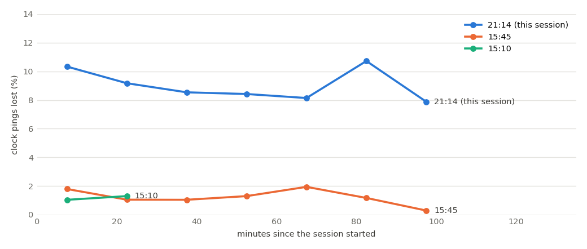
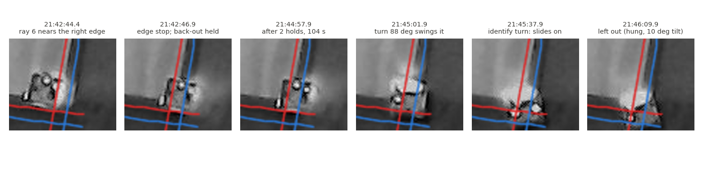
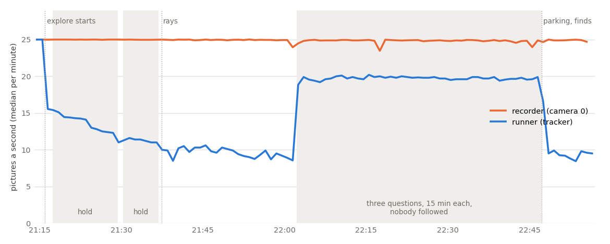

# Real session 2026-10-25 21:14 (MIRLT): Left hung at the corner, a radio link losing 1 command in 10, false holds, explore failed, the overnight hold

**Premise.** Session `e02-20261025-211419` on the Pi, started with `./run-e02-pi.sh --with-side --home --hours 1.5`
(explore, no stored setup). It was the first session with the runner fixes after 15:10 and 15:45
([runner fixes](e02-oct25-runner-fixes.md), [15:45 fixes](e02-oct25-1545-fixes.md); code 7a2ab4e, the commit before
c55e500) and firmware 2026-10-25c (the robots' own 6 cm border, no moves before a compass check). It ran from 21:14 to
22:55, then waited on an unanswered hold until 06:41. Nick saw two "lost robot" holds (Center 21:17, Right 21:30), Left
left out at the bottom-right corner "0 cm from the nearest open edge", and Center's wheels "looks bad ×2.9". Logs and
video only; the Pi was not touched and no runner code was changed.

**Sources.** The logs zip (`e02_log.txt`, `e02_state.json`, `track.csv`, `perf.csv`, `threads.csv`, `stalls.csv`,
`border_shadow.csv`; from `robot-logs-1`: `leg.csv`, `param.csv`, `edge.csv`, `raw.csv`, `clock_sync.csv`, `fix.csv`),
the recorder's small zip (`frames.csv`, `session.json`) and the overhead video. `frames.csv` puts 21:14-23:00 in
frames 0-159,000, which lie in parts `-aa` to `-ac`; the frames needed (about 1,600) were read from those three parts
by byte range through the file's own index, because the machine had 3 GB free (Appendix D). The 15:10 and 15:45 logs
were used for comparison. Distances are in the stored calibration's board cm (roam1): x = 0 is the bottom open edge of
the picture, y = 0 the right one. Scripts: `tools/experiment/analyses_oct25/session_2114/`.

## Data

### 1. The radio link lost about 1 command in 10 all evening

The share of the runner's clock pings that no robot answered, per 15 minutes, in this session and the two afternoon
sessions (data: each session's `clock_sync.csv`).

| | 15:10 | 15:45 | **21:14** |
|---|---|---|---|
| Clock pings lost | 1.1 % | 1.2 % | **8-11 % from the first minute** (18.9 % over the night, as the robots went silent) |
| Moves (`go`/`turn`) with no record from the robot | 0 of 136 | 10 of 733 | **30 of 283 sends** (25 legs late by 9-19 s; 5 legs lost twice) |
| `set` commands the robot's own parameter dump contradicts | - | - | **6 of 113 checked** (a 7th shows in leg times) |

A lost move is sent again once after 9-19 s with the same id, and the robot then answers `queued`, never `dup`: it had
not received the first one. A `set` has no answer, so a lost one is never sent again. The lost settings (`param.csv` at each robot's next
firmware run; Right's speed from its leg times, `speeds.py`):

| Robot | Setting lost | Sent | Effect |
|---|---|---|---|
| Right | `calib_spin_deg 0`, `calib_roll_cm 0` | 21:14:28 | its compass check spun 720° and took 64 s, not 10 |
| Center | `e02_open_x_cm 0`, `e02_open_y_cm 0` | 21:15:42 | **its own 6 cm border had no open edges all session** (-999 at 22:50) |
| Right | `e02_cms 4` | 21:30:11 | its room check and small square ran at 8 cm/s, not 4 (12 legs) |
| Left | `safe_front_cm 7` | 21:38:58 | its front stop stayed at the creep's 3 cm for rays 2-8 |
| Right | `e02_xboard_cm 118.84` | 22:53:50 | its find took the x-board to be at y = 0, the right open edge, and drove at it (Q7) |

### 2. Left: how it went over the bottom-right corner (21:42-21:46)

Overhead video crops of the bottom-right corner at six moments, with the stored open-edge lines (red, x = 0 and y = 0)
and 4 cm outside them (blue) (data: cam0 video, roam1 calibration).

The second-by-second table is in Appendix A. In short:

| Time | What happened | Guard and why it did not stop it |
|---|---|---|
| 21:42:22-46 | Ray 6, a 4 cm/s crawl looking for an edge, ran along the bottom edge (x ≈ 13 → 7) into the right edge | By design the camera border lets a crawl pass (explore relies on the edge guard), and the robot's own 6 cm border is off in explore (no camera fix, so the robot does not know where it is) |
| 21:42:46.1 | Line sensors tripped (439/256/73: the left one first, a slanting approach). Video: the body's outer side about 2 cm past the outer edge of the dark strip, nose over the drop | Edge guard worked as built: it acts when the sensors reach the edge, so the bumper overhangs |
| 21:42:47.0 | Back-out `go -9.5` started; **0.1 s later the camera border held the session** ("6 cm past the line, moving further out") | The border check has no back-out exemption (the 15:45 fix 4 went into the watchdog's hazard check only). Its pictures still showed the end of the forward crawl. The tracker also put Left about 5 cm further out than the body: by eye its centre was at y ≈ -0.5, the tracker said -6 |
| 21:42:57-21:43:13 | Nick `a` after 10 s. The runner sent the ray's return (`turn 175`, `go 78.4`, `turn 44.5`), then ray 7 (`go 105`): **all four refused by the firmware**, "no plywood under the line sensors" | Firmware 25c worked. Explore counted ray 7's refusal as an open edge at distance 0 (then dropped it as a side point, correctly) |
| 21:43:13.1 | Back-out again; **held again 0.6 s later** ("7 cm past, moving further out"): 0.8 cm of tracker jitter | Same gap in the border check |
| 21:44:58.6 | Nick `a` after 104 s. **`turn 88.6` (aiming ray 8) ran, on the spot, with the nose over the edge**; the body swung into the corner (crops 3-4) | Turns are not edge-guarded (firmware: forward only), and the 15:45 fix 5 (no turns within 9 cm of an edge) is only in `drive_to`; in explore the runner has no board to measure from |
| 21:45:05-35 | Ray 8, `go 105` at 4 cm/s: the wheels counted 104.85 cm, the camera saw 1 px of motion. Line sensors read plywood (49/47/48), bottom zone 5.9-6.1 | Nothing watches "wheels turn, body does not" during a crawl; the explore check caught it only at the end, 30 s later |
| 21:45:36-48 | Find-again turns ±40° (Nick's `a`): both timed out. **During the +40° turn the body slid further over the corner** (crop 5) | Turn not guarded |
| 21:45:49-56 | Compass check: **its own tilt sensor read pitch -9.7°** (0.5° at 21:14), wheels turning, heading not moving; "yaw check failed" | - |
| 21:45:58 | Turn watch: left out, found by its lights at (0.1, -1.8) | Fix 1 worked, after the damage |

**Did it go over the edge?** Yes, partly: from 21:42:46 its nose was over the right edge, from 21:45:02 its body was
over the corner, and from 21:45:37 it was hung there tilted about 10° with a wheel that no longer gripped. It did not
fall: it is in the same place in the 22:47 picture. The live page's "0 cm from the nearest open edge" at 22:53 is the
lights' spot from 22:47 (0.3, -2.0).

### 3. The two "lost robot" holds were lost commands, not a lost camera

| Hold | Leg before | The back-out | Robot's record | Video | Camera |
|---|---|---|---|---|---|
| Center 21:17:23 | room-check probe `go 12`: 11.90 cm in 4.0 s (as asked) | `go -11.88` sent 21:17:19 | **none**; the resend at 21:29:25 was queued as new and ran 11.75 cm | stood still 21:17:19-21:29:25 | right (0 cm) |
| Right 21:30:18 | probe `go 12`: 11.79 cm in 1.9 s, **8 cm/s** (`set e02_cms 4` lost) | `go -11.79` sent 21:30:14 | **none**; the resend at 21:36:53 ran 11.69 cm | stood still 21:30:14-21:36:53 | right (1 cm) |

So for Right at 21:30: the probe did not stop early, the runner did not back out further than it went (−11.79 is the
robot's own 11.79), the robot did not refuse, and the camera did not lag: the back-out never reached the robot. The lost
check's expected distance was right for a leg that had started (4 cm/s × (3.5 − 1) s = 10 cm). Its flaw is that it
counts from the send, not from the robot's `started` record. The same thing happened 6 more times at 22:48-22:49
(Right's `go 10`, twice), handled silently after Nick's `a`.

### 4. Explore did not find the board

| Robot | Rays | Its own path against the camera (limit 20 px) |
|---|---|---|
| Left | 2-6 open edges (one ray's stop missing), 1 nothing met, 7 refused, 8 hung | **21.5 px: left out**. 6.8 px up to 21:40, 20.4 px after: ray 2's 74 cm stop is missing (the camera had lost Left for 5 s at its end) and the watchdog cut ray 2's aiming turn at 65° of 136° and nothing finished it |
| Center | 3 open edges, 2 boards, 1 nothing met, 2 skipped | 6.6 px, used |
| Right | 2 open edges, 1 board, 3 nothing met, 1 skipped | 10.5 px, used |

- **Fit: 8.9 px against a limit of 8, so explore failed** and fell back to the stored roam1 calibration. Nobody answered the outline question, so after 15 minutes the default `y` was taken.
- Replayed offline with the same code (`fit_replay.py`), it fails the same way. It would also have failed its sides: "side x0 met by 1 ray; side y0 met by 1 ray". Center alone fits at 7.0 px but meets only 3 sides. Left's stops up to its crossing do not help: its path is broken from 21:40.
- **Board sides:** both questions timed out after 15 minutes each, and the defaults (left, top) were taken. The x-board line was found at y = 118.84 cm (16 of 17 places, within 1.4 cm). The y-board was not seen, so its edge (122.2 cm) was used.

### 5. Center's "wheels looks bad ×2.9" is old, not new

This session ran the sensor-trust code that is on main now (`e02_trust.py` has not changed since edbf86e, 19:53).

Two things made the ×2.9:
1. **The flag** was raised at 15:45 by that session's older code. Nothing this session could clear it: explore failed, so there were no fits or runs, and a flag clears only on this session's own evidence.
2. **The number:** with no evidence this session, the live page divides all earlier sessions' stretch error by the bare healthy wheel noise (0.6 cm), with no camera share.

A replay of the real sessions in order on main's code (`trust_2114.py`) gives:
- no wheel flag for any robot after 15:45;
- live-page values of Center 2.78, Left 2.65 and Right 1.73;
- a judged k of 1.0 for all three.

So the flag is not a real wheel fault.

### 6. The picture rate

Pictures handled a second, median per minute: the runner's tracker (blue, `perf.csv`) against the recorder's camera 0
(orange, `frames.csv`); grey bands are the two lost holds and the three unanswered questions.

| When | Runner pictures/s | Tracker ms a picture | What was running |
|---|---|---|---|
| 21:14-21:15 | 25 | 33 | nobody followed |
| 21:16-21:37 (room checks, 2 holds) | 15 → 11 | 62 → 83 | a robot followed, **mostly standing still** |
| 21:37-22:01 (rays) | 9.7 (10th pct 8.0) | 96 | a robot followed and driven |
| 22:02-22:47 (questions) | 19.7 | 45 | nobody followed |
| 22:47-22:55 (parking, finds) | 9.4 | 99 | followed and driven |
| overnight hold | 10.3 | 86-89, flat for 7.5 h | Right followed, still |

- **The runner's camera thread used 0.86-0.97 s of CPU every second in every phase** (`threads.csv`). All its other threads used 0.11-0.18 s. So the camera loop was CPU-bound in its own work. Waiting on other threads (the 15:45 guess) was a minor part.
- The cost per picture rose about 30 % in the first 20 minutes at the same load (62 → 83 ms, and 33 → 45 ms idle). After that it was flat for 8 hours. That fits a Pi warming up and slowing itself, but temperature was not logged in this code.
- The recorder held 24.92 pictures a second, with 0.31 % missed. There were 3 camera-loop stalls of 100 ms or more (0.34 s in all).

### 7. Every hold and question

| Time | Robot | Kind: words | Answer, wait | Real danger? |
|---|---|---|---|---|
| 21:17:23 | Center | lost: "wheels ~10 cm, camera 0 cm" | `c`, 12 min | No: the back-out command was lost |
| 21:30:18 | Right | lost: same | `a`, 6.6 min | No: same |
| 21:40:41 | Left | border: "2 cm from an edge, moving towards it" | `a`, 33 s | Near the edge, yes; "moving towards", no: it was backing out after its edge stop, and the hold stopped that |
| 21:42:47 | Left | border: "6 cm past the line, moving further out" | `a`, 9 s | **Yes, nose over the edge**; the direction was wrong (backing in), and the hold stopped the right move |
| 21:43:14 | Left | border: "7 cm past, moving further out" | `a`, 104 s | Same; 0.8 cm of tracker jitter |
| 21:45:58 | Left | turns failing: left out (sound) | - | **Yes**: hung at the corner |
| 21:47:57 | Center | border: "3 cm, moving towards" | `a`, 120 s | No: backing out after its edge stop; jitter |
| 21:53:35 | Center | border: "7 cm, moving towards" | `a`, 11 s | No: backing out; the tracker re-locked 5 cm |
| 22:02:13 | - | outline on the plywood? | none, 15 min → `y` | - |
| 22:17:13 | - | x-board: top or left? | none, 15 min → left | - |
| 22:32:13 | - | y-board: bottom or top? | none, 15 min → top | - |
| 22:54:03 | Right | watchdog: "11 cm from the open edge, heading for it" | (stop, no question) | **Yes**: its find was driving to a board it thought was at y = 0 (lost `set`); stopped at y ≈ 7.7 |
| **22:55:06** | Right | border: "7 cm from an open edge, moving towards it" | **`s` at 06:41:00, 7 h 46 min** | **No**: it was moving 3.1 cm away from the edge (own record +1.4 cm inward, camera 7.4 → 10.2); 1 cm of jitter in the first 0.5 s (8.0 → 7.0) |

**Why the session did not end at 1.5 h.**
1. `--hours` is checked only between blocks of runs. The session never reached run 1: explore took 47 minutes (19 of them waiting on holds), the three questions took 45 minutes of time-outs, then came parking and finds.
2. A hold has no time limit, by design. So the false hold at 22:55:06 waited until Nick's `s`. The runner sent `stop` every few seconds and the recorder kept recording. The robots went silent at 03:02 (Center), 03:32 (Right) and 04:30 (Left); at 22:54 their batteries were at 68-75 %.

### 8. What the new fixes did well

| Fix | Count this session |
|---|---|
| Compass check verified by a check turn | 3 of 3 at the start (15-16°); Right's was right despite its lost settings |
| A robot whose turns fail is caught | Left, 17 s after its first failed turn: a repair check (correctly failed), left out, found by its lights twice (21:46, 22:47), a sound each time. No further move was sent to it |
| Firmware refuses moves at the edge | 4 legs refused at Left's nose-over position (21:42:57-21:43:12) |
| Refused leg not counted as a contact | ray 7 (distance 0) dropped as a side point |
| Watchdog near parked robots (slow-camera rule) | 8 stops (7 in explore, 1 parking), closest 11 cm centre to centre, no touch |
| Watchdog at an open edge | Right's mis-aimed find stopped 7.7 cm from the line |
| Speed guard | 10 waits; 7 caught up in 1.8-40 s; 3 went at the 60 s limit (the lag never came back under 0.2 s) |
| Cut turn finished (`drive_to`) | Center's `turn -100.3`, cut at 0° by the watchdog, re-sent as the rest (-97.1) |
| Heading crawl / move away / slow turns / check drives | 1 / 1 / 6 / 2 |
| Routes skip set-aside robots; held-fix rule | not exercised (no runs) |

One fix misbehaved: near the end of parking (22:52:54-22:53:48), Center went back and forth 5 times between 17 and 23 cm
from the right edge. Each time it made a 4 cm check drive and then a half turn. The target was nearer than the 4 cm check
drive, so it overshot every time (Appendix B).

## Conclusions

1. **Left went over the corner because the runner turned it on the spot with its nose already over the edge, after
   twice stopping it from backing out.** The edge guard did its job at 21:42:46. Then the camera border held the
   back-out twice, as "moving further out", on pictures of the forward crawl and on jitter. The runner then sent a
   90° turn, which the firmware does not guard and the no-turn rule does not cover in explore. The ray after it spun
   its wheels for 30 s, and the find-again turn slid it further. None of the evening's fixes covered explore's
   turns. The one that would have helped most, back-outs always allowed, was built into the watchdog but not into the
   border check.
2. **The radio link was about 8 times worse than in the afternoon, from the first minute.** That one fact explains both
   lost holds, 6 silent "lost" stops, Center's own border being off all session, Left's 3 cm front stop, Right's
   double-speed room check, and Right's find driving at the open edge. The runner resends a lost move after 9-19 s and
   never resends a `set`. The cause of the loss (WiFi, distance, interference) is not in the logs.
3. **Every border hold this session (6) came on a move away from the edge**, 5 of them back-outs after the robot's own
   edge stop. None was a real approach. The overnight one was such a hold.
4. **Explore failed (fit 8.9 px > 8) and would also have failed its sides.** One robot hung, lost commands bent one
   robot's path, 3 rays were skipped and 5 met nothing.
5. **Center's ×2.9 is a flag carried from 15:45 plus a display number with no camera share.** Main's code clears it
   once a session has evidence.
6. **The camera thread is CPU-bound in its own work.** A separate tracker process (c55e500) removes at most the
   10-20 % other threads take; the main lever is the tracker's own cost.

## What's next

Fixes not yet built, ranked by what they would have prevented here:
1. **Commands that are confirmed.**
   - A move with no `queued` record within about 1 s is sent again (now 9-19 s).
   - Every `set` is read back (`get`) and sent again until it matches.
   - The lost check counts from the robot's `started` record, not the send.
   - A link gauge (pings lost over 5 minutes) that holds with plain words above a limit. *Would have prevented both lost holds, Right's find at the edge, and Center's missing border.*
2. **The border check lets a back-out run** within 30 s of the robot's own edge stop, as the watchdog already does. "Moving towards" needs 1 cm of real motion over the window, not jitter. *All 6 border holds, including the overnight one.*
3. **Explore near an edge.**
   - No turn on the spot when the camera puts the centre within 9 cm of, or past, an open line (in the guard's frame): back straight out first.
   - A refused "no plywood under the line sensors" means back out, not the next leg.
   - A watchdog-cut turn is finished, as a hold-cut one is.
   - A ray whose stop the camera missed keeps the robot's own record. *Left's crossing; Left's broken path.*
4. **A hung robot is stopped at once.**
   - Tilt over 5° (its own IMU), or the wheels counting 5 cm while the camera sees under 1 cm, during any leg: stop and hold ("Left is tilted / stuck at the edge"), with no turns.
   - Firmware: stop driving on tilt.
5. **The bottom zone's limit:** at the right edge it read 10.0-10.3 cm with the nose over the drop, under the 11 cm limit. Measure it at that edge (DOE row updated).
6. **The live page's trust number:** with no evidence this session, show the check's own baseline (with the camera share) and "flag carried from 15:45". Clear flags raised by the pre-fix code.
7. **Parking:** a target nearer than the 4 cm check drive is driven directly (Center's back-and-forth).
8. **Time limits:** built this morning ([timeout](e02-oct26-timeout.md), 1185f8b): after the planned end a hold unanswered 10 minutes ends the session and uploads, so last night's would have ended at about 23:05. Still open: explore and setup questions use most of `--hours` before run 1.
9. **Camera:** a cheaper lock-on search (the main lever); log temperature (c55e500 adds `cpu.csv`).
10. **Simulator:** drop a set share of commands and settings in dry runs (none is modelled now).

Before the next board session: charge all three robots (they ran flat overnight), check Left's wheels and caster, and
look at the WiFi.

**Questions for Nick**

*Substantive*
1. Was anything different with the WiFi this evening: the router moved, other devices streaming, the phone on the live page all session, the side camera's upload? The link lost 8-11 % from the very first minute, against 1 % at 15:10 and 15:45.
2. When the link is that bad, should the session refuse to start (or stop and ask), and at what share? My assumption: hold above 3 % over 5 minutes. If that is too strict, the fallback is fix 1's resends alone.
3. The right edge has a dark strip like the bottom one. Is it painter's tape too, and does the plywood end at its outer side? The video puts the stored right line about 4 cm inside the drop there. If that's wrong, the tracker was not 5 cm off at the corner, and the nose was further over.
4. Fix 2 lets a back-out run without asking right after the robot's own edge stop. Agreed? It would have avoided every border hold this session.

*Other*
5. Was Left still hanging at the corner in the morning? Please check its wheels and caster before using it.
6. Did the live page chime for the holds (sounds have to be turned on each time the page opens)?
7. Shall I start a build of fixes 1-4 and 7 (runner and firmware, with dry runs that drop commands)? About 3-4 h.

## Sweep 1: new tests that may now be needed

- A dry run that drops 10 % of commands and settings: no lost hold on a robot that never started, every `set` read back, Right's find not mis-aimed.
- On the bench: the WiFi link's loss against the Pi's distance and channel, with `clock_sync.csv` alone (no driving).
- A dry run of explore with a robot nose-over at a line after an edge stop: the back-out runs, no turn is sent.
- The tilt check: a robot with one wheel off a 3 cm step on the bench; pitch and roll readings.
- The bottom zone at the right edge and at the corner: readings with the nose over the drop.
- The border check replayed on this session's 6 holds and the 15:45 tracks with the back-out exemption and a 1 cm jitter floor: no real approach missed.
- A replay of the tracker's position against the body near an open edge with its lights on: the 5 cm outward bias at the right edge.
- The parking ping-pong in a dry run: a target 2-3 cm away near an edge.
- The timeout (1185f8b) with explore's three setup questions unanswered: the planned end comes before run 1.

## Sweep 2: possible inaccuracies in what this relied on

- **Lost sends are inferred** from the robots' records (no `queued`; a later resend accepted as new). A robot that got a command but whose answers were all lost would look the same. The video settles both holds (still), not every case.
- **Lost `set`s are counted only where a later parameter dump exists** (6 runs). The real number of lost settings is unknown; it could be any of the 355 sent.
- **Ping loss treats every unanswered number as lost**, and assumes the runner numbers its pings with one counter for all robots (checked: the numbers interleave).
- **Body positions at the corner were read by eye** from 640 × 480 crops (±1-2 cm). "About 2 cm past the outer edge of the strip" and "tracker 5 cm out" rest on that. The difference-blob method sees only the part of the body over bright plywood.
- **Where the right edge drops** (the strip's outer side) is read from the picture. The dark strip was not checked on the board.
- **Pitch -9.7°** is from one compass-check record; its sign (nose or tail down) is not known.
- **The trust replay** chains six sessions; the Pi's real trust file holds more (its ×2.9 against the replay's ×2.78). The 15:45 flag being still set at 21:14 is inferred from the live page.
- **Warm-up slowing as the cause of the 30 % cost rise** is a guess: temperature and throttling were not logged.
- **Explore's offline fit** uses this machine's numpy and OpenCV; it reproduced the Pi's 8.9 px exactly.
- **Chosen numbers in the fixes** (DOE rows added): 1 s resend wait, 3 % over 5 minutes link limit, 5° tilt, 5 cm wheels against 1 cm camera, 1 cm border jitter floor. The 30 s back-out window and 9 cm no-turn distance already exist.

## Appendix A. Left, second by second (21:42:20-21:46:08, selected rows)

Columns: what the runner sent; the robot's own leg record; edge events (line sensors L/C/R, bottom zone cm); the
tracker's position on the board (x, y; the smaller is the distance to the nearest stored open line, negative past
it); pictures a second and picture age (`timeline.py Left 21:42:20 21:46:08`).

| Time | Runner sent / said | Robot (own record) | Edge sensors | Camera x, y | Pictures/s, age |
|---|---|---|---|---|---|
| 21:42:22 | `go 105` (ray 6, crawl 4 cm/s, seek) | queued | | 14.3, 75.7 | 8.0, 0.20 s |
| 21:42:34 | | | | 10.7, 34.1 | 10.4, 0.16 s |
| 21:42:42 | | | | 8.2, 5.7 | 9.6, 0.18 s |
| 21:42:44 | | | | 7.4, 0.4 | 10.0, 0.17 s |
| 21:42:45 | | | | 7.1, -3.7 | 8.4, 0.19 s |
| 21:42:46 | `go -9.5` | ray failed: plywood edge (line) at 78.4 cm | trip 439/256/73, bottom 10.3 | 7.5, -6.0 | 10.9, 0.16 s |
| 21:42:47 | **HOLD border** "6 cm past, further out" | back-out failed after 0.1 s (stop command) | | 7.3, -6.0 | 10.9, 0.16 s |
| 21:42:57 | Nick `a`; `turn 175` | failed (plywood edge) | all three off the plywood 566/412/480, bottom 10.1 | 7.4, -6.2 | 9.3, 0.18 s |
| 21:42:58-21:43:10 | speed guard waits 12 s (lag 0.32 s) | | | 7.5, -6.4 | 8-12 |
| 21:43:10 | `go 78.38` (return) | failed (plywood edge) | 665/594/577, bottom 10.2 | 7.7, -6.4 | 12.2, 0.15 s |
| 21:43:11 | `turn 44.53` | failed (plywood edge) | 663/581/633 | 7.5, -6.6 | 11.0, 0.16 s |
| 21:43:12 | `go 105` (ray 7) | failed (plywood edge) | 672/609/658 | 7.9, -7.0 | 8.2, 0.19 s |
| 21:43:13 | `go -9.5` | failed after 0.7 s at -0.3 cm (stop command) | 692/640/677 | 7.8, -6.2 | 9.7, 0.17 s |
| 21:43:14 | **HOLD border** "7 cm past, further out" | | | 7.8, -6.3 | 10.9, 0.15 s |
| 21:44:58 | Nick `a`; `turn 88.63` (ray 8 aim) | queued | 533/498/600 (no forward drive) | 7.7, -6.3 | 11.3, 0.16 s |
| 21:45:02 | | turn done 87.7° | | 4.0, -6.2 | 7.2, 0.21 s |
| 21:45:03-05 | speed guard waits 2 s | | | 4.0, -6.2 | 7-9 |
| 21:45:05 | `go 105` (ray 8, crawl, seek) | queued | base 49/47/48, bottom 6.1 | 4.0, -6.2 | 9.5, 0.17 s |
| 21:45:35 | "drove 105 cm, camera 1 px": find again (Nick's `a`) | done 104.85 cm | | 4.9, -5.6 | 10.5, 0.17 s |
| 21:45:36 | `turn 40` (identify) | queued; timed out 21:45:41 | | (lights on) | 12-20 |
| 21:45:42 | `turn -40` | timed out 21:45:48 | bottom 9.3 | | 18-24 |
| 21:45:48-56 | compass check | failed: yaw check; **pitch -9.7°**, roll -1.4° | bottom 9.3 | | 18-21 |
| 21:45:56 | `turn 15` (check turn) | timed out | | | 21 |
| 21:45:58 | **Left left out** (turns not working) | | | | |
| 21:46:05 | found by its lights | | | 0.1, -1.8 | 13.9, 0.15 s |

## Appendix B. Other second-by-second notes

- **Right's lost setting at its find (22:53:50-22:55:06).** Its find drove from (17, 75) towards (60, 21) by its own count. That is a heading of about -51°, towards the right edge, because `e02_xboard_cm` was still 0. The watchdog stopped it at 22:54:03 at y ≈ 7.7. The runner then moved it 3.1 cm straight away (`go -3.14`). The border check saw the tracker go 8.0 → 7.0 in 0.5 s (jitter) and held. The robot's own record shows 1.4 cm inward, and the camera 10.2 by 22:55:06.
- **Center's back-and-forth (22:52:54-22:53:48).** `turn -164.9`, `go 4` (to y 22), `turn -174.9`, `turn -5.1`, `go 4` (to y 17), `turn 177.5`, `go 4` (to 22.5), `turn -169.7`, `go 4` (to 17.7), `turn 168.8`. The runner's two "heading check" entries and slow and full-speed turns alternate as it crosses 20 cm.
- **Lost sends** (30): Left 7, Center 15, Right 8. They are spread over the session and do not depend on what was sent just before (a `set` 9 %, a camera fix 9 %, nothing for over 1 s 14 %) or on how soon after the robot's last leg (`sends_prev.py`, `sends_gap.py`).

## Appendix C. Explore's contacts

From the stops' camera positions in the stored calibration (`setup.explore_obs`):
- **Bottom edge (x ≈ 1.4-9.2):** Left 3, Center 3, Right 1.
- **Right edge (y ≈ -5 to -3.5):** Left 1 (the corner), Right 1 (x 107).
- **Boards:** at y ≈ 117 (the x-board line is 118.8) Center 1 and Right 1; at x ≈ 122 Center 1.

Rays skipped because another robot was in the way: 3. Watchdog stops near parked robots during explore: 7.

## Appendix D. Methods and scripts

`tools/experiment/analyses_oct25/session_2114/`; paths in `common.py` (scratch at analysis time). The downloads were
deleted after the analysis.
- `avindex.py`, `rng.sh`, `getframes.py`: the cam0 file's OpenDML super-index (in the first 128 KB of `-aa`) lists 24 `ix00` chunks. The first five (frames 0-177,769, up to about 23:12) were fetched by byte range; each frame was then cut from parts `-aa` to `-ac` by range.
- `pose.py`: explore's positions are on the provisional camera. They were projected back to pixels and onto roam1 at the robot's top height, as the border did (`border_frame`).
- `timeline.py`, `sheet.py`, `overlay.py`, `grid.py`, `blob.py`: tables and video crops.
- `sends.py`, `sends_prev.py`, `sends_gap.py`, `sets.py`, `speeds.py`, `clockloss.py`: the link.
- `fit_replay.py`: explore's fit offline.
- `trust_2114.py`: Center's flag on main's code. Run with `S2114_PREV=<folder with the unzipped 15:10 and 15:45 logs>`; needs the 2026-10-23/24 session folders of `analyses_oct24/night_common.py`.
- `figs.py`: the figures.
