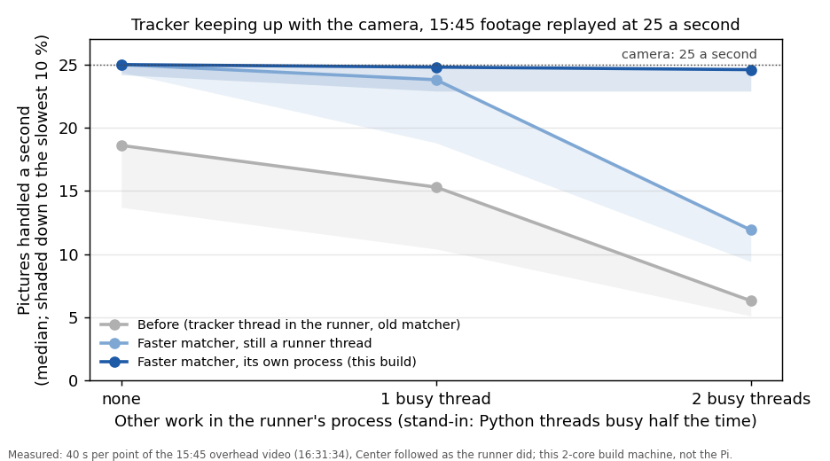

# The camera tracker in its own process, every robot watched, frame saving, the Pi's load logged (MIRLT)

**Premise.** Nick approved this build at 19:03 on 2026-10-25 (estimate 5-6 h). In the 15:45 session the runner's
tracker fell to 10-12 pictures a second once it followed a robot, while the recorder on the same Pi held 25. The
likely cause was the runner's single Python process: the tracker took turns with the runner's other threads for
Python's lock. The camera also followed one robot at a time. The others sat at their last-seen spots, which led to
blocked routes, a collision and stale positions. Built:
1. the tracker in its own process, pictures in shared memory, cores pinned;
2. every parked robot watched in every picture;
3. cpu.csv (per-core load, temperature, throttling);
4. frame saving with a production mode;
5. fusion steering, OFF by default;
6. explore's maths faster. **Not done** (see What's next).

Everything was tested on this 2-core build machine: unit tests, replays of real 15:45 footage, and simulator dry runs.
The Pi and the board were not touched.

**Sources.** 6 min of the 15:45 overhead video (16:31:30-16:37:40, 9,245 pictures, fetched by byte range from release
`e02-session-20261025-154522`, deleted afterwards), its `track.csv` and `e02_state.json`. Bench:
`tools/pi/tracker_proc_bench.py`. Results and chart script: `tools/experiment/analyses_oct25/tracker_process/`.
Tests: `tests/test_e02_tracker_process.py` (32 cases). Dry runs: Appendix A.

## Data

The chart shows how many of the camera's 25 pictures a second the tracker kept up with, as the runner's other work
grows. Only the separate process stays at 25.

**Pictures handled a second**, 15:45 footage replayed at 25 a second with Center followed as the runner did (median,
slowest 10 % in brackets; 40 s a point; this machine):

| Runner's other work | Before | Faster matcher, runner thread | Own process (this build) |
|---|---|---|---|
| none | 18.6 (13.7) | 25.0 (24.4) | 25.0 (24.2) |
| 1 thread busy half the time | 15.3 (10.4) | 23.8 (18.8) | 24.8 (22.9) |
| 2 threads busy half the time | 6.3 (5.1) | 11.9 (9.4) | 24.6 (22.9) |

"Busy threads" stand in for the runner's own work (UDP listener, live page, watchdog, fits). They are not a
recording of it (DOE row).

- **Tonight's session on the Pi** (e02-20261025-211419, started 21:14 on the code before this build) ran at 12 of 25
  pictures a second while following, the same as 15:45 (a live reading, not yet analysed).
- **The tracker's own cost.** Measured in CPU time per picture, one thread, same pictures. The old tracker took
  24.9-34.0 ms, the new one 9.9-11.4 ms, including the parked-robot watch. 60 % of the old cost was the lock-on's
  template matching: OpenCV's call took 2.4 ms per turn tried, about 9 turns a picture. All the turns now go through
  one Fourier transform, with each turn's transform kept. Same formula and same tie-breaking.
- **Same answers.** On 3,000 real pictures the followed robot's positions, the floor memory and the statistics are
  bit-for-bit identical to the old tracker. Tested again on 300 pictures and on synthetic scenes.
- **Every robot, every picture** (real footage, 6 min, 2-3 parked robots at a time):
  - each parked robot's outline was found in every one of the 18,500 robot-pictures (0 "unseen");
  - 0 false moves;
  - the runner's stored parked spots sat 3.4-4 cm from the robots' outlines on every picture, so a move is measured
    from the outline's own place;
  - at 16:31:36 Left's outline jumped about 8 cm by the bottom edge while Left stood still (checked on the video).
    The first version called that a 4.2 cm move. Now a move must also change the picture where the robot stood. That
    call became "outline shifted", and the spot was kept.
- **Simulator dry runs** (Appendix A):
  - tracking error against the simulator's truth: median 0.66 cm with the process against 0.69 cm in the runner (same
    seed);
  - a robot hidden from the camera while parked gave "unseen" after 3.0-3.1 s each time;
  - a help call saved its still and a 13 s clip. The first version also "moved" the hidden robot onto something else
    that appeared nearby. Fixed: no move is ever inferred across an unseen gap ("seen again, unconfirmed").
- **How the camera is shared** (unchanged). The recorder opens the camera and serves every picture at `/live`. The
  tracker process reads `/live`, as the runner's thread did. In a production session there is no recorder, so the
  tracker process opens the camera itself and keeps the camera's own JPEG bytes. The camera is opened once either way.
- **Cores** (run-e02-pi.sh, 4-core Pi): runner and live page on core 0, recorder on core 1, tracker process on
  cores 2-3. With the side camera on, the recorder gets cores 0-1. In production the runner gets cores 0-1.

## Conclusion

1. **The slowdown is fixed on this machine, both ways the 15:45 report suggested.** The faster matcher alone takes
   the tracker to about 25 a second when the runner is quiet. The separate process keeps it at 25 however busy the
   runner gets. On the Pi the old tracker cost about 1.35 times what it costs here (38 against 28 ms). If that ratio
   holds, the new one needs about 15 ms a picture, well inside 40 ms, on two cores of its own. **That is a
   projection.** The next session's perf.csv and cpu.csv will measure it.
2. **Every parked robot is now watched.** The runner is told when one moves (its stored place follows it, and the
   moment is saved as a clip), when it can't be seen for 3 s, and when it is seen again. The runner does not yet
   refuse a route past an unseen robot. That is the next step, below.
3. **Frame saving works end to end in the simulator**: stills, clips that play, thumbnails and events.csv. It is on
   by default beside the video, so the next experiment session tries it. Production (`./run-e02-pi.sh
   --production`) has run only against the simulator's stream: the camera-opening path has never seen a real camera.
4. **Fusion steering is built and OFF** (`--fusion-steer`). It has not run on the real board. One dry run with it on
   is in Appendix A.

## What's next

- **Next real session** (no flags needed). Check:
  - the console says "Camera tracking in its own process (... cores 2,3)";
  - perf.csv: pictures handled about 24-25 a second while a robot is followed (it was 10-12);
  - cpu.csv: no core above about 90 % for minutes, the recorder still at 25 (its frames.csv), the temperature, and
    "throttling: none" in the session's last lines;
  - parked.csv: any "moved" should match something that really happened on the video;
  - frames/events.csv: one row per hold, stop and help call.
- **If the tracker process fails to start**, the runner says so and tracks the old way. `--tracker-in-runner` forces
  the old way.
- **Production**: one short real session with `./run-e02-pi.sh --production` before relying on it (the camera is
  opened by the tracker process for the first time).
- **Route checks against unseen parked robots** (the 15:45 problem in full): treat an "unseen" robot's spot as
  blocked with a wider margin, and ask before driving near it. Not built: it changes the runner's planning, which the
  15:45 fixes just changed.
- **Explore's maths (item 6), not done.** Its fit is mostly OpenCV's homography and PnP searches: 20.6 s and 13.1 s
  of a 48 s profile on the 15:10 data. The plan:
  - search the gyro scale coarse then fine (30 homographies a robot instead of 90);
  - narrow the PnP focal-length sweep;
  - accept only if the 15:10 and 15:45 fits come out the same.
  It is less urgent now: the fit runs in a helper process and no longer slows the camera.
- Run the bench on the Pi with no board (about 30 min):
  `python3 tools/pi/tracker_proc_bench.py --clip <recording folder> --track <track.csv>`.

## Sweep 1: new tests that may now be necessary

1. On the Pi: the bench with cores 2-3 against unpinned, and OpenCV threads 1/2/3 (DOE row).
2. A real camera through `DevicePics` (production): are the camera's MJPG bytes handed over undecoded? Is the frame
   rate 25? Do the clips play?
3. The recorder pinned to one core while two cameras record (it now gets two then; cpu.csv's recorder column).
4. A replay of the 15:45 collision stretch: does the parked watch call the bumped robot "moved", and by how much?
5. A board check: Nick nudges a parked robot 1, 2, 4 and 8 cm (the gate DOE).
6. The tracker process dying mid-session (kill it): the runner restarts it, finds every robot where it was, and
   carries on.
7. `--fusion-steer` on routes on the board against the same routes off.
8. A full-length dry run (hours) with frame saving: disk use, and the 4 GB cap's message.

## Sweep 2: possible inaccuracies in what this relied on

- **Not the Pi.** Every rate here is from a 2-core x86 machine shared with other agents' simulator runs (load 2-12).
  The Pi projection uses one ratio (38/28 ms) from two different stretches.
- **The bench's runner load is a stand-in**: pure-Python threads busy half the time, not the runner's measured thread
  profile.
- **The GIL explanation** is still an inference for the Pi. The bench shows the mechanism, not that it was the 15:45
  cause.
- **Parked-watch numbers are chosen** (gate 8 cm, move 2 cm, 12 pictures, still 1 cm, picture change 12 grey levels,
  unseen 3 s). They were checked on only 6 min of real footage with no real move in it, so missed moves are untested
  on real footage. DOE rows added.
- **The frame-saving window** (10 s before, 3 s after) is Nick's figure plus a choice.
- **Fusion steering's numbers** (camera fresh 0.5 s, spread 3 cm, disagreement 3 cm, board 15 cm) are chosen or taken
  from the real-fusion report's averages, not tuned.
- **Footage times**: frame times come from the recorder's frames.csv. The runner's clock is taken as the same (on_pi)
  minus the usual 0.04 s.
- **Disk numbers for production** (about 700 MB for 2 h) assume an event every 2 minutes.

## Appendix A. Dry runs and replays

All: `e02.py --dry-run --auto --home --skip-naming --skip-find-check --hours 0.3 --view-port 0 --classic-setup
--dry-true-calib --dry-start parks`, each in its own network namespace.

| Run | Extra | Result |
|---|---|---|
| seed 31, process (snapshot) | `--max-runs 1` | 1 run; tracking error 0.66 / 1.12 cm (median / 95th); 3,245 positions, 55 dropped as older than a command; 0 parked events |
| seed 31, `--tracker-in-runner` | `--max-runs 1` | 0.69 / 1.16 cm |
| seed 32 | `--max-runs 2` | 2 runs; 0 parked events, 11 thumbnails |
| seed 35, robots hidden | `E02_SIM_HIDE=Center:100:115,Left:100:400`, `--max-runs 2` | help call saved (still + clip); "unseen" 3.0-3.1 s; first version moved hidden Left twice (fixed, see Data) |
| seed 35 again, robots hidden, integrated on main (after the fix) | as above | a lost hold and a help call, each with a still and a 13 s clip (195 pictures at the simulator's 15 a second, plays in OpenCV); "unseen" 3.1 s twice; "seen again" 0.17 cm from its spot; no moves |
| seed 34, `--fusion-steer` | `--max-runs 2` | 2 runs, tracking 0.77 / 1.93 cm; the combined estimate was never chosen (the camera was always fresh; fusion_steer.csv empty), so steering was the camera's |
| seed 31, integrated on main | `--max-runs 3` | 3 runs, 0 failed; 0.67 / 1.14 cm; 6,210 positions, 51 dropped as older than a command; 0 parked events |

The whole test suite passes on the integrated tree: 443 passed, 18 skipped.

Real-footage replays: `eq.py`-style comparison inside `tests/test_e02_tracker_process.py`
(`E02_TRACKER_CLIP=<folder>` runs it on a clip). The 6-minute parked replay printed the status counts quoted in Data.

## Appendix B. What changed where

- New: `e02_trackproc.py` (process, sources, runner-side `ProcFeed`/`ProcTracker`); `e02_shmframes.py` (picture
  ring); `e02_alltrack.py` (faster matcher, parked watch); `e02_framesaver.py`; `e02_cpulog.py`; `e02_fusesteer.py`;
  `e02_trackwire.py` (the runner's calls); `tools/pi/tracker_proc_bench.py`.
- `e02.py`:
  - the feed and tracker come from `e02_trackwire`;
  - `--tracker-in-runner`, `--production`, `--save-frames`/`--no-save-frames`, `--fusion-steer`, `--cpu-log-s`;
  - marks become frame-saving events;
  - setup's camera check and the recorder check skip the recorder in production.
- `e02_view.py`: a Note tap is an event.
- `camrec.py`: `--cores`.
- `run-e02-pi.sh`: cores, and `--production` (no recorder; uploads logs and frames).
- `e02_camera.py`: unchanged. Its tracker is subclassed, not edited.
