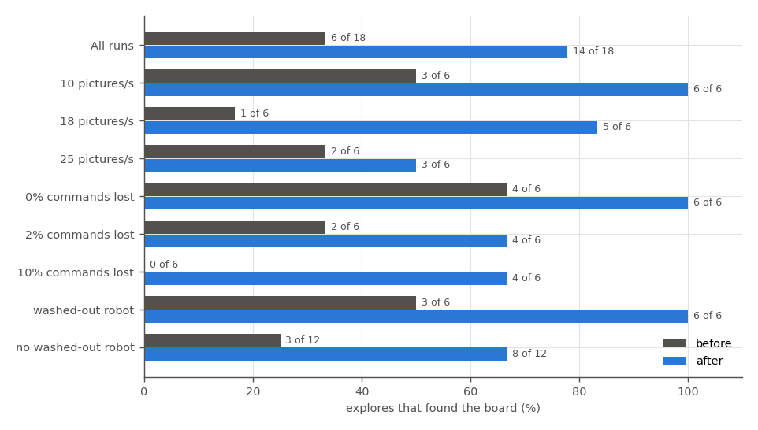
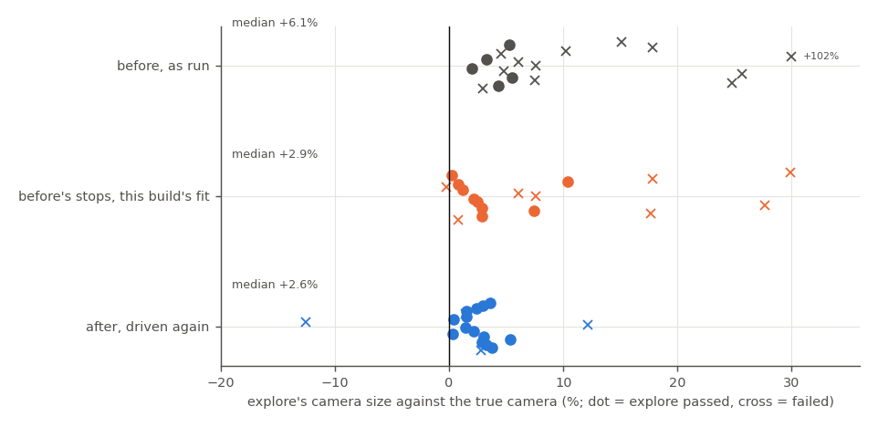
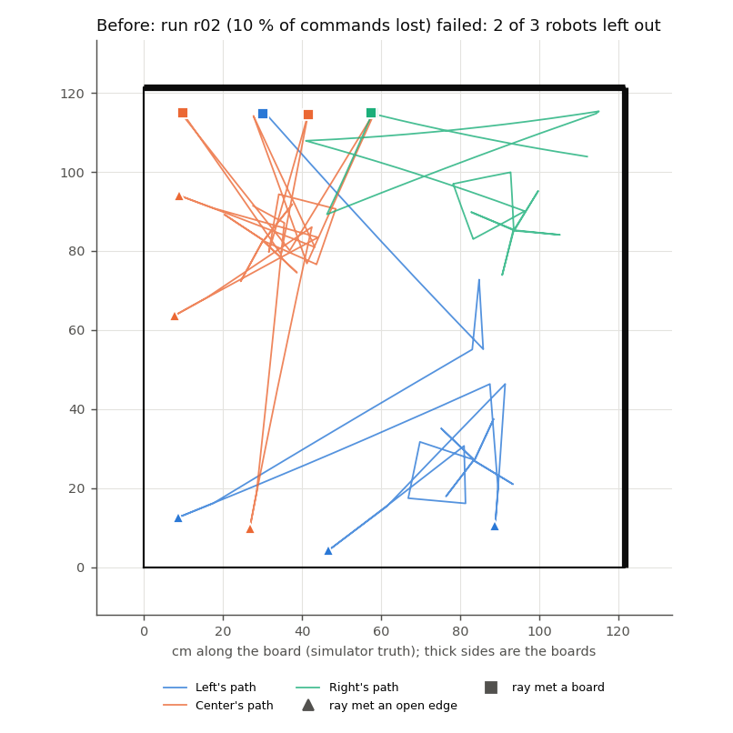
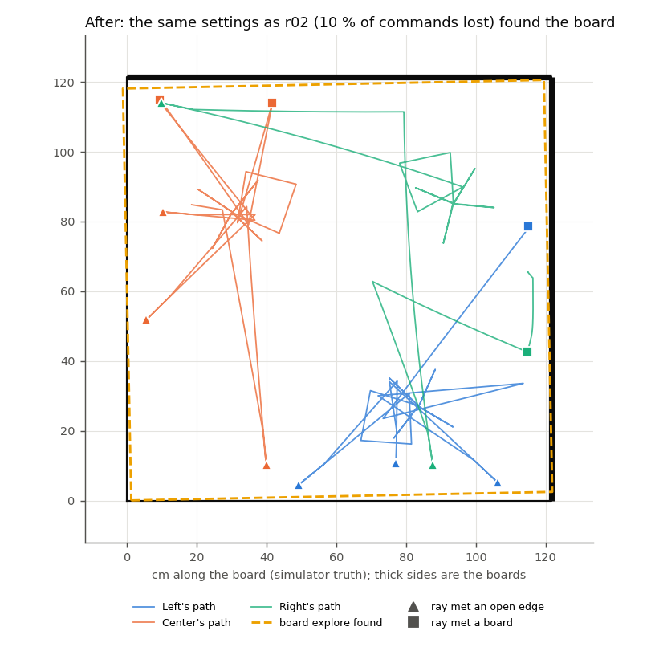

# Explore reliability in the simulator (MIRLT): why explore failed 2 runs in 3, what was fixed, and the shutdown crash

**Premise.** Explore is the stage where the robots drive rays to find the board's edges and boards, and fit the
overhead camera's floor calibration from their own paths. It failed on the real board in the last three explore sessions
(the outline at 10-26 10:44 was the stored calibration, not explore's). In the simulator it passed 2 of 7 runs
in the [runner fixes build](e02-oct26-runner-fixes.md), once with a board 12 % too wide; the real
[09:55 session](e02-oct26-session-0955.md) made the board 11 % too small from Center's path alone, touching one side;
[21:14](e02-oct25-session-2114.md) and [15:10](e02-oct25-session-1510.md) failed on the fit and on the sides. This
study ran explore-only dry runs, found the causes against the simulator's truth, fixed the clear ones, and ran the
same 18 settings again. It also fixes the crash at shutdown in the camera-tracking code. Simulator and logs only; the
Pi and the robots were not touched.

**Sources.**
- 18 explore-only dry runs before the fixes and the same 18 settings after (`--dry-explore-only`, new: the session
  ends at explore's result). Settings: seeds 201-218; camera 10 / 18 / 25 pictures a second; 0 / 2 / 10 % of
  commands lost; a washed-out robot in 6 runs; 6 start layouts (parks, scatter, corners, edge, the 15:10 spots, the
  21:14 corner), each 3 times. Each run scored against the simulator's truth (true robot paths, true camera, true
  board). Appendix A.
- Offline replays of explore's fit on every run's recorded stops, with and without each fit change (`evalfits.py`).
- The real sessions' logs from the GitHub releases (Oct 24 x4, Oct 25 x3, Oct 26 09:55), against the stored roam1
  calibration.
- Scripts: `tools/experiment/analyses_oct26/explore_reliability/` (Appendix B). 9 new unit tests in
  `tests/test_e02_explore_reliability.py`. The whole suite on the final code:
  684 passed, 18 skipped (`tools/experiment/tests`, `tools/sim/tests`, `tools/pi/tests`, 11.7 min).

## Data

### 1. Before: explore found the board in 6 of 18 runs

Share of the 18 explore-only dry runs that found the board, by camera speed, command loss and washed-out robot,
before and after this build's fixes (data: the runs' `e02_state.json` scored by `exsum.py`).

| Before (18 runs) | Result |
|---|---|
| Found the board | **6** (33 %); 0 of 6 at 10 % command loss, 0 of 3 in the corners layout |
| Its camera's size against the true camera | 2-5.5 % too big on the passes; 6-102 % off on the failures (median of all 6 %) |
| Board size on the passes | within 5 % in 5 runs; **8.8 % too wide** in one |
| Sides the robots really touched (true contact places) | all 4 in 16 runs, 3 in 2 |
| Robots whose paths the fit used | 3 in 8 runs; 2 in 5; 1 in 4; none in 1 |
| Why the 12 failures stopped | the fit missed by 9.8-18 px (6); one robot or none left (5); the sides did not hold together (3, with overlaps) |
| Time | 11.6-19.1 min (median 13.8) |

The robots reached every side in nearly every run. Explore failed because it could not **use** what they found: a
robot's path was wrong somewhere, the fit then either missed or left that robot out, and its contacts went with it.

### 2. What was wrong in the paths

Each explore leg's own record (distance, turn) against the simulator's truth for the same two stops (`causes.py`,
`legcheck.py`):

| Fault | Runs (of 18) | What it looks like | Where it came from |
|---|---|---|---|
| **Wheels counted, body did not move** | 18 | a 3 cm creep step counted, 0.3 cm moved, 3-4 times in a row; a 105 cm ray counted, 65-92 cm moved; a hang at an edge (26 cm counted, 17 moved) | the slanted creep into a board: the bumper's corner touches before the front sensor reads 3 cm, the wheels slip ("crept 11.6 cm and met neither", also in the real 21:14 log); a ray against a board or robot the front sensor missed; a hang at an open edge |
| **A move recorded as nothing** | 8 (all with commands lost) | a 175 deg turn, an 11 cm back-out, a 72 cm ray recorded as 0 | a leg resent with the same id is answered `dup`; arriving after the leg's own `done`, it replaced it (the runner took the newest record); and a ray whose start record was lost was taken as no move |
| A washed-out robot's spot jumping | 6 (by design) | stops 40-170 px off | the camera; already handled by the lights (runner fixes C2) |

One such leg is enough: in seed 49 (a trial run) a single hang leg pushed Left's wheel scale to the fit's bound
(0.82 against a true 1.03) and made the camera 12.6 % too big; correcting that one leg and the creeps from the truth
brought it to 3.6 %. With separate wheel scales per robot and a camera fitted at the same time, the robots' scales
and the camera's perspective trade off, so a wrong leg moves the camera's size, not just one robot.

### 3. The 11-12 % size errors have two different causes

Explore's camera size against the true camera for every run, in %: before as run, the same recorded stops refitted
with this build's fit, and the runs driven again after (data: `exsum.py`, `evalfits.py`).

- **Simulator (the 12 % wide board, the 7-25 % failures):** the overcounted legs above. The fit absorbs them into a
  robot's wheel scale and the camera's size.
- **Real 09:55 (11 % small, one side touched):** not the wheels. Center's own path matched roam1 at scale 1.000;
  explore's camera was right **where Center drove** (2.7 % at its own stops) and **12.5 % off over the whole board**.
  Center's 41 stops covered one 47 x 52 cm corner, and from there a camera tilted 22.9 deg (roam1: 8.8 deg) fits as
  well as the real one: the error is in the part of the board no robot visited. A prior that the camera looks
  roughly down fixes this one case (0.3 %), but the two-robot rule (runner fixes C8) already refuses one-robot fits,
  so the prior is left off (DOE row).
- **Robot outline size cannot be the scale check:** the outline reads 1.68-1.71 x the robot on the real board both at
  15:10 (camera right within 3 %) and at 09:55 (12.5 % off), because it is measured where the robot is, where the fit
  is right anyway. The board's known size can (section 4, change 6).

### 4. What changed (ranked by expected effect)

| # | Change | Where |
|---|---|---|
| 1 | **Leg repair.** After a first fit, a leg that could have overcounted (ended against something, a ray that drove its full length, a creep step, a lost record) and that the camera saw much shorter than the wheels counted (by 1.5 cm and under 75 %, or 8 cm and under 85 %, against the robot's own other legs) becomes a free length in the fit, between 0 and what the wheels counted. Not when the next leg is off too (that is a wrong camera spot, after-batch r07). The robot check retries with such legs taken at the pixels' length. | e02_explore.py `repair_legs`, `robot_check` |
| 2 | **No lost moves.** A done or failed record wins over a later `dup` for the same leg; a leg whose record never arrived, or answered only `dup`, is taken as told (a drive by the camera's move) and marked lost; a failed leg with no start record uses its final record (an exploring robot has no pose, so that is the leg's own move). Lost legs are free in the fit too. | e02.py `Listener.leg_final`, `explore_stop` |
| 3 | **Stalled creep = a board contact.** A creep step the camera saw move under 40 % of its wheels' count ends the creep as a blocked side met at the bumper (6 cm ahead), and the step is taken at the camera's length. | e02.py `explore_creep`, `explore_creep_stalled` |
| 4 | **Each robot's wheel scale near 1** (prior, sd 4 %). Stops the robots' scales and the camera's perspective trading off. | e02_explore.py `S_PRIOR_SD_LOG` |
| 5 | **Left-out robots' contacts count**, placed by the fitted camera when the camera's length of that ray agrees with the wheels within 25 % (09:55: 8 board contacts from Left and Right went uncounted). | e02_explore.py `contacts_seen` |
| 6 | **The board's known size as the last check:** a side more than 6 % off the plywood's 122 cm is not trusted (more rays, then the fallback). A wrong board is worse than the fallback, which says what it uses. | e02.py `EXPLORE_SIZE_CHECK_PCT` |
| 7 | **Gap rays:** up to 2 rounds (was 1), given first to the robots the fit used. | e02.py `explore_gap_rays` |
| 8 | The edge guard's learned reach is dropped when it breaks sides that held as met (after-batch r04: one edge moved 7.6 cm). | e02.py `_explore_finish` |
| 9 | Every explore try is kept in the state (`setup.explore_tries`: the fitted camera, robots used and left out, contacts, why it failed), so failed ones can be scored afterwards. | e02.py `explore_finish` |

"Not ending explore until 3 sides are touched, or asking": the truth showed the robots touch all 4 sides in 16 of 18
runs, so the limit is not touching but using them; change 7 adds rounds, and asking is left as a question.

### 5. After

Over the same 18 settings, with the fixes 1-5 and 7 (the code at the batch's start):

| | Before | After |
|---|---|---|
| Found the board | 6 of 18 (33 %) | **14 of 18 (78 %)** |
| At 10 % of commands lost | 0 of 6 | 4 of 6 |
| All 3 robots' paths used | 8 runs | 15 runs |
| Camera size on the passes (median, against the truth) | 4.6 % big | 2.6 % big |
| Board size on the passes, worst side | median 3.4 %, worst 8.8 % | median 3.0 %, worst 7.4 % |
| Time | median 13.8 min | median 13.8 min |

Run r02 before the fixes (10 % of commands lost): each robot's true path, every ray end that met a side (triangle:
open edge, square: board) and the true board (thick sides are the boards); two robots were left out and explore failed
(data: the run's `e02_state.json` stops at the simulator's true places, `truth.csv`).

The same settings after the fixes: all three robots used; the dashed outline is the board explore found, placed on the
true board, within 1.7 % (data as above).

**Final code: all 18 settings found the board**, the 12 from the after batch plus the 6 settings run again on the
final code (below), each with all 3 robots and no move recorded as nothing. That is 18 of 18 against 6 of 18, with
the caveat that 12 of the 18 ran on the code one step before the final (Sweep 2).

**The 4 failures after, and what each led to:**

| Run | Why | Change it led to | The same settings on the final code |
|---|---|---|---|
| r04 | the fit was right (2.3 px, all 3 robots); the edge guard's learned reach moved one open edge 7.6 cm and its ray ends stopped agreeing | change 8 | **found**, -3.3 / -1.9 %, 3 robots (the size check also refused one 9 % off try, and the next round passed) |
| r07 | a ray that ended at an edge with its start record lost went in as no move (72 cm driven): Left left out; then the leg repair took two good 105 cm rays the first fit saw short | change 2 (the failed-leg case), the repair only for legs whose next leg agrees, and change 6 (offline, this run would have "found" a board 15 % short) | **found**, -4.8 / -2.1 %, 3 robots |
| r08 | an 85 cm ray recorded as no move (same cause): two robots left out | change 2 | **found**, +0.4 / +1.4 %, 3 robots |
| r17 | 15 contacts, one side's 2 ray ends disagreed | none yet (What's next 3) | **found**, -3.1 / -3.3 %, 3 robots (this time; nothing aimed at it changed) |

The settings that were affected by the final changes (r00: a board 7.4 % tall, now refused by change 6; r11) were run
again too: both **found** the board (r00 +3.2 / +1.7 %, r11 +2.8 / -0.8 %), 3 robots each. The other 12 were not driven again; their recorded stops refitted offline with the final fit
all still found the board within 5 %.

**Offline, the fit changes alone** (the before runs' own recorded stops, refitted): 5 → 9 of 18 found the board, and
the camera's size error fell from a median 6.1 % to 2.9 %. The rest of the gain after needed the driving changes (no
lost moves, the stalled creep, gap rounds), which only a driven run can test.

**The real sessions refitted offline with this build's fit:** 15:10 still lacks a side (1 ray on one side), 21:14
still misses by 8.7 px with Left out (it hung), 09:55 is still one robot. On real data the fit changes alone do not
turn a failure into a pass; the driving changes are what those sessions needed, and they need the board to confirm.

### 6. The shutdown crash (exit 139)

**Cause:** numpy's views on the shared picture memory do not keep it mapped. When the runner closed its ring while
another of its threads was still reading a picture, that thread read unmapped memory and the process died with a
segmentation fault, after the session was saved. Reproduced 6 times in 6 with a reading thread and `close()`.

**Fix:** every read, write and close of the ring takes one lock; after close every read returns nothing.
Reproduction afterwards: 6 of 6 clean, plus a unit test that runs it 3 times in a subprocess. None of the about 50 dry
runs of this study crashed at shutdown (the crash was 1 in 12 in the last build, so this is not evidence alone).

## Conclusions

1. **Explore failed in the simulator because it threw away what the robots found, not because they found too
   little.** The robots touched all four sides in 16 of 18 runs. Explore found the board in 6. Two faults in the
   robots' own records did it: the wheels counting while the body did not move (a slanted creep into a board, a ray
   against something, a hang at an edge: every run), and moves recorded as nothing when a resent leg's `dup` answer or
   a lost record replaced the real one (8 runs, all with commands lost). Either one wrong leg bends a robot's path, so
   the fit misses or leaves the robot out, and its contacts go with it.
2. **After the fixes, explore found the board in 14 of the same 18 settings (33 % → 78 %)**, 4 of 6 at 10 % command
   loss (was 0), with all three robots used in 15 runs (was 8). With the last three changes, the 6 settings they touched all found the board too, so
   **on the final code every one of the 18 settings found the board** (12 of them from the after batch, one step
   before the final code). Boards within 5 % on every final run.
3. **The 11-12 % size errors were two problems.** In the simulator, overcounted legs pulled the camera's size (now:
   2.6 % median, a 3 % bias from the wheels themselves remains). On the real board at 09:55, one robot's stops covered
   one corner, so the camera was right there and 12.5 % off over the rest; the two-robot rule already refuses that
   fit. The robots' outline size cannot check the scale; the plywood's known size now does (6 %).
4. **On the real sessions' stops, the fit changes alone do not turn a failure into a pass.** Those sessions failed for
   driving reasons (a missing side, a hung robot, one robot left). The driving changes (no lost moves, the stalled
   creep, more gap rays) are simulator-tested only: **a board session is needed to confirm them.**
5. **The shutdown crash is fixed:** a reading thread could touch the shared picture memory after it was closed; every
   access now takes one lock. Reproduced 6 of 6 before, 0 of 6 after; no crash in about 50 dry runs.

## What's next

1. **A real explore session** (the next board session, `--home`, explore from scratch): read `setup.explore_tries`
   (every try's fit, robots used, contacts, why), `explore_lost_records`, `explore_creep_stalls`, and whether the
   board passes the 6 % size check. This is the confirmation the simulator cannot give.
2. The DOE rows (doe-backlog.md, "Explore reliability"): repair thresholds, the wheel-scale prior, the stall share,
   gap rounds, the size check, all on the recorded stops first (no driving).
3. The one remaining simulator failure kind: sides with 2 disagreeing ray ends (r17). A rectangle fit that weighs
   each side's ends by how straight the ray met it, or one more targeted ray at that side.
4. The ray that drives its full 105 cm into a slanted board (wheels slipping for 30-40 cm before the leg ends): the
   stuck check could end it early in explore too (it watches only while a leg should still be running).
5. The real 09:55 one-corner case: a robot left in a corner is refused (two-robot rule); a camera-looks-down prior
   would make one robot enough. Worth it only if two robots often cannot both pass.

**Questions for Nick**

*Substantive*
1. **The plywood's size is now a check on explore** (a side more than 6 % off 122 cm is not trusted; more rays, then
   the fallback). That uses a fact about your board that explore was meant to find by itself. My assumption: a check
   is fine, as long as explore's own measurement is what is used. If the board will change size, the check is set
   by `EXPLORE_SIZE_CHECK_PCT` (0 turns it off), or it could read the size from a setting.
2. **When explore still lacks a side after two rounds of gap rays, it falls back** (the stored calibration, said
   plainly). The alternative you suggested, asking you which side is missing, is not built: in this batch the robots
   reached all four sides in 16 of 18 runs, so the gap was using them, not reaching them. Do you want the question
   anyway (one hold, with the picture), or keep the fallback?
3. A creep that stalls is now called a board met at the bumper. Next to a robot rather than a board, that contact is
   dropped by the existing "near another robot" rule; next to an object on the board that is not a board, it would
   count as a board. My assumption: nothing else stands on the board during explore. If it can, the stall should be
   "blocked, not a side".

*Other*
4. The baseline batch ran on a copy of the code before this build, and the after batch on the code at its start; the
   last three changes were checked by rerunning only the 6 settings they touched (and the others' stops offline).
   A full third batch would take 2 more hours of machine time; say if you want it.
5. Time: estimate 3 h, actual about 6.8 h (12:40-19:30), most of it machine time (about 50 dry runs at 2 shared
   cores, one at a time per core).

## Sweep 1: new tests that may now be needed

- **A real explore from scratch** with the fixes (the confirmation; What's next 1), ideally with 3 robots and one
  put near a board at a slant, to see a stalled creep called on real plywood.
- **The stalled creep on the board:** slanted creeps into a board at 30 / 45 / 60 deg; does the camera see 40 % or less
  of the counted step every time, and is the bumper's 6 cm right (a ruler)?
- **A lost or resent leg on the real link:** with firmware 26a, how often a leg's `dup` comes after its `done`
  (`link.csv` and the robots' `leg.csv`); this build makes it harmless, the count shows how often it happened.
- **The size check on the real board:** explore's W and H against the plywood; are the open edges' lines where the
  6 % allows?
- The leg repair on real stops: the 15:10 and 21:14 replays repaired 3 legs each; their true lengths are in the
  overhead video (frame pairs at each stop).
- A dry run with a robot whose start pose is kept from an earlier session (`--dry-kept-pose`): change 2 now trusts a
  failed leg's final record when its start record is lost, which is right only for a robot with no pose.
- A one-robot explore (`--robots Right`), as the runner fixes report already asked.

## Sweep 2: possible inaccuracies in what this relied on

- **Simulator only.** Every number here is the simulator's truth; the real board has its own leg faults (the
  simulator's slip, stall and hang are models: wheels keep 96 % of their speed against a board, a hang is set at the
  centre of mass passing the edge).
- **Same settings, not the same runs.** The simulator is not deterministic for a given seed (timing, the link), so
  "the same 18 settings" is a paired comparison of conditions, not of identical runs. One run per setting: each
  condition's rate (e.g. 4 of 6 at 10 % loss) rests on 6 runs.
- **Two cores, shared.** Two simulators ran at once, and offline replays beside them; one baseline run (r12, set to
  18 pictures a second) ran at 10.
- **The after batch is not the final code** for 12 of 18 settings; those were checked offline (their recorded stops
  refitted), not driven again.
- **Chosen numbers, not derived:** the repair's 1.5 cm / 75 % and 8 cm / 85 %, the next-leg check's 1.25 and half-as-much
  rule, the wheel-scale prior's 4 % and weight 3, the stall's 40 %, the bumper's 6 cm, the 25 % agreement for
  left-out robots' contacts, 2 gap rounds, the 6 % size check. Each has a DOE note in the code and a row in
  doe-backlog.md. The analysis's own 15 cm "touched a side" and 8 cm reach (exsum.py) sort contacts for this report only.
- **The repair rules were tuned on the batch they are tested on** (seed 49, the before runs, after r07). The confirmation
  reruns were driven after, but on settings the tuning had seen.
- **"Camera size against the truth"** is a similarity fit over a 10 cm grid of the board at robot-top height; it
  mixes a uniform size error with the shape error, which is small (median residual 1-1.5 cm).
- **Real-session comparisons use roam1** as the truth, which has its own error (its right line 4 cm inside the drop,
  21:14 report).
- **The `dup` cause is inferred**, not read from the robots' records: the runner's log shows the same leg id sent
  twice in every baseline run with lost moves (1-8 a run, counts within one of the lost moves), but the
  batch kept only the runner's files, not the robots' `leg.csv`.
- **r17 passed on the final code with nothing aimed at its failure**; its pass is chance as much as fix.
- **The crash fix is checked by a reproduction**, not by the dry runs: the crash was intermittent (1 in 12).

## Appendix A. The runs

Explore-only dry runs: `e02.py --dry-run --auto --home --skip-naming --skip-find-check --new --dry-explore-only
--board-sides 1,1` plus each row's settings (`--seed`, `--dry-camera-fps`, `--dry-drop-pct`, `--dry-start`,
`--dry-low-contrast ROBOT@150-100000`), each in its own network namespace, two at a time on 2 cores. Before: a copy of
the code at d80c4e3 with only the explore-only stop and the try records added (13:10-16:05). After: the code with
fixes 1-5 and 7 (16:13-18:34). Final: the final code, the 6 affected settings (18:41-19:30; r17's first start failed
in the simulator's own start-up, "not heard from Right", and was run again). Board size: explore's W / H against the
true board, %; camera: its size against the true camera.

| Run | Seed | Pictures/s | Lost % | Start | Washed out | Before | After | Final code |
|---|---|---|---|---|---|---|---|---|
| r00 | 201 | 10 | 0 | parks | - | failed: fit missed by 18.1 px; 2 robots, 13 min | found, +3.4 / +7.4 %, camera +3.6 %, 3 robots, 10 min | found, +3.2 / +1.7 %, camera +3.8 %, 3 robots, 12 min |
| r01 | 202 | 10 | 2 | scatter | Center | found, +0.2 / +2.3 %, camera +5.3 %, 3 robots, 12 min | found, -3.0 / +2.7 %, camera +3.0 %, 3 robots, 11 min | as after |
| r02 | 203 | 10 | 10 | corners | - | failed: Right alone fitted; 1 robot, 13 min | found, +1.7 / -0.3 %, camera +2.4 %, 3 robots, 12 min | as after |
| r03 | 204 | 18 | 0 | edge | - | failed: sides did not close; 2 robots, 19 min | found, +4.1 / -2.2 %, camera +1.6 %, 3 robots, 15 min | as after |
| r04 | 205 | 18 | 2 | s1510 | - | failed: sides did not close; 2 robots, 13 min | failed: sides did not close; 3 robots, 13 min | found, -3.3 / -1.9 %, camera -0.0 %, 3 robots, 11 min |
| r05 | 206 | 18 | 10 | s2114 | Left | failed: Left alone fitted; 1 robot, 17 min | found, -2.4 / -3.4 %, camera +1.6 %, 3 robots, 15 min | as after |
| r06 | 207 | 25 | 0 | parks | Right | found, -4.9 / +1.6 %, camera +3.3 %, 3 robots, 14 min | found, -4.2 / -0.5 %, camera +0.4 %, 3 robots, 14 min | as after |
| r07 | 208 | 25 | 2 | scatter | - | failed: sides did not close; 2 robots, 14 min | failed: sides did not close; 2 robots, 16 min | found, -4.8 / -2.1 %, camera +0.5 %, 3 robots, 14 min |
| r08 | 209 | 25 | 10 | corners | - | failed: Left alone fitted; 1 robot, 14 min | failed: Center alone fitted; 1 robot, 18 min | found, +0.4 / +1.4 %, camera +3.0 %, 3 robots, 19 min |
| r09 | 210 | 10 | 0 | s1510 | - | found, +1.0 / -0.7 %, camera +2.0 %, 3 robots, 13 min | found, -0.4 / -0.8 %, camera +1.4 %, 3 robots, 12 min | as after |
| r10 | 211 | 10 | 2 | s2114 | - | found, +8.8 / -0.9 %, camera +4.8 %, 3 robots, 13 min | found, -2.3 / +0.4 %, camera +2.1 %, 2 robots, 14 min | as after |
| r11 | 212 | 10 | 10 | edge | Center | failed: fit missed by 9.9 px; 2 robots, 15 min | found, -0.5 / -5.0 %, camera +0.4 %, 3 robots, 19 min | found, +2.8 / -0.8 %, camera +3.1 %, 3 robots, 14 min |
| r12 | 213 | 18 | 0 | scatter | Left | found, +2.7 / +4.2 %, camera +5.5 %, 3 robots, 12 min | found, +3.1 / +0.6 %, camera +3.0 %, 3 robots, 15 min | as after |
| r13 | 214 | 18 | 2 | corners | - | failed: fit missed by 9.8 px; 3 robots, 15 min | found, +2.3 / +1.7 %, camera +5.3 %, 3 robots, 11 min | as after |
| r14 | 215 | 18 | 10 | parks | - | failed: fit missed by 12.9 px; 1 robot, 18 min | found, +1.0 / -2.9 %, camera +2.9 %, 3 robots, 13 min | as after |
| r15 | 216 | 25 | 0 | edge | - | found, +2.5 / +0.8 %, camera +4.3 %, 3 robots, 16 min | found, +1.8 / -0.6 %, camera +3.2 %, 3 robots, 11 min | as after |
| r16 | 217 | 25 | 2 | s1510 | Right | failed: no robot fitted; 0 robots, 14 min | found, +0.6 / -0.3 %, camera +3.7 %, 3 robots, 14 min | as after |
| r17 | 218 | 25 | 10 | s2114 | - | failed: fit missed by 10.5 px; 3 robots, 16 min | failed: sides did not close; 3 robots, 14 min | found, -3.1 / -3.3 %, camera +1.8 %, 3 robots, 14 min |

Also: 2 trial runs (seeds 48, 49: the hang leg found in 49), 1 smoke run of the first fixes (r02's settings: found),
and 4 runs of a first after batch, stopped when the `dup` cause was found (3 found, 1 failed on lost moves). Every
run ended with the explore-only exit; none crashed at shutdown.

## Appendix B. Scripts

All in `tools/experiment/analyses_oct26/explore_reliability/`:
- `exsum.py`: one run scored against the truth (pass, fit, camera scale, board size, sides touched, legs off).
- `causes.py`, `legcheck.py`: each leg's own record against the truth (lost and overcounted legs).
- `evalfits.py`: explore's finish replayed offline on a run's recorded stops under fit variants.
- `refit.py`, `tiltprior.py`: single fits under priors (the tilt and focal-length tests).
- `realdiag.py`, `replay0955.py`, `realreplay.py`: the real sessions' explore stops against roam1.
- `figs.py`: the figures.
- The batch runner and plan (`batch.py`, `plan.json`, one network namespace per run) were scratch files; the plan
  is Appendix A's table.
