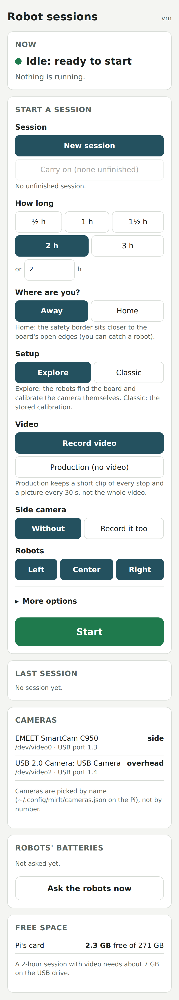
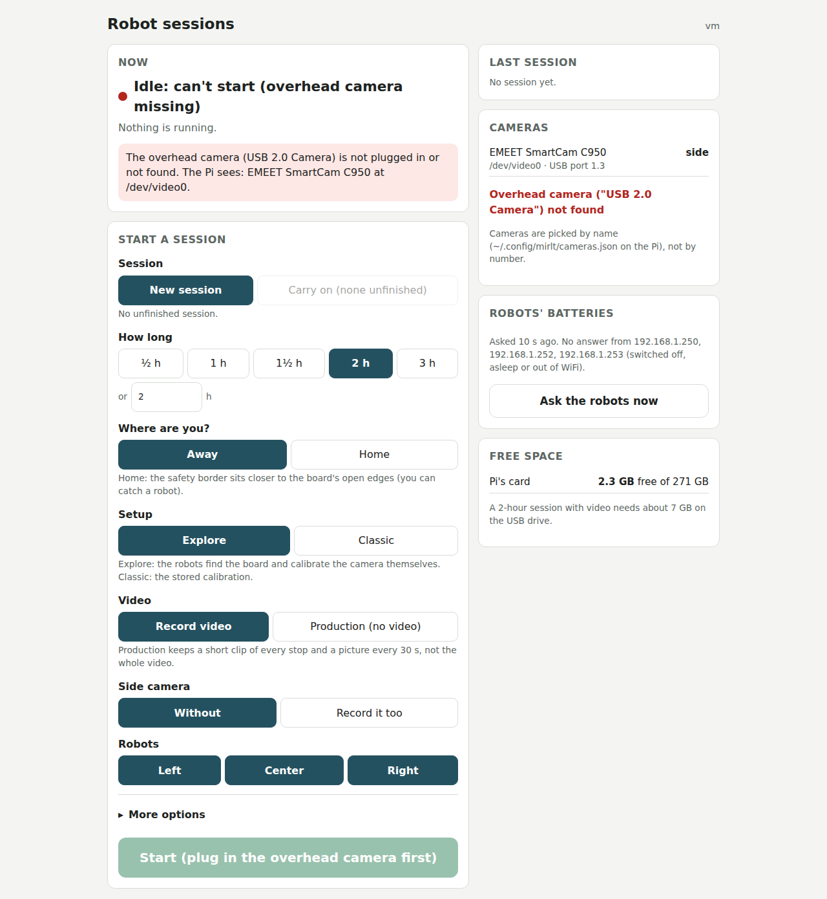
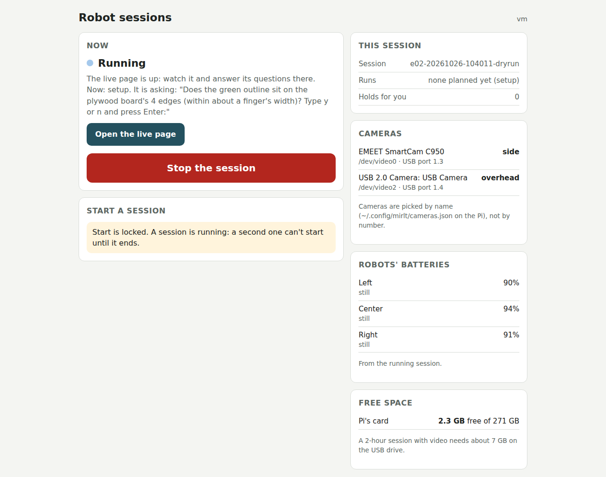
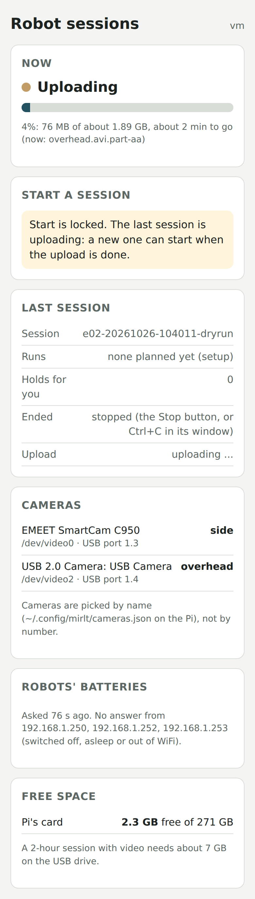
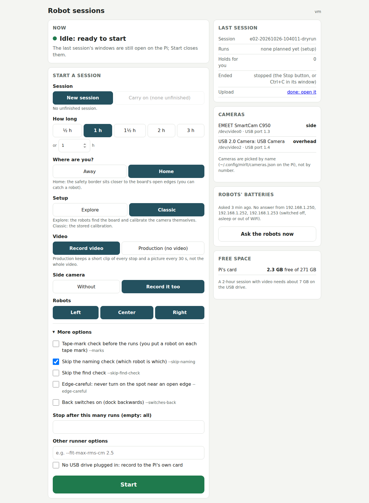

# Start page: robot sessions from a phone, cameras by name (MIRLT, 2026-10-26)

**Premise.** Nick approved this at 09:38 on 2026-10-26. He wants to start and stop Pi sessions from a web page,
without PowerShell or Claude. Separately, after a Pi restart that morning the camera numbers swapped, and the runner
opened the side camera as the overhead. Built and tested in this container against the simulator only. The Pi was not
touched (a real session was running on it).

**What was built.**

| Part | File | What it does |
|---|---|---|
| Start page | `tools/pi/launcher.py` | A small always-on web server (systemd, starts at boot). Start with options, Stop, status, upload progress, last session, disk, cameras, batteries. PIN, home network and Tailscale only. |
| Cameras by name | `tools/pi/camnames.py`, `run-e02-pi.sh` | Finds each camera's `/dev/video` number from its name; `~/.config/mirlt/cameras.json` says which name is overhead and which is side. `OVERHEAD_DEV` / `SIDE_DEV` still override. |
| One-time install | `tools/pi/install_launcher.sh` | Saves the camera names, asks for the PIN, writes the systemd service, prints the addresses. |
| Upload progress | `tools/pi/upload_session.py` | Writes `~/.local/state/mirlt/upload.json` (bytes sent, current file, link) for the page. Output unchanged. |
| Runner hook | `tools/experiment/e02.py` (2 lines) | `--new`: skip the "carry on the unfinished session?" terminal question (the page asked already). |
| Live page link | `tools/experiment/e02_view.py` (2 lines, own commit) | "start page / Stop" link in the live page's header. |

**The port design.** Port **8091** is always the start page. Port **8090** (the live page's address, already in Nick's
bookmarks) shows the start page while nothing runs. Just before a session starts, the start page lets go of 8090 so
the runner's live page can open it. A terminal start asks for this too: `run-e02-pi.sh` runs `launcher.py --handoff`,
which does nothing if the page is not installed. The page takes 8090 back once the runner has exited, so the upload's
progress shows there too. Why: one address always shows something useful, and the runner and live page are unchanged.

**How a start and a stop work.** Start runs `run-e02-pi.sh` itself, with `E02_LAUNCHER=1`: no terminal questions,
no window to attach. A page session is therefore the same as a terminal session: tmux `e02`, windows `rec` and `run`,
then the upload. Stop presses Ctrl+C in the runner's window, as Nick would. Every robot stops and everything is saved;
then the window's own chain stops the recorder and uploads. The service uses `KillMode=process`, so restarting the
page never kills a session.

## Data

**Tests.** 33 new unit tests (`tools/pi/tests/test_launcher.py`): cameras by name, including the 2026-10-26 swap; the
script's camera choice, with tmux, git and sleep stubbed; options and refusals; the PIN; and the 8090 hand-over. All
pass. The whole suite (`tools/pi/tests` and `tools/experiment/tests`) on the committed code alone: 512 passed, 18 skipped.

**End-to-end dry runs.** Four passes, each in its own process and network namespace. Each pass ran the real start
page and Chromium (Playwright, desktop 1280 x 900, phone 390 x 844 at 2x). The session script was
`tools/pi/tests/launcher_dry_session.sh`: the same tmux layout and chain as `run-e02-pi.sh`, but the runner was
`e02.py --dry-run --web-ask --view-open`, the recorder a stand-in writing a sparse 900 MB video, and GitHub was stubbed
in the real upload code at 20 MB/s. Final pass (10:40):

| Check | Result |
|---|---|
| Wrong PIN, then right PIN | refused, then in; 5 wrong PINs from one address pause logins for 60 s (unit test) |
| 8090 while idle | the start page |
| Overhead camera unplugged (stand-in removed) | red "can't start" state and message naming what the Pi sees; Start greyed; the server refuses too (409) |
| Start (1 h, home, classic, side camera, skip naming) | confirm box listing the choices; running with the live page up 9-11 s after "Yes, start" |
| A second start from the phone, opened before the first | refused: "A session is starting already." |
| Start while running / while uploading (server) | refused (409) with a plain reason |
| 8090 during the session | the runner's live page, with the new "start page / Stop" link |
| Stop | confirm box; "stopping" at once; the runner logged "Session ended: Ctrl+C"; uploading 22 s after Stop |
| Upload | progress bar with MB and minutes to go; 8090 back to the start page; done 134-138 s after Stop, link shown |
| Ask the robots (none reachable here) | "No answer from 192.168.1.250, .252, .253" after 4 s |

Source: `drive.log` of each pass; 22 s from Stop to upload = the runner's stop and save plus the stand-in's
20 s recorder wait in `upload_session.py --stop-recorder`.

The start page on a phone with nothing running: every option is one tap, and the cameras are listed by name with
their role (data: dry run, stand-in cameras with the Pi's 2026-10-26 names and numbers).

With the overhead camera unplugged, the page says so in red, names what the Pi does see, and will not start (same dry
run, the overhead's entries removed).

During a session: what the runner is asking, a button to the live page, Stop, and the robots' batteries read from the
live page (dry run `e02-20261026-104011-dryrun`).

After Stop, the upload's progress: bytes sent of the session's size, the current file, and minutes to go (stubbed
GitHub at 20 MB/s).

Back to idle: the last session shows how it ended and links to its upload.

All pictures, including the PIN screen, confirmations, the refused second start and the live page's new link:
`docs/screenshots/index.md`, "start page" lines.

**Problems the screenshots found (fixed before the last pass).** (1) A message from a refused start stayed on the
phone through the whole session; messages now clear when the state changes, or after 20 s. (2) "Idle: ready to start"
showed while the overhead camera was missing; that state is now red, "can't start", with Start greyed. (3) During a
session the card said "Last session" about the running one; it now says "This session". (4) The upload bar sat at
0 % with no numbers; it now shows MB and minutes to go. (5) "More options" had no open/close mark. (6) The battery
check read the robot addresses from the test script; it now reads them from `run-e02-pi.sh`.

**Found in passing.** `run-e02-pi.sh --production` never gave the tracker the camera's number: it always opened
`/dev/video0`, whatever `OVERHEAD_DEV` said. It now passes `--camera-device` with the camera found by name.

## Conclusion

1. Nick can start a session from his phone (Tailscale or home WiFi) with: hours; home or away; explore or classic;
   video or production; the side camera; new or carry on; which robots; the five most-used extra options; a run cap;
   other options. Stop ends the session cleanly, and it uploads.
2. A second session cannot start while one is starting, running, stopping or uploading, or without the overhead
   camera (or the side camera, when chosen). The page and the server both check.
3. Cameras are picked by name in the page and in `run-e02-pi.sh`. The 2026-10-26 swap would now pick the right camera.
4. The terminal way is unchanged, apart from the camera choice: by name unless `OVERHEAD_DEV` / `SIDE_DEV` is given.

## What's next

1. Nick installs it after the current session has uploaded (steps in `docs/pi-run.md`, "Once: the start page").
2. First real use: a short session (`½ h`) started and stopped from the phone over Tailscale. Check that the upload
   link appears, and that `http://100.122.222.75:8090` switches to the live page and back.
3. Restart the Pi once to confirm the page comes back by itself and the cameras are still found by name.

## Sweep 1: new tests that may now be needed

- On the Pi: start, Stop and upload from the page with the real recorder and the real camera. The dry runs used
  stand-ins for both.
- Stop during the recorder's 8 s start wait, and during a hold. Only "running at a setup question" was tested.
- Stop on a plan (`--plan`) started from a terminal: Ctrl+C ends only the current stage, and the plan script goes on
  to the next one. The page does not offer plans; it shows "busy" between a plan's stages.
- The page after a Pi restart (systemd, the USB drive mounted later than the page starts).
- Two phones pressing Stop at the same moment (one Ctrl+C is sent; the second is refused as "already stopping",
  checked by unit test only).
- The camera names on the real Pi's sysfs (the USB-port parse was built from the `camrec.py --list` text, not read on
  the Pi).

## Sweep 2: possible inaccuracies in what this relied on

- **Camera names and the picture node.** The page assumes a camera's picture node is its first node (`index` 0 in
  sysfs). This is true for UVC webcams, but was not checked on these two cameras. If the overhead's number comes out
  one too high, that is the cause.
- **"USB 2.0 Camera" is a generic name.** A second cheap camera would have the same name; the page then refuses and
  asks for the USB port in `cameras.json`.
- **The upload's size is an estimate.** It sums the folder sizes before zipping, so the bar can finish below 100 %.
  It then jumps to done.
- **Battery while idle** uses the firmware's `status` reply on port 5005. Robots asleep (the sleep check-in) do not
  answer until their next check-in.
- **Chosen numbers:** port 8091; 120 s hand-off grace; 180 s start timeout; 5 wrong PINs, then 60 s; messages cleared
  after 20 s. Each is a convenience value: any value well above the time it covers works, so a design of experiment
  would not help.
- **Resume with new options.** Carrying on passes the page's options (hours, home, etc.) along with `--resume`, as a
  terminal user would type them. Whether every option takes effect on a resumed session is the runner's behaviour;
  it was not checked here.
- **Access check** trusts the address the Pi sees. Tailscale's 100.64.0.0/10 range is also used by phone carriers
  (CGNAT). That does not matter while the Pi sits behind the home router (nothing from outside reaches it except
  through Tailscale), but it means the PIN, not the address check, is the real guard.
