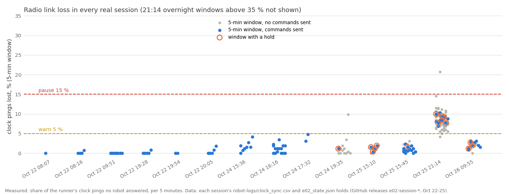
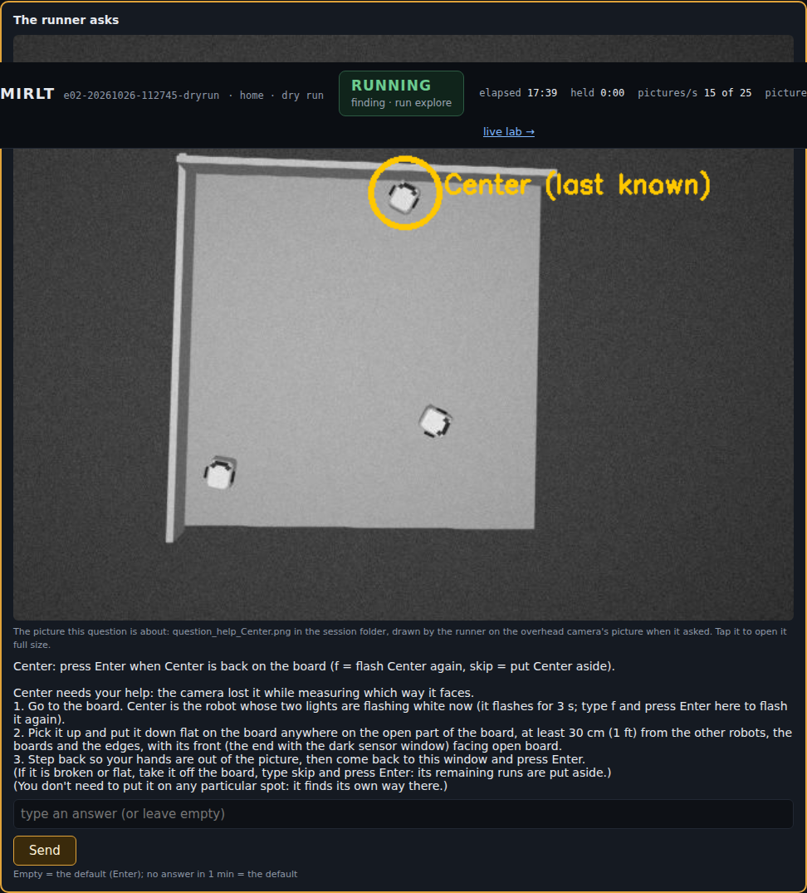
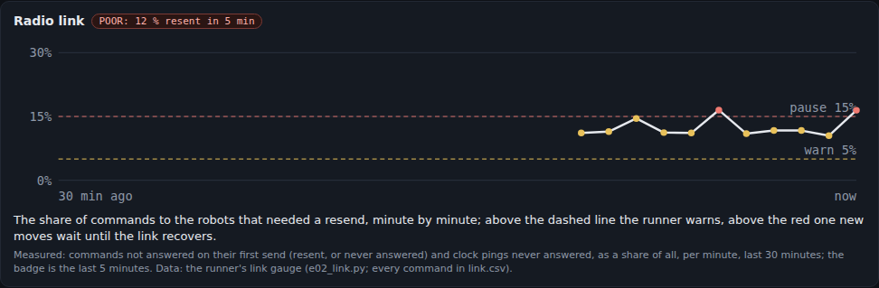
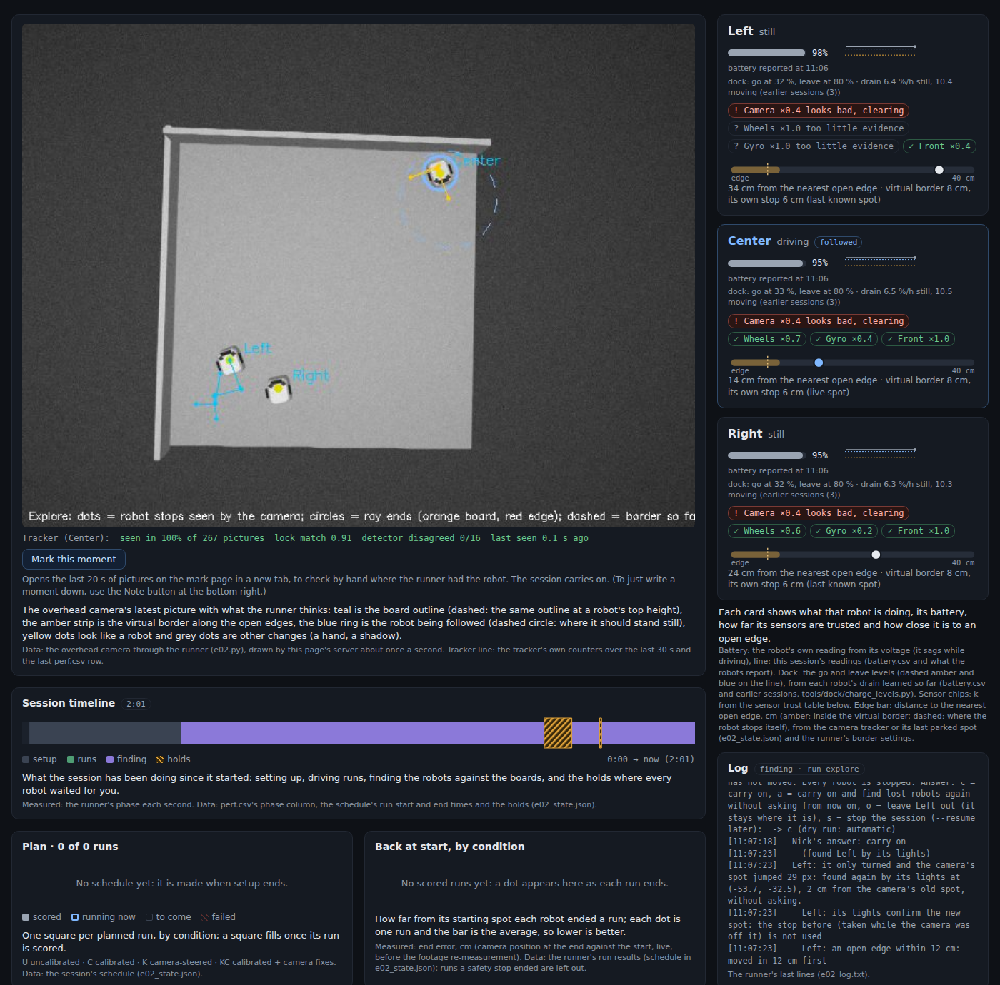

# Runner fixes after the 21:14 session (MIRLT): commands that arrive, back-outs, no turns at an edge, hung robots, parking, rescues

**Premise.** Nick approved this build at 09:38 on 2026-10-26. It covers the fixes the
[21:14 analysis](e02-oct25-session-2114.md) ranked first, with Nick's answers:
- every command numbered, acknowledged and resent; every setting read back; the pause decision based on all past
  sessions' logs;
- back-outs after a robot's own edge stop always allowed; no turn on the spot at or past an edge;
- a tilted or stuck robot stopped at once; parking without the back-and-forth;
- lost commands in the simulator;
- a hold nobody answers rescues its robot instead of ending the session;
- the tape strips along the right and bottom edges are surface, not a drop.

The coordinator added four items from Nick's live session during the build (10:00 to 10:50):
- find a lost robot by its lights before asking;
- accept a camera jump that the lights confirm;
- take the board sides from explore instead of asking;
- name the robot in every question, and put the help call's full text and a picture on the live page.

At 11:55 it added five from the [09:55 session analysis](e02-oct26-session-0955.md):
- never drive a put-aside robot whose position and heading are not known, and decide with its latest position;
- find against a free staging point when a set-aside robot sits in the usual one;
- crawl backwards when a board blocks the heading crawl;
- watch parked robots on every 5th picture;
- explore needs more than one robot's path; three reporting fixes.

Everything was tested in the simulator only. The Pi and its running session were not touched.

**Firmware: bumped to 2026-10-26a. Nick must flash it to all three robots (Left, Center, Right)** before the
numbered commands and the tilt stop work. Flash `firmware/home_lab/home_lab.ino` from the repo at this build's commit
or later; the runner's start lists each robot's firmware and expects 2026-10-26a. Until then the runner still works
with 25c: plain commands as before, plus the settings read-back, the gauge (from clock pings), and every runner-side
fix. The firmware changes are `net.h`, `e02.h`, `motion.h`, `params.h` and the version line in `home_lab.ino`
(Appendix B).

**Sources.**
- Every real session's logs from the GitHub releases (Oct 22 x6, Oct 24 x4, Oct 25 x3, and today's 09:55 session,
  added once it was uploaded). Scripts: `tools/experiment/analyses_oct26/link_loss/` and `.../camera_noise/`.
- 12 dry runs: D1-D8, plus 2 first versions that found bugs (Appendix A).
- 36 new unit tests in `tests/test_e02_oct26_runner_fixes.py` and 1 in `test_e02_tracker_process.py`, plus 9
  existing tests updated for the changed rules. The whole suite passes (Appendix A, last line).
- A tracker bench on 79 s of the real 21:14 overhead video (fetched by byte range):
  `analyses_oct26/runner_fixes/park_every_bench.py`.
- A host-side compile and run of the new firmware command code with stand-in headers.

## Data

### 1. The radio link in every real session

Each dot is one 5-minute window of one session, placed by its share of clock pings that no robot answered. Orange
rings mark windows that had a hold.

| | Normal sessions (Oct 22-26, 13) | 21:14 (Oct 25) |
|---|---|---|
| Pings lost, whole session | 0.0-3.4 % (today 09:55: 1.9 %) | 18.9 % (8-11 % while the robots were awake) |
| Worst 5-minute window with commands being sent | 4.8 % | 10-11 % |
| Holds per hour (windows under 2 % / 2-5 % / 5-15 %) | 3.9 / 1.1 / - | - / - / 8.7 |
| Moves that never reached the robot | 1.1 % (under 2 % windows), 1.8 % (2-5 %) | 10.6 % |
| A lost ping followed by another 50 ms later | 31-43 % of the time | 20 % |

Reply times decide how long to wait before a resend. On the Pi (34,300 answered pings, Oct 24-25):
- median 18 ms;
- 99.9 % within 0.64 s;
- 0.07 % over 1 s.

The laptop sessions of Oct 22 were slower (0.41 % over 1 s).

**What was set from this** (code: `e02_link.py`; reasoning in its header):
- **Resend after 1.0 s.** A slow answer is almost never mistaken for a lost one, and a resend of a command that did
  arrive is answered `dup` and not run again. Six sends span 8 s.
- **Warn at 5 %** of commands needing a resend over 5 minutes. No normal session's window reached 4.8 %.
- **Pause new moves at 15 %, but only when the share is above it by 2 standard errors**; resume when the last 2
  minutes are under 15 %. With resends, a command is lost only if every send is lost. What stays at risk is time: a
  `stop` that needs a resend arrives 1 s late. Stops now go out 3 times under one number, so a stop is late only if
  all three copies are lost. At 15 % that is 0.6-2.8 % of stops, depending on how bursty the loss is. On a normal
  link a single stop was late 1.2 % of the time. So above 15 % the stops are less reliable than before 21:14.
- The 2-error rule came from dry run D3. At a steady 12 % the 5-minute share wandered between 9 and 16 %, and one
  touch of 15 % paused the session with no way back.
- A robot that answers nothing for a minute (switched off, asleep, flat) is left out of the share. Found in review:
  one silent robot of three would have read as 33 % and paused everything.

### 2. What changed

| Item | Change | Where |
|---|---|---|
| 1a | Every command goes as `#<n> cmd`. The robot answers at once with an ACK record and never runs a number it has seen before (the last 64). There is no answer within 1 s → it is resent with the same number. A leg id seen before is answered `dup` before any refusal: before this, a resent leg arriving while the first copy ran was refused "a leg is running", and the runner took that refusal for the leg's own answer. **Firmware 2026-10-26a.** | net.h, e02.h, e02_link.py |
| 1b | Every `set` is confirmed by the robot's own "name = value" words; no match after 1 s → `get`; still no match → sent again, up to 4 times. Moves wait (at most 12 s) until that robot's settings are confirmed. A setting never confirmed is said once, loudly, with a sound. Works on older firmware too. | e02_link.py, e02.py `send` |
| 1c | The lost check counts from the robot's own `started` record (else its answer + 0.35 s), not from the send. A command that has not arrived is not a lost robot. | `leg_started_at`, `lost_why` |
| 1d | `link.csv` logs every command (answered, resent, never answered, read back). The live page has a "Radio link" panel: the share per minute for 30 minutes, with the warn and pause lines. | e02_link.py, e02_view.py |
| 1e | Warn and pause as in section 1. A pause lasting 30 min ends the session like an unanswered hold. | `link_tick`, `link_gate` |
| 2 | The camera border never holds a back-out after the robot's own edge stop. "Right after" now means no turn or forward drive has run since; before, it meant within 30 s, and 21:14's second back-out came after a 104 s hold. "Moving towards / further out" needs 1.5 cm of movement along a straight line fitted through the window's pictures. A robot standing still for 4 h never moved more than 1.52 cm that way; the 21:14 false holds were 0.8 and 1.0 cm. | `border_check`, `backing_out`, `BORDER_JITTER_CM` |
| 3 | Before any turn on the spot during explore: if its own edge guard stopped it and it has not backed 9.5 cm since, or the camera puts its centre within 5 cm of an open edge's line or past it, it first moves straight out (back after an edge stop). If that does not clear it, the turn is not sent. The find-again turns at an edge use the lights only, no turn. | `at_edge_why`, `edge_clear_before_turn`, `_identify` |
| 4 | **Tilt:** the robot's own pitch or roll more than 5° from its level (taken at the compass check) for 0.3 s stops it, and go / turn legs are refused while it lasts (**firmware 26a**). The runner also checks RAW rows when it gets them, then stops the robot and asks Nick. **Stuck:** the wheels should have driven 5 cm or more in the last 3 s, the camera saw it move under 2 cm, and the leg should still be running by its own length and speed. Its lights are looked for first: elsewhere means the camera had lost it (no stop); same place means stuck (held for Nick). | motion.h, e02.py `stuck_why`, `tilt_why`, `hung_stop` |
| 5 | Parking: with the target nearer than 5.5 cm (the 4 cm check drive plus arriving), no turn over 30°. It rolls along its heading instead, and a second change of direction ends the parking as "close enough". | `near_target_leg` |
| 6 | Simulator: `--dry-drop-pct` (commands to the robots lost at random, 0-15 %; the robots' lines a quarter as often). Also `--dry-drop-first` (lose a chosen command), `--dry-low-contrast` (a washed-out robot), `--dry-start s2114` (Left at the 21:14 corner), and a hang model (a robot whose centre of mass passes an open edge hangs there, tilted 10°, wheels turning). | e02_sim.py, tools/sim |
| 7 | A robot's hold that nobody answers by its deadline (30 min, 10 after the planned end) no longer ends the session. The robot tries to get back by itself: at an edge, straight out; lost, its lights, then a find against the boards; tilted, nothing (it is not driven). If that fails, it is left out and the others carry on. The session ends only when no robot is left, or at the hard cap. Every attempt is logged (`rescues`). The battery plan's last stage has no hard cap now (`--hard-cap-min 0`). | `self_rescue`, `hold_for_nick`, session_plan.sh |
| 8 | The dark strips along the right and bottom edges are tape on the plywood (Nick). The runner's comments now say so; no rule treated a strip as a drop. At the right edge the drop is about 4 cm outside the stored line, so the rules there keep 4 cm more than they say. Noted in the 21:14 report. | e02.py comments |
| C1 (10:00) | A lost robot is first looked for where its wheels put it, then by its lights. Nick is asked only if both fail (at most 3 times in 5 min per robot). | `auto_find`, `hold_for_nick` |
| C2 (10:02) | In explore, "it only turned and the spot jumped": when its lights confirm the new spot, the jump is the camera correcting itself. No hold; the stop before it is not used. | `explore_stop` |
| C3 (10:45) | The board sides come from explore when it found the blocked boards (kept in picture words even if explore fails later, or read from its board contacts). Nick is asked only when explore did not find them, or disagrees with a stored answer, and then with the picture. | `explore_board_sides`, `find_boards` |
| C5 (11:55) | A put-aside robot is driven only with a camera position found now and a measured heading. Otherwise it stays put until Nick moves it (an alert), and the others go round it. Its place is refreshed (its lights, whole picture) before any decision. With it in the find corner, finds start 50 cm from both boards instead of 25, clear of it; the session ends only if that spot is blocked too. | `keep_on_map`, `free_find_corner`, `board_params` |
| C6 | A heading crawl stopped by the front sensor ("obstacle") crawls backwards 3 cm instead (only away from open edges), rather than calling the robot lost. | `heading_crawl` |
| C7 | The parked-robot watch runs on every 5th picture. A push is still confirmed after 3 watched pictures (0.6 s). | e02_alltrack.py `PARK_EVERY_N` |
| C8 | Explore's camera fit is used only when at least 2 robots' paths pass their own check. | `EXPLORE_MIN_ROBOTS` |
| C9 | Reporting: the end summary's tracker line sums every tracker of the session; watchdog stops near a parked robot are saved as "near-robot stop" (not "edge stop"); `cpu.csv` has `arm_mhz`, the real ARM clock (`vcgencmd measure_clock arm`). | e02.py, e02_framesaver.py, e02_cpulog.py |
| C4 (10:50) | Questions name their robot first. The help call's question on the live page holds the whole help text and a picture with the robot circled. Before a help call, and again after a "not seen", its lights are looked for over the whole picture. | `help_from_nick`, `robot_picture`, `lights_whole_picture` |

### 3. In the simulator

| Run | Set-up | What it showed |
|---|---|---|
| D1 | Explore, 5 % of commands lost | 629 numbered commands: 7.3 % needed a resend, **none was lost for good**. One setting was lost, found by the read-back and sent again. Explore found the board (116.2 x 119.5 cm, fit 4.4 px, 12 min) with no hold. 4 straight-out moves before turns. |
| D2 | Stored calibration, 4 runs, **10 %** lost | 578 commands: 12.1 % resent, none lost for good; 1 setting caught and resent. 4 runs scored, **0 lost-robot holds**. One false "stuck" stop: a "done" record lost on the way back made a finished back-out look stuck. **Fixed:** the check now applies only while the leg should still be running. |
| D3 | **21:14's corner**: Left at the bottom-right corner facing the right edge; 10 % lost | Left's edge stops at the corner were followed by **straight back-outs (9.5 cm, twice), never a turn there**. It never went past an open edge (closest 6.6 cm, simulator truth); at 21:14 it went over. 791 commands, 11.1 % resent, none lost for good. Explore then failed its fit in this cramped layout (no robot's path fitted), and the session stopped on an existing rule (question 3). |
| D3a | First version of D3 | **Found a flaw:** Left drove along the bottom edge 7 cm from it, so straight moves never got it clear, and every turn was refused. **Fixed:** in explore "at the edge" means its body reaches the line (within 5 cm), and straight moves that do not change the distance are not repeated. |
| D4 | Left washed out from 2.5 min in; 5 % lost | **The camera's jump onto the washed-out Left (29 px) was confirmed by its lights: no hold, the stale stop dropped** (C2). One false "stuck" hold: a crawl that had ended 2 s before. **Fixed:** the check compares the same 3 s window. Explore then failed its fit with the washed-out robot, fell back, and ran 2 runs. Parking ended twice as "close enough" (item 5). |
| D5 | Questions on the live page, a "lost" hold nobody answers (1 min deadline), help calls left unanswered | The injected lost hold never reached Nick: **Right was found by its lights at once** (C1). Explore failed its fit (8.5 px, limit 8) and fell back; the help call then appeared on the page **naming Center, with the full steps and a picture of it circled** (C4). |
| D5b | As D5 with a **border** hold nobody answers | **No answer by the deadline: Right backed straight out (38 cm from the edge afterwards) and the session carried on** (item 7). |
| D7 | D3's corner layout, all the fixes, help calls left 1 min | Every command arrived (9.8 % resent). Left backed straight out of the corner twice. Two help calls went unanswered: **both robots, heading unknown, were left where they were and not driven** (C5), and **the session ran its 2 runs and finished**. D3 ended the session at this point. |
| D8 | Explore, **10 %** lost, all the fixes | Every command arrived (12.7 % resent); 3 lost settings caught; 2 lost holds resolved by the lights; 2 runs. Explore missed its fit limit (8.0 px against 8) and fell back. |
| D9 / D10 | The same explore (seed 48, no loss): this build against the code before it | **Both passed, both maps off.** This build: 128.7 x 119.1 cm, fit 7.6 px. Before: 136.2 x 116.7 cm, fit 4.6 px. The simulator's board is 121.6 x 121.3. |
| D6a / D6b | The 21:14 lost back-out: the first back-out to Center and to Right dropped. Old plain commands against numbered | **Plain: each back-out ran 10.7 s late. Numbered: 1.0 s late.** No hold in either: these back-outs were 6.7 cm, under the lost check's 10 cm. The 21:14 case itself (11.8 cm at 4 cm/s) is a unit test with its real numbers. |

The dry runs found 5 problems, all fixed before the push:
1. answered pings were missed by the gauge, so it read 16 % at a 5 % drop and paused at once (D1);
2. a crash in the new hang model (D1);
3. the stuck check fired after a leg's end record was lost (D2);
4. the stuck check fired on a leg that had ended (D4);
5. the corner deadlock (D3a).

Also: one back-out's distance was measured on one axis only (5.3 cm reported for 9.5), and the link warning
repeated every few seconds.

**Explore in the simulator is unreliable either way:** 2 of the 7 explores in this build's runs passed their fit,
and the passes were off by 4-6 % in size. With the same seed, the code before this build passed too, 12 % off. Pass
or fail sits near the 8 px limit and changes from run to run. So there is no sign this build made explore worse, but
explore's accuracy is a problem of its own (What's next 5). Today's real explore at 10:44 succeeded.

### 4. Screenshots

- The help call on the live page in D5: the robot named, the full steps, and its picture circled: 
- The live page's new radio-link panel during D2 (10 % of commands lost): 
- The washed-out Left in D4: the log on the right shows it found by its lights, and the camera's jump accepted
  without a hold: 
- Nick's pictures of the problems this build fixes:
  - [10:00, washed-out lost hold](../screenshots/2026-10-26/1000-left-washed-out-lost-hold.png)
  - [10:02, the jump held](../screenshots/2026-10-26/1002-refind-jump-hold.png)
  - [10:07, a back-out held at the right edge](../screenshots/2026-10-26/1007-border-hold-center-right-edge.png)
  - [10:44, the board-side question after explore](../screenshots/2026-10-26/1044-explore-outline-question.png)
  - [10:50, the unnamed help question](../screenshots/2026-10-26/1050-unnamed-robot-question.png)

### 5. The parked-robot watch on recorded video

The tracker's own time per picture on 79 s of the real 21:14 overhead video, every picture pushed, two robots parked
(data: `park_every_bench.csv`, this 2-core build machine; the Pi is about 5 times slower).

| Parked watch | Idle (nothing followed) | Following a robot |
|---|---|---|
| off | 6.5 ms | 10.6 ms |
| every picture (as built yesterday) | 11.2 ms | 10.7 ms |
| every 5th picture (now) | 7.2 ms | 9.3 ms |

- Idle, the watch was 42 % of the tracker's time, and every 5th picture removes most of it. By the same share, the
  Pi's 54 ms idle becomes about 35 ms: the full 25 pictures a second.
- **While following, the watch cost nothing extra on this machine**, because the outline search it needs is done
  for the followed robot anyway. The estimate of 13 → 20 pictures a second while following is not supported here; a
  Pi bench is the check.

## Conclusions

1. **With numbered, acknowledged commands, the simulator's lost commands never reached the session.** At 5 and 10 %
   loss, about 2,900 commands in all needed resends 7-12 % of the time. None was lost for good. Every lost setting
   was caught and resent. The 21:14 back-out now arrives about 1 s late instead of 9-19 s. None of this works on the
   robots until firmware 26a is flashed; the settings read-back already works on 25c.
2. **The pause rule rests on the logs:** warn above every normal session's worst window (5 %), pause only when the
   link is clearly worse than 15 %, the level at which even a triple-sent stop is less reliable than a single stop
   was before 21:14. The 21:14 link itself (8-11 %) would have warned and resent, but not paused.
3. **Left's 21:14 corner does not repeat in the simulator.** Every turn near the edge was replaced by a straight
   back-out, and no back-out was held. The tilt and stuck stops are there as backstops; the tilt stop needs the new
   firmware for idle legs, because the runner sees RAW tilt only during firmware runs.
4. **A hold nobody answers now costs only that robot, not the session.** In D5b the robot backed itself out and the
   session went on. A put-aside robot whose place and heading are not known is no longer driven (Left's 11:05 drive
   into the right edge today). Its corner no longer ends the session while another staging point is free.
5. Three of today's live-session problems are handled without asking Nick: a washed-out robot found by its lights,
   the jump onto it accepted, and the board sides taken from explore. Two are handled with better words: a named
   robot, and the full help text with a picture. Washed-out robots are a camera problem (exposure and contrast on
   bright plywood) to look at separately; this build works around it with the lights.

## What's next

1. **Flash firmware 2026-10-26a to all three robots** (Arduino IDE: open firmware/home_lab/home_lab.ino, pick the
   robot's port, press Upload). The runner says on connect which firmware each robot has.
2. On the next real session, read `link.csv` and `link_events` (how often resends were needed, any pause),
   `auto_finds`, `rescues`, `hung_stops` and `edge_clear_moves` in the state.
3. The bench link test and the bench tilt test (DOE rows) settle the pause level and the tilt limit.
4. The tracker-process shutdown crash (Sweep 1) goes to the tracker-process owner.
5. Explore's reliability in the simulator: pass or fail near the fit limit, sizes 4-12 % off, with or without this
   build. A batch of explore-only dry runs (5 seeds x 0 / 10 % loss, about 2 h of machine time) would show the
   spread and whether the limit or the scale check needs work.

**Questions for Nick**

*Substantive*
1. In explore, the camera rule for "at the edge" is now the body reaching the edge line (centre within 5 cm), not
   the 9 cm used elsewhere. 9 cm stopped a robot driving along the bottom edge 7 cm away from ever turning (D3a). The
   edge-stop rule is unchanged. My assumption: 5 cm matches "at or past an edge". If you want 9 cm in explore too,
   such a robot is left out instead.
2. A stuck robot that its lights confirm has not moved holds the session for you, like a tilted one. With no answer
   by the deadline, it backs straight out once, then is left out if that does not free it. Is backing out a stuck
   robot acceptable, or should a stuck robot only ever be left out?
3. (Settled by the coordinator's 11:55 addition.) A robot set aside in the find corner no longer ends the session:
   the others' finds start 50 cm from both boards. The bumps then land 50 cm along each board; I assumed find accuracy
   there is the same as at 25 cm. If finds at 50 cm turn out worse, the fallback is to ask you to lift the robot out.

*Other*
4. Help calls (the robot needs your hands) still put the robot aside after 10 min with no answer, as before; only
   holds get the rescue. My assumption: that is what you meant.
5. Today's 09:55 session is in the link analysis (1.9 % lost, a normal link); its two lost holds were camera
   problems, not the link (the session's own analysis).

## Sweep 1: new tests that may now be needed

- **Firmware 26a on the bench before a session:** numbered commands answered (`link.csv`), a repeated number not run
  twice (send the same `#n go 5 7` twice from the console), tilt stop (one wheel off a 2 cm step), and the level
  message at the compass check.
- The bench link test: pings at 1, 2 and 4 s spacing, near and far from the router. It gives the burst rate q that
  the pause level rests on.
- A real session with the gauge: is the share on the real link close to the ping loss (simulator: 12 % at 10 % in
  and 2.5 % out)?
- The tracker-process shutdown crash: one dry run (D4) exited with a segmentation fault after its summary (numpy
  reading freed shared memory in a thread). The upload still runs after it, but the exit code is 139. A repeat test
  stopping the camera threads before the picture memory is closed.
- The help call's question and picture on a phone, and the rescue path with a real hold nobody answers.
- Explore at 10 % loss in an open layout (D3's cramped corner layout failed its fit for reasons not tied to the
  link).
- The board sides taken from explore with no stored answer: dry runs always carry `--board-sides 1,1`, so this path
  is unit-tested only.
- A find from the 50 cm staging point, on the board: the bumps land 50 cm along each board instead of 25. Is it as
  accurate? (Simulator first: a dry run with a robot set aside in the find corner.)
- The backwards heading crawl in the blocked corner (Left at 10:49 today): a dry run with a robot put down facing a
  board in the corner.
- The parked watch on every 5th picture, on the Pi with the bench (`tools/pi/tracker_proc_bench.py`), and how soon
  a real push is reported (the 15:45 collision footage).
- A one-robot explore session (`--robots Right`): explore's two-robot rule must not apply there (it needs at least
  two robots in the session).

## Sweep 2: possible inaccuracies in what this relied on

- **Ping loss stands in for command loss.** They matched at 21:14 (9-11 % against 10.6 % of moves) and in the
  afternoons (1.2 % against 1.4 %), but over few windows: 11 above 5 %, all from one session. Today (1.9 %) had
  2 of 234 moves lost.
- **The burst rate q is measured 50 ms apart**, not at the 1 s resend spacing. The pause level's range comes
  from q's spread (6-30 %); 15 % is chosen within it.
- **The simulator's loss is random per packet**, with the robots' lines lost a quarter as often as commands. That
  split is an assumption from 21:14 (a resend answered `queued`, never `dup`). Real bursts and outages are not
  modelled.
- **The camera's 1.5 cm wobble floor comes from a robot standing still.** A moving robot's wobble is not measured.
- **The tilt limit (5°, 0.3 s) rests on 5 sessions of RAW on flat plywood and one hanging reading (10.2°).** A wheel
  over the tape strips or a board's lip was not measured.
- **The hang model's numbers are guesses:** centre of mass 1.5 cm ahead of the axle, 10° once hung.
- **The 5 cm explore "at the edge" rule** uses the camera in the guard's rough frame (3-5 cm off near the edges at
  15:10 and 21:14).
- **Chosen numbers:** 1 s resend wait and 6 sends; the 2-error pause rule; 2-minute resume; 60 s silent robot; 12 s
  settings wait; 3 s / 5 cm / 2 cm stuck; 5.5 cm / 30° / 2 flips parking; 3 automatic finds in 5 min. Each has a DOE
  note in the code and a row in doe-backlog.md.
- **The parked-watch bench ran on this build machine**, about 5 times faster than the Pi, with the robots' spots
  placed by hand (no track.csv). The Pi figure (about 35 ms idle) is scaled by the share, not measured.
- **The 50 cm find staging point** is chosen from the find's reach (60 cm), not tested on the board.
- **PARK_EVERY_N 5 and EXPLORE_MIN_ROBOTS 2** are chosen; their DOE notes are in the code.
- **Firmware compiled with stand-in headers only** (g++ on this machine, the new command code run against 7 cases),
  not with the Arduino toolchain.

## Appendix A. Dry runs

All runs: `e02.py --dry-run --auto --home --skip-naming --skip-find-check --view-port 8090 --new`, each in its own
network namespace, with Playwright screenshots of the live page (shots in the build's scratch space). Summaries:
`tools/experiment/analyses_oct26/runner_fixes/runsum.py`.

| Run | Folder (logs/) | Extra arguments | Result |
|---|---|---|---|
| D1 | e02-20261026-104904-dryrun | `--dry-drop-pct 5 --seed 41 --max-runs 2` | explore found the board; 0 commands lost for good; stopped by hand at a link pause (problem 1) |
| D2 | e02-20261026-104948-dryrun | `--classic-setup --dry-true-calib --dry-drop-pct 10 --seed 42 --max-runs 4` | 4 runs, 0 lost holds; 1 false stuck (problem 3) |
| D3a | e02-20261026-110330-dryrun | `--dry-start s2114 --dry-drop-pct 10 --seed 43` | corner deadlock (problem 5); stopped by hand |
| D3 | e02-20261026-110737-dryrun | as D3a | straight back-outs at the corner, closest 6.6 cm; explore fit failed; session stopped (question 3) |
| D4 | e02-20261026-110534-dryrun | `--dry-low-contrast Left@150-100000 --dry-drop-pct 5 --seed 44 --max-runs 2` | jump accepted by the lights; false stuck (problem 4); 2 runs; exit 139 at shutdown |
| D5 | e02-20261026-112745-dryrun | `--web-ask --dry-scene Right:ray:2:none --answer-timeout-min 1 --help-wait-min 1 --dry-drop-pct 5 --seed 45 --max-runs 2` | lost hold found by its lights; explore fit 8.5 px, fallback; help call with name, steps and picture; 2 runs |
| D5b | e02-20261026-114501-dryrun | `--dry-scene Right:ray:2:noneborder --answer-timeout-min 1 --dry-drop-pct 5 --seed 47 --max-runs 2` | unanswered border hold: rescued (straight out); session finished |
| D6a | e02-20261026-112652-dryrun | `--plain-commands --classic-setup --dry-true-calib --dry-drop-first=Right:go_-:1,Center:go_-:1 --seed 46 --max-runs 2` | lost back-outs ran 10.7 s late |
| D9 | e02-20261026-122553-dryrun | `--seed 48 --max-runs 1` (no loss, this build) | explore 128.7 x 119.1 cm, fit 7.6 px; stopped by hand after explore |
| D10 | worktree at a18a7ac (before this build) | `--seed 48 --max-runs 1` | explore 136.2 x 116.7 cm, fit 4.6 px; stopped by hand after explore |
| D6b | e02-20261026-112657-dryrun | as D6a without `--plain-commands` | lost back-outs ran 1.0 s late |
| D7 | e02-20261026-120429-dryrun | `--dry-start s2114 --dry-drop-pct 10 --seed 43 --max-runs 2 --help-wait-min 1` (all fixes) | 661 commands, 9.8 % resent, none lost; 2 straight back-outs at the corner; 2 help calls unanswered: both robots **not driven** (heading unknown, 1-2 cm from an edge) and left where they were; 2 runs; finished (D3 ended the session here) |
| D8 | e02-20261026-120435-dryrun | `--dry-drop-pct 10 --seed 48 --max-runs 2 --help-wait-min 1` (all fixes) | 904 commands, 12.7 % resent, none lost; 3 lost settings caught; 2 lost holds found by lights; explore fit 8.0 px (limit 8), fallback; 2 runs; finished |

The whole suite after the last change: 675 passed, 18 skipped (`tools/experiment/tests`, `tools/sim/tests`,
`tools/pi/tests`, 8.4 min).

## Appendix B. Firmware 2026-10-26a

- `net.h`: `#<n> cmd` parsed in `poll()`, the one place every command passes through. The ACK is sent before the
  command runs; a repeat is not returned. Plain commands are unchanged (the console, clock pings).
- `e02.h`: `dup` checked first; legs refused while tilted.
- `motion.h`: `tilt::` (level at the compass check, `tilt::over()` in `shouldAbort`).
- `params.h`: `tilt_stop_deg 5`, `tilt_ms 300`.
- The runner accepts 22b-25c as before: plain commands, no tilt stop.
