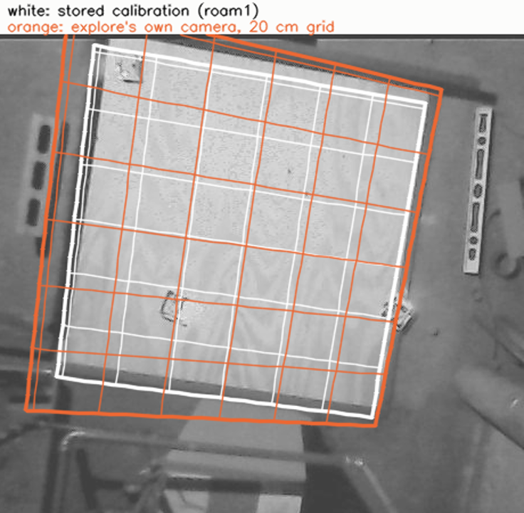
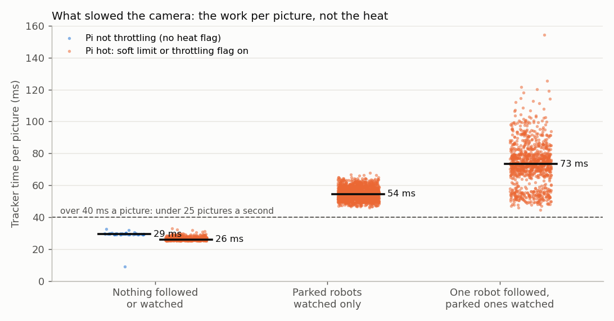
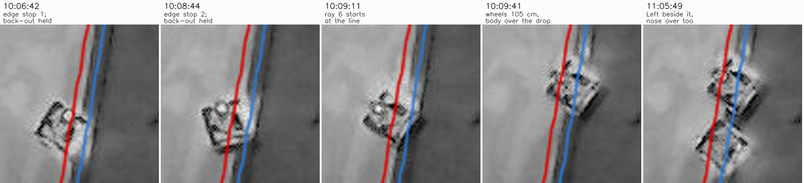
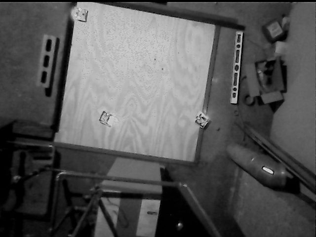
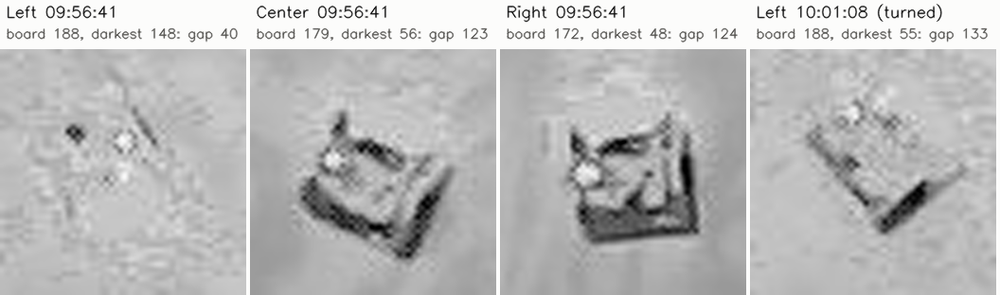

# Real session 2026-10-26 09:55 (MIRLT): explore failed again, Center hung over the right edge, a blind rescue put Left beside it, no runs

**Premise.** Session `e02-20261026-095541` on the Pi, started at 09:55 after a Pi reboot with
`OVERHEAD_DEV=2 SIDE_DEV=0 ./run-e02-pi.sh --with-side --home --hours 1.5` (explore, no stored setup). It was the
first real session with the tracker in its own process (c55e500), the session timeouts
([timeout](e02-oct26-timeout.md)), main's sensor-trust code and firmware 2026-10-25c on all three robots. The reboot
turned the Pi's WiFi power saving back on. It ran none of the runs on the code before the
[2026-10-26 runner fixes](e02-oct26-runner-fixes.md), which were being built during this session. Logs and video only;
the Pi was not touched and no runner code was changed.

**Sources.** The logs zip (`e02_log.txt`, `e02_state.json`, `track.csv`, `perf.csv`, `cpu.csv`, `threads.csv`,
`stalls.csv`, `parked.csv`, `border_shadow.csv`, `frames/`; from `robot-logs-1`: `leg.csv`, `edge.csv`, `raw.csv`,
`param.csv`, `clock_sync.csv`, `find.csv`, `fix.csv`), the recorder's small zip (`frames.csv`, `meta.json`) and 1,560
overhead video frames read by byte range. Nick's screenshots: [index](../screenshots/index.md), 2026-10-26.
Distances are in the stored calibration's board cm (roam1): x = 0 is the bottom open edge of the picture, y = 0 the
right one. Times are the Pi's clock; Nick's screenshot times run 1-2 minutes later. Scripts:
`tools/experiment/analyses_oct26/session_0955/` (Appendix C).

## Data

### 1. Explore did not succeed

| Check | Result | Limit or need |
|---|---|---|
| Robots whose own path fits the camera | **Center only** (5.4 px). Left 28.7 px, Right 20.1 px: left out | each robot under its limit |
| Camera fit | 5.69 px over 41 stops, all Center's | 8 px: **pass** |
| Sides met | **2 contact points, both on the right open edge**; nothing on the other three sides | two open edges and two boards: **fail** |
| Result | "EXPLORE FAILED" at 10:22:10 after 26 min (8 min of it on holds); fell back to the stored roam1 calibration | - |

The offline replay (`fit_replay.py`) gives the same 5.69 px and the same two contacts.

A 20 cm grid on the board drawn by the stored calibration (white) and by explore's own camera (orange), lined up as
well as a turn and a shift allow (data: `e02_state.json` explore stops, roam1 calibration, video frame 10:47:20).

| Explore's camera against the stored one (819 points on the board) | Difference |
|---|---|
| Lined up by a turn and a shift | median 5.1 cm, 95 % 9.9 cm; corners 4-14 cm off |
| Also scaled (best scale 1.126) | median 1.5 cm, 95 % 3.7 cm, max 6.1 cm |

- **Explore's camera has the right shape but the wrong size:** it makes the 122 cm board about 108 cm (11 % short).
  With one robot, the size comes from Center's own wheel counts alone.
- **The stored calibration fits the board in the video.** The green and yellow outline in Nick's 10:44 screenshot is the
  stored roam1 one, not explore's. It was the x-board question's picture, after explore had failed. The 21:14 report
  measured its right line about 4 cm inside the drop (the tape strip). The screenshot index line for 10:44 is corrected
  below.
- **Why it failed:**
  1. Center, the only robot that passed, hung over the right edge after its 4th ray (section 3).
  2. Left was washed out (section 6); the camera's spot jumped 223 and 245 px after two of its turns.
  3. Right's camera spot jumped twice (28, 49 px) after turns.
  4. Six rays were skipped because another robot was in the way.

  The gap rays at 10:17-10:22 met boards (Left 4 times, Right 4 times), but those robots were out of the fit, so their
  contacts were not counted.

### 2. The picture rate: the work per picture limited it, not the heat

The tracker's time per picture in each second (`perf.csv`), grouped by what it was doing, coloured by the Pi's heat
flag at that second (`cpu.csv`).

| What the tracker was doing | When | ms a picture (median, 95 %) | Pictures a second |
|---|---|---|---|
| Nothing followed or watched, Pi cool | 09:55:44-09:56:31 | 29, 30 | 25 |
| Nothing followed or watched, Pi hot | 10:37-10:47 | **26**, 29 | 25 |
| Parked robots watched only | 10:22-10:37, 10:50-11:05 | **54**, 62 | 17-19 |
| One robot followed, the parked ones watched | explore, 10:03-10:22 | **73**, 96 | 12-14 (worst second 2.9) |

- **The tracker process was CPU-bound on one core.** Pictures a second × ms a picture came to about 970-990 ms of each
  second whenever it was under 25. Its CPU stayed at 118-120 % (of 200 % on cores 2-3), with one thread full.
- **The parked-robot watch roughly doubles the cost per picture** (26 → 54 ms) and following a robot adds another
  20 ms. The 10:37-10:47 spell at 25 a second ran from the stored calibration's confirmation (the robots' positions
  dropped) to the next "finding the robots".
- **Heat.** The Pi passed 80 °C at 09:57:14, then sat at 83-86 °C with the soft-limit flag on 80 % of the time and
  the throttling flag 17 % (the coordinator's [heat tracker](../results/heat-tracker.md)). That table's 24.9 against
  17.6-17.9 pictures a second between flag states comes from the workload: the same idle work cost 29 ms cool and
  26 ms hot. `freq_mhz` read 1800 throughout, so the real clock is not in the logs.
- **Cores 0-1 (runner and recorder) ran at 85-92 %.** The recorder used 100-160 % with both cameras and the runner
  6-19 %. The recorder kept 24.8 pictures a second (0.85 % missed); 2 camera-loop stalls of 0.1 s.
- **Nick's figures match:** 21 (09:58, Left's hold), 15 (10:02), 14 (10:07), 26 (10:44, nothing watched), 16 (10:50).
  The "9 at first" was a single second; the lowest minute was 11.0, at 10:17.

### 3. Every hold and question

| Time | Robot | Kind: words | Cause | Answer, wait | Real danger? |
|---|---|---|---|---|---|
| 09:56:41 | Left | lost: "wheels ~11 cm, camera 3 cm" | **Camera**: Left washed out, the tracker on empty plywood ~10 cm away. Left really backed 11.2 cm | `c`, 4 min 19 s | No |
| 10:01:07 | Left | lost: "only turned, spot jumped 40 px" | **Camera correcting itself**: after the 90° turn Left's dark side showed and the tracker locked on (correct spot) | `c`, 1 min 56 s | No |
| 10:06:44 | Center | border: "0 cm from an open edge, moving towards it" | Its own edge stop at the right edge (bottom zone 11.3 cm), then **its back-out `go -9.5` was held within a second** | `c`, 98 s | **Yes**: nose at the drop. The hold stopped the move away |
| 10:08:22 | Center | (no hold) | After "carry on" **the back-out was never sent again: the next leg was `turn 175` on the spot, 0-1 cm from the line** | - | **Yes** |
| 10:08:29 | Center | border stop (no question): "2 cm, moving towards" | The return leg near the line | - | Near the edge |
| 10:08:34 | Center | border: "moved 2.9 cm towards an open edge while it turned" | A turn on its spot 2-6 cm from the line | `c`, 3 s | **Yes** (turn at the edge) |
| 10:08:45 | Center | border: "0 cm past the line, moving further out" | Ray 5 edge stop, **back-out held again** after 0.3 s | `c`, 7 s | **Yes**; direction wrong (it was backing in) |
| 10:08:57 | Center | border: "moved 3.1 cm towards an open edge while it turned" | `turn 175` then `turn -130.5`, at the line again | `a`, 9 s | **Yes** |
| 10:09:10-10:10:04 | Center | turns failing → left out | Ray 6 (`go 105`, crawl) started 1.3 cm from the line: **the wheels counted 104.9 cm, the camera saw about 9 cm, and the body slid half over the drop** (figure below). Two find turns and the check turn timed out (0.8° in 5 s); the compass check failed | (automatic) | **Yes: hung over the right edge**, tilted 3.3° pitch and 1.7° roll from its level |
| 10:13-10:22 | Left, Right | 11 watchdog stops near parked robots (12-16 cm) | Rays and returns towards a parked robot | (no question) | Prevented |
| 10:22:11 | - | outline on the plywood? | after the fallback | none, 15 min → `y` | - |
| 10:37:11 | - | x-board: top or left? | | none, 10 min → left | - |
| 10:47:11 | - | y-board: bottom or top? | | Enter → top (10 s) | - |
| 10:49:19 | Left | help call | section 5 | `f` ×3, Enter at 10:54:32, then none, 10 min | No (until the rescue) |

**Center at the right edge, in short.** Its own edge guard stopped both rays correctly. Each time, the camera
border held the back-out, and after Nick's "carry on" the runner went to the next leg: a turn on the spot at the line.
The back-out was not re-sent. Ray 6 then left from the line along the edge. The line sensors stayed on the board
(49-72) while the body slid sideways over the drop, so the edge guard could not see it. **Its back-out was blocked
twice.** This is the 21:14 corner again: the border held a back-out, then the runner turned the robot at the edge.

Overhead video crops of the right edge with the stored open-edge line (red) and 4 cm outside it (blue, about where the
plywood ends), at Center's two edge stops, the start and end of ray 6, and the session's end (data: cam0 video, roam1).

### 4. Command loss: about the afternoon's, not the 21:14 evening's

| | 15:10 | 15:45 | 21:14 | **09:55 (after reboot)** |
|---|---|---|---|---|
| Clock pings lost | 1.1 % | 1.2 % | 19 % (8-11 % in session) | **1.9 %** |
| Worst 5 minutes | 1.9 % | 3.1 % | 71 % | **3.2 %** |
| Moves with no record from the robot | 0 of 136 | 10 of 733 | 30 of 283 | **2 of 234** (Left `turn -129.94` 10:13:24, Right `go 15` 10:13:48; both ran on the resend 13-15 s later) |
| Settings lost (checked against a later dump) | - | - | 6 of 113 | **1 of 112**: Left `e02_xboard_cm 118.73` at 11:05:13 (section 5) |
| Reply time, median / 99 % | 22 / 222 ms | 18 / 286 ms | 18 / 120 ms | 18 / 117 ms |

- **Neither lost hold came from the link.** Both were the camera (section 3).
- If the reboot did turn power saving back on, **power saving on gives a link like the afternoon's**, so it cannot
  explain 21:14's 19 %. When it was switched off before is not in the logs (question 3).

### 5. The help call at 10:50: Left, in the blocked corner

- **Where.** Left had ended explore's gap rays in the top-left corner, the blocked corner (113, 116), facing a board.
- **Why.** After the fallback the runner did not know which way Left faced. It asked for a 3 cm crawl to measure it.
  - Left's front sensor read 2.8-3.0 cm, so **the firmware refused every crawl as "obstacle"** (5 times).
  - The tracker was only holding Left's last spot ("held").
  - The runner read the refusal as "the camera lost it while its wheels say it moved 0 cm".
  - After 3 automatic tries it called Nick.
- **The question did not name the robot on the live page:** "Press Enter when it is back on the board". The full steps
  ("Left is the robot whose two lights are flashing...") were only in the console.
- **Answers.** `f` three times. Enter at 10:54:32 with Left not moved: the same refusal again. Then no answer for
  10 min, so Left was put aside (11:04:57).
- **After that (11:05:03-11:05:50):**
  1. Left drove out on its own wheels (turn 89°, 15 cm, turn 57°, 15 cm).
  2. A "rescue find" against the boards then ran with the robot's heading unknown and with **`e02_xboard_cm` lost on
     the radio**, so the robot had 0 (the same lost setting as Right at 21:14).
  3. The first find met no board within 60 cm. The second drove Left across the board into the **right open edge,
     beside the hanging Center**. Its line sensors stopped it at 11:05:46, nose over the drop (last crop above).
  4. The runner then ended the session: "Left is put aside at about (113, 116), in the corner every robot's find
     drives to". **That position was 20 minutes old.** Left was at the right edge by then.

The frame saver's still at the help call (data: `frames/stills/104919_help-call-Left.jpg`): Left top-left against the
boards, Right mid-board, Center on the right edge.

### 6. The washed-out Left

Each robot's darkest 5 % of pixels against the plywood round it (grey levels 0-255) at Left's first lost hold, and Left
again after its 90° turn (data: frame-saver still 09:56:41, video 10:01:08).

| | Plywood | Robot's darkest 5 % | Gap |
|---|---|---|---|
| Left 09:56:41 | 188 | 148 | **40** |
| Center 09:56:41 | 179 | 56 | 123 |
| Right 09:56:41 | 172 | 48 | 124 |
| Left 10:01:08, after a 90° turn | 188 | 55 | 133 |

- **The white top is barely brighter than the plywood** (Left's brightest 5 % 213 against 188). The camera finds a
  robot by its dark wheels, sides and shadow. At some headings, near the brightest part of the board (185-193 across
  the top half, 142-160 near the bottom), those hardly show.
- **It is not over-exposure.** No pixel reached 250. The camera is on manual exposure 157 (15.7 ms), gain 0, contrast
  32 of 64, gamma 110 (`meta.json`), and the frame's mean brightness held at 83 through the hold's clip.
- **What could fix it:**
  1. A dark mark on each robot's top: a gap of ~130 at every heading, against 40 now.
  2. Camera contrast up (48-64) with exposure down (100-120), so the plywood sits near 140 and the white top stands
     out by itself. The likely gain is perhaps 1.5×, a DOE question.

### 7. How the session ended, and the timeouts

- **It ended at 11:05:50, 20 minutes before its planned end (11:25), on the "put aside in the find corner, no run can
  start" rule** (section 5), not on a timeout. The logs reached GitHub at 11:08 and the video by 11:34.
- **The timeouts did what they were built to do where they applied:**
  - every hold showed its deadline ("no answer by 10:26 ends the session"), and none was reached (the longest wait
    was 4 min 19 s);
  - the outline question defaulted after 15 min and the x-board one after 10;
  - the help call put Left aside after 10.
- **Not exercised:** the after-planned-end 10 minutes and the hard cap (11:55).
- **Time:** 51 of the 90 minutes went before any run could start. Explore took 26 min and the three setup questions
  25 min.

### 8. Runs

**None.** No run started: n = 0, so there is no accuracy or mean ± SD to report. Center's "wheels ×2.9" flag on the
live page is the one carried from 15:45; this session again had no evidence to clear it.

### 9. The new parts: parked watch, frame saving, cpu.csv, the tracker process

| Part | Worked? | Notes |
|---|---|---|
| Tracker process | **Yes** | 76,325 positions, 284 dropped as older than a command. No crash. CPU-bound on one core (section 2) |
| Parked-robot watch (`parked.csv`) | **Yes** | 7 events: Left unseen while washed out (10:03:48, 10:13:57; seen again 1.7 cm away), Center unseen once hung over the edge (10:10:07, 10:47:38), Right unseen 51 s (10:17). No false "moved". It costs about 25-28 ms a picture |
| Frame saving (`frames/`) | **Yes** | 20 events, 18 clips (13 s each, playable), 20 stills, 141 thumbnails every 30 s; 351 MB. **Watchdog stops near a parked robot are labelled "edge stop"** (11 of them) |
| `cpu.csv` | **Yes** | 2,088 rows every 2 s, per core, temperature, throttle flags, per-process CPU. `freq_mhz` is the kernel's requested clock, not the real one |
| End summary "Tracker: ... none 98 %" | **No: a reporting bug** | It covers only the tracker object made last (after the 10:37 recalibration; 16,941 pictures, 98 % with nothing followed). Over the whole session `track.csv` gives both 70 %, lock alone 18 %, detector alone 9 %, held 3 % |
| Camera loop blocked by `_input` threads | Minor | 2 stalls of 0.10-0.12 s. The listed `_input` threads look like idle question readers (one per question asked), probably not the cause |

## Conclusions

1. **Explore failed.** Its camera fit passed (5.7 px), but on one robot only, and its rays met only one side. Its
   camera made the board 11 % small. The outline Nick saw at 10:44 was the stored one, which fits the board.
2. **Center went over the right edge for the same reason Left did at 21:14.** The border held its back-out twice.
   After each "carry on" the runner turned it on the spot at the line, and its next ray slid it half off the board,
   where it hung. The line sensors never saw the drop. The runner-fixes build covers every link of this chain except
   the last check: Center's tilt (3.3° and 1.7°) is under the build's 5° limit, so only the new "stuck" check would
   have stopped it.
3. **The session's end was a blind rescue plus a stale position.** A heading crawl refused by a board in front was
   read as a lost camera, which led to the help call. The put-aside robot was then driven with an unknown heading and
   a setting lost on the radio, into the open edge beside Center. The runner ended the session on a 20-minute-old
   position.
4. **The camera's speed is set by the tracker's work per picture.** The parked watch doubles it and following a robot
   adds more. Heat at 83-86 °C did not measurably slow the same work.
5. **The link was normal (1.9 %).** The reboot and power saving were not the 21:14 cause.
6. **Left's wash-out is a contrast problem at some headings** (gap 40 against 120-130), not exposure saturation.

## What's next

**Covered by the runner-fixes build** ([report](e02-oct26-runner-fixes.md)):
- the border never holds a back-out (item 2);
- no turn on the spot at the edge in explore, and a back-out first (item 3);
- the stuck check (item 4: wheels 5 cm and camera under 2 cm in 3 s, which Center met at about 10 cm against 1 cm);
- settings read back (item 1b, Left's lost `e02_xboard_cm`);
- finding a lost robot by its lights before asking, and lights-confirmed camera jumps (09:56, 10:01);
- the help question naming its robot with a picture (10:50).

The build's question 3 already asks about the find-corner end.

**Fixes not in the build, ranked by what they would have prevented here:**
1. **No blind rescue drive.**
   - A put-aside robot without a fresh camera fix and a known heading is not driven: no drive-out by dead reckoning,
     no find.
   - The end-of-session check uses the robot's latest camera or lights position, not the position from the help call.
   - The other robots find against a free corner when one is taken. *Would have kept Left off the right edge and the
     session running to 11:25.*
2. **A heading crawl refused as "obstacle" means the front is blocked.** Crawl 3 cm backwards instead (the edge guard
   is not needed backing away from a board), or turn 180° first. A "held" camera spot is not "lost". *The help call
   and its 15 minutes.*
3. **Watch parked robots at a lower rate**, every 5th picture (a parked robot moves only when pushed), or on the
   tracker's idle second core. *Estimated 54 → 30 ms idle and 73 → 50 ms following: 18 → 25 and 13 → 20 pictures a
   second.*
4. **Contrast:** a dark mark on each robot's top (Nick's call), or a camera contrast and exposure DOE (DOE row).
5. **Explore with one robot:** its scale is unconfirmed. Explore should need a second robot, or check the scale
   against the robots' size or a measured board side before it is used. Contacts from robots left out of the camera
   fit, placed on the fitted camera, should count.
6. **Tilt limit:** the bench tilt DOE should include a robot sliding sideways off an edge (Center: 3.3° pitch, 1.7°
   roll).
7. **Reporting:** the end summary's tracker line from the session's counts; the frame saver's label for watchdog
   stops ("near-robot stop"); log the real ARM clock (`vcgencmd measure_clock arm`) in `cpu.csv`.

**Before the next board session:** Center and Left both ended at the right edge, Center hung. Lift both back and check
wheels and casters. Flash firmware 2026-10-26a (the build's step 1).

**Questions for Nick**

*Substantive*
1. Can each robot get a dark mark on its top (matte black tape square, about 4 × 4 cm)? It would end the washed-out
   problem at every heading. My assumption if not: a camera contrast and exposure test on the board (about 15 min,
   robots parked).
2. A robot that has been put aside without a known position stays where it is until you move it, and the session
   carries on with the others. Agreed? Today the runner drove Left blind into the open edge.
3. When had WiFi power saving been switched off before today: before 15:10, or only after 21:14? Today, with it
   assumed on, loss was 1.9 %.

*Other*
4. Is Center still hanging over the right edge, and Left's nose over it beside Center?
5. At 10:54 Enter was pressed with Left still in the corner. Was it clear which robot the live page meant? The build
   now names it, with a picture.
6. Is a heatsink or fan available for the Pi? The heat did not slow the tracker today, but 86 °C is near the Pi's
   85 °C hard limit.

## Sweep 1: new tests that may now be needed

- A dry run: a put-aside robot with no camera fix is never driven; the session carries on and the end check uses a
  fresh position.
- A dry run: Left in the blocked corner facing a board, heading unknown. The heading crawl goes backwards, with no
  help call.
- A dry run: a robot slides sideways over an edge with the line sensors on the board. The stuck check stops it
  (`--dry-start` with Center's 10:09 pose).
- The tracker process with the parked watch at 1 picture in 5: pictures a second and missed "moved" events on
  replayed footage.
- On the board: the contrast at 4 headings × 3 places, with and without a top mark; camera contrast 32 / 48 / 64 ×
  exposure 157 / 120 / 100.
- Explore replayed with Left's and Right's gap-ray contacts placed on Center's camera: whether the sides would then
  close.
- The tracker summary line against `track.csv` counts after a recalibration.

## Sweep 2: possible inaccuracies in what this relied on

- **Power saving on today is an assumption** from Nick's note about the reboot; the Pi's WiFi state was not logged.
- **Workload groups are by time spans**, inferred from the log (which robots were followed or parked). The parked
  watch being off at 10:37-10:47 is inferred from the positions being dropped when the stored calibration was confirmed; it is not logged.
- **Heat against workload:** only 45 cool seconds exist, all at the start, with nothing followed; "heat did not slow
  the same work" rests on that one comparison (29 vs 26 ms).
- **"Body half over the drop"** is read by eye from 640 × 480 crops, with the drop taken at the tape's outer side
  (21:14 report, Nick's answer); ±1-2 cm.
- **Explore's 11 % scale** compares its camera with roam1, which assumes roam1's board size (122 × 122 cm) is right.
  Center's wheel scale was fixed at 1.000 by the fit; a wheel fault would show the same way.
- **The contrast numbers** come from fixed 21 × 21 px boxes placed by eye on each robot.
- **One lost setting** is counted only where a later parameter dump exists (5 runs). Two other mismatches were the
  runner's own resets at the 10:09 compass check, not losses.
- **Estimated savings in fix 3** (30 and 50 ms) are a projection from the group medians, not measured.
- **Tilt values** are from the one compass-check run (10:09:55) after Center hung; the sign (which side down) is not
  known.

## Appendix A. Center, second by second (10:06:30-10:10:05)

Columns: the runner's sends and words; Center's own leg record; edge events (line sensors L/C/R, bottom zone cm);
the camera's position on the board (x, y; the smaller is the distance to the nearest stored open line, negative past
it); pictures a second, picture age (`timeline.py Center 10:06:30 10:10:15`).

| Time | Runner | Robot (own record) | Edge | Camera x, y (d) | Pictures/s, age |
|---|---|---|---|---|---|
| 10:06:32 | `go 105` (ray 4, crawl) | queued | | 46.2, 31.7 | 11.4, 0.16 |
| 10:06:42 | | failed: plywood edge (bottom zone) | trip 56/52/53, bottom 11.3 | 31.2, 0.9 | 13.7, 0.15 |
| 10:06:43 | `go -9.5` (back-out) | **failed after 0.4 s: stop command** | | 31.3, 0.7 | 12.9, 0.16 |
| 10:06:44 | **HOLD border** "0 cm, moving towards" | | | 31.2, 0.6 | 13.3, 0.15 |
| 10:08:22 | Nick `c`; **`turn 175`** | done | | 33.0, 1.1 → 33.2, 0.2 | 12.7, 0.17 |
| 10:08:28 | speed guard 2 s; `go 33.62` | failed (border stop) | | 32.8, 2.3 | 13.6, 0.15 |
| 10:08:31 | `turn -131.13` | failed (stop) | | 35.3, 1.9 | 12.9, 0.16 |
| 10:08:34 | **HOLD border** "moved 2.9 cm while turning" | | | 35.0, 3.0 | 9.9, 0.18 |
| 10:08:41 | Nick `c`; `turn -13.51`, `go 105` (ray 5) | done; failed: plywood edge | trip 53/51/52, bottom 11.2 | 34.5, 0.7 | 10.4, 0.19 |
| 10:08:44 | `go -9.5` (back-out) | **failed after 0.3 s: stop command** | | 34.9, 0.0 | 14.0, 0.15 |
| 10:08:45 | **HOLD border** "0 cm past, further out" | | | 34.7, 0.6 | 13.6, 0.16 |
| 10:08:52 | Nick `c`; **`turn 175`**, `turn -130.51` | done; failed (stop) | | 34.8, 0.2 → 32.5, 4.8 | 8.7-13.7 |
| 10:08:57 | **HOLD border** "moved 3.1 cm while turning" | | | 32.5, 4.8 | 13.7, 0.15 |
| 10:09:07 | Nick `a`; `turn -110.58` | done | | 36.4, 1.3 | 12.8, 0.16 |
| 10:09:10 | `go 105` (ray 6, crawl) | queued | lines 54/52/53 | 36.2, 1.2 | 9.6, 0.18 |
| 10:09:41 | "drove 105 cm, camera 39 px": find again | **done 104.89 cm**, heading -1.8° | lines 49/48/72, bottom 9.3 | **45.1, -3.7** | 14.2, 0.14 |
| 10:09:42-10:09:53 | `turn 40`, `turn -40` | both timed out (0.8° each) | | (lights) | 16-22 |
| 10:09:54-10:10:01 | compass check | failed: yaw check; pitch 4.5° (1.2° level), roll 3.1° (1.4°) | | | 20 |
| 10:10:04 | `turn 15` timed out → **Center left out** | | | | 20 |

## Appendix B. Left, 11:04:58-11:05:50

| Time | Runner | Robot |
|---|---|---|
| 11:04:58 | help call timed out; identify turns ±40 | both done |
| 11:05:03 | "Left is in the corner every find drives to: moving it out" (wheels and gyro) | `turn 89.4`, `go 15`, `turn 56.9`, `go 15`: all done (front 111 → 86 cm) |
| 11:05:12 | "front reads 86 cm where its own pose puts Center at 19 cm; retracing" | |
| 11:05:12-13 | 18 settings incl. `e02_xboard_cm 118.73` (**not received**: 0 in both later dumps) | |
| 11:05:14 | `run find` | failed: x board, no bump within 60 cm |
| 11:05:31 | `run find` | failed: edge guard tripped (line 301/55/54) at 11:05:46, at the right open edge beside Center |
| 11:05:48 | "edge find: where it is or which way it faces is not known"; put aside at "(113, 116)" | |
| 11:05:50 | session ended | |

## Appendix C. Methods and scripts

`tools/experiment/analyses_oct26/session_0955/`; paths in `common.py` (scratch at analysis time). The downloads were
deleted after the analysis.
- `rng.sh`, `avindex.py`, `getframes.py`: the cam0 file's OpenDML index (the first 128 KB of `-aa`), then frames cut
  by byte range from parts `-aa` and `-ab` (1,560 frames, 15 requests).
- `pose.py`, `timeline.py`, `sheet.py`: positions on roam1 (explore's on the provisional camera, projected as the
  border did), second-by-second tables, crops.
- `cpu.py`, `trackmix.py`: per-minute load, temperature, flags and pictures a second; what the tracker followed.
- `sets.py`: settings against the robots' later parameter dumps. Link loss: `analyses_oct26/link_loss/linkloss.py`
  run on this session.
- `fit_replay.py`: explore's fit offline and its camera against roam1.
- `figs.py`: the four figures (saved to `docs/screenshots/2026-10-26/0955-analysis-*`).
- Heat: `tools/analysis/heat_tracker.py` (run by the coordinator; row in `docs/results/heat-tracker.md`).
