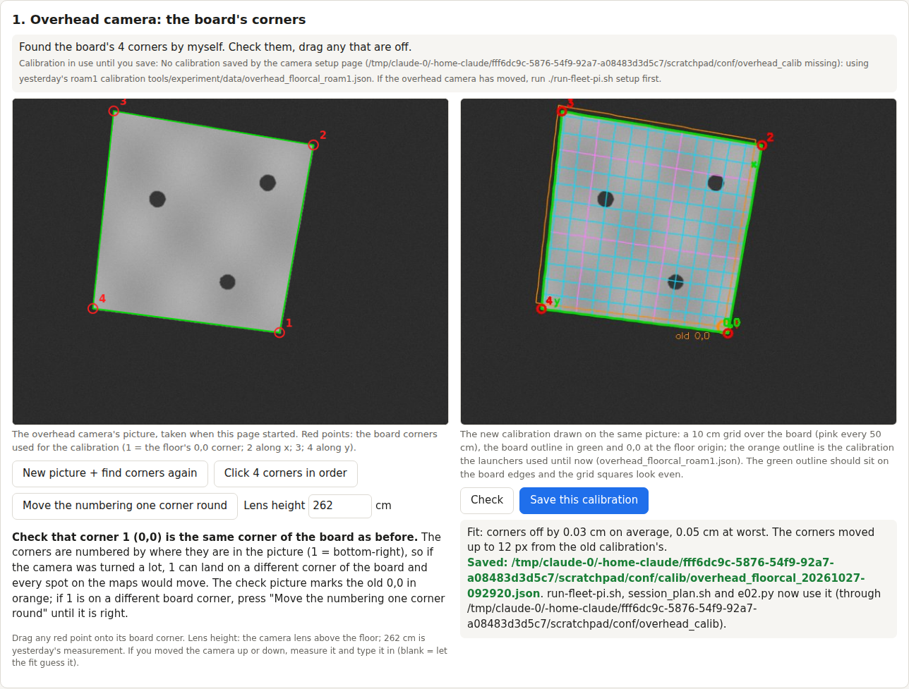
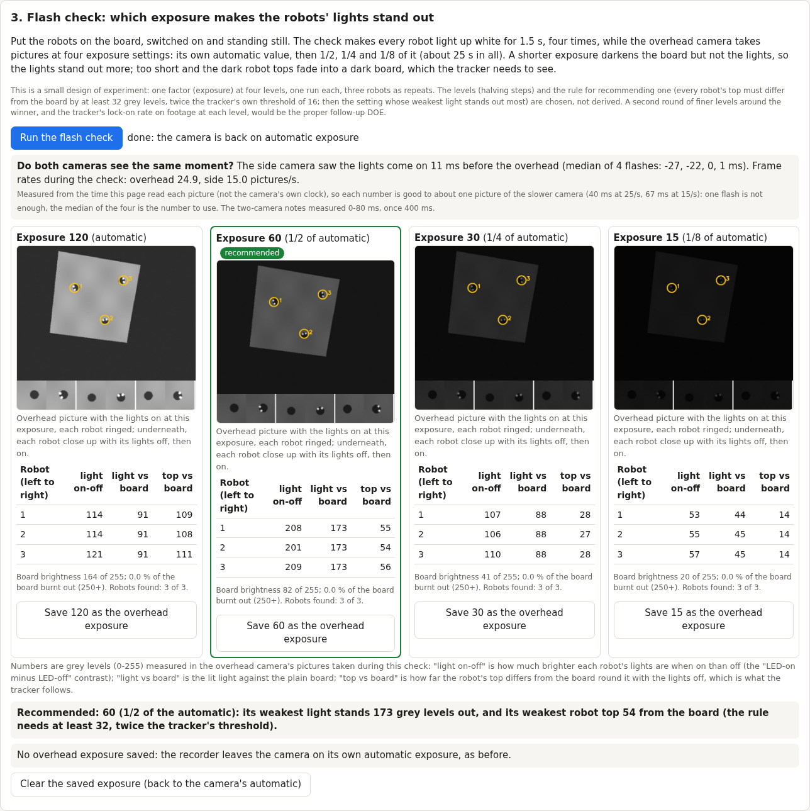

# Camera setup page (2026-10-27): new overhead calibration after the cameras moved, side check, lights' exposure

**Premise.** Nick unplugged and moved both cameras this morning. Both still see the whole board (122.15 x 121.9 cm,
no boards on it), but today's launcher (`run-fleet-pi.sh`) and tonight's plan (`tools/pi/session_plan.sh`) used
yesterday's overhead calibration (`overhead_floorcal_roam1.json`), which no longer fits. Nick also asked whether the
contrast can be raised so the robots' flashing lights are easier to see. Built and tested here on simulated cameras
and robots; the Pi, the cameras and the robots were not touched.

**What was built.** `./run-fleet-pi.sh setup` starts `tools/pi/camera_setup.py` on the Pi; Nick opens
http://100.122.222.75:8096 from the laptop.

1. **Overhead corners.** The page takes a picture, finds the board's 4 corners itself (`e02_camera.find_board_corners`;
   the same order and floor frame as `e02.py` classic_calibration: 1 = (0, 0) at the picture's bottom-right, 2 along
   x, 3, 4 along y) and draws them. Nick can drag any corner, click all 4, or move the numbering one corner round. Check
   fits the calibration (`make_calibration`) and draws a 10 cm grid, the board outline and yesterday's outline with
   its old 0,0. Save writes `~/.config/mirlt/calib/overhead_floorcal_<date-time>.json` (outside the repo, so the Pi's
   `git pull` never meets it), copies it into the page's logs folder, and points `~/.config/mirlt/overhead_calib` at
   it. `run-fleet-pi.sh`, `session_plan.sh` and `e02.py`'s default calibration now read that pointer
   (`tools/pi/setup_conf.py`). If it is missing, they use roam1 and print that they did.
2. **Side camera.** Its live picture and frame rate, with the plain note that its calibration is refitted from the
   robots and is not needed today. Corner clicks are optional and saved separately; nothing uses them yet.
3. **Flash check (a small DOE).** All robots light white (`led 1 1 1 1500` to .250/.252/.253) while the overhead
   camera runs at its locked automatic exposure, then at 1/2, 1/4 and 1/8 of it. For each setting the page measures
   the light's contrast (LED on minus LED off), the light against the board, and the robot's top against the board,
   and recommends one. The chosen value is saved as the overhead exposure. The recorder (`run-fleet-pi.sh`,
   `run-e02-pi.sh`) then passes it to camrec as the new `--overhead-exposure` option, which applies only to the camera
   named overhead. If nothing is saved, nothing changes.
4. **Both cameras' timing (coordinator's addition).** The page shows each camera's real frame rate. During the flash
   check it also measures when each camera first sees the lights, which gives the side camera's lag.

## Data (dry run: simulated cameras and robots, `--fake`)

The new calibration's 10 cm grid on the simulated overhead picture, with yesterday's outline in orange. Source: the
dry run's simulated overhead camera (roam1's model turned 0.05 rad and moved 5 cm).

| Check (simulated, known true camera) | Result |
|---|---|
| Corners found against the true corners | within 2 px (test) |
| Fit error, corners as found | 0.03 cm average, 0.05 cm worst |
| Floor points through the new calibration against the true camera | within 2 px and 1 cm at 5 spots (test) |
| Corner 1 dragged 40 px off (problem shown on purpose) | 3.1 cm average, 6.1 cm worst; grid visibly off the board |

Each exposure's lights-on picture, close-ups of every robot (lights off, then on), and the numbers. Source: the dry
run's simulated overhead camera. In the simulation the lights burn out at the automatic exposure.

| Exposure (simulated) | Weakest light vs board | Weakest top vs board | Board brightness |
|---|---|---|---|
| 120 (automatic) | 91 | 108 | 164 |
| **60 (1/2), recommended** | **173** | **54** | 82 |
| 30 (1/4) | 87 | 27 (below 32) | 41 |
| 15 (1/8) | 44 | 14 (below 32) | 20 |

Simulated side-camera lag (set to 40 ms, side camera at 15 pictures/s): the median of 4 flashes was 34 ms in one run
and -7 ms in another. Each flash is only good to about one picture of the slower camera (±67 ms), so the median of
the four is the number to use.

**Every chosen number (DOE notes).**
- Exposure levels: automatic, 1/2, 1/4, 1/8. Chosen: halving steps cover 8x in 4 runs. **A DOE fits:** a second round
  of finer levels around the winner.
- Recommendation rule: every robot's top must stand at least 32 grey levels from the board. That is twice the tracker's
  own threshold (`MotionTracker` thr = 16); the factor 2 is chosen. Among the settings that pass, the one whose
  weakest light stands out most wins. **A DOE fits better:** the tracker's lock-on rate on recorded footage at each
  exposure.
- `LED_MS` 1.5 s and the 0.8 s settle wait: chosen. They are waits, not measurements, so no DOE.
- Light-detection floor of 25 (20 for the onset): chosen above sensor noise. No DOE: a floor.
- Port 8096: free (mission control uses 8095).
- Lens height 262 cm: yesterday's measured value, pre-filled. Nick types a new one if the camera's height changed.
- Grid 10 cm: Nick's ask.

**Tests.** `tools/pi/tests/test_camera_setup.py`, 14 tests: the config fallback and pointer, exposure save, read,
clear and bad files, and the shell output; corners found against a known camera; the fit against the true
projection; the grid drawing; the flash measurements, the "no lights" case and the recommendation; the onset time;
camrec's `--overhead-exposure` (overhead only); the page's API on `--fake`. All 60 tests in `tools/pi/tests` pass.

## Conclusion

The page replaces yesterday's hard-coded calibration with one Nick checks by eye in about a minute. The launchers
read it automatically, and roam1 stays as a stated fallback. The flash check answers Nick's contrast question with
measured numbers instead of a guess. A shorter exposure darkens the board but not the lights, so the lights stand
out more. The limit is the robot tops, which the tracker needs to see. Until it runs on the real board, which
exposure wins is unknown.

## What's next

- Nick runs the page today, Saves the corners, and runs the flash check with the robots on the board. Whether to
  save the recommended exposure is his call. Saving it changes what the tracker sees in every later recording.
- If an exposure is saved, the next session checks the tracker's lock-on (camera fixes accepted) against this
  morning's sessions.

## Sweep 1: new tests that may now be necessary
- The real overhead picture: whether `find_board_corners` finds this morning's corners itself (OTSU on the real board
  and floor) or Nick has to drag them.
- The tracker on a darker picture: lock-on rate and camera-fix acceptance at the saved exposure compared with the
  automatic (the proper DOE above).
- The blink naming (tools/live) at the saved exposure. A shorter exposure may change how blinks look between pictures.
- camrec applying `--overhead-exposure` on the real USB 2.0 Camera. Check the fps after a manual exposure: camrec's own
  fps check prints it.
- The side lag from real flashes, against the two-camera notes' 0-80 ms.
- `run-fleet-pi.sh stop` uploading the `*-p0-camera-setup` logs folder. It matches the upload pattern, but
  upload_session was written for runner sessions.

## Sweep 2: possible inaccuracies in what this relied on
- The simulated camera, board, robots and lights are stand-ins: brightness is linear in exposure, the lights burn out
  at the automatic exposure, and the robot tops are dark. On the real board the robot tops may be lighter than the
  board, or the lights may not burn out. The measurements handle either case, but the recommended level will differ.
- The "top vs board" disc is centred on the lights, which sit near the front of the top. On a small or tilted view
  the disc can catch the robot's edge.
- The lag uses the time the page read each picture, not the camera's own clock (driver buffering is not included).
  The robots light up one after another as the UDP commands arrive, a few ms apart.
- Lens height 262 cm comes from roam1. If the camera was raised or lowered, the robot-top projection (3.7 cm up) is
  slightly off until it is re-measured.
- The corner numbering follows picture position. If the camera was turned more than about 45 degrees, corner 1 can
  land on a different board corner. The page warns about this and marks the old 0,0.
- The fit takes about 4 s here, so expect longer on the Pi.
