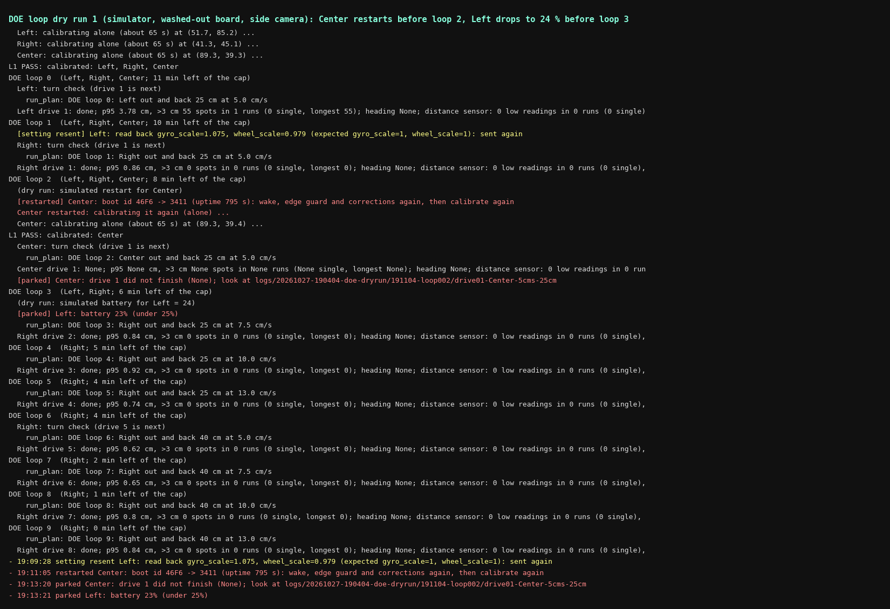
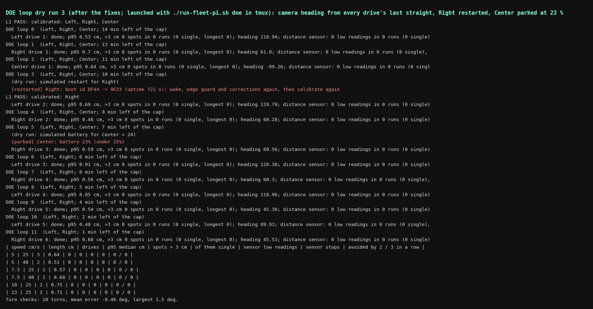

# The DOE loop: the ladder left running unattended (MIRLT, 27 Oct evening)

**Premise.** This afternoon's ladder run stopped for state it assumed and never re-checked: robots that restarted
after a sleep check-in, battery checked only at L0, a lost `set wheel_scale`, and distance-sensor stops over empty
floor ([ladder-run report](e02-oct27-ladder-run.md)). Nick wants the robots to work unattended tonight and give
data: a speed sweep, heading from short vs long lines, the miss pattern, and how often the distance sensor stops for
nothing. Built in about an hour and tested only in the simulator. Nothing here has run on the robots or the Pi.

`tools/fleet/doe_loop.py` (new), `./run-fleet-pi.sh doe | doe-status | doe-stop`, `tools/pi/upload_session.py`
(`--unique-tag`, `--recording-dir`, `--exclude`), `tools/sim/fleet_sim.py` (`simctl restart|battery`, simulator
only), 10 tests in `tools/fleet/tests/test_doe_loop.py`.

## What it does

1. **Start:** L0 and L1, using the ladder's own code.
2. **The check, before every loop and every robot move.** It sends `status` (battery), `clock` (boot id and uptime;
   2026-10-25c firmware has no boot id in `status`, but every `clock` answer carries it), and `get` for gyro_scale,
   wheel_scale and gyro_drift_dps.
   - **New boot id:** it sends `wake`, then the edge guard and the corrections, then calibrates that robot again, alone.
   - **Battery under 25 %:** the robot is parked.
   - **A setting that does not read back:** it is sent again. Still wrong: the robot is parked.
   - **No answer:** it sends `wake` and asks again. Still nothing: the robot is parked.
   Every `M` line (status, `led`, `awake`) now goes to `messages.csv`; this afternoon none were kept.
3. **The loop, one robot at a time, round robin; the others parked as obstacles.**
   - **Turn check:** every 4th drive of a robot, and its first.
   - **The drive:** a planned out-and-back in open board, at the spot nearest the robot that fits: to A, A->B, B->A.
     It parks on A facing the way it came back, so the last straight is the full length.
   - **Speed and length:** speed cycles 5 / 7.5 / 10 / 13 cm/s and length 25 / 40 cm, so all 8 pairs come round
     every 8 drives of a robot.
   - **Recorded per drive (`drives.csv`):** p95, the miss pattern, the camera heading from the last straight, and the
     distance sensor's low readings and stops.
   - **`turns.csv`:** each turn of every turn check.
   - **`sensor_runs.csv`:** every run of low readings.
   - **`sensor_stops.csv`:** each stop, the low readings in a row that ended at it, and whether a 2-in-a-row or a
     3-in-a-row rule would have avoided it.
   - **`battery.csv`:** every robot's battery, boot id and uptime at every check.
   - **`cpu.csv` and `perf.csv`:** the Pi's temperature, throttling and load, and each camera's picture rate. These
     are what `tools/analysis/heat_tracker.py` reads.
4. **Safety.**
   - Every planned spot and line stays 25 cm from every edge. The planner's floor is shrunk 13.5 cm, so every turn
     keeps a body's middle 24.7 cm in. A detour's straight travel could come to 18 cm.
   - Every spot and line stays 30 cm from every parked robot's middle. A parked robot is a 17 cm circle, so a turn
     next to it keeps the middles 28 cm apart and straight travel 22 cm.
   - A robot that restarted and was calibrated again gets a turn check before its next drive.
   - A FAIL parks that robot: a drive that did not finish, a turn check FAIL, the camera losing it, or p95 over 8 cm.
     The loop goes on with the others.
   - Ctrl+C, `doe-stop`, or the tmux session closing stops every robot. **Disconnecting SSH does not stop it**,
     because it runs in tmux; that is the point. *Claude's reading of "SSH drop stops every robot": that applied to
     the ladder, which ran in the SSH window itself.*
   - It ends when every robot is out, after 4 h, or when no robot has room twice in a row. It then stops the
     recorder and uploads.
5. **Recording.** The recorder runs with `--no-record`, so it serves the pictures but saves no video.
   - **Tracking-rate frames:** while a robot moves, the loop keeps one picture per tracking interval: 12 a second
     overhead, 9 side. It saves them as Motion-JPEG `.avi` parts with a `.csv` of times. That is about 2.4x less than
     the full video.
   - **Clips:** a full-rate clip 5 s either side of every stop, hold, FAIL and park, plus a still at the moment and a
     thumbnail every minute. This uses `e02_framesaver`.
   - **Full video:** `./run-fleet-pi.sh doe 4 full-video` keeps the recorder's video as well.
6. **Upload.** The tag is `doe-<the folder's date-time>`, with `--unique-tag`, so a release name is never reused
   (today's 15:32 skip). The frames go up as their own files, and the logs zip leaves them out.

## Data (simulator only: these test the machinery, not the robots)

**Dry run 1** (washed-out board, side camera; Center restarted before loop 2, Left set to 24 % before loop 3;
15 min cap):

The terminal of dry run 1, filtered to the loop's own lines. Red lines are restarts and parks; the yellow line is a
setting that was sent again.

- **Center's restart:** caught at the next check (boot id 46F6 -> 3411). The loop recalibrated it (L1 PASS) and it
  went on to its turn check.
- **Left at 23 %:** parked at the next check.
- **Right:** finished the full 8-pair cycle, p95 0.62-0.92 cm.
- **Recording:** the frames and clips were written. Overhead kept 10,956 pictures (563 MB at the simulator's 51 KB a
  picture), side 5,502 (246 MB), and 2 clips per camera.

Three problems were found, and each is fixed:

| Problem in dry run 1 | Fix |
|---|---|
| No camera heading from any drive: the plan parked the robot back on its start spot, so the last straight was 0.9 cm | park on A facing B->A, so the last straight is the full 25 / 40 cm |
| Center parked after "no plan": B was 28 cm from a parked robot and the planner needs 8.2 cm to turn there (8.1 left) | lines 30 cm from parked robots; "no plan" (nothing moved) is now a skip, not a FAIL |
| Left's settings resent every loop: run_plan on disk at 19:08 sent the stored corrections, and the dry run expected factory values | in dry runs either set is accepted; real runs expect the stored corrections |

**Dry run 2** (seed 11) found a fourth problem: Right stood 31 cm from an edge, and with the floor shrunk 20 cm the
planner had 7.8 cm to turn it where it stood (needs 8.2). The loop skipped it ("no plan", nothing moved), as it
should. The floor inset is now 13.5 cm and parked circles 17 cm. A planner-only check made 40 random layouts (robots
25-97 cm in, 40 cm apart): 40 plans, every last straight ends on A along B->A. Dry run 2 was stopped with Ctrl+C
(the Ctrl+C path: every robot answered "nothing running" to the stop).

**Dry run 3** (all fixes; started with `./run-fleet-pi.sh doe 0.3` in tmux, as Nick will; washed-out board, side
camera, seed 11; Right restarted before loop 3, Center set to 24 % before loop 5; 18 min cap):

The loop's screen (`screen.txt`, filtered): every drive with its p95 and the camera heading from its last straight.
Red lines are the restart and the battery park.

- **Drives:** 12, all done. p95 0.46-0.91 cm. No spots over 3 cm.
- **Headings:** every drive gave a camera heading. Left's four 25 cm drives read 118.9-120.4 deg against the planned
  118.6.
- **Turn checks:** 20 turns, mean error -0.46 deg, largest 1.5.
- **Right's restart:** caught (DF44 -> 9E33) and recalibrated. Its heading came from a crawl, and it carried on
  through 13 cm/s.
- **Center:** parked at 23 %.
- **Recording:** overhead kept 8,621 pictures (444 MB), plus 2 clips per camera. The screen went to `screen.txt` in
  the folder, and `doe-finish` ran.

**Speed sweep and heading, simulator.** These numbers only show that the columns fill. The simulated robots follow
their lines within 1 cm at every speed. In dry run 1, Left's first drive came back 3 cm to the side of its outbound
line (p95 3.78 cm, one run of 55 pictures in a row over 3 cm). The cause is in the simulator (camera or robot), not
looked into.

**Distance sensor:** the simulator's front sensor gave no low readings over empty floor (292-326 readings a drive, 0
under 13 cm). So the phantom-stop columns were checked only by the unit test: a single flicker, a 2-in-a-row stop
(avoided by a 3 rule, not by a 2 rule), and a 3-in-a-row run.

## Conclusion

- The loop runs end to end in the simulator.
- It catches a restart and recalibrates that robot.
- It parks a robot under 25 %.
- It skips when the planner finds no room, without parking the robot.
- It reads a heading from every drive.
- It cycles all 8 speed and length pairs.
- It writes every file the questions need.

Tonight's real run is the first test of the parts the simulator cannot show:

- the real `get` answer format;
- the distance-sensor phantoms;
- 13 cm/s on the real robots;
- the Pi's load with the frame saving on;
- the upload size.

## What's next

1. Tonight: watch the first two drives (`tmux capture-pane -p -t doe | tail -40`). If the first 13 cm/s drive is
   parked for p95 over 8 cm, that speed is too fast for the camera fixes. The loop goes on at the other speeds for
   the other robots, but that robot is out.
2. Tomorrow (logs only): speed against p95 and misses, 25 vs 40 cm heading, and 1/2/3-in-a-row against the night's
   stops. Re-count at LOW_CM 9 / 11 / 13 / 15. Heat tracker on the folder:
   `python3 tools/analysis/heat_tracker.py logs/<...>-doe`.
3. If the night shows phantom stops avoided by 3 in a row and no real obstacle missed, the firmware's
   `front_confirm_ms` could change, from 100 ms (about 2 sensor pictures) to about 200 ms (3). That needs a brick
   run to confirm the reaction time.

## Sweep 1: new tests that may now be necessary

- A real robot's `get gyro_scale` answer read back by the loop. The firmware prints `gyro_scale = 1.075  (help)`;
  the parser expects `name = value`, and the test uses that form.
- A sleep check-in during the loop on the real robots: the boot id changes, the loop sends `wake`, then recalibrates.
- 13 cm/s planned drives on the real board: camera fixes at 8-10 a second from the bridge are 1.3-1.6 cm apart.
- The Pi's load with the frame saver reading both streams: `cpu.csv`, `perf.csv`, and the bridge's frames a second.
- The upload of a 4 h night: frames of roughly 9-13 GB (real JPEGs about 35 KB against the simulator's 51 KB).
- A distance-sensor run with a real brick: does the loop's per-stop row match what the robot reported?

## Sweep 2: possible inaccuracies in what this relied on

- **"Frames the tracker processes"** are a separate reader of the same `/live` streams, sampled at the tracking
  rate. They are not the exact pictures cam_bridge or the ladder's Eye picked. Next step: have cam_bridge write the
  pictures it tracks (it belongs to the other build).
- **Phantom = any low reading in a DOE drive.** This assumes the drive's line is clear: 30 cm from parked robots,
  25 cm from edges. A parked robot seen sideways at a turn-around could give a true low reading. The run's own
  `zones` column says which zone, so this can be checked.
- **Duplicate sensor rows:** a RAW row identical to the one before (all five zones) counts as the same sensor
  picture. Two real readings that are exactly equal would count as one, which would make a run look shorter.
- **The stop rule being evaluated:** today's firmware stops after 100 ms of low readings (`front_confirm_ms`), not
  after a count of readings. "Avoided by 2 / 3" counts the readings before each stop, which is an approximation of
  that rule.
- **Chosen numbers**, each with a DOE row in [doe-backlog.md](../doe-backlog.md): TURN_EVERY 4, LOW_CM 13, CLIP_S 5.
  Chosen with no DOE: SAFETY_P95_CM 8, PARKED_CLEAR_CM 30, PART_S 300.
- **Dry runs keep the simulator's factory gyro.** If run_plan now sends the stored corrections, the simulated turns
  are 7.5 % off after the first drive. Dry run 3's turns stayed within 1.5 deg, so run_plan did not do that in
  dry run 3.
- **perf.csv's picture age** is arrival time minus the recorder's own time stamp, both on the Pi's clock. In the
  simulator it reads 0.
