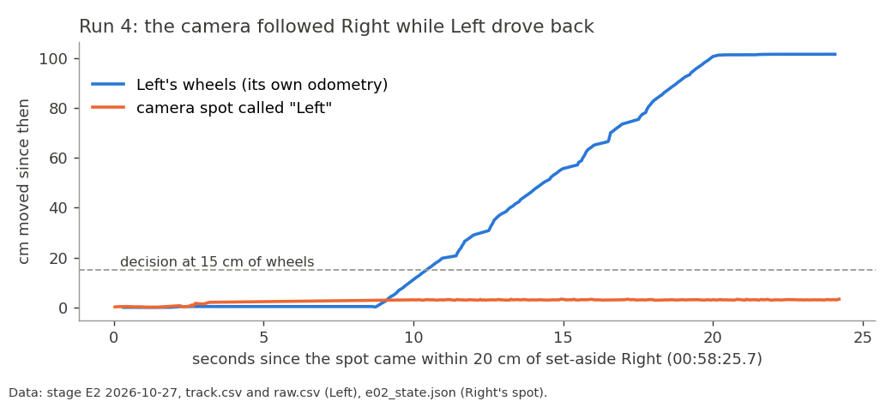
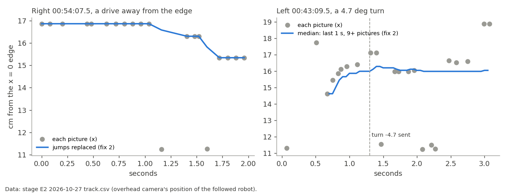
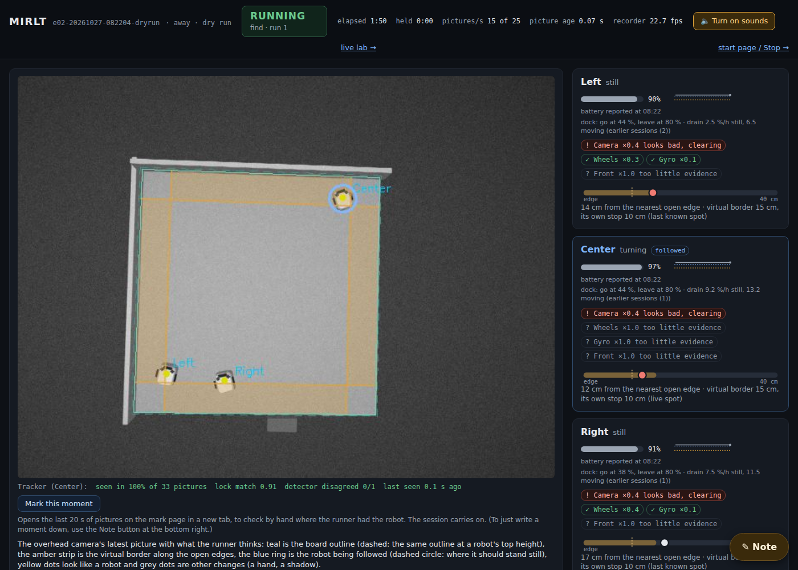

# Edge fixes 1-4 from last night's edges session (MIRLT): who's who, camera jumps, own pose after a barrier, inward rescue

**Premise.** Last night's stage E2 ended with all three robots put aside
([session analysis](e02-oct27-session-edges.md)). Nick approved its fixes 1-4 at 07:45 for today's robots. All four
are in `tools/experiment/e02.py` (the runner behind `./run-e02-pi.sh --plan edges`); nothing else changes behaviour.
Simulator, tests and logs only: the Pi and the robots were not touched. Each fix has a test on last night's logged
numbers (`tools/experiment/tests/test_e02_oct27_edge_fixes.py`, 12 tests; run-4 data in
`tests/data/e02_oct27_run4.json`).

## Data

### 1. Who's who after passing a parked robot (Left, run 4)

How far Left's own wheels and the camera's "Left" spot moved after the spot came within 20 cm of set-aside Right
(data: E2 track.csv and raw.csv for Left, e02_state.json for Right's spot). The wheels drove it 100 cm back; the spot
stayed beside Right.

- **New, live (watchdog):** the followed spot within `ID_NEAR_CM` 20 cm of another robot's stored centre opens a
  doubt. The robot's own odometry (RAW x, y, streamed 10-40 a second on routes) settles it: once its wheels have moved
  `ID_MOVE_CM` 15 cm, the spot must have moved the same within `ID_AGREE_FRAC` 30 %. If not, everyone stops and the
  existing lost hold finds it (where its wheels put it, then its lights; Nick only if both fail).
- **New, at the next camera fix:** a doubt still open (no RAW: idle legs) needs its own pose within
  `ID_FIX_AGREE_CM` 15 cm of the camera, or the same stop-and-find runs before the fix is sent.
- **New, route check:** a route whose far point or a corner it stops at is under `ASIDE_FAR_CM` 25 cm from a
  set-aside robot is not run (the path rule, 18 cm, stays).

| Run 4 (logged) | Before | Now (test) |
|---|---|---|
| Route check: far point (23.3, 24.1) to Right's spot (8.4, 9.5) | 20.9 cm, run | under 25: **not run** |
| If it had run: doubt opens | - | 00:58:25.7, spot 13 cm from Right |
| Wheels 15 cm into the drive back, spot moved | - | 3 cm: **stop and find by lights at 00:58:36** |
| Camera fix (15.9, 18.1) with its own end (95.8, 94.3) | sent at 00:58:56 | 110 cm apart: stop and find first |

### 2. Camera holds near edges ignore one-picture jumps (Right 00:54, Left 00:43)

Each overhead picture's position of the followed robot (grey) and what the checks now use (blue), across the two
holds (data: E2 track.csv). Right's two single pictures at x = 11.2 and Left's three detector pictures at x = 11.3
no longer reach the checks.

- **Drives (`border_check`):** a picture more than `EDGE_JUMP_CM` 3 cm from the median of its 4 neighbours takes
  that median before the line fit.
- **Turns on the spot (`spin_check`):** the median of the last `SPIN_MEDIAN_S` 1 s, reaching back to at least
  `SPIN_MEDIAN_N` 9 pictures, against the same median before the turn (was: the last 3 pictures against one picture).
- **Both:** a spot the detector alone put past an open edge's line is dropped (a lock there still counts).

| Hold (logged) | Before (replayed on the logged pictures) | Now |
|---|---|---|
| Right `go 4` 00:54:08, away from both edges | "12 cm from an open edge, moving towards it" | no hold at any tick |
| Left turn -4.7° 00:43:11 | moved 5.1 cm (16.41 → 11.27) | moved under 0.5 cm at every tick phase; allowance 2.75 |

### 3. Own pose after a barrier-kept find (Right 00:53)

- After a find that felt a barrier, the robot's own pose stands until the camera (median of 3 pictures) is within
  `OWN_AGREE_CM` 3 cm of it, for at most `OWN_TRUST_MAX_S` 90 s. Meanwhile camera fixes are not sent (the caller gets
  its own pose) and the watchdog's camera edge checks skip that robot; its own 10 cm border and edge sensors guard it.
- Test: own (16.8, 13.0) against the spot (16.7, 3.6) and the fix spot (17.6, 3.6): kept; the spot back at
  (17.2, 14.9): camera used again.

### 4. Rescue drives on inward (Right 00:57)

- A border rescue whose last forward drive pointed inward from every open edge within `RESCUE_NEAR_CM` 20 cm (and
  at least `RESCUE_INWARD_COS` 0.5 inward from one) drives on that way instead of reversing it. The same backing out
  in `retry_find` is unchanged.
- Test: Right's `go 4` heading 52° at (11.9, 13.5): now `go 6.0` (was `go -6.0`, into its own border at 9.9 cm).
  Facing the corner, driving along an edge, or no edge near: reversed as before.

### 5. Simulator dry runs

One simulator run, 08:22-08:46 (`logs/e02-20261027-082204-dryrun`): `--no-boards`, the edges plan's settings, a
brick just beyond the x = 0 edge at y = 48 (`--dry-bricks=-4,48,14,6,90 --dry-bricks-now`, tonight's "barrier") and
Center's turns broken from 60 s (`--dry-turn-fault Center@60`).

The live page at the start of the dry run (data: simulator). The grey block below the board's bottom edge is the
brick standing beyond the open x = 0 edge.

| What | Result |
|---|---|
| Runs | 10 done, 0 failed, 0 rescues, nobody set aside (planned end 08:40, hard cap reached) |
| Fix 3: barrier felt (Right at x = 0, every find) | 4 times; own pose used each time. The first spell lasted Right's whole route (69 s, one fix 3.6 cm off not sent); the next three ended in 0.1 s (camera within 1.1-1.7 cm) |
| Fix 2 | no false holds; Center's 4 holds in run 1 came from its broken turns (8, 5 and 2 cm from the edge, real moves) |
| Fix 1 | no doubt opened: no followed robot came within 20 cm of another's spot; no route blocked |
| Fix 4 | not reached (no rescue) |
| Watchdog stops at route starts right after a find (9-10 cm, all three robots) | 5, as before this build; Right's two among them came after its spell had already ended |

## Conclusions (Claude's)

1. On last night's numbers, fix 2 removes Right's set-aside hold and Left's 00:43 hold; fix 4 would have brought Right
   inward; fix 1 would not have run run 4 at all, and had it run, would have stopped the swap 20 s before the bad fix.
2. **Fix 1's live check and fix 4 have not run in the simulator.** Their tests use last night's numbers, and RAW reaching
   the check has its own test. The first real use will be on the board.
3. **Fix 3 turns the camera's edge checks off for a robot for up to one route** (the robot's own pose only updates at a
   leg's or route's end). In the simulator that happened once for 69 s. The robot's own border (10 cm) and edge sensors
   guard it meanwhile.
4. Center's set-aside (the sidestep slant, items 5-7 of the analysis) is not addressed by this build.
5. **Landed:** commit 72041d0 (code and tests), this report in the commit after it. Full suite: 649 passed, 1 failed (a
   test stand-in for `back_out` without the new argument; fixed, its file rerun: 36 passed).

## What's next

- Today's robots: watch the log for "who is who is checked", "its own pose is used" and "drives on inward"; each
  is also in `e02_state.json` (`identity_doubts`, `own_pose_kept` / `fix_own_kept`, `rescue_inward`).
- The analysis's items 5-7 (sidestep steered by the camera, the edge guard's in-between readings, a stage starting with
  a hanging robot) remain for Nick's go-ahead.

## Sweep 1: new tests that may now be needed

- Replay every session's track.csv through the new `border_check` / `spin_check` (with the legs' live times from
  `leg.csv`) to count which past holds go away and confirm the 15:45 slipping spins still hold.
- Logs DOE for `ID_AGREE_FRAC`: camera move against wheel move over 15 cm stretches of every route (track.csv +
  raw.csv); for `ID_NEAR_CM`: tracker swaps against the gap to the nearest parked robot.
- On the board: a far point next to a parked robot (about 13 cm) with the camera watching, to see the doubt open and
  settle on real RAW.
- On the board: a barrier find (something beyond an open edge) and how long the spot takes to come back to the body
  (sets `OWN_TRUST_MAX_S`).
- E1's two Left holds (24° and 2.5° turns, camera jumping 87 → 110 cm in y) were not replayed here (E1's logs were not
  downloaded); a replay would confirm fix 2 covers them.

## Sweep 2: possible inaccuracies in what this relied on

- **RAW odometry frame:** fix 1 compares distances moved, not positions, because RAW x, y are in each run's own frame.
  A run change mid-doubt restarts the count; a robot whose RAW stops (idle legs) falls back to the fix-time check.
- **During a firmware route, the robot's own pose is its last leg's until the route ends** (`own_latest_xy` adds the
  route's E02 end record). Fix 3's agreement can therefore only come when the route is over or a leg ends; until
  then (at most 90 s) the camera's edge checks are off for that robot.
- **Chosen numbers:** 15 cm, 30 %, 15 cm, 3 cm (jump), 1 s / 9 pictures, 90 s, 20 cm, 0.5 are chosen, each with a DOE
  note in the code. 20 cm, 25 cm and 3 cm (agreement) are Nick's.
- **The "before" for Left 00:43** is recomputed from the logged pictures and the logged turn start (16.41); the old code
  was not re-run. Right's "before" re-runs the new code with the jump step switched off.
- **Ticks:** the tests step the watchdog every 0.1 s at fixed phases; the real watchdog's ticks fall elsewhere.
- **The 2-picture case at the newest end:** the drive check's jump step judges the newest picture on its 2 older
  neighbours only, so a jump lasting 2 pictures at the very end can count for one tick (0.1 s) until the next picture.
- **The simulator's camera does not ride on the nose at edges**, so the dry run cannot show fix 3's real length.
- **Detector spots past the line are dropped** in the border checks only. A robot really over the edge that only the
  detector sees is left to its own line sensors and border.

## Appendix. Files

- `tools/experiment/e02.py`: constants and `median_xy` / `recent_median` / `drop_jumps` (fix block after
  `spin_allowance_cm`); `Listener.odo`; `Runner.identity_tick`, `identity_at_fix`, `own_latest_xy`, `own_pose_kept`,
  `trusted_edge_samples`, `drive_was_inward`; changes in `fix_now`, `send_leg` (turn start), `spin_check`,
  `border_check`, the watchdog loop, the barrier branch of the edge find, `back_out`, `self_rescue`,
  `route_blocked_by_aside`.
- `tools/experiment/tests/test_e02_oct27_edge_fixes.py` (13 tests), `tests/data/e02_oct27_run4.json`;
  `test_e02_1545_fixes.py`: the 15:45 spin test now gives the whole 5.4 s spin as history (the check reads the last
  second; it still holds).
