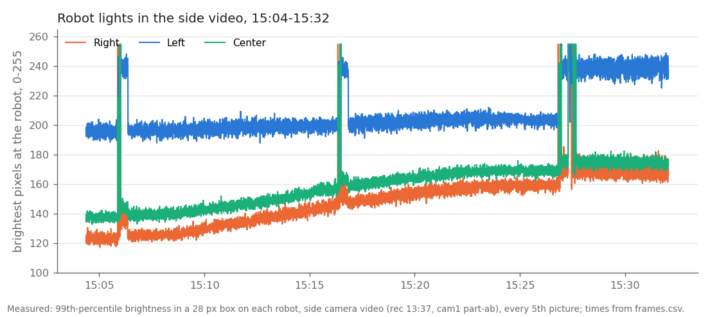
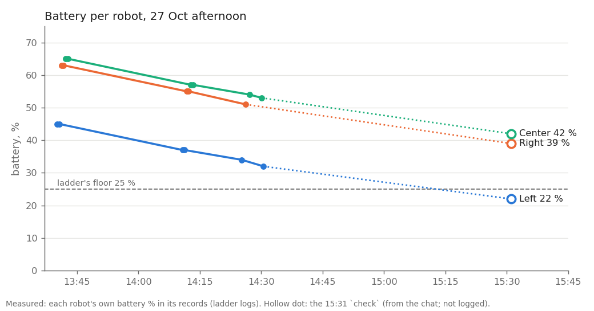
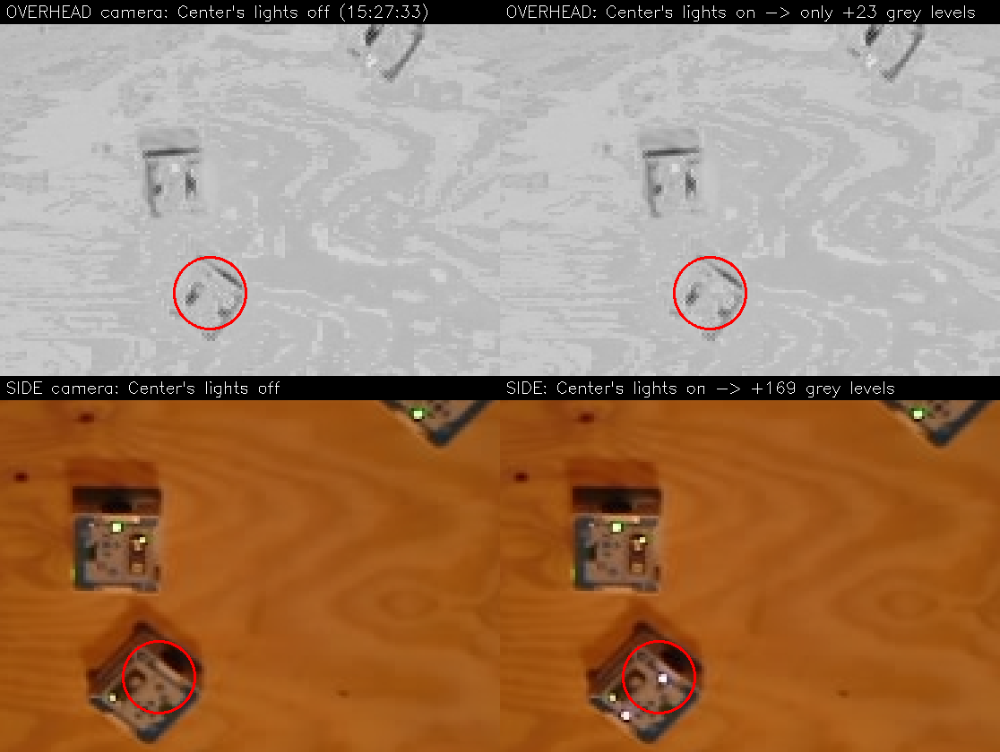
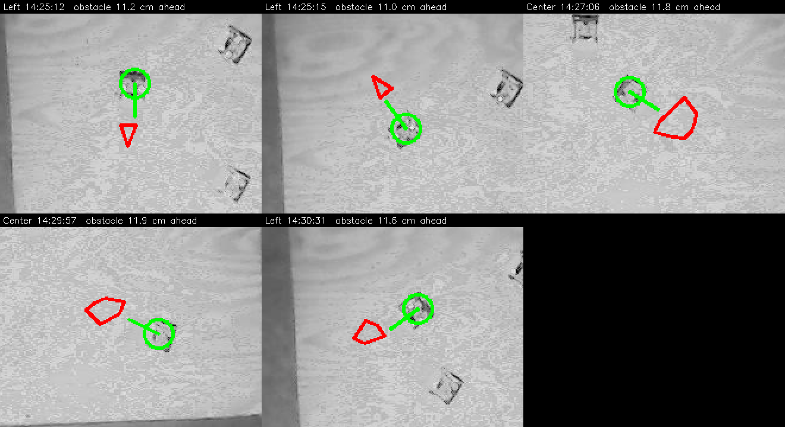
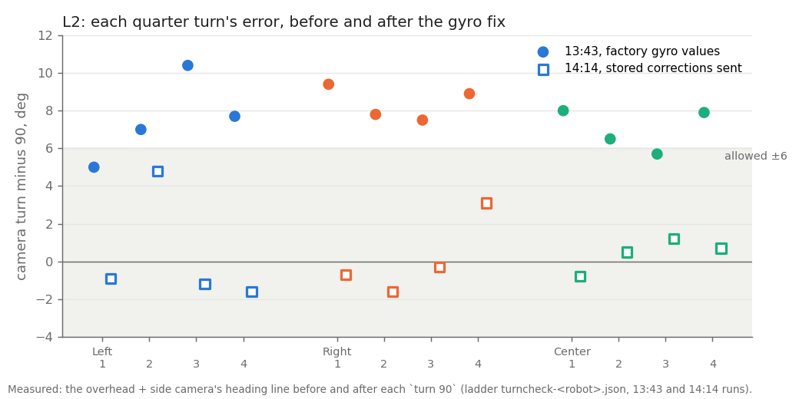

# The real ladder run, 27 Oct afternoon: why each step stopped (MIRLT)

**Premise.** The remote ladder (`tools/fleet/ladder.py`) ran on the real board this afternoon: the robots were on the
home plywood, both cameras had been calibrated at 12:58, and all three robots ran firmware 2026-10-25c. It stopped four
times (13:01, 13:37, 14:30 and 15:27). Nick asked for the specific cause of each stop. This is a logs-and-footage
analysis: nothing was run on the robots or the Pi.
Sources: release `p0-20261027-ladder-pm` (ladder logs 11:17-15:28) and release `p0-20261027-recording` (the 13:37
recording, from 13:37 to 15:32). Of that recording, the overhead video from 14:23 and the side video from 15:04 were
available. The first part of each video was not uploaded (see "Upload" below).

## The stops

| Time | Step | Specific cause | Evidence |
|---|---|---|---|
| 11:20 | L0 | The overhead camera alone could not see the bodies on the washed-out board. | Two-camera report (`e02-oct27-two-camera-tracking.md`) |
| 13:01 | L0 | Two causes: tracking fell seconds behind the camera, and the side picture was too dark (mean 20 of 255). Fixed in bb5077d. | Same report, section "Fix after the real L0 at 13:01". This run's logs hold only clock files. |
| 13:43 | L2 FAIL | The robots ran on factory gyro values: every robot reported `gyro_scale 1.0000`, `wheel_scale 1.0000`. Each quarter turn was 5-10 deg too big. Fixed in 7072b06. | `param.csv` (13:39-13:42); the chart below |
| 14:25 | L3, Right kept out | Right's p95 was 3.11 cm (the gate is 3.0). All 41 spots over 2.5 cm are at its two turn-around points. Its driving between them stayed on the line. | `L3-Right/bridge/track.csv` against the planned lines |
| 14:30 | L4 refused at the start spot | A distance-sensor stop over empty floor made the planner re-plan, and the new plan dropped the 15 cm straight lead-in. Left reached the start on an 8 cm drive plus a 57 deg turn on the spot. The heading read from that was 8.3 deg off, and the limit was 6. | coordinator.jsonl, raw.csv, the overhead video at 14:30:31 |
| 15:27 | L4 start-up failed: "Not heard from: Left" | run_plan's link received **no packet from any robot** for its 20 s wait (15:27:52-15:28:12). Right and Center were silent too. The cause of the silence is not in the logs. Separately, two things meant this start could not have worked: all three robots had restarted at 15:26:49 (a sleep check-in), which cleared the calibration L1 gave them, and Left was at about 23 %, under the 25 % floor. | the boot IDs in clock_sync.csv; the side video; the run_plan folder holds no clock or record files |
| 15:27 | (within L4) "Center: its lights were not seen" | Center did get both `led` commands: the side video shows its lights come on twice. In the overhead picture its lights raised its spot by only 23-24 grey levels, and the light finder needs 30. The light search uses the overhead camera only. | both videos, 15:27:33 and 15:27:38; the ladder's own `locate_light` run on the real frames |

### 15:27 in detail

**The robots had restarted.** Every robot answer carries a boot ID. At 15:27 all three IDs were new (Right C12D,
Center 4305, Left 9DA8). The robots' own clocks put the restart at 15:26:48.9, 15:26:49.8 and 15:26:50.6. That is 23 s
before the ladder started. Between 13:36 and 14:31 the IDs had not changed.

Each line is one robot's brightest pixels in the side video. The robots light up together every 10 min 30 s (15:05:53,
15:16:22, 15:26:50), stay lit about 25 s, then go dark again, and nobody reaches over the board at any of these times.

That pattern fits the firmware's `sleep` (default 10 min): each wake-up is a fresh start, then a 20 s check-in, then
sleep again unless something sends `wake`. After 15:26:50 the robots stayed lit until at least 15:38, so something
woke them for good. *Claude's reading: the robots were put to sleep after the 14:30 stop and woken at the 15:26:49
check-in (question 1).* A deep-sleep wake clears the calibration since power-on. The ladder does not notice a
restart: it resumed at L4 because `state.json` said L0-L3 had passed. So even with the link working, run_plan would
have stopped at "Not calibrated since power-on".

**The link.** The ladder's own link heard all three robots from 15:27:16 to 15:27:38 (clock round trips 17-20 ms).
run_plan opened its link at 15:27:52.6, sent one `ping` and then waited 20 s. In every earlier run it had heard all
three robots, including robots not on its map, within 1.0 s. This time it heard none, and it never re-pings while it
waits. Left's battery cannot be the cause on its own, because Right (about 39 %) and Center (about 42 %) were silent
too. The robots were awake (Left's lights stay on in the video, and the 15:31 `check` reached all three). *Claude's
reading: something else was talking to the robots, or the one ping was lost. The robots answer whichever computer
sent to them last. A `wake` loop still running from another computer would take their answers away (question 1).*

**Battery.** At 15:27 Left was at about 23 % (22 % at 15:31). The ladder checks battery only in L0, so a resumed L4
never checked it.

Each robot's own battery reading through the afternoon. Left drained 13 points in 51 min of ladder work (about 15 % an
hour) and was below the 25 % floor by 15:31.

**Center's lights.**

The same moment from both cameras, with Center's lights off and then on. The overhead barely changes; the side camera
shows a bright light.

| 15:27 light search (median picture with the lights on minus median with them off) | Overhead change at the robot | Side change at the robot | Ladder result |
|---|---|---|---|
| Left | +40 grey levels | +164 | found |
| Right | +49 | +177 | found |
| Center, try 1 / try 2 | +23 / +24 | +169 / +171 | **not seen** |

Threshold: 30 grey levels above the picture-wide median change (`locate_light`). Run on the real frames, the
ladder's own `locate_light` finds Left (1 cm from its body) and Right (2 cm) and does not find Center on either try.
The two videos were aligned on the robots' restart lights (15:26:48.9 by the robots' clocks). Left's 14:30 drive
landed within 0.3 s of its log, which checks that alignment.

Center stood at (48.9, 69.0), well inside both pictures: at pixel (334, 306) of 640 × 480 in the side picture, far
from its edges. Its battery was about 43 % (53 % at 14:30, 42 % at 15:31).

### 14:30 L4 refusal in detail

Each tile is the overhead picture at the moment a robot stopped for something "ahead". The green circle is the robot
and its heading; the red outline is where the planner put the obstacle. Every outline lands on empty plywood.

Four of the five planner drives stopped this way (five stops in all, two of them in Left's L3; Right's L3 had none), every one at 11.0-11.9 cm. In the robots' own distance
records, single zones flick between 10-16 cm and 70-150 cm from one reading to the next, even while the robot stands
still (Left 14:25:12, zone CR). At 14:30:31.8 the stop came during Left's drive into the corner. The re-plan went
straight to the start (7.9 cm) and turned 57 deg on the spot. `end_poses` took the heading from that 8 cm line plus the
turn: 8.3 deg off, against the limit of 6 at the time (10 since 3eb2b16). The position was 1.8 cm off, which was
fine.

## Data

**L2 after the gyro fix (14:14), per robot.**

Each mark is one quarter turn's error, as the cameras measured it. Filled marks: the 13:43 run on factory values, all
above the ±6 band. Hollow marks: 14:14 with the corrections, all inside.

| Robot | 13:43, mean error per turn / after 4 turns | 14:14, mean / largest / after 4 turns |
|---|---|---|
| Left | +7.5 / +30.1 deg | +0.3 / 4.8 / +1.1 deg |
| Right | +8.4 / +33.5 | +0.1 / 3.1 / +0.5 |
| Center | +7.0 / +28.1 | +0.4 / 1.2 / +1.5 |

At 13:43 the cameras measured 97.6 deg against the gyro's 90.1, a ratio of 1.083, close to the stored 1.075. At 14:12
Center reported `wheel_scale 1.0000` although 0.979 was sent (a lost `set`; see Next).

**L3 line check (14:25-14:27), 5 cm/s, 25 cm out and back.**

| Robot | median | p95 | max | Result |
|---|---|---|---|---|
| Left | 0.38 cm | 0.91 cm | 0.98 cm | PASS (stopped once for a phantom obstacle) |
| Center | 0.57 | 1.88 | 2.54 | PASS (phantom stop; 31.5 s against 17 planned) |
| Right | 1.06 | **3.11** | 3.68 | FAIL, kept out. Spots over 2.5 cm: at (66.4, 60.3) against the planned turn-around point (67.4, 57.3), and at the end, (88.1, 39.4) against (87.5, 42.4) |

*Claude's reading:* at a turn on the spot, the camera follows the body's middle, which swings around the axle. The
dry-run plan expected about 3 cm of that.

**The Pi's tracking (`tracking_times.csv`).**

| Step (start time) | Overhead: tracked a second / median ms / 90 % ms / dropped | Side: tracked a second / median / 90 % / dropped | Most behind |
|---|---|---|---|
| L0 13:37 | 12.3 / 70 / 88 / 51 % | 9.1 / 96 / 122 / 64 % | 0.25 s |
| L1 13:39 | 12.0 / 83 / 99 / 52 % | 8.3 / 114 / 148 / 67 % | 0.27 s |
| L2 13:43 | 12.0 / 84 / 97 / 52 % | 8.3 / 114 / 145 / 67 % | 0.22 s |
| L0+L1 14:00 | 12.0 / 84-86 / 97-100 / 52 % | 8.1-8.3 / 114-119 / 147-152 / 67 % | 0.27 s |
| L2 14:14 | 11.8 / 87 / 101 / 53 % | 8.0 / 120 / 153 / 68 % | 0.32 s |
| L3 14:24 | 11.7 / 86 / 101 / 53 % | 8.1 / 117 / 152 / 68 % | 0.30 s |
| L4 14:29 | 11.4 / 87 / 113 / 56 % | 7.9 / 118 / 155 / 69 % | 0.27 s |
| L4 15:27 | 12.6 / 66 / 88 / 50 % | 9.4 / 92 / 132 / 63 % | 0.18 s |

Dropped: pictures the tracker skipped because a newer one was waiting, which is by design since bb5077d. The
rate caps are 12 a second (overhead) and 10 (side). The Pi costs 70-87 ms an overhead picture, against the 45-50 ms
the fix assumed. The camera bridge in the planner runs handled 8-10 overhead pictures a second (`bridge_summary.json`),
against the 14+ the plan asked for.

**Side camera brightness.** The planner runs at 14:25-14:30 had a side picture mean of 41 of 255, so the tracker
brightened it 1.93x. At 15:27 the mean was 64 and no brightening was needed. In the side video the mean rose from 39
(15:04) to 58 (15:20), then held, with the exposure locked. *Claude's reading: the room got lighter (daylight).* The
side camera carried every body: the overhead alone saw none of them in any planner run (`two_camera`: overhead-only
0, side 269-665, both 19-285).

**Upload.** `upload_session.py` skips any file name already in a release. The 15:32 stop therefore skipped the new
ladder logs and the first part of each 13:37 video, because the 13:01 upload had used the same names. The logs were
re-uploaded under `p0-20261027-ladder-pm`. Two more things: `--stop-recorder` only stops a tmux `e02` session, so the
fleet recorder kept recording during the upload, and each video part was cut mid-picture. The overhead video runs 3.5 s
past its frames.csv, and the side video runs about 16 min past it.

**Heat tracker:** not run. These logs have no `cpu.csv` (neither the ladder nor run_plan writes one).

## Conclusion

- 13:43: factory gyro values. The fix worked: every turn is now within 4.8 deg, and the four-turn totals are +0.5 to
  +1.5 deg.
- 14:30: a distance-sensor reading over empty floor caused a re-plan that dropped the lead-in.
- 15:27: run_plan heard no robot at all. Even if it had, the robots had restarted from sleep, so they were
  uncalibrated, and Left's battery was below the floor. The ladder has no check for either after L0/L1.
- Center's lights: it got both `led` commands, but its lights were too faint in the overhead picture. The side
  picture shows them 7x more strongly and is not used for the light search.

*Claude's conclusion:* the camera and driving side is in good shape: L3 p95 0.9-1.9 cm, and the side camera carries
the bodies. What stopped the afternoon was state the ladder assumed and never re-checked (restart, battery, the
link), plus distance-sensor noise.

## What's next (recommended, not built)

1. **Ladder, at every step and resume:** ask each robot for `status` and its boot ID. A new boot ID since L1 means
   "restarted: redo L0 and L1". Check battery against the 25 % floor every step, not only in L0.
2. **run_plan start-up:** re-send `ping` every 2 s during the 20 s wait. Say which robots were heard at all; "heard
   none" is a link problem, not a robot problem. **Log `M` lines** (status, `led` replies, `awake`) to
   `messages.csv` in `alvik_console.Session`; today none of them are kept.
3. **Light search with both cameras:** take the side camera's change when the overhead's is under the threshold
   (Center: +169 against +23).
4. **Distance-sensor stops:** confirm before re-planning, for example 3 readings in a row, two zones, or the camera
   seeing something there. *DOE fits:* 1 / 2 / 3 readings against phantom stops (5 today) and real-obstacle reaction
   time (brick runs).
5. **drive_to after a re-plan:** put the corner lead-in back, or crawl 10 cm along the start heading before the start
   check.
6. **Line check at turn-around points:** leave out samples taken while turning on the spot, or measure the axle point.
   This changes the Phase 0 gate (question 4).
7. **Settings read back:** compare the robots' `PARAM` rows with what was sent, and resend on a mismatch (Center's
   wheel_scale).
8. **Upload:** one release tag per recording (or replace an asset with the same name), and stop the fleet recorder
   before uploading.

## Sweep 1: new tests that may now be necessary

- A robot restarted mid-ladder (sleep / power), dry run: does the ladder notice it? (After fix 1.)
- run_plan start-up with the first `ping` dropped (simulator `--wifi-drop` at t=0): should start within 2 s after fix 2.
- Two programs talking to the robots at once (a `wake` loop plus run_plan): who gets the answers?
- Distance sensor standing still on the plywood, lamp on and lamp off, 2 min each: how often a zone reads under 15 cm.
- Light search on the real board with the side camera, all three robots, at several spots on the board.
- The line check's p95 with turning samples removed, on today's L3 and the 14:30 drives.
- The Pi's cost per picture under the ladder (70-87 ms overhead, 92-120 ms side), against the bridge's 8-10 a second,
  with the planner running.

## Sweep 2: possible inaccuracies in what this relied on

- **Video alignment:** the two videos are matched on the robots' restart lights against the robots' clocks (±0.3 s).
  The overhead's light change is sensitive to this: with the windows moved by about 1 s, Center's change reaches 36.
  At the alignment where Left and Right are found (as they were live), it is 23-24.
- **The 15:27 battery** (about 23 %) is read between 32 % (14:30) and Nick's 22 % at 15:31 (from the chat; the 15:31
  `check` folder was not uploaded).
- **"Asleep"** is read from the light pattern and the boot IDs. The firmware's `sleep` messages are `M` lines, which
  are not logged. The video before 15:04 (side) is missing, so when they were put to sleep is not known.
- **The phantom stops** are judged empty from the overhead picture alone. A thin object level with the sensor would
  not show from above, and no side video covers 14:25-14:30.
- **Right's L3 turn-around reading** assumes the camera follows the body's middle; the 3 cm is the dry-run plan's
  figure, not a measurement.
- **The "daylight"** reading of the side brightness is an assumption (room lights not logged).
- **Chosen numbers in the recommendations:** a re-ping every 2 s and 3 readings in a row are chosen. A DOE fits the
  second (above); the first is a retry period (no DOE).

## Appendix: method

Scripts were in scratch: the AVI parts indexed by their `00dc` chunks; frame numbers mapped to frames.csv rows through
the restart anchor; robot spots projected with the 12:58 calibrations (`overhead_floorcal_20261027-125803.json`,
`side_floorcal_20261027-125812.json`). The overhead light change is the median of 18-25 pictures with the lights on
minus 18-40 with them off, as `locate_light` does it. The videos were deleted after use.
