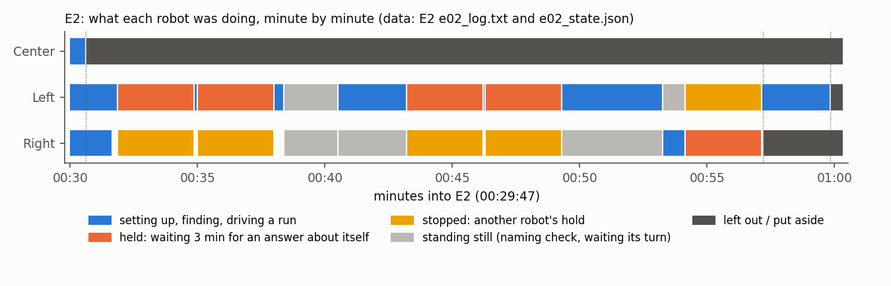
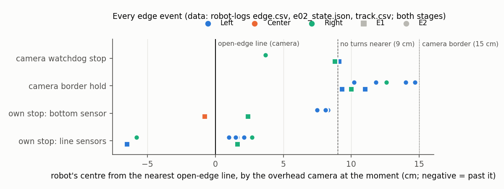
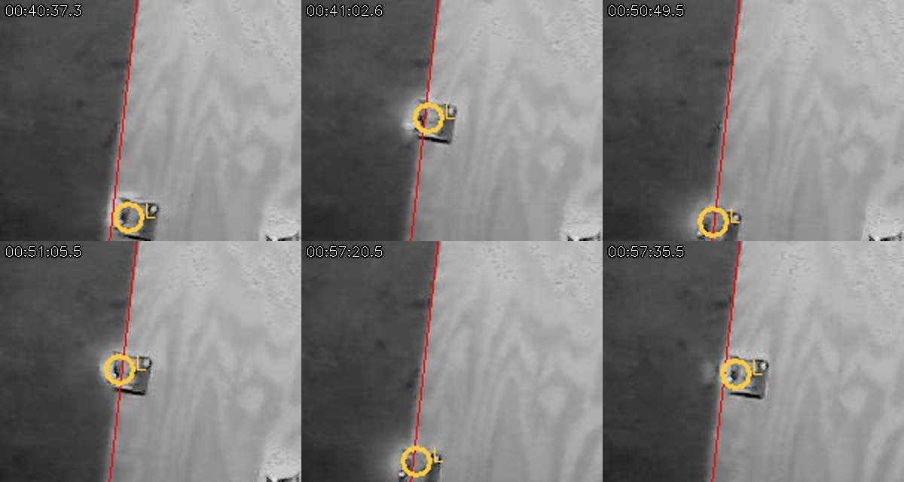
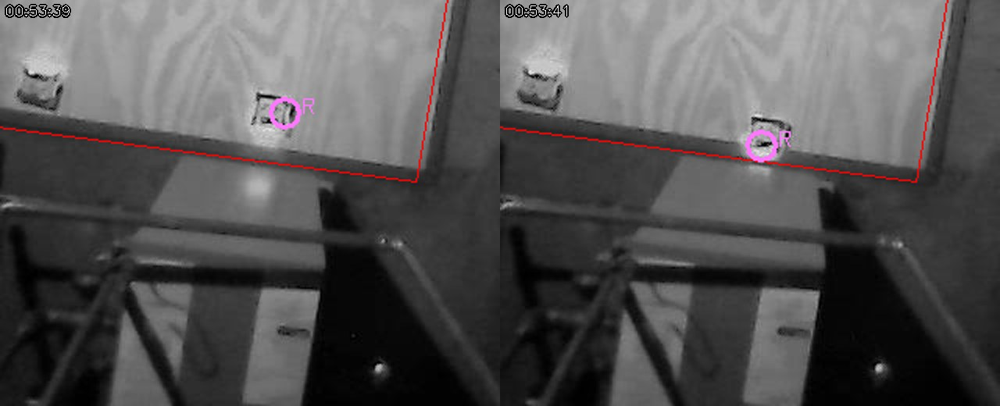
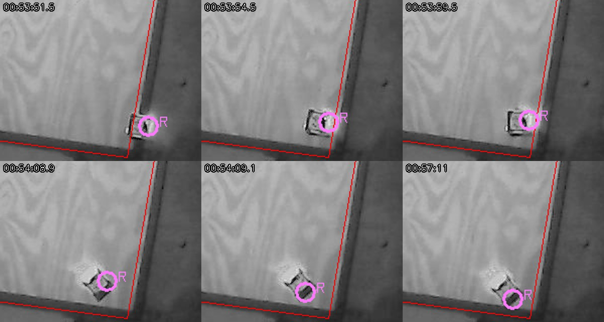
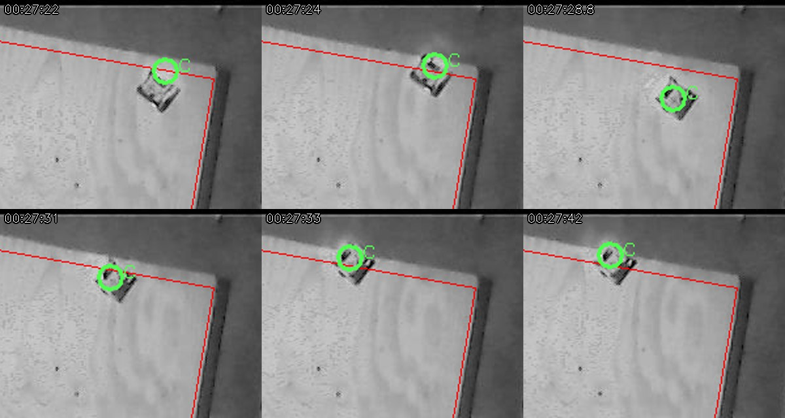
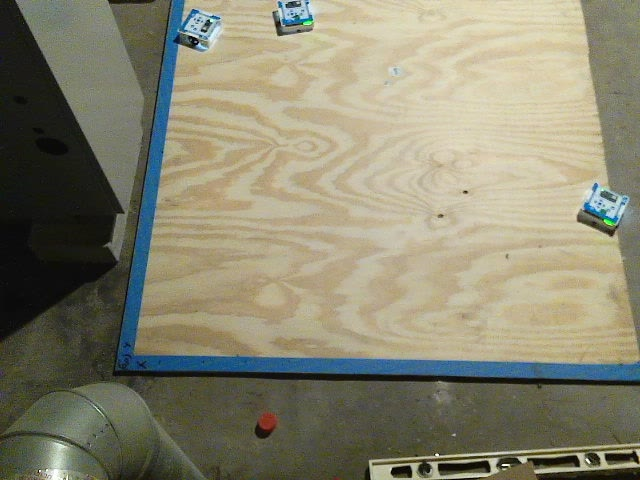
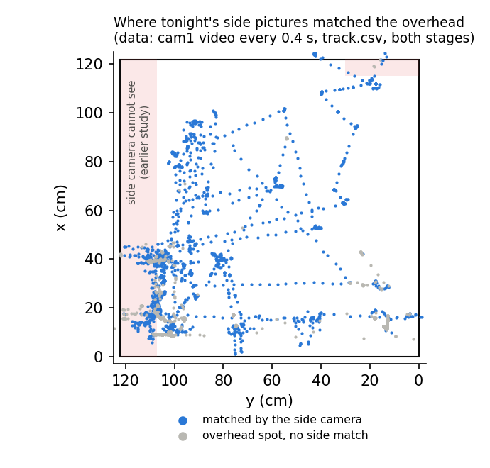
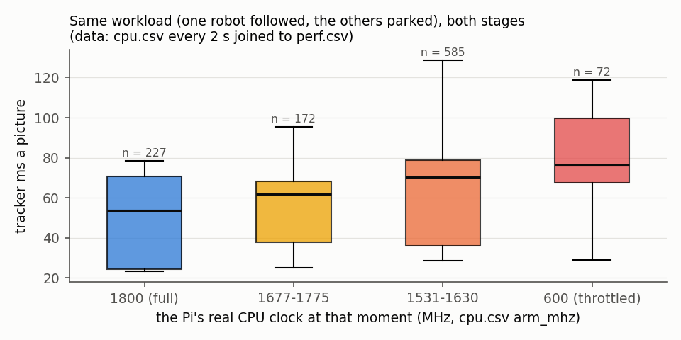
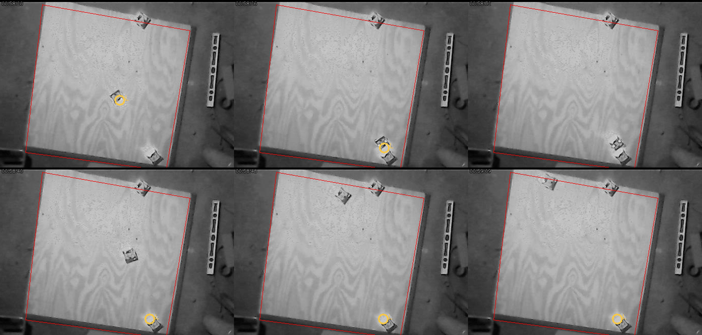

# Real session 2026-10-27 00:11 "edges" (MIRLT): E2 ended at 01:00 with all three robots put aside; the 49fd943 fixes would have saved one of them

**Premise.** Plan `edges` (`tools/pi/session_plan.sh`): both boards off, all four sides open edges (`--no-boards`),
stored roam1 calibration, 3 robots, unattended, an unanswered hold rescues the robot after 3 min. Stage E1
00:11-00:28 (`e02-20261027-001136`), stage E2 00:29-01:00 (`e02-20261027-002947`), both cameras recorded
(`e02-pi-plan-20261027-0011-recording`). E1's three set-asides were analysed last night and fixed in 49fd943 (00:43),
but **E2 ran the old code**. Logs and video only; the Pi and the robots were not touched, no runner code changed.

**Sources.** Both stages' logs zips (`e02_log.txt`, `e02_state.json`, `track.csv`, `perf.csv`, `cpu.csv`; robot logs
`edge.csv`, `leg.csv`, `raw.csv`, `border.csv`, `e02.csv`), the recorder's small zip (`frames.csv`, `meta.json`,
`session.json`), overhead frames read by byte range and 7,000 side frames. **cam0 is the overhead** ("USB 2.0 Camera":
device 2, role overhead, top-down picture) and **cam1 the side camera** (EMEET: device 0, role side, colour, 15 a
second); the camera names are not in the logs, so this comes from `session.json` and the pictures. Distances are
roam1 board cm (x = 0 the bottom open edge of the overhead picture, y = 0 the right one); "the line" is roam1's
open-edge line. Times are the Pi's. Scripts: `tools/experiment/analyses_oct27/edges/` (Appendix C).

## Data

### 1. E2, robot by robot, and why it ended at 01:00

What each robot was doing through E2; dotted lines mark the three set-asides (data: E2 `e02_log.txt`, `e02_state.json`).
Half of E2 (15 of 31 minutes) went to five unanswered 3-minute holds, during which every robot stood still.

| Robot | What happened | Set aside | Cause (evidence) |
|---|---|---|---|
| **Center** | Started E2 still hanging over the x = 122 edge where E1 left it (camera 123.4, 41.8). Its three compass-check turns timed out (wheels spun ±380° in place, it did not move) | 00:30:36, "turns not working" | Inherited from E1 (section 3). Tilted 2.5° roll / 2.6° pitch from its own level for all of E2 (`raw.csv`) |
| **Left** | 3 runs done (2 edge finds OK, 1 failed find retried), 4 border holds, all 4 rescued itself. Run 4 (straight 100 cm) drove to its far point beside the left-out Right; **the camera then followed Right as "Left"** (from 00:58:28). Left drove back unseen and the runner, thinking it was at Right's spot, sent it 24 cm towards the x = 122 edge. Found there by its lights 1.6 cm from the line, heading unknown: help call (unattended: not waited for) | 00:59:50 | Tracker identity swap at a parked robot (figure below). Video: Left really ended run 4 at about (114, 67), not where the camera said (15.9, 18.1) |
| **Right** | Setup OK. Run 3's edge find felt "a barrier" at x = 0 (section 2), kept a camera position that was its nose at the y = 0 edge, the route was stopped twice by the camera watchdog, then a border hold "12 cm, moving towards" during a drive *away* from both edges | 00:57:11, rescue failed | The hold came from a one-picture camera jump of 5 cm (16.3 → 11.3 in x at 00:54:09.0). The rescue backed it towards the corner until its own 10 cm border stopped it (`border.csv` 9.9 cm); "no drive known", camera 8.6 cm from the edge, so it was left out |

**Why it ended:** at 01:00:21 nothing could run ("put aside: Center, Left, Right"), 3 h 29 min before the planned end.
Runs: 4 of 141 done (n = 4, too few for statistics). **Run 4's logged result "back at start 91.1 cm off" is wrong**: the
camera was on Right. It should be excluded or re-measured from the video.

**Would 49fd943 have prevented each set-aside?** Replayed against the logged numbers (`replay.py`):

| Set-aside | 49fd943 rule that applies | Replay | Verdict (Claude's) |
|---|---|---|---|
| Center 00:30:36 | none in E2; E1's back-off 15 cm (was 9.5) | E1's sidestep slanted 28° towards the edge (below): from 15 cm back it would still end about 4 cm inside the line and turn there | **Probably not** |
| Right 00:57:11 | border rescue with no drive to reverse carries on at ≥ 8.5 cm | camera 8.6 cm: carries on, **by 0.1 cm** | **Yes, narrowly**; the false hold and the stale find position remain |
| Left 00:59:50 | none | identity swap is untouched | **No** |
| Left's 4 holds (not set-asides) | turn swing allowance | 168.9° and 166.1° turns: no hold; 4.7° turn with a 5.1 cm one-picture jump and the 15 cm drive hold: still hold | **2 of 4 holds gone, 6 of the 15 idle minutes** |

**Correction to 49fd943's own claim:** replayed on E1, it removes Right's hold (92° turn, 4.0 cm) but **not Left's**:
Left's two E1 holds were on a 24° and a 2.5° turn (allowance 3.8 and 2.6 cm) with 5.5 and 5.0 cm "moves", and the track
shows the camera jumping 87 → 110 cm in y within 3 s while Left turned. Those were camera jumps, not swings, and E1
Left would still have been left out.

### 2. Edge data for Monday

Where the overhead camera put each robot's centre at every edge stop, hold and camera stop, both stages (data: robot
`edge.csv`, `e02_state.json`, `track.csv`). The robots' own sensors stopped them with the camera spot 1-3 cm from the
line; the camera's own stops and holds came 9-15 cm in.

| Event (both stages) | n | Sensor readings (plywood ≈ 48-57) | Camera, centre to the line |
|---|---|---|---|
| Own stop, line sensors | 10 (Left 7, Right 3) | trip 211-694 (threshold 150); a moment later **all three 471-736** ("off the plywood") | median 1.6 cm in; 2 readings -5.8 / -6.5 are the spot sliding onto the dark floor (video) |
| Own stop, bottom sensor | 5 | bottom distance 11.1-11.2 cm (limit 11; 6.6-7.9 on plywood) | Left at x = 0: 7.5-8.3 cm in; Right 2.4; Center -0.8 |
| Camera border hold | 8 | - | 9.3-14.7 cm in |
| Camera watchdog stop | 4 | - | 3.7-9.1 cm |
| Barrier felt at an open edge | 2 (Right, x = 0, y 47-50, E1 and E2) | front sensor 13-14 cm at 14 cm in; stop "obstacle" at 6-9 cm in | find not used; would have moved Right 9.0 / 7.8 cm |

Left's line-sensor stops at the y = 122 edge, overhead crops with the line (red) and the camera spot (circle) (data:
cam0 video, roam1). Noses reach the plywood's end and stop; the camera spot sits on the nose over the dark floor.

- **How far past the line:** no robot fell and none went past except Center. Video: noses at or a little over the
  plywood's end, bodies on the board. At the x = 0 and x = 122 sides the plywood runs a little past roam1's line; at
  y = 122 the line is the plywood's end.
- **The camera's spot moves outward at edges.** At the edge the tracker locks on the dark nose against the dark floor
  (crops), so "centre past the line" readings of -5 to -7 cm are the spot, not the robot. Right after its y = 0 stop,
  the camera put it at y ≈ 3.7 for 6 s while it had already backed to about 13 (its own pose and the video).
- **Tilts (`raw.csv`, against each robot's own still median):** only Center, 2.5° / 2.6° for all of E2. Left reached
  2.4° once at E2's start, 13 cm in (the board, not an edge); everything else stayed within 1.5°.
- **Center's hang did not trip its edge guard:** its right line sensor read **135-140 for 30 minutes, under the 150
  threshold**. A sensor over the tape, or part way over the drop, can sit just under the trip level.
- **The barrier at x = 0, y ≈ 47-50** was felt both times Right touched there. The overhead shows a light rectangle just
  beyond that edge (crop below). It is probably something standing beside the table, seen by the front sensor before the
  line sensors reach the edge.

Right at its "barrier" touch on the x = 0 edge (00:53:39-41), with the light object just beyond the line (data: cam0
video).

Right at the y = 0 edge and its false hold, overhead crops (data: cam0 video, track.csv): the spot stays on the nose at
the line after Right backed off (00:53:54-59), then jumps 5 cm to its rear corner at 00:54:09.1, which raised the hold.

### 3. Did Center "go from not moving to driving straight off"?

**Not in E2.** In E2 Center never moved: the overhead pictures from 00:30:00 to 01:00:20 are the same, its position
(85.19, -11.94 by its own count) did not change, and its only commands were three `calibrate` wiggles and three
`turn 15` that timed out.

**It happened at the end of E1, 00:27:16-00:27:42**, after 14 minutes parked (since 00:13:35). Nick's screenshot times
ran 1-2 minutes ahead of the Pi before, so his 00:29-00:31 likely matches this.

Center's edge find at the x = 122 edge, overhead crops with the line (red) and the camera spot (data: cam0 video, E1
track.csv). It touches the edge, backs off, then the sidestep drives it diagonally over the line.

| Time | Command (E1 `leg.csv`) | Robot's own record | Camera |
|---|---|---|---|
| 00:27:16 | `turn -100.93` (edge find starts) | done, heading -0.4° | 111.9, 17.7 |
| 00:27:21 | `go 25.06` | stopped by its bottom sensor (11.1 cm) | 0.8 cm past the line (spot on the nose) |
| 00:27:23 | `go -9.50` | done | 8.5 cm in |
| 00:27:25 | `turn 90.00` | done, heading 89.1° | |
| **00:27:28** | **`go 25.00`, id 743254 (the sidestep)** | **done: 25 cm "straight along" the edge, heading 87°** | **drove at 61.5°: 28° towards the edge; crossed the line at 00:27:31.6** |
| 00:27:32-42 | `turn -90.00` | timed out (1.3°) | 2.1 cm past the line, stayed there |

- **Did it go off?** Over the edge, not down. It hung there, tilted 2.5° / 2.6°, through all of E2.
- **Why:** Center's turns in the find were 15-20° off what its gyro said (camera vs its own heading: -4° before the
  find, -21° after the first turn, -28° after the second). The edge guard never tripped (right line sensor 75, then
  135-140).

The side camera at 00:27:36: Center at the right edge (x = 122), Left and Right parked at the far end (data: cam1
video).

### 4. Two cameras

- **The side camera recorded the whole night:** 00:11:29-01:02:25, 45,837 pictures at 15.0 a second, 0.42 % missed.
  The overhead: 75,891 at 24.8 a second, 0.61 % missed.
- **It saw robots at all four edges** (overhead spot within 15 cm of the edge, side outline matched within 20 px):

| Edge | Robot moments near it | Matched by the side camera | Who |
|---|---|---|---|
| x = 0 | 1,261 | 317 (25 %) | Right 233, Left 84 |
| x = 122 | 101 | 98 (97 %) | Center |
| y = 0 | 517 | 76 (15 %) | Right 65 |
| y = 122 | 986 | 365 (37 %), 75 of them past y = 112 | Left 353 |

Every overhead robot position at a sampled side picture, blue where the side camera found the robot there (data: cam1
video every 0.4 s, track.csv, the robot-made side model unchanged). Unmatched spots cluster where robots stood still
for minutes.

- **New pairs: 1,905 matched of 4,739 robot moments (40 %)**, median miss 8.5 px with the 26 Oct model unchanged.
  The earlier study had **6,650 pairs over 4 sessions** (4.9 px after fitting). Tonight's set adds the first pairs
  at the y = 122 and x = 122 edges with no boards. The two counts are not directly comparable (a 20 px gate here, the
  fit's inliers there).
- The low share at x = 0 and y = 0 comes from the detector, not the view: robots standing still for minutes (holds,
  parking) blend into each minute's median picture. The same limit was found before.

### 5. Picture rate and the Pi's heat

| | E1 | E2 |
|---|---|---|
| Pictures handled a second, whole stage | 16.8 (59 ms a picture) | 13.6 (73 ms) |
| Nothing followed (setup) | 25.0 | 25.0 |
| One robot followed, others parked (most of the time) | 16.6 | 13.8 |
| Temperature median / max | 80.8 / 85.2 °C | 84.2 / 86.2 °C |
| Time: no flag / soft limit / throttling | 63 / 37 / 0 % | 0 / 85 / 15 % |

The tracker's time per picture for the same work, grouped by the Pi's real CPU clock at that moment, both stages
(data: cpu.csv `arm_mhz` every 2 s, joined to perf.csv). As the Pi heated and slowed its clock, each picture took
longer.

- **Heat did slow the camera tonight.** These are the first sessions logging the real clock: 1800 MHz → 54 ms a
  picture, 1677-1775 → 62, 1531-1630 → 70, 600 (throttled) → 76 (medians, n = 227 / 172 / 585 / 72). The 09:55
  session could not show this.
- **Cooling:** nothing in the logs; recorded as "unknown". Heat tracker rows and reading added
  ([heat tracker](../results/heat-tracker.md)).

## Conclusions (Claude's)

1. **E2 ended because all three robots were put aside by 01:00.** Center was hanging from E1. Right was put aside by a
   camera jump at the edge, then a rescue that backed it into its own border. Left was lost to a tracker identity swap
   with the parked Right and driven blind to the x = 122 edge.
2. **49fd943 would have kept Right (by 0.1 cm) and removed 2 of Left's 4 holds.** It would not have saved Center or Left.
   Its claim for E1's Left was wrong: those holds were camera jumps, not turn swings.
3. **The robots' own edge sensors work with no boards:** 15 own stops, no falls, noses stopping at the plywood's end.
   Two weaknesses: a sensor over the tape can read just under the trip level (Center, 135-140 against 150), and the
   front sensor sees objects beyond an open edge as a "barrier".
4. **At edges the overhead camera is weakest:** its spot rides on the nose against the dark floor, 5-9 cm from the
   body's centre, and jumps. Two of E2's three set-asides began with a wrong camera position, at an edge (Right) or at a
   parked robot (Left).
5. **The side camera saw all four edges** and the robots where the overhead went wrong (Center at x = 122, Left's run
   4). It would have caught the run-4 swap.
6. **The Pi's heat now measurably slows the tracker** (54 → 76 ms a picture).

## What's next

Proposed fixes, ranked by what they would have saved tonight (Claude's; not built, pending Nick's go-ahead):

1. **Identity check after passing near a parked robot.** When the followed spot comes within about 20 cm of a parked
   robot, confirm with the lights or the robot's own odometry before trusting it. The route check should also keep
   far points 25 cm or more from set-aside robots (tonight 20.6 cm was allowed). *Left.*
2. **Camera holds near edges ignore single-picture jumps:** use the median of 3 or more pictures (as `camera_edge_room`
   already does), and never trust a "detector" spot on the dark side of the line. *Right's hold, Left's 00:43 hold,
   E1 Left's two holds.*
3. **After a barrier-kept find, take the robot's own pose until the camera agrees within 3 cm** (not the last camera
   spot, which was its nose at the edge). *Right's route stops.*
4. **Rescue backs towards the board, not "the way it came", when the last drive was away from the edge.** *Right's
   rescue.*
5. **Edge find sidestep steered by the camera:** stop the sidestep when the camera puts the robot under 9 cm from the
   line, and check the robot's turn against the camera before the sidestep. 15 cm alone does not cover a 28° slant.
   *Center.*
6. **Edge guard: a sensor sitting between plywood and the trip level for long (Center 135-140) counts as "at the
   edge"** (Monday's table will have a different surface; the warm-up should measure its readings). *Center.*
7. **A stage that starts with a hanging or set-aside robot from the stage before leaves it out** instead of
   re-calibrating it.

**Monday:** the school table's edges should be felt in the warm-up with these numbers in mind. The camera's border
needs 9-15 cm, the robots' own stops are reliable at 1-3 cm, and anything standing beside the table can read as a
barrier.

**Questions for Nick**

*Substantive*
1. Is the 49fd943 claim correction worth a fix build now (items 1-4 above, about 1.5-2 h estimated), before the next
   board session? My assumption if not: Monday runs on 49fd943 as it is, with these known gaps.
2. What stands just beyond the x = 0 edge at about y = 30-60 (the light rectangle below the board in the overhead
   picture)? If it is permanent, the map can mark that side "partial" rather than open.
3. Did you see Center drive off at about 00:29-00:31 by your clock? If so, it is E1's 00:27:28 sidestep (Pi clock).

*Other*
4. Is Center still hanging over the x = 122 edge and Left at the x = 122 edge (about y = 93)? Both need lifting
   back before the next session; Center's turns were 15-20° off in the find, so a bench `turn 90` check first.
5. Is there a fan or heatsink on the Pi? The heat tracker has "unknown" for tonight.
6. Run 4 (Left, straight) has a wrong logged result (91.1 cm). Should the analysis exclude it, or replace it with the
   video estimate (about 33 cm, by eye)?

## Sweep 1: new tests that may now be needed

- Dry run: a robot's route far point next to a parked robot. The tracker must not take the parked one (identity check
  item 1).
- Replay of tonight's `track.csv` with a 3-picture median in the turn and drive border checks: how many of the 10
  holds remain.
- Bench: line sensor readings with the sensor over the blue tape and half over the edge, against `edge_thr` 150.
- Bench: Center `turn 90` × 10 against the camera (tonight 15-20° off in the find).
- On the board: sidesteps at 10 / 15 / 20 cm off an open edge, closest approach by camera (the 49fd943 DOE note).
- Side camera: refit the robot-made model on tonight's pairs and compare with the 26 Oct one (tonight's misses were
  8.5 px against 4.9).
- Heat: the same session plan with a fan, `arm_mhz` against ms a picture.

## Sweep 2: possible inaccuracies in what this relied on

- **The camera's distances near an edge are the spot, not the body centre** (section 2). The table's numbers are as
  logged. "Bodies on the board" comes from the video by eye.
- **Left's real end of run 4 (about 114, 67) and its final spot** were read from pixel positions by eye (±3 cm).
- **The 49fd943 replay** uses the turn sizes from `turns_cut` and the camera distances in the logged messages. It does
  not re-run the runner, so what happens after a removed hold is not simulated.
- **Center's 28° slant** is from the camera's start and end spots of one 25 cm drive (±3°).
- **The "barrier" object** is identified from one overhead picture; what it is, is a guess.
- **Side pairs** use a chosen 20 px gate and a chosen 0.05 s lag, and the 26 Oct model unchanged. Not the earlier
  study's RANSAC inliers, so the counts are only roughly comparable.
- **The heat bands** mix E1 and E2 and assume "one robot followed, others parked" is the same work throughout. The
  number of parked robots differed between the stages.
- **Nick's clock offset** (1-2 min) is from earlier screenshots, not measured tonight.
- **The camera names** come from `session.json` roles and the pictures, not from `camnames`.

## Appendix A. E2 holds and rescues

| Time | Robot | Hold | Wait | Rescue | Under 49fd943 |
|---|---|---|---|---|---|
| 00:31:51 | Left | turn 168.9°: 2.7 cm, 12 cm from y = 122 | 3 min | backed 5 cm: OK (camera 20.1 cm) | no hold (allowance 8.5) |
| 00:35:00 | Left | drive: 15 cm, moving towards | 3 min | backed 6 cm: OK | same |
| 00:43:12 | Left | turn -4.7°: 5.1 cm (one-picture jump to 11.2, 97.7) | 3 min | backed 3.8 cm: OK (14.8 cm) | still holds (2.75) |
| 00:46:18 | Left | turn 166.1°: 2.5 cm | 3 min | backed 3.8 cm: OK | no hold (8.5) |
| 00:54:09 | Right | drive: 12 cm, moving towards (jump 16.3 → 11.3) | 3 min | backed into its own border at 9.9 cm: failed, left out | carries on (8.6 ≥ 8.5) |

## Appendix B. Left's run 4 and after (00:57:49-01:00:21)

| Time | Runner / camera | Left's own record | Video |
|---|---|---|---|
| 00:57:49 | `run e02` straight 100 cm | | |
| 00:58:06 | camera at the route start (96, 91) | start (95.2, 93.7) | |
| 00:58:25 | camera at the far point (19, 18), next to the left-out Right | far (22.8, 23.6) | both robots together |
| 00:58:28-00:59:10 | camera holds (15.9, 18.0): **this is Right** | drives back, end (95.8, 94.3) | Left at (67, 43) at 00:58:40, (114, 67) at 00:58:48 |
| 00:58:56 | fix (15.9, 18.1) replaces its pose; `turn -148.69`, `go 4`, `go 10`, `go 10` "hardly moved" | heading 74.8°, 24 cm | Left drives to (121, 91), the x = 122 edge |
| 00:59:17-00:59:48 | turns ±40: found at (120.2, 91.6); lights (120.5, 93.3), 1.6 cm from the line | | stays there |
| 00:59:50 | help call; unattended: put aside at once | | |

Overhead pictures of run 4 with the camera's "Left" spot (yellow) (data: cam0 video, E2 track.csv). From 00:58:40
the spot stays on Right (bottom right) while Left drives back up the board and to the top edge.

## Appendix C. Methods and scripts

`tools/experiment/analyses_oct27/edges/` (paths in `common.py`, scratch at analysis time; the downloads were deleted
afterwards):
- `vid.py`, `remote.py`, `frametimes.py`, `grab.py`, `sheet.py`: frames by byte range through each AVI's OpenDML
  index; contact sheets with roam1's lines and track.csv spots. `remote.py` now waits and retries on GitHub's
  "429 too many requests".
- `edgetable.py`: every edge event with camera distances. `replay.py`: holds and rescues against 49fd943's rules.
  `goheads.py`: camera against own heading on every drive.
- `sidepairs.py` (resumable), `sidesum.py`: side outlines (`analyses_oct26/twocam/det.py`) against the robot-made side
  model.
- `figs.py`: the timeline, edge distances and heat figures.
- Heat: `python3 tools/analysis/heat_tracker.py <stage folder> --cooling="unknown"` for each stage.
