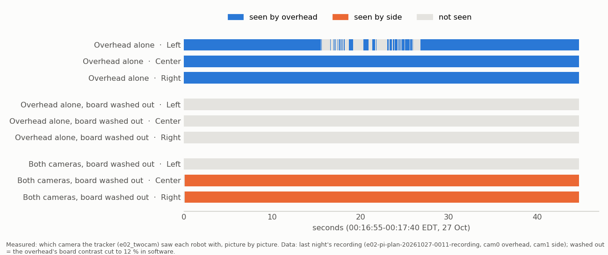
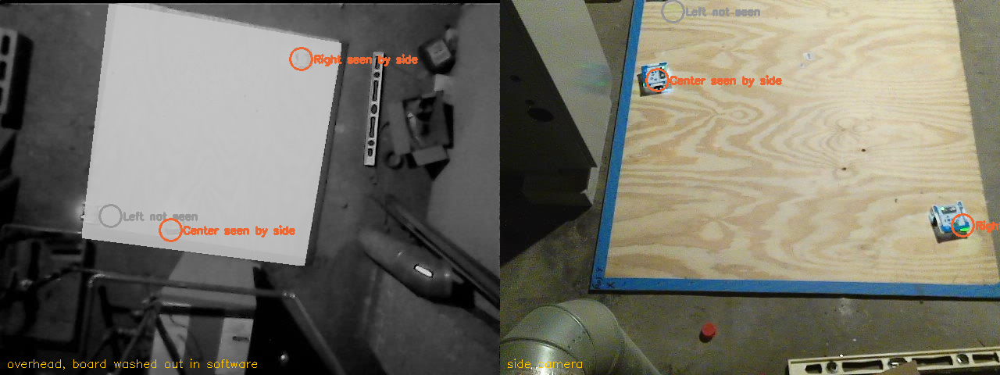

# Two-camera tracking for the ladder (2026-10-27, MIRLT)

**Premise.** At 11:20 `./run-fleet-pi.sh ladder pause` stopped at L0. The overhead camera found all three robots by
their lights, but the tracker never saw their bodies: the board sits under the lamp and is washed out (board 193 of
255; robot tops 14-24 grey levels from it for two robots, 0-3 for the third). Nick: "This is why I wanted to use both
cameras in conjunction with each other." Built and tested on the simulator and last night's recording; the Pi, the
cameras and the robots were not touched.

**What was built** (commits 0f1e998, c0b3b28, 952bf7b, plus this report's commit).

1. **Side camera calibration on the setup page** (`./run-fleet-pi.sh setup`, part 2). The page finds the side
   picture's 4 board corners, or Nick clicks or drags them. If not all 4 are in the picture, the page fits from the
   plywood grain alone. The corners are numbered like the overhead's (1 = the floor's 0,0) using points the
   overhead's calibration already knows: the plywood grain matched between the two pictures, and the robots' lights
   from the flash check. Of the 8 possible numberings, the one that puts those points where the side picture has them
   wins, and it must beat the next best by 2x. Check draws the grid and says how far the points land. A wrong
   numbering lands about 150 px off and gets a red warning; a right one lands about 0.5 px off. Save writes
   `~/.config/mirlt/calib/side_floorcal_<time>.json` (with the flash check's side lag) and a pointer
   `~/.config/mirlt/side_calib`, like the overhead's.
2. **Side camera exposure.** Every exposure lock or auto setting now switches automatic exposure on first. It then
   waits until the brightness stops changing: three 0.4 s readings within 3 %, 2-8 s. Before, the camera had a fixed
   2 s warm-up and a lock could stay on from an earlier program. A brightness check warns under 50 or over 215. The
   recorder locks the side camera this way (`--side-exposure lock`). The setup page settles both cameras when it
   opens and shows the side camera's brightness.
3. **Two-camera tracking** (`tools/experiment/e02_twocam.py`, used by the ladder and `cam_bridge`). Each camera keeps
   its own memory of the empty floor. Each camera's outlines go to the floor and are matched to one set of robots by
   prediction (MultiTracker's rules). A robot counts as seen when either camera sees it clearly, or when both see it
   and agree within 6 cm. When both see it and disagree, it is marked unsure. The tracker also:
   - takes out the side camera's lag;
   - measures distances with the side camera's line-of-sight stretch taken out;
   - learns the side camera's offset from the overhead while a robot stands still, but only from whole overhead
     outlines;
   - does not let the side camera judge a robot that is outside its picture or in line with another robot from
     where the side camera stands;
   - uses the side's whole outline instead of an overhead outline that covers only part of a robot.

   **Lights as markers:** when neither camera sees a body, the tracker uses the lights near the robot's prediction,
   moved 3 cm back along its heading. Between steps the ladder keeps every robot's lights on (`led 1 1 1 20000` every
   12 s). During runs, the robots' blink codes do the same job.
4. **L0** checks bodies with both cameras; lights alone still keep a robot out. It also prints which camera sees
   each robot.

## Data

Each bar is one robot over 45 s of last night's recording; its colour shows which camera the tracker saw it with in
each picture.

| Last night's footage (45 s, 1,120 pictures; roam1 overhead, side grain calibration, lag 0.05 s) | Left | Center | Right |
|---|---|---|---|
| Overhead alone, as recorded: seen | 84 % | 100 % | 100 % |
| Board washed out (contrast cut to 12 % in software), overhead alone: seen | 0 % | 0 % | 0 % |
| Washed out, both cameras: seen (all by the side) | 0 % (out of the side picture) | 99.8 % | 99.8 % |
| Washed out, both cameras: distance from the overhead-alone spot, median / 95 % | - | 1.85 / 2.27 cm | 2.05 / 3.53 cm |
| As recorded, both cameras: Center seen by both, agreeing / Right by the side or both | | 100 % | 99 % |

The 1.9-2 cm matches the two-camera study's agreement (median 1.9 cm).

Left: an overhead picture with the board washed out in software. Right: the side picture at the same moment.
Circles: where the tracker has each robot. Left sits at the side picture's top edge, so neither camera sees it.
Source: the 00:11 recording.

| Simulator (camera bridge, test cross, 2 robots; error against the simulator's truth) | median | 95 % | line check |
|---|---|---|---|
| Overhead alone, plain board (regression) | 0.47-0.49 cm | 0.88-1.06 cm | pass |
| Washed-out board + side camera (lag 0.06 s), seen by the side | 0.40-0.46 cm | 1.19-1.25 cm | pass |
| Same, first try (offset learned from pieces of robots, averaged in) | 4.0 cm | 4.9 cm | pass, but 4 cm off: fixed |

| Ladder L0, dry run, washed-out simulated board | Result |
|---|---|
| Overhead alone ([screenshot](../screenshots/2026-10-27/two-camera-problem-ladder-L0-dry-washed-out-overhead-alone-all-kept-out.png)) | FAIL: all three kept out, "only its lights" (the 11:20 stop, reproduced) |
| Both cameras ([screenshot](../screenshots/2026-10-27/two-camera-feature-ladder-L0-dry-washed-out-both-cameras-pass.png)) | PASS: all three "seen by the side camera only", within ~1 cm of where they stood |

**Full ladder dry run** (washed out, both cameras, L0-L5;
[screenshot](../screenshots/2026-10-27/two-camera-feature-ladder-full-dry-run-washed-out-L0-to-L5-pass.png)): every step
passed. Every robot's body was seen by the side camera only. The L3-L5 line check p95 was 0.48-1.05 cm (gate 3 cm),
and the start spot checks were 0.2-0.5 cm and 0.3-1.7 deg. The bodies came 9.3 cm apart at the normal-speed cross.
L2 kept Center out at -8.2 deg after four turns (limit 8). That is not the side camera: the same turn check with the
overhead alone on a plain board read -6.6 deg (each turn 1.2-2.1 deg short against the gyro's 89.2). The simulated
Center turns about 88.5 deg, and its total sits near the limit with either camera.

**Tests.** 9 two-camera tests (`tools/experiment/tests/test_e02_twocam.py`): the 11:20 failure reproduced; the side
sees the robots; both cameras on a plain board; lights only; side lag taken out (0.12 s); robots in line from the
side; cameras disagreeing; the line-of-sight stretch; the filled-in floor margin. There are 3 new setup-page tests
(numbering from the grain in any of the 8 ways round; numbering from 3 lights without knowing which is which; the
fake board saved end to end), 3 camrec exposure tests, and the bridge's dry run with a washed-out board plus the side
camera. All pass, alongside the existing suites: Pi 63, fleet 23, tracker and side camera 50.

**Every chosen number (DOE notes).**
- Agreement 6 cm (the study's 95 % agreement). **A DOE fits:** 4 / 6 / 8 cm against "cameras disagree" stops and
  the line check's p95 on the board.
- Side pictures used 10 a second (of its 29). **A DOE fits:** 5 / 10 / 15 against the Pi's overhead picture rate and
  the side's seen-rate on the washed-out board. This matters because the Pi was never tested.
- Side gate +2 cm, plus 0.08 s x speed for the lag's uncertainty. **A DOE fits:** 1 / 2 / 4 cm, side seen-rate against
  identity swaps in the simulator's crossings.
- Offset learning: 0.05 a picture, capped at 8 cm, still robots only, whole outlines only (at least 0.7 of a robot),
  used after 30 pictures. No DOE: these are the settings of a filter.
- Lights: 30 grey levels over the floor memory and at least 235 bright; lights-to-middle 3 cm; gate 10 cm; a sighting
  counts for 0.6 s; position sigma 2 cm. **A DOE fits** the threshold (20 / 30 / 40 against false lights on footage
  with lights on). The 3 cm should be **measured**, not set by a DOE: L0 pictures where the body and the lights are
  both seen give it.
- Filled-in floor margin: measured on the board (95th percentile of the fill-in error), kept within 4-14. No DOE: it
  is a measurement.
- "Hidden" from the side within 1.0 body width of the picture's border; outlines dropped within 0.6. No DOE: these
  come from the camera's geometry.
- Exposure settle: 3 % over three 0.4 s readings, 2-8 s; warnings under 50 / over 215. **A DOE fits** the settle rule
  (time to settle against brightness after locking, from a dark and a bright start).
- Setup page: numbering must win by 2x; a fit whose grain points land more than 15 px off is flagged; grain fit on
  12 cm cells (8 cm took 16 s here). No DOE: these are checks and a speed trade.
- Keeper renews the lights every 12 s (the firmware caps one `led` at 20 s). No DOE: this is a renewal period.

## Conclusion

The side camera sees what the washed-out overhead cannot. On last night's real pictures, with the overhead's board
contrast cut to 12 %, the overhead alone saw none of the three robots. With both cameras, the two robots inside the
side picture were seen 99.8 % of the time, 1.85-2.05 cm (median) from where the overhead alone put them on the
unwashed footage. In the simulator, the washed-out board with the side camera tracked as well as a plain board does
with the overhead (0.40-0.46 cm median) and passed the line check. A robot outside the side picture is still not
seen. L0 says so and keeps it out, instead of guessing.

## What's next

- Today, on the board: setup page part 2, then the flash check (it measures the side lag, which is saved with the
  next side Save), then L0. Nick's steps are in the reply.
- If L0 keeps a robot out as "seen by neither camera", look at where it sits in the side picture. The corners of the
  board nearest the side camera's edges may be outside its view.
- After the first real session: run `e02_twocam` on its recording with the overhead alone and with both cameras, as
  done here, and set the 6 cm and 10-a-second values from it.

## Sweep 1: new tests that may now be necessary

- The Pi's picture rate with the side camera tracked at 10 a second, during a planner run (the overhead must stay
  at 14+ a second).
- Whether the moved side camera sees all 4 board corners and all of the board. If not, check which spots it cannot
  see.
- The flash check's lights as anchors on the real board: does the side picture show the three lights clearly enough
  to number the corners?
- SIFT on the Pi's OpenCV and on the washed-out real board: the number of grain matches.
- Lights-to-middle distance from real L0 pictures (expected near 3 cm).
- Side exposure settling on the real EMEET C950: settle time and brightness after the lock.
- Identity at crossings when only the side camera sees both robots: L5, with "in line with" moments counted.
- The side offset learned on the real board against the study's 4.7 cm (test T1, taped marks).
- The turn check's total allowed of 8 deg against the simulated Center (about -7 to -8 deg with either camera): repeat
  checks of one healthy robot on the board would show whether 8 deg false-FAILs (the DOE already noted for it).

## Sweep 2: possible inaccuracies in what this relied on

- **The washed-out real footage was made in software** (overhead contrast cut to 12 % on the board). A real lamp also
  adds glare spots and may wash out the side camera partly.
- **The simulator's side camera** is a plain pinhole. Its robots are boxes with dim faces and bright tops, and its
  board is not washed out (assumed: the glare reaches the overhead, not the slanted side). The real side picture
  showed the robots clearly last night, but that was before the cameras were moved.
- **Last night's calibrations** (roam1 overhead, 25 Oct grain side) were used for last night's pictures. The two
  disagree by about 5 cm (the study), and the tracker took no offset off (it learns one only from whole overhead
  outlines). So the 1.85-2.05 cm includes their disagreement, not only tracking error.
- **The robots' starting spots in the real test** were read by eye from the first overhead picture.
- **The side lag** in the simulator and the default (0.04 s) are stand-ins. One earlier session had -0.40 s,
  unexplained. A wrong lag shows up as moving robots trailing; the test shows 0.12 s untold costs about 1 cm at 10 cm/s.
- **Lights:** 3 cm from the middle, two LEDs merging into one spot, and the 235 brightness floor are taken from the
  simulator and the flash check's figures, not measured on the real top. Idle robots show their mode colour on the
  left LED only; the keeper's white replaces that while the ladder watches.
- **The half-height plane (1.85 cm)** for the side outline's centre is chosen (e02_sidecam). The simulator's side
  outline is mostly the top, which leaves about 0.5-1 cm of error that the plane does not remove.
- **The setup page's lights anchors** use the overhead calibration in use when the flash check ran. Running the flash
  check before saving part 1 after a camera move gives wrong anchors; the 2x margin rejects them rather than trusting
  them.

## Appendix: how the real-footage test was run

Recording `e02-pi-plan-20261027-0011-recording`, 00:16:55-00:17:40 EDT. cam0 (25/s) and cam1 (15/s) frames were read
by byte range. Each camera's t_wall minus 0.04 s was used, and the side lag was 0.05 s. The starting spots were the
overhead pixels (142, 276), (222, 283), (387, 72) taken to the floor. "Washed out" pushed every pixel inside the
board's outline towards 193 at 12 % of its distance from the board's median. Scripts (scratch):
`realrun.py over|two|washover|washtwo`, `fig.py`, `overlay.py`. Not committed, because they read the scratch
download.
