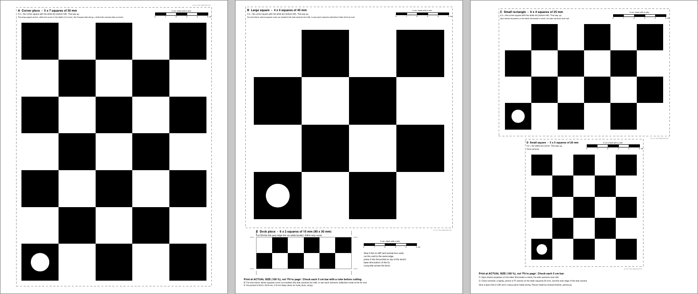
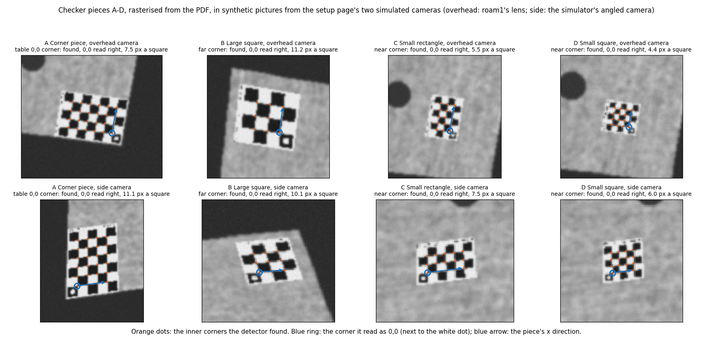
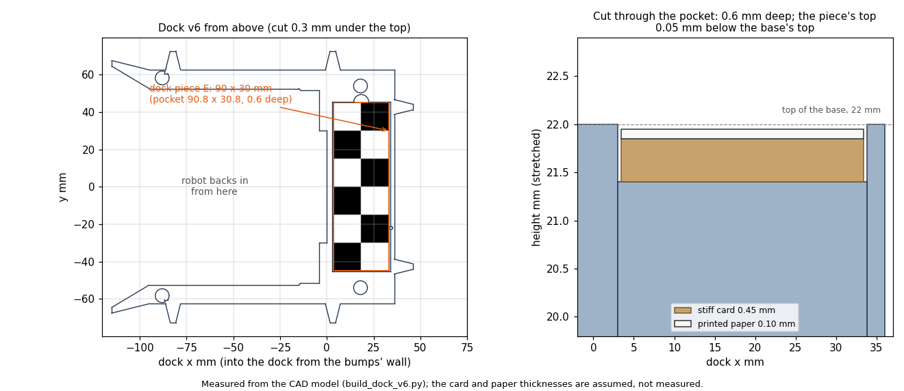
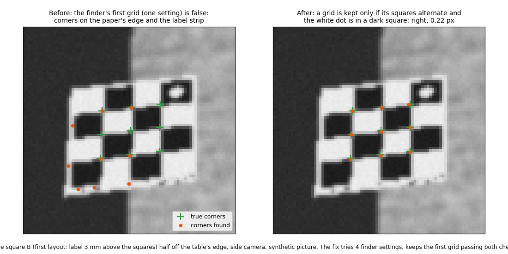

# Checker pieces PDF and the dock v6 pocket (2026-10-27 evening build)

## Premise

Nick, 22:03: "Give me a file with a few checker pieces in it, squares and rectangles. It should include one that will
fit on the new dock so make sure that design is updated as well." No robots or Pi: synthetic pictures, the CAD build
and tests only.

## Data

**The file:** [`docs/hardware/checker-pieces-letter.pdf`](../hardware/checker-pieces-letter.pdf), 3 letter pages
(made by `tools/pi/checker_pieces.py pdf`). Pieces, sizes and purposes: [docs/hardware/README.md](../hardware/README.md).

The pages as printed: every piece carries its name, square size, a 5 cm bar and a white dot in its 0,0 corner square.

**Detection** (the PDF rasterised, each piece laid at 3 spots and turns on the table, in the setup page's two
simulated cameras; D also in two desk cameras 45 cm away, 640 x 480, chosen not measured; `checker_pieces.py test`):

| Piece | Camera | Spots found | Pixels a square | 0,0 read right | Corner error, median (px) |
|---|---|---|---|---|---|
| A Corner piece 5 x 7, 35 mm | overhead | 3 of 3 | 7.5-8.6 | 3 of 3 | 0.06-0.22 |
| A Corner piece 5 x 7, 35 mm | side | 3 of 3 | 6.7-11.1 | 3 of 3 | 0.09-0.20 |
| B Large square 4 x 4, 45 mm | overhead | 3 of 3 | 10.3-11.2 | 3 of 3 | 0.12-0.15 |
| B Large square 4 x 4, 45 mm | side | 3 of 3 | 10.1-11.9 | 3 of 3 | 0.16-0.31 |
| C Small rectangle 6 x 4, 25 mm | overhead | 3 of 3 | 5.5-6.1 | 3 of 3 | 0.11-0.15 |
| C Small rectangle 6 x 4, 25 mm | side | 3 of 3 | 4.4-7.5 | 3 of 3 | 0.11-0.19 |
| D Small square 5 x 5, 20 mm | overhead | 3 of 3 | 4.4-5.0 | 3 of 3 | 0.14-0.24 |
| D Small square 5 x 5, 20 mm | side | 1 of 3 | 4.5-6.0 | 1 of 1 | 0.22 |
| D Small square 5 x 5, 20 mm | close, straight | 3 of 3 | 23.1 | 3 of 3 | 0.17-0.47 |
| D Small square 5 x 5, 20 mm | close, tilted 35 | 3 of 3 | 21.4-25.2 | 3 of 3 | 0.19-0.30 |

Corner error: distance between each inner corner found and where the simulated camera truly puts it.

Each piece at its first spot in both cameras: orange dots are the corners found, the blue ring the 0,0 corner read
from the white dot.

Straight from the PDF (no camera), every piece A-D is found with the 0,0 corner in the right place at every size
from 6 to 100 px a square (test `test_printed_pieces_found_from_6_to_100_px_a_square`).

**Dock piece E** (2 x 6 squares of 15 mm): 3.3 px a square in the overhead, 4.0 in the side camera. The chessboard
finder does not look for it (it needs 4 x 4 squares at least); the bump check does:

| Camera | True bump (px) | Read (px) | Match |
|---|---|---|---|
| overhead | 0.5 right / 0.5 down / 1, 1 | 0.51 / 0.45 / 1.00, 0.94 | 0.99 |
| side | 0.5 right / 0.5 down / 1, 1 | 0.50 / 0.48 / 0.99, 0.98 | 0.98-0.99 |

**Dock v6:** same 90.8 x 30.8 mm pocket in the same place, 0.6 mm deep instead of 1.0 (paper on cereal-box card);
`build_dock_v6.py`: all checks ok, the usual one WARN (the comparison), no FAIL; new preview
`hardware/dock/preview/dock_v6_piece.png`.

The dock's base from above with the piece in its pocket, and a cut through the pocket showing card and paper.

**Problems found and fixed**

- The setup page's solve ignored the printed white margin: it put the corner piece's squares at the paper's edge,
  5 mm off (the one-system PDF also has the 5 mm margin). `charuco_calib.solve_checker` now counts it
  (`CHECK_MARGIN_CM`); with the corner piece (drawn as printed) in the corner, the solved overhead puts table points
  within 0.6 cm of the truth (test).
- The finder is unreliable on the minimal 4 x 4 board: with the setup page's one flag setting it missed B at some
  sizes between 40 and 130 px a square, and other settings returned distorted grids on the paper's edge and label
  strip that still gave a dot-like reading. `detect_piece` now tries 4 settings and keeps a grid only if all its
  squares alternate dark and light and the white dot sits in a dark square. B's label strip also moved 10 mm off its
  squares (3 mm before); on its own that did not fix the misses.
  
  The same picture before and after: green crosses are the true corners, orange the corners found.

## Conclusion

The PDF prints five pieces that fit letter paper at actual size. The four calibration pieces are found, with their
0,0 corner read right, wherever their squares come out at 4.4 px or more in the simulated cameras (D is below that on
the side camera's far half, as expected for a desk piece). The dock piece is v5's marker pattern on paper; dock v6
has a pocket sized for it, and the bump check reads half a pixel through it. The setup page now uses the margin and
refuses a corner piece that is turned the wrong way. Nothing here was printed or filmed.

## Next

1. Print the PDF at actual size; check each 5 cm bar and one square of A (3.5 cm).
2. Run the one-button setup with piece A in the 0,0 corner; compare the lens heights with a tape.
3. Glue piece E in the pocket when dock v6 is printed; one recorded session with `--dock-map` gives the bump check's
   real noise.
4. Wiring still open (another agent's file): `tools/fleet/mission_control.html` line 230 should read "the printed
   corner piece A ... its **white-dot corner** in the table's corner, the 5-square side along the table's long side".

**Question for Nick (substantive).** Should the camera find the dock itself? A chessboard the finder can read needs
at least 4 x 4 squares of about 2 cm (8 x 8 cm) in these cameras; the dock's base is 3.6 cm deep, so the dock piece
cannot be one. Options: (a) keep it as is (bump check and known length; the dock's place on the map stays a tape
measurement); (b) a 4 x 4 piece of 20-25 mm glued on the plywood behind the dock, read like the other pieces, giving
the dock's position and heading from the cameras; (c) a longer base (about 9.5 cm deep, the dock 22 cm long instead of
16) carrying that piece. My pick would be (b): it gives the camera-found pose without changing the dock's print.

## Sweep 1: new tests

`tools/pi/tests/test_checker_pieces.py` (26 cases): the PDF's pages and that every piece fits the printable area
without overlap; squares at their printed size; every piece found from 6 to 100 px a square with the 0,0 corner in
place; the 0,0 corner read at each quarter turn of every piece; a mirrored rectangle flagged; the dock piece equals
the strip and fits the pocket; the setup page's solve with margin and dot (and refusing a piece turned half way);
the dock piece's bump check at 0.5 px. Run with the camera setup, session checks, label and dock v6 suites: 231
passed. Tests that may now be needed: the dot read on real prints under the overhead's lights; the setup page's
"turned" refusal end to end through Mission Control (other agent's file).

## Sweep 2: possible inaccuracies

- All detection pictures are synthetic: the overhead is roam1's lens model slightly moved, the side camera the
  simulator's; the blur (0.7 px), noise (2 grey levels) and paper shades (30 / 235) are chosen, not measured.
- The desk cameras for D (f = 520 px, 45 cm) are chosen to stand for a webcam, not measured on one.
- The dot thresholds (20 grey levels above its ring, 15 above any other corner) and the squares' separation
  (10 grey levels) are chosen; the test pictures' dot contrast (about 30-205) is the data a DOE would set them from.
- Card thickness (0.45 mm) and paper (0.10 mm) are assumed; measure 10 sheets of each with a rule.
- Pieces B-D have no setup page step yet; they are found by `detect_piece`, not used by a calibration.
- The dock piece's bump test shifts the whole picture; a real bump also tilts it slightly.
