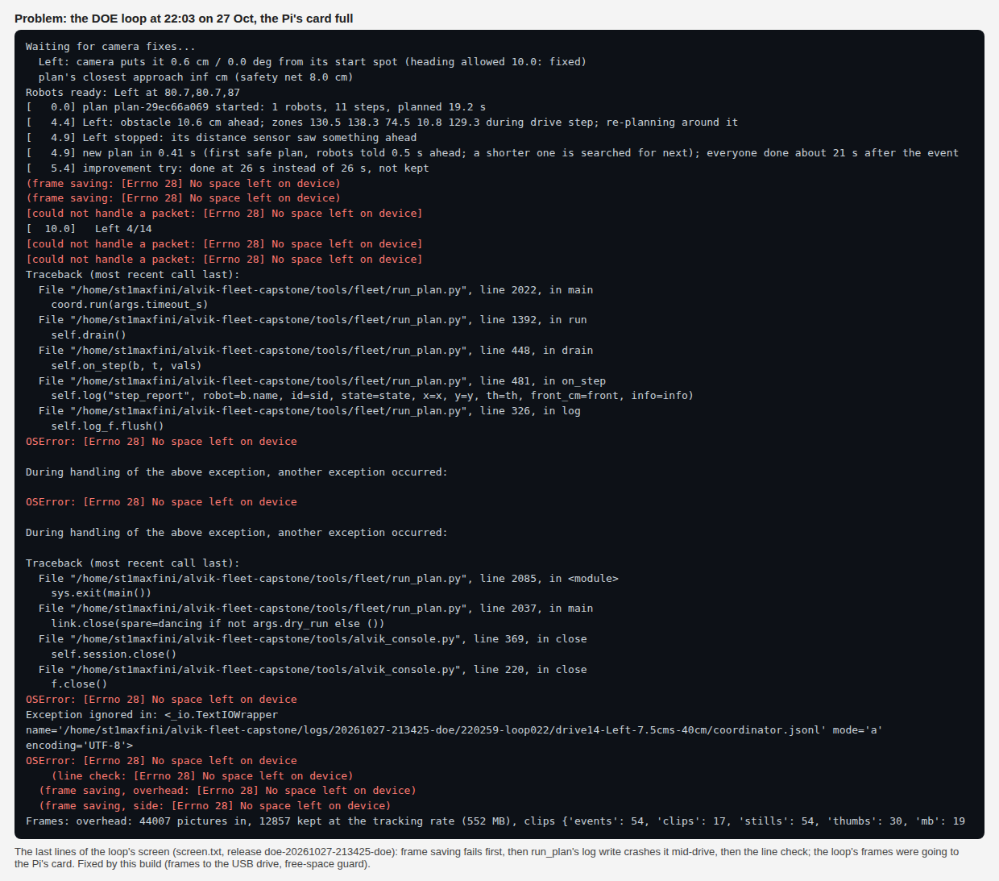
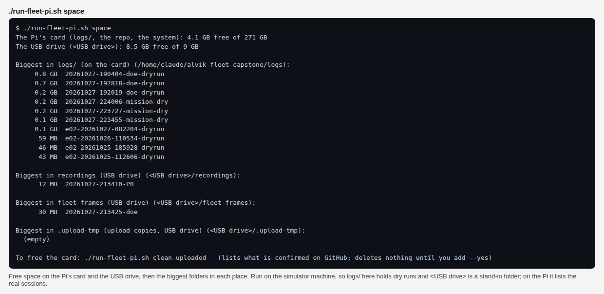
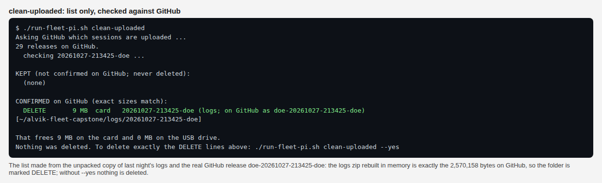
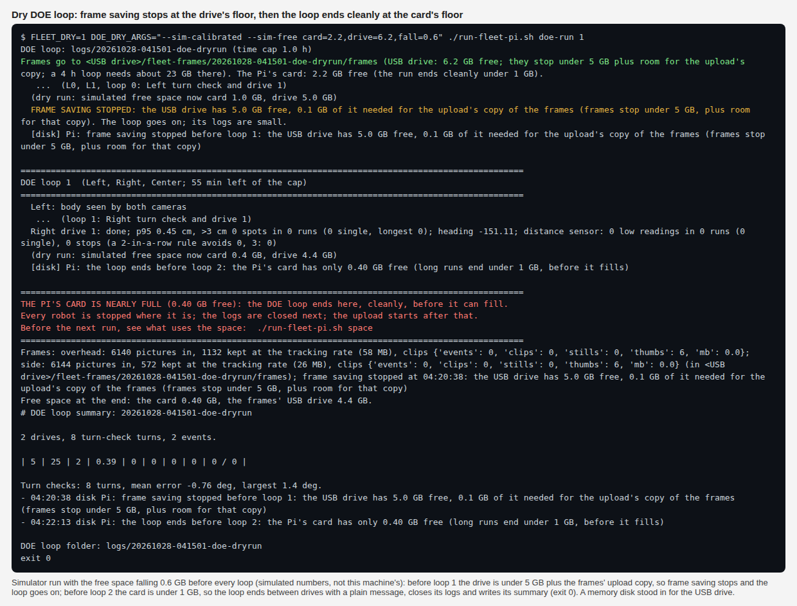
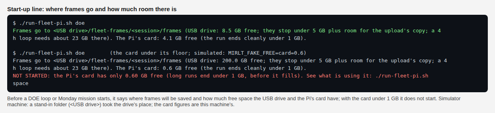

# The DOE loop that filled the Pi's card (MIRLT, 27 Oct 21:34-22:03) and the free-space guard (28 Oct)

**Premise.** Nick started the unattended DOE loop on the Pi at 21:34 for 4 h. It died at 22:03 with
`OSError: [Errno 28] No space left on device`. Its frames were being saved on the Pi's SD card (the card), inside
`logs/<session>/frames`, next to the logs. Nothing checked free space. The USB drive (256 GB) that the recorder uses
was not used for frames. This build moves the frames to the USB drive and adds a free-space guard to every long run.
It was tested in the simulator and in tests only. Nothing has run on the Pi yet.

## Data: the session (logs from release `doe-20261027-213425-doe`)

| | |
|---|---|
| Loops | 23 (loop 0 to loop 22), 21:34-22:03 |
| Drives finished | 20, all `done` (drives.csv) |
| Center | set aside 21:51: its heading crawl measured 15.1 cm on camera when it was sent 10 cm |
| Right | set aside 21:54: turn check FAIL (errors -10.6, +6.0, -0.0, +2.1 deg; total -2.6) |
| After 21:54 | Left only (Left drives 5-13) |
| End | 22:03, during loop 22 (Left drive 14, 7.5 cm/s, 40 cm): the card was full |
| Frames | overhead 44,007 pictures in, 12,857 kept at the tracking rate (552 MB). With the side camera and the clips, the frames zip is 1.42 GB (1,418,027,440 bytes) for 29 min, which is **2.9 GB an hour** |
| Logs (everything but frames) | 9.3 MB for 23 loops, about **0.4 MB a loop** (2.6 MB zipped) |

**What failed, in order (screen.txt):**
1. Frame saving: both cameras.
2. run_plan: a log write. Its log flush raised the error and crashed it mid-drive.
3. The camera's line check.
4. summary.md: 0 bytes, never written.
5. screen.txt: cut off at 65,536 bytes.



The loop's last screen lines at 22:03: frame saving failed first, then run_plan crashed on a log write.

**The robot was stopped.** run_plan's close sends `stop` to every robot before it closes its files. The crash came in
the file close, after the stop (`tools/alvik_console.py` Link.close). The loop then ended, and the upload worked
afterwards because its zip copies go to the USB drive.

**Not known:** how much free space the card had at 21:34. Nothing logged it. Since 552 MB of tracked frames plus the
clips filled it in 29 min, it had about 1.4 GB free at most. Something else is using the rest of the card;
`./run-fleet-pi.sh space` will show what.

## What changed

1. **Frames go to the USB drive.** It is found the same way the recorder finds it: the first writable drive under
   `/media/<user>`, and it must be a real mount. Frames are saved in `<drive>/fleet-frames/<session>/frames`, and
   `frames_where.txt` in the session folder says where. The `doe-finish` upload and `mission_run --upload` read that
   file, so the release still gets `rec-frames-small.zip`. With no drive, frames go to `logs/<session>/frames` as
   before, and the start-up line says so in capitals. Logs stay in `logs/`.
2. **A free-space guard on every long run** (`tools/fleet/diskguard.py`).

   | Run | Before it starts | During the run |
   |---|---|---|
   | DOE loop | not started under the card floor | checked between loops: frames stop at the frames floor; the loop ends cleanly at the card floor (robots stopped, logs closed, `doe-finish` uploads) with a plain message |
   | Monday / Mission Control (`mission_run`) | not started under the card floor | frames check every 2 s; under the card floor, run_plan gets Ctrl+C (every robot stops) and the upload follows |
   | Ladder | each step not started under the card floor | (none) |
   | run_plan | not started under 0.5 GB | checks every 5 s and halts everyone under 0.5 GB; a failed log write now ends the run instead of crashing it |

   Free space on the card and on the frames drive is logged every 2 s in `perf.csv`, in two new columns:
   `card_free_gb` and `frames_free_gb`.
3. **The start-up line** (`./run-fleet-pi.sh doe` and `monday`, and the DOE loop's own first lines) says where frames
   will go and how much room the card and the drive have.
4. **`./run-fleet-pi.sh space`** prints free space on the card and the drive, and the biggest folders in `logs/`,
   the recordings folder, `fleet-frames` and the upload's zip copies.
   

   `space` on the simulator machine. A stand-in folder took the USB drive's place.
5. **`./run-fleet-pi.sh clean-uploaded`** lists, and deletes only with `--yes`, the session folders whose upload
   GitHub confirms. "Confirmed" means the release has every file the upload made, at exactly the size the folder
   makes today. Each zip is rebuilt in memory only to measure its size; nothing is written. A folder that changed
   since the upload, a missing or wrong-size asset, a dry run, no answer from GitHub, or a run still going (tmux
   `doe`, `monday`, `ladder`, `e02`) means it deletes nothing. `--frames-only` keeps every logs folder.
6. **The upload deletes its own zip copy** in `.upload-tmp` once GitHub has it. The 1.42 GB frames zip stayed there
   before. It also records which release holds the session, in `~/.local/state/mirlt/uploads/`.

**Checked against GitHub for real:** the list run on the unpacked copy of last night's logs rebuilt
`logs-20261027-213425-doe.zip` in memory at exactly 2,570,158 bytes, the size on GitHub. It marked the folder
CONFIRMED and deleted nothing.



`clean-uploaded` (list only), on the unpacked copy of last night's logs, checked against GitHub's real release.

### The floors

| Floor | Value | How it was set | Should an experiment set it? |
|---|---|---|---|
| Card: the run ends (`CARD_STOP_GB`) | 1 GB | chosen. Logs grow 0.4 MB a loop (about 80 MB in 4 h), so most of the 1 GB is room for the system (journal, apt, Python, the start page) | No DOE. It is a safety margin, not a robot question. The logs' share can be worked out from the next sessions' folders (logs only) |
| Card, inside one drive (`CARD_HARD_GB`, run_plan) | 0.5 GB | chosen: the last resort under the 1 GB floor | No DOE: a safety margin |
| Frames on the card, no drive (`CARD_FRAMES_GB`) | 2 GB | follows from the 1 GB floor: frames stop 1 GB before the loop does | No DOE |
| Frames on the drive (`DRIVE_FRAMES_GB`) | 5 GB, **plus** the frames saved so far (the upload zips a copy of them on the same drive) | chosen. A 4 h loop needs about 23 GB there (11.6 GB of frames + the same again for the copy) | No DOE: a safety margin on a 256 GB drive |
| How often the frames floor is checked (`CHECK_S`) | 2 s (with perf.csv) | chosen. At 2.9 GB an hour, that is under 2 MB between checks | No DOE: far below any floor |
| Frames per hour (`FRAMES_GB_PER_H`) | 2.9 GB | measured (one session) | Measure again on the next runs, from logs only. It changes with the number of cameras and the tracking rate |

## Dry run: the loop ends cleanly at the floor

The run was `FLEET_DRY=1 DOE_DRY_ARGS="--sim-calibrated --sim-free card=2.2,drive=6.2,fall=0.6" ./run-fleet-pi.sh
doe-run 1`. The free space was simulated and fell by 0.6 GB before every loop. A memory disk stood in for the USB
drive.

| Before | Card | Drive | What happened |
|---|---|---|---|
| start | 2.2 GB | 6.2 GB | the start-up line: frames to `<drive>/fleet-frames/20261028-041501-doe-dryrun/frames` |
| loop 0 | 1.6 | 5.6 | Left: turn check + drive 1, frames saved (on the stand-in drive) |
| loop 1 | 1.0 | 5.0 | **frame saving stopped** (5.0 GB, of which 0.08 GB is needed for the upload's copy, is under 5 GB); the loop goes on. Right: turn check + drive 1 |
| loop 2 | 0.4 | 4.4 | **the loop ended before it started**, with the plain message; summary.md written; exit 0; `doe-finish` ran |



The dry run's screen: frame saving stops at the drive's floor, then the loop ends between drives at the card's floor.



The start-up line, and the refusal with the card under 1 GB (simulated).

**One problem along the way: a clash with other runs on this machine.** The first dry run collided with another
agent's simulator sweeps, which started at the same time on the same machine. Both used UDP port 5005, and the loop
stopped after loop 1 with "Port 5005 is already in use" before it reached the floor. It had already shown frame
saving stop at the card's 2 GB floor. The run above was repeated in its own network namespace (a private loopback),
so nothing was shared. This cannot happen on the Pi, which runs one thing at a time. My first run's persistent
simulated board was also up on port 8765 from 04:09 until I stopped it at about 04:15 (by its own pid file), so it
may have disturbed the other agent's simulator runs in that window.

**Tests:** 8 in `tools/fleet/tests/test_diskguard.py` and 9 in `tools/pi/tests/test_clean_uploaded.py`. Among them:
- the loop ending at the card floor before loop 1, and not starting at all on a full card;
- frames stopping at the floor;
- run_plan's log write on a full disk ending the run instead of crashing;
- `clean-uploaded` refusing a folder with no release, a wrong-size asset, a folder changed since the upload, a dry
  run, GitHub unreachable, or a run going.

All pass, with the existing DOE loop, ladder and upload tests (37 tests).

## Conclusion

The loop died because frames, about 3 GB an hour, were going to a card that had about 1.4 GB free, and nothing
watched the space. With this build:
- frames go to the 256 GB drive;
- frame saving stops before the drive fills;
- the loop ends cleanly, with the upload, before the card fills;
- a full disk inside run_plan ends the drive instead of crashing.

The card still needs freeing before the next run. Nick's steps are below.

## What's next

1. **Nick, on the Pi, now:** free the card with the steps below, `git pull`, then restart the start page.
2. Run `./run-fleet-pi.sh space` to see what else is on the card. Last night's frames alone do not explain a full
   card.
3. At the next DOE start, check that the start-up line says **USB drive**, not "ON THE PI'S CARD".
4. After that run, run the heat tracker as usual. `perf.csv` now has free space too.

### Nick's steps: free the card now

All of these go in the **laptop's terminal window** (PowerShell), after you connect to the Pi. Type one box, press
Enter, and wait for the prompt to come back before the next one.

1. Connect to the Pi:

   ```
   ssh st1maxfini@100.122.222.75
   ```

   You should see a prompt ending in `$`.
2. Go to the project folder:

   ```
   cd ~/alvik-fleet-capstone
   ```

3. See how full the card is:

   ```
   df -h /
   ```

   Look at the `Avail` column. It will be near 0.
4. Check that last night's upload is on GitHub with both files:

   ```
   curl -s https://api.github.com/repos/nfmaxfield-cmd/alvik-fleet-capstone/releases/tags/doe-20261027-213425-doe | python3 -c "import json,sys; [print(a['name'], a['size'], a['state']) for a in json.load(sys.stdin)['assets']]"
   ```

   You should see exactly these two lines:
   `logs-20261027-213425-doe.zip 2570158 uploaded` and `rec-frames-small.zip 1418027440 uploaded`.
   **If either line is missing or a number is different, stop here and tell me. Do not delete anything.**
5. See how big last night's frames folder is:

   ```
   du -sh logs/20261027-213425-doe/frames
   ```

   It should say about `1.4G`. If it is far from that (under 1.2G or over 1.6G), stop and tell me.
6. Delete last night's frames folder. This is the only thing deleted by hand, and it is the copy GitHub already has
   (step 4):

   ```
   rm -rf logs/20261027-213425-doe/frames
   ```

7. Check the space again:

   ```
   df -h /
   ```

   `Avail` should be about 1.4 GB higher than in step 3.
8. Get this build:

   ```
   git pull
   ```

   It should end with a list of changed files.
9. Restart the start page so it uses the new code:

   ```
   sudo systemctl restart mirlt-launcher
   ```

   It may ask for the Pi's password. Nothing is printed when it works.
10. See what else is using the card:

    ```
    ./run-fleet-pi.sh space
    ```

11. List what else GitHub confirms. Nothing is deleted:

    ```
    ./run-fleet-pi.sh clean-uploaded
    ```

    Each `DELETE` line is a folder whose upload GitHub confirms at exact sizes. `keep` lines are never deleted.
12. Only if you want those `DELETE` lines gone, and no run is going:

    ```
    ./run-fleet-pi.sh clean-uploaded --yes
    ```

## Sweep 1: new tests that may now be needed

- **On the Pi:** the first real DOE start. Does the drive count as a mount under `/media/st1maxfini/...`, and does
  the start-up line name it? If the drive is mounted somewhere else, frames fall back to the card. The line says so,
  but the run would still use the card.
- **On the Pi:** `clean-uploaded` on last night's folder before step 6 is done by hand, if Nick prefers that order.
  Does the rebuilt frames zip match 1,418,027,440 bytes? How long does it take on a Pi 4 (about a minute a GB is a
  guess)?
- **On the Pi:** a DOE run started with `MIRLT_FAKE_FREE=card=1.5,drive=50`, to see the guard's messages on the real
  screen and the start page. Logs only, no robot time if it is refused at the start.
- Mission Control's Run screen when `mission_run` refuses to start (exit code 3): does the page show the reason?
  Not checked.
- The heat tracker with the two new `perf.csv` columns (it reads columns by name, so it should be unaffected; not run
  on a new session yet).
- The upload deleting its zip copy: tested by the existing upload test only. Not checked on a real release.

## Sweep 2: possible inaccuracies in what this relied on

- **All the floors are chosen numbers** (1 GB, 0.5 GB, 2 GB, 5 GB), not derived. See the floors table.
- **The frames rate, 2.9 GB an hour, comes from one 29-minute session.** It depends on how many robots move, which
  cameras run, and how many clips there are.
- **The card's free space at 21:34 is inferred** (about 1.4 GB at most), not measured.
- **The drive is found by assumption:** the first writable mount under `/media/<user>` is assumed to be the 256 GB
  drive, as the recorder assumes. With two drives, both take the first one in name order.
- **The zip-size check assumes the same zlib and Python on the Pi as at the upload.** After an OS update the sizes
  can differ. The folder is then kept, never deleted, so this fails safe but less useful.
- **Releases are matched to sessions by tag name** (`doe-<session>`, `-2` and so on) when no upload record exists.
  That covers every session uploaded before this build.
- **The dry run used stand-ins:** falling free space was simulated (`--sim-free`), and a scratch folder stood in for
  the drive. A real drive has a different filesystem (likely exFAT), which matters for writes. The zip size does not
  depend on it.
- **"The robot was stopped"** at 22:03 is read from the code order (stop before file close) and the traceback, not
  from the robot's own log.
