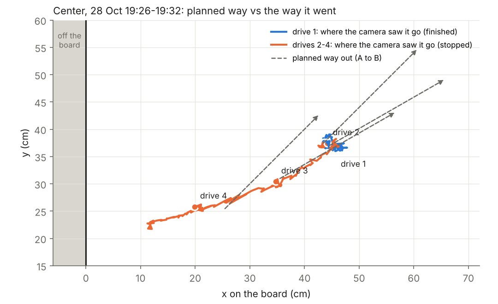
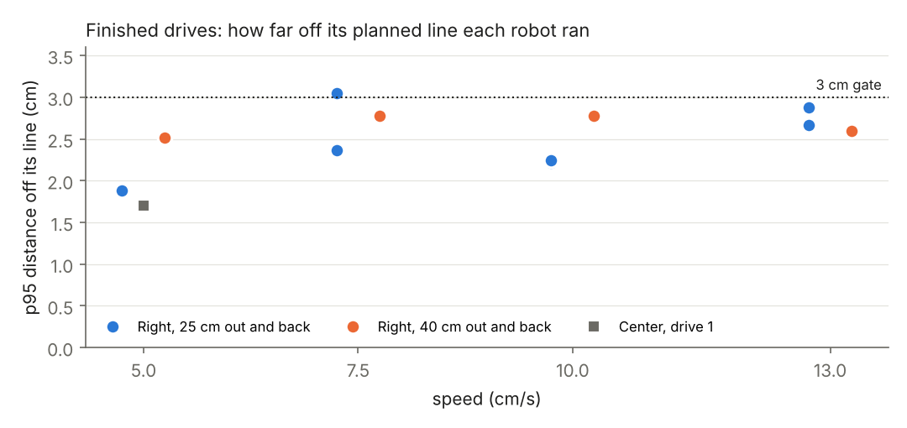
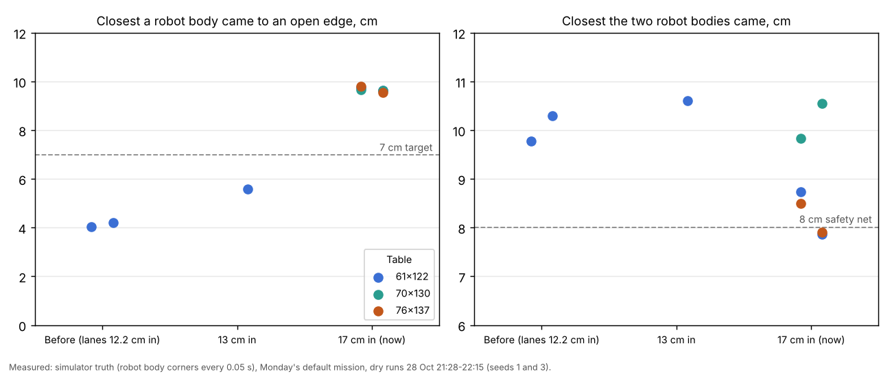
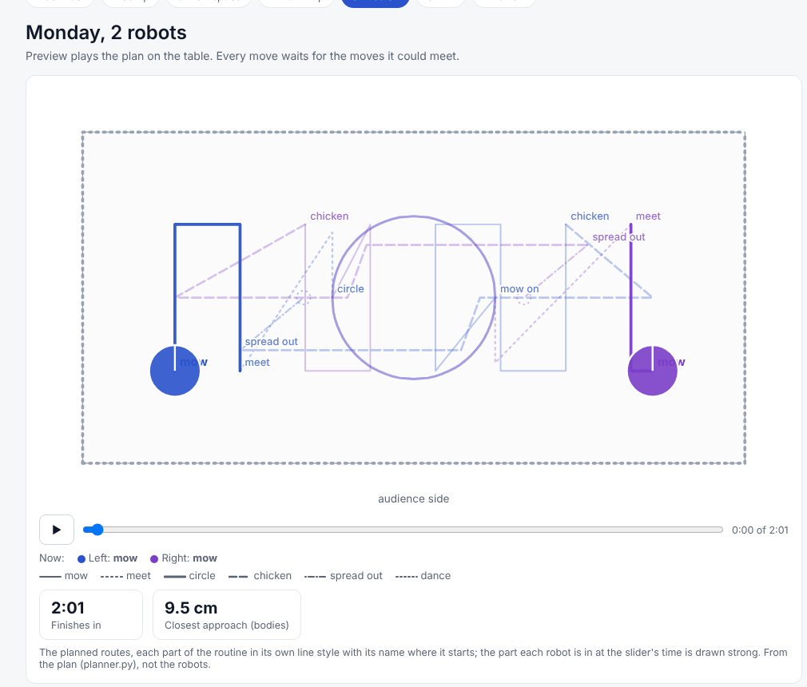

# Keep-going DOE loop, 28 Oct 19:17: why it stopped after 27 minutes, and what was fixed

**Premise.** The real DOE loop in keep-going mode ran from 19:17 to 19:44 on 28 Oct (code 2fa7b2a, firmware
2026-10-28a, batteries 75 % at the start, at night under the room lamp). Right drove 11 good drives. Center's drives
2-4 each stopped with "camera and Center's own pose disagree", and Center ended up next to the x = 0 edge. Left never
drove. All three were then parked for "could not finish" reasons, and the loop ended. Monday's mission uses Left and
Right, so the question is whether tracking is good enough, and what still needs fixing. Everything here was done
offline, from the loop's logs, its kept frames (downloaded: loop 19's turn check and find step, Center's drive 2,
Left's turn check, the stills) and the simulator. The Pi and the robots were not touched.

## Data: what happened, robot by robot

| What the screen said | What it was | Kind |
|---|---|---|
| Center: "camera and own pose disagree" (drives 2-4) | Center's heading was 190 deg wrong, so it drove the wrong way | loop design |
| Center: "5 cm from the x = 0 edge" | really 9-10 cm in; the tracker misread a robot standing at an edge | tracker |
| Left: "no end of the leg in 20 s", then "backing blind refused" | its "done" message was lost on the WiFi; the ladder did not ask | loop design |
| Right: "the camera lost Right during its crawl" | both cameras saw it; its spot hopped 1.4 cm between them | tracker + camera (lamp) |
| Loop ended at 19:44 | "edge" and "lost" in those messages counted as safety stops | loop design |
| Right drive 1: "start-up failed" | an unneeded recalibration inside the drive | loop design |
| Center: "read back gyro_scale=?" | one lost answer; resent, then correct | WiFi (handled) |
| Lighting: overhead "washed out" (16 grey levels, needs 18) | the lamp over the table at night | camera / room |

None of these were the robots' wheels, gyros or sensors. Every turn check that ran passed: 16 turns, mean error
+1.3 deg, largest 4.5 deg.

**Center drove the wrong way three times.** Drive 1 met an obstacle reading at 5 s, was re-planned, and finished facing
-150 deg by its own gyro (its turns were fine: 4 of 4 within 4.3 deg minutes earlier). That re-planned drive left no
long straight for the camera to measure a heading from, so the loop kept the heading it had before the drive, 41 deg.
Drive 2 started Center believing 41 deg while it faced 210 deg. It turned and drove "forwards along 45 deg", and both
cameras saw it go along 216 deg. Its own pose and the camera's split apart. It refused 11 camera fixes, and run_plan
stopped it after 1 s of disagreement. The loop then measured a heading from the camera's line, but pointed that line
the way the plan said Center should have gone. That gave 34 deg, "confirming" the wrong heading, so drives 3 and 4
did the same thing.

Grey dashed arrows are where each drive was planned to go. Coloured lines are where the camera bridge saw Center go
(data: each drive's bridge/track.csv); drives 2-4 went the opposite way, towards the x = 0 edge.

It was not a camera identity mix-up: Center was the only robot moving, both cameras agreed on where it went, and
the bridge saw it with both cameras in 122 of 131 pictures of drive 4. "Side camera only" at L0-L2 was the washed-out
overhead.

Each wrong-way drive moved Center 8-15 cm (11.6, 15.2 and 8.4 cm) before the 1 s guard stopped it. It ended with its
middle at x = 11.8 by the drive's camera bridge, 9-10 cm by the overhead picture. It was driving physically forwards,
so the firmware's edge guard was watching as well. The edge risk was real but caught twice over: one more such drive
would have reached the edge, where the edge guard is the last stop.

**"5 cm from the edge" was a tracker error at the board's edge.** When tracking starts, the floor under each robot is
filled in from round it. At the edge, that fill took in the dark floor beyond the plywood, so plain plywood between
Center and the edge read as "robot", and the outline's middle moved 4-5 cm towards the edge
([before and after](../screenshots/2026-10-28/keep-going-problem-edge-fill-plywood-read-as-robot-before-and-after.png)).
Replaying the 19:42 find step, the tracker put Center at x = 5-6 whatever spot it was started from; the picture shows
its body from x = 4.5 to 15.

**Left's crawl: a lost message, not Left.** Left's turn 1 was fine (gyro +90.3 deg). Its next `go 10` started at
19:22:17 and finished: the following leg started 9.8 cm further on. Its `done` message never arrived, and the ladder
waited the full 20 s for it ([Left's own records](../screenshots/2026-10-28/keep-going-problem-left-leg-done-record-lost-terminal.png)).
The back leg then ran, which used up Left's 10 cm allowance for backing without a camera fix. The next crawl's
forward leg went 10 cm towards x = 122 and its back leg was refused. That left Left 24 cm from the edge, 1 cm short of
the turn check's 25.

**Right "lost": one robot, two spots.** Standing still after its crawl leg at 19:43:14, Right's position hopped
between the two cameras' mix (51.6, 85.6) and the side camera alone (50.4, 84.7). Those spots are 1.4 cm apart, and
the "standing still" rule allowed 1.2. The overhead's washed-out outline came and went, so the 6 s wait never found
a still second, and the turn check called Right lost
([the hop, replayed](../screenshots/2026-10-28/keep-going-problem-right-standing-still-spot-hops-between-cameras.png)).
The replay, with the floor memory the loop had, saw Right in every picture.

**Why the loop ended.** Keep-going still parks for safety, and the safety test looked for words: "edge" matched
"24 cm from the x = 122 edge" and "lost" matched "the camera lost Right". So all three were out by 19:43.

**Right's first drive: "start-up failed".** run_plan's record of the day still had Right's boot id from the morning,
because the DOE loop's own calibration (L1, 19:20) is not written there. run_plan took Right for a restarted robot and
calibrated it again. The calibration's roll moved Right, so the camera bridge stopped vouching for its start heading,
and run_plan waited for a heading that never came ("No camera fix for Right: is the position source running?").

**Right, the Monday robot, drove well.** 11 finished drives, p95 1.88-3.05 cm, 3 turn checks passed.

Each dot is one finished drive: the 95th percentile of its distance from the planned line (data: drives.csv, the
line check against the camera bridge); one of Right's 11 sits just over the 3 cm gate (3.05 at 7.5 cm/s).

## What changed (commits)

| Commit | Change |
|---|---|
| 74eb797 | Tracker: at the board's edge, the filled-in floor under a robot is filled from plywood only, and the part beyond the edge from beyond it. Replay of 19:42: Center at 8.3-9.1 cm (was 5-6). Robots away from edges: unchanged |
| e3b1d5b | Headings: the camera's line points the way the camera saw the robot go, and says when that is opposite to the plan. A drive that did not finish, or left no line, makes the next move start with a heading crawl (Center's drives 2-4 now read -146 deg, its true facing; Right's 11 headings unchanged to 0.1 deg) |
| e3b1d5b | Lost leg messages: after 6 s with no end, the ladder asks the robot `status`; "idle" means the leg ended. Every crawl first sends the camera's position as a fix (the backing allowance starts full), and never backs after a leg whose end is unknown |
| e3b1d5b | "Standing still" is judged per camera source (both cameras first). On loop 19's pictures: still after 0.8 s (the old rule: 1.7-3.2 s with every picture, and never in the live run). A crawl that still cannot find its robot waits 4 s more, looks for its lights, then holds it (stopped) for the next loop instead of parking it |
| e3b1d5b | Room before every turn check and drive: a robot within 25 cm of an edge, or 30 cm of another robot, is driven to the nearest open spot (32 cm from edges, 38 from robots) on a planned, camera-watched path. If its heading is unknown, a crawl comes first, forwards (the edge guard watches forward legs). A crawl with no room either way is refused. Standing near an edge is no longer a safety stop |
| e0e0db3 | The DOE loop writes its L1 calibrations to run_plan's day record. run_plan says plainly when a calibration it ran moved the robot: "It IS calibrated now ... start the run again" |

**Dry DOE loop** (simulator, keep-going, Left's first leg message dropped, Left moved to 24 cm from x = 122 at loop
3, Center to 12 cm from x = 0 at loop 5; 21 min): the loop ran to its time cap with nothing parked. Left's dropped
"done" was asked for after 6.1 s and the crawl went on
([screenshot](../screenshots/2026-10-28/keep-going-feature-dry-run-lost-leg-done-asked-for-not-waited-20s.png)).
Left (24 cm from the edge) and Center (13 cm; heading unknown, so it crawled first) were each driven to open space,
33 and 32 cm in, and then drove normally
([screenshot](../screenshots/2026-10-28/keep-going-feature-dry-run-robot-near-edge-driven-to-open-space.png)).
Center's move was 55 cm long: the nearest spot 38 cm from both other robots. 14 finished drives, p95 0.26-0.47 cm in the
simulator. The run also reproduced Right's drive-1 failure on Center, because it started before the day-record fix.
A second dry run (8 min, fresh simulated robots) with that fix: all three first drives started and finished, no
recalibration inside a drive.

**Tests.** New: edge fill (5), headings from the camera's travel, stillness per source, lost leg message (3 cases),
crawl fix-first, crawl with no room, room-making (2), lost crawl held, the day record, room words not safety.
Fleet suite: 175 passed, 8 skipped (one disk-guard test's stub loop needed the new room step stubbed too); tracker suites 70 passed (the one side-camera grain test was already failing on
main).

## Conclusion

Tonight's stops were the loop's bookkeeping and the tracker at the board's edge, not the robots. Right's tracking is
good enough for Monday: p95 under 3.1 cm at every speed, turns within 4.5 deg. Left drove nothing tonight, so its
evidence is still the earlier sessions. Nothing tonight points at Left's wheels, gyro or sensors: its one turn was
+90.3 deg, and its stop was a lost WiFi message.

What tonight means for Monday's mission (Mission Control runs one plan, so the DOE loop's between-drive bookkeeping
does not apply):
- **A robot put down facing the wrong way** would do what Center did: drive the wrong way for about 1 s (8-15 cm)
  until the guard stops everyone. The camera does not check which way a robot faces at the start. Place each robot
  with its front (the distance sensor) facing its start direction.
- **A robot that restarts mid-session** is recalibrated by the run, and the run then fails to start with the new plain
  message. Start it again: the second start works (as Right's drive 2 did).
- **The lamp over the table at night** washes the overhead out (16 grey levels, needs 18). The side camera carried
  the robots, but that is what made Right's spot hop. Lamp off, room light on.
- **Still a risk in the DOE loop (not Monday):** a robot with its heading unknown that stands close to an edge and
  faces it crawls forwards first. Only the firmware's edge guard then stops it at the edge (it watches forward legs;
  backing is blind). Its lights could say which way it faces first (open question 55).
- **Lost WiFi messages** happened to all three tonight. Mission Control's run already re-sends steps. The ladder and
  the DOE loop now ask instead of waiting.

## What's next

1. Thursday's daytime test, with the new code: [session plan](../session-plans/2026-10-29.md) (updated: lamp advice,
   new normal lines, placement).
2. Check on the board before Monday: each robot's front faces its start direction before Run (the start check cannot
   see it); Center's WiFi (-72 dBm, the others -62 to -64), since Center is the spare.
3. After Monday: give the camera bridge a way to vouch for a robot's heading after a calibration (open question 56),
   and a start check of which way each robot faces (open question 55).

## Sweep 1: new tests that may now be necessary

- Room-making on the real board: one robot placed 20 cm from an edge, the DOE loop's first turn check. Does the
  planner's escape back it out cleanly, and how long does the move take?
- The edge fill on the real overhead in daylight: L0 with one robot 10-15 cm from an edge; the body's middle against
  a tape mark.
- `status` while an idle leg runs, on the real firmware: does it answer "running" (the simulator does; the firmware
  source says so)?
- The position-only fix before a crawl: does the real firmware's `fix x y - t` replace the position and keep the
  heading when idle (firmware source: yes; never sent this way on a robot before)?
- The per-source stillness rule in daylight, where the overhead sees more and the sources switch less.
- A robot placed backwards at a Mission Control start, in the simulator: how far it goes before the stop.

## Sweep 2: possible inaccuracies in what this relied on

- **Center's true position at the edge** (9-10 cm) comes from reading one overhead still by eye against the
  calibration's grid, and the drive bridge's 11.8. There is no tape mark.
- **Center's true heading** (about 210-214 deg) is inferred from its gyro at the end of drive 1 plus the turns, and the
  camera's travel. It was never measured standing still.
- **"The done message was lost"** is inferred: the next leg started 9.8 cm on and nothing else arrived. The robot's
  own log of what it sent is not kept.
- **The replays** rebuild the tracker's floor memory from the find step's last 5 kept pictures. The live tracker
  built its own from the pictures it had then, and it dropped about half of them.
- **All the new numbers are chosen** (appendix A), none derived; the room spot's 32 / 38 cm and the re-find's 4 s /
  2 cm / 12 cm especially.
- **The simulator's floor beyond the edge** is close to plywood grey, so the edge-fill tests darken it to 60 by
  hand (the room's floor was 60-90).
- **Right's p95** is measured against the same camera that steered it, so camera bias common to both does not show.

## Appendix A: chosen numbers and DOE notes

- Leg end not heard: ask `status` 6 s after sending (`LEG_QUIET_S`), then every 2 s. **A DOE fits** it from
  leg.csv: each leg's time from sent to `done` over a session (the longest real one plus a margin). A smaller value
  only costs one question.
- Re-find: 4 s more wait (`REFIND_WAIT_S`), 2 cm spread (`REFIND_SPREAD_CM`), lights within 12 cm of where it should
  be (`REFIND_NEAR_CM`). **A DOE fits** all three from the frames kept round each crawl (seconds to "still" and spread
  per camera source, lamp / daylight). A larger spread lowers a crawl's precision by about as much.
- Camera line needs 3 cm of seen travel (`MIN_TRAVEL_CM`). No DOE: a floor well above the 0.5-1.5 cm wobble of a
  robot standing still, and well under any leg.
- Crawl room: tip at least 10 cm from an edge, or 22 cm from another robot's middle (`CRAWL_MIN_EDGE_CM`). No DOE:
  a safety room (the body's back 5 cm in).
- Room before a move: 25 cm from an edge (the turn check's existing rule), 30 cm from another robot
  (`ROOM_ROBOT_CM`, as `PARKED_CLEAR_CM`). No DOE: safety rooms.
- Open spot to drive to: 32 cm from every edge, 38 cm from every other robot (`ROOM_TARGET_CM`,
  `ROOM_TARGET_ROBOT_CM`), nearest first, a 0.1 weight towards the middle. **A DOE fits** 28 / 32 / 36 cm against how
  often a robot needs room again within its next 3 drives (events.csv "room made") and the minutes the moves take.
- Edge fill: a 14-pixel window round each filled-in patch. No DOE: anything over the fill's 5-pixel radius gives the
  same result.

## Appendix B: how the replays were run

`scripts/live_replay.py` (scratch, not committed: it reads the downloaded frames) replays a kept segment as the loop
ran it: `e02_twocam.TwoCamTracker` with the loop's calibrations (27 Oct 12:58), floor memory from the find step's last
5 pictures with all three robots filled in, all three tracked, and the ladder's stillness rule applied at every
overhead picture. Seeds: Right (45.6, 93.8), Left (97.8, 42.9), Center (4.5, 22.3), from state.json; Center also from
(6.7, 20.3) and (10.0, 22.5). `tools/analysis/cam_replay.py` (committed) gave the per-camera counts for loop 19's turn
check. Frames came from `rec-frames-small.zip` by range requests (about 240 MB of 1.55 GB).

## Lanes moved in (28 Oct 21:27, simulator only)

**Premise.** On the real robots tracking is within 2-3 cm of the line 95 % of the time (Right's 11 drives tonight), and
the worst moments are the turn-arounds. In the Monday 2-robot sweep the body's nearest corner came 3.8-4.9 cm from an
open edge while mowing, and 2.3-3.0 cm in the worst runs, at Left's turn on the spot at the end of lane 1 (x = 0 end).
Nick approved moving the lanes in. Target: the body's nearest corner at least 7 cm from any open edge everywhere in the
mission, turns included.

**What changed** (tools/fleet/missions.py):

| Setting | Before | Now | Sets |
|---|---|---|---|
| `mow_inset_cm` | 10 (raised to 12.2 by the planner's room from open sides) | **17** | the lane line (first and last lanes) and the turn-around point (each lane end) |
| `edge_room_cm` (new) | 12.2 (planner's room + 1 cm) | **17** | Chicken's run-in starts and the ends its pass drives on to (a turn on the spot happens there too) |

17, not the 13 cm first suggested: a turn on the spot swings the 9.5 cm square's corners 6.72 cm from its middle, so
the lane needs 6.72 + 7 + 3 (real tracking) = 16.7 cm. At 13 cm the turn leaves 6.3 cm even with perfect tracking. Swerve 15 cm,
pass gap 10 cm, the 8 cm net, lane spacing 12 cm and the 15 cm circle are unchanged. Chicken's run gets shorter on 61 x 122:
36.8 cm before, 32 cm now. A Mission Control settings.json saved before today (holding 10) no longer overrides the new value.

**Data.** Monday's default, `mission_run.py --dry` (the same path as `FLEET_DRY=1 ./run-fleet-pi.sh monday <size>`),
seeds 1 and 3 per table. Body = the 9.5 cm square's corners, simulator truth every 0.05 s.

| Table | Seed | Finished | Time (plan) | Closest robots | Closest body to an open edge, and where |
|---|---|---|---|---|---|
| 61 x 122 | 1 | yes | 113 s (121) | 8.7 cm | 9.8 cm: Left, x = 0 end, turn at lane 1's end |
| 61 x 122 | 3 | yes | 113 s (121) | **7.9 cm** | 9.6 cm: Left, y = 61 side, turn at lane 6's start |
| 70 x 130 | 1 | yes | 123 s (130) | 9.8 cm | 9.7 cm: Left, x = 0 end, turn at lane 1's end |
| 70 x 130 | 3 | yes | 122 s (130) | 10.6 cm | 9.6 cm: Left, y = 70 side, turn at lane 5's end |
| 76 x 137 | 1 | yes | 128 s (135) | 8.5 cm | 9.8 cm: Left, y = 76 side, turn at lane 7's start |
| 76 x 137 | 3 | yes | 128 s (135) | **7.9 cm** | 9.5 cm: Left, y = 76 side, turn at lane 7's start |
| 61 x 122, before (12.2) | 3 | yes | 125 s (134) | 10.3 cm | 4.2 cm: Left, x = 0 end, turn at lane 1's end |
| 61 x 122, 13 cm | 3 | yes | 122 s (130) | 10.6 cm | 5.6 cm: Left, y = 61 side, turn at lane 6's start |

Line check p95 0.5-1.0 cm in every run. By plan, the closest any body comes to an edge is 10.2-10.3 cm on all three
tables (the circle on 61 x 122 is 10.2), against 5.5 cm before (Chicken's run-in starts and lane 1's turn).

Left panel: the closest a body came to an open edge rose from about 4 cm to about 9.6 cm. Right panel: the closest the two
robots came fell, to 7.9 cm in 2 of 6 runs.

Mission Control's Mission screen with the new lanes on 61 x 122: the first lane now starts 17 cm from each end and each long side.

**Conclusion.** In the simulator the edge target holds with room to spare: 9.5-9.8 cm, all at lane-end turns. With
3 cm more real tracking error that comes to about 7 cm. Times are 7-8 s shorter. **New problem:** after the circle,
one robot waits at the circle's exit while the other mows a lane next to it. On 61 x 122 that lane is now 19 cm from
the waiting robot (65 against 46); on 76 x 137 it is 18.5 cm (65 against 83.5). The plan allows 9.5 / 9.0 cm (the
planner's floor is 9), and simulator drift brought it to 7.9 cm, just under the 8 cm net. Before, the lane grid happened
to give 10 cm there. Centring the lane grid on the table did not help (plan 9.66 cm on 61 x 122, unchanged on 76 x 137).

Fixed along the way, each with a test: the plan-time cache was keyed on a map's `id()`, so a later table could reuse an
earlier table's planner. A robot left out of the mission (Center) still moved the Chicken line through its map start
spot. `plan_synced` without settings planned at the planner's 5 cm, not the mission's 8.

**What's next.** (1) Decide the post-circle closeness (question below). (2) On Thursday's table, measure the turn-arounds
with the camera (the board DOE below). (3) Fleet suite: 182 passed, 7 skipped.

Question for Nick: the robots' closest pass after the circle is now 9.0-9.5 cm by plan (7.9 cm in 2 simulator runs). The
options are to raise the planner's floor for Monday from 9 to about 11 cm (more waiting), to make the waiting robot
step away from the circle's exit, or to accept it, since the 8 cm net stops the robots on the real camera. Claude
leans towards stepping away from the exit, but has not built it.

### Sweep 1: new tests that may now be necessary
- Board: lane margin DOE (14 / 17 / 20 cm) against the camera's closest body-to-edge at turn-arounds. It would also show
  whether lane ends can sit nearer than the lane line, because the stop error along a lane is smaller in the simulator.
- Simulator: the full Monday sweep conditions (lost packets, stalls, dead robot) at 17 cm, three seeds. Only the base
  condition was run here.
- Board: Chicken with the shorter run (32 cm on 61 x 122). Does it still read as "driving at each other"?

### Sweep 2: possible inaccuracies in what this relied on
- 3 cm of tracking error is the real p95 from one robot's 11 drives (Right, tonight), measured against the camera that
  steered it. Turns on the spot were not part of that measure.
- 17 cm is chosen, not derived from a test. The 6.72 cm swing assumes the body is a 9.5 cm square centred on the turn point.
- Only two seeds per table, base condition. The 7.9 cm moments both come from seed 3.
- The old/13 cm comparisons were run on today's code (with the fixes above), not the exact earlier code.
