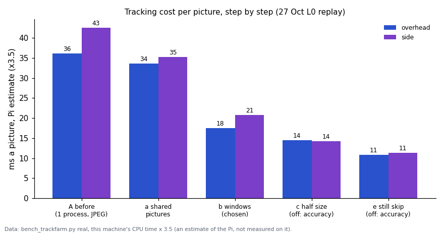
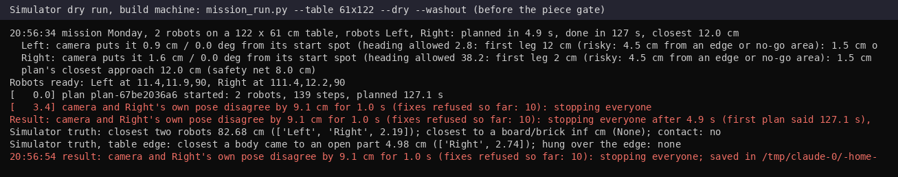

# One system: engine checks, Pi tracking load, blocks, arcs, Mission Control on the robots (2026-10-27 evening build)

## Premise

Nick's 18:26-18:56 brief ([mission-control.md](../build-plans/mission-control.md), "One system decided"): one engine
(run_plan) under Mission Control, the ladder and the DOE loop, with checks before and during every run; the Pi's
tracking load cut, not just split; Monday's 2-robot mission as editable blocks with a true-curve circle; Mission
Control driving the real robots and collecting the data. Simulator, replays and tests only: no robot or Pi was
touched. The firmware was compiled with the stand-in headers only (tools/fwcheck), not the Arduino toolchain.

What landed (all on main):

| Item | Commit |
|---|---|
| 1. Engine checks in run_plan | a7738b2 |
| 4. Arc move: firmware 2026-10-28a, planner, simulator | a7738b2 |
| 3. Blocks and Monday's default mission in Mission Control | 55f5b0c |
| 2. Pi tracking load (shared pictures, windows, one process per camera) | 461d142 |
| 5, 6. Mission Control on the robots; one-command Monday run; data collection | 526d8d0 |

## Data

**1. The Pi's tracking cost, step by step** (`tools/fleet/bench_trackfarm.py real`, the 27 Oct 13:01 L0 replay:
30 s, three robots standing still, washed-out board; this machine's CPU time x 3.5 as a Pi estimate).

Windows round each robot halve the cost a picture; half size and still-picture skipping cut it further but lose accuracy, so both stay off.

| Step | Overhead, ms a picture (Pi est.) | Side | Positions against the full tracker, p95 |
|---|---|---|---|
| A before: one process, JPEG decoded, full pictures | 36.1 | 42.6 | - |
| a + shared pictures (no JPEG decode) | 33.6 | 35.3 | same pictures, same code |
| b + windows, full scan every 8 (**chosen**) | 17.5 | 20.8 | 0.11 / 0.29 / 0.17 cm (Left / Right / Center) |
| c + half size (off) | 14.5 | 14.2 | 0.98 / 5.49 / 2.63 cm; Right seen in 31 % of pictures |
| e + still pictures skipped (off) | 10.8 | 11.3 | Center's spots up to 6.7 cm off its standing spot (0.75 cm in A) |
| d each camera its own process, at Pi speed (b) | overhead 20.6 of 22 pictures a second tracked | side 8.4 of 10 | 0.03 s behind the newest picture |

On the 27 Oct ladder the Pi tracked 12 overhead and 8 side pictures a second, half dropped. Row d says about 20
overhead pictures a second with windows, but it is an emulation (each worker made 3.5x slower on a 2-core
machine), not a Pi measurement.

**2. Monday's mission in the simulator** (`mission_run.py --dry`, both simulated cameras, camera bridge with
`--farm` unless said; Left at the 0,0 end, Right at the other):

| Run | Result | Took / planned | Closest bodies, simulator truth | Camera against truth, p95 (Left / Right) | Closest to an open edge |
|---|---|---|---|---|---|
| 61 x 122 | done | 115 / 127 s | 12.1 cm, no contact | 0.70 / 0.77 cm | 4.2 cm |
| 70 x 130 | done | 120 / 130 s | 10.1 cm, no contact | 0.75 / 0.73 cm | 4.1 cm |
| 76 x 137 | done | 127 / 137 s | 12.1 cm, no contact | 0.80 / 0.82 cm | 4.1 cm |
| 61 x 122, overhead washed out | stopped at 3.4 s, then **done** after the fix | 116 / 127 s | 12.0 cm, no contact | 0.85 / 0.91 cm | 5.0 cm |
| 61 x 122, 5 % of packets lost each way | done | 115 / 127 s | 12.0 cm, no contact | 0.70 / 0.81 cm | 3.8 cm |
| 61 x 122, Right dies at 60 s | Right out at 64 s ("nothing heard for 4 s"); Left re-planned and finished Chicken, spread out, dance | 93 s | 16.4 cm (centres 25.9) | 0.72 cm (Left) | - |
| 76 x 137, washed out + 5 % lost + Left dies at 70 s | Left out at 74 s; Right finished | 115 / 137 s | 14.2 cm (centres 23.7) | 0.75 cm (Left) | - |

Every robot reached every block in the runs where none died. In the circle the simulated robots held the 15 cm
radius within 0.15 cm. The dead-robot runs wrote no simulator report: closest from truth.csv, edge distance not measured.

**3. Problems the runs found, fixed**

- Washed-out overhead: a piece of Right's outline 5.9 cm off its middle was taken while the side camera missed it;
  camera and own pose disagreed by 9.1 cm and run_plan stopped everyone at 3.4 s (same with and without the farm).
  Now a piece is taken only within 5 cm of where the robot should be (e02_twocam `PIECE_GATE_CM`).
  
  The same run with the gate finished in 116 s.
- The line check had no arcs, so the circle counted as misses (Left p95 8.5 cm, runs of 3.9 s); with arcs, 0.72 cm.
- Windowed tracking: a second window was clipped to the first one's size and came out empty (crash on robots far
  apart). Fixed, with a test.
- Mission Control: start spots were not carried to a smaller table (warm-up refused: "Right boxed in at (122, 18)");
  the simulated setup wrote its calibrations into the real calibration folder; a finished run showed broken camera
  pictures; closing Mission Control (SIGTERM) left a run driving; the one-button setup went straight on to the
  warm-up with the chessboard still on the table (it now waits for "Chessboard taken away"). All fixed.

**4. Chessboard corner piece** (5 x 7 squares of 3.5 cm, plain chessboard: ArUco markers were too small to decode at
~3.4 px/cm; [PDF to print](../hardware/chessboard-corner-piece-5x7-3.5cm.pdf)). Simulated cameras: side lens 169.9 cm
up (true 170), overhead 259.0 cm (the test's own camera: 261.9 against 262), board fit 0.07-0.14 px, table corners
within 0.2-0.3 px. The squares were 3.8 cm until the end of the build: that left 0.3 cm for a printer's margins, so
"fit to page" would have shrunk them.

**5. Engine checks** in the full ladder dry run (L0-L5, with run-ins): every step PASS, p95 0.18-0.44 cm, closest
bodies 13.7-14.0 cm.

## Conclusion

The engine, blocks, arcs and Mission Control work end to end in the simulator on all three table sizes, with both
cameras, a washed-out overhead, 5 % packet loss and a robot dying mid-run. Windows cut the Pi's tracking cost by
about half at no accuracy cost on the real replay; half size and still-skipping do not keep accuracy and are off.
Nothing here has run on the robots or the Pi.

## Next

1. Flash firmware 2026-10-28a (USB or WiFi) and run `./run-fleet-pi.sh monday 61x122` on a 61 x 122 area at home;
   then once with `farm`, comparing tracking_times.csv and cpu.csv with the 27 Oct ladder.
2. Print the chessboard PDF at actual size, check a square measures 3.5 cm, run Setup once, and compare the lens
   heights with a tape.
3. If the arc's radial error on the board is over 1 cm: the arc_kr DOE row (1 / 2 / 4).
4. The open-edge distance (4.1 cm at the mow lanes' ends): Nick's call below.

## Sweep 1: new tests

23 new test functions: tools/fleet/tests/test_engine_checks.py (10: status parsing, day state, plan gap gate,
heading allowance, run-ins kept by a re-plan, miss pattern, read-back, dry runs with a dead robot, uncalibrated
robots, battery floor), test_one_system.py (11: Monday fits every table, circle swapped, every lane mowed once,
bad programs, blocks, arc step, re-plan mid-circle, dance circle held, firmware host compile, Mission Control
plans the blocks, start spots follow a new table size and the setup waits for the chessboard), test_trackfarm.py (1: windows find both robots far apart), test_camera_setup.py (1: chessboard
pose and height for both cameras). The fleet and Pi suites: 178 passed, 7 skipped; camera and fusion tests 60 passed.

## Sweep 2: possible inaccuracies

- The Pi figures are this machine's CPU time x 3.5 (from earlier Pi measurements), not measured on the Pi; row d is
  an emulation on 2 cores.
- The replay has robots standing still; windows with moving robots were checked only end to end (dry runs: camera
  against truth p95 0.70-0.85 cm with the farm), not against the full tracker picture by picture.
- The piece gate (5 cm) is close to the 4.5 cm offset a real washed-out piece showed on 27 Oct: on the real board it
  may drop good pieces at the side picture's edge (the case the old rule kept them for).
- The simulator's washed-out board is drawn, not filmed; the dead robot is "silent and still", not a robot that
  wanders.
- The firmware's arc and dance were compiled against stand-in headers only.
- The 0.15 cm circle error is the simulator's motion model; the real robot's wheels and gyro will be worse.
