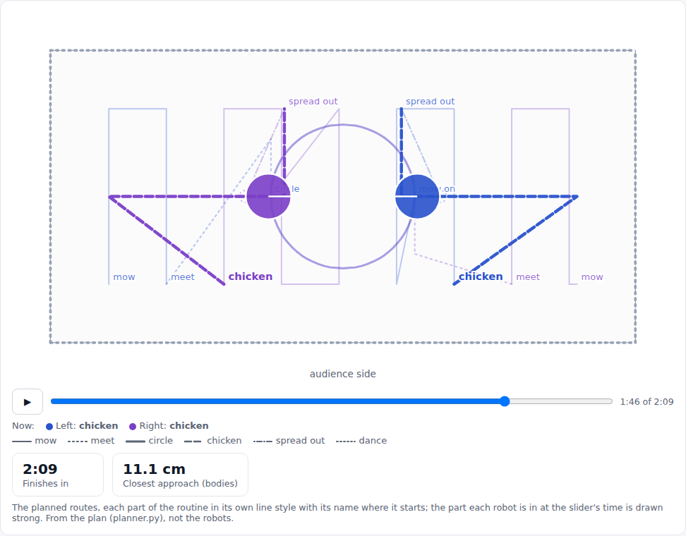
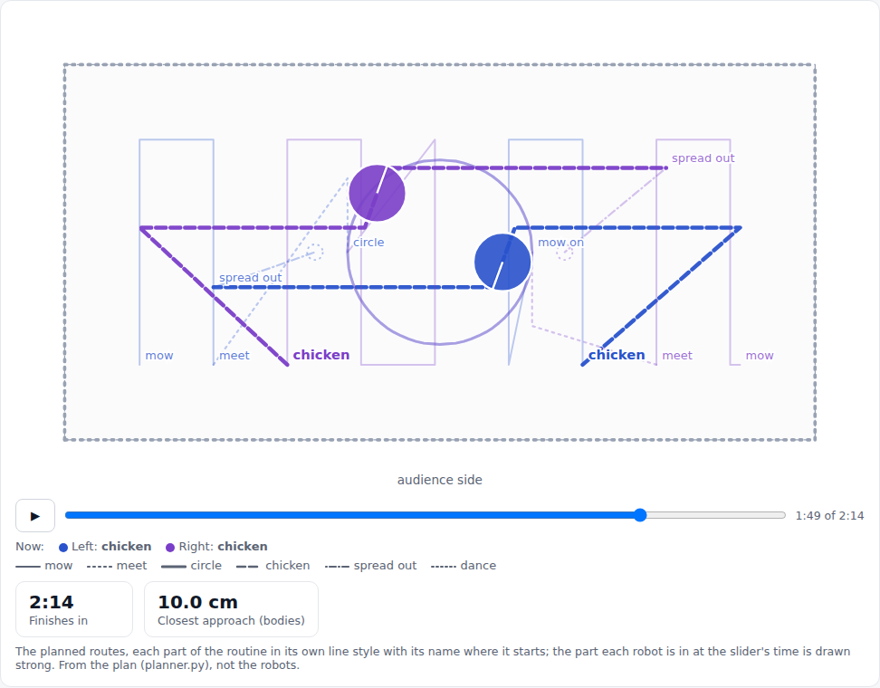
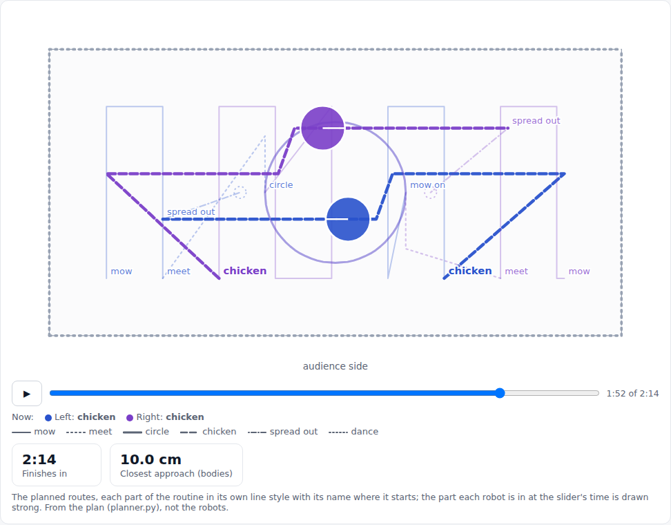
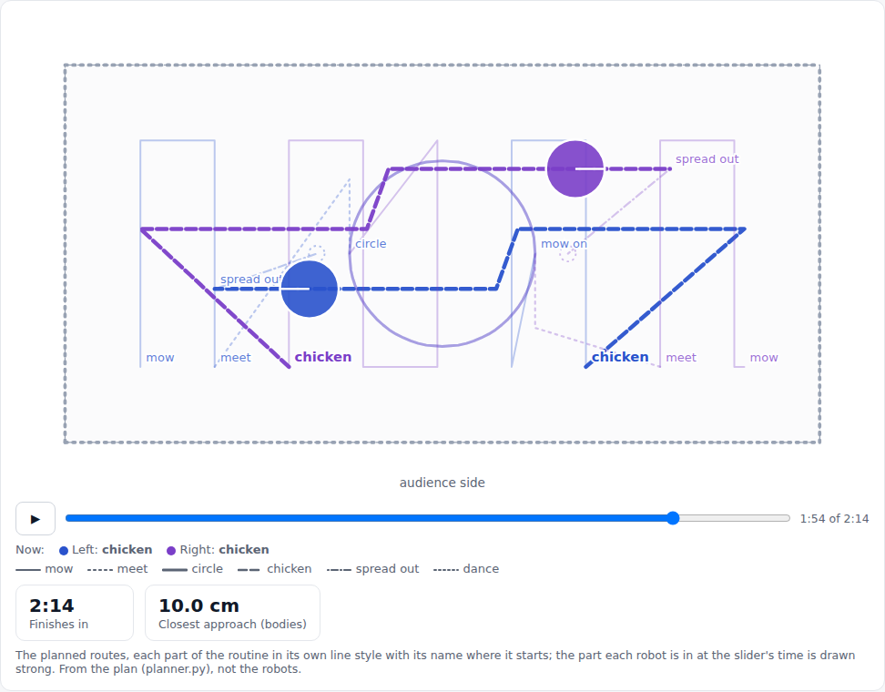

# One system: engine checks, Pi tracking load, blocks, arcs, Mission Control on the robots (2026-10-27 evening build)

## Premise

Nick's 18:26-18:56 brief ([mission-control.md](../build-plans/mission-control.md), "One system decided"): one engine
(run_plan) under Mission Control, the ladder and the DOE loop, with checks before and during every run; the Pi's
tracking load cut, not just split; Monday's 2-robot mission as editable blocks with a true-curve circle; Mission
Control driving the real robots and collecting the data. Simulator, replays and tests only: no robot or Pi was
touched. The firmware was compiled with the stand-in headers only (tools/fwcheck), not the Arduino toolchain.

What landed (all on main):

| Item | Commit |
|---|---|
| 1. Engine checks in run_plan | a7738b2 |
| 4. Arc move: firmware 2026-10-28a, planner, simulator | a7738b2 |
| 3. Blocks and Monday's default mission in Mission Control | 55f5b0c |
| 2. Pi tracking load (shared pictures, windows, one process per camera) | 461d142 |
| 5, 6. Mission Control on the robots; one-command Monday run; data collection | 526d8d0 |

## Data

**1. The Pi's tracking cost, step by step** (`tools/fleet/bench_trackfarm.py real`, the 27 Oct 13:01 L0 replay:
30 s, three robots standing still, washed-out board; this machine's CPU time x 3.5 as a Pi estimate).

Windows round each robot halve the cost a picture; half size and still-picture skipping cut it further but lose accuracy, so both stay off.

| Step | Overhead, ms a picture (Pi est.) | Side | Positions against the full tracker, p95 |
|---|---|---|---|
| A before: one process, JPEG decoded, full pictures | 36.1 | 42.6 | - |
| a + shared pictures (no JPEG decode) | 33.6 | 35.3 | same pictures, same code |
| b + windows, full scan every 8 (**chosen**) | 17.5 | 20.8 | 0.11 / 0.29 / 0.17 cm (Left / Right / Center) |
| c + half size (off) | 14.5 | 14.2 | 0.98 / 5.49 / 2.63 cm; Right seen in 31 % of pictures |
| e + still pictures skipped (off) | 10.8 | 11.3 | Center's spots up to 6.7 cm off its standing spot (0.75 cm in A) |
| d each camera its own process, at Pi speed (b) | overhead 20.6 of 22 pictures a second tracked | side 8.4 of 10 | 0.03 s behind the newest picture |

On the 27 Oct ladder the Pi tracked 12 overhead and 8 side pictures a second, half dropped. Row d says about 20
overhead pictures a second with windows, but it is an emulation (each worker made 3.5x slower on a 2-core
machine), not a Pi measurement.

**2. Monday's mission in the simulator** (`mission_run.py --dry`, both simulated cameras, camera bridge with
`--farm` unless said; Left at the 0,0 end, Right at the other):

| Run | Result | Took / planned | Closest bodies, simulator truth | Camera against truth, p95 (Left / Right) | Closest to an open edge |
|---|---|---|---|---|---|
| 61 x 122 | done | 115 / 127 s | 12.1 cm, no contact | 0.70 / 0.77 cm | 4.2 cm |
| 70 x 130 | done | 120 / 130 s | 10.1 cm, no contact | 0.75 / 0.73 cm | 4.1 cm |
| 76 x 137 | done | 127 / 137 s | 12.1 cm, no contact | 0.80 / 0.82 cm | 4.1 cm |
| 61 x 122, overhead washed out | stopped at 3.4 s, then **done** after the fix | 116 / 127 s | 12.0 cm, no contact | 0.85 / 0.91 cm | 5.0 cm |
| 61 x 122, 5 % of packets lost each way | done | 115 / 127 s | 12.0 cm, no contact | 0.70 / 0.81 cm | 3.8 cm |
| 61 x 122, Right dies at 60 s | Right out at 64 s ("nothing heard for 4 s"); Left re-planned and finished Chicken, spread out, dance | 93 s | 16.4 cm (centres 25.9) | 0.72 cm (Left) | - |
| 76 x 137, washed out + 5 % lost + Left dies at 70 s | Left out at 74 s; Right finished | 115 / 137 s | 14.2 cm (centres 23.7) | 0.75 cm (Left) | - |

Every robot reached every block in the runs where none died. In the circle the simulated robots held the 15 cm
radius within 0.15 cm. The dead-robot runs wrote no simulator report: closest from truth.csv, edge distance not measured.

**3. Problems the runs found, fixed**

- Washed-out overhead: a piece of Right's outline 5.9 cm off its middle was taken while the side camera missed it;
  camera and own pose disagreed by 9.1 cm and run_plan stopped everyone at 3.4 s (same with and without the farm).
  Now a piece is taken only within 5 cm of where the robot should be (e02_twocam `PIECE_GATE_CM`).
  
  The same run with the gate finished in 116 s.
- The line check had no arcs, so the circle counted as misses (Left p95 8.5 cm, runs of 3.9 s); with arcs, 0.72 cm.
- Windowed tracking: a second window was clipped to the first one's size and came out empty (crash on robots far
  apart). Fixed, with a test.
- Mission Control: start spots were not carried to a smaller table (warm-up refused: "Right boxed in at (122, 18)");
  the simulated setup wrote its calibrations into the real calibration folder; a finished run showed broken camera
  pictures; closing Mission Control (SIGTERM) left a run driving; the one-button setup went straight on to the
  warm-up with the chessboard still on the table (it now waits for "Chessboard taken away"). All fixed.

**4. Chessboard corner piece** (5 x 7 squares of 3.5 cm, plain chessboard: ArUco markers were too small to decode at
~3.4 px/cm; [PDF to print](../hardware/chessboard-corner-piece-5x7-3.5cm.pdf)). Simulated cameras: side lens 169.9 cm
up (true 170), overhead 259.0 cm (the test's own camera: 261.9 against 262), board fit 0.07-0.14 px, table corners
within 0.2-0.3 px. The squares were 3.8 cm until the end of the build: that left 0.3 cm for a printer's margins, so
"fit to page" would have shrunk them.

**5. Engine checks** in the full ladder dry run (L0-L5, with run-ins): every step PASS, p95 0.18-0.44 cm, closest
bodies 13.7-14.0 cm.

## Conclusion

The engine, blocks, arcs and Mission Control work end to end in the simulator on all three table sizes, with both
cameras, a washed-out overhead, 5 % packet loss and a robot dying mid-run. Windows cut the Pi's tracking cost by
about half at no accuracy cost on the real replay; half size and still-skipping do not keep accuracy and are off.
Nothing here has run on the robots or the Pi.

## Next

1. Flash firmware 2026-10-28a (USB or WiFi) and run `./run-fleet-pi.sh monday 61x122` on a 61 x 122 area at home;
   then once with `farm`, comparing tracking_times.csv and cpu.csv with the 27 Oct ladder.
2. Print the chessboard PDF at actual size, check a square measures 3.5 cm, run Setup once, and compare the lens
   heights with a tape.
3. If the arc's radial error on the board is over 1 cm: the arc_kr DOE row (1 / 2 / 4).
4. The open-edge distance (4.1 cm at the mow lanes' ends): Nick's call below.

## Sweep 1: new tests

23 new test functions: tools/fleet/tests/test_engine_checks.py (10: status parsing, day state, plan gap gate,
heading allowance, run-ins kept by a re-plan, miss pattern, read-back, dry runs with a dead robot, uncalibrated
robots, battery floor), test_one_system.py (11: Monday fits every table, circle swapped, every lane mowed once,
bad programs, blocks, arc step, re-plan mid-circle, dance circle held, firmware host compile, Mission Control
plans the blocks, start spots follow a new table size and the setup waits for the chessboard), test_trackfarm.py (1: windows find both robots far apart), test_camera_setup.py (1: chessboard
pose and height for both cameras). The fleet and Pi suites: 178 passed, 7 skipped; camera and fusion tests 60 passed.

## Sweep 2: possible inaccuracies

- The Pi figures are this machine's CPU time x 3.5 (from earlier Pi measurements), not measured on the Pi; row d is
  an emulation on 2 cores.
- The replay has robots standing still; windows with moving robots were checked only end to end (dry runs: camera
  against truth p95 0.70-0.85 cm with the farm), not against the full tracker picture by picture.
- The piece gate (5 cm) is close to the 4.5 cm offset a real washed-out piece showed on 27 Oct: on the real board it
  may drop good pieces at the side picture's edge (the case the old rule kept them for).
- The simulator's washed-out board is drawn, not filmed; the dead robot is "silent and still", not a robot that
  wanders.
- The firmware's arc and dance were compiled against stand-in headers only.
- The 0.15 cm circle error is the simulator's motion model; the real robot's wheels and gyro will be worse.

## One address: Mission Control as a tab (2026-10-28, open question 4)

**Premise.** Nick wants one address for everything on the Pi. The start page (8091) is the only page that is always
on (systemd, PIN), so it now holds three tabs, each the existing page unchanged: **Live lab | Mission Control |
Start/Stop**. Bookmark: **http://100.122.222.75:8091**. A bar at the top says what runs on the Pi, whichever tab is open.

**What each tab shows** (screenshots `docs/screenshots/2026-10-28/one-address-*.png`):

| On the Pi | Live lab | Mission Control | Start/Stop |
|---|---|---|---|
| Nothing running | "Nothing is running", where to start each thing | Mission Control's page; if closed, **Open Mission Control** (runs `./run-fleet-pi.sh mc` in tmux `mc`) | Start page as before |
| E02 session | its live page (questions) and the Lab page, one click apart | opens for planning and the simulator; robot runs refused | Running, Stop |
| DOE loop / Monday's mission / ladder (tmux) | the run's own screen (last lines, every 2 s), **Stop** (Ctrl+C in its window), camera pictures on request | opens beside it; its robot run refused until the other ends | "A robot run is going", Start locked, Stop for that run |
| Mission Control's own run | "watch and stop it on the Mission Control tab" | its Run screen | Start locked |

Before this, the start page took a DOE loop or Monday run for "the recorder running without a runner", and its Stop
would have stopped the recorder under the running loop. It now knows the fleet's programs (doe_loop, mission_run,
ladder, run_plan, Mission Control; simulator runs marked as such).

**Problems found while building, fixed.**
- The E02 runner refused firmware 2026-10-28a (the one-system build's), so after Monday's flash no E02 session would
  have started ("this session needs 2026-10-22b ... or 2026-10-27a"). 28a only adds the arc, the dance and the boot
  ID to 27a: now accepted (e02.py OK_FW, BORDER_FW, BACK_FW, TILT_FW). Found by the dry E02 session run for the
  screenshots.
- The live page's "start page / Stop" link opened the tabs inside the tab: it now opens in the whole window.

**Mission Control's preview, part by part** (the coordinator's addition: Nick could not see the game of Chicken).
Each part of the routine is drawn in its own line style with its name where it starts; the part each robot is in at
the slider's time is drawn strong, and "Now: Left chicken, Right mow on" sits under the slider
(`mc-preview-parts-*.png`). It showed why Chicken was hard to see: **the two robots never play it together.** On
61 x 122, Left swerves at 82 s while Right is still mowing; Right swerves at 103 s while Left dances. The chicken
block has no wait for the other robot (the meet block has one). Not changed here (it changes the mission the Monday
sweeps simulate): open question 41.

**Tests.** 7 new launcher tests (the fleet's programs recognised; a DOE loop shown, Start locked, Stopped through its
tmux window; Mission Control's run not stopped from here; simulator runs marked; Mission Control opened in tmux once;
the tabs page framing /start and its buttons behind the PIN) and 2 Mission Control tests (robot run refused while
the DOE loop drives; Monday's preview cut into its parts, Chicken with its own path). Pi and fleet suites: 185
passed, 9 skipped; E02 runner tests 87 passed, 1 skipped. Screenshots: the real page code with a stand-in Pi (the
process list and tmux screens stubbed, the DOE screen text made up), a real Mission Control and a real dry E02 session.

**Not tested on the Pi.** The service picking up the new code (needs `sudo systemctl restart mirlt-launcher` after
`git pull`); tmux started from the systemd service for Mission Control (the same way it starts E02 sessions);
Mission Control inside the tab over Tailscale and on the phone; `hostname -I` addresses added to Mission Control's
allowed hosts; the camera pictures in the Live lab tab (the recorder's /stream).

**Next.** On the Pi: `git pull`, `sudo systemctl restart mirlt-launcher`, open http://100.122.222.75:8091, press
Open Mission Control once. Answer question 41.

**New tests that may now be necessary:** a launcher end-to-end with a real dry DOE loop in tmux (Stop from the page);
Mission Control started from the page under systemd's environment.
**Possible inaccuracies:** the fleet runs are recognised by their program names on the Pi's process list; a run
started some other way (a renamed copy, `python -m`) would not show. The 2 s refresh and the 24 screen lines are
chosen, not derived (display only; no DOE needed).

## Chicken played together (2026-10-28, question 41)

**Premise.** Nick could not see the game of Chicken in Monday's default mission. The preview drawn part by part showed
why: each robot ran its half of Chicken when it got there (61 x 122: Left swerved at 82 s, Right at 103 s). Asked
fix: both wait for each other at their ready spots, then run at each other together (swerve 15 cm, never under 8 cm).

**Cause, two parts.** (1) The chicken block had no wait for the other robot (the meet block before the circle has
one). (2) Adding one was not enough: an `until_s` wait is measured on a robot's own timeline without the waits the
planner adds for the other robot (planner.build_prims), so a robot that yielded on the way (13-15 s here) still set
off that much late. **Fix:** each Chicken round now has the meet's wait and sync mark; `missions.plan_synced` plans,
lengthens the earlier robot's wait by how early it set off, and plans again until each group sets off within 0.6 s
(one extra plan on every table). Mission Control and `mission_run.py` (so `./run-fleet-pi.sh monday`) both plan
through it. A wait to set off together is no longer scored as a late show beat.

**Data.** Plans (planner.py) and simulator runs (`mission_run.py --table T --dry`: both simulated cameras through the
camera bridge; times on the run's own clock):

| Table | Plan: both set off / closest (plan) | Simulator: result, took / planned | Both swerve at | Closest bodies (simulator truth) | Closest to an open edge |
|---|---|---|---|---|---|
| 61 x 122 | 103.8 s / 11.1 cm | done, 121 / 129 s | 107.5 s | 11.2 cm, no contact | 4.8 cm |
| 70 x 130 | 109.8 s / 10.3 cm | done, 128 / 135 s | 113.7 s | 10.1 cm, no contact | 3.9 cm |
| 76 x 137 | 115.7 s / 11.1 cm | done, 134 / 142 s | 120.4 s | 11.3 cm, no contact | 3.8 cm |

The preview 1:46 into Monday on 61 x 122: "Now: Left chicken, Right chicken", both at their swerve points.

**Conclusion.** Chicken is now played together on all three table sizes, in the plan and in the simulator through
the cameras, never under 8 cm (closest 10.1 cm). The mission is about 2 s longer on 61 x 122 (2:09 planned).
**Monday sweep runs made before this commit had the old Chicken.** The 70 x 130 closest (10.1 cm at 62 s) is not
in Chicken.

**Next.** On the robots: watch that both start the run-in together (run_plan holds each robot's step after the sync
until the other has reached its own).

**New tests:** `test_chicken_is_played_together` on the three tables (sets off within 0.6 s, swerves within 1 s,
never under 8 cm). Fleet suite: 124 passed, 7 skipped.
**Possible inaccuracies:** the 0.6 s tolerance and the 5 plans at most are chosen, not derived (no DOE needed:
display and planning budget); the simulator's robots keep time better than real ones, so on the board the sync
step (not the plan's timing) is what keeps them together.

## Chicken: swerve and pass (2026-10-28)

**Premise.** Nick (03:52): "they should drive past each other. It looks like they are going to drive into each other
but then they swerve a little and keep going straight, passing each other." Before this, each robot swerved 20 cm
sideways and stopped. Nick's numbers: swerve when the fronts are 15 cm apart, the bodies pass about 10 cm apart
(each robot moves its line 9.75 cm to its own side), never under 8 cm, and each drives on to about the other's
ready spot (they swap ends), then spreads out and dances.

**What changed.** The swerve is an **angled jog**: turn 70 deg on the spot towards its own side, drive 10.4 cm on the
diagonal onto its pass line, turn back, drive a 3 cm piece, then drive on straight past the other robot. Why not a
curve: the planner keeps apart any two steps whose times overlap *or touch*, judged on each step's whole swept area,
so with the fronts only 15 cm apart nothing may move forward much before it has moved sideways:

| Swerve shape at 15 cm (planner's own rule) | Closest two bodies |
|---|---|
| S-curve on two arcs (the firmware's arc move), 45-90 deg | 0.0-4.9 cm |
| jog, then arc back onto the straight (r 9-12 cm) | 4.0-7.8 cm |
| jog 45 / 55 / 60 deg | 5.9 / 8.4 / 9.1 cm |
| **jog 70 deg, 3 cm first piece (chosen)** | **10.0 cm** (the pass gap itself) |

Closest two bodies: the smallest distance between the two robots' outlines (9.5 x 9.5 cm squares) over each step
and the other robot's same and neighbouring steps, from `missions.chicken_shape`. The planner needs 9 cm (8 cm plus
1 cm it allows between its 0.1 s samples).

The 3 cm piece exists because the other robot's turn back (a full turn circle on its own pass line) against a
12-15 cm first piece came to 8.0 cm. Arcs tighter than about 9 cm radius would also ask the outer wheel for more than
the motor's 70 rpm. Settings in Mission Control's chicken block: `swerve_cm`, `min_cm`, **`pass_gap_cm`** (new,
10 cm) and optional `jog_deg`. `chicken_aside_cm` is retired; an old saved value is skipped. If a jog angle or
`min_cm` would break the 9 cm rule, the jog is made steeper by itself and the mission's notes say so.

**A second change it needed.** Passing only plans when both robots set off together: the planner places one robot
first, and if the other was late (it gave way earlier: 13 s on 61 x 122) the first one's pass ended beside the late
one's ready spot, and no plan was found. `plan_synced` now lines up each group (the meet, then each Chicken round) on
the mission cut just after its sync mark, before planning the whole mission. Planning takes 20-30 s here (was about
10 s).

**Data.** Simulator (`mission_run.py --table T --dry --farm`: both simulated cameras through the camera bridge; times
on the run's clock; closest bodies and edges from the simulator's truth):

| Table | Result, took / planned | Both set off | Both swerve at | Closest bodies in Chicken | Closest bodies, whole run | Closest to an open edge (body) |
|---|---|---|---|---|---|---|
| 61 x 122 | done, 126 / 134 s | 105.9 / 105.9 s | 108.6 / 108.6 s | 9.72 cm | 9.72 cm (in Chicken), no contact | 3.8 cm (Left, 4.6 s, mowing) |
| 70 x 130 | done, 133 / 140 s | 112.1 / 112.1 s | 115.2 / 115.2 s | 9.71 cm | 9.71 cm (in Chicken), no contact | 4.9 cm (Left, 8.6 s, mowing) |
| 76 x 137 | done, 140 / 147 s | 118.0 / 118.0 s | 121.6 / 121.6 s | 9.99 cm | 8.81 cm (64 s, circle), no contact | 4.8 cm (Left, 66.8 s, mowing) |

Edge figures are from the body's nearest corner, not its centre. Left / Right in the "set off" and "swerve"
columns.

In the plans, every table's Chicken closest is 10.0 cm, with no waits once they swerve, each robot ends on the
other's side and the mission is 4-5 s longer (61 x 122: 2:14 planned).

The preview 1:49 into Monday on 61 x 122: the fronts reached 15 cm and both robots turn towards their own side.

At 1:52 they pass side by side on their own pass lines, bodies 10 cm apart (the discs drawn are larger than the
robots' bodies).

At 1:54 each drives on towards the other's end, before spreading out.

**Conclusion.** On all three table sizes the robots now set off together, swerve at the same moment, pass on
opposite sides about 10 cm apart and swap ends. They never come under 8 cm (closest 8.81 cm, in the circle; 9.71 cm
in Chicken). The swerve is a steep jog rather than a curve, because at a 15 cm swerve distance a curve cannot keep
them 8 cm apart. **Monday sweep runs made before this commit had the old Chicken.** The old 3-robot routine keeps the
old swerve (it has no set-off-together waits).

**Next.** On the board: whether a 70 deg jog reads as a swerve from the audience's side; if not, the lever is
`swerve_cm` (at 20 cm a 50 deg jog keeps 9.4 cm; at 25 cm, 45 deg keeps 10 cm). Time Monday's planning on the Pi:
20-30 s here may be 2-3 times longer there.

**New tests that may now be necessary.** `test_chicken_robots_pass_each_other` on the three tables (ends swapped,
pass lines 19.5 cm apart, no waits once they swerve, 9-10.5 cm while passing, never under 8) and
`test_chicken_shape_and_settings` were added. Fleet suite: 138 passed, 7 skipped. Still missing: the plan with a
robot dying mid-pass (the survivor's re-plan from beside the other's line); Chicken with `rounds` = 2 in the blocks
(the second round starts from the swapped ends: planned in code, not run); a timing test of planning on the Pi.

**Possible inaccuracies.** The 70 deg angle, the 3 cm piece and the 0.5 cm margin are chosen from planner geometry,
not measured. The simulator keeps its line better than real robots: the camera's p95 error (0.7-0.8 cm) is close to
the 0.3 cm difference between the 10 cm pass gap and the planner's 9 cm floor. "Both swerve at" is when the turn
step started on each robot (run_plan's step log), not when the camera saw them turn. The edge distances come from a
blank table with every side treated as open.
