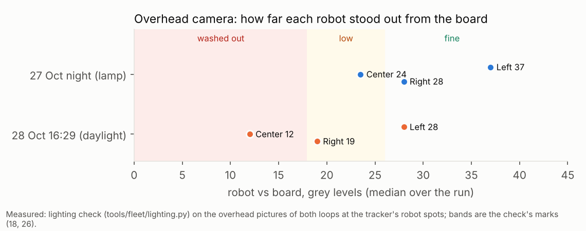
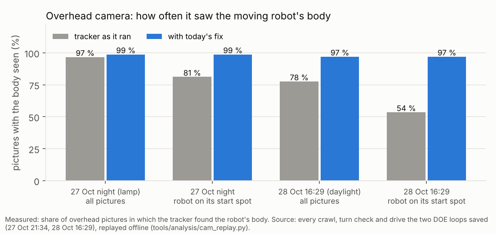
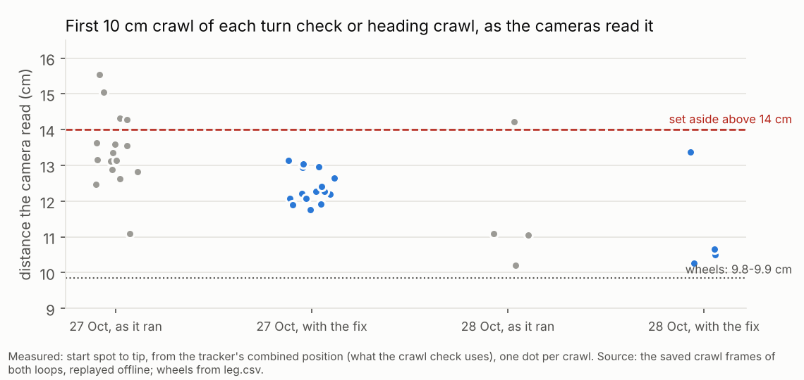

# Overhead camera in daylight: why it missed the robots, and what was fixed (2026-10-28)

**Premise.** The real DOE loop at 16:29 on 28 Oct (firmware 2026-10-28a, batteries 95-100 %) ended after 12 minutes
and 5 drives, with every robot set aside:
- the screen said "body seen by the side camera only" in 26 of 29 checks;
- Center failed its turn check (+3.9, −1.8, +7.9, −5.6 deg);
- Left's heading crawl read 15.0 cm for 10 (Center's read 15.1 the night before);
- at 16:41 neither camera saw Right's body.

The questions were whether the camera, the board or the lighting caused this, and whether the side camera stretches
distances. Everything here was done offline, on the frames and logs the two DOE loops kept (27 Oct 21:34 under the
lamp, 28 Oct 16:29 in daylight), and on the simulator. The Pi and the robots were not touched.

## Data

**Neither camera moved.** The 27 Oct 12:58 calibrations still put the board's four corners on the board's corners
in today's pictures, for both cameras
([screenshot](../screenshots/2026-10-28/overhead-contrast-feature-calibrations-still-line-up-with-board-corners.png)).

**The light changed, not the exposure.** The board's grey level was the same on both nights: about 193 next to the
robots, and less than 0.01 % of it clipped. What changed was how bright the robots' tops were: 235 under the lamp at
night against 199 in daylight (90th percentile of the robot's top, overhead).

Each dot is one robot, placed by how far its body stood out from the board on the overhead camera. In daylight,
Center fell into the washed-out band and Right into the low band. Center was already near that edge at night.

**Why "side camera only".** When tracking starts, the tracker has to fill in the floor under each robot, and it
trusts that filled-in floor only with an extra margin of 13-14 grey levels. With the robots only 12-28 levels from the
board, the overhead saw them on that spot in 54 % of pictures (81 % at night), and then only in pieces. The ladder
checks every robot right after tracking starts, which is exactly when it stands there.

Each pair of bars is the overhead's seen-rate as the loop ran (grey) and with this fix (blue), on the same pictures.

**Crawl and turn checks: the start spot, not the side camera.** On still robots seen by both cameras, the side
agrees with the overhead to 1.3-2.7 cm (median) and 2.0-4.2 cm (95 %) in every part of the board. Its scale is
0.94-0.98 of the overhead's, so there is no x1.5 stretch. The long crawls came from the start spot: every FIRST crawl
of a turn check or heading crawl starts where the robot stood on filled-in floor. On 27 Oct those read 11.1-15.5 cm
and on 28 Oct 10.2-14.2 cm (fused), for 9.8-9.9 cm by the wheels. Later crawls of the same robots read 8.5-12.4 cm on
either camera.

Each dot is one first crawl, start spot to tip, from the tracker's combined position (what the crawl check uses).
The red line is where a robot is set aside.

The turn checks recomputed per camera show a 10 cm crawl's heading misread by up to 5-14 deg on either camera alone
(appendix B). A misread heading shows as two opposite errors in a row. Center's FAIL (+7.9 then −5.6) and 27 Oct's
Right FAIL (−10.6 then +6.0) are both this pattern, and their totals stayed within the limit (+4.3, −2.6). A
robot that really turns wrong shows it in the total.

**Right at 16:41.** The pictures of that check were not kept, because the loop saved frames only while a robot moved.
Replaying the drive's last pictures with the tracker started as at 16:41 (Right seeded at its lights), the side
camera sees Right, and the overhead does not (only a piece, too small to be robot-shaped). So the overhead missed it
for the reason above. Why the side missed it live cannot be settled without those pictures.

## What changed (commits)

| Commit | Change |
|---|---|
| d9217aa | `./run-fleet-pi.sh doe <hours> keep-going`: a failed turn check, crawl, line check or one-camera evidence is logged as "would have parked" and the robot carries on. Safety still parks. ([dry run](../screenshots/2026-10-28/overhead-contrast-feature-keep-going-dry-run-turn-fail-logged-robot-drives-on.png)) |
| d75be2e | Recorder start-up check. `start_recorder` asks for one picture from each camera (3 s). An open window without pictures is stopped and started afresh ([test output](../screenshots/2026-10-28/overhead-contrast-feature-recorder-window-without-pictures-is-restarted.png)) |
| f25f3a7, c1e9fad | No robot set aside on one camera's evidence. A crawl that reads off by more than 40 % is crawled again once. A turn-check FAIL whose headings came from one camera, or that has the misread-heading pattern, is held: no drive this loop, checked again next time. Two-camera FAILs park as before |
| 963b70f | Lighting check before anything moves: in L0, and as a Lighting card on Mission Control's Setup and Run screens ([screenshot, real 16:40 pictures](../screenshots/2026-10-28/overhead-contrast-feature-mission-control-setup-lighting-card-real-1640-pictures.png)). Overhead washout guard in the recorder (on by default, Nick): exposure steps down only while the board clips, the change is said and logged, then returns to automatic |
| 01f45dd | Tracker: on filled-in floor, an outline grows from its sure part down to the plain threshold (within 0.35 robot widths). The extra margin is still needed to start an outline ([pictures](../screenshots/2026-10-28/overhead-contrast-problem-start-spot-outline-in-pieces-and-fixed.png)) |
| e27d61d, c80fac0 | The find step's frames are kept, and "kept out" lists each camera's own verdict. The growth works only round the filled-in floor (+0.1-0.7 ms a picture, not +3) |

Every chosen number is in appendix C, with its DOE note.

**Dry DOE loop after the changes** (simulated board, overhead washed out in software, Center's turns forced 12 %
off; 9 min): L0's lighting check said "overhead camera washed out ... close the blinds or turn off the lamp above
the table" and "side camera: fine" before anything moved
([screenshot](../screenshots/2026-10-28/overhead-contrast-feature-L0-lighting-check-dry-run-washed-out-overhead.png)).
Left and Right drove 4 drives with p95 0.42-0.66 cm. Center's turn check FAILED (+36 deg total) on the side camera
alone and was **held, not set aside**
([screenshot](../screenshots/2026-10-28/overhead-contrast-feature-dry-run-one-camera-turn-fail-held-not-set-aside.png)).
That also shows the rule's cost: a robot that really turns wrong is held every round instead of parked (open
question 48).

**Tests.** New: keep-going (3), holds (2), crawl re-check, misread heading, recorder check (3), washout guard (4),
lighting check (4); the two-camera test of the 11:20 failure updated. Fleet + Pi suites and the two-camera and
multitrack tests: 293 passed, 7 skipped. Three tests in `tools/experiment` were already failing on main before this
work and still are (`test_e02_explore` x2, the `test_e02_sidecam` grain fit).

## Conclusion

The robots were missed because of the lighting combined with how the tracker treats a robot's start spot. It was
not the calibration (nothing moved) and not the exposure (nothing clipped). The side camera's distances are right to
about 2-3 cm; its readings parked Left and Center because the start spot's outline was in pieces on both cameras. The
fused position also switched between "side only" and "both" across the crawl. On the same pictures, the overhead now
sees the bodies 97-99 % of the time and the first crawl reads 10.3-13.4 cm (limit 14). A crawl or turn check
that still reads off is re-checked or held, not parked. Last night's lamp light was already close to the edge:
Center stood 24 grey levels from the board, with "low" starting at 26.

**Could the side camera alone carry Monday's run?** For positions, yes: it saw the robots in 99.7-100 % of
pictures on both nights, within 2-3 cm of the overhead. It needs no recalibration and no scale correction. It does
need the side-to-overhead offset learning (built), the lights as a fallback (built), headings from long straights
(25 cm or more, as the drives use) rather than 10 cm crawls, and a robot kept inside its picture (Left sat at its
top edge on 27 Oct).

**Camera pose from geometry** (Nick's priority). Both calibrations come from the board's 4 corners and size, and they
still fit. The side camera's height and tilt are fixed by those corners (219 cm, 28 deg). The overhead's height is
not, because it looks almost straight down: its 262 cm comes from the tape. A 10 % error in it moves a robot-top
spot by under 0.1 cm, so it does not explain any error seen here, and no pose correction is supported by the data.

## What's next

1. Thursday daytime test: [docs/session-plans/2026-10-29.md](../session-plans/2026-10-29.md) (lighting check, then a
   1 h DOE loop, with pass marks from these replays).
2. Remaining start-spot bias: the first crawl still reads 0.4-3.6 cm long, mostly on the overhead. Next step: have
   L0 nudge each robot 3 cm and back, so its start floor is seen before anything is measured.
3. Turn check: 10 cm crawls misread headings by up to 14 deg. A 15 cm crawl, or a heading from both legs, would
   tighten it (DOE in appendix C).

## Sweep 1: new tests that may now be necessary

- The washout guard on the real camera: does `cap.set(CAP_PROP_EXPOSURE)` hold on the overhead webcam in automatic
  mode, and does switching back to automatic restore it? Only fake cameras were tested.
- The lighting check's marks for the side camera: they come from overhead data. The side camera saw 100 % even at 16
  grey levels, so "low" may be over-cautious there.
- A live L0 under daylight with the new tracker (Thursday's plan), counting "seen by both" per robot.
- The crawl re-check on the real board: two crawls take about 8 s more. Does a robot near an edge have room for
  the second?
- The hold rule over a long run: a robot held every turn-check round never drives. A cap (for example, 3 holds in
  a row) may be needed.
- The find step's saved frames (about 25 s a loop): free space on the USB drive over a 4 h loop.
- A test for Eye.why_unseen and the frames saved during the find step (covered only by the dry run).

## Sweep 2: possible inaccuracies in what this relied on

- **The replays seed the moving robot** from its own pose in leg.csv / fix.csv, or from the screen's lines. A seed a
  few cm off changes the first pictures' outlines.
- **Only frames kept while robots moved** were replayed: 20 crawl/turn-check segments and 5 drives. L0's own
  pictures (robots standing for a long time) were not kept. The "start spot" figures come from the first second of
  each segment.
- **The replay runs at full speed on this machine**, not at the Pi's 12 / 10 pictures a second, with drops.
- **The lighting check's marks (18, 26)** are fitted to 6 robot-nights (3 robots x 2 lights). They are chosen, not
  derived.
- **Daylight on 28 Oct** is one afternoon. The sun's angle changes the shadows, and the shadows move outline centres
  by 1-3 cm.
- **The side-vs-overhead agreement** includes the overhead's own errors. There is no third reference (taped marks,
  open question 34).
- **The wheels' 9.8-9.9 cm** is the robot's own count after its wheel_scale correction (0.979). It is not an
  independent truth.
- **Right at 16:41:** the explanation for the overhead comes from an emulation with the drive's last pictures, not
  the check's own pictures.

## Appendix A: how the replays were run

`tools/analysis/cam_replay.py <frames> <logs> <overhead calib> <side calib> <out.csv>` replays each saved
`frames/<camera>/track/<HHMMSS>_<what>.avi` pair through `e02_twocam.TwoCamTracker` with the loop's calibrations (side
lag −0.019 s). The floor memory comes from the segment's first 5 pictures with the robot's floor filled in, as the
ladder does. For each picture it writes each camera's own sighting, the fused one, and the robot-vs-floor contrast.
The summaries, charts and region tables are scratch scripts (`summ.py`, `firstcrawl.py`, `regions.py`, `turns.py`,
`light_cal.py`, `charts.py`). They are not committed, because they read the downloaded frames. 27 Oct's frames came
from `rec-frames-small.zip` by range requests: only the crawls, turn checks, stills and thumbnails.

| Variant (overhead seen %, 27 Oct / 28 Oct; first crawl, fused, median / max error cm) | Overhead seen | First crawl 27 Oct | First crawl 28 Oct |
|---|---|---|---|
| As it ran | 96.7 / 77.6 | 3.4 / 5.7 | 1.2 / 4.4 |
| Growth over filled-in floor, down to 1.0 x threshold (**chosen**) | 98.8 / 97.0 | 2.4 / 3.3 | 0.7 / 3.6 |
| The same, down to 0.7 x | 95.2 / 99.5 | 2.0 / 3.0 | 0.5 / 3.4 |
| The same plus the lights as seeds | 98.8 / 97.0 (identical) | | |
| Growth over all floor, 0.6 x | 73.0 / 93.4 | 1.3 / 3.2 | 1.1 / 4.2 |
| Plain threshold 12 instead of 16 (the "per-frame normalisation" idea: a gain on the difference is the same as a lower threshold) | 95.4 / 89.4 | 3.5 / 5.2 | 1.2 / 4.6 |

## Appendix B: turn checks recomputed per camera (errors per turn, deg)

| Segment | Overhead alone | Side alone |
|---|---|---|
| 28 Oct Center (FAIL live) | ?, −2.0, −0.3, +4.9 | −0.3, +0.8, +2.6, +0.3 |
| 28 Oct Left | −1.6, −0.2, +4.2, +1.3 | −10.4, +5.9, +0.3, +1.3 |
| 27 Oct Right 21:53 (FAIL live) | −5.2, +6.9, −0.5, +2.6 | −4.9, +8.0, +1.3, +0.9 |
| 27 Oct Left 21:57 | −5.8, +1.9, +4.2, +0.1 | +13.7, +0.1, +5.5, −9.7 |

The live FAILs came from the fused positions. Either camera alone misreads a single crawl heading by similar amounts.

## Appendix C: chosen numbers and DOE notes

- Outline growth (HYST_LOW 1.0, over filled-in floor only, at most 0.35 robot widths): chosen from appendix A.
  **A DOE fits:** 0.85 / 1.0 on the board, lamp and daylight, against L0's body seen-rate and the first crawl.
- Crawl re-check: once, when off by more than 40 % (the existing 0.6-1.4 band). No DOE: one retry.
- Misread-heading rule: an OFF turn undone by the next (opposite sign, the pair within 6 deg, total within 8).
  Follows from the existing tolerances. **A DOE fits** the crawl length (10 / 15 / 20 cm) against heading spread.
- Lighting marks: washed out under 18, low under 26 (appendix data); a robot is found when 30 % of its middle passes
  16. **A DOE fits:** contrast against L0 seen-rate, on the board, lamp / daylight / both.
- Washout guard (Nick: on by default): washed out when more than 2 % of the picture's middle clips (250+), two checks
  2 s apart; steps of 80 %, never under 30 % of the start; back to automatic after 60 s under 0.2 %. **A DOE fits**
  the threshold (0.5 / 2 / 5 %) and the step (0.7 / 0.8 / 0.9) on a board that clips. None of the footage so far
  clips, so nothing could be measured. This is also why the guard would not have acted on 28 Oct: a lower exposure
  there would have lowered the contrast, because nothing was saturated.
- Recorder check: one picture within 3 s per camera. No DOE: a guard.
