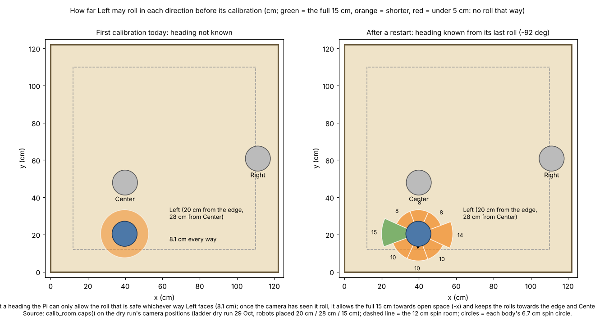
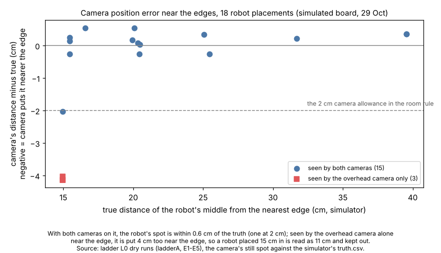

# Calibration with less room (29 Oct 2026, simulator and logs only)

Nick, 07:5x: "I want the robots to be able to calibrate with less space." He chose **point the roll at open space +
skip**. Nothing here touched the DOE loop running on the Pi since 07:43 (it runs the code it started with).

## Premise

The ladder's L1 (and so the DOE loop) kept a robot out unless it was **30 cm from every edge and 35 cm from every other
robot**. At 07:43 that kept Right out at 27 cm from the x = 122 edge. The calibration only needs room all round for its
spin. Its roll needs room in **one** direction, but the robot picks that direction with its front sensor, and the front
sensor cannot see a plywood edge. The firmware already accepts `set calib_dir_limits <deg> <cm> ...`: a cap on the roll
for each direction, used by the next calibration only.

## What changed

1. **Room = spin room only** (`tools/fleet/calib_room.py`). The body is 9.5 x 9.5 cm, so its corners sweep a 6.72 cm
   circle when it spins. Each number adds 2 cm for the camera and a 3 cm margin:
   - **12 cm** from every edge (6.72 + 2 + 3 = 11.7)
   - **21 cm** between robots' middles (6.72 + 6.72 + 2 x 2 + 3 = 20.4; both robots may be spinning at once)

   L0 no longer keeps any robot out for being near an edge (L1 handles it). The 25 cm rule still applies before any
   robot drives: the DOE loop moves the robot in first, and the ladder's turn check refuses it.
2a. **No room: driven to open space first** (added on the coordinator's request after the 09:22 run, where Right was
   kept out the whole run at 27 cm under the old rule). A robot without room to spin where it stands goes through four
   steps:
   1. the compass check alone: a few degrees' wiggle on the spot, with no spin and no roll (the same settings e02.py
      uses), so the firmware lets it drive
   2. a 10 cm heading crawl
   3. a slow planned drive (5 cm/s, camera fixes) to the nearest spot 32 cm from every edge and 38 cm from the other
      robots
   4. the full calibration there

   If its crawl is blocked by another robot, it is tried again once the others have calibrated or moved. It is kept out
   only if there is no open spot, the compass check fails, or the drive does not finish, and the words say which.
2. **Roll caps.** Before every full calibration, the Pi takes the camera's position, the board and the other robots,
   and works out the longest safe roll in 8 directions round the robot. It sends them as `calib_dir_limits`: 8 pairs
   cover every heading. Robots that stay where they are count as 6.7 cm circles. Robots calibrating at the same time
   each keep to their own half of the floor between them. The roll then goes towards open space. If no direction has
   5 cm, the roll is skipped and the robot counts as calibrated "limited" (the firmware already handles this).
   - **Heading known** (a crawl, a drive, or the camera watching its last calibration roll): the caps are aimed, with
     15 deg allowed for the heading being off.
   - **Heading not known** (the first calibration after a power-on; a robot cannot crawl before its compass check):
     every direction gets the roll that is safe whichever way the robot faces.
   - **New:** after a roll of 6 cm or more, the camera's line through the roll gives the robot's heading, so later steps
     know which way it faces.
3. **Keep or calibrate.** If a robot was calibrated today and its boot ID hasn't changed, it keeps that calibration:
   no 65 s run. The record is `~/.config/mirlt/day/<date>.json` (`calibrated_boot`, `calibrated_t`), the same file
   run_plan uses. Dry runs now write their own `day-dry/` file instead. A full calibration runs in these cases:
   - the robot restarted (new boot ID)
   - it has no calibration today (a new day)
   - it was forced
   - the quick check failed. The quick check is the first turn check after a kept calibration (ladder L2, the DOE
     loop's first drive). A FAIL there calibrates the robot fully once and checks it again, instead of parking it.
4. **Where:**
   - ladder L1 and the DOE loop (start, restarts, quick check)
   - `./run-fleet-pi.sh calibrate`, which now goes through the camera, one robot at a time, and keeps today's
     calibration. `calibrate full` forces a full one; `calibrate blind` is the old way (no camera).
   - run_plan's own calibration, so Mission Control's warm-up and runs: room check and caps. Its skip-on-same-boot rule
     was already there.

**What Nick sees** (per robot, in plain words):
- `Left: calibrated today at 08:06 on this power-on (boot B6A3): kept, no 65 s calibration ...`
- or `restarted since its calibration at 08:06 (boot B6A3, now 71CC): ... full calibration`
- then `room to roll ...: rolls allowed +0:10, ... -90:15 ...; the longest, 14.9 cm, towards -x on the board`
- then `its roll: 14.9 cm at -69 deg from where it faced, towards -x on the board`

## Data (dry runs, simulator)

| Run | Robots placed | What happened |
|---|---|---|
| ladder L0+L1 | Left 20 cm from an edge, Center 28 cm from Left, Right 15 cm | Left and Center calibrated in place (old rule: both kept out); heading unknown, so both rolled 8 cm (the roll that is safe whichever way they face); the camera then read their headings from the roll (-92 deg vs true -90.7; 171 vs 171.2). Right was read at 11 cm and kept out (see problem) |
| second session, same power-on | the same | Left and Center **kept** (same boot IDs), no calibration |
| Left restarted, `calibrate` | the same | Left: new boot ID, full calibration; with its heading known it rolled the full 15 cm towards -x, along the edge it was 20 cm from and away from Center. Center kept |
| DOE loop as a second session, Center restarted before loop 1 | the same | start: both kept; loop 1: Center recalibrated in full |
| ladder L0+L1, nobody has room | Right 8 cm from an edge; Left and Center 17 cm apart | all three calibrated, none kept out: Right and Center driven to open space (22 cm and 20 cm, about 7 s each) and calibrated there with the full 15 cm roll; Left's crawl was blocked by Center, so it was tried again after Center moved and then had room where it stood |
| run_plan, all 3 uncalibrated at once | Left 15 cm facing its edge, Center 28 cm from Left, Right 20 cm | all calibrated: Left limited (edge on one side, Center's half on the other); Center and Right rolled away from the edges and each other |

Without a heading, Left is only allowed the 8 cm roll that is safe every way. Once the camera has seen it roll, it gets
the full 15 cm towards open space.

18 placements in the simulator. 15 robots seen by both cameras were read within 0.6 cm (one at 2 cm). The 3 robots seen
by the overhead camera alone, near the x = 122 edge, were read 4 cm too near the edge.

Tests: `tools/fleet/tests/test_calib_room.py` (11 new: room numbers, caps for 15 / 20 / 28 cm, never an unsafe roll
inside a cap's window, two robots calibrating together, keep / restart / new day / forced, the open spot). Fleet
suite: 217 passed, 7 skipped.

## Conclusion

- A robot can now calibrate from **12 cm** from an edge and **21 cm** from another robot, down from 30 / 35. Right's
  27 cm this morning is now well inside the rule.
- Near an edge the roll is aimed away from it, or skipped. Whether it can be aimed depends on the heading:
  - first calibration of the day (heading unknown): a robot under about 16 cm from an edge skips its roll
  - from 20 cm: it rolls about 8-9 cm
  - after its first roll the heading is known, and later calibrations roll the full 15 cm towards open space
- A second session on the same power-on skips the 65 s per robot.
- A robot with no room at all is no longer kept out: it is driven to open space and calibrated there. Under the old rule,
  Right (27 cm, 09:22 run) would also have been driven in rather than kept out.

## What's next

1. Next start, after `git pull`: robots may be put 16 cm in (12 + the 4 cm the overhead camera alone can be off).
   30 / 40 cm is still best for the DOE loop, which otherwise moves robots in before driving.
2. Logs-only check on the Pi (runs without asking): in the 27-29 Oct ladder/DOE `state.json` files, compare `lights_dir`
   (from L0) with the crawl headings. If the lights give the heading to about 20 deg, the first calibration could be
   aimed too.
3. Firmware idea (not built, needs flashing): turn back to the start heading after the roll. Today the robot stays
   facing its roll heading, which is why run_plan sometimes has no start heading after a calibration.

## Sweep 1: new tests that may now be necessary

- **On the board:** one calibration with a robot 15-20 cm from an edge, its heading known. Check that it rolls away
  from the edge and that `CALIB_LOOK` shows the caps.
- **On the board:** the roll heading against the next crawl's heading, per robot (does `calibration roll (camera)`
  hold up?).
- **On the board:** a kept calibration followed by a turn check FAIL, to see the quick check calibrate it fully.
- **Simulator:** why the side camera misses Right near the x = 122 edge (3 of 3 placements). Is the real side camera
  blind there too?
- **Dry run:** the DOE loop dry run again, end to end, after the `--sim-from` truth-path fix (the first run parked
  Left for "camera lost it" because its line check looked for the simulator's truth file in the wrong folder; fixed,
  not re-run).
- **On the board:** the drive to open space with a robot under 12 cm from an edge facing the edge. Its forward crawl
  then meets the edge guard, and the robot is kept out ("crawl did not finish"). A backwards crawl would need the 10 cm
  blind-backing allowance. Is that acceptable there?
- **Real logs:** Mission Control's first run of a day, now that its calibration turns robots towards open space more
  often (more "no start heading" stops).

## Sweep 2: possible inaccuracies in what this relied on

- **Body size, 9.5 x 9.5 cm, axle under the middle:** from the simulator's config, not measured on the real robots. A
  fitted nose bracket (+1.34 cm) would make the corner circle 7.7 cm; the ladder sends `bumper_cm 0`.
- **Camera allowance, 2 cm:** chosen. The simulator shows 4 cm when only the overhead camera sees the robot near an
  edge. That error always pointed towards the edge, so it keeps robots out rather than letting them in too close.
- **Margin, 3 cm:** chosen, like the firmware's `calib_margin_cm`.
- **Heading allowance:** 15 deg for a measured heading and 45 deg for a weak one. Both chosen; DOE notes are in
  calib_room.py.
- **Roll heading:** taken from the last 14 s of the calibration, at least 6 cm out. The window and the minimum are
  chosen, and the real robots' roll speed and timing are not checked.
- **What a full calibration fixes:** it redoes the compass check and the tilt level. It does **not** change
  gyro_scale or wheel_scale on the robot, which come from the stored corrections. So when the quick check FAILs, the
  recalibration may not change how the robot turns.
- **Robots calibrating at the same time (run_plan):** each one's caps assume the other's roll stays in its own half.
  The robots do not know about each other, so this holds only because both follow the same caps.
- **Open spot, 32 cm / 38 cm:** copied from the DOE loop's own "make room" target. Chosen, not derived.
- **The compass-only calibration** restores calib_spin_deg 720, calib_roll_cm 15 and calib_roll_min_cm 5, the
  firmware's defaults. If anyone had set other values, they are overwritten.
- **Map obstacles (boxes) are not in the caps.** The front sensor still sees physical ones.
- **The simulator's turn check on Center after its restart** read -9.4 deg total (FAIL). Its calibration was a fresh
  full one, so this is not the kept-calibration path. Not investigated.
