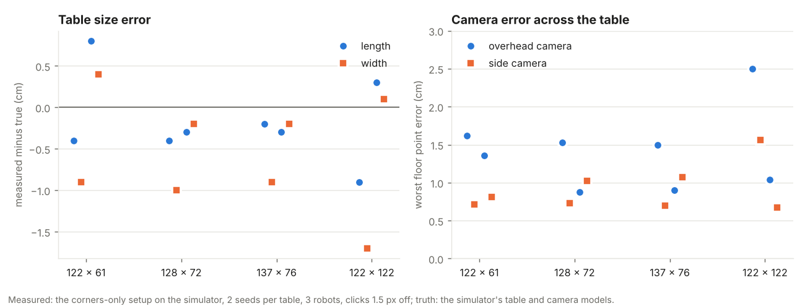
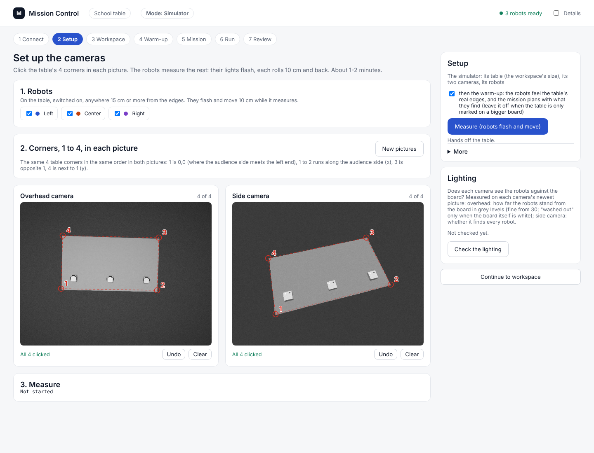
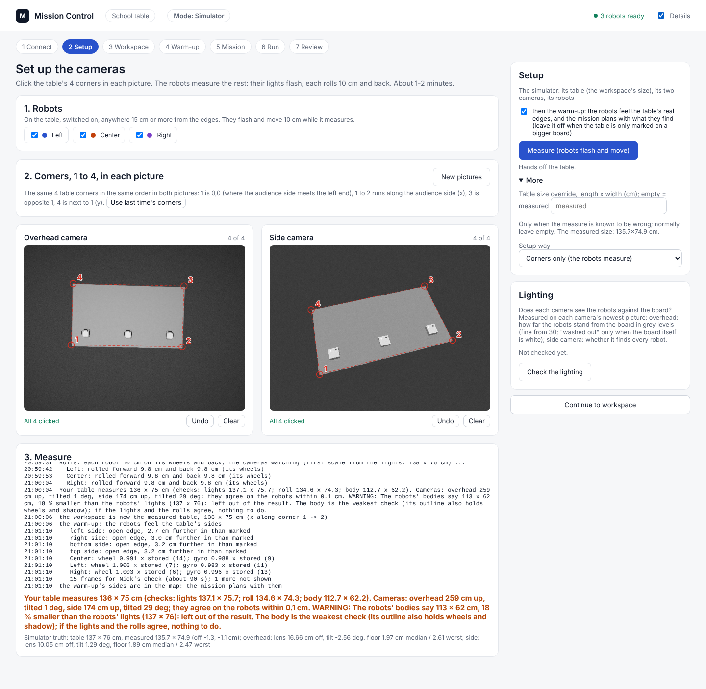
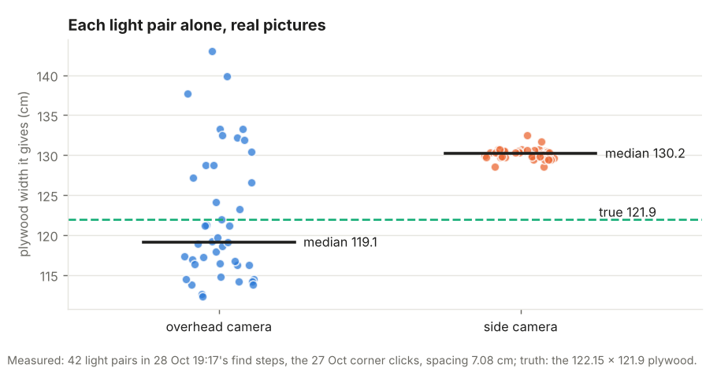
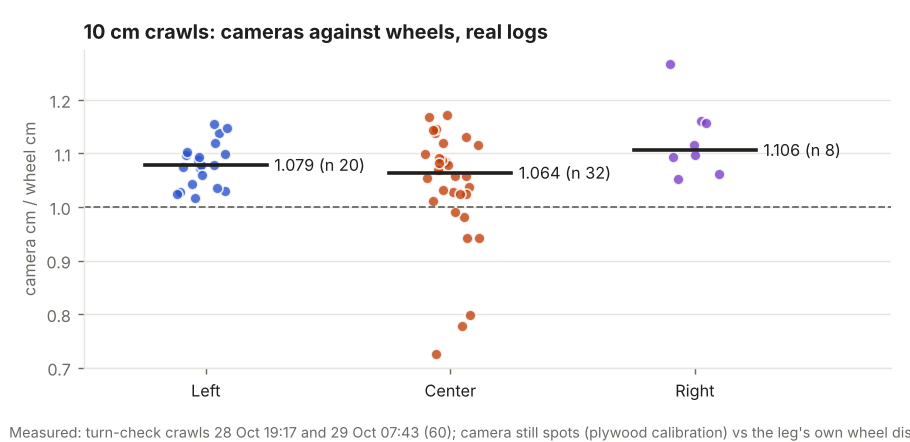

# Corners-only setup: the user clicks corners, the robots measure the rest (29 Oct 2026, simulator and saved pictures)

## Premise

Nick, 20:20-20:27: "the user does nothing but select corners." Before, setup meant placing corner piece A, typing the
surface's size, stopping the recorder by hand and starting it again mid-setup (the run sheet's clash). Now:

- The user clicks the table's 4 corners as 1-2-3-4 in the overhead picture, and the same 1-4 in the side picture.
  Corner 1 is 0,0, and the 1 -> 2 side is x.
- The robots measure the rest, moving if they need to:
  - scale from each Alvik's two lights (primary)
  - a 10 cm roll on the wheels (check)
  - the 9.5 cm body (check)
- The two cameras are lined up on the robots' lights. The board's size is measured, not typed.
- Corner piece A is dropped (its code is kept).
- The warm-up is on for a real table, and its findings feed the plan.
- The setup handles the recorder itself.

Nothing here touched the Pi or the robots.

## Data

**How it measures** (`tools/fleet/corner_setup.py`):

1. Each camera's 4 clicks plus its lens model give its pose and the table's shape, but not the scale.
2. The scale comes from things of known size at a known height:
   - two lights 7.08 cm apart at 3.7 cm up
   - a roll the wheels measured
   - the body's outline
3. The size comes from the camera that looks most straight down (the overhead).
4. The side camera is lined up on it: its corners at that size, plus the same lights at the same floor spots. When it
   is tilted, its focal length is refitted too.
5. A check more than 2 % from the lights is reported in plain words and left out.

Before anything moves, two numbering mistakes are refused, with words saying what to click instead:

- a clockwise numbering, which would mirror the frame so the robots turn the wrong way
- two pictures numbered differently

**The light spacing (the ruler).** Arduino's datasheet names the two top LEDs but gives no positions, so the spacing
was measured from 28 Oct 19:17's 22 find steps. Those steps have 42 light pairs seen by both cameras on the known
122.15 x 121.9 plywood (appendix A).

| Method | Spacing |
|---|---|
| The spacing that makes this setup measure the plywood, all 42 pairs | **7.08 cm (used)** |
| The same, each half of the steps alone | 6.95 and 7.22 cm |
| Each light triangulated by the two plywood-calibrated cameras (median) | 7.01 cm |

How sure: about +-0.15 cm (2 %). A ruler across one lit robot would settle it (question 79).

**Simulator: Monday's three tables and the 122 x 122 board.** The setup ran with both simulated cameras and three
robots on Monday's crosses (Left 17, 17; Center half way; Right L-17; all facing 90). The clicks were 1.5 px off, and
there were 2 seeds per table. Each run took 44-46 s.

Every table came back within 1.7 cm of its true size, and every camera put floor points within 2.5 cm of the truth.

| Table | Seed | Measured (cm) | Off L / W | Lens off: overhead / side (cm) | Tilt off: o / s (deg) | Floor median: o / s (cm) | Floor worst: o / s (cm) | Robots worst (cm) | Cameras agree (cm) | Used |
|---|---|---|---|---|---|---|---|---|---|---|
| 122x61 | 3 | 121.6 x 60.1 | -0.4 / -0.9 | 26.6 / 6.1 | 4.8 / -0.6 | 0.9 / 0.6 | 1.6 / 0.7 | 0.8 | 0.15 | lights |
| 122x61 | 4 | 122.8 x 61.4 | +0.8 / +0.4 | 19.2 / 7.2 | -1.4 / 0.6 | 0.6 / 0.6 | 1.4 / 0.8 | 0.7 | 0.13 | lights |
| 128x72 | 3 | 127.6 x 71.0 | -0.4 / -1.0 | 19.6 / 3.0 | 3.5 / -0.3 | 0.9 / 0.6 | 1.5 / 0.7 | 0.7 | 0.14 | lights |
| 128x72 | 4 | 127.7 x 71.8 | -0.3 / -0.2 | 15.5 / 3.1 | -1.8 / 0.2 | 0.3 / 0.6 | 0.9 / 1.0 | 0.7 | 0.12 | lights+roll |
| 137x76 | 3 | 136.8 x 75.1 | -0.2 / -0.9 | 17.5 / 1.7 | 3.0 / -0.2 | 0.9 / 0.6 | 1.5 / 0.7 | 0.8 | 0.15 | lights |
| 137x76 | 4 | 136.7 x 75.8 | -0.3 / -0.2 | 14.0 / 2.0 | -1.9 / 0.1 | 0.3 / 0.6 | 0.9 / 1.1 | 0.7 | 0.13 | lights+roll |
| 122x122 | 3 | 121.1 x 120.3 | -0.9 / -1.7 | 11.3 / 5.7 | 1.8 / -0.4 | 1.0 / 1.1 | 2.5 / 1.6 | 0.8 | 0.17 | lights |
| 122x122 | 4 | 122.3 x 122.1 | +0.3 / +0.1 | 10.6 / 3.0 | -1.8 / 0.3 | 0.5 / 0.5 | 1.0 / 0.7 | 0.6 | 0.14 | lights+roll |

Lens off: the solved lens position against the true one. Floor: where a 5 cm grid over the table lands through
the new model against the truth. Robots: each robot's lights through each new model against the truth.

How to read the camera numbers:

- The overhead's lens position comes out 11-27 cm off and its tilt up to 4.8 deg. A camera looking straight down at a
  flat table can trade tilt against sideways position with almost no change on the table, so 4 corners cannot pin
  them down.
- This does not reach the floor: floor points stay within 2.5 cm, and robots within 0.8 cm.
- The side camera, tilted 28 deg, is pinned to about 2-7 cm and 0.6 deg.
- In 5 of 8 runs the rolls were left out. The simulator's wheels read 2-3 % short, because its robots' wheel sizes
  are off and dry runs send no wheel_scale.
- The body was left out every time. The simulator draws the shell in the board's own grey, so the outline is wheels,
  top plate and shadow, and reads 18 % small.

**Through Mission Control (Playwright, 137 x 76, simulator):**

- Take pictures, then click 4 corners in each picture, then Measure. The measure and the warm-up took 2 min 15 s.
- The workspace became the measured 135.7 x 74.9 (true 137 x 76).
- The warm-up found all four sides open. They went into the map ("the mission plans with them"), and the 15 frames
  were left for Nick's check.
- These clicks went through the page at 0.7 scale. The floor error was 2.0 cm median and 2.6 cm worst, and robots
  1.8-2.5 cm: click error costs about 1 cm more here than in the direct runs.

The Setup screen: robots chosen, the 4 corners clicked in each picture, numbered in red.

After **Measure**:

- the robots' steps
- the result line with the size and the checks
- the warning that the body check was left out
- the warm-up's sides
- the simulator's truth (Details)

**Real pictures (28 Oct 19:17, the known plywood).** The test used the 27 Oct 12:58 corner clicks (both cameras; the
cameras had not moved since, see
[picture](../screenshots/2026-10-29/corners-setup-feature-real-corner-clicks-27-oct-on-28-oct-pictures.png)) and the
lights from the 22 find steps. The size was not given.

| Lights used | Measured (true 122.15 x 121.9) | Off |
|---|---|---|
| All 42 pairs (spacing set on these same pairs) | 121.9 x 121.6 | -0.3 / -0.3 cm |
| Odd steps, with the spacing from the even steps (cross-checked) | 117.7 x 117.4 | -4.5 / -4.5 cm (3.7 %) |
| Even steps, with the spacing from the odd steps | 126.9 x 126.5 | +4.7 / +4.6 cm |

After lining up, the two cameras agree on the robots' lights within 0.46 cm (median) and 2.5 cm (worst).

Each light pair measured the plywood on its own. The overhead camera's readings scatter around the truth. The side
camera's readings cluster tightly but 6.5 % too large (its lens model, fitted from 4 corners, is good on the floor but
not 4 cm above it). So the size comes from the overhead, and the side camera is lined up on it.

The roll check on real data: 60 of 28-29 Oct's 10 cm turn-check crawls. The plywood-calibrated cameras saw them
7.8 % longer than the wheels said (median; Left 7.9, Center 6.3, Right 10.6 %). On real robots the roll check will
likely be left out with a warning (question 80).

**The recorder clash, fixed.**

- This setup reads the recorder's own pictures (the warm-up and the run need it running too). It starts the recorder
  itself when it is not running.
- The old chessboard way (behind **More**, **Setup way**) opens the cameras itself. Mission Control stops the
  recorder before it and starts it again after.

**Tests.** `tools/fleet/tests/test_corner_setup.py` has 17 tests:

- the size and cameras come back on all 4 tables
- a clockwise numbering is refused
- pictures numbered differently are named
- a side lens off by 20 %: the size comes from the overhead, and the focal length is refitted to 1.4 %
- a check over 2 % off is left out and said
- one camera alone works
- with no lights, no scale is given
- the scale formula is checked
- the roll's room rule
- the light spots
- the recorder is started and stopped
- Mission Control's state, way and size override, and a table marked on a bigger board

The fleet suite: see the commit message. The simulator's side camera now draws each light at its sub-pixel spot,
2.55 cm either side like the overhead's. Drawn at whole pixels, the lights' spacing read up to 5 % off.

## Conclusion

- **Clicking corners is enough in the simulator.** On Monday's three tables and the board, the size came back within
  1.7 cm, floor points within 2.5 cm, and robots within 0.8 cm (2.5 cm through the page's clicks).
- **On real pictures the scale is only as good as two things:**
  - **The lights' spacing.** It was set from the same night's pictures: one ruler measurement would settle it.
  - **How many light pairs there are, and how clean.** The washed-out night overhead gave each pair about 6 % spread.
    Cross-checked halves of 21 pairs were 3.7 % off, and a live setup flashes 9 pairs.
- **Expect a plain-words warning on real robots.** The roll check disagrees, because the wheels read 8 % short of the
  cameras on 28-29 Oct.
- **Monday:** the table's size and the camera poses now come from the setup. A 2-4 % size error at night (2-5 cm)
  matters near the edges. The run sheet keeps the tape check: within 2 cm is good, and the size override is under
  **More**.

## What's next

1. **At home before Monday:** run the new setup once on the plywood, in daylight and at night. Compare the result line
   with 122 x 122, and the two cameras' agreement with today's 0.5 cm.
2. Measure the light spacing with a ruler (question 79), and one robot's `go 10` with a tape (question 80).
3. If the night size is off by more than 2 %, flash each robot's lights twice per spot. That is 18 pairs instead of 9,
   about 6 s more.

## Sweep 1: new tests that may now be necessary

- **Board:** the whole setup on the plywood, day and night; the size against 122 x 122. This is the real test of
  everything above.
- **Board:** firmware 2026-10-29a's one-side lights. The setup needs them: with old firmware there is no left/right,
  and so no roll.
- **Board:** `go 10` / `go -10` with a robot that has had no calibration since power-on. The setup gives it the compass
  wiggle first, the ladder's way; not run on a real robot.
- **Pi:** the setup starting the recorder (`./run-fleet-pi.sh rec` from Mission Control), and the old way's stop and
  restart.
- **Simulator:** the setup with a robot placed under 15 cm from an edge and facing it (the backward roll), and with
  the side camera seeing only part of the table.
- **Real pictures:** the side camera's lens. A wide-angle distortion term (k1) fitted from the lights might remove its
  6.5 % (sweep 2).

## Sweep 2: possible inaccuracies in what this relied on

- **Light spacing 7.08 cm:** set on the same 28 Oct pictures the real test used (the all-pairs row is circular; the
  cross-checked rows are not). The triangulated 7.01 depends on the 27 Oct calibrations.
- **Lights' height 3.7 cm:** assumed (the robot's top). The two cameras' triangulation said 5.5 +- 0.8 cm, which may
  point to the side camera's lens rather than the lights. The overhead's scale barely depends on it (0.4 % per cm).
- **Lens models:**
  - The overhead's focal length (599 px) came from a calibration that assumed a 262 cm lens height. Its floor scale
    barely depends on it.
  - The side's focal length (848 px) came from a 4-corner fit, with no distortion term.
- **Wheel distances:** the legs' own end poses (firmware resets them per leg) with the stored wheel_scale 0.979. Today
  the cameras disagree with them by 8 %.
- **Body 9.5 cm, outline at 3.7 cm:** nominal. The simulator's robot outline is not the real one, so the body check is
  untested on real pictures.
- **Simulated clicks:** the true corners plus 1.5 px; real clicks may be worse. Corner snapping was tried and left off
  (real plywood corners snapped to grain up to 9 px apart).
- **Chosen numbers:** 2 % agreement line, 2 px click and 0.5 px spot weights, 1.5 px line-up weight, 10 cm roll,
  15 deg refit tilt, 5 cm edge room (appendix B).
- **The simulator's robots** all stood on their crosses facing 90 deg. The setup's roll room and the warm-up's start
  from other spots are not tested here.

## Appendix A. The light spacing from real pictures

`scratchpad/scripts/real_spacing.py` (not committed: it reads downloaded frames) works through each of the 22 find
steps as follows:

1. Per camera: a dark picture (10th percentile), then the spots that rose 30 grey levels.
2. Frames with exactly one pair 4-9.5 cm apart. Both lights were lit (old firmware: white on both).
3. The pairs are matched across the two cameras by time and floor spot, and each light is triangulated.

Results over 42 pairs:

| Measure | Value |
|---|---|
| 3D spacing | median 7.01 cm (sd 0.43) |
| Height | median 5.5 cm (sd 0.8) |
| Overhead alone at 3.7 cm | 7.24 cm (sd 0.45) |
| Side alone at 3.7 cm | 6.60 cm (sd 0.03) |
| Rays' closest gap | 0.95 cm |

`real_corners.py` then solved the plywood without its size. The spacing that makes all 42 pairs measure it is 7.08 cm.

## Appendix B. Chosen numbers and DOE notes (all in corner_setup.py / setup_job.py)

| Number | Value | DOE? |
|---|---|---|
| Light spacing / its sd | 7.08 / 0.15 cm | No: a ruler |
| Lights' height | 3.7 cm | No: a ruler |
| Body / its sd | 9.5 / 0.6 cm | Yes: body vs lights on 5 still robots |
| Roll | 10 cm (the firmware's longest backward leg) | Yes: 10 / 15 / 20 cm against the roll check's spread |
| Wheels' error | 1.5 % + 0.2 cm | Yes: roll vs lights over a week of setups |
| Agreement line | 2 % | Yes: the checks' spread over real setups |
| Click / spot / line-up weights | 2 / 0.5 / 1.5 px | Yes: 5 clicks per corner; still-robot spot spread; cams-agree at 1 / 1.5 / 3 px |
| Cameras agree warning | 2 cm | No: a warning line |
| Focal refit from | 15 deg tilt, 6 shared lights | No: below it focal length and height cannot be told apart |
| Edge room for a roll | 5 cm + half the body | No: a safety room |
| Corner snap | 8 px, off | Yes: snap on / off against Nick's repeated clicks |
| Recorder start wait | 45 s | No: a wait |

## Appendix C. What changed

- `tools/fleet/corner_setup.py` (new): the measure, the live run (lights, rolls, body), dry runs on the simulator,
  and a self test.
- `tools/fleet/setup_job.py` (new): Mission Control's Setup job and the recorder start / stop.
- `mission_control.py`: endpoints `/api/setup/pictures`, `picture`, `measure`, `corner`, `way`; the chessboard way
  stops and restarts the recorder.
- `mission_control.html`: the new Setup screen.
- `tools/sim/table_cam.py`: the side camera's lights at the overhead's spot, sub-pixel.
- The run sheet: section 2, the pack list, the problem table, the rehearsal, and the print copy.
- `mission-control.md`: the queued items marked.
- Open questions: answered entries, plus questions 79-82.
