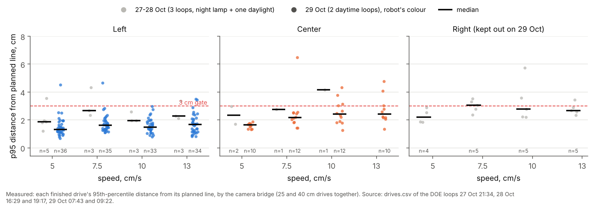
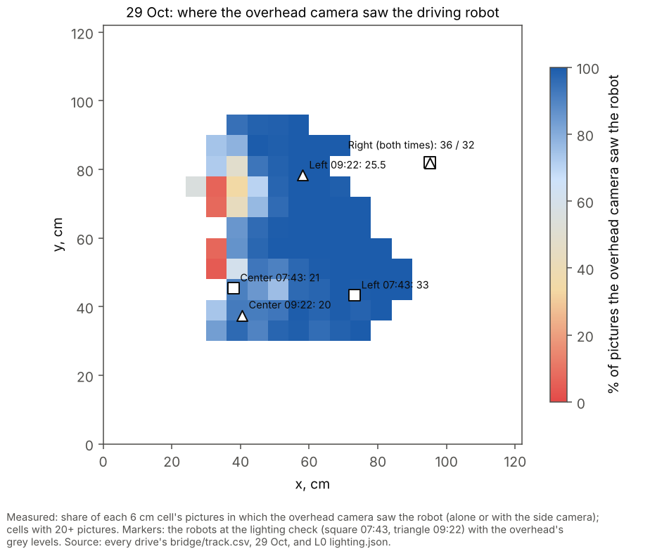
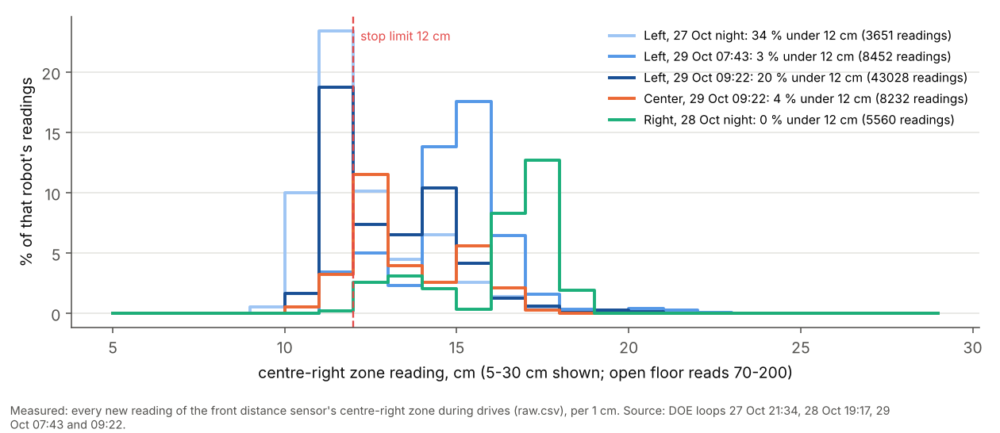
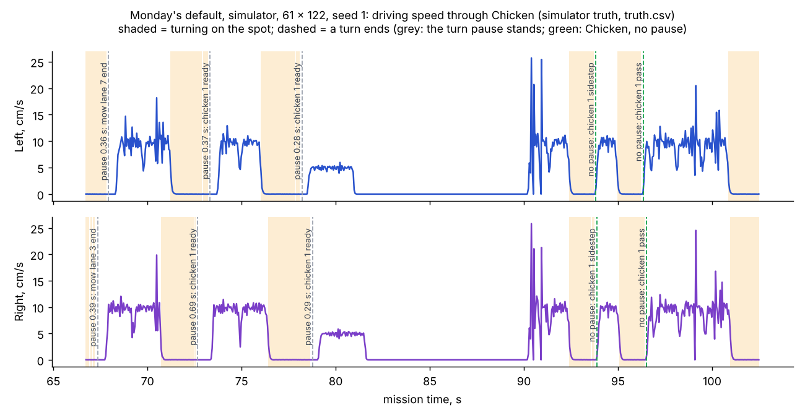

# Daytime DOE loops, 29 Oct: accuracy, cameras, stops, and what it means for Monday

**Premise.** Two real DOE loops ran in keep-going mode on 29 Oct (firmware 2026-10-28a): **07:43-08:44** (1 h,
morning sun; the lighting check called both cameras "low"; Left 23 drives, Center 23) and **09:22-12:23** (3 h; Left
121 drives, Center 23 until it was parked at 10:25; the loop ended at 12:23). Right was kept out of both (27 cm from
the x = 122 edge: no room to calibrate). Monday's mission uses Left and Right. Everything here is from the uploaded
logs (logs zips of both releases; the 07:43 frames did not upload, fix 4 below); the Pi and the robots were not
touched.

## Data

**1. Drive accuracy: better than 27-28 Oct, and speed matters little.**

| Robot | 27-28 Oct (3 loops) | 29 Oct 07:43 | 29 Oct 09:22 |
|---|---|---|---|
| Left | 14 drives, median p95 2.20 cm, 21 % over 3 cm | 22, 1.96 cm, 5 % | 116, **1.40 cm, 3 %** |
| Center | 4, 2.86 cm, 25 % | 23, 2.48 cm, 30 % | 21, 1.83 cm, 5 % |
| Right | 19, 2.78 cm, 32 % | kept out | kept out |

p95: the 95th percentile of the robot's distance from its planned line over one drive, measured by the camera
bridge. Finished drives only.

Each dot is one finished drive (grey 27-28 Oct, coloured 29 Oct); the black bar is the median, and on 29 Oct the
medians sit at 1.3-1.7 cm for Left at every speed, below the 27-28 Oct ones.

Per speed (median p95, 25 / 40 cm drives), Left 09:22: 5 cm/s 1.29 / 1.31, 7.5 1.64 / 1.38, 10 1.40 / 1.37, 13 1.71 /
1.38. Left 07:43 grew with speed on 25 cm drives (1.97 at 5 cm/s to 2.56 at 13). Center 07:43 was the worst at 13 cm/s
on 25 cm (4.09), 2.18 by 09:22. 40 cm drives were as good as or better than 25 cm ones in every 29 Oct group.

**2. How often both cameras saw each robot, against the lighting check.**

| Loop | Robot | Lighting check at L0, overhead / side (grey levels) | Pictures with both cameras | Drives under 80 % both |
|---|---|---|---|---|
| 07:43 | Left | 33 / 21 | 98.9 % | 0 of 23 |
| 07:43 | Center | **21** / 31 | 77.2 % | 7 of 23 (08:28-08:43) |
| 09:22 | Left | 25.5 / 34 | 89.2 % | 23 of 121 (20 of them 10:04-10:39) |
| 09:22 | Center | **20** / 41 | 88.3 % | 3 of 23 |

Pictures with both cameras: the driven robot's pictures in which both cameras saw it; the rest were almost all
the side camera alone (the overhead alone under 0.5 %, missed under 0.1 %). Source: each drive's
bridge/bridge_summary.json; lighting: L0 lighting.json.

The check ranked the robots right (Center, the lowest overhead contrast, lost the overhead most), but it measures one
picture at the robots' standing spots. The losses were about **where** a robot was: the overhead lost robots on a strip
at x = 30-45 cm (Left at x 37-47, y 68-78 from 10:04 to 10:39: 0-77 % both; at x 48+ the same hour, 93-99 %).

Each square is a 6 cm patch of the board coloured by how often the overhead camera saw the robot there: the red and
pale patches at x = 30-45 cm are where only the side camera saw it.

**3. Turn checks: fine.** Left passed 37 of 38 checks (|error| p95 2.6 deg at 07:43, 4.3 deg at 09:22; largest 7.7);
Center 12 of 15 (p95 5.1-6.2 deg). Every fail was "held" as a misread heading (one turn's error undone by the next)
or one camera's evidence; none was a bad turn. 27-28 Oct: Left p95 4.6 deg, Right 4.0-9.0.

**4. The "would have parked" events and their causes.**

| When | Robot | What the loop said | Cause |
|---|---|---|---|
| 08:23; 10:53, 11:05, 11:31, 11:39 | Left | drive did not finish (no plan) | Left's phantom sensor stops (section 5): each stop puts an obstacle on the map; one or two of them blocked the route back, so run_plan stopped |
| 09:57, 10:07 | Center | drive did not finish (start-up failed) | side camera only, ~3 cm off its start spot (below) |
| 10:39 (and 12:22, 12:23, held) | Left | start-up failed (12:22-12:23: making room did not finish) | the same |
| 08:01 | Left | heading crawl 14.2 cm for 10 | the overhead had lost Left; the side camera alone measured the crawl (Left's wheels said 9.75 cm) |

**Start-up failed = the side camera alone, on the overhead's blind strip.** All five start spots were at x = 35-42
cm. With only the side camera seeing it, a standing robot's spot was a median 2.95-3.30 cm from its start spot (both
cameras: 0.5-1.3 cm). The bridge counts a robot as "moved" after 3 sightings over 3.0 cm, a moved robot gets no start
heading, and run_plan never got a first fix (0 fixes sent each time). The loop then ended at 12:23: Left sat 28-29 cm
from Center (it needs 30), its drive to open space could not start for the same reason, twice.
([the five failures](../screenshots/2026-10-29/daytime-problem-start-up-failed-side-camera-3cm-off-start-spot.png))

**5. Left's distance-sensor stops: the centre-right zone reads the floor just under 12 cm.**

| Loop | Left drives | Stops | Stops a drive | Stop's nearest zone | Centre-right readings under 12 cm |
|---|---|---|---|---|---|
| 27 Oct 21:34 | 13 | 21 | 1.62 | CR 15 of 21 | 34 % driving, 41 % standing |
| 29 Oct 07:43 | 23 | 6 | 0.26 | CR 6 of 6 | 4 % |
| 29 Oct 09:22 | 121 | 124 | 1.02 | CR 122 of 124 | 18 % driving, 25 % standing |

None of the 130 stops on 29 Oct had anything there: the nearest other robot was 26 cm or more away, the board's edge
49 cm or more ahead. Every other zone on Left, and every zone on Center and Right, read under 12 cm in 0-4 % of
readings.

Each line shows where one robot's centre-right zone readings fall between 5 and 30 cm: every robot has a bump at
11-18 cm (the floor ahead), Left's sits at 11 cm on 27 Oct and from 09:22 today, right on the 12 cm stop limit, and at
14-15 cm in the 07:43 loop.

This updates the 27 Oct finding (open question 46, "a third of the time"): it is not a fault that sees "something" at
11 cm; the zone sees the plywood floor ahead, as on every robot, but nearer on Left, and how near moved between the two
loops today (Left was restarted in between, new boot ID). A replay of Left's logged readings with the stop rule
(two new readings in a row in its path) gives the share of drives with at least one stop:

| Stop limit | All zones | Centre-right zone left out |
|---|---|---|
| 12 cm (now) | 91-98 % | 0-13 % |
| 11 cm | 4-65 % | 0 % |
| 10 cm | **0 %** | 0 % |

The replay over-counts against the real loop (it stopped in 26 % and 79 % of drives): it does not shorten the
check near a drive's end or stop counting after the robot halts. The comparison between limits is what it is for.

The stops also cost time: 53 of Left's 121 drives ended without a long straight for the camera's heading, so the next
drive began with a heading crawl.

**6. Center at 10:24: a WiFi silence, not the battery.** Center answered at 10:24:31 (battery 55 %), then missed the
10:25:37 check and the re-ask after a wake, and was parked for good at 10:25:46. It was answering again at 10:27:19 and
kept answering until 12:22, but stayed out. Its WiFi was the weakest all session (median -73 dBm, -76 to -80 in its
last 15 minutes, worst -83) against Left -67 and Right -63
([timeline](../screenshots/2026-10-29/daytime-problem-center-not-answering-1025-answering-again-1027.png)). Battery
use: Left 96 -> 82 % in the 1 h loop, 74 -> 29 % in the 3 h loop (14-15 % an hour of DOE driving).

**7. Heat** (heat tracker, both rows added): 07:43 the hottest loop so far, median 79.4 C, 19 min at 80 C+, soft limit
3 %, no throttling (was the sun on the Pi? question 62); 09:22 median 74.0 C, no flag in 3 h. The camera kept 25 pictures a second (22.5 under the soft
limit).

## Conclusion

- Tracking accuracy in daylight is the best yet: Left's median p95 1.4 cm over 116 drives, 3 % over 3 cm, with little
  change from 5 to 13 cm/s.
- Every "would have parked" today came from two things, neither of them the robots' wheels or gyros: **Left's
  centre-right zone reading the floor just under the 12 cm limit** (5 "no plan" ends, about one phantom stop a drive),
  and **the overhead losing robots on a strip at x = 30-45 cm in daylight**, where the side camera alone sits about
  3 cm off and the bridge's 3 cm "moved" rule then refuses a start (5 start-ups) or a crawl reads 14 cm for 10.
- Center's 10:25 park was a 2-3 minute WiFi silence on the weakest signal of the three, not its 55 % battery.
- **Monday with Left and Right:** as it stands, Left will stop for nothing about once a drive, and in run_plan each
  phantom stop is a re-planned obstacle; one in the wrong place ends the mission with "no plan". That needs a decision
  before Monday (question 59). A robot placed where the overhead cannot see it will not start (question 60). Right has
  not driven since 28 Oct night (p95 2.78 cm then), and not at all in daylight since 28 Oct 16:29 (2.9-5.7 cm).

## What's next

1. Before Monday, Nick's call (question 59): Left's stop limit 10 cm (`set follow_look_cm 10` on Left only; the
   replay's phantom stops go to 0) or ignore Left's centre-right zone (a firmware change), then a 10 min board check:
   Left drives 10 straights at 12 and at 10 cm (a DOE fits: limits 10 / 11 / 12, phantom stops per drive against how
   far ahead a brick is first seen).
2. The bridge's start rule: allow for the side camera's offset when only it sees the robot (question 60; logs-only
   replay of today's five failures first).
3. Right drives in the next session (question 63; it is Monday's robot); the calibration-room work should let it
   calibrate where it stands.
4. The DOE loop: re-check a silent robot at the next loop instead of parking it for good (question 61).
5. Re-upload the 07:43 frames: `./run-fleet-pi.sh reupload-frames 20261029-074342-doe` (fix 4), then check the
   overhead's picture on the x = 30-45 strip (question 64).

## Sweep 1: new tests that may now be necessary

- Board: Left standing and driving on empty plywood at stop limits 10 / 11 / 12 cm, then a brick put in its path at
  10, 15 and 20 cm: does 10 cm still stop in time (it stops 2 cm later)?
- Board: Left's centre-right zone right after a restart and 30 min later, same spot: does a restart move the floor
  reading (14-15 cm before 09:22, 11 cm after)?
- Logs replay: the bridge's start rule at 3 / 4 / 5 cm for side-only sightings on today's five failures, and on the
  27-28 Oct drives that started, to see none of them would now start wrongly.
- Board: the overhead's picture of the x = 30-45 strip at 08:30, 10:30 and noon, blinds open and closed (the sun's
  patch moves; at 07:43 Center's spot was fine, at 08:28 it was not).
- Mission Control: the lighting card's new "low, 2 of 3 found" wording on the Pi's real pictures.
- Simulator: Monday's mission with a phantom obstacle injected in front of Left once a drive: how often it ends with
  "no plan".
- Board: Monday's Chicken on the board with the pause left out of the swerve (fix 1): does it look continuous?

## Sweep 2: possible inaccuracies in what this relied on

- p95 is measured by the same cameras that steered the robot; a camera offset common to both is invisible to it.
- "Pictures with both cameras" is per picture the bridge handled (about 11-12 a second), and counts only the driven
  robot.
- The overhead's blind strip is inferred from where robots were seen, not from pictures (the 07:43 frames are not
  uploaded, the 09:22 frames were not downloaded); its cause (sun patch, glare) is a guess.
- The zone directions (22 / 11 / 0 / -11 / -22 deg) and the 5.25 cm path half-width in the replay are the firmware's
  own assumptions; the replay is an approximation (above).
- "Nothing there" for the stops uses Right's fixed spot and Center's last camera spot; a hand or object on the board
  would not show in these logs.
- "Center answering again at 10:27" rests on the robot's own "nothing running" replies in messages.csv being Center's
  (the robot column says so); its status, boot ID and battery were never read again.
- Battery per hour is DOE driving with long standing waits, not Monday's mission.
- Chosen, not derived: the 12 cm stop limit, the bridge's 3 cm "moved" rule, the 30 cm room rule; the 10 cm suggestion
  comes from today's replay only.

## Appendix: today's fixes (each its own commit, with tests)

1. **Chicken keeps going** (050111c): the turn pause no longer stands at Chicken's jog or its turn back and pass
   (matched by the goal's label, since only a goal's last piece carries it). Monday's default, simulator, 61 x 122,
   seed 1: finished in 108.6 s (109 before), closest robots 9.8 cm, 13 / 12 pauses and none in Chicken; both Chicken
   drives were queued before their turn ended.
   
   Each robot's driving speed through Chicken: the green lines (jog and pass) have no standing gap after the turn, the
   grey ones (ordinary turns) still stand 0.3-0.7 s. The jog itself is still a turn on the spot then a diagonal.
2. **Lighting label** (e68ae3b): a robot not found made the verdict "washed out" at any contrast; now washed out only
   under 18 grey levels, "low" at 18-25 (also when a robot is missing, with "only 2 of 3 found").
3. **Mission Control's mode** (8090130): opens on Robots when the recorder's cameras answer on the Pi, on Simulator
   with FLEET_DRY=1 / `--dry` or off the Pi; a "Mode: ..." pill in the header and a line on the Connect screen say which
   and why.
4. **Uploader** (7ee597d): any zip over 1.9 GB goes up as `.part-aa`, `-ab` (the 3,351 MB frames zip had failed with
   HTTP 422); a retry skips parts GitHub has whole and resends a half-uploaded one; `clean-uploaded` counts the parts.
   On the Pi: `./run-fleet-pi.sh reupload-frames 20261029-074342-doe` (USB drive plugged in).
