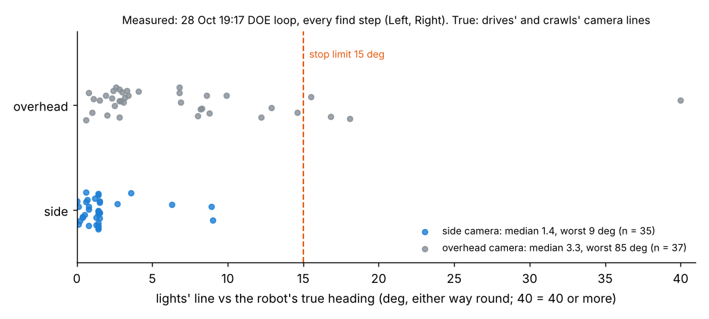

# Facing check: which way each robot faces, from its lights, before anything moves

**Premise.** On 28 Oct (19:17 DOE loop) Center's heading was 190 deg wrong and it drove the wrong way three times.
The cameras checked each robot's spot, never which way it faced, and Monday's start took every heading as placed
(open question 55). Nick approved (29 Oct, 07:3x) a facing check: light the robots' lights, find them in both
cameras, measure the heading, and move nothing if a robot faces the wrong way. Built and tested on the simulator and
on 28 Oct's saved pictures only; the Pi and the robots were not touched.

## Data

**The lights are not at the front and back.** The brief assumed front and back lights. On 28 Oct's real pictures,
each Alvik's own two lights (its `left_led` and `right_led`) sit across the robot, 6.5-7.5 cm apart, about level
with its middle ([picture](../screenshots/2026-10-29/facing-feature-real-left-lights-dark-both-idle-left-front-arrow.png)).
The line through them is square to the heading. So the heading comes from the left light to the right light,
turned 90 deg clockwise, and knowing which light is the left one tells front from back. (The light plate with 5
front and 2 back "directional" lights is designed in hardware/dock but not built.)

**What the firmware could do.** `led r g b ms` lit both lights the same colour, so the firmware could not light one
side alone. When a `led` ends, though, the robot goes back to idle: its left light shows the selected experiment's
colour and its right light stays dark. That only works while the robot is "selected turn". After any `run follow`
it is "selected follow" and both lights stay dark. **Firmware 2026-10-29a** adds `led 1 1 1 <ms> L` / `R`, which
lights that side alone. The change is 6 lines, and it compiles with the stand-in headers (tools/fwcheck), not the
Arduino toolchain. **Nick must flash all three robots.** Without the new firmware the check still works, but
fewer starts are caught (see below).

**How it runs.** All robots go dark, and both cameras take dark pictures. Then, for one robot at a time: its left
light alone, then its right light alone. Each light is the spot that came on against the dark pictures, placed on
the floor at the lights' height. Each camera gives a heading, and the two are averaged with the side camera
weighted more. If the cameras disagree by more than 30 deg, that robot is measured again. Nothing moves. It takes
6-8 s for two robots in the simulator, which is more than the 4-5 s planned (sweep 1).

**On real pictures (28 Oct 19:17, every find step, firmware 2026-10-28a, idle-light method).** The true heading
comes from the camera line of the crawl right after the find step, or of the drive before it.

| | Cases | Result |
|---|---|---|
| Front/back read from the idle left light (Left all night; all three in loops 0-2) | 23 | **23 of 23 the right way round.** Left: 0.5-1.7 deg off (20 cases); Right: 9.8 deg off a 10 cm crawl (2); Center: 23-24 deg off a 10 cm crawl (3, see sweep 2) |
| Robots "selected follow" (idle light off) | 36 | No front/back given (correctly). Before a brightness floor was added, 1 of 36 gave a wrong one (fixed, appendix A) |
| Lights' line vs true heading, side camera | 35 | median 1.4 deg, worst 9 |
| Lights' line vs true heading, overhead camera (washed out, 16 grey levels) | 37 | median 3.3 deg, worst 85; 4 over 15 deg |

Each dot is one find step: how far the line through the robot's two lights was from its true heading. The side
camera stays under 10 deg; the washed-out overhead strays further and once picks the wrong pair.

**In the simulator (Monday's mission, 61 x 122, both simulated cameras):**

| Placed | Facing check said | Then |
|---|---|---|
| Both right (1 and 3 deg off) | faces its start direction | mission done, 110-114 s |
| Left backwards (270, start 90) | "Left is facing the wrong way (about 179 deg off): turn it round so its front (the distance sensor) faces towards the y = 61 side (90 deg)." | nothing moved ([picture](../screenshots/2026-10-29/facing-feature-dry-left-placed-backwards-nothing-moves.png)) |
| Right sideways (0) | "Right is turned about 88 deg to its right (sideways): turn it so ..." | nothing moved ([picture](../screenshots/2026-10-29/facing-feature-dry-right-placed-sideways-nothing-moves.png)) |
| Left backwards, old firmware | caught by its idle left light, and asks for a flash | nothing moved ([picture](../screenshots/2026-10-29/facing-feature-dry-old-firmware-backwards-caught-by-idle-light.png)) |
| Left 18 deg off | "turned about 18 deg to its left (its start allows 15)" | nothing moved |
| Left 9 deg off | faces its start direction (9 deg off) | mission done |
| Both 12 deg off; both 15 deg off (check switched off, to find the limit) | - | mission done |
| Left 18 deg; Right 28 deg (while the limit was looser) | passed | **the run stopped after 1 s**: "camera and Left's own pose disagree" ([picture](../screenshots/2026-10-29/facing-problem-dry-right-28deg-off-passed-then-run-stopped.png)) |

**DOE loop (simulator, keep-going).** Center was turned round where it stood before loop 1, which is 28 Oct's case.
The loop said: "Center: its lights say it faces 167 deg, but the loop had -14 deg (179 off): that heading is
dropped". In the next loop Center's lights read 167 deg, and its crawl then measured 166.9. Drive 1 finished with
p95 0.18 cm ([picture](../screenshots/2026-10-29/facing-feature-dry-doe-center-turned-round-heading-dropped.png)).
Elsewhere in the loop, the lights agreed with the crawls and drives within 1-2 deg (-98 against -96.2, 31 against 32.2,
136 against 135.2).

## Conclusion

Which way a robot faces can be measured from its own two lights in a few seconds, with nothing moving. On 28 Oct's
night pictures, front and back were read right in 23 of 23 cases. The side camera's line was within 9 deg every
time. My calls:
- **Monday and Mission Control (Run and Setup with cameras; `./run-fleet-pi.sh monday`):** a robot more than 15 deg
  off its start heading stops the start, with plain words. I did not use the measured heading instead: the run
  would have to re-plan from it, and Monday's timed mission will not re-plan (the planner says "no priority order
  gave a plan").
- **DOE loop and ladder (L0 and every find step):** a kept heading that the lights contradict by more than 30 deg is
  dropped, so the robot crawls before it moves. When the heading is unknown, the lights' heading is used if the side
  camera saw both lights, or if both cameras agree within 10 deg.

## What's next

1. **Flash firmware 2026-10-29a onto Left, Right and Center** (the usual upload). Until then, the check can only
   tell front from back while a robot is "selected turn" (since power-on, nothing has run `follow`).
2. At the board, put each robot down the right way, then backwards, then sideways, and run `./run-fleet-pi.sh monday`
   each time. The backwards and sideways starts must stop with words and nothing moving. This also measures the
   check's time and both cameras' error in daylight.
3. Open question 55 is answered. The new questions are below.

**Questions for Nick**
- Substantive: 15 deg is the stop limit, from the simulator (12 and 15 deg ran the whole mission; 18 deg stopped
  it after 1 s). Should a robot that is 15-45 deg off get one small turn on the spot before the run instead (it
  moves, but saves a walk to the table)?
- Substantive: Center's heading from its lights was 24 deg off its crawl in loops 0-2 on 28 Oct, though both cameras
  agreed with each other within about 3 deg. Is the 10 cm crawl wrong there (open question 51 says up to 14 deg), or
  is something on Center's top bending the measure? One still photo of Center from above, with a ruler line along
  its side, would settle it.
- Other: the check takes 6-8 s for two robots (4-5 s expected). Is that fine before Monday's run?

## Sweep 1: new tests that may now be necessary
- Board: firmware 2026-10-29a's `led 1 1 1 1500 L` / `R` on each robot. Does the right side light, and does its
  answer say "left only"? It is compiled against stand-in headers only.
- Board: the check in daylight. Neither camera is washed out then, so check whether the overhead's worst case
  shrinks from 85 deg.
- Board: put a hand or a phone light near the table during the check. Spots are searched across the whole board
  when Mission Control starts robots where they stand.
- Simulator: robots swapped (Left on Right's spot). The check names it ("are Left and Right swapped?"), but this is
  only tested on its own, not in a dry run.
- The DOE loop's find step is now about 1.8 s longer per robot. Check the loop's time per loop on the Pi.
- Pre-existing, found on the way: a robot 6 cm off its spot fails Monday's start ("No camera fix for Left"), and
  re-planning Monday's mission raises a planner error. So "start where they stand" does not work for Monday's
  mission (simulator).

## Sweep 2: possible inaccuracies in what this relied on
- **True headings** come from 10 cm crawl lines (up to 14 deg off, open question 51) and from drives' camera lines.
  Left's later 4.2 deg is inferred from one crawl plus its gyro's +90.3 turn.
- **The lights' position on the robot** (across the middle, 0-1.5 cm ahead of it) comes from 28 Oct's pictures of
  three robots. The simulator still draws them near the front corners, and the two-camera tracker's
  `LIGHT_FWD_CM = 3.0` (lights 3 cm ahead of the middle) does not match. Neither was changed.
- **The lights' height** is taken as the robot's top (3.7 cm). A different height shifts both spots, which is why
  their spacing reads 6.5 in the side camera and 7.5 overhead. The heading is barely affected.
- **The old-firmware method** depends on the robot being "selected turn". All 23 real cases were from that state.
  With firmware 2026-10-29a it is not needed.
- **Simulator pictures** are clean (no washed-out board unless `--washout`), so the 1-3 deg error there flatters
  the real overhead.
- **Every number in appendix A is chosen**, apart from the 15 deg limit, which comes from 6 simulator runs.

## Appendix A: chosen numbers (tools/fleet/facing.py, ladder.py) and DOE notes
- Stop limit 15 deg (`TOL_DEG`, `--facing-tol-deg`). From the simulator. **DOE:** on the board, starts at
  0/10/15/20 deg off, against first-leg stops, line-check p95 and false stops on well-placed robots.
- "Sideways" over 45 deg, "the wrong way" over 135 deg. These only choose the words. No DOE.
- Settle 0.35 s after each `led` answer, 0.45 s of pictures per state. **DOE:** 0.3/0.45/0.6 s against how much the
  heading spreads between repeats, and the check's total time.
- A light must rise 30 grey levels over the dark pictures (28 Oct: 40-90 overhead, 60-160 side). **DOE:** 20/30/40
  against missed and false spots.
- The two lights must be 4-9.5 cm apart (measured 6.5-7.5). No DOE: a sanity window.
- Camera weights: side 4 deg, overhead 10 deg (28 Oct). Cameras over 30 deg apart: measure again, then stop. **DOE:**
  refit both weights from Thursday's starts.
- Old firmware: the idle light must be at least 0.25 of the same light's white spot (real 0.56-0.75; the false
  case under 0.1). **DOE:** from a session on old firmware.
- DOE loop: drop a kept heading over 30 deg off (`FACING_DROP_DEG`); use the lights' heading when both cameras agree
  within 10 deg (`FACING_AGREE_DEG`). **DOE:** the find steps' lights-minus-kept spread over a session
  (facing_events.jsonl).

## Appendix B: what changed
`tools/fleet/facing.py` (new: measure, words, run_plan hook, self-test); `run_plan.py` (`--facing-check`, run before
the follow runs and after any calibration); `mission_run.py` (passes it with both cameras; `--no-facing-check`);
`ladder.py` (find step: left/right lights after the white ones; heading kept, dropped or taken from the lights;
`--no-facing`); `doe_loop.py` (`--no-facing`); firmware 2026-10-29a (`led ... L|R`); `tools/sim/fleet_sim.py` (`led`
dark for its time, one side, `--old-led`); e02.py's firmware lists; 24 new tests (tools/fleet/tests/test_facing.py).
The real-data scripts are in the scratchpad, not committed (they read downloaded frames): `facing_real.py`,
`facing_lr.py`, `facing_pics.py`.
