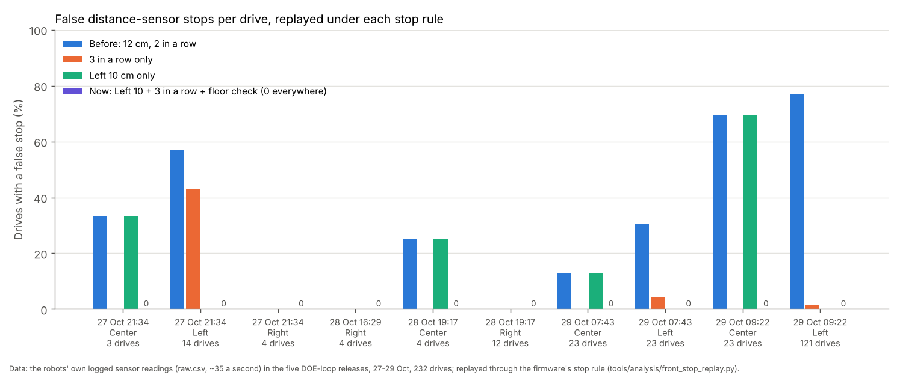
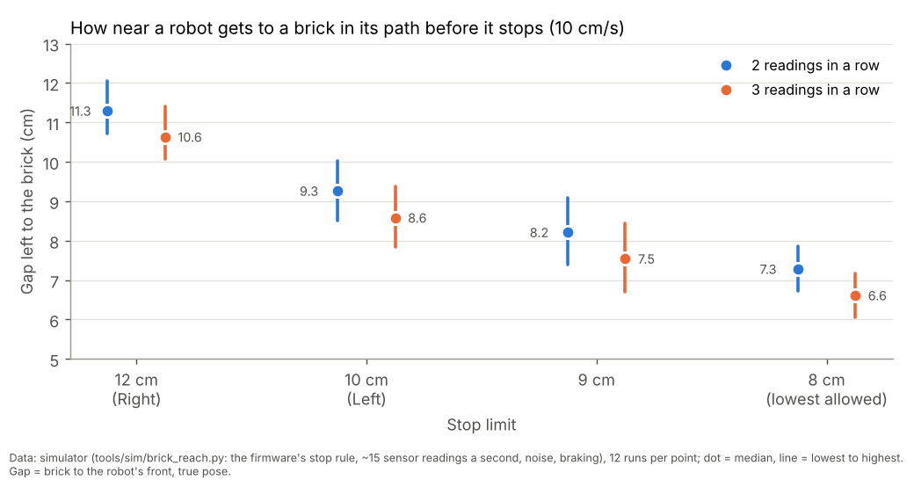

# False stops: 3 readings, the floor check, unconfirmed obstacles, a silent robot rejoins, per-camera lighting (29 Oct 2026, simulator and logs only)

**Premise.** Nick approved five changes from the rules audit (`e02-oct29-rules-audit.md`) at 16:2x on 29 Oct:
(1) 3 readings in a row before a distance-sensor stop, for every robot; (2) a stop that only the sensor saw goes on
the planner's map as unconfirmed, expires after about 15 s and is dropped rather than ending the run with "no plan";
(3) a robot that goes quiet on WiFi is held, not out for good, and rejoins when heard again; (4) lighting labels per
camera; (5) a floor check at every connect that sets each robot's stop limit. Left's 10 cm limit is the other build's
(`engine_checks.ROBOT_SETTINGS`); this build uses it as Left's ceiling. Nothing ran on the board.

**The answer to "how much earlier or later does a robot now stop for a real brick?"** Later, by a little. At Monday's
10 cm/s, in the simulator, the gap left between the brick and the robot's front once it has stopped:

| Robot | Before (12 cm, 2 readings) | Now | Change |
|---|---|---|---|
| Right (12 cm, 3 readings) | 11.3 cm | 10.6 cm (10.1-11.4) | **0.7 cm nearer** (one more reading) |
| Left (10 cm, 3 readings) | 11.3 cm | 8.6 cm (7.9-9.4) | **2.7 cm nearer** (2 cm limit + one reading) |
| A robot the floor check takes to 9 cm | 11.3 cm | 7.5 cm (6.7-8.4) | 3.8 cm nearer |
| The lowest allowed, 8 cm | 11.3 cm | 6.6 cm (6.1-7.2) | 4.7 cm nearer |

Every one of the 384 simulated approaches (brick straight ahead) stopped, none touched the brick. The board check in appendix C (also added to
the Monday run sheet as its appendix C) measures it on the real robots in 10 minutes.

## Data

**1. The logged readings, replayed (five DOE releases, 27-29 Oct, 232 drives, 179 logged sensor stops, none real).**
Each drive's `raw.csv` went through the firmware's stop rule under each variant
(`tools/analysis/front_stop_replay.py`; it reproduces the audit's counts).

| Rule | False stops | Drives with one |
|---|---|---|
| Before: 12 cm, 2 readings in a row | 164 | 130 of 232 (56 %) |
| 3 in a row only (12 cm) | 10 | 9 (4 %) |
| Left 10 cm only (2 in a row) | 24 | 21 (9 %) |
| **Now: Left 10 cm + 3 in a row + the floor check** | **0** | **0** |
| Floor check alone (no Left 10), 3 in a row, once per boot | 3 | 3 (1 %) |
| Floor check alone, 3 in a row, at every drive's start | 4 | 4 (2 %) |
| Floor check alone, 2 in a row | 152 | 121 (52 %) |

Each group of bars is one robot in one release; the purple "now" bars are all at zero.

**2. The floor check.** While a robot stands still at start-up, its five front zones are read for 2.5 s (about 35 new
readings). Its floor level is the lowest value the in-path reading stayed under for 3 readings in a row: with a stop
limit below it, those readings could not have stopped it. In the replay the floor check at a drive's start set:
Left 9.1-10 cm (under 10 in 13 of 159 drives), Center 10.7-12, Right 11.9-12.

What the replay also shows: **Left's floor moves from drive to drive within one power-on**, not only between
power-ons. At 09:22 (one boot), the floor read at each drive's start went from 10.8 to 15.6 cm; the first drive read
14.1. So one check at connect cannot predict the floor after every turn; that is why it can only lower a limit and
why 3 in a row does most of the work. A floor check alone (no Left 10) leaves 3-4 false stops in 232 drives.

**Which rule wins (one rule):** the stop limit is **the lowest of three numbers: 12 cm, the robot's own ceiling (Left
10 cm), and its floor reading less 1 cm; but never under 8 cm.** Examples from the logs: Left at 07:43 (floor 16.7)
keeps 10; Left at 27 Oct 21:34 (floor 12.1 in one drive) gets 10, and 9.1 in its lowest drive; Center 28 Oct
19:17 (floor 11.8) gets 10.8; Right (zones look past the floor) keeps 12. Said in plain words in the event log, for
example `floor check: Left: the floor reads 11.2 cm at its lowest (3 readings in a row) -> stop limit 10.0 cm (its
own limit; the floor allows up to 10.2)`, and logged (`floor_check` events, `floor_check.json`, the summary's
`start_checks`). It runs at every run_plan start, so every connect (the ladder, the DOE loop and Monday's mission all
start run_plan), and after a restarted robot's re-check.

The margin hardly matters on these logs: floor less 0 / 0.5 / 1 / 1.5 / 2 cm left 5 / 5 / 4 / 3 / 3 false stops
(floor check alone). 1 cm was kept (the audit's figure).

**3. The brick, in the simulator** (`tools/sim/brick_reach.py`: the simulated firmware's stop rule, about 15 readings
a second with noise and lag, braking; 12 runs per point; the gap is measured on the true pose).

Each dot is the median gap left between the brick and the robot's front once stopped at 10 cm/s; the line runs from
the smallest to the largest of 12 runs.

At 7.5 and 13 cm/s the step from 2 to 3 readings costs 0.5 and 0.8 cm. A brick already 9-14 cm in front when a step
starts (the case right after a turn) leaves 10.7 cm at 12 cm and 8.8 cm at 10 cm, 3 readings. The line the event log
prints (`obstacle X cm ahead`) is the sensor's reading at the stop: Right 10.0 (9.6-10.8), Left 8.2 (7.4-9.3).

**4. Monday's default in the simulator** (mission_run `--dry`, both cameras simulated, one run at a time).

Each row is one dry run of the whole Monday program (seed 1). "False readings" are injected low readings in one front
zone (9 cm, nothing there) at the start of the drive after a turn: 2 after every turn, and in the "all together" rows
5 after every 5th turn (a stop even with 3 in a row). "Floor" gives the simulated sensor a floor reading (Left 11.4,
Right 10.8 cm); without it the simulator's sensor sees no floor. The brick (20 x 9 cm) is put down at 40 s where no
robot is, and the camera never reports it.

| Run | Table | Injected | Result | What the new rules did |
|---|---|---|---|---|
| Monday's default | 70 x 130 / 76 x 137 | nothing | done, 115.5 s / 128.6 s, no stop | floor check: no floor seen, Left 10, Right 12 |
| False readings, 3 in a row | 61 x 122 | 2 after every turn (29) | **done, 108.8 s, 0 stops** | all 29 ignored |
| False readings, 2 in a row (the rule before) | 61 x 122 | the same | **not finished: 4 stops in 35 s, out of re-plans at 192 s** | (shows why 3) |
| A real brick, camera blind | 61 x 122 | brick at 29, 38 | done, 111.8 s, 3 stops | unconfirmed, expired, met again: confirmed, first outline restored (data 7) |
| Left silent 5 s | 61 x 122 | at 12 s; at 30 s | done, 96.6 s; done, 90.6 s | held, heard on the same boot, rejoined; no route together: back to a fixed obstacle, Right finished |
| Left restarts (5 s silent) | 61 x 122 | at 40 s | done, 95.8 s | held, re-checked: the facing check could not measure it, so it stays out; Right finished |
| **All together** | 61 x 122 | floor, false readings, Left silent 5 s at 30 s, brick | **done, 97.0 s**, 3 stops | 2 unconfirmed dropped instead of "no route"; the rejoin fell back; floor check Left 10.0, Right 9.6 |
| **All together** | 70 x 130 | the same (brick at 101, 43) | **done, 85.7 s**, 2 stops | 1 dropped, 1 expired; Left rejoined, then nothing moved for 26 s (it waited for Right, already dancing): back to a fixed obstacle |
| **All together** | 76 x 137 | the same (brick at 25, 31) | **done, 142.1 s**, 6 stops | 3 expired, 1 dropped, 1 kept; **Left rejoined and finished its program** |

No run touched another robot. Closest bodies: 9.7-16 cm in the "all together" runs; but **3.4-5.9 cm** between Right
and the held Left in the silent and restart runs: a robot held as a fixed obstacle is planned round with the
obstacle margin, not the 8 cm net (open question 44, the same with a robot that dies). The brick was touched only
in the 61 x 122 runs, from the side (data 7). Right came within 4.9 cm of an open edge once (76 x 137 at 121 s;
the others 6.4-9.7 cm); not traced in this build.

Found and fixed with these runs (each fix re-run): the rejoin used a heading from before the silence (the camera
guard stopped everyone, 9-15 cm apart); a restarted robot's re-check crashed (its part of the plan was missing);
an idle restarted robot was never "heard steadily"; a joint plan after a rejoin could strand both robots or wait
forever on a robot already dancing (now undone after 30 s / 20 s); a dropped obstacle was forgotten (the unseen
brick was met 30 times).

**5. Lighting labels per camera** (`tools/fleet/lighting.py`). Side camera: "ok" whenever it finds every robot, "not
found" (with the words to check the picture) when it does not; no contrast mark (it saw the robots 97.7-99.8 % of
the time at 16-45 grey levels). Overhead: "low" under 30 grey levels (every logged robot-session under 30 lost the
robot 5-22 % of the time), "washed out" only when the board itself clips (2 %). On the audit's 11 points the
overhead now says "low" for 16.5-25.5 and "ok" at 33; the side camera says "ok" for all. Mission Control's card and
the ladder's L0 use the new verdicts; the card's legend says what each camera's label means.

**6. The DOE loop.** A robot that does not answer the check before its turn is now held (it skips that loop, is
checked again at its next turn, and rejoins when it answers; a new boot ID goes through the existing restart path:
settings, then calibration). Before, it was parked for the rest of the run (Center, 29 Oct 10:25).

**7. A real brick the camera does not see, in the simulator (61 x 122, a 20 x 9 cm brick put down at 40 s on
Right's way to its Chicken spot, the camera's report switched off).** Right stopped for it by its sensor at 64.4 s
(8.1 cm), the obstacle was mapped unconfirmed, expired at 79.4 s, and when Right met the brick again at 84.6 s the
second stop confirmed it and put the first outline back on the map; the mission finished (111.8 s). The same run
under the old rules (2 readings, every sensor obstacle kept): 2 stops, finished in 105.2 s. **In both, Right's side
brushed the brick's corner from 47 s, before any stop:** it drove past the corner, which was beside it, not in front,
where no front sensor looks. That is not a stop-rule question; it is the camera not seeing the brick (question 4).
Found and fixed on the way: a first version forgot a dropped obstacle, so the robot met the unseen brick 30 times and
pushed into it; and a version that did not restore the first outline let Left's dance spot be planned on the brick's
corner.

## Conclusion

- With 3 readings and Left at 10 cm, none of the 179 false stops in the five releases would have happened, at a cost
  of 0.7 cm (Right) and 2.7 cm (Left) of gap to a real brick. The floor check adds a guard for a robot whose floor
  sits near its limit after a power-on, and only ever lowers a limit.
- A false stop that still happens can no longer end the run: its obstacle is unconfirmed, leaves the map after 15 s,
  and is dropped at once if the planner finds no route with it (simulator, the three "all together" runs: of 9 sensor obstacles, 4 were dropped when a re-plan found no route, 4 expired, 1 stayed; all three runs finished. The 29 Oct logs had 5 "no plan" ends).
- A robot that goes silent is now held, checked (same boot, or a re-check after a restart) and put back into the
  plan from where the camera sees it. **In Monday's two-robot program it came back and finished in 1 of 6 simulator
  tries** (76 x 137). In the other 5, once the other robot had re-planned alone, the two had no route together, or the
  returning robot waited on one that was already dancing, or (after a restart) the facing check could not measure
  it. Each time it fell back to what happened before this build: the returning robot stays a fixed obstacle and the
  other finishes. So on Monday a silent robot is no worse off than before, but it rarely comes back yet (question 2).

## What's next

1. The 10-minute board check (appendix C, also in the Monday run sheet) on Left and Right before Monday.
2. A board DOE: limit 10 / 12 x readings 2 / 3 on empty floor after turns, then a brick at 8 / 10 / 12 cm (the
   audit's rec 1 DOE). The simulator says the stop is safe at 8 cm; only the board can say how near the floor really
   gets after a turn on the school table.
3. Rejoining in Monday's program needs the planner to re-plan the rest of the program for both robots together from
   where they stand (today it keeps each robot's own remaining steps, which no longer fit together once one has
   carried on alone); question 2.

## Sweep 1: new tests that may now be necessary

- Board: the floor check's limit after 3 restarts on the same spot, and at 5 spots / 4 headings on the plywood: how
  far the standing floor moves within one power-on (10.8-15.6 cm in the 09:22 logs).
- Board: a brick dropped in front of a robot standing after a turn, at 8 / 10 / 12 cm, Left and Right (does it stop
  before starting, and how far does it creep).
- School table: the floor check on the school's table top (its floor reading may differ from the plywood's).
- Simulator: a robot silent for 5 s at 10 points along Monday's program (not only 12 s and 30 s): where does a rejoin
  succeed, and where does it fall back to a fixed obstacle.
- Simulator: two false stops at the same lane end (a phantom repeated at the same spot is "confirmed" by Nick's
  second-stop rule): does the mission still finish?
- Board: WiFi off for 5 s (router unplugged and back, or a robot carried out of range) to see a real rejoin.
- Mission Control on the real cameras: the dashed "?" obstacle and "Stops at" on the robot cards.
- Simulator: why Right came within 4.9 cm of an open edge in the 76 x 137 "all together" run (121 s), and the
  3.4-5.9 cm gaps past a held robot (open question 44).

## Sweep 2: possible inaccuracies in what this relied on

- **"No real obstacle" in the five releases** rests on the camera seeing none and the robots being far apart (rules
  audit); a hand would not show.
- **The replay is a model** of the firmware rule (zone angles, path half-width, distance left from the wheel angle);
  it reproduces 29 Oct's counts within 1-2 per loop, but under-counts 27 Oct (11 replayed against 22 logged: that
  night's firmware may have used the older 100 ms rule).
- **The floor check in the replay** used each drive's standing readings before its first move as "the check at
  connect". Real run_plan starts stand a little longer; the board may differ at the school.
- **The simulator's sensor** sees no floor unless told to (`floor` in the sim conditions); the false stops in the
  simulator are injected (2 readings after every turn, 5 after every 5th), chosen to look like the logs, not fitted.
- **The brick gaps** depend on the simulator's sensor lag, noise and braking model (fitted earlier to the robots, not
  re-checked for this); the board check measures it.
- **Chosen numbers** (appendix A): the 1 cm margin, 8 cm minimum, 15 s expiry, 8 cm "same place", 1 s heard before a
  rejoin, 30 s wait for a held robot, 3 rejoins, 2.5 s floor reading, 30 grey levels. Each has a DOE note.
- **A second stop "confirms"** (Nick's rule) also when the same false reading repeats at the same spot after the
  re-plan's turn: possible, because the floor reading depends on where and which way the robot stands.
- **Rejoin after a restart** (re-check: settings, calibration, facing check, floor check) ran only in the simulator,
  and there the facing check could not measure the restarted robot, so it never got as far as rejoining: the rest of
  the re-check is untested.
- **Mission Control's pictures** were rendered from dry runs' own records (positions, messages, obstacles at one
  moment), not taken from a live page; battery, edge and steps are blank in them.

## Questions

**Substantive**
1. The floor check can take a robot to 8-10 cm on its own (Left went to 9.1 cm in one 27 Oct drive). Is a limit
   under Left's 10 cm acceptable, or should Left's 10 be a floor as well as a ceiling? (The replay shows no false
   stop either way; 9 cm leaves 7.5 cm to a brick in the simulator.)
2. A returning robot came back into Monday's program in only 1 of 6 simulator tries; otherwise it stays a fixed
   obstacle and the other finishes alone, as before. Fixing that means re-planning the rest of the program for both
   robots together (a planner change, about 1-2 h with tests). Before Monday, or after?
3. A second stop at the same place confirms an obstacle (your rule). Should it count only when the robot was already
   moving at one of the two stops (false stops happen while standing after a turn)? My suggestion, not decided.

4. A brick the camera does not see, put down beside a robot's path, is brushed by the robot's side (simulator, old
   and new rules alike): the front sensor cannot see it. Is Monday's brick drop always in front of a robot, in the
   camera's view, with the brick watch on? If not, that is the bigger risk than the stop rule.

**Other**
5. Should the board check (appendix C) go on the Thursday board or the Sunday rehearsal?
6. Question 69 stays open: where did the side camera's 13-24 grey levels come from?

## Appendix A: every chosen number (DOE notes)

| Number | Value | Where | DOE |
|---|---|---|---|
| Readings in a row | 3 | front_stop.STOP_READINGS, run_plan OBSTACLE_READINGS | Yes: 2 / 3 on the board, false stops after turns and the gap to a brick |
| Cap | 12 cm | FLOOR_CAP_CM | No: the firmware's value |
| Lowest limit | 8 cm | FLOOR_MIN_CM | Yes: the board's brick test at 8 / 10 / 12 cm |
| Margin under the floor | 1 cm | FLOOR_MARGIN_CM | Yes, worth one: floor check then 10 standing turns, margin 0.5 / 1 / 2 cm (the logs barely separate them) |
| Floor reading time | 2.5 s | FLOOR_SAMPLE_S | No: more only costs time |
| Robot or obstacle in front skips the check | 30 cm, 35 deg | FLOOR_ROBOT_AHEAD_CM | No: a guard |
| Unconfirmed expiry | 15 s | UNCONFIRMED_S (Nick: about 15 s) | Yes, in the simulator: 5 / 15 / 30 s with injected false stops and a real brick without the camera |
| Same place (second stop, camera) | 8 cm | CONFIRM_NEAR_CM | No: the simulator's repeat-brick runs check it |
| Heard before it rejoins | 1 s | REJOIN_HEARD_S | No: a flapping link is capped by the next row |
| Rejoins per robot per run | 3 | REJOIN_MAX | No: a stop to a loop |
| Boot ID wait | 4 s | REJOIN_BOOT_WAIT_S | No: plumbing |
| Wait for a held robot at the end | 30 s | REJOIN_WAIT_S | No: a policy |
| A rejoin is undone if a re-plan leaves robots without a route within | 30 s | REJOIN_TRIAL_S | No: a guard |
| A rejoin is undone if no step finishes for | 20 s | REJOIN_STALL_S | No: a guard (Monday's steps finish every 1-3 s) |
| Overhead "low" | under 30 grey levels | lighting.OVERHEAD_LOW | Yes: lamp / daylight / blinds, contrast per board region against the overhead's seen rate there |

## Appendix B: how it was made, and the files

- `tools/fleet/front_stop.py` (new): the floor level, the one rule for the limit, its words, the unconfirmed
  registry.
- `tools/fleet/run_plan.py`: OBSTACLE_READINGS 3; `floor_check()` at start-up (after the settings read back);
  unconfirmed obstacles (`mark_unconfirmed`, `unconfirmed_watch`, `no_plan_drop`, also when a re-plan leaves robots
  without a route); held and rejoining robots (`retire(kind=...)`, `out_heard`, `rejoin_watch`, `rejoin`, `recheck`,
  `recheck_robot`); `live.json` carries the obstacles (unconfirmed flagged) and each robot's stop limit and held
  state; options `--floor-check`, `--floor-margin-cm`, `--unconfirmed-s`, `--no-rejoin`.
- `tools/fleet/mission_control.html`: the dashed "?" obstacle with its seconds left, "HELD" and "Stops at" on the
  robot cards, the lighting card's per-camera words. `tools/fleet/lighting.py`, `tools/fleet/ladder.py` (L0 words),
  `tools/fleet/doe_loop.py` (held, not parked).
- `tools/sim/brick_reach.py` (new), `tools/fleet/sweeps/sim_shim.py` (`floor` and `phantom` conditions),
  `tools/analysis/front_stop_replay.py` (new).
- Tests: `tools/fleet/tests/test_front_stop.py` (new), `test_lighting.py`, `test_doe_loop.py`. Fleet tests: 279 passed, 7 skipped (after the last change: the run_plan
  tests, 82 passed).

Re-make the numbers: `python3 tools/analysis/front_stop_replay.py <unzipped releases> <out>`;
`python3 tools/sim/brick_reach.py --seeds 12`.

## Appendix C: the 10-minute board check (also the Monday run sheet's appendix C)

It checks three changes on
the real robots: every robot now needs **3 readings in a row** before its distance sensor stops it; at the start each
robot's **floor check** sets its stop limit (Left 10 cm or lower, Right 12 cm or lower, never under 8 cm); and a stop
that only the sensor saw is marked **unconfirmed** and leaves the map after 15 s. Do it on the home plywood, Left and
Right charged, firmware flashed. You need the brick and the tape measure.

1. **1 min. Laptop browser.** Go to `100.122.222.75:8091`, click **Mission Control**, then **1 Connect**, then
   **Robots**. The pill at the top says **Mode: Robots**.
2. **1 min. 3 Workspace.** Type `122` into **Length (cm)** and `61` into **Width (cm)**, click **Save workspace**.
   Click **More**. Under **Robot start spots** type Left `17 17 90` and Right `105 17 90`, click **Save workspace**.
3. **1 min. On the plywood.** Tape two crosses 17 cm in from the edge nearest you: one 17 cm from the left end, one
   17 cm from the right end. Put Left on the left cross and Right on the right cross, both facing away from you.
4. **1 min. 5 Mission.** Click **Monday's default**, then **Plan and preview**, then **Go to run**. Click **Run
   (robots)**. Click **Event log** to open it.
5. **Within 30 s, in the Event log:** two lines start with `floor check:`. Write down each robot's numbers:

   | Robot | "the floor reads ... cm" | "stop limit ... cm" |
   |---|---|---|
   | Left | | |
   | Right | | |

   You should see Left's stop limit **10.0 or lower** and Right's **12.0 or lower**, neither under **8.0**. If a line
   says **the lowest allowed**, click the red **Stop**, look in front of that robot (anything within 30 cm?) and wipe
   its sensor window, then start again from step 4.
6. **2 min. While they mow (no brick yet).** Watch the Event log for a line with `obstacle` and `ahead`. You should
   see **none**. Count them here: ____ . One is acceptable if the run carries on; two or more: note which robot.
7. **1 min. The brick.** When Right turns at the end of its second lane, put the brick flat across its next lane,
   long side across, about **25 cm in front of Right**. Right stops. The Event log says
   `Right: obstacle X cm ahead; zones ...`: write X here: ____ cm. You should see **about 9.5-11 cm** (the simulator:
   10.0, from 9.6 to 10.8). With the tape measure, brick to Right's front while it stands: about **10-11 cm**. For
   Left the same test gives **about 7.5-9.5 cm** on the log line (the simulator: 8.2) and about 8-9 cm by tape.
8. **The next line** says either `no camera sees it: mapped as unconfirmed` or that the camera confirmed it. Leave the
   brick. Right should drive round it. If it stops at the brick again, the log says `stopped again where an earlier
   stop was: the obstacle is confirmed`; that is right too.
9. **1 min.** When both robots dance, click **Stop**, switch them off, take the brick away.

**Pass:** step 5's limits in range, step 6 none (or one, and the run carried on), step 7 between **7 and 12 cm** and
the robot never touched the brick. **Anything else:** tell me the numbers you wrote; the run's logs upload on their own.

