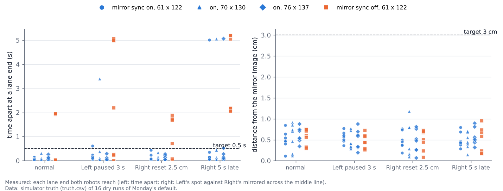
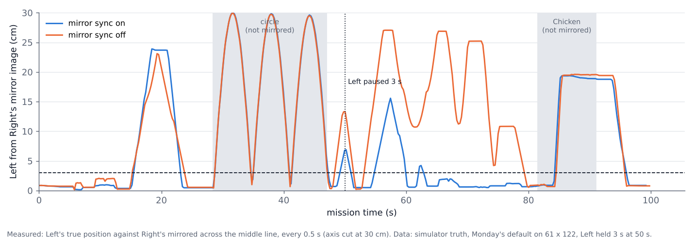
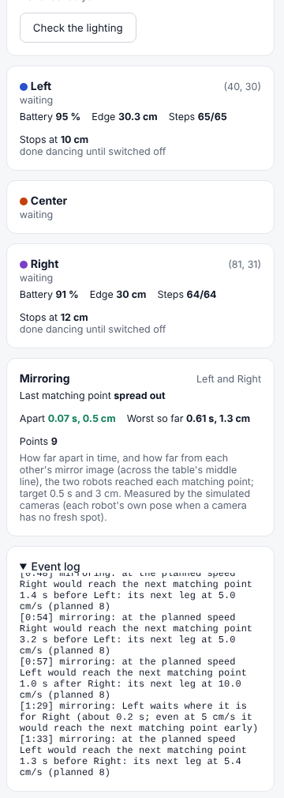

# Mirroring by speed matching, and six smaller changes (29 Oct, simulator only)

**Premise.** Nick, 29 Oct 20:06-20:08: Left and Right should mirror each other across the table's middle line for the
whole of Monday's run. "Can we simply slow down one of them to allow the other to speed up and get to its proper
place relative to the other bot? And the bot that was misaligned or momentarily paused should be told where to go
based on how long it would take him to get there and how long it will take the other robot to get to the corresponding
spot." The target is that both robots reach matching points **within 0.5 s and 3 cm** of each other's mirrored
position. The same approval covered six smaller changes:
1. The blind cap goes from 30 to 40 cm.
2. A robot under 9 cm from an edge still turns at the start (the 7 cm rule stays).
3. The 3 deg tolerance and the 8 s re-check stay.
4. Left's stop limit never goes under 9 cm.
5. A second stop at the same place confirms an obstacle only if the robot was moving at one of the two stops.
6. A moving robot keeps 8 cm from a held or parked robot (open question 44).

All of it was built and tested in the simulator. Nothing ran on the Pi or the robots.

**What was built.**
- **A shared timeline of mirrored points.** Each point Left drives to in a mirrored block (mowing, the walk to the
  meet, spreading out) has a key that the mirror image of that point in Right's plan also has.
- **Symmetric lanes.** Before, lanes were laid 12 cm apart from one end, so the two halves did not match: on
  61 x 122, Left had 2 outer lanes and Right had 1. Now each half's lanes are spread evenly (10.3-12.8 cm apart). The
  innermost pair is 26.4 cm apart, which is two turn circles plus the step-away's 13 cm. Both robots now mow those
  lanes at the same time, so nobody waits or steps aside after the circle.
- **Planned speed on mirrored legs: 8 cm/s.** This leaves room to speed up to 10 cm/s or slow down to 5 cm/s. Chicken
  keeps 10 cm/s.
- **The mirror sync in run_plan.** Before each drive towards the next matching point is sent, run_plan works out each
  robot's time to go and its partner's time to go to the matching spot, from steps already sent, the robot's own
  pose, turns, settles and the turn pause. Both are aimed at the same arrival time: the late one speeds up and the
  leader slows down, within 5-10 cm/s. If the leader would still arrive early at 5 cm/s, it waits where it stands
  before its next leg, for at most 8 s. If the partner is held or out, mirroring switches off.
- **Every matching point is logged:** how far apart in time the two arrived, and how far each was from the other's
  mirror image. This appears in the event log (`mirroring: ...`), in run_plan_summary.json and mission_summary.json,
  and in a new **Mirroring** card on Mission Control's Run screen.
- **Switching it off:** `--no-mirror` (mission_run and run_plan), or the run setting `mirror`.

## Data

**1. Monday's default, 12 dry runs** (`mission_run.py --dry`, one run at a time). Lane ends are the 7 points per run
where both robots finish a lane end. The robot's first lane start is its start spot, so it is not a driven point. Time
and position errors come from the simulator's truth (truth.csv) at each robot's "done" for that point. "Max after"
leaves out the one lane end straight after the injected delay.

| Table | Case | Finished | Total time | Time apart, max / median | Max after | Position, max / median | Closest robots | Closest body to an edge |
|---|---|---|---|---|---|---|---|---|
| 61 x 122 | normal | yes | 98.8 s | 0.15 / 0.09 s | - | 0.85 / 0.48 cm | 9.7 cm | 9.5 cm |
| 61 x 122 | Left paused 3 s at 51 s (at a turn) | yes | 98.8 s | **0.61** / 0.10 s | 0.61 s | 0.77 / 0.57 cm | 9.6 cm | 9.6 cm |
| 61 x 122 | Right reset 2.5 cm at 8 s | yes | 98.8 s | 0.44 / 0.07 s | 0.24 s | 0.76 / 0.45 cm | 10.2 cm | 8.9 cm |
| 61 x 122 | Right 5 s late | yes | 98.9 s | **5.01** / 0.14 s | 0.35 s | 0.80 / 0.45 cm | 10.1 cm | 9.6 cm |
| 70 x 130 | normal | yes | 106.3 s | 0.31 / 0.06 s | - | 0.91 / 0.71 cm | 9.7 cm | 9.8 cm |
| 70 x 130 | Left paused 3 s at 53 s (mid-lane) | yes | 106.2 s | **3.40** / 0.10 s | 0.39 s | 0.77 / 0.41 cm | 9.7 cm | 9.9 cm |
| 70 x 130 | Right reset 2.5 cm | yes | 106.3 s | 0.34 / 0.08 s | 0.34 s | 1.18 / 0.29 cm | 9.7 cm | 9.8 cm |
| 70 x 130 | Right 5 s late | yes | 106.3 s | **5.06** / 0.13 s | 0.44 s | 0.70 / 0.45 cm | 9.8 cm | 9.8 cm |
| 76 x 137 | normal | yes | 112.4 s | 0.26 / 0.06 s | - | 0.88 / 0.54 cm | 9.7 cm | 9.9 cm |
| 76 x 137 | Left paused 3 s at 50 s (in the circle) | yes | 112.8 s | 0.30 / 0.06 s | 0.12 s | 0.88 / 0.59 cm | 9.9 cm | 9.8 cm |
| 76 x 137 | Right reset 2.5 cm | yes | 112.5 s | 0.29 / 0.05 s | 0.29 s | 0.81 / 0.48 cm | 9.9 cm | 9.8 cm |
| 76 x 137 | Right 5 s late | yes | 112.4 s | **5.07** / 0.15 s | **0.52** s | 0.90 / 0.51 cm | 9.8 cm | 9.8 cm |

Total time: run_plan's time from the mission's first step to "all robots done" (the dance starts), the figure
the earlier reports used. Closest robots and edges: simulator truth, 9.5 cm square bodies. Line check p95 (worse
robot): 0.50-0.71 cm.

All 12 runs finished. The position error stayed under 1.2 cm at every lane end, against the 3 cm target. In time,
78 of the 84 lane ends were within 0.5 s. The 6 that missed:
- **4 points, each straight after a delay** (5.0, 5.1, 5.1 s after a 5 s late start; 3.4 s after a 3 s pause
  mid-lane). The leader had already set off on that leg when the delay began, and it can only wait at a point, as
  specified. It waits at that point, and the next one matches.
- **0.61 s on 61 x 122** and **0.52 s on 76 x 137**, both after a delay. Every other point was under 0.45 s.

Each dot is one lane end. The sync-on dots sit under the 0.5 s line apart from the one point straight after each
delay; the sync-off dots sit at about 2 s even when nothing goes wrong.

**2. The same four cases on 61 x 122 with the sync off** (`--no-mirror`: planned speeds, no waits, same mirrored
plan):

| Case | Time apart, max / median | Within 0.5 s and 3 cm |
|---|---|---|
| normal | 1.96 / 1.93 s | 3 of 7 |
| Left paused 3 s | 5.07 / 2.19 s | 3 of 7 |
| Right reset 2.5 cm | 1.89 / 1.68 s | 2 of 7 |
| Right 5 s late | 5.21 / 2.20 s | 0 of 7 |

Even with nothing injected, the mirrored plan alone is about 2 s out after the circle. The two robots leave the circle
facing opposite ways (it is point-symmetric), so one turns 195 deg and the other 16 deg before the first inner lane.
The sync absorbs this: the robot that turns less waits about 1 s and drives that leg at 5 cm/s.

The line is how far Left is from Right's mirror image at each moment. With the sync on (blue), it returns under 3 cm
within one lane of the pause; with it off (orange), it stays 10-27 cm out until Chicken.

The walk to the meet (15-22 s) is not mirrored in shape on either line. The meet's entry points face opposite ways,
so the two paths differ; only the arrival time is matched there.

**What Nick sees.**

The Run screen's new Mirroring card shows the last matching point and the worst one so far. Its numbers come from the
simulated camera, so they differ slightly from the truth figures above. The Event log names every wait and re-timing.
The terminal shows the same lines
([picture](../screenshots/2026-10-29/mirroring-feature-terminal-61x122-right-5s-late-waits-and-retiming.png)), for
example `mirroring: Right waits where it is for Left (about 1.3 s; ...)`. At the end it gives a summary:
`mirroring: 7 lane ends, time apart max 5.01 s (median 0.14), position max 0.6 cm (median 0.3); 6 within 0.5 s and
3 cm`.

**3. Against the builds before this one** (same simulator, the earlier reports' figures):
- **Total time:** 99 / 106 / 112 s on the three tables, against 109 / 115 / 129 s. Nobody waits after the circle any
  more, and 76 x 137 now has 8 lanes 12.8 cm apart instead of 10 lanes 12 cm apart. The plans say the same: 106.5 /
  113.8 / 120.3 s mirrored, against 115.9 / 122.5 / 129.0 s with the same code unmirrored.
- **Closest robots:** 9.6-10.2 cm, against 9.4-10.7 cm before.
- **Closest body to an edge:** 9.5-9.9 cm, against 9.4-9.8 cm before. The 8.9 cm on 61 x 122 comes from the injected
  2.5 cm reset itself (8.7 cm with the sync off).

**4. Two faults found on the way, both fixed and re-run.**
- **Inner lanes too close.** The first lane layout put the innermost pair 22.5 cm apart (13 cm between the bodies
  standing square). Turning together at those lane ends, the corners came **9.0-9.4 cm** apart
  ([picture](../screenshots/2026-10-29/mirroring-problem-terminal-61x122-first-lane-layout-bodies-9cm-turning-together.png)).
  The layout now allows for the turn circles (26.4 cm).
- **Late start read as a dead robot.** The first late-start run made the robot silent while it waited, so run_plan
  took it as dead
  ([picture](../screenshots/2026-10-29/mirroring-problem-terminal-61x122-late-start-injection-silent-robot-held.png)).
  This was a fault in the injection, not in run_plan: the simulator's hold now keeps the robot talking.

On the way, a version that held the leader until it was within 0.25 s (rather than 0.1 s) left one lane end 0.53 s
apart. It was tightened to 0.1 s, and the matrix was run again from the start.

**5. The six smaller changes.**

| Change | Built | Checked |
|---|---|---|
| 1. Blind cap 40 cm | `run_plan.BLIND_MAX_CM` 40 | Unit test drives 55 cm blind: stops after 40 |
| 2. Under 9 cm from an edge still turns | No change: the 7 cm rule (`straighten.SPIN_EDGE_CM`) already turns | test_straighten, 21 pass |
| 3. 3 deg and the 8 s re-check | No change | As above |
| 4. Left never under 9 cm | `front_stop.ROBOT_MIN_CM` {"Left": 9}, used by the floor check | Unit test: floor 9.4 gives 9.0 ("minimum"), floor 10.6 gives 9.6; Right can still go to 8 |
| 5. Second stop confirms only if moving at one | A stop is "moving" when its drive or arc had carried the robot 2 cm or more (`run_plan.MOVING_CM`). `Unconfirmed.near(moving=...)`. Two standing stops say so in the event log | Unit tests (standing + standing: not confirmed; moving at either: confirmed) |
| 6. 8 cm from a held robot | The held robot's outline grows by 8 - 1.5 = 6.5 cm (a true offset, not a push from the middle) | Dry run, 61 x 122, Left silent 5 s at 30 s: Left rejoined, could not be fitted back, stayed held; Right finished (88 s), **12.0 cm** from it at closest (was 3.4-5.9 cm). A first version that pushed the outline out from its middle came to 8.6 cm along its sides |

**Tests.**
- New file `tools/fleet/tests/test_mirror.py` (19 tests): symmetric lanes, every key has its mirror image, keys and
  speed carried to plan steps and back, the speed matching (late speeds up, leader slows, the wait and its 8 s limit,
  off with `--no-mirror` or a held partner), the measuring, a Monday program saved before tonight still mirroring,
  and the smaller changes 4-6.
- Updated tests: `test_turn_pause` (the step-away is now tested on an unmirrored program, plus a new test that mirrored
  Monday needs no step-away), `test_one_system` (Monday's lanes are the mirrored ones), `test_straighten` (40 cm cap).
- Fleet suite (`python3 -m pytest tools/fleet/tests`, after the matrix): **301 passed, 7 skipped**.

## Conclusion

- **Left and Right now mirror each other through Monday's mowing and spreading out.** At every lane end across 12 dry
  runs they were within 1.2 cm of each other's mirror image, against a 3 cm target.
- **In time they are within 0.5 s at 78 of 84 lane ends.** Four of the six misses are the one point straight after a
  pause or a late start, and there the leader waits so the next point matches. The other two are at 0.52 and 0.61 s.
- **Without the sync the same plan is about 2 s out at every lane end**, even when nothing goes wrong.
- **The mission is 10-16 s shorter than before** (no step-away wait). The closest robots (9.6-10.2 cm) and edges
  (9.5-9.9 cm) are as before.
- **The circle and Chicken stay synced moments, as asked; they are point-symmetric rather than mirrored.**
- **A held robot is now passed at 8 cm or more** (12.0 cm in the dry run).

## What's next

1. **Board (Thursday or the Sunday rehearsal), 10 min.** Run Monday's default on the home plywood and read the
   Mirroring card and the end-of-run summary line. If the median time apart at lane ends is over 0.5 s on the real
   robots, the time-to-go estimate needs the real turn and turn-pause times (sweep 2).
2. **Board:** pause one robot by hand for 3 s (a hand flat in front of its sensor, then away) to see a real re-timing.
3. **Nick:** the questions below.

## Questions for Nick

**Substantive**
1. **The point straight after a delay is off by about the delay** (3.4-5.1 s), because the leader is already driving
   that leg and can only wait at a point. Nick's spec says the leader waits at its next point, so this is as built.
   The alternative is to stop the leader mid-lane as soon as the partner stalls. That would make even that point
   match, but a robot stopping mid-lane looks like a fault to the audience. My pick: keep it as built.
2. **The middle strip.** The innermost lanes are now 26.4 cm apart, which leaves about 17 cm unmowed between the
   bodies (the circle runs over most of it). This is the price of both robots mowing at once, mirrored, with 13 cm
   between them while turning. Is that fine for how it looks? The alternative: one more lane pair mowed one after the
   other, which breaks the mirror for about 5 s.
3. **Mirrored legs drive at 8 cm/s** (Chicken stays at 10), so the mowing looks a little slower than before. Is it
   fine? A simulator DOE of 7 / 8 / 9 cm/s would set it (appendix A).

**Other**
4. On 76 x 137 the lanes go from 10 (12 cm apart) to 8 (12.8 cm apart). It is still one pass of the table. Fine?
5. The walk to the meet and the first leg after the circle are matched in time, not in shape (the circle is
   point-symmetric). Is that fine, or should the plan add a turn so they leave the circle mirrored? That would cost
   about 3 s.

## Sweep 1: new tests that may now be necessary

- Board: the Mirroring card on the real robots (real turns, real turn pauses, real camera lag).
- Board: a robot speeding up to 10 cm/s on the real lanes. The line check at 10 cm/s is known, but the re-timed legs
  alternate 5 and 10 cm/s; does accuracy at 5 cm/s hold?
- Simulator: mirroring with the washed-out overhead (one camera, longer turn pauses) and with 5 % packet loss.
- Simulator: a brick dropped on one robot's lane. The re-plan goes round it, the partner should slow or wait, and the
  keys must survive the re-plan (unit-tested only).
- Simulator: a robot paused for more than 8 s (the leader gives up waiting) to see the run re-mirror at the meet.
- Logs: the five releases' sensor stops sorted by the new "moving" rule (how many false stops count as moving at 2 cm).
- Board: Left at 9 cm with the floor check (appendix C of the run sheet, now "between 9.0 and 10.0").

## Sweep 2: possible inaccuracies in what this relied on

- **The simulator's robots run each step's time very close to the plan's**, so the time-to-go estimates are good
  there. Real turns and turn pauses vary more, and the estimate's turn-pause allowance (0.5 s) is chosen.
- **The "late start" and "pause" are simulated holds before a step.** The robot keeps talking and stands still. A
  real stall (a wheel caught, a long turn pause) may look different to run_plan.
- **The "correction" is a 2.5 cm shift of the true pose** that the camera then corrects. It is not a real fpose reset.
- **Positions come from the simulator's truth.** The card uses the simulated camera (worst 1.3 cm, against 0.8 cm
  truth for the same run).
- **One seed per case, one run each.** The before figures (109 / 115 / 129 s, 9.4-10.7 cm) come from the earlier
  reports' runs on that day's code.
- **Chosen, not derived:** 8 cm/s, the 0.1 s wait tolerance, 0.5 s turn-pause allowance, 8 s longest wait, 26.4 cm
  centre gap (13 cm is the step-away's chosen figure), 1 cm lane stretch, 2 cm "moving". Each has a DOE note in
  appendix A. The 5-10 cm/s band, 0.5 s / 3 cm target, 40 cm, 9 cm and 8 cm figures are Nick's.
- **The 6.72 cm turn radius** assumes the 9.5 cm square with the axle under its middle. This has not been measured
  (as in earlier reports).
- **The machine** ran one dry run at a time (load under 2), with no other agent's runs during the matrix.

## Appendix A: chosen numbers and DOE notes (also in docs/doe-backlog.md)

- `missions.SETTINGS["mirror_cruise_cms"]` 8: room both ways inside 5-10. **DOE:** 7 / 8 / 9 cm/s in the simulator,
  then the board, against lane-end error after a 3 s pause and the mission's length.
- `mirror_min_cms` 5 / `mirror_max_cms` 10, `mirror_tol_s` 0.5, `mirror_tol_cm` 3: Nick's. A board DOE of 10 / 11.5 /
  13 cm/s would show whether a faster catch-up is still accurate.
- `mirror_wait_max_s` 8: bounds a wait. No DOE.
- `run_plan.MIRROR_HOLD_TOL_S` 0.1 (0.25 left 0.53 s once). **DOE:** 0.1 / 0.25 / 0.5 s in the simulator, against the
  lane-end time error and the number of waits.
- `MIRROR_TURN_PAUSE_EST_S` 0.5: re-measured every step. No DOE.
- `MIRROR_SAY_S` 1.0: wording only.
- `missions.mirror_centre_gap` = 2 x 6.72 + `STEP_AWAY_GAP_CM` 13 = 26.4 cm. **DOE:** 22.5 / 26.4 / 30 cm on the
  board, against the camera's closest approach while both turn.
- `MIRROR_LANE_STRETCH_CM` 1: lanes at most 13 cm apart. Looks. No DOE.
- `run_plan.MOVING_CM` 2. **DOE:** 1 / 2 / 4 cm in the logs, against the five releases' sensor stops.
- `BLIND_MAX_CM` 40, `front_stop.ROBOT_MIN_CM["Left"]` 9, the held robot's 8 cm: Nick's. The board DOEs are already
  listed (25 / 30 / 40 cm; brick test at 9 / 10 cm).

## Appendix B: what changed

- `tools/fleet/missions.py`:
  - mirror settings;
  - `lanes_x(mirror=True)`: symmetric lanes, centre gap 26.4 cm;
  - `mow_region(mirror=True)`: a region takes the mirror image of its mirrored region's lanes;
  - `build`: the program's `"mirror"` (Monday's default says `[Left, Right]`, and an unedited default saved before
    tonight counts too); keys and 8 cm/s on mirrored gotos; `mission.mirror` in the mission map;
  - a lane-end tie broken the same way for both robots (float noise had sent one up and one down).
- `tools/fleet/planner.py`: an item's own `cruise_cms`; `mirror` and `mirror_leg` carried to the steps, back to prims
  (re-plans) and onto what is left of a step under way.
- `tools/fleet/fleetmap.py`: visit items keep `mirror` and `cruise_cms` (1-15 cm/s).
- `tools/fleet/run_plan.py`:
  - the mirror sync (`mirror_gate` in `release`), the measuring (`mirror_arrived`), and the summary, live.json and
    `--no-mirror`;
  - `BLIND_MAX_CM` 40;
  - `was_moving` and the second-stop rule;
  - the held robot's outline grows by the net;
  - Left's 9 cm minimum in the floor check.
- `tools/fleet/front_stop.py`: `ROBOT_MIN_CM`, `robot_min_cm`, `Unconfirmed.near/add(moving=)`.
- `tools/fleet/mission_run.py`: `--no-mirror` and the mirroring summary line. Kept on top of the coordinator's fix
  656ef68.
- `tools/fleet/mission_control.py` / `.html`: the run setting `mirror` and the Mirroring card.
- `tools/fleet/sweeps/sim_shim.py`: simulator conditions `hold` (a robot stands s seconds before a step, still
  talking) and `nudge` (true pose moved cm back along its heading).
- Tests: `test_mirror.py` (new), `test_turn_pause.py`, `test_one_system.py`, `test_straighten.py`.
- Docs: Monday run sheet (md and print copy), open questions (Q44 and the straightening and false-stops reports'
  questions answered), DOE backlog, time tracker.
- Not committed (scratchpad): the analysis, chart and picture scripts, and the 17 dry runs.
