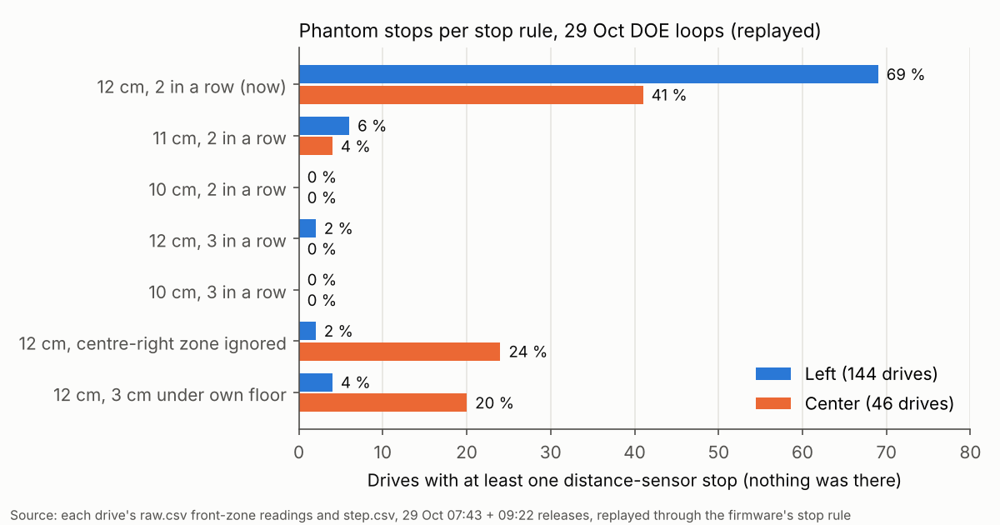
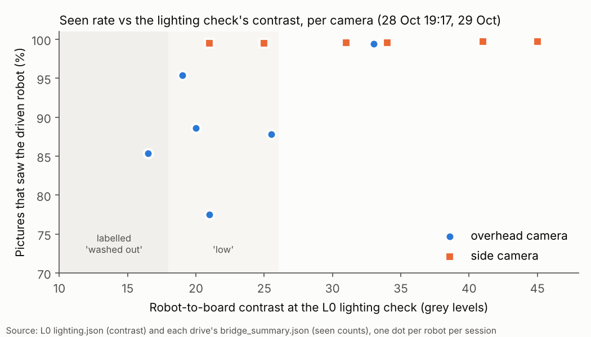

# Rules audit: what can stop, hold, park, refuse or slow a robot (29 Oct 2026, logs and code only)

**Premise.** Nick, 15:41: "Do a full check of rules we set up and recommend changes. Some of them were made early on and
the program has evolved since then." This audit covers every rule and chosen number that can stop, hold, park, refuse
or slow a robot, or limit where it may go, in `tools/fleet` (run_plan, ladder, doe_loop, planner, missions,
mission_run, cam_bridge, lighting, facing, calib_room, diskguard) and the firmware (`border.h`, `edge.h`, `params.h`,
`motion.h`, `e02.h`). Each rule is checked against what has changed since it was set: two cameras, the tracker fix,
keep-going, the turn pause, the calibration room, the facing check, the camera-watched drive to open space, and
firmware 28a's four-sided border and two-in-a-row obstacle readings. The evidence comes from the logs of the five DOE
loop releases (27 Oct 21:34, 28 Oct 16:29 and 19:17, 29 Oct 07:43 and 09:22: 236 drives, 1,445 forward drive steps).
No code was changed. The full rule table, about 70 rules, is in appendix A.

## Findings

**1. Most rules never fired, and the ones that did were right, with one exception: the distance-sensor stop.** Across
the five loops, the edge guard, the virtual border, the tilt and lift stops, the travel cap, the silent-robot rule
(the longest gap in any drive was 0.57 s against 4 s) and the 8 cm p95 park never fired. Robots stayed 25 cm in, so
none of these rules was tested. The camera guard fired 3 times (28 Oct 19:17), and all 3 were real: Center was driving
the wrong way. The distance-sensor stop fired **180 times, and nothing was there in any of them**: 130 on Left and 24
on Center on 29 Oct alone. The camera reported no obstacle for any of the 180 (no brick watch; other robots were 26 cm
or more away).

**2. The phantom stops happen at the start of a drive, right after a turn, while the robot is still standing.** On
Left's 123 fully logged stops at 09:22 (of 124), the median distance travelled in the step was **0.07 cm**, the median time since the step
started was 157 ms, and 121 of the 123 came from the centre-right zone. In that zone, Left reads the floor at 13.9 cm
(median) while driving, but just over 11 cm while standing. The floor reading also moves between power-ons: the
median was 15.0 cm at 07:43 and 12.3 cm at 09:22, after a restart. Right's centre-right zone also comes close to the
limit, at 11.6-12.0 cm at its lowest. Center's centre-left zone stops it too: 41 % of Center's drives on 29 Oct had a
phantom stop.

**3. Each phantom stop becomes a permanent obstacle on the map, and one in the wrong place ends the run.** run_plan
maps every sensor stop as an obstacle polygon about 11-17 cm ahead of the robot and keeps it for the whole run
(`run_plan.py:1243-1250`, `1024`). All 5 "no plan" ends on 29 Oct ("park spot cannot be reached: no clear route")
came within 0.1 s of a phantom stop on the way back to the park spot. In 3 of them, a single stop was enough.

**4. Replaying the stop rule on the logged readings** (each drive's `raw.csv` through the firmware's own rule,
including the counter carried across steps) reproduces the real counts: 121 against 123 for Left at 09:22, 19
against 20 for Center, 7 against 6 for Left at 07:43. It then answers "what if":

With the 10 cm limit, or with three readings in a row instead of two, almost no drive on 29 Oct would have stopped
for nothing. Rules based on a learned floor level or on ignoring one zone leave many of Center's stops.

**5. The lighting check's 18 and 26 marks come from overhead-camera data that no longer applies.** They were fitted on
28 Oct to 6 robot-nights, using the overhead camera and the tracker **before** its fix (01f45dd, growth over
filled-in floor). No side-camera data was used. Since then, the side camera saw the driven robot in 97.7-99.8 % of
pictures in every loop, at contrasts from 16 to 45. The overhead, after the fix, saw 77-95 % at 16.5-25.5 and 99.4 %
at 33.

Each dot is one robot in one loop: the side camera's squares sit at the top at every contrast, while the overhead's
circles only reach 99 % at 33. Under 30, the overhead's seen rate depends on where the robot drives (the sunny strip at
x = 30-45, reported earlier today) more than on the contrast measured at one spot. The label never stops anything
(`ladder.py:1222-1263`); it only warns.

**6. A rule that holds starts: the bridge's 3 cm "moved" rule.** It caused 5 start-up failures on 29 Oct. When only
the side camera sees a standing robot, its spot is about 3 cm off, so the bridge decides the robot has moved and
sends no start heading (`cam_bridge.py:293-298`). The robot had not moved at all.

## Answers to Nick's three questions

**(a) Why a robot under 12 cm from an edge, facing it, cannot crawl forward.**
1. Under 12 cm the robot has no room to spin (`calib_room.py:37`: 6.72 cm corner circle + 2 cm camera + 3 cm margin
   = 11.7, rounded up to 12), so L1 sends it to open space (`ladder.py:1532-1538`).
2. If its heading is not known, the first step is a heading crawl with `h_known=None` (`ladder.py:1487-1488`).
3. `crawl()` only picks a direction when it knows the heading (`ladder.py:1613-1626`). With no heading, `sign` stays
   +1, so the crawl is always **forward** 10 cm (`ladder.py:1633`, `CRAWL_CM`, line 75).
4. The firmware's edge guard stops any forward leg near an open edge (`edge.h:183-197`). The bottom-zone cue trips when
   the floor patch about 8-9 cm ahead of the axle reads over `edge_bot_cm` 11 for 100 ms (sent by `ladder.py:140`).
   The line cue trips when the line sensors, 3.5 cm ahead, move by `edge_thr` 150 three checks in a row. If run_plan
   has already sent `bd_on 1` to this robot since it was switched on, the 6 cm virtual border can also stop it
   (`e02.h:132-154`). The leg ends "failed: plywood edge".
5. The crawl then backs only as far as the camera saw it go and raises LadderStop (`ladder.py:1634-1644`). L1 keeps
   the robot out (`ladder.py:1496-1504`). The DOE loop's "make room" does the same forward crawl (`doe_loop.py:849-851`)
   and holds the robot instead.

So the edge guard is doing its job; the problem is the software choosing forward blind. Because the guard looks about
9 cm ahead, a forward 10 cm crawl that faces the edge fails from anywhere under about **19-20 cm**, not only under
12. Fix (rec. 9): the facing check (firmware 29a) gives a heading from the robot's own lights before anything moves.
Pass it to `crawl()` even when it is "not sure enough to drive by", because it only needs to pick forward or back. If
a forward crawl still ends "plywood edge", that tells us the front faces the edge, so crawl backwards instead (the
crawl's position fix has just refilled the 10 cm blind-backing allowance) rather than keeping the robot out.

**(b) Why 18 grey levels for "washed out", and is it right for both cameras.**
1. Where it came from: `lighting.py:40-45` (commit 963b70f, 28 Oct, chosen by Claude). It was fitted to 6 overhead
   points from 27-28 Oct (Center 12 grey levels -> 60 % seen, Right 19 -> 71 %, Left 28 -> 99.7 % in daylight; 23.5 /
   28 / 37 under the lamp). Those points were measured on the tracker as it was before the 28 Oct fix.
2. Is it right for both cameras: no. It was never measured on the side camera. The side camera saw robots 97.7-99.8 %
   of the time at every contrast logged (16-45), and 99.7-100 % at 16 in the 28 Oct replays.
3. The 13-24 readings: I could not find side readings of 13-24 in these five releases (L0 recorded 21-45 for the side
   camera). They must come from a later check (question 2 below).
4. Re-derived per camera from the logs (5 overhead and 6 side robot-sessions after the tracker fix):
   - **Side camera:** no drop in seen rate anywhere in the logged range, so no threshold can be derived. "Washed out"
     should mean "a robot is not found" (the existing 30 %-of-its-middle test), plus a contrast warning only below the
     lowest value seen working (13 by your reading; 16 in these logs).
   - **Overhead camera:** every robot-session under 30 lost the overhead 5-22 % of the time; at 33 it lost 0.6 %. So
     "low" should start under 30, not 26. No contrast in the logged range made it unusable (77 % at worst), so
     "washed out" should mean board clipping only (the existing 2 % clipped test).
5. These are 11 points, chosen not derived. A DOE fits (rec. 5).

**(c) False distance-sensor stops: the options, with numbers from the logs.**

| Option | Phantom stops replayed, 29 Oct (Left 144 drives / Center 46) | Verdict |
|---|---|---|
| Now: 12 cm, 2 readings in a row | Left 69 % of drives, Center 41 % | the problem |
| Per-robot limit: Left 10 cm (already being set) | Left **0 %** | works today, but thin: Left's lowest floor readings are 9.2-10.2 cm, and the floor moved 3 cm between power-ons |
| Left 11 cm | Left 6 %, Center 4 % | not enough |
| Per-zone: ignore Left's centre-right zone | Left 2 %, Center 24 % | blind on one side, and does not fix Center |
| Learned floor level per zone (stop only when 2-3 cm below its own floor) | Left 4-41 %, Center 20-41 %; learned at the drive's start: Left 22 % | weak: the standing floor is nearer than the driving floor, and that is where the stops happen |
| 3 readings in a row (12 cm) | Left 2 %, Center 0 % | strong, and software only (`run_plan.py:71`, `--obstacle-readings 3`) |
| **Left 10 cm + 3 in a row** | **0 % / 0 %**, and 0 in the 42 drives on 27-28 Oct | best |
| Camera cross-check | the camera agreed with none of the 180 stops, all false. But with brick watch off it sees no bricks, and it never reports hands | use only to decide what goes on the map, never to cancel a stop |
| Phantom obstacles expire unless confirmed | would have prevented all 5 "no plan" ends (each followed a phantom on the way home) | needed: the stop rule will never be perfect |
| Retry the leg after a short pause | while Left stood after a stop, half its readings (median) were still under 12 cm; the stops happen at the start of a step anyway | does not help alone |

**Recommended combination:** Left at 10 cm (in progress) **and** 3 readings in a row for every robot, plus sensor-only
obstacles mapped as "unconfirmed": they expire after a short time unless the camera or a second stop confirms them,
and they are dropped before run_plan gives up with "no plan". At setup, check each robot's floor readings to catch a
robot whose floor sits near its limit (Right's lowest readings reach 11.6-12.0 cm). The cost of the combination is
reach: by my estimate, Left stops with a real brick about 8 cm ahead of the sensor at 10 cm/s, against about 10.6 cm
now. That is still above `safe_front_cm` 7, but it rests on assumed braking (sweep 2).

## Recommendations, ranked by risk to Monday's demo (Left and Right, school table, brick drop)

1. **Front stop: 3 readings in a row for all robots, plus Left at 10 cm.** Change `OBSTACLE_READINGS` from 2 to 3
   (`run_plan.py:71`). Without it, Left stops for nothing on about 2 of every 3 drives, and Monday's mowing has a turn
   at every lane end, which is exactly where the stops happen. *DOE: yes.* On the board: limit 10 / 11 / 12 x readings
   2 / 3, against phantom stops on empty floor and how far ahead a brick is when the robot stops.
2. **Sensor-only obstacles become "unconfirmed".** They expire (about 15 s, chosen) unless the camera's brick watch or
   a second stop confirms them, and they are dropped and the plan retried before run_plan stops everyone with "no
   plan" (`run_plan.py:942`, `1024`, `1243-1250`). Today, one phantom near a park spot ends the run (5 of 5 "no plan"
   ends on 29 Oct). *DOE: the expiry time is chosen; a simulator sweep with injected phantoms (1 per drive) would set
   it.*
3. **The bridge's "moved" rule should use the robot's own motion, not a 3 cm camera distance**
   (`cam_bridge.py:293-298`). Change: "moved" = it has been sent a step, or its wheels turned. Or at least use 5 cm
   when only the side camera sees it. It caused 5 start-up failures on 29 Oct, and in a bright room the overhead may
   lose the robots at the start. *DOE: logs replay of the five failures and the starts that worked (open question
   60).*
4. **Floor check per robot at setup** (warm-up or calibration spin): record each front zone's standing readings, and
   set `follow_look_cm` per robot to min(12, its 1st-percentile floor reading - 1 cm; Left on 29 Oct: 10.6 - 1 = 9.6), with a warning under 9. Software only
   (`set follow_look_cm`). This catches the 3 cm shift between power-ons and Right's 11.6 cm floor. Later, in
   firmware: a limit per zone. *DOE: the same board test as rec. 1.*
5. **Lighting labels per camera** (`lighting.py:40-45`). Side camera: warn only when a robot is not found. Overhead:
   "low" under 30; "washed out" only when the board clips. Today's labels tell you to close the blinds when the side
   camera is fine. *DOE: yes.* Lamp / daylight / blinds, contrast against each camera's seen rate per board region.
   The check should also sample the robots' whole working area, not only where they stand.
6. **Edge guard settings** (`edge_bot_cm` 11, `edge_thr` 150, `edge_n` 3; `ladder.py:140`, `mission_run.py:53`,
   `mission_control.py:57`): set for the home plywood over cement. Left read 10.0-10.3 cm over the home edge and did
   not trip. They did not fire in 236 drives. Keep them, but confirm with Monday's warm-up side feel on the school
   table before the mission. *DOE: on the school table (the existing backlog row).*
7. **Silent robot (4 s) takes the robot out for the whole run** (`engine_checks.py:32`; `run_plan.py:407`: "it stays
   out"). At home, no drive had a gap over 0.57 s; the school WiFi is unknown. With only two robots, losing one for
   good loses half the show. Let a robot that is heard again rejoin with a re-plan. *No DOE: a policy.*
8. **Turn pause** (1.5 cm / 1 s / 3 s; `run_plan.py:1407-1425`): there is no real data yet (built 08:18 on 29 Oct;
   not in these logs). Keep it; count its timeouts on Thursday's board. If the overhead is blind in the school's light,
   every turn may wait out the 1 s one-camera timeout. *DOE: yes, as its comments say.*
9. **Crawl near an edge** (question a): pick the crawl direction from the facing check's heading, and crawl backwards
   after an edge-guard trip instead of keeping the robot out (`ladder.py:1487`, `1613-1644`; `doe_loop.py:849-851`).
   This does not affect Monday's mission, which does not crawl. *No DOE: logic.*
10. **DOE loop room rules** (Nick, 27 Oct): `EDGE_REFUSE_CM` 25 (`ladder.py:69`) and `ROOM_ROBOT_CM` 30
    (`doe_loop.py:96`). Since then, robots near an edge are driven to open space, and the calibration only needs
    12 / 21 cm. The 29 Oct 09:22 loop ended at 12:22 because Left was 28-29 cm from Center (it needs 30) and making room
    failed twice. Suggest 20 cm from an edge (a 10 cm crawl plus the guard's 9 cm look-ahead) and 25 cm between robots.
    These were Nick's numbers, so this is his call. Not Monday. *DOE: the loop's own "room made" count against the
    minutes it costs.*

Keep as they are: the camera guard (6 cm / 1 s: 3 fires, 3 real), the virtual border 6 cm, the tilt 5 deg, lift,
blind backing 10 cm (one refusal on 28 Oct, fixed by the crawl's position fix), the travel cap, battery 25 %, the
8 cm plan floor, Chicken 15 / 8 cm, the 17 cm insets, facing 15 deg, the disk guard, and every planner margin
(appendix A).

## What's next

1. Nick's call on recs 1-3, which touch run_plan before Monday (questions 1-3 below). Each is a small change with a
   simulator test and a replay of these logs. Rec 1 is a one-line default.
2. Thursday's board (if there is a session): rec 1's DOE (10 drives each, Left and Right, limits 10 / 12 x readings
   2 / 3, then a brick at 8 / 10 / 12 cm), the floor check of rec 4, and turn-pause timeouts.
3. At the school: the warm-up side feel confirms the edge guard trips on that table (rec 6), and the lighting check is
   read with rec 5's per-camera meaning.

## Sweep 1: new tests that may now be necessary

- Board: Left and Right standing still after a 90 deg turn, then driving off, at limits 10 / 12 and 2 / 3 readings:
  does a brick at 8, 10 and 12 cm still stop them in time? (The 3-reading cost is estimated, not measured.)
- Board: Left's front-zone floor readings after three restarts, same spot: how far does the floor move between
  power-ons (15 -> 12 cm on 29 Oct)?
- Simulator: Monday's mission with a phantom obstacle injected after every lane-end turn, with and without
  unconfirmed obstacles that expire: how often does it end "no plan"?
- Simulator: the bridge's start with only the side camera, the robot 3 cm off its spot, under a motion-based "moved".
- Ladder dry run: a robot 10 cm from an edge facing it, with the facing heading passed to the crawl: does it back out
  and calibrate?
- School table: the edge guard's bottom-zone reading and line-sensor change at its edge (warm-up side feel).
- Mission Control: the lighting card with per-camera labels on the real cameras in daylight.

## Sweep 2: possible inaccuracies in what this relied on

- **The replay is a model.** It uses the firmware's zone angles (22 / 11 / 0 / -11 / -22 deg) and the 5.25 cm path
  half-width as written, wheel angle times 1.7 cm for the distance left in a step, and the logged readings at
  about 35 a second. It reproduces 29 Oct's real counts to within 1-2 a loop, but under-counts 27 Oct's (11 vs 22).
  On 27 Oct, Left may have run the older time-based rule (100 ms) instead of readings in a row; not checked.
- **"Nothing was there"** rests on the camera reporting no obstacle, other robots being 26 cm or more away, and
  earlier today's report. A hand on the board would not show in these logs.
- **Stopping reach with 3 readings** (about 8 cm for Left at 10 cm/s): 66 ms a reading and about 0.5 cm of braking
  are assumed, not measured.
- **The floor-level rows of the table** used each loop's driving median per zone (that loop's own data, so it is
  optimistic) and, separately, the median while the robot stands before its first move. Neither is how a firmware
  version would learn it.
- **Lighting:** the contrast is one L0 picture at each robot's start spot; the seen rate is over a whole loop of
  driving. 11 points; 28 Oct 16:29 and 27 Oct have no L0 contrast (the check did not exist yet).
- **Unconfirmed-obstacle expiry 15 s, follow_look floor - 1 cm, overhead "low" under 30, side 13, 20 cm / 25 cm room:**
  all chosen, not derived. The DOE notes above say how to set them.
- **No evidence for rules that never fired** (edge guard, border, tilt, lift, silent robot): "keep" means no reason
  found to change them, not that they are proven.
- **The 9 cm bottom-zone reach** behind the 19-20 cm figure in (a) is the backlog's estimate (`BOTTOM_AHEAD_CM`), not
  measured. On Left the bottom cue may not trip at the home edge, so the line cue, about 3.5 cm ahead, would stop it
  later.
- **Where each rule came from:** the commit log goes back to 4 Oct. Rules set before 18 Oct came from the early home
  experiments, and many commits are under Nick's account but were written in Claude sessions. "Nick" in the table
  means the comment quotes his decision.

## Questions

**Substantive**
1. Rec 1: switch every robot to 3 readings in a row before Monday (plus Left at 10 cm)? It costs about 2 cm of reach
   for a real brick.
2. Where did the side camera's 13-24 come from on 29 Oct? Mission Control's card after 12:23? The five releases only
   have 21-45.
3. Rec 2: may an unconfirmed sensor obstacle expire on its own (15 s), and be dropped rather than end the mission with
   "no plan"? The stop itself always stays.
4. Rec 3: should the bridge count a robot as moved only when it has been told to move (its wheels turned), rather
   than by a camera distance?
5. Rec 7: should a robot that goes silent on Monday rejoin when it is heard again, or stay out (today's rule)?
6. Rec 10: lower your DOE-loop room rules from 25 / 30 cm to 20 / 25 cm?

**Other**
7. Is Center part of Monday at all? If it is, it needs the same treatment: its centre-left zone gives 41 % phantom
   drives.
8. Should the lighting check sample the board where the robots will drive (the sunny strip at x = 30-45), not only
   where they stand?

## Appendix A: every rule (a "fired" count means in the five loops' logs)

Who set it: **N** = the comment quotes Nick's decision; **C** = chosen by Claude; **G** = follows from geometry or
another number. Recommendations: **K** keep, **Ch** change, **R** remove, **PR** per robot / per camera.

### Firmware (robot side)

| Rule (plain words) | Number | Where | Set (when, who) | Fired | Still needed? | Rec |
|---|---|---|---|---|---|---|
| Follow drive stops for anything in its path closer than this | 12 cm | params.h:93, follow.h:221-225 | 18 Oct (18b), C | 180, all false | yes, but too near the floor for Left / Center | PR: Left 10, per-robot floor check (rec 1, 4); DOE |
| ...path checked this wide | 5.25 cm half | params.h:94, motion.h:46-57 | 18 Oct, G | (in the above) | yes | K |
| ...a stop needs this many new readings in a row | 2 (sent by run_plan) | params.h:100, motion.h:119-130, run_plan.py:71 | 28 Oct (28a), N | (in the above) | yes | Ch to 3 (rec 1); DOE |
| ...older time-based version | 100 ms | params.h:92 | 18 Oct, C | before 28a only | only for old firmware | K |
| ...only as far as the step still goes | +2 cm | params.h:95, pose.h:265 | 18 Oct, C | - | yes | K |
| ...below what the map expects ahead | -2 cm | params.h:91, follow.h:223 | 18 Oct, C | - | yes (Chicken, meets) | K |
| Turns and idle legs: centre zone closer than this | 7 cm | params.h:142, e02.h:1084 | 4 Oct, C | 0 | yes | K |
| Edge guard on, both cues | safe_edge 3 | ladder.py:140, mission_run.py:53 | 21 Oct, C | 0 trips | yes (last stop at an edge) | K, verify at school (rec 6) |
| ...line cue: change from learned plywood level | 150, 3 checks | ladder.py:140, edge.h:172-181 | 21 Oct, C | 0 | yes | K; DOE on the school table |
| ...bottom cue: floor ahead reads over | 11 cm, 100 ms | ladder.py:140, edge.h:183-197 | 23 Oct, C | 0 | yes | K; DOE (Left read 10.0-10.3 over the home edge) |
| ...no forward drive if all three line sensors start off plywood | - | edge.h:120-127 | 22 Oct, C (after a fall) | 0 (1 "nobase": too few readings) | yes | K |
| ...only while driving forward faster than | 2 rpm | params.h:153 | 18 Oct, C | - | yes | K |
| Virtual border: centre held this far inside an open side | 6 cm (run_plan) | run_plan.py:80, border.h, e02.h:132-154 | 24-27 Oct, N (idea) / C (number) | 0 | yes (under the camera) | K |
| ...corner allowance on partly-open sides | 5 cm | border.h:37 | 27 Oct, G | 0 | yes | K |
| ...re-opens once back this far | 3 cm | e02.h:111 | 24 Oct, C | 0 | yes | K |
| Tilt stop | 5 deg for 300 ms | params.h:144-145, motion.h:86-92 | 26 Oct, C (data: 210,000 rows) | 0 | yes (hung at an edge) | K; bench DOE noted |
| Lifted stop | on | params.h:143 | 4 Oct, C | 0 | yes | K |
| No go / turn before a compass check | - | e02.h:1042-1045 | 17 Oct, extended 25 Oct, C (after a 405 deg spin) | 0 | yes | K |
| Longest forward leg | 110 cm | params.h:236, e02.h:1035 | 21 Oct, C | 0 | yes | K |
| Blind backing since the last camera fix | 10 cm | params.h:237, e02.h:1058-1061 | 21 Oct, C | 1 (28 Oct; fixed since) | yes | K |
| Idle leg travel cap | leg + 10 cm | e02.h:1117, 215 | 21 Oct, C | 0 | yes | K |
| e02 run: refuse a start spot further than | 90 cm | params.h:231 | 21 Oct, C | not used (old runner) | old runner only | K |
| e02 run: quiet laptop ends the run | 20 s | params.h:235 | 21 Oct, C | 0 | old runner / idle legs | K |
| Follow: says so after quiet | 1.5 s | params.h:98 | 18 Oct, C | 0 | yes | K |
| Camera fix: ignored if older than / further than | 1 s / 4 sd and 3 cm | params.h:77-78 | 18 Oct, C | (fixes refused feed the camera guard) | yes | K |
| Calibration: no spin with something within / roll margin / shortest roll | 8 / 3 / 5 cm | params.h:127-129 | 18 Oct, C | - | yes (with calib_room caps) | K |

### Laptop / Pi side

| Rule (plain words) | Number | Where | Set (when, who) | Fired | Still needed? | Rec |
|---|---|---|---|---|---|---|
| Sensor stop -> permanent obstacle on the map | for the whole run | run_plan.py:1243-1250, 1024 | 18 Oct, C | 180 mapped; 5 runs ended "no plan" | not as permanent | Ch: unconfirmed + expiry (rec 2) |
| No plan -> stop everyone | - | run_plan.py:942 | 18 Oct, C | 5 | yes, after dropping unconfirmed obstacles | Ch (rec 2) |
| Camera guard: camera and own pose apart for | 6 cm, 1 s | run_plan.py:588-589 | 27 Oct, C | 3, all real | yes | K; DOE noted |
| Turn pause: stand after a turn over 20 deg until camera and pose agree | 1.5 cm; one camera after 1 s; max 3 s | run_plan.py:1407-1425 | 29 Oct, N (idea) / C | no data | yes | K; count timeouts (rec 8) |
| Silent robot -> out for the rest of the run | 4 s | engine_checks.py:32, run_plan.py:1185, 407 | 26 Oct, C | 0 (longest gap 0.57 s) | yes, but final | Ch: rejoin (rec 7) |
| Battery floor | 25 % | engine_checks.py:29, ladder.py:135 | 25 Oct, N | 0 | yes | K |
| Refuse a plan under | 8 cm | engine_checks.py:39 | 27 Oct, N | 0 | yes | K (Nick wants to narrow it) |
| Start spot tolerance (run_plan / Monday) | 2 cm / 4 cm | run_plan.py:2146, mission_run.py:203 | 26-28 Oct, C | 0 | yes (Monday re-plans from the camera) | K |
| Start heading allowed | from the plan's risk | run_plan.py:2054-2067, engine_checks.py:241-254 | 28 Oct, C | 0 | yes | K |
| Facing check: more off than this, nothing moves | 15 deg | facing.py:45 | 29 Oct, C (simulator) | no data | yes | K; DOE noted |
| Bridge: robot "moved" off its start after 3 sightings over | 3 cm | cam_bridge.py:293-298 | 27 Oct, C | 5 false start-ups (29 Oct) | yes, but on motion | Ch (rec 3) |
| Bridge: picture skipped if late by | 0.3 s | cam_bridge.py:71 | 27 Oct, C | 53 % of pictures skipped, as designed (7-10 fixes a second) | yes | K |
| Lighting: washed out / low | 18 / 26 grey levels | lighting.py:40-45 | 28 Oct, C | 3 L0 warnings | label only | PR per camera (rec 5); DOE |
| Lighting: board clipped | 2 % | lighting.py:46 | 28 Oct, C | 0 | yes | K |
| Washout guard: lower exposure | 2 % clipped, 2 checks | pi/camrec.py:723-733 | 28 Oct, N | 0 | yes | K |
| Planner: safety margin / separation | 1.5 / 5 cm | planner.py:47-48 | 18 Oct, C | - | yes | K |
| Planner: obstacle event stops robots arriving within | 2 s | planner.py:75 | 18 Oct, C | with every stop | yes | K |
| Mission: lane and edge room | 17 cm | missions.py:44, 56 | 28 Oct, N | - | yes | K |
| Mission: Chicken swerve / never under | 15 / 8 cm | missions.py:64 | 27 Oct, N | - | yes | K |
| Mission: planning time limit | 60 s | mission_run.py:55 | 28 Oct, C | 0 | yes | K |
| Disk: stop a long run / hard stop / frames | 1 / 0.5 / 2 GB (card), 5 GB (USB) | diskguard.py:31-41 | 28 Oct, C | 0 | yes | K |
| Calibration: spin room from edges / robots | 12 / 21 cm | calib_room.py:37-38 | 29 Oct, G | no data | yes | K |
| Calibration: camera error / margin / heading allowance | 2 cm / 3 cm / 15-45 deg | calib_room.py:32-48 | 29 Oct, C | - | yes | K; DOE noted |
| Open spot target (calibration, make room) | 32 cm edges, 38 cm robots | ladder.py:1428-1429, doe_loop.py:98-99 | 28 Oct, C | 2 room moves | yes | K |
| Ladder / DOE: robot nearer an edge than this is not moved / is moved in first | 25 cm | ladder.py:69, 1716 | 27 Oct, N | 2 parks (28 Oct, before room-making) | less so now | Ch to 20 (rec 10) |
| DOE: another robot nearer than this -> make room | 30 cm | doe_loop.py:96 | 28 Oct, C | ended the 09:22 loop (28-29 cm) | less so now | Ch to 25 (rec 10) |
| DOE: spots and lines from edges and parked robots | 25 cm | doe_loop.py:69 | 27 Oct, N | - | yes for the DOE layout | K |
| DOE: planner floor inset / parked circle / clear of parked | 13.5 / 17 / 30 cm | doe_loop.py:70-80 | 27-28 Oct, G | - | yes | K |
| Crawl: direction chosen only when the heading is known | - | ladder.py:1613-1626 | 25-28 Oct, C | (question a) | needs the facing heading | Ch (rec 9) |
| Crawl: no room either way under | 10 cm tip | ladder.py:120 | 27 Oct, C | 0 | yes | K |
| Crawl: length / reads off by over 40 % -> re-crawl, then fail | 10 cm / 6-14 cm | ladder.py:75, 1661-1670 | 27-28 Oct, C | 2 "would have parked" (14.2 cm etc.) | yes (keep-going logs only) | K |
| Turn check: per turn / total | 6 / 8 deg | ladder.py:80, 84 | 27 Oct, C | 2 parks (27-28 Oct), 4 held (29 Oct) | yes (keep-going holds) | K; DOE noted |
| Drive p95 over this parks the robot (safety) | 8 cm | doe_loop.py:82 | 28 Oct, C | 0 | yes | K |
| Ladder start check after a drive | 4 cm, 10 deg | ladder.py:106-107 | 27 Oct, C | - | yes | K |
| Parked robot as an obstacle / lines keep clear | 10 cm circle / 20 cm | ladder.py:137, 95 | 27 Oct, C | - | yes | K |
| Keep-going: one-camera evidence held, not parked | - | doe_loop.py:529-545, 788 | 28 Oct, N | 6 holds (29 Oct) | yes | K (cap repeated holds: open q 48) |
| Not answering at the check -> parked | 4 s wait | doe_loop.py:92, 612 | 27 Oct, C | 1 (Center 10:25, a WiFi gap) | yes, but final | Ch: re-check next loop (open q 61) |

### The old e02 runner

`tools/experiment/e02.py` is still started by `run-e02-pi.sh`, but per the "one system" decision (27 Oct) it gets no
more fixes. What the new system still takes from it: the edge guard settings (`SAFETY_SETTINGS` -> `ladder.SAFE`,
`mission_run.EDGE_GUARD`), the compass-only calibration settings (`ladder.py:1430`), and the camera and tracker
modules (`e02_camera`, `e02_twocam`, `e02_bricks`). Its own stop rules (heading crawl near an edge, no turns within
9 cm, explore creeps; `docs/doe-backlog.md` rows 37-41, 108-115) are not used by the fleet code, so they are out of
scope here.

## Appendix B: how the numbers were made

Scripts (scratch, not committed: they read the downloaded releases): `replay_stops.py` replays every drive's
`raw.csv` through `motion.h`'s rule. For each logged row it uses the robot's own step id: for drive steps, the
in-path minimum over the five zones against min(limit, distance left + 2 cm); for turns, the centre zone against 7 cm;
waits and idle are skipped. A reading counts as new when any zone changed. The counter is carried across steps as in
the firmware. The reading that tripped each real stop is added at its STEP time, because it reaches `raw.csv` only
after the STEP record. Per-variant counts, per-session floor medians and the readings after each stop are in the
scratch outputs. Seen rates come from each drive's `bridge/bridge_summary.json` (`two_camera` counts), and contrasts
from L0 `lighting.json`. Events, refusals and trips were counted from `events.csv`, `leg.csv`, `step.csv`,
`edge.csv` and `coordinator.jsonl`.
