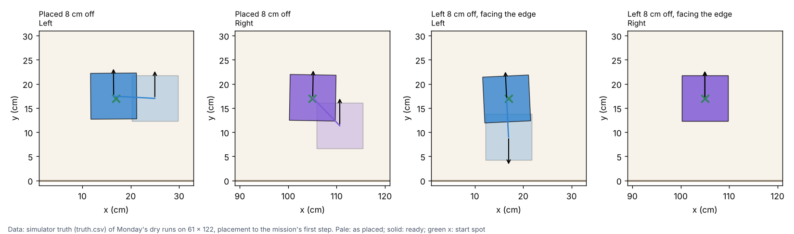
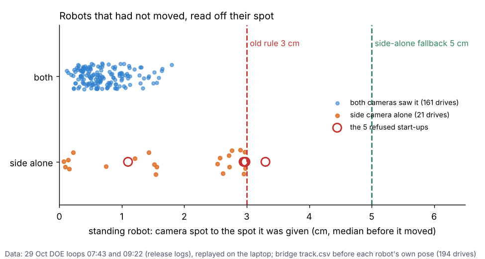
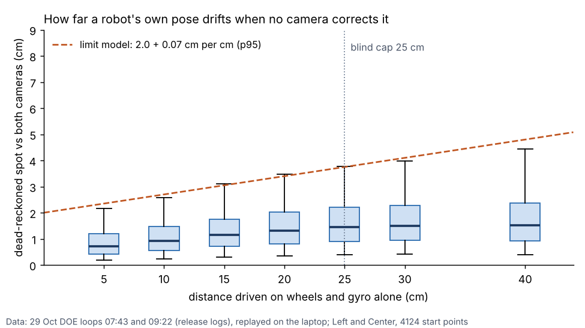
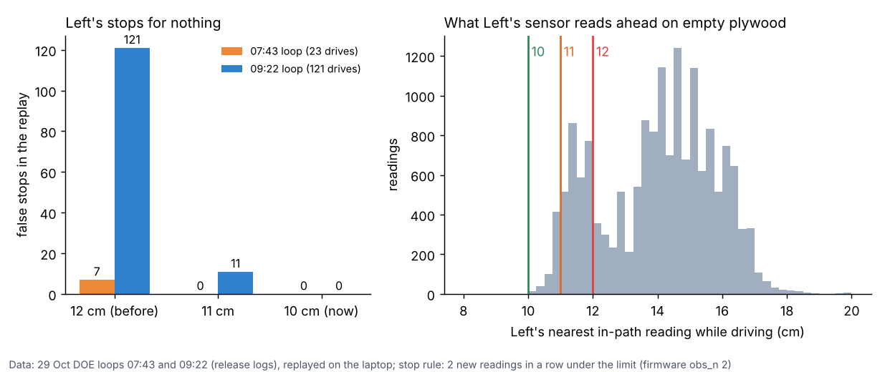

# Start straightening, the blind strip, Left's 10 cm stop (29 Oct, simulator and logs only)

**Premise.** Nick decided at 15:41 on 29 Oct: "Before Monday's run, 15 degrees should result in a correction, not a
stop." The brief had four parts:
1. Straighten each robot at the start instead of stopping.
2. A robot facing an edge under 12 cm turns away first. It never backs blind.
3. On the daylight blind strip (x = 30-45 cm), allow the side camera alone 5 cm (question 60), and let a robot
   that no camera sees drive on its wheels and gyro for a limited distance.
4. Left's distance-sensor stop limit becomes 10 cm (question 59).

At 16:2x Nick also approved rules audit recommendation 3: a robot counts as "moved off its start" only by its own
motion. Everything here was built and tested in the simulator and on the 29 Oct logs. The Pi and the robots were
not touched.

## Data

**1. Monday's default in the simulator, all three tables (final code, one run at a time).** "Corrections" counts
how many times the start corrected the robots before the mission began. The body gaps come from the simulator's
truth (the real 9.5 cm bodies).

| Table | Placed | Result | Corrections | Closest robots, mission | Closest body to an edge: straightening / mission | Line check p95 |
|---|---|---|---|---|---|---|
| 61 x 122 | correctly | done, 109 s | 0 | 10.0 cm | - / 9.7 cm | 0.42 cm |
| 61 x 122 | both 20 deg off (Left +20, Right -20) | done, 109 s | 1 | 9.6 cm | 10.9 / 9.6 cm | 0.44 cm |
| 61 x 122 | both backwards | done, 109 s | 1 | 10.2 cm | 10.3 / 9.4 cm | 0.69 cm |
| 61 x 122 | both 8 cm off (Right towards the y = 0 edge) | done, 109 s | 1 | 10.1 cm | **4.6** / 9.7 cm | 0.56 cm |
| 61 x 122 | overhead blind at x = 30-45, side camera 3 cm off | done, 109 s | 0 | 10.0 cm | - / 9.7 cm | 0.59 cm |
| 70 x 130 | correctly | done, 115 s | 0 | 9.8 cm | - / 9.7 cm | 0.44 cm |
| 70 x 130 | 20 deg off | done, 115 s | 1 | 10.0 cm | 10.9 / 9.7 cm | 0.48 cm |
| 70 x 130 | backwards | done, 115 s | 1 | 10.0 cm | 10.3 / 9.7 cm | 0.41 cm |
| 70 x 130 | 8 cm off | done, 115 s | 1 | 9.8 cm | **4.6** / 9.7 cm | 0.56 cm |
| 70 x 130 | overhead blind strip | done, 115 s | 0 | 10.1 cm | - / 9.7 cm | 0.67 cm |
| 76 x 137 | correctly | done, 129 s | 0 | 9.6 cm | - / 9.4 cm | 0.75 cm |
| 76 x 137 | 20 deg off | done, 128 s | 1 | 9.8 cm | 10.9 / 9.7 cm | 0.51 cm |
| 76 x 137 | backwards | done, 128 s | 1 | 9.4 cm | 10.3 / 9.6 cm | 0.96 cm |
| 76 x 137 | 8 cm off | done, 129 s | 1 | 9.8 cm | **4.6** / 9.4 cm | 0.64 cm |
| 76 x 137 | overhead blind strip | done, 129 s | 0 | 10.1 cm | - / 9.7 cm | 0.57 cm |
| 61 x 122 | Left 8 cm off, facing the y = 0 edge 4 cm away | done, 109 s | 1 | 9.9 cm | **2.3** / 9.6 cm | 0.54 cm |

Line check p95: the worse robot's 95th percentile distance from its planned line, measured by the camera bridge.
Data: mission_summary.json and sim/truth.csv of each dry run (`FLEET_DRY` path, `mission_run.py --dry`).

All 16 required runs finished, and every correction worked on the first try (no second corrections). The edge
numbers in bold are the spins on the spot at placement: a robot put 11 cm from an edge sweeps a corner to 4.6 cm,
and one put 9 cm from an edge sweeps to 2.3 cm. The wheels stay on the board. During the missions themselves, the
closest robots and edges are what they were before this build (9.4-10.2 cm).

**What the start adds.** With nobody off, the start takes 10.5-12.6 s from the facing check to the first step, as
before. A correction adds 11-15 s: the move itself takes 0.8 s for a 20 deg turn, 2.7-2.8 s for a 180 deg turn and
4.0-4.9 s for an 8 cm drive. The rest is the re-check (the follow runs stop, the facing check runs again, the follow
runs start again).

Each panel is one robot from above: pale is where it was placed, solid is where it was when the mission started,
the line is its path, and the green x is its start spot. Left, which faced the edge, turned on the spot before it
drove.

What Nick sees (the backwards case,
[picture](../screenshots/2026-10-29/straighten-feature-terminal-61x122-both-backwards-turned-rechecked.png)):
`Left was 179 deg off (backwards): turned to face the y = 61 side`. The 8 cm case
([picture](../screenshots/2026-10-29/straighten-feature-terminal-61x122-both-8cm-off-driven-to-spot.png)):
`Left was 8.4 cm off its start spot: turned, drove 8.4 cm to its spot, and faces the y = 61 side`. The robot facing
the edge ([picture](../screenshots/2026-10-29/straighten-feature-terminal-61x122-left-facing-edge-4cm-turns-first.png)):
`Left faces the y = 0 side with its nose 4.1 cm from it: it turns on the spot first (no backing)`.

**The known bug is fixed.** Before this build, a robot placed 8 cm off its spot stopped Monday's start with "No camera
fix for Left" (reproduced today on the old code). It now drives to its spot. The camera bridge also took the robot's
floor as empty where it stood off its spot, so it read Left 1.4 cm short. The bridge now relearns the floor round a
robot it first sees 2 cm or more from its spot.

**2. The bridge's start rule (question 60 and audit recommendation 3), replayed on the 29 Oct logs.** There were 194
robot starts across both DOE loops.

| Rule | Starts refused | Which |
|---|---|---|
| Old: camera spot over 3 cm from the start spot, 3 sightings in a row | **5** | exactly the 5 real "start-up failed" (Center 09:57 and 10:07, Left 10:39, 12:22, 12:23) |
| Question 60: 5 cm when only the side camera sees it | 0 | - |
| Built: moved only by its own motion (its own pose moved 1 cm, or it ran a step) | 0 | - |

Standing robots (before their own pose existed) were read a median 0.62 cm off by both cameras (p95 1.42, worst
1.80) and 1.56 cm off by the side camera alone (p95 2.97, worst 2.98). The worst start of all 194 was 3.39 cm. None
was really displaced, so no start would now go ahead wrongly.

Each dot is one robot standing before a drive, placed by how far the camera read it from the spot it was given. The
side camera alone reads up to 3 cm off, and that is where the old 3 cm rule refused the 5 start-ups.

The 5 cm allowance is kept where it is still needed: in run_plan's start check (DOE loop and ladder drives) and in
straightening (a robot 3-5 cm off, seen only by the side camera, is not driven to its spot).

**3. Driving blind: how far the robot's own pose drifts (29 Oct logs).** Dead reckoning was rebuilt from each robot's
own wheels (raw.csv wheel angles, wheel_scale 0.979) and gyro (raw yaw, gyro_scale 1.075). Each stretch started at
a camera spot with the robot's own heading. The result was compared with both cameras after D cm of driving: 4,124
start points on Left's and Center's straight drives.

| Driven blind | 5 cm | 10 | 15 | 20 | 25 | 30 | 40 |
|---|---|---|---|---|---|---|---|
| median error | 0.72 | 0.93 | 1.15 | 1.32 | 1.45 | 1.50 | 1.52 cm |
| p95 error | 2.17 | 2.58 | 3.10 | 3.50 | 3.78 | 4.02 | 4.44 cm |

Each box is the spread of the error after that many cm with no camera (whiskers 5-95 %). The dashed line is the
allowance the program now uses: 2.0 cm plus 0.07 cm per cm driven blind.

The first 0.7-2 cm is the camera's own error and timing, not drift. The drift itself grows about 0.07 cm per cm at
p95. Left drifts less than Center (at 25 cm: p95 3.35 cm against 4.53).

**What the program did with a robot no camera saw, before this build.** It already kept driving: the firmware runs on
its own pose, and run_plan only logged "tracker lost". The 1 s stop (CAM_GUARD_S) fires only when the camera sees the
robot again more than 6 cm from its own pose. Nothing limited how far it drove blind. What is built now:
- **Cap:** 30 cm driven with no camera stops everyone. Nick said 25-30. At 25 the both-blind dry run stopped Left on
  Monday's 27 cm diagonal across the strip.
- **Edges while blind:** its body must stay 5 cm from every edge, after subtracting the blind error (2.0 + 0.07 per
  cm). Otherwise everyone stops.
- **Seen again:** if the camera disagrees with its own pose by more than 2.5 cm (and not over 12 cm), its pose is set
  to the camera's (`fpose`), moved on by what it drove since that picture. Below 2.5 cm, the ordinary fixes pull it
  in.
- Every blind stretch is logged (`blind_start`, `blind_end` with distance and error) and listed in
  run_plan_summary.json.

**In the simulator:**
- With the overhead blind at x = 30-45 and the side camera reading 3 cm off, all three tables finished (table above).
- With **neither** camera seeing x = 30-45, Left crossed the strip on its wheels and gyro (25-27 cm, 0.2-0.7 cm off
  when seen again). On all three tables, though, Right's later lane runs inside the strip for over 30 cm, and the
  cap stopped everyone at 74 s, 78 s and 84 s
  ([picture](../screenshots/2026-10-29/blind-strip-problem-terminal-61x122-both-cameras-blind-lane-inside-strip-30cm-stop.png)).
  This is the cap working as asked, but it means a strip that both cameras lose would end Monday's run (question 1
  below).
- With neither camera seeing a 10 cm strip (x = 30-40) and Left's gyro 4 % off, the run finished. Left drove up to
  19 cm blind and was 2.2 cm off when seen again, so the ordinary fixes corrected it
  ([picture](../screenshots/2026-10-29/blind-strip-feature-terminal-61x122-10cm-strip-no-camera-drives-through-finishes.png)).
- The reset path (over 2.5 cm off) did not come up in the dry runs (the simulator's wheels drift too little). Its
  test covers it (`test_seen_again_after_blind_its_pose_is_reset_when_off`).

**4. Left's stop limit, replayed on Left's 29 Oct readings** (the audit's replay functions, 2 readings in a row, the
rule Monday had this morning):

| Left's limit | 07:43 loop (23 drives) | 09:22 loop (121 drives) |
|---|---|---|
| 12 cm (before) | 7 false stops (30 % of drives) | 121 false stops (77 %) |
| 11 cm | 0 | 11 (7 %) |
| **10 cm (built)** | **0** | **0** |

Left: false stops at each limit. Right: where Left's nearest in-path reading falls while it drives on empty plywood.
The plywood floor sits at 11-12 cm, right on the old limit.

How much later a real obstacle stops it: 2 cm nearer. That is 0.2 s at 10 cm/s, or 0.15 s at 13 cm/s. With the
confirmation readings and braking (about 2-3 cm at 13 cm/s), Left stops about 7-8 cm from a brick instead of 9-10.
That is still outside the firmware's 7 cm safe_front_cm. The margin is thin: Left's lowest floor reading while
driving was exactly 10.0 cm (0.1 % under 10.3). It is sent at every connect, for Left only
(`engine_checks.ROBOT_SETTINGS`), and read back. Since 16:2x the other agent's floor check (commit c33cc81) runs on
top of it, with 3 readings in a row.

## Conclusion

- **Monday's start now corrects instead of stopping.** Robots placed 20 deg off, backwards, 8 cm off, or facing an
  edge all straightened and finished the mission on all three tables, with the mission's closest robots (9.4-10.2 cm)
  and edges (9.4-9.7 cm) unchanged. It stops only if a robot cannot be found or measured, cannot turn safely (under
  7 cm from an edge), or is still off after two corrections. A correction costs 11-15 s at the start.
- **The 6 cm start bug is gone,** and so are the 5 start-ups refused on 29 Oct (moved now means its own motion).
- **Is the program robust enough to correct position after drift and continue the run's pattern? Yes, within
  limits.** Every plan step is a position on the board (drive from A to B, turn to heading H), not "drive 30 cm". When
  the camera sees the robot again and its pose is corrected, the robot's next control cycle sees that it is off the
  line from A to B and steers back onto it, then carries on to B and the next step as planned. Nothing in the
  pattern shifts. On 29 Oct's logs a blind stretch of 25 cm is off by 1.5 cm typically and 3.8 cm at worst (p95), and
  the robot absorbs that in a few cm of steering. The limits: over 30 cm blind, or near an edge while blind, it
  stops everyone. A lane that runs inside a strip neither camera sees therefore stops the run.
- Left at 10 cm removes every phantom stop in the replay, at the cost of stopping 2 cm nearer a real obstacle.

## What's next

1. **Board, Monday's start (10 min):** run `./run-fleet-pi.sh monday` with each robot placed correctly, then 20 deg
   off, backwards, 8 cm off, and facing an edge. Each must straighten, re-check and run, and Nick should see the plain
   words above. Watch the real turn and the re-check's heading.
2. **Board, the strip at 10-11 am:** check whether the side camera keeps seeing robots on x = 30-45 when the overhead
   loses them. If both lose them, see question 1.
3. **Board, Left at 10 cm:** a brick in Left's path at 13 cm/s, then measure where it stops (expect 7-8 cm).
4. Nick's answers to the questions below.

**Questions for Nick**
- Substantive:
  1. With **both** cameras blind on x = 30-45, Right's lane inside the strip drives over 30 cm blind, and the cap stops
     Monday at 74-84 s. Choose one: (a) keep 30 cm (safe: real 29 Oct data had the side camera seeing the strip);
     (b) 40 cm (p95 error 4.4 cm, still under the 6 cm camera guard); (c) the planner keeps lanes off a strip
     the cameras lose. A DOE fits: 25 / 30 / 40 cm on the board at the sun's hour, against blind stops and the error
     when seen again.
  2. A spin at placement brings a corner to 4.6 cm from the edge (robot put 11 cm in), or 2.3 cm (9 cm in). Should the
     straightening refuse to spin a robot whose middle is under 9 cm from an edge, and ask for it to be moved by hand?
     Today it spins from 7 cm (your figure).
  3. "Off by any amount" is built as more than 3 deg, because the facing check's own spread is 1-3 deg. Is 3 deg
     right, or should it turn at any measured error?
- Other:
  4. The re-check after a correction takes about 8 s (the follow runs stop for the facing check). Fine, or re-check by
     camera position and gyro alone (about 1 s, but the gyro then vouches for the turn)?
  5. Mission Control's warm-up does not straighten (it starts where the robots stand, as before). Is that what you
     want?

## Sweep 1: new tests that may now be necessary
- Board: the straightening on the real robots. These are the first real turns and drives sent before the timed
  mission, and the follow runs restart once for the re-check.
- Board: a correction that fails (a hand in the robot's way), to see the second try, then the stop with words.
- Simulator: a robot placed 25-40 cm off its spot, and the two robots' ways crossing (planned "one after the other",
  tested only in unit tests).
- Board: the camera bridge's floor relearn on real pictures, with a robot put 8 cm off its spot. In one dry run it
  relearned 3 times and the last spot was 2.6 cm towards the edge.
- Board or logs: the reset after a blind stretch, which happened in no dry run.
- Logs: the blind error model on Right (no 29 Oct drives) and at 13 cm/s only.
- DOE loop and ladder: `turn_from_edge` is unit-tested only. It needs a dry run with a robot under 12 cm from an edge,
  facing it, with no room to calibrate.
- Board: Left at 10 cm with the floor check and 3 readings (c33cc81) together. The replay here used 2 readings.

## Sweep 2: possible inaccuracies in what this relied on
- **The simulator's camera and wheels are kinder than the real ones.** The bridge and robot agree within 1 cm, and
  wheels and gyro drift little, so the corrections, re-checks and blind stretches all look cleaner than they will on
  the board.
- **The dry runs ran on a 2-core machine shared with two other agents.** The first batch ran 2 at a time under load
  8-16. In that batch, three 70 x 130 runs stopped on camera lag (the guard, "nothing from the laptop"). All the
  numbers above come from a second batch, run one at a time (load 2-7). These dry runs include the other agent's
  sensor-rule changes (commit c33cc81, then uncommitted).
- **Blind error** comes from straight drives only (follow state "drive"). The camera's timing was fitted per drive
  (0.1-0.3 s), and the start heading was the robot's own camera-fixed heading. Turns while blind are not in it.
- **"Nothing there" in the Left replay** carries over the audit's assumption that every 29 Oct stop was false.
- **Chosen, not derived** (all in appendix A): 3 deg, 3 / 5 cm, 8 deg re-check, 2 tries, 7 cm spin room, 12 cm
  edge look, 7.5 cm/s, 0.6 s blind, 30 cm cap, 5 cm blind edge, 2.5 / 12 cm reset, the 2 cm relearn. The blind error
  model (2.0 + 0.07 per cm) is fitted to 29 Oct.
- The 12 cm "edge ahead" uses the board's rectangle. A side the warm-up has felt as walled is still treated as open.
- **Body 9.5 x 9.5 cm with the axle under the middle,** as in the calibration-room report: not measured.

## Appendix A: chosen numbers and DOE notes
- `straighten.TURN_DEG` 3: turn when further off. **DOE:** 2 / 3 / 5 deg, against the first leg's p95 and the time.
- `POS_TOL_CM` 3 and `POS_TOL_SIDE_CM` 5: drive to the spot when further off. **DOE:** 2 / 3 / 4 cm (both cameras),
  4 / 5 / 6 cm (side camera alone).
- `RECHECK_DEG` 8: the re-check's heading allowance. **DOE:** 5 / 8 / 12 deg, against second corrections.
- `TRIES` 2: Nick's "fails twice". No DOE.
- `SPIN_EDGE_CM` 7: Nick's figure. **DOE:** 7 / 8 / 9 cm, against the corner's closest approach (question 2).
- `EDGE_AHEAD_CM` 12: the firmware's edge guard. No DOE.
- `DRIVE_CMS` 7.5: so the bridge gets a travel heading. **DOE:** 5 / 7.5 / 10 cm/s, against the end error.
- `cam_bridge.MOVED_OWN_CM` 1: a definition. No DOE.
- `RELEARN_CM` 2 (up to 3 times). No DOE (the dry runs show the read error 1.4 cm going under 0.5 cm). Sweep 1 has
  the board check.
- `Coordinator.BLIND_AFTER_S` 0.6: a definition (the real longest gap was 0.57 s).
- `BLIND_MAX_CM` 30. **DOE:** 25 / 30 / 40 cm (question 1).
- `BLIND_EDGE_CM` 5 with `BLIND_ERR_BASE_CM` 2.0 and `BLIND_ERR_PER_CM` 0.07 (fitted). **DOE:** 3 / 5 / 8 cm,
  against blind stops near lane ends.
- `REACQUIRE_CM` 2.5 / `REACQUIRE_MAX_CM` 12. **DOE:** 1.5 / 2.5 / 4 cm, against the error 1 s after it is seen
  again.
- `ROBOT_SETTINGS["Left"]["follow_look_cm"]` 10: Nick (question 59). **DOE:** 10 / 11 / 12 cm, against a brick in its
  path.

## Appendix B: what changed (commits 4fd9467, 16e93ae, 9bcccc5, 42254c5, 8156a97, 08abe97)
- `tools/fleet/straighten.py` (new): the correction's steps, safety checks, re-check and words; self-test.
- `run_plan.py`:
  - `--straighten`: the facing check's heading, the camera position, `fpose`, the correction run with the camera
    guard and the turn pause, the re-check, two tries.
  - The bridge's map heading is dropped until the robot's measured pose is in.
  - Blind watch, cap, edge rule and reset.
  - 5 cm for the side camera alone at the start check.
  - Left's own settings at connect.
  - A robot calibrated just now still needs a camera heading (it used to come from the bridge's 3 cm rule).
- `cam_bridge.py`: "moved" only by its own motion. The floor is relearned round a robot put off its spot.
- `facing.py`: straighten mode (measure, never stop for a heading).
- `mission_run.py` (`--no-straighten`), `mission_control.py` (run setting `straighten`, off for the warm-up), and the
  `run-fleet-pi.sh` help.
- `ladder.py` (DOE loop too): `turn_from_edge` before a crawl.
- `engine_checks.ROBOT_SETTINGS`.
- `fleet_sim.py`: `--live-blind-strip X0:X1[:both]` and `--live-side-bias DX,DY`.
- Tests: `tools/fleet/tests/test_straighten.py` (21). The fleet suite had 265 passed, 2 failed and 7 skipped. Both
  failures were in `test_ladder.py`, because `turn_from_edge` needed ladder state that the stubbed test crawls do not
  have. After fixing that (08abe97), test_ladder + test_straighten pass 37 of 37.
- Not committed (scratchpad, they read downloaded logs): `start_rule_replay.py`, `blind_replay2.py`,
  `left_limit.py`, and the chart and picture scripts.
- One line of the other agent's lighting change in `ladder.py` (`"not found"` in L0's washed-out check) went into
  42254c5 by mistake.
