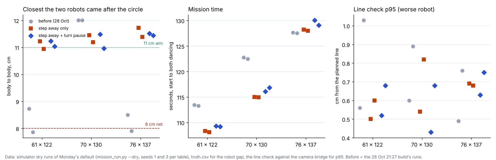
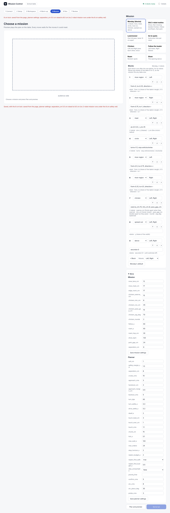
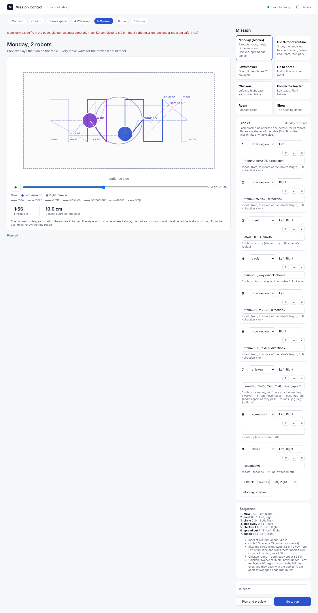

# Turn pause, step away and the 8 cm lock (29 Oct, simulator only)

**Premise.** On the real robots tracking is within 2-3 cm of the line 95 % of the time, worst at the turn-arounds, and the
camera is 0.18-0.27 s behind at most. Nick (28 Oct 21:27): "a pause for the camera to catch up". Approved 29 Oct 07:3x,
three parts for Monday's mission (Left and Right): (1) after every turn on the spot the robot stands until the cameras
agree with its own pose, then drives; (2) after the circle, the robot that waits beside the other's first lane steps
away first (it came 7.9 cm from the other in 2 of 6 simulator runs, against the 8 cm net); (3) no screen or saved file
can run a 2-robot mission under the 8 cm net. Nothing here touched the Pi or the robots; the DOE loop and the ladder
are unchanged (they do not pass the new pause).

## Data

Monday's default, `mission_run.py --dry` (the path `FLEET_DRY=1 ./run-fleet-pi.sh monday <size>` runs), seeds 1 and 3.
Before = the 28 Oct 21:27 build's runs (lanes 17 cm in), same seeds. Body = the 9.5 cm square, simulator truth.

| Table | Seed | Finished | Time, now (before) | Closest robots, now (before) | Closest after the circle, now (before) | Closest body to an open edge | Line check p95, worse robot, now (before) |
|---|---|---|---|---|---|---|---|
| 61 x 122 | 1 | yes | 109 s (113) | 9.9 cm (8.7) | 11.2 cm (8.7) | 9.7 cm (9.8) | 0.52 cm (0.56) |
| 61 x 122 | 3 | yes | 109 s (113) | 10.5 cm (**7.9**) | 11.0 cm (**7.9**) | 9.5 cm (9.6) | 0.68 cm (1.03) |
| 70 x 130 | 1 | yes | 116 s (123) | 9.8 cm (9.8) | 11.5 cm (12.0) | 9.8 cm (9.7) | 0.43 cm (0.60) |
| 70 x 130 | 3 | yes | 117 s (122) | 10.7 cm (10.6) | 11.0 cm (12.0) | 9.4 cm (9.6) | 0.68 cm (0.89) |
| 76 x 137 | 1 | yes | 130 s (128) | 9.5 cm (8.5) | 11.5 cm (8.5) | 9.8 cm (9.8) | 0.63 cm (0.49) |
| 76 x 137 | 3 | yes | 129 s (128) | 10.6 cm (**7.9**) | 11.4 cm (**7.9**) | 9.5 cm (9.5) | 0.75 cm (0.76) |

The closest moment is now Chicken's pass (planned 10.0 cm), not the stretch after the circle. Line check p95: the
95th percentile of each robot's distance from its planned line, measured by the camera bridge.

Each dot is one simulator run; grey is before, orange the step-away alone, blue the step-away with the turn pause (data:
truth.csv and the line check of each dry run).

**The pause's cost.** 14-16 pauses per robot, each 0.25-1.0 s in the simulator, all with both cameras agreeing, no
timeouts. Added standing time per robot: 4.1-5.0 s (61 x 122), 4.7-7.1 s (70 x 130), 6.0-8.0 s (76 x 137). The mission
took only 1-1.5 s longer than the same code without the pause (108 / 115 / 128 s), because most pauses fall inside
waits the plan already has (the meet, Chicken's start). Times are 4-6 s shorter than before on 61 x 122 and 70 x 130
and 2 s longer on 76 x 137; that comes from the step away changing who waits where, not the pause.

**One camera.** With the overhead washed out (side camera and lights only, 61 x 122 seed 1) every pause took one
camera's fix. At first each waited the full 1 s for a second camera that could not see it (13-15 s per robot); now a
robot that has been on one camera for the 2 s before the turn takes that camera's fix at once: 9.1-11.7 s per robot,
the mission 111 s, closest 9.5 cm.

**What was built** (tools/fleet):

| Part | Change |
|---|---|
| 1. Turn pause | `run_plan.py --turn-pause`: a drive or arc after a turn of 20 deg or more is not sent until a camera fix taken after the turn (the mean of the newest 3, both cameras' if they both see it) is within 1.5 cm of the robot's own pose, reported after it took that fix. One camera after 1 s, or at once when only one camera has seen it lately. After 3 s it drives on as before and says so. Each pause is logged (`turn_pause` in coordinator.jsonl) and totalled in run_plan_summary.json. `mission_run.py` passes it (`--no-turn-pause` turns it off); Mission Control has a run setting `turn_pause` (on). |
| 2. Step away | `missions.build`: after the circle, if the two robots' first lanes are too close to mow at once, the robot whose circle exit is nearest the other's first lane drives straight away from that lane until the bodies are 13 cm apart (by plan) and waits there. Right steps 3.5 cm on 61 x 122 and 7.5 cm on 70 x 130; Left steps 4 cm on 76 x 137. A note in the mission says so. |
| 3. 8 cm lock | Mission settings (`separation_cm`, `chicken_min_cm`), planner settings, Mission Control's saved settings.json, the program's Chicken `min_cm`, `mission_run --setting / --min-gap-cm` and `run_plan --min-gap-cm` are all raised to 8 cm (or `chicken_min_cm` if more) for any mission with 2 or more robots, with an "8 cm LOCK" message on the screen and in the terminal. Mission Control's planner screen now shows 8, not the planner's own 5. The only way under it is the simulator's safety-net DOE (`--dry --below-net-doe`). |

The Mission screen after typing 5 into the planner's `separation_cm` and saving: it is saved as 8, and the red line at
the top says so.

The preview at 0:50 on 61 x 122: Right (purple) stands 3.5 cm further out from the circle while Left (blue) mows the lane
next to it.

**Tests.** New: tools/fleet/tests/test_turn_pause.py (13: the pause waits, old and not-yet-taken fixes, one camera,
timeout, trims, the step away on all three tables, the lock on every path). The safety-net DOE test and sweep now pass
`--dry --below-net-doe`. Fleet suite: 205 passed, 8 skipped (was 182 passed, 7 skipped).

## Conclusion

All six runs finished. The two robots no longer come close after the circle: 11.0-11.5 cm in the simulator (13 cm by
plan), against 7.9-8.7 cm before on 61 x 122 and 76 x 137. The closest moment of the mission is now Chicken's pass,
9.5-10.7 cm, as planned. The turn pause cost 4-8 s of standing per robot and about 1-1.5 s of mission time, and it did
not hurt the line check (p95 0.43-0.75 cm, before 0.49-1.03). Bodies stayed 9.4-9.8 cm from the open edges, as before.
The simulator's camera always agrees with the robot within 1 cm, so it shows the pause's cost but cannot show its
benefit: that needs the board.

## What's next

1. On the board (Thursday): Monday's mission with the pause, then with `--no-turn-pause`, the same table. Compare the
   line check p95 on the leg after each turn and the closest approach, and read each pause's length and result from
   coordinator.jsonl (`turn_pause`).
2. If real pauses often time out (3 s) or end on one camera, check the side camera's coverage at the table's far end.
3. Nick's call: should the DOE loop and the ladder get the pause too (question below)?

## Sweep 1: new tests that may now be necessary
- Board: pause on/off A/B (above), 2 runs each; it is the only test that shows whether the pause helps.
- Board: the pause with the lamp on (one camera): how long the one-camera pauses are, and whether the 1.5 cm agreement is
  reached at all when the overhead is washed out.
- Simulator: a camera that lags 0.25 s and a robot whose gyro is off 3-5 deg, so the pose and camera disagree after a
  turn (the simulator's default never does): how many pauses then time out.
- Simulator: the full Monday sweep conditions (lost packets, stalls, dead robot) with the pause: a lost FOLLOW record or
  fix stream during a pause.
- Board: Chicken's swerve with the pause: the robots now stand ~0.3-1 s at each jog. Does it still look like a dare?

## Sweep 2: possible inaccuracies in what this relied on
- The simulator's camera and robot pose agree within 0.3 cm after a turn, so the pause lengths here (0.25-1 s) are a
  floor; on the real robots each pause waits for the firmware's fix blending, which may take longer.
- The 2-3 cm real p95 is from Right's 11 drives on 28 Oct, measured against the camera that steered it.
- Chosen numbers, none derived: 1.5 cm agreement, 20 deg least turn, 1 s before one camera, 2 s "only one camera
  lately", 3 s timeout, 13 cm step-away gap, 3 cm least step (appendix).
- "Closest after the circle" is measured from the circle's end to Chicken's first step; the robots' turns at the
  step-away spot are inside that window.
- Two seeds per table, base condition only (plus one washed-out run). Two no-pause runs failed at start-up when two
  dry runs planned at the same time on this 2-core machine (no step sent); they were re-run alone and finished.
- The before numbers come from the 28 Oct runs on that day's code, not today's code with both parts off.

## Appendix: chosen numbers and DOE notes
- `TURN_PAUSE_TOL_CM` 1.5: a standing robot wobbles 0.5-1.5 cm in the camera. **A DOE fits** 1.0 / 1.5 / 2.5 cm
  against pause length and the line check on the leg after each turn (board, 10 lane turns per robot).
- `TURN_PAUSE_ONE_CAM_S` 1.0 and `TURN_BOTH_LATELY_S` 2.0: **a DOE fits** 0.5 / 1 / 2 s from bridge_track.csv (how often
  a two-camera fix still came after each wait).
- `TURN_PAUSE_MAX_S` 3.0: **a DOE fits** 2 / 3 / 5 s against the share of timeouts and their cause.
- `TURN_PAUSE_MIN_DEG` 20: no DOE (Monday's turns are 70-180 deg, the planner's trims under 5).
- `STEP_AWAY_GAP_CM` 13: Nick's "about 11 or more" plus the simulator's 1.1-1.6 cm drift there. **A DOE fits** 11 / 13 /
  15 cm against the camera's closest approach in that stretch (free in time: the step is inside the wait).
- `STEP_AWAY_MIN_CM` 3: no DOE (shorter steps are lost in the 2-3 cm tracking error).
