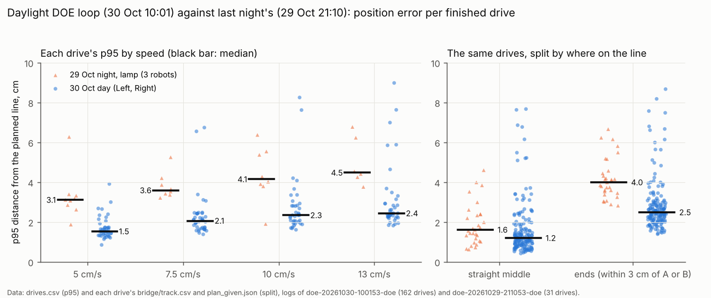
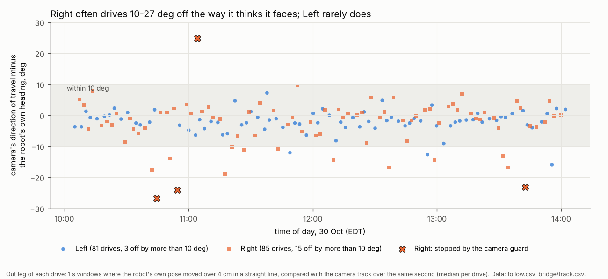
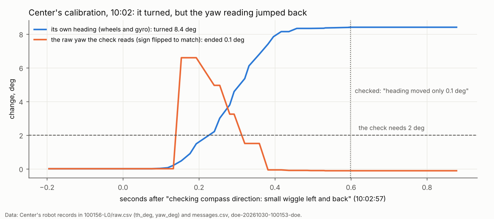

# Daytime DOE loop, 30 Oct 10:01-14:01: the overnight fixes held, daylight accuracy, every stop

**Premise.** The DOE loop `doe-20261030-100153-doe` (`./run-fleet-pi.sh doe 4 keep-going`) ran in daylight on the Pi
with Left and Right; Center was set aside at the start. Code: the overnight fixes (d40c3ff, 303d6f8) and the warm-up
fixes (6b0ff09, 6620ac3), **not** the no-stops build (41268bd onward, pushed after the loop started). Robot firmware
2026-10-28a (no facing check from the lights). Questions: did the overnight fixes hold; how accurate is daylight
against last night (`doe-20261029-211053-doe`, [overnight report](e02-oct30-overnight.md)); what caused each stop,
hold and OUT, and would the no-stops build have fixed it; why did the loop end when it did. Everything below is from
the uploaded logs (17.6 MB; the frames were not downloaded). The robots and the Pi were not touched.

## Data

**1. The loop ran its full 4 hours.** It ended at the time cap ("The time cap (4.0 h) is reached", 14:00), then
uploaded at 14:02. The release's "created 13:13" on GitHub is the time of the commit the release points at (the
robots-anywhere report, 13:13:10), not the upload ([end of the loop](../screenshots/2026-10-30/daytime-doe-feature-terminal-time-cap-reached-full-4h.png)).
171 drives were started: 162 finished (Left 81, Right 81), 5 got no plan (Left), 4 were stopped by the camera guard
(Right). 176 turn-check turns, mean error +0.5 deg, largest 5.7. Batteries 93 % to 39-41 %.

**2. The overnight fixes held.**

| Fix | Last night (37 drive tries) | Today (171) |
|---|---|---|
| Crawls stopped by the robots' own border or a plywood edge | 3 (all three robots parked) | **0** (44 turn-check crawls, 13 crawls with no heading) |
| Start-ups refused | 4 (6 of 36 start checks over 4 cm) | **0** of 166; largest 2.8 cm (allowed 4) |
| Side camera's learned offset carried into the camera bridge | never (every bridge started at 0, 0) | **171 of 171** bridges ("learned this session", -1.0 to 2.2 cm) |
| Park spot A at least 30 cm from the edges | 11 of 37 under 30 cm | 0 of 166 (closest 30.0 cm) |

Sources: screen.txt, events.csv, each drive's bridge.txt first line and run_plan_summary.json start_checks
(place_cm), plan_given.json (A).

**3. Daylight accuracy: about 40 % less error than last night at every speed; the ends of the line are still the
larger part.**

On the left, each dot is one finished drive's p95: daylight (blue) is 1.5-2.4 cm against 3.1-4.5 cm at night at the
same speed. On the right the same drives split: on the straight middle 1.2 cm against 1.6, at the ends 2.5 against 4.0.

| p95, median of finished drives (cm) | 5 cm/s | 7.5 | 10 | 13 | all |
|---|---|---|---|---|---|
| Left, day (81) | 1.6 / 1.5 | 2.3 / 2.0 | 2.3 / 2.1 | 2.3 / 2.3 | **2.1** |
| Right, day (81) | 1.6 / 1.6 | 2.2 / 1.6 | 2.7 / 3.4 | 3.3 / 2.3 | **2.2** |
| Left, night (15) | 3.1 / 3.4 | 3.8 / 3.5 | 4.1 / 3.0 | 4.5 / - | 3.5 |
| Right, night (12) | 4.5 / 2.9 | 4.3 / 3.2 | 5.5 / 6.4 | 5.2 / 3.8 | 4.8 |
| Center, night (4, 25 cm only) | 3.1 | 4.2 | 3.8 | 6.8 | 4.0 |

Each cell: 25 cm line / 40 cm line. p95 (95th percentile): over one drive, the distance from the planned line
that 95 % of the camera's positions stay within; the median of those per cell. "Ends": positions within 3 cm of A
or B along the line, or beyond them. Sources: drives.csv; bridge/track.csv and plan_given.json for the split (my
recomputed p95 is within about 0.2 cm of the logged one). Night numbers are the overnight report's session,
recomputed per robot and speed.

- Both cameras saw the driven robot in a median 99 % (Left) and 98 % (Right) of pictures (night: 92 % and 47 %).
  Lighting check at L0: overhead 20 grey levels (fine from 30), side 22.
- The day's few bad drives (p95 over 5 cm, the blue dots high up) are almost all Right's, explained in section 4.

**4. Every stop, hold and OUT, with its cause.** Label: what failed (camera, tracker, robot, how the loop is built).
"Would the no-stops build have fixed it" is from [robots-anywhere, appendix A](e02-oct30-robots-anywhere.md#appendix-a-every-path-that-stopped-a-start-or-a-run-or-set-a-robot-aside).

| When | Robot | What the loop said | What happened (from the logs) | Label | No-stops build |
|---|---|---|---|---|---|
| 10:02 **OUT** | Center | calibration: failed | Not its lights: they were read at L0 and L1 (88 deg, both cameras) and in 166 of 173 later loops. The calibration's compass step failed: "yaw check failed: heading moved only 0.1 deg". Center **did** turn (8.4 deg by its wheels and gyro), but the raw yaw the check reads jumped 6.6 deg and then fell back to where it started (chart below). Center had been switched on 3.7 min before. | robot (yaw reading) | **Probably** (Claude's conclusion): Center would have been calibrated again at the start of every loop. That fixes a one-off glitch, not a stuck reading. Its "calibrate again, then the compass check alone" uses the same wiggle, so it does not get round this check. |
| 10:31 and 13:39 held | Left | making room did not finish: no room to crawl 10 cm either way | The find step lost another robot's lights (Center's at 10:31, Right's at 13:39) and put **Left on that robot's spot** ("Left is 0 cm from Center"). A camera fix moved Left's own pose from (30.2, 91.9) to (37.6, 52.0), which is Center's spot. Left crawled 10 cm out and back where it really was, the camera watched the other robot standing still ("crawl 0.4 cm"), and Left was held. It rejoined next loop. ([picture](../screenshots/2026-10-30/daytime-doe-problem-terminal-left-found-on-centers-spot-crawl-watched-wrong-robot.png)) | camera (lights matched to the wrong robot) | **No.** Its retries re-measure lights that were *not* read; nothing checks that a robot's lights are where that robot was. |
| 10:44, 10:54, 11:04, 13:42 stopped | Right | camera and Right's own pose disagree by 8.8-11.8 cm (fixes refused 12-17) | Right drove 23-27 deg off the heading it believed. Its own pose went one way and the camera saw another, so it refused the camera's position fixes as too far off and could not correct itself. | robot (Right's heading; cause not in the logs) | **No** for the DOE loop: its drives still stop on the camera guard (run_plan without `--straighten`). Monday's run would halt Right, reset its pose from the camera and re-plan. The heading error itself stays. |
| 11:17, 12:36 would have parked | Right | p95 9.0 / 8.2 cm, over the 8 cm safety limit | Same as above: 19 and 17 deg off. | robot | No (keep-going only logs it) |
| 10:45-10:53, 5 times | Left | no plan for drive 15 | Its A was picked at (62, 33), across the board, behind the parked Center and Right where Right's drive 15 had stopped. `pick_segment` keeps the line clear of parked robots but does not check that A can be reached; the planner found "no clear route". Cleared at 10:56 when Right was moved for room. | loop design | **No** (a "no plan" still ends that run) |
| 11:37 held 51 s | Right | not answering | Right missed one status check (WiFi -72 to -80 dBm all day, Left -59 to -64). It rejoined. | link | already handled |
| 13 times | Right (12), Left (1) | setting resent | The read-back of a setting got no answer; it was sent again and confirmed. | link | already handled |

Each dot is one drive's out leg: how far the camera's direction of travel was from the way the robot thought it was
going. Right was more than 10 deg off in 15 of 85 drives, Left in 3 of 81. Right's 4 camera-guard stops (crosses) are
the worst of them.

- The size of the turn before the out leg does not explain it: 13 of Right's 15 came after a first turn under 150 deg.
  Last night's Right drive 7 (27 deg off) was the same fault, which the overnight report could not explain from one
  case. Mostly clockwise (14 of 15).

Over the second of Center's compass wiggle, its own heading (blue) rose to 8.4 deg. The yaw value the check reads
(orange) jumped and then fell back to 0.1 deg by the time it was read, under the 2 deg the check needs.

## Conclusion

- **The overnight fixes held:** no crawl hit a border or an edge, no start-up was refused, every camera bridge started
  from the learned offset, and A stayed 30 cm in. The loop ran its full 4 h; it was not stopped by a crash or `doe-stop`.
- **Daylight is accurate:** median p95 2.1 cm (Left) and 2.2 cm (Right), against 3.5-4.8 cm last night. The ends of
  each line (2.5 cm) are still twice the straight part (1.2 cm).
- **Center's OUT was its yaw reading, not its lights.** The robots-anywhere report says Center's lights were "not
  read" at 10:02. They were read at 10:02; the "too few pictures" line is from loop 1 (10:05), after the OUT.
  *Claude's conclusion:* a yaw reading that snaps back while the gyro counts the turn looks like the robot's motion
  sensor still settling a few minutes after switch-on. That is a guess; the logs show what happened, not why.
- **Right's heading is the main robot fault left.** It drives 10-27 deg off course in about 1 drive in 6, and its
  refusal of far-off camera fixes keeps it from correcting.
- **New risk** (*Claude's conclusion*): lights matched to the wrong robot. Twice in 4 h the find step put Left on
  another robot's spot. In the DOE loop the crawl caught it. The no-stops build now **seeds the camera bridge from the
  lights**, so the same mix-up at a Monday start could have the bridge follow the wrong robot.

## What's next

1. Center: switch it on, wait 5 minutes, and calibrate it alone (`calib` through the ladder) twice. If the yaw check
   passes, it was a start-up glitch, and the no-stops build's retry every loop covers it. If it fails again, look at
   Center's motion sensor (question 1 below).
2. Lights mix-up: a check in the find step and in run_plan's facing check. A robot's lights found within about 10 cm
   of **another** robot's last known spot, and far from its own, count as "not read", and are measured again. Add a
   simulator fault for it (one robot's `led` answered late).
3. Right's heading: a board test (below). Meanwhile let the camera guard reset Right's heading from the camera line
   in DOE drives, as Monday's run already does.
4. `pick_segment`: only choose an A the planner can reach (try the next-best line on "no clear route").
5. Next night session with the same fixes, to compare at night (from the overnight report).

## Questions for Nick

Substantive:
1. Was Center switched on shortly before 10:01 (its own clock says 09:59)? Has its calibration failed like this before?
2. Should Right sit out Monday's run until its heading is checked on the board, or run with the camera guard
   resetting it?

Other:
3. Should the DOE loop's drives also get the no-stops behaviour (`--straighten`), or keep stopping, as data?

## Sweep 1: new tests that may now be needed

- Board, Center: switch on, calibrate at 1, 3, 5 and 10 minutes; log `yaw_deg` and `th_deg` during the wiggle.
- Board, Right: ten out-and-back drives at 10 cm/s, 40 cm, taped. Camera line heading against Right's own at the
  start of each out leg. Is the error there before the first turn (a wrong start heading) or made by the turns?
- Simulator: three robots, one robot's lights answered 2 s late in the find step. Does any robot get placed on
  another's spot (DOE loop find step; run_plan facing check with the new bridge seeding)?
- Simulator: a DOE loop with a robot stopped mid-board between the others. Does `pick_segment` choose an A the
  planner cannot reach?
- Logs: the side camera's offset per robot (Left +2.6, -0.4; Right -1.4, +2.0 cm today). Is one shared offset enough,
  or does each robot need its own?

## Sweep 2: possible inaccuracies in what this relied on

- p95 and the ends/straight split are measured by the same cameras that correct the robot's pose. They are not
  independent of what they judge.
- The direction error compares the robot's own pose with the camera's track over 1 s windows. The robot's pose is
  itself pulled by camera fixes it accepted, so in drives where most fixes were refused, the error is clearer than
  where they were used.
- "Center turned 8.4 deg" is from Center's own wheels and gyro. The camera's heading of Center during the wiggle was
  not measured (front and back not told apart; frames not downloaded).
- That the camera watched Center or Right during Left's crawl is inferred from the spot the fix gave (their spot) and
  "crawl 0.4 cm"; no frames were looked at.
- The 2 deg pass mark of the yaw check is read from the simulator's copy of the firmware (tools/sim/robot.py), not
  the firmware source.
- Night has 31 finished drives against 162 by day, and Center drove only at night. The per-cell night medians rest on
  1-3 drives each.
- Chosen numbers in this analysis, none derived:
  - "Ends" = within 3 cm of A or B. A DOE would not set it better; a sweep of 2 / 3 / 5 cm on the logs would show
    whether the split is stable.
  - Direction windows: 1 s long, the robot's own pose over 4 cm, under 3 deg of turn, the first 6 windows of a drive.
    No DOE; a sensitivity check on the logs would do.
  - "Off course" = more than 10 deg. No DOE; it is a reporting line.
  - The loop's own numbers that mattered here: SAFETY_P95_CM 8 (a safety limit, no DOE), A_INWARD_CM 5 (DOE note in
    the code: 0 / 3 / 5 / 8 cm against how often room is needed), the robots' fix refusal limit (firmware; a DOE
    would help: how far off a fix may be before it is refused, against camera-guard stops).

## Appendix A: per-drive data used

Derived in the analysis scratchpad (not committed) from the release's logs: per drive the start check, the bridge's
starting and learned side offset, the both-camera share, my recomputed p95 split into ends and straight, and the
direction error of the out leg. Day and night run through the same scripts. The DOE loop's own summary.md has the
per-speed table (p95 median 1.5-2.8 cm per speed and length; 0 sensor stops).

## Appendix B: the side camera's offset

| | Left | Right | Center |
|---|---|---|---|
| Day, learned per drive (median, cm) | +2.6, -0.4 | -1.4, +2.0 | - |
| Night (overnight report) | -4.4, +3.9 | -3.4, +2.3 | -4.1, +2.2 |

The bridge starts from one offset for all robots, today -1.0 to +2.2 cm. Start checks were all under 3 cm, so that
was good enough by day. At night the offsets were larger but had the same sign for every robot.
