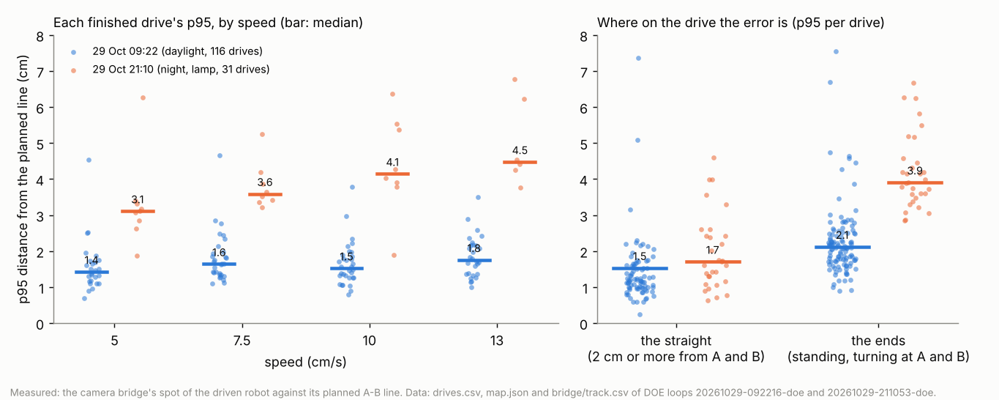
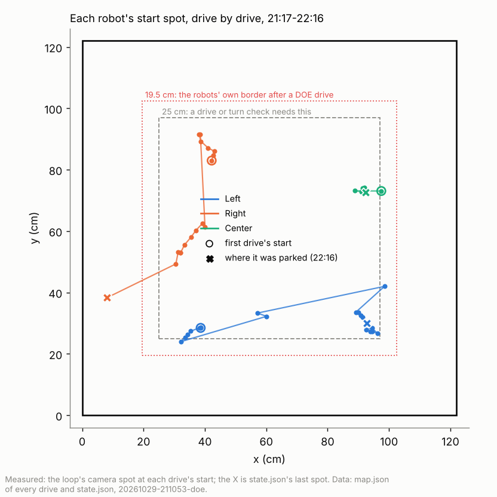
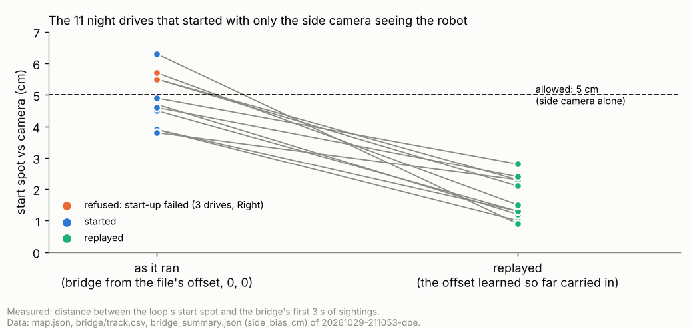

# Night DOE loop, 29 Oct 21:10-22:16: why it ended, why it was less accurate, and the fixes

**Premise.** The DOE loop `doe-20261029-211053-doe` ran in keep-going mode for 65 minutes at night under the room lamp
with all three robots (code: main at about 21:05, before the mirroring commits; robot firmware 2026-10-28a, so no facing
check from the lights). It ended at 22:16 with every robot parked for safety. Everything below is from the uploaded logs,
the overhead track video of Left's 21:47 turn check, and the simulator; the robots and the Pi were not touched.

## Data

**1. Every stop, in plain words.** Label: what failed (camera, tracker, robot, or how the loop is built).

| When | Robot | What the loop said | What happened (from the logs) | Label |
|---|---|---|---|---|
| 21:36 **parked** | Center | turn-check crawl failed (virtual border) | The loop knew Center faced 3.5 deg (straight at the x = 122 edge, 28.6 cm away), but the turn check's first crawl never uses a known heading: it went forwards. The robot's **own** border stopped it at x = 102.6, 9.2 cm in. That border stays on the robot after a DOE drive and sits **19.5 cm** from the edge (the drive map's floor is the board less 13.5 cm, plus 6 cm). | loop design |
| 21:40 | Right | camera and own pose disagree by 10.1 cm | Right drove about 27 deg off the heading it believed (camera: -86 deg; its own pose: -57) for 27 cm, then the camera guard stopped it, as built. Why the heading was off is not in the logs (its turns before were within 3 deg). | robot (not proven) |
| 21:44 | Left | no plan | Two phantom stops 0.7 s apart while standing (its centre-right zone read the floor at 9.2-9.4 cm, limit 10); the second "confirmed" the first, so no route was left. Already changed at 21:23 (a second stop confirms only when the robot was moving). | robot sensor; loop design (fixed before) |
| 21:45 | Right | crawl refused: a leg is running | The first `go 10`'s answers were lost on the WiFi; the link sent it again; the robot refused the copy because the first was running; the loop took that refusal as the leg's end. | loop design (link) |
| 21:51 | Left | heading crawl read 16.3, then 14.3 cm for 10 | The two cameras put Left 4.3 cm apart there (the side camera's offset), and each new tracker starts that offset at 0: the spot jumped when the overhead came and went. | tracker |
| 21:59 | Right | turn check FAIL, side camera only | Errors +7.2, +20.7, -26.1, -3.7 cancel out: misread headings on the side camera alone; held, as built. | camera |
| 21:59, 22:03, 22:09 | Right | start-up failed | The loop put Right on its spot; the drive's camera bridge put it 5.5-5.7 cm off (allowed 5 with the side camera alone). | tracker |
| 22:10 | Left | start-up failed (no camera fix) | The bridge saw the two cameras 6.6 cm apart (over its 6 cm "agree" limit), called Left "unsure" for 17 s and sent no fix at all. | tracker |
| 22:11 | Right | lost during its crawl | Neither its body nor its lights were found where it should be after a crawl leg (side camera only there); held, as built. | camera |
| 22:12, 22:14 | Right | backing blind refused | Right had **no pose** since its failed start-up (run_plan's follow mode starts without one). The robot refuses a position-only fix then, so its 10 cm blind-backing allowance never refilled, and every back leg after the first was refused. | loop design |
| 22:15 **parked** | Left | heading crawl failed (virtual border) | Its heading (-28.3 deg, from drive 17) was dropped by the find step (the camera had it 2.5 cm or more from where it was measured). The crawl went forwards blind at -29 deg into its own border at (102.5, 23.8). | loop design |
| 22:16 **parked** | Right | making room: crawl failed (plywood edge) | Three crawls that could not back walked Right 30 cm, from (27.5, 52.8) to (8.1, 38.2); the bottom sensor stopped the third 3.5 cm in. | loop design |

([last four loops](../screenshots/2026-10-30/overnight-problem-terminal-last-loops-right-walks-to-the-edge-left-border.png);
[Right's refused fixes and back legs](../screenshots/2026-10-30/overnight-problem-right-no-pose-fixes-refused-back-legs-refused.png))

20 heading crawls began with no heading at all (8 after a drive that did not finish or gave no camera line, 12 after a
hold or the find step's 2.5 cm rule); each went forwards whichever way the robot faced.

**2. Why the night was less accurate: the error is where the robot stands and turns, not on the straight.**

On the left, night drives (orange) are 2-3 cm worse than the 09:22 daylight loop at every speed; on the right, the
same drives split in two: on the straight middle night and day are alike (1.7 vs 1.5 cm), at the ends night is twice
as bad (3.9 vs 2.1 cm).

| | 07:43 (morning sun) | 09:22 (daylight) | 21:10 (night, lamp) |
|---|---|---|---|
| Lighting check at L0, overhead / side (grey levels; fine from 26-30) | 33 / 21 (Left), 21 / 31 (Center) | 25.5 / 34, 20 / 41 | **11** / 23 |
| Pictures with both cameras (driven robot) | Left 99 %, Center 77 % | Left 89 %, Center 88 % | Left 75 % (+19 % "unsure"), **Right 45 %**, Center 95 % |
| Side camera's offset against the overhead (median, learned per drive) | 3.9-4.7 cm | 1.4-2.8 cm | **4.2-5.7 cm** (Left up to 7.8) |
| Past B, p95 per drive: the robot's own pose / the camera | - | 1.2 / 1.2 cm | 1.9 / **3.8 cm** |

p95: the 95th percentile of the robot's distance from its planned line over one drive (camera bridge). "Past B":
how far beyond the far end of the line the robot was, along it. Sources: drives.csv, bridge/track.csv,
bridge/bridge_summary.json, follow.csv, L0 lighting.json of each loop.

- The lamp washed the overhead out: 11 grey levels between robots and board, the lowest yet. The overhead lost Right
  more than half the time (Right sat at x = 30-40, the strip where the overhead lost Left in daylight).
- The seen rate is not the whole story: Center was seen by both cameras 95 % of the time and still had a 4.0 cm median
  p95. At the ends of each line the camera put a standing, turning robot about 2 cm further on than its own wheels did
  (day: no difference). The overhead picture shows white robots on a white board with only their dark edges and a
  shadow line on one side ([picture](../screenshots/2026-10-30/overnight-problem-overhead-camera-night-lamp-white-robots-on-white-board.png));
  an outline made of edges and shadow is a likely reason, not a measured one.
- Turning on the spot, the camera's spot wobbled no more at night (p95 1.0 cm, day 0.8-1.4).

**3. Why robots end up at the edges.**

Each line follows one robot's start spot drive by drive; Left and Right creep outwards to the 25 cm line (grey), and two
long jumps (Right's drive 7, Left's drive 8) move them across the board.

- Each drive parks the robot back on A, picked as near the robot as possible; the return leg ends 1-4 cm past A, away
  from the middle (B lies towards it), so the next A moves out too: about 1.8 cm a drive, until the 25 cm rule.
- Unfinished drives leave a robot wherever it stopped: Right's drive 7 moved it 29 cm; Left's "no plan" left it at B,
  41 cm away near x = 122.
- At the 25 cm line "making room" needs a heading first; with none, the crawl went forwards blind (row 1 above).

**4. Why "start-up failed".** The loop's own tracker learns the side camera's offset (side minus overhead) while robots
stand still and both cameras see them. The camera bridge of every drive started again from the calibration file's
offset, (0, 0). At night the offset was 4-8 cm, so a robot only the side camera saw was 4-6 cm off its spot in the
bridge's eyes (allowed 5), and two cameras 6.6 cm apart counted as disagreeing (no fix at all).

Each line is one night drive that started with only the side camera seeing the robot: as it ran (left) three were over
the 5 cm allowance; with the offset the loop had already learned carried into the bridge (right) all are 0.9-2.8 cm.

## Conclusion

- The run ended because of **how the loop crawls**, not the robots: two crawls went forwards blind into the robots'
  own virtual border (one with a heading the loop knew), and one robot with no pose could not back, so its crawls
  walked it to the plywood edge.
- **Start-up failures** came from the tracker forgetting the side camera's offset at every drive; at night that offset
  was 4-8 cm instead of 1-3.
- **Night accuracy** suffered from the lamp (overhead contrast 11, Right seen by both cameras 45 % of the time) and,
  even with both cameras, from a 2 cm camera offset at the ends of each line. Straight-line driving was as good as by day.
- Fixed in software (appendix A): crawls choose their way from the heading the loop has or had and keep outside the
  robots' border; a refused back leg gives the robot a pose and backs; a start-up that sent nothing keeps its heading;
  the learned offset is carried into every bridge; a resent leg's refusal is no longer its end; A keeps 30 cm from
  the edges. Replays: 0 of 11 side-camera starts refused (was 3 of 11); Center's and Left's last crawls now back first;
  Right's (no pose on the robot) now backs after its forward leg. A 24 min simulator loop with the night's offset and
  start spots: 19 drives, no border or edge stops, start checks under 1 cm (appendix B; two faults it found are fixed).

## What's next

1. Next night session: same lamp, same place, with these fixes. Compare the ends p95 (target: under 2.5 cm, as by day)
   and count start-ups refused and crawls stopped by the border (target: 0).
2. Light: less light on the board, or diffuse (question 85). A short DOE fits: lamp position x 2, dimmer x 2, the
   lighting check's contrast and the ends p95.
3. Flash firmware 2026-10-29a before the next session (facing check from the lights; question 86).
4. Decide where the robots' own border sits after a DOE drive (question 83).

## Sweep 1: new tests that may now be necessary

- Board, night: a robot standing still and turning on the spot at A, both cameras' spots logged separately against its
  wheels: is the 2 cm end offset the overhead, the side camera, or the fused spot?
- Board: a crawl from 21-24 cm off an edge facing along it, the border at 19.5 cm: does the firmware's "mostly along"
  rule let it go as crawl_sign assumes?
- Board: a robot with no pose (after a refused start-up), one crawl: is the back leg refused, then done after the fix
  from the forward leg (the new path)?
- Logs: the side camera's offset over a whole day (morning, noon, night) and against the lamp: does it follow the light?
- Simulator: a DOE loop with the overhead blind on a strip and the side offset at -6, 6 for 2 h: start-ups refused,
  border stops, robots needing room.
- Simulator: the same dry run with the overhead blind on x = 25-45 (`--live-blind-strip`), so starts are side-camera
  only, as Right's were; and with a robot restarted mid-loop (the calibrate-then-refuse path).
- Board: Right's drive 7 again (a 170 deg turn on the spot, then a 40 cm straight at 10 cm/s), taped: does Right turn
  20 deg short on a long turn?

## Sweep 2: possible inaccuracies in what this relied on

- p95 and "past B" are measured by the same cameras; the robot's own pose is corrected by those cameras' fixes, so
  "own pose vs camera" is not independent.
- The start-check replay takes the median of the bridge's first 3 s; run_plan used its first fix with a heading. One
  drive that started (Left 17) reads 6.3 cm in the replay's measure.
- The crawl replay uses the robot's own heading as the hint and its own pose as its spot; the loop would have used the
  camera's spot and its last camera heading (1-2 deg apart where both exist).
- 11 of the 75 crawls had no pose on the robot; they are not replayed (the new path is covered by tests and the
  simulator only).
- The shadow explanation for the end offset is a guess from one picture; no frames from the night were analysed
  (the 4 GB frames zip was not downloaded).
- Chosen, not derived: A_INWARD_CM 5, CRAWL_BORDER_MARGIN_CM 2, HINT_SPREAD_DEG 30, KNOWN_SPREAD_DEG 10,
  CHECK_SPREAD_DEG 3, HINT_NEAR_CM 10, CRAWL_BORDER_EDGE_CM 0.5 (DOE notes in the code and docs/doe-backlog.md).
  ROBOT_BORDER_IN_CM 19.5 and CRAWL_ALONG_CM 3 follow from other numbers (13.5 + 6; the firmware's 0.5 rule).
- Right's 27 deg heading error (drive 7) is unexplained; "robot" is a label by elimination.

## Appendix A: the fixes (each with tests in tools/fleet/tests/test_night_oct30.py)

1. **Crawls choose their way** (ladder.py `crawl_sign`, `crawl_way`): from the known heading (+-10 deg), the heading the
   loop had before it was dropped (a hint, +-30 deg, only within 10 cm of where it was noted), or, in a turn check,
   the gyro's prediction (+-3 deg). The tip must stay 2 cm outside the robots' border (19.5 cm from the edge) or move
   along or away from the edge; else the roomier way if it stays outside the border itself; else a turn on the spot to
   the middle first (not inside a turn check); else "no room" (held, not parked). Backing first, the fix carries the
   heading, so a robot with no pose can back.
2. **A refused back leg** (no pose): the forward leg's camera heading is sent with its spot, and it backs.
3. **A start-up that sent nothing** keeps the robot's heading (doe_loop.py).
4. **The side camera's offset** learned by the loop's tracker is kept (state.json `side_bias`), seeds the next tracker,
   and goes to every bridge (`--side-bias=x,y`, cam_bridge.py).
5. **A resent leg** refused with "a leg is running" is not taken as that leg's end (ladder.py `Bench.leg`).
6. **A drive's park spot A** keeps 30 cm from the edges when a line allows it (doe_loop.py `A_INWARD_CM`).
7. Simulator: `--sim-side-bias DX,DY` on the ladder and the DOE loop.

## Appendix B: dry runs

Simulator DOE loop, keep-going, the night's three start spots, the side camera reading every robot 5 cm off (-5, 5,
`--sim-side-bias`), no facing check (as the night's firmware), 24 min.

| Run | What it showed | Then |
|---|---|---|
| 1 (07:05) | Every drive failed to start: the bridge refused `--side-bias -4.40,3.70` (the minus read as an option) ([picture](../screenshots/2026-10-30/overnight-problem-dry-run-1-bridge-refused-negative-offset-argument.png)) | fixed (`--side-bias=`), test added |
| 2 (07:11) | Stale calibration record from run 1 ("no compass check"): a simulator set-up fault | stopped, run 3 with a fresh record |
| 3 (07:15-07:39) | 19 drives; every bridge started from the learned offset (about -3.6, 3.9); all 19 start checks 0.1-0.9 cm off; no crawl stopped by a border or an edge; the robots ended 35-86 cm from the edges ([picture](../screenshots/2026-10-30/overnight-feature-dry-run-offset-carried-starts-0-to-1cm-no-border-stops.png)) | - |
| 3, Center | run_plan calibrated Center before its start-up failed (a restart in its day record); the loop kept Center's old heading, and the next drive was stopped by the camera guard at 7.1 cm | fixed: a heading is kept only when run_plan neither calibrated nor straightened the robot; test added |

In the simulator the overhead sees every robot, so run 3 does not reproduce a side-camera-only start; the log replay
(section 4) covers that.
