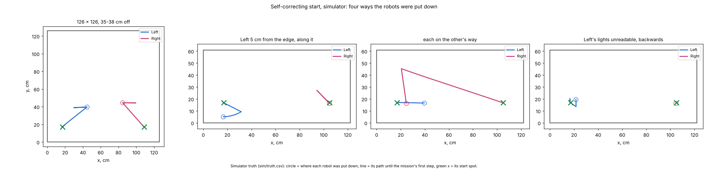

# Robots anywhere, no stops, no sit-outs (30 Oct)

## Premise

Nick's rules: "the user only clicks corners 1-4; the robots self-correct" (morning), and at 10:08: "It should start and
run under any circumstances in which the robots are on and on the board ... I'd rather have a warning and a failure
than a stop." Two real failures this morning:

- 09:52, Mission Control's warm-up (firmware 2026-10-28a, board 125.8 x 125.8 cm): "No camera fix for Left: no camera
  finds it on the board", though the facing check had just found Left by its lights. Right's camera fixes: 76 of 77
  ignored. Both calibrations said rolls of 15 cm were allowed, then "no roll (no room in any direction)".
- 10:02, the DOE loop: Center's lights were not read ("too few pictures (19 dark, 0, 12)"), its calibration failed,
  and it was OUT for the rest of the loop.

## Data

Simulator, Monday's program unless named, both simulated cameras through the real camera bridge, robots on firmware
2026-10-28a lights (front and back from the idle light), not calibrated since power-on unless named.

| Case (board) | What was injected | Result | What the start did | Warnings |
|---|---|---|---|---|
| Put down anywhere (126 x 126) | Left 35 cm off, backwards; Right 38 cm off, sideways | done, 143 s | found by lights, both driven 36 cm to their spots; re-check 0.4 cm / 1 deg | 0 |
| Same, through **Mission Control's warm-up** (126 x 126) | same | done, 97 s (edge feels) | same | 0 |
| Put down anywhere (61 x 122) | Left 35 cm off facing -x; Right 28 cm off, backwards | done, 99 s | both driven to their spots | 0 |
| Lights unreadable 3 times (61 x 122) | Left's lights dark for 3 `led`s | done, 99 s | measured again twice; read after calibration | 1 |
| Lights never readable (61 x 122) | Left's lights always dark, Left 6 cm off and backwards | done, 99 s | a 3 cm watched crawl found it faced -89 deg; turned and driven to its spot (first version crawled again at every re-check: fixed) | 1 |
| Calibration fails twice (61 x 122) | Left's first 2 calibrations fail | done, 99 s | calibrated again, then the compass check alone | 2 |
| No room (61 x 122) | Left and Right put 14 cm apart (bodies 4.6 cm) | done, 99 s | compass check alone, then driven apart to their spots | 2 |
| Each on the other's way (61 x 122) | Left on Right's way and Right on Left's, 15 cm apart | done, 99 s | Right went round by (21, 45), Left waited | 2 |
| WiFi gone 30 s at the start (61 x 122) | Right silent 3-33 s after the simulator starts | done, 99 s | facing check and follow run asked again; settings resent and confirmed | 2 |
| Side camera off, overhead loses Left 6 s mid-run (61 x 122) | `--no-side`, `--cam-gap Left@20:6` | done, 99 s | (drove blind on its wheels and gyro) | 0 |
| Parked along the edge (61 x 122) | Left 5.2 cm from the y = 0 edge, facing along it | done, 99 s | a 30 deg arc (radius 30 cm) off the edge, then to its spot | 2 |
| In a corner, facing out (61 x 122) | Left at (8, 6) facing the corner | done, 99 s | backed 4.5 cm straight off the edge, then to its spot | 2 |
| Silent for 100 s from switch-on (61 x 122) | Right no WiFi for its first 100 s | done, 104 s | Left started alone; Right held, re-checked when heard, rejoined 46 s into the run | 1 |
| Mission Control's Monday program, start spot taken (122 x 61) | robots on each other's way, Right's calibration fails twice, both not calibrated | done, 311 s (Left's part whole; Right never joined) | Right held (not calibrated); Left's start spot taken by Right, so Left started where it stood; Right re-checked and calibrated mid-run, but no plan fitted it back in, retried 4 times | 9 |
| DOE loop, 18 min (61 x 122 sim) | Center's battery 10 % at loop 1, back to 90 % at loop 3; Left moved into a corner at loop 2 | ran to its time cap | 6 robots set aside, all 6 retried the next loop; Left and Right recalibrated by the retry; drives: Left 5 done, Right 3 done, Center 1 done and 1 start-up failed (then retried) | |

Result: run_plan's result and the mission's length (run/run_plan_summary.json; the DOE loop: its summary). Warnings:
the run's WARNING lines (the summary's "warnings"). Every run: no contact and nothing over the edge (simulator truth);
camera fixes refused by the robots 0-1 per robot. Closest bodies: 9.7-10.2 cm during the missions; 2.6 cm in "no room"
while both robots wiggled at once where they were put down 4.6 cm apart (now one at a time). Each case was run once
(seed 1); later cases ran on code fixed by the earlier ones.

Each panel is one simulated run from above: the circle is where a robot was put down, the line its path until the
mission began, the green x its start spot.

## Conclusion

**What was wrong (the 09:52 warm-up).**
1. *The camera bridge only looked round each robot's start spot.* It learns the empty floor at its start with the
   robots wherever they stand, and then follows each from its map start spot; a robot put down elsewhere was part of
   the "floor" and never found. Now, after every facing check, run_plan tells the bridge where each robot's lights are
   and which way it faces; the bridge moves its track there, forgets the floor under the robot and re-learns the empty
   start spot. The lights were chosen because they are the one measurement that already finds a robot anywhere and
   knows who it is (each robot lights up on command); a search of the whole board by outline would have to guess who
   is who, which is how the 27 Oct identity swap happened.
2. *Calibration turns the robots,* so the facing check now runs again after a calibration, and the bridge is told
   again.
3. *76 of 77 fixes ignored:* a robot with no pose yet refuses a fix without a heading, and the start strips the
   heading until it gives the robot its pose. Those fixes are now held until it has one.
4. *"15 cm allowed" then "no room":* the laptop's caps are only the most a robot may roll; it rolls only where its own
   front sensor also sees 15 cm clear. The caps were also worked out from the plan's start spot and heading, not where
   the robot stood. They now come from the lights, the screen says the sensor must also see room, and a skipped roll
   prints what the sensor saw. Most likely the sensor read the floor all round (Left's floor reads 10.6-15 cm); not
   provable from here (see What's next).

**What changed (no stops).** The start now fixes what it can and holds only the robot it cannot; during the run one
robot's trouble holds that robot, never everyone; a held robot is checked again after 10, 20, 40, then every 60 s and
rejoins when it passes; the DOE loop tries every set-aside robot again at every loop. True safety is kept and now stops
only that motion of that robot: the firmware's edge guard and border, the 8 cm net, a halt when the camera and the
robot disagree. Every path that used to end a start or run, with its fix, is in Appendix A.

**Review: what the fault runs found in my first versions (all fixed and re-run).** A held robot's re-check could
never pass (its own `led` answers were not read while it was held) and each failed re-check left the other robot
halted; a robot whose lights never read crawled again at every re-check; robots put down 14 cm apart came to 2.6 cm
while both wiggled for the compass check; while one robot was held, the other's start correction did not plan round it
(3.5 cm, no contact); a held robot whose start spot was taken kept the run from ever ending; a robot standing along
an edge was held instead of moved; a robot rejoining after a hold drove the first leg of its old plan (from its start
spot) head-on towards the other robot before the re-plan came (bodies 3.9 cm, no contact): it now sends no step until
the re-plan is in (re-run: 5.5 cm, which is where they were put down). One DOE drive (Center, after its battery came back) still ended "start-up failed":
run_plan recalibrated it inside the drive and the roll moved it; the loop's retry ran it again the next loop.

**What Nick sees.** WARNING lines where a stop used to be, and a list at the end: "WARNINGS (2; each was handled
without stopping the run)". A robot that is held says why and when it is checked again.

## What's next

1. On the Pi (Nick): `git pull`, `./run-fleet-pi.sh mc-stop`, reopen Mission Control. Put the robots down anywhere on
   the board, any way round, and start the warm-up.
2. Confirm the floor cause of "no roll": in the Pi's terminal,
   `find ~ -name calib_look.csv -mmin -600 -exec tail -n 2 {} \;` (the room8 column: eight numbers all under 15 means
   the sensor read the floor). If so, the fix is a firmware one (ignore readings at the floor's distance during the
   look), or a `set tof_min_cm` just for the calibration: a question for Nick, below.
3. A robot held since the start rejoins with its old plan and a re-plan from where everyone is; in the "start spot
   taken" case no re-plan fitted it back in, so it never joined (a warning). Re-planning the whole mission from where
   everyone stands at that moment would fit it in; not done today (it changes the timed mission mid-run).
4. Robots calibrated by the compass check alone run on their stored scales. They could be fully calibrated once they
   are on their start spots (room is known there): a 65 s cost per start.

## Questions for Nick

Substantive:
1. The floor reading during the calibration's look (What's next 2): fix it in the firmware (a flash before Monday) or
   leave the roll skipped ("limited", calibrated) for Monday? Recommendation: leave it for Monday; the robots run on
   their stored corrections either way.
2. A robot calibrated by the compass check alone (no room, or calibration failed twice): fully calibrate it again once
   it stands on its start spot (about 65 s more), or run on its stored scales? Recommendation: run on stored scales;
   recalibrate after the run.
3. "I don't want Center sitting out": Monday's program has Left and Right. Should Center be added to the program when
   it is on and heard, or is the sit-out you meant the DOE loop's OUT (now retried every loop)?

Other:
4. A held robot's re-check halts the others for its facing check (about 10 s; 65 s more if it needs calibrating),
   because the lights' pictures need the board still. Acceptable, or should the others keep driving and the check be
   skipped while anything moves?

## New tests that may now be necessary

- Board: robots put down 20-40 cm off, backwards and sideways, both boards: warm-up and Monday (this build's main case).
- Board: a robot parked along an edge 5 cm in: the arc off the edge (radius 30 cm), measured corner clearance.
- Board: the watched crawl (3 cm) with real lights covered: the heading's error against the facing check.
- Board: a robot switched off for 60 s mid-run, then on: held, re-checked, rejoined.
- Simulator: the DOE loop with a robot whose lights never read (L1 retry each loop).
- Unit: the facing check's retry when one camera returns no pictures at all for a robot.

## Possible inaccuracies in what this relied on

- The simulator's front sensor does not see the floor, so it never reproduces "no roll"; the floor cause is a likely
  explanation, not a measured one.
- The lights' middle is taken 1.0 cm ahead of the robot's middle (measured 0.4-1.5 cm, 28 Oct): chosen; the bridge's
  outline re-centres it. No DOE needed.
- Chosen numbers, each with whether a DOE would decide it better: crawl 3 cm (DOE worth it: 2 / 3 / 5 cm against the
  heading error); arc radius 30 then 20 cm (DOE only if robots are often parked along an edge); edge escape ends 2 cm
  past the 7 cm spin room (no DOE: a guard); retry waits 10-60 s (no DOE: a patience against the others' holds);
  three --find-s rounds before starting without a robot (no DOE); three corrections before starting from where they
  stand (DOE worth it: 2 / 3 / 4 against the start's time and first-leg p95); the DOE loop's 20 s wait when every robot
  is held (no DOE).
- The simulated faults (dark lights, a failed calibration run, WiFi silence) are simplifications: a real calibration
  can fail part-way after moving the robot; real glare can light a wrong spot rather than none.
- "No room" and "each on the other's way" robots started 4.6-5 cm apart (bodies): the board will show whether the
  first moves hold their spacing as the simulator says.
- The run's rejoin and re-plan machinery predates this build; it is now used far more (every held robot, every retry).
  Each retry halts the others for the re-check: the fault runs show it works, not that it is quick.

## Appendix A. Every path that stopped a start or a run, or set a robot aside

"Held" = the robot stops where it is, is a fixed obstacle for the others, and is checked again (status, settings,
calibration, the facing check, its follow run) after 10, 20, 40, then every 60 s; it rejoins when it passes. Every
WARNING is printed, logged (`warning` events in coordinator.jsonl) and listed at the end of the run's summary.
The self-correcting start and run are on whenever run_plan gets `--straighten` (mission_run passes it: Monday, Mission
Control's warm-up and program runs). Older callers (the ladder's own run_plan steps, bench tools) keep the old stops.

### run_plan.py: the start

| What stopped it | Cause | Auto-fix now | Logged as |
|---|---|---|---|
| Not heard from (some robots) | off, asleep, WiFi | waits 3 x --find-s, then starts with the robots heard | WARNING; the others held, join when heard |
| Not heard from (no robot) | the link | waits 3 x --find-s | still a failure (nothing to run) |
| Firmware too old | needs flashing | that robot held | WARNING |
| Battery under the floor | low battery | runs anyway | WARNING (charge after) |
| Not calibrated since power-on | power-on | calibrate; failed: calibrate again; failed twice: the compass check alone (no spin, no roll; stored scales) | WARNING per step; still not: held |
| No room to calibrate | edge or robot within the spin circle | the compass check alone (needs almost no room), one robot at a time | WARNING |
| Facing check: lights not read ("too few pictures") | glare, lost `led`, timing | measured again twice (fresh pictures, longer waits) | said |
| Facing check: front/back unknown, or cameras disagree | old firmware, glare | a 3 cm watched crawl: the camera sees which way it moved (forwards; backwards if the edge guard refuses and it is 9 cm from every edge) | WARNING |
| Facing check: robot faces wrong way / sideways | placed so | turned / driven (straightening) | words |
| A robot nearer another's start spot ("swapped?") | placed so | drives to its own spot | note |
| Did not start its follow run | lost command | asked again twice, waiting longer | WARNING; still not: held |
| No FOLLOW records | lost run start | follow run started again | WARNING; still not: held |
| Settings not confirmed | lost `set` | read back a second full round | edge guard / border not confirmed: held; others: WARNING, runs with its own |
| Floor check not confirmed | lost `set` | keeps the usual 12 cm (Left 10) | WARNING |
| No camera fix ("no camera finds it") | bridge seeded at the start spot | bridge told where its lights are (stage 1); else its position from the lights | WARNING |
| Too near an edge to turn (under 7 cm) | placed so | a short straight drive (or back-up) away from the edge; standing along it: a gentle arc off it (radius 30 cm, backing along the edge first if it faces a corner) | words; no arc fits: held |
| Ways cross within the 8 cm net | placed so | one waits; else a detour round the other; else one moves aside, the other goes, then the first; robots held at the start count as standing obstacles | words; none found: one held |
| Still off after 2 corrections | slip, camera | a 3rd correction, then starts from where they stand (plan made again from there) | WARNING |
| Correction stopped (camera guard etc.) | | measured again, corrected again | WARNING |
| No pose on (fpose not taken) | lost command | pose sent again | WARNING; still not: held |
| Every robot held | | the whole start once more after 3 s | WARNING; then a failure |
| Plan refused under the 8 cm net | the plan | **kept** (true safety: a plan that brings two robots within 8 cm never starts) | failure |
| Card nearly full | disk | **kept** (the logs) | failure |

### run_plan.py: during the run

| What stopped everyone | Auto-fix now | Logged as |
|---|---|---|
| A robot's follow run ended (edge guard, restart) | that robot held (its own edge guard already stopped it); the others re-plan round it and carry on; it rejoins after its re-check | WARNING |
| Camera and own pose disagree (camera guard) | that robot halted, its pose set from the camera, the others re-plan; 3 times in a minute: held | WARNING |
| Drove too far blind / blind near an edge | that robot halted and held (found again by its lights at the re-check) | WARNING |
| Nothing heard from a robot | (already) held, rejoins when heard | said |
| A held robot's re-check failed ("stays out") | checked again after 10/20/40/60 s, never out for good | WARNING |
| Rejoined, then nothing moved on; or no plan fits it back in | held again, retried later | WARNING |
| No new plan / re-plan failed / out of re-plans | **kept** as the run's end (failure with the reason) | failure |
| Every robot out | ends after 90 s of no robot rejoining (was 30 s) | failure |
| Everyone running is done, one robot still held | waits 90 s for it, then ends "done" | WARNING: "never joined this run" |

### Other files

| File | What stopped it | Now |
|---|---|---|
| facing.py | robot not measured (straighten mode) | retried twice, then "unknown" handed to the crawl, no stop |
| facing.py | no pictures at all from the cameras | **kept** (no camera: nothing can be found or followed) |
| straighten.py | Refuse: too near an edge; ways within the net | edge escape; wait / detour / move aside (above) |
| cam_bridge.py | port in use | tries again once a second for 15 s |
| cam_bridge.py | no robots given | kept (a wrong command line) |
| doe_loop.py | park() (any reason, safety or not): OUT for the rest of the loop | every set-aside robot is tried again at the start of every loop (checks; L1 again if it never passed or was set aside for its calibration or "no compass check"; its lights; room); "retried" event |
| doe_loop.py | "Every robot is out: the DOE loop ends" | WARNING; waits 20 s and tries them all again |
| doe_loop.py | "No robot has room for a drive: the DOE loop ends" | WARNING; carries on (each moved to open space at its turn) |
| doe_loop.py (its drives' run_plan) | a drive's start-up fails (e.g. calibrated inside the drive, the roll moved it, no heading) | **not changed** (the drives keep their own start rules): the robot is set aside and retried next loop, when it is calibrated already |
| ladder.py | find step: lights' left/right not read (Center 10:02) | measured again twice with fresh dark pictures |
| ladder.py | body unseen by both cameras: kept out | tried again every DOE loop (above) |
| mission_run.py | plan refused under the net; --below-net-doe off the simulator | **kept** (safety; a wrong command line) |
| mission_control.py / setup_job.py | no stop of their own (they show run_plan's result) | MC passes simulator faults through (`sim_args`) for tests |

**Kept on purpose (true safety, Nick's C):** the firmware's edge guard and border (never removed), the 8 cm net in
plans and the runtime separation, halting a robot at once when its camera and own pose disagree. They now stop **that
motion of that robot**, not the run.
