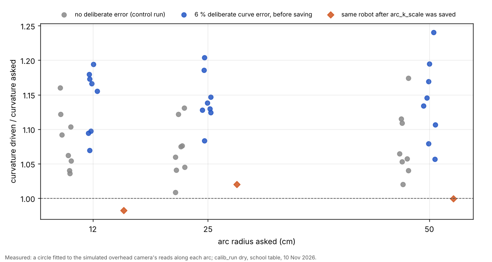

# e12: curves in the calibration, the camera self-check, no pictures, a robot left at an edge, and the 9 Nov crashes (10 Nov, simulator and logs only)

## Premise

Nick approved a curve section in the calibration run (10 Nov) and listed seven more items for today's school testing:
a camera self-check for runs started from the terminal with blind areas learned per site, a warning when the cameras
send no pictures, one robot at an edge never holding up the others, a loud message about a robot left at an edge, the
`freeroam-status` crash and the "FATAL: exception not rethrown" abort, `jay-bundle` finding command-line runs, and
housekeeping (card floor per site, Mission Control noticing a `git pull`, the USB stick, the 9 Nov battery drain).
Mid-build the coordinator added the 9 Nov school evidence on readability (below). Nothing here touched a robot, a Pi,
a camera or Tailscale; only GitHub (releases read, the push).

**Measured, and where from.** The calibration's own dry runs (`calib_run --dry --quick`: fleet_sim with the firmware
mirror, the school table, one simulated camera); mission_run's real-path practice (`--practice-real`); the home free
roam's dry run; the fast simulator (`freeroam_fastsim`); the 9 Nov home logs from the repo's releases
(`freeroam-20261109-123542`, `-125248`). "Claude's reading" marks conclusions not measured.

## Data

### 1. The curve phase in the calibration (on for robots that will drive curves)

| | Built |
|---|---|
| When | Phase R, after the fit (B) and before the tours (C), so the arcs run on the fitted wheels and gyro |
| What it drives | 3 radii (12, 25, 50 cm: free roam's menu) x left / right x 2 speeds (5 and 10 cm/s; radius 12 capped at 9.0 by its outer wheel), 2 rounds = 24 arcs, firmware step R (`run follow`, `fpose`, `fs <id> R ...`), coast off, no camera fix sent during an arc (wheels + gyro alone, as phase A) |
| Where | First to "the middle": the readable spot furthest from the site's edge margin, outlets, tiles, the view limit and every cell the camera does not read; each arc then starts with the smallest turn on the spot that gives it room |
| Room check | Every 2 cm along the arc, also as if it turned 15 % tighter or wider and ran 15 % longer: the middle keeps max(site edge margin, `safety_rules.clearance_cm` with its blind bubble so far and the stop at that speed), the keep-out clearance plus the bubble, the view limit, and readable ground. No room here or in the middle: the arc is skipped and said |
| Fit and save | Each arc: `freeroam_core.fit_arc_points` (free roam's own circle fit, moved into a module function unchanged; the calibration also fits radius 50). Saved with free roam's own rule (`arc_agree`: 15+ fits, both medians within +-0.03, values 0.8-1.25): `set` both, read back, `save`; then 3 check arcs with the new values |
| Lost tag on an arc | stopped; the calibration's recovery from the robot's own end pose (it is in the camera's frame since the `fpose`) |
| Switch | `--arc-phase auto` (default) / `on` / `off`; site `calibration.arc_phase`; Mission Control Advanced "Curves in the calibration". Auto = firmware 2026-11-05c or newer AND free roam drives curves here (`--roam-motion`, else Mission Control's saved Advanced "Free roam driving", else the site file, else curves). **At school today it is off by itself**: Advanced says straight lines (Nick, 9 Nov) |
| Free roam | Its in-run fitting and saving are unchanged (it refines the calibration's values) |
| Simulator | `fleet_sim --arc-err NAME=PCT`: on curves the body turns PCT % tighter than its own pose shows; calib dry uses 6 % by default |



Each dot is one arc: how much tighter it really curved than asked; the blue arcs (6 % error) sit higher than the grey
(no error), and after the save the orange check arcs sit on 1.

| Dry run (one robot, school table) | Arcs fitted | Curvature driven / asked (median +- 95 %) | Length driven / asked | Saved | 3 check arcs after the save |
|---|---|---|---|---|---|
| 6 % deliberate error (`calib_arc3`) | 24 of 24 | 1.142 +- 0.023 | 0.922 +- 0.008 | yes: arc_k_scale 0.8757, arc_d_scale 1.0841 | 1.000 curvature, 0.987 length |
| no deliberate error (control, `calib_arc0`) | 24 of 24 | 1.063 +- 0.021 | 0.975 +- 0.011 | yes: 0.9404, 1.0261 | 1.036, 1.020 |

Measured (simulator). The ratio of the two runs, 1.142 / 1.063 = 1.074, is the deliberate 6 % (within its +-). The
control run shows the simulator's own curve tracking already curves about 6 % tight; the phase calibrates both
together, which is what it is for. The phase took about 7 minutes of a quick dry calibration (24 arcs, 3 checks,
the moves to the middle).

**Found while building** (fixed): (a) the first try started the arcs where the robot was parked (P09, a corner) and
the simulated camera lost the tag there; the phase now goes to the middle first and the calibration's readability map
is seeded from the camera model (below); (b) fleet_sim ends itself when every robot has finished a follow run, so the
camera went silent after the first arc: calib dry now starts it with `--persist`.

### 2. Camera self-check and blind areas learned per site

- **Self-check at the start** of every real tags run (`camera_selfcheck.py`, from `mission_run` and `calib_run`, so
  `./run-fleet-pi.sh visit / calib` and the school free roam): the reference tags are read in 2 s of pictures and
  compared with where the saved model puts them (the bridge's own `ref_expected`). Under 3 px (the bump watch's limit):
  "CAMERA CHECKS OUT". Over: Measure is run as Mission Control's button does (its saved clicks / typed values for this
  site), the old model kept in `tagcal-before-<time>`, what changed said and written to `camera_selfcheck.json`. No
  reference tag read: said, the saved model used (the bump watch keeps checking). Switches: `--no-camera-check`,
  `MIRLT_CAMERA_SELFCHECK=0` (or `=check`: measured, never refitted). **Not run against real pictures here.**
- **The measured motivation (coordinator, from the real 9 Nov school runs):** the readability seed flagged P03, P05,
  P12, P13, P15, P18, P19, P20 as unreadable, yet in all 7 tours with "try anyway" on every one of the 20 stops had
  camera fixes (worst +- per tour 3.0-5.0 cm), and the camera read the robot steadily at (283, 127) cm. The cautious
  seed was too cautious.
- **Evidence now overturns the seed:** at the end of every tags run, after its exports, the run's `camera_track.csv`
  fixes (at most 20 per 20 cm cell) and `stops.csv` stops (a stop with fixes = up to 10 reads, without = a miss) go
  into the readability map, which the site keeps (`readmap.json`, carried into the next run at half weight). Test: a
  point seeded at 10 % with 7 read stops is readable in the next run's start map; a place nothing visited keeps its
  seed. On the visit practice's own files: 479 fixes and 5 stops learned. `blind_areas.json` lists the cells still
  learned blind. The cautious camera-model seed stays the first guess.
- **Calibration:** its readability map is now seeded from the camera model and the site's history (was: everything
  readable); it uses the site's proven workspace (felt drops saved by free roam count as edges); `--visit-order
  P01,P05,...` (alias `--tour-order`) sets its tours' order; unknown points refused before anything moves.

### 3. No pictures from a camera

`frame_watch.py` in both bridges: no new picture (a repeated frozen picture does not count) for 3 s (chosen) ->
"CAMERA OVERHEAD: NO NEW PICTURE FOR 3 S ..." in capitals, repeated every 10 s while it lasts, a `no_pictures` event,
and a `{"type": "camera"}` message to the run; `pictures_back` with the gap when they return. Free roam, run_plan and
the calibration print and log it. What the robots do is the existing lost-robot rules (no fixes arrive): the
calibration stops a leg after 1 s and holds, missions hold the lost robot, free roam drives its bubble then holds;
all carry on when fixes return. Switch `MIRLT_FRAME_WATCH=0`. Rehearsed on its own (picture below); **not rehearsed
end to end** with a bridge whose stream is cut.

### 4 and 5. One robot at an edge never holds up the others; the loud message

- **Where it held the run up (found):** every robot rule is per robot (the fast simulator: with Center hung at the
  x = 0 edge and waiting for a person, Left and Right were moving 69-72 % of the time, as without it). What one held
  robot did block was the **run's end**: the home run ends when every robot is "out", and a robot waiting at an edge
  for a person is never out, so after the others parked at 10 % the run went on to the 4 h cap.
- **Built:** a robot held at an edge (put down there and not moved in, tilted with no safe way back, or unsure near an
  edge and held) for 60 s in a row (chosen) is **parked**: it stays still where it is, kept out by the others, counts as
  out, and is said loudly at once (event `PARKED AT AN EDGE`), in `state.json`, in `freeroam-status`, in a block of
  `!!` lines at the run's end, and in a red box in Mission Control's status: the robot's name, where it is (cm from
  which edge, and from the edge of the proven ground when that differs) and "SOMEONE MUST MOVE IT a hand's width onto
  the board before the next run". Switch `MIRLT_EDGE_PARK=0` (held and asked for the whole run, as before).
- Fast simulator, 2 seeds: Center parked at 60 s, Left 71 % and Right 67-69 % moving; with the switch off, Center held
  to the end. Home dry run with Right put down at the edge: Right parked at 60.6 s, Center roamed on (56 moves in 3 min).
- **Found in that rehearsal, not fixed:** Left, standing 23 cm from the edge after the proof drive, was also held by
  the start check ("its middle -2.5 cm from the edge"): the distance the start check uses is to the proven ground,
  and the ground near Left was not proven. Parked after 60 s like Right. Cause not traced (see questions).

### 6. The crashes

- **`freeroam-status` KeyError 'mode'** (reproduced with the old code on the real 9 Nov 12:52 folder): the start-up
  ladder keeps its own `state.json` in the free roam's folder until the free roam writes its own (and the 12:52 run
  stopped in L0, so it never did). Now said as "starting (the start-up checks ...)"; test with that file's shape.
- **"FATAL: exception not rethrown"**: found in the 12:52 run's screen.txt, right after "L0 found no robot that can go
  on", from `freeroam.py` itself. Claude's reading: the ladder's camera threads (OpenCV) were still running when Python
  shut down; Python 3.11 ends such threads with pthread_exit, which aborts inside C++ code. Changed: free roam stops the
  ladder's camera before it ends (it did so only in dry runs); `orderly_exit` waits up to 3 s for threads, then exits
  without the interpreter's shutdown if any are left (free roam, tag bridge, camera bridge, recorder); the tag bridge
  joins its workers before its summary. **Not reproduced here** (Python 3.13 handles such threads differently).

### 7. jay-bundle

`./run-fleet-pi.sh jay-bundle` with no argument now takes the newest school run with stops from either Mission
Control's `runs/` or the command line's `logs/<date-time>-mission` (where `./run-fleet-pi.sh visit` puts it), and says
which. Test with both.

### 8. Housekeeping

| Item | Done |
|---|---|
| a. Card floor | `card_stop_gb` in the site file (school 0.55); `MIRLT_CARD_STOP_GB` still overrides; default 1.0; never under 0.5. The visit practice printed "the run ends cleanly under 0.55 GB". No `tmux set-environment` needed |
| b. New code | Mission Control compares its code (git HEAD and file times) with when it started; the Start screen says so in a yellow box with "Restart Mission Control now", refused while a run is going (on the page and in the server). Pressed in practice: the new process answered with no change |
| c. USB stick | `tools/pi/mount_fleet.sh` (mounts `LABEL=FLEET` at /media/<user>/FLEET when not mounted; says each sudo step; `--check` never asks for a password); `docs/how-to/usb-stick.md` with the fstab line (`nofail`) for Nick to add; `./run-fleet-pi.sh mc` warns when the stick is missing. No system file edited |
| d. School runs to the home Pi | Deferred (question below) |
| e. Home robots drained (9 Nov) | Below |

**Why the home robots drained (9 Nov), from the release logs.** Measured: in the 12:35 run the three robots stood
almost still for 9.5 minutes (1 move each; the run froze in discovery, fixed in e11) and their batteries fell
18.7-19.4 % an hour (Left 61 -> 58, Center 28 -> 25, Right 66 -> 63). Both runs ended without a `sleep` to the robots
(12:50 stopped by hand; 12:52 stopped in L0): neither screen shows a sleep, and since 11-05h free roam leaves parked
robots awake on purpose; only Mission Control's idle sleeper puts robots to sleep, and these runs were started from
the terminal. Claude's reading: awake robots left after terminal runs, at about 19 % an hour, would empty Center within
about 1.5 h and the others within about 3.5 h. Not fixed (a sleep after terminal runs is Nick's call: question 2).

### 9. The P15 lock that broke a stop (coordinator's item, Jay-Sun's 9 Nov tours)

Measured (coordinator, run 20261109-161714, coordinator.jsonl): at P15, where roof-tag reads are weak, a lock fix
(tag_bridge's lock bank: position only, heading null) put the robot at (186.16, 154.41) while it stood at about
(180, 151) (the next tag read: 180.42, 151.92). The camera guard saw 7 cm for 1 s, trusted "the camera", set the
robot's pose there, halted it mid-dwell and re-planned; the dwell restarted as a 4 s wait, so stops.csv said
dwell_s 3.99 at a spot 7.5 cm off. Run 20261109-180738 shows the same coordinates the other way round: the lock may be
latching onto a fixed feature near P15.

| Fix | Switch (old way) |
|---|---|
| (a) run_plan's camera guard never resets a pose from a lock-only fix: it needs a roof-tag read, or a lock within 3 cm of a tag read from the last 2 s (both chosen); a declined reset is said and logged (`cam_guard_lock_declined`) and the robot keeps its own pose | `MIRLT_LOCK_GUARD=0` |
| (b) a dwell restarted at the same point within 60 s after a halt, where the robot stayed within 2 cm (its tag reads, else its own pose), stays ONE stop with its first start and full length; `point_confidence` and stops.csv gain `interrupted` (0/1, appended as the last column) | `MIRLT_DWELL_KEEP=0` |
| (c) simulator: `fleet_sim --lock-latch X,Y,R[,SHARE]`: near (X, Y) a share of the fixes become a lock latched onto that fixed spot (run_plan dry runs: `--sim-arg=--lock-latch --sim-arg=186.2,154.4,15`) | - |

Tests: the 9 Nov numbers replayed through the guard (lock declined, a tag read 7 cm off still believed, the switch
restores the old reset), a lock agreeing with a tag read trusted, an interrupted dwell kept as one 8 s stop and a real
7 cm move kept as two. **Not rehearsed** in a full run with the latching lock (time); the tag bridge's own lock was not
changed, so the lock still latches; only its power to move a robot's pose is gone.

### Found in the practice runs (open)

- **School free roam (real-path practice, curves, 2 robots, 6 min):** both robots joined and roamed (curves, Motion
  actually used: curves), but both drove past the camera's readable area (lost at x about 254 cm; the readable map ends
  near 220 cm), eased to a stop, and stood "lost near an edge" for the last 4 minutes: at least 2 moving only 17-23 %
  of the time. The free roam's board at school is the whole table from the floor calibration, not the readable area.
  Claude's reading: the school free roam's workspace should be the readable area (the proven workspace's SEEN cells
  from the readability map). Not fixed in e12 (found at the end); it matters for any school free roam today.
- Visit tour practice (real path, 5 points P01, P05, P11, P12, P15): done, every point 0.1 cm from the simulator's
  truth; stops.csv 5 rows; the run's 479 camera fixes and 5 stops learned into its readability map.

Pictures: `docs/screenshots/2026-11-10/` (9, index lines added).

**Tests.** `tools/fleet/tests/test_e12.py`: 23. Full fleet suite on the first three e12 commits: 774 passed, 6 failed,
9 skipped; the 6 failures were one e12 test leaking `MIRLT_SITE=school-conference` into later tests (calib_run.main sets
it); fixed, the 6 files re-run: passed. Final fleet suite: 784 passed, 9 skipped (14 min 48 s); simulator + Pi tests: 257 passed, 4 failed in test_launcher.py, which fail the same way on the commit before e12 (this machine has no cameras). **Those three commits
reached GitHub before the full suite had finished** (the coordinator pushed from this clone at 8fcb74b): between that
push and the fix commit, the 6 tests failed on main (no run code was wrong).

## Conclusion

- In the simulator the curve phase finds a 6 % curve error to within its +- and saves it; the check arcs afterwards
  ran at 1.00 curvature. It drives itself only where curves will be driven: at school today it stays off.
- The cautious readability seed can now be overturned by the run's own fixes and stops, as the 9 Nov school tours
  showed it must be.
- A robot left at an edge is parked after 60 s and named loudly everywhere a person looks; the others never wait for it.
- The freeroam-status crash was reproduced and fixed; the abort's likely cause was found in the 9 Nov log and the exit
  made orderly, unproven on a Pi.
- A lock-only camera fix can no longer move a robot's pose or split a stop (the 9 Nov P15 case).
- Open and important for school free roam: robots roam past the readable area and stand lost (practice).

## What's next

- Today at school: pull, restart Mission Control (steps below), and check the first lines of a run for "CAMERA CHECKS
  OUT" (or what it refitted).
- The first real curve phase at home (firmware 2026-11-05c+ robots): its arcs.csv decides the DOE rows on radii, speeds
  and how many arcs.
- Trace why the start check called Left over the edge in the home rehearsal.
- School free roam: limit the workspace to the readable area (next build; until then prefer Visit points at school).
- Find what the lock latches onto near P15 (a sticker, a tile edge?) from the 9 Nov frames.

## What Nick does at the Pi

In the **terminal window connected to the school Pi**, one command per box, Enter after each.

1. Go to the project folder:
   ```
   cd ~/alvik-fleet-capstone
   ```
2. Get the new code. You should see a list of changed files:
   ```
   git pull
   ```
3. Restart Mission Control so it uses the new code. You should see "Mission Control is closing":
   ```
   ./run-fleet-pi.sh mc-stop
   ```
4. Start it again. You should see its address; if the USB stick is missing, a line starting `!! WARNING`:
   ```
   ./run-fleet-pi.sh mc
   ```
   (From now on, after a `git pull` the Start screen shows a yellow "New code on the Pi" box with a Restart button
   instead.)
5. The card floor is now in the site file; this should print `0.55 the site file (school-conference)`:
   ```
   MIRLT_SITE=school-conference python3 -c "import sys; sys.path.insert(0,'tools/fleet'); import diskguard as D; print(D.CARD_STOP_GB, D.CARD_STOP_FROM)"
   ```
6. Only if step 4 warned about the USB stick: plug it in, then type this (it may ask for the Pi's password). You should
   see "Done: ... free on /media/...":
   ```
   tools/pi/mount_fleet.sh
   ```
7. After a run (from Mission Control or the terminal), Jay-Sun's files. You should see "the newest run (...)" and
   "bundle for Jay-Sun":
   ```
   ./run-fleet-pi.sh jay-bundle
   ```

## Sweep 1: new tests that may now be needed

- The camera self-check on the real school pictures: one run with the camera untouched (expect "checks out"), one with
  the camera nudged (expect a refit and its "what changed").
- The first real curve phase: does `fs R` behave on the robots as in the firmware mirror (coast off, braking at the
  end), and do the fitted ratios differ by radius or speed (DOE backlog).
- No pictures end to end: unplug the overhead camera for 10 s during a calibration and a free roam (or stop the
  recorder) and check the message, the holds and the carry-on.
- A real robot left at the edge for 60 s in a home free roam; and the home run's end with one robot parked.
- The orderly exit on the Pi (Python 3.11): L0 failing on purpose (no robot on the board), check no abort.
- The trace of the start check's false "over the edge" (Left in the home rehearsal).
- A run_plan dry run with `--lock-latch` near a point: no pose reset, one full stop.
- School free roam practice after the readable-area limit: robots never lost past x 220 cm.
- Next school run: check P03, P05, P12, P13, P15, P18-P20 are no longer flagged after the 9 Nov-like evidence (only
  runs from today on feed it; the 9 Nov runs' maps were not learned this way).

## Sweep 2: possible inaccuracies in what the work relied on

- **Simulator, not robots**: the curve phase's numbers come from fleet_sim's model of curves and my 6 % error model
  (the body travels less than its wheels count on curves). Real causes (inner wheel slip at low speed, tyre scrub,
  tracking lag) may depend on radius and speed, which one arc_k_scale cannot capture.
- **The control run's 6 % curve tightening** is the simulator's own tracking, not a measured robot fact.
- **Chosen numbers**: ARC_SWEEP_DEG (120 / 90 / 60), ARC_SPEEDS (5, 10), ARC_ROUNDS 2, ARC_VERIFY 3, ARC_FIT_MIN_K 1/60,
  ARC_K_ALLOW 15 %, ARC_HEAD_STEP 15 deg, ARC_SAMPLE_CM 2; sim ARC_ERR_MIN_K 1/70; frame_watch NO_PICTURE_S 3 s and
  REPEAT_S 10 s; EDGE_PARK_S 60 s; camera self-check PICTURE_S 2 s; LEARN_READS_PER_CELL 20, LEARN_STOP_READS 10,
  BLIND_MIN_TRIES 3; orderly_exit WAIT_S 3 s; Mission Control CODE_CHECK_S 5 s; LOCK_AGREE_CM 3, LOCK_AGREE_S 2,
  DWELL_STILL_CM 2 (Nick's "about 2 cm"), DWELL_KEEP_S 60. A DOE would be sensible for the radii,
  speeds, number of arcs, sweep and EDGE_PARK_S (rows added to docs/doe-backlog.md); the rest are caps, waits or
  allowances where a DOE is not useful (said in each comment).
- **The abort's cause is inferred** from one log line's position and the code; it was not reproduced.
- **The drain rate** (about 19 % an hour) is from 9.5 minutes of three robots in follow mode with heartbeats; asleep
  or idle outside follow mode it may differ.
- **The camera self-check's refit** reuses Mission Control's Measure with its saved clicks; with no saved Mission
  Control state on the Pi it uses the reference tiles alone.
- **The 9 Nov readability evidence** is the coordinator's summary of the school stops; I did not have those files.
- The free-roam edge-park rehearsal used the start check's "wait for a person" mode; the default mode first tries to
  back off the edge, so a real robot reaches the park only after its tries fail.

## Questions for Nick

**Substantive**
1. The curve phase is off at school because Advanced says straight lines. Should the school calibration drive curves
   anyway (`on`), so the values are ready if school free roam goes back to curves?
2. Robots left awake after terminal runs drained about 19 % an hour on 9 Nov. Put them to sleep after a terminal run
   ends (as Mission Control's idle sleeper does after 10-30 min), now that every value is saved on the robots?
3. School runs copied to the home Pi (deferred): how do the two Tailscale accounts connect (shared node, one account,
   or a copy through GitHub releases as today)?
4. A robot parked at an edge stays parked for the rest of the run even if someone moves it in. Should it rejoin by
   itself once the camera sees it well inside (more code, a small risk), or stay parked until the next run?

**Other**
5. Restart Mission Control by itself when new code arrives and no run has gone for a while, or keep the button only?
6. The 60 s before parking, and 3 s before "no pictures": fine as first values?
7. School free roam today: given the practice finding, run Visit points at school instead until the readable-area
   limit is built (recommended), or free roam with someone ready to move lost robots?
